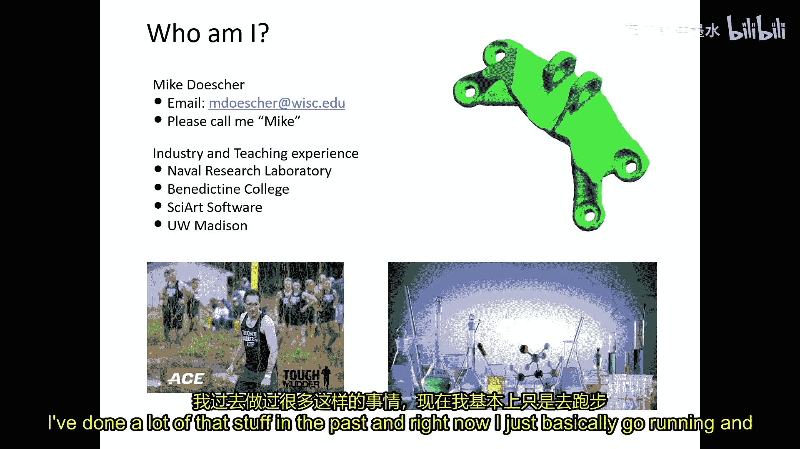
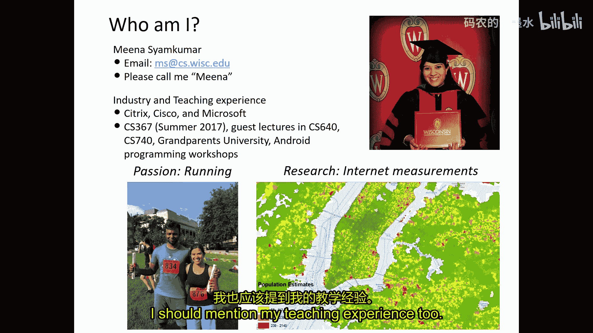
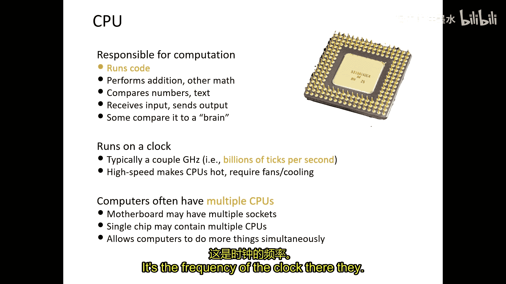
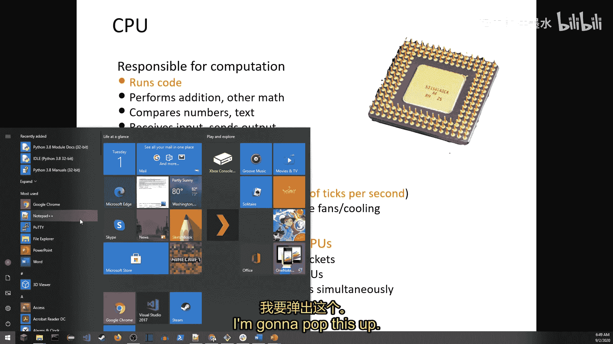
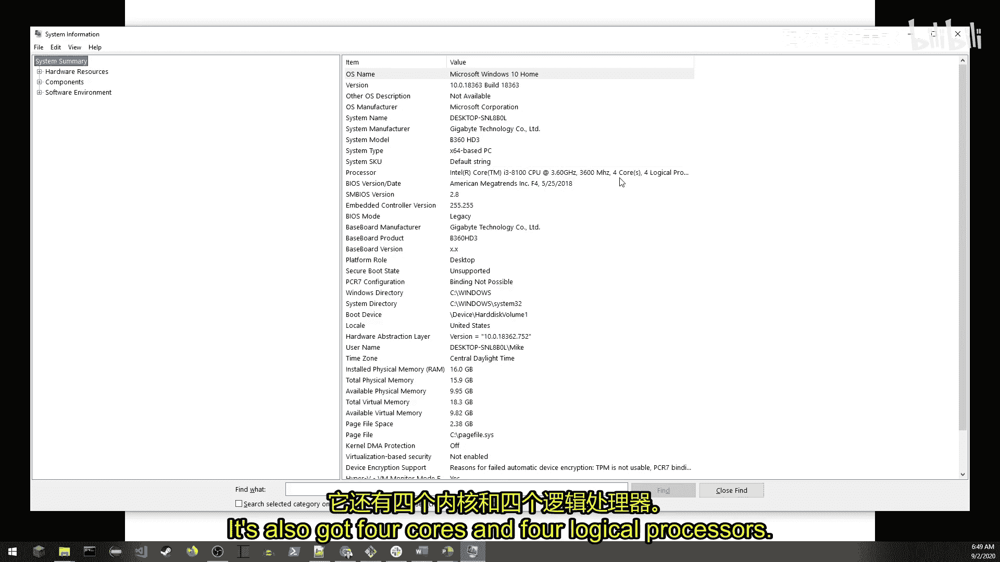
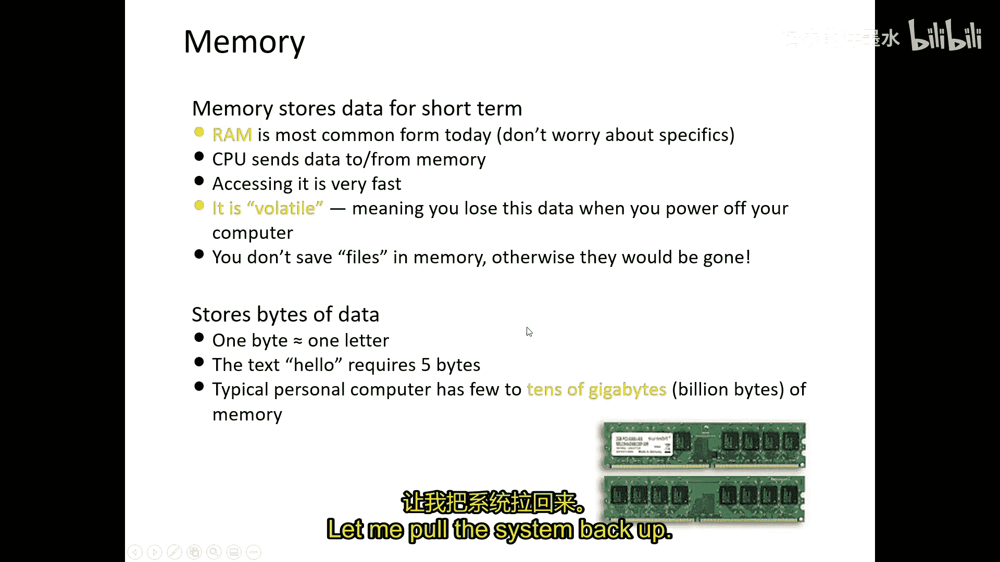
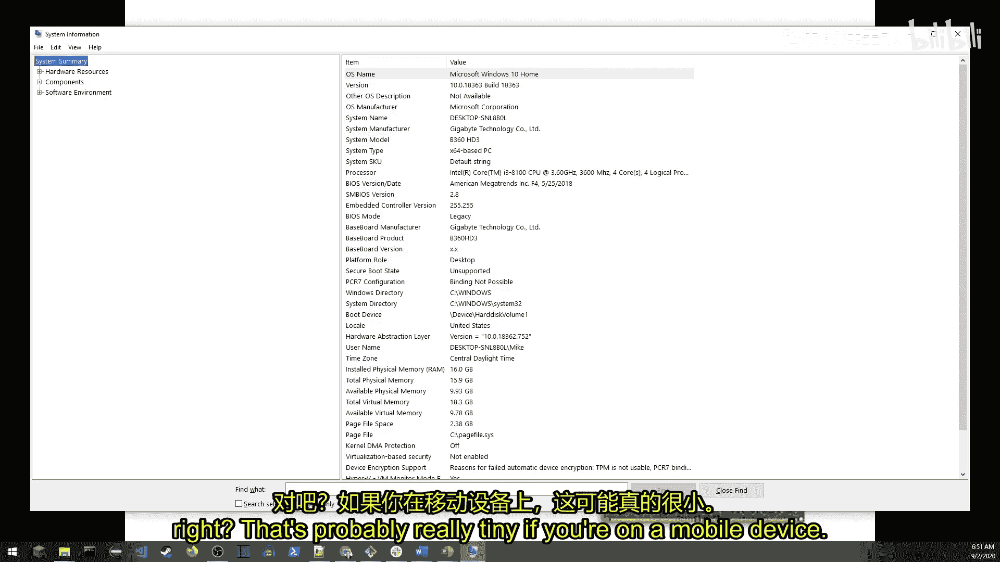
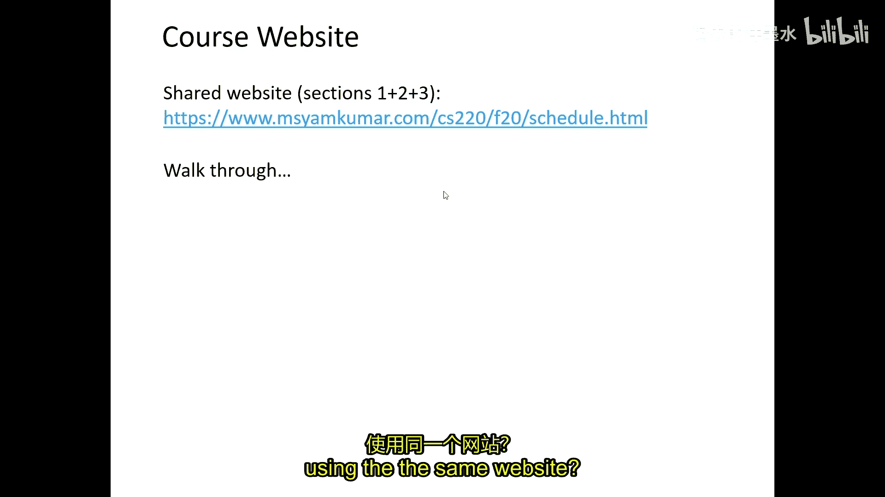
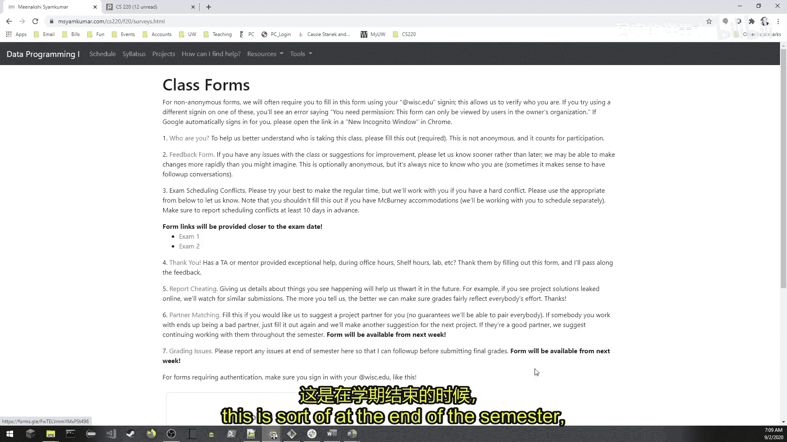
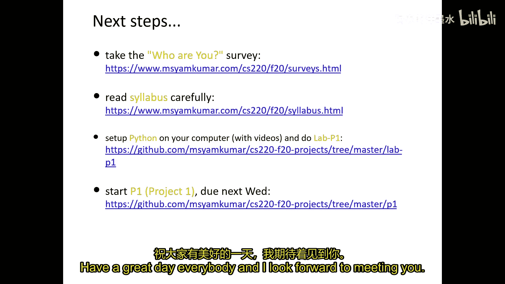

# 【全集】威斯康星大学-Python数据编程-CS220-中英字幕-1080P-p02-Lecture-1---课程概述与硬件--BV1VxvsBLEmv_p2-

Al right， good morning。 hellello， everyone。 Welcome to data programming 1。

 This is Comp Science 220 at the University of Wisconsin Madison。 My name is Mike Dosher。

 I'm one of the coins for this course。 I'm a faculty associate here at the university or in my basement right now。

😊，Welcome to COVID times。 All right a couple of notes as we get started。

 you are welcome to either watch Mea's lecture or my lectures We Coa teaching or both producing lectures。

 It doesn't matter whose lecture you watch。 You can just pick out whoever you want figure out whose style you like best and see who matches you're learning。

Let me switch to the next slide here。Alright， oh my face is covering everything up。 Yeah。

 I'm gonna just take my camera off and go through this。 I'll put it back on if it's appropriate。

 I if there's a little space。 So you guys can actually have like some human interaction。

 Let's see here。The other one， wrong one。Wrong one， there we go， okay。Yeah。

 so over the last several years， we've seen just an explosion of interest in this course two years ago。

 we had 300 students in the fall 400 in the spring。

 than 600 and then tip to 450 because we limited enrollment we just didn't have the staff and this semester we're looking at 770 students taking this course。

 that's a huge number， In fact I'm a little scared but that many students in this class。

 we may push it up to 800。 I'm not sure I got to talk to me about that。

 but it's obvious that many students view this course as an important class for their career。

 This course， it's all about data and we have more data than ever before。

 Some people like to think we're drowning in data and other people like to see this as a goldmine and even in like fallreach fields。

 things that are very diverse like journalism which is usually about just telling stories we're seeing more and more data brought。

And there's an election approaching in the United States and I think I see more and more polling data every single day。

 we have a global pandemic， I see more and more data about how the vaccine is developing。

 how the degree the pandemic is spreading。Anyway， more and more data is brought in being brought in and and in fact。

 a lot of how many guys out there have heard of 538。 It's a web page。

 a journalism or website that uses a lot of statistics。

 All of their articles are backed up by statistics and data。 All right。

 we can also use data to understand ourselves。 So like here， I've got a picture of the human brain。

 we can observe the brain with all different kinds of imaging techniques。

 and this collects just a tremendous amount of data。

 if you're doing like a CT scan that takes slices of images of the。

The brain and what's going on as different neurons are activated。

 It's going to generate just a ton of data。 In fact。

 the next little image there over with all the AGTs， that's。Gomic data。

 and now for just a few thousand dollars， we can image the entire genome of a species and。

Look for things that are uncommon in the year of a global pandemic。

 it looks like a lot of biochemitry kind of stuff like this is going to be very important。

 So dealing with those kinds of data are going to be important。Then in the lower left。

 that's pictured of the large Hadron collider also generates just huge amounts of data per second and is helping physicists understand what's going on at subatomic of。

Levels of matter。And then finally on the right on the bottom。

 we have a weirdly colored picture of an airplane。 those colors are showing the various forces that the airplane is experiencing while it's flying。

 so mechanical engineers are using data and simulation and trying to figure out how to make better airplanes。

So one of the very important things that we're going to try and take a look at in this class is how can we learn stuff from sets of data。

 And the answer here is computation。 generally， when you think of computation today。

 it's something to do with a computer。 But in the past， it used to be a job title。 you know。

 you had an engineer and you had a mathematician。 You had a computer。

 And that was someone who did math。 And you know， if I were to sit down and try and do math。

 maybe I can add a few numbers， you know， every couple seconds， But now when we think of computation。

 we're going to be looking at。Computers that are doing that work， machine based computation。

And the picture on the right here， this is of。Ooh， where is that， I'm forgetgiving。

All rightI do't know where that is Google's cloud Center in Oklahoma。And the lower right。

 So giant computer， tons and tons of computing power。 every single one of those little boxes。

 hopefully my mouse is recording every single one of those。 So we got 1，2，3，4，5，6，7，88，9，10，11，1213。

14 in a stack。 And as far as the eye can see is a computer。

And our goal is to figure out a way to take advantage of all of that computational power。

So computers have a number of advantages。 They are faster， more reliable。

 I make mistakes all the time， and computers are very good at certain kinds of things。

 This is a really great quote from Larry Page， find the leverage in the world so you can be more lazy。

😊，So Larry Page is the founder and CEO of。Google， its not someone you would think of as lazy。

 The quote here is really trying to say， just don't do the work that a computer can do and you can get more done with the time that you're spending on work and spend less time on stuff that can be automated。

All right。 But being able to automate this requires that we need to be able to tell the computer what to do。

 So a lot of people like to think of this as being bilingual。 There are big problems out there。

 problemsble in biology and engineering in journalism in。What's the word？

Who are the guys that make vaccines， biochemists， geneticists？Viirologists， they。

 they have big problems that need solving。 And those problems they're not going to be solved by a computer scientist。

 What we need is people who are experts in their field who can also write computer code to help them solve those problems。

 So the goal is to become bilingual， to speak the language of vaccine making and to speak the language of computing。

So right now， data science is a really great career opportunity also one of the reasons you might be interested in pursuing the data a science major。

 in fact， in 2019 data scientists were listed as the number one best job in America。

For by this is glassla door the。It dropped in 2020 to position3。

 If this were a typical introductory computer science course。

 we'd be learning Java at the University of Wisconsin or C plus plus a lot of other places。

 more challenging high levell language， you'd be in the same class with a lot of computer science students plus all the other majors would be together and we'd be looking at a lot of theory。

 but not very much data， So the approach we're going to be taking here is a little different。

 we're going to be looking with Python it's still a very powerful language but it's a lot easier to learn if you're looking for like pure performance。

 the fastest speed possible you wouldn't choose Python but to just get the job done and for most problems as long as the scale isn't too big Python is great。

We're going to bring in more coding with the other fields of data being like。

 we'll take a look at problems from all different kinds of disciplines and we'll use what we learn about Python to try and solve those problems。

 We're going to see that this course is going to be heavy on data。

 Almost all of the projects are going to have us bring in a data set and then do something with it。

 And we're going to emphasize what kinds of questions are we asking and how do we solve those questions。

All right， next up。Just introduction， just let me start with whom am I。Yep， all right。

 so I get to go first， even though Minina put her slide in the deck first。 So I'm Mike Doher。

 You can email me right there at that address。 please call me Mike。I've got a who。Basically。

 I've been to school for most of my life。 I basically finished the 30th grade。

 I graduated with my undergrad with a degree in biology and chemistry， minor in math。

 Then I went to the University of South Carolina I got my PhD in physical chemistry there and after that I went to go work for the naval research laboratory in Washington D。

 It's a military lab in support of the Navy in Marine Corps and did that for three years until my contract ran out After that I took a job at Benedictine College in Kansas where I taught chemistry for eight years and that's when curiosity started getting under my skin。

 I just had to know more。 I wanted to know well was going on with the computers I was using to be honest guys。

 curiosity is a very important lifelong skill that's highly worth cultivating but anyway it led me to the University of Wisconsin where I came I took a bunch of courses online before I got in So I've had a lot of experience taking online courses just like you guys are all doing right now。

Got into the university here and came and actually took a lot of the undergraduate courses that you'll end up taking also if you pursue a computer science degree。

I finished my master's degree and then took a job working as a software engineer。

 I worked for a small startup company in Madison called S Art Software。

 where we made software that actually helped engineers develop parts like this one。

 So this is a bracket。 And you can see we've。The software we developed helped an engineer decide how to reshape this to make it as light as possible。

 So it light cleaned up the front of this， and it shaved down the struts。

All right I also enjoy obstacle course races。 I've done four tough Mus now。 I've missed out。

 I'm signed up for two more， but they canceled them。

 I also enjoy sports where I let people try and hit me kick boxing， boxing， cry Taekwondo。

 I've done a lot of that stuff in the past And right now I just basically go running and work out a lot。

😊。

All right， let's let me jump back to Minna and introduce her， so my Sam Kumar is my co-inor。

 she graduated last year with her PhD in computer science。

 she's got a bunch of industry and teaching experience working at Citri。

 Cisco and Microsoft he's been teaching here at the university for I believe three years now as guest lecturers and lecturers。

She also enjoys running and has a。Research interest in internet measuring。

 like measuring how well the internet works。

I should mention my teaching experience， too。 I've been teaching at the University of Wisconsin for three years also as an instructor。

 so I had this full time job as a software engineer。

 and then I would teach one night class at a time。 mostly that was like either like focused on a programming language like Matlab or C++。

 And then during the spring of last year， I actually came and saw taught the data programming course co teaching with Mina。

So that's my first like big class。Experience。All。Let see here I also want to introduce Tyler。

 Tyler longtime Badger also grew up in Wisconsin。 Were actually from the same hometown。

 He's the one who taught the class before us and developed almost a lot of the slides were using and a lot of the tools that were still continuing to use So without this man if I do a good job a lot of it's because I stole from him he's got some interest that I thought we're like at least worth talking about right here。

 Check out this keyboard。 This is the DVk keyboard。

 and it looks a little bit different from the keyboard that we use and one of his interests is like maximizing the utility of the tools we use。

 and keyboard is a great example here。 So modern keyboard， the Quay keyboard。

 if you look at your keyboard the first it's the Quay keyboard because the up know the first couple letters QW E R TY was designed so that on an old school manual typewriter the mechanical pieces of it didn't get jammed together So they mixed up were the really common letters。

So they're all over the place。 And here on this keyboard。

 what they've done is taken the really common letters and put them all in the home row。

 So A O E U I are very commonly used。 You've got them right there。

 Your fingers are already on the most commonly used letters。 I just thought that was interesting。

 And it's one of the themes we'll be taking out of this class too。

 as also we're going to be using a number of tools in this class to solve data programming questions。

 And the goal here is really to become as good as possible using those tools。Alright。

 so next up the other half of the who are we is the who are you guys So please notice we've got a survey。

 you can go to that link right there， you can click it either from the PowerPoint slides there's a PDF version on the webpage or the survey link is I'll take a tour of the web page at the end and show you where the survey link is and it might even be linked from the homepage of canvas I'll check that too。

Yeah， anyway， so the idea here is we just want to get to know who's taking our class and then share some data about who's right along you know in this experience for you guys。

 so go take the survey， please do it as soon as possible。

 particularly if you're on the waitlist for the class and。

You're going to run into one potential problem。 And that's you need to be signed into Google using your W Edu address。

 So if this is a problem， if you go Google will frequently try and remember who you are。

 I'm using cookies。 So if you've logged in with your Gmail account or something。

 it'll remember that and try and keep you logged in as that account。

 So if you have trouble taking the survey， just go down and open up Google in incognito mode。

And that will not use any cookies。 You won't be logged in anywhere automatically。

 And then you can go to Google do com， Sign in with your W I A。Yeah。

 your whisk ID followed by that whisk Edu。Go ahead and sign in using that and then you'll be able to use the form to fill out and collect data。

 we don't want random strangers stopping by and messing with our data we want only people in the class to be contributing to this one。

So that's why we do it。All right。 all right。 Yeah， good slides。 So if you get this。

 this is the error message you get if you don't have permission。

Here's how to go get the new incarognito window。All right， right。

 Now what I really wanted to do was show you some of the results we've collected from this same survey from this is this is data from spring 2019 data from the last semester had a global pandemic crash on us right in the middle。

 So I think this is going to be a little more representative of like how people relate to you know house scoresers correlate to my experience。

So one of the very first questions we ask is this the first time you're taking a computer science course and what we see is that。

 you know the course is really tailored toward this blue block right here。

 people who have never done any programming， never seen any computer science before。

 and that represented about 40% of the class。And then we also are going to ask。

 what's the largest program you've ever written before。Again。

 we're going to be focused on this large blue block who have never written any code before。 I mean。

 let's face it less than 10 lines of code is also。Pretty much like not having written very much code。

 So this is like these bottom two slices here are like 50% of the class。 And you guys。

 you're our target audience。 We do have some people， you know，10 to 99 lines。

 maybe you wrote some some code during a math class to solve the problem or took like a part of an intro course and。

 you know。In in high school， something like that， you guys over here in the purple。

1 thousand lines of codeder more， this might not be the best course for you， and if you want。

 you can drop by office hours or send me an email and talk about if this is the right place if you do have a lot of experience。

And okay， so the next thing I want to do is just take a look at how did all of these people do。

 I want to make sure that when I'm done teaching this course that my audience。

 my target audience right here has like a good chance of succeeding。

So we've got this graph right here。 So the people who've written zero lines of code over here are on the first bar。

 and this is the percent of students that got each you know that scored each particular letter grade A A B。

 So if we look here all the way up to B C， this is like more than 90% of the students who have never written any code before scored a B C or better and 50% got an A B or an A would do see that there's number of students who got A's。

 I mean， if you've written a thousand0 lines of code before，80% of those students got an A。

 I am not surprised at that that students with lots of experience did well in the class。

 But what I really want to focus on here is to show you that even the students who have not done any of this before。

 if you work hard and keep up， A is totally possible to do well in this class。

All right and just a couple of comments from course evaluations in the past Check this one out I'm a senior CS student。

 This class was very easy for me。 I really hope it would be by the time you're a senior you've taken a lot of computer science classes。

 this is probably the wrong course for you if you're a senior computer science major and again。

 send me an email we'll talk about whether this is the best place for you guys to be。Another one。

 make it significantly easier。None of us will ever code again。

This just makes me sad the reason that I'm teaching this class。

 the reason you guys are taking it is because hopefully you plan to use computer programming in your career or in some other aspect of your life。

嗯。And then I think we get a lot of comments like this good course。

 I think there is a good pace for the class speaking from someone with zero programming experience。

 So it is particularly online can be difficult to keep up。

 we're going to do a lot of things for the course to just sort of like pro students we do have a lot of freshman in the class who this is their first college experience and they're doing it online that motivation。

 how do I keep going is a real challenge for any online learning experience。All right， so。

Course overview today。 That was the introduction。 Now we're into topics。

 So as we take a look at the course。We're going to see that it can be broken down into three parts。

 When we look at the schedule， I'll highlight exactly where all three of these pieces。

 they're about five weeks each。And divided evenly among control flow， state and data science。

 So control flow is basically just asking the question。 What is the computer doing right now。

 What is it doing right now， What is it doing right now， What is it doing next。

 What is it doing next， over and over and over， And we'll see that control flow is about what line of code executes next。

 We can jump around between different places of code， We'll write functions。

 We'll use conditions over here to decide whether we want to choose this branch or that branch。

 We'll use loops to see if we want to go back around and loop again。

 So this is what control flow is all about， And we're spend about five weeks learning how to do this in Python。

The next third of the class is about state。 This is the part about how the computer is going to be managing our data。

 not that this first paragraph up here won't have data in it。

 but this is where we're going to focus on organizing that data， how to save it in files。

 how to use lists and dictionaries and built in structures in Python to keep this organized to help us answer the questions know how do we sort data So these numbers are in the right order。

 or do we want to sort them by giving them names。Alright。

 so that's going to be the second third of the course。

 And then the final last piece of the course is the last five weeks are all going to be about specific data science topics。

 These first two parts， we would see these in any introductory computer science class。

 and then there would be a lot more theory。 It'd be a lot more in depth。

what we're going to do instead is be light on the theory and focus on data for this last part。

 So we're going to be looking at a couple of special topics。

 tabular data like CSV files or spreadsheets。 We're going to be looking at the Internet。

 We're actually going to be writing some programs that go out。

 downloads files from the web and analyze them。We'll take a look at databases or ways to organize data to quickly answer lots of questions about them。

And we'll take a look at plotting， making graphs that like make it easy for us to decide。

 you know how you know， students are doing in a class or any other kind of question we're looking at。

啊。Trying to find a way to display it。 So it's easy for a pattern to jump out。Okay。

 so I want to talk a little bit about my lecture style。 lecture is going to have just。

This one's probably particularly boring。 It's just me talking about the class。

 I really love to do more of a guided learning experience style thing。 My videos are gonna say， okay。

 pause the video， go try this problem。 Come back and I'll show you how I did it。

 A lot of that kind of stuff。 This one doesn't have any of it。 I'm so sorry。 Just kick back。

 tell your a little brother to stop watching YouTube。 Just quite so loud and pay attention anyway。😊。

Allright， yeah， so I'll have some like lecture time where I just talk about the general concepts。

 I do some examples， but then I'm also going to include a lot of practice problems and I'm going to use Jupyter notebook worksheets。

 We'll have some guided experience using Pi Tutor， but a lot of things where you just pause the video and go try something。

And then finally， the live coding， this is a programming class in a lot of ways we're going to be learning programming。

 the best way to learn to program is to do it yourself。

And a lot of instructors really shy away from doing live coding， they。I don't know。

 Maybe ego gets in the way and they just don't want to make mistakes in front of hundreds of students。

 To be honest， that doesn't bother me at all。 I make mistakes all the time。 Do you get good at it。

 And there's a lot to learn by watching， you know， me make mistakes and see what's going on。

We're also going to be supporting this course with readings feel free to do the readings anytime you want I'm going to post the PowerPoint slides as a PDF document on the web so you can see you can follow along with the slides while you watch this we're having live Q&A sessions the first one's coming up in a couple of hours for me definitely come ask questions about the course I love to get them。

Al right， so oh， oh yeah。 one of the things I want to talk about is as you go through this course。

 if something doesn't make sense， if some topic is just not clicking for you。

 definitely make sure that you go back， ask some questions about it。

 We're building up knowledge here and。Over here on the picture on the left word in Wisconsin。

 This is a wedge of cheese。 It's Swiss cheese， which is famous for having holes in it。

 And it's important for us to avoid having any holes in our background knowledge。

 because when we get up to the top of the ladder here。

 we're going to need all of those pieces to work together to solve those kinds of problems。

 So as you go through this ladder。 If we're missing any of these steps。

 it's like not having a wrong in the ladder。 And that's going just be serious handicap for finishing the course。

 So make sure you keep up， make sure you don't get left behind on any of these topics。

 So definitely feel free to ask questions。 I mentioned ego up here with a live coding part of things。

 a lot of professors don't like doing it。Same thing with students who have questions in a giant class。

 it can be really challenging to feel like I have my professors so busy。 In fact， I am busy。

 I got a lot going on。 Def don't let that hinder you。 Def ask all the questions you want。

 We have office hours。 All right， I've got course， logistic stuff coming up。

 but tons of office hours。And lab hours。 Yep， so we're gonna have， let me just do this now。

 We've got lab hours and off hours。 We've got a really big team。 We've got 15 Ts。

14 undergraduate peer mentors。 Those are students who took the course just like you guys are doing right now。

 There's myself and my coinor Mina。 So that's a team of 31 people to support this class with nearly 800 students。

 So it's a big experience。 we're trying to create here。

 One of the things we're gonna be doing is providing lab hours。

 The lab itself is just a self guided experience。 You just go through it。

 tells you step by step what to do。 It's generally leads up to the project， the homework。

 So do this before you do the the homework projects。😊，We're going to post the document every week。

 but we're also providing hours where if you want to。

 you can go connect to a Blackboard Collaborate session where there's going to be a TA and a peer mentor there and you can just like use the chat to talk to them it's not going to be an opportunity to share code but if you want to talk about strategy or you run into a particular problem or you just want to like help you know try and find a partner to work with it's a great place to go。

And the schedule for our lab hours， most of them are on Thursday and Friday。

It is posted on our Piazza site。Yep， okay。Course readings are generally going to come from three sources。

 we'll be using these first two textbooks， Think Python， second edition。

 there's a link from the webage。And it's for Python 3 Not。

 we'll be using Python 3 for everything in this course。

 You may have Python 2 installed in a computer if you have an older computer and took a math class a while ago that needed it。

 We need to upgrade to Python 3 for you guys。The other one， I just really love this title。

 Automate the Boring stuffs by Al Swwagart， I've seen a number of his YouTube videos and he's a very clever guy。

 so it's a pleasure to read that book and we've also written a number of just course notes ourselves for this course to support the data science part of this。

And trust me， I am well aware that going to college is very expensive。 I've done a lot of it myself。

 And so any place that I can save you guys some money， I'm going to。

 there's a lot of great free resources out there。 And so rather than make you pay for a textbook。

 we're going to go with these guys and just use draw from a couple of different sources to get everything that we need for this class。

All right， so we have almost 800 students in the class。

 31 people on the staff communication is going to be extremely important。

So the first tool we're going to use for communication is going to be piazza。 This is an online form。

 A lot of you guys have used it if you're ancoming freshman， you may not have seen it。

 there is a link on our web page and I'll walk you over there and show you in the like web page too in just a little bit at the end of the lecture。

So it's an online forum where if you guys have a question you can go there you can post your question before you do that please do a quick search and see if anyone else has asked the same question。

 particularly with his projects in this course， someone will have a question on project to question6 and use that as your subject line when you post your question so the other people who have the same question can come see it。

嗯。And guide it it is really fun to go through and find duplicate questions and just mark them with the at question number there's a link up at the very one of the very first pinned posts you know at the very top is about how to do that so that's going to help us reduce piazza bloat where there's just tons and tons of questions on the same topic。

You guys do have the opportunity to post privately。

 already noticed that there were like something like there are several piazza posts about how I can't take the survey that were all private。

 we have to answer all of those individually， if someone had just like made that public from the beginning。

 there would be one post， everyone could say， oh look。

 how here's what I need to do to go take the survey with 800 people。

 if we have even a small fraction of people with private questions that need individual attention one one question that's public could solve it。

That would be great。 So if your question doesn't need to be private， you can make it anonymous。

 Go ahead and make it public so everyone can see that people already have this question And finally。

 don't post more than five lines of code on piazza。 that's considered cheating。

 It can be so I'm specifically talking about code that you've written for the homework。

 If you've got a question about something from the lecture here， Mike did this and in class。

 and I don't understand it。 that's fine。 but more than five lines of your homework code is considered cheating。

😊，Email is going to be another really important tool that we're using so you'll be receiving emails from the compign mailing list。

 the Ggroups message we'll probably send one out three or four times a week just to like keep people updated let you know what's the new material that's been released。

 you may also get emails from the web page which is no reply at my Iam Kummar。

On our resources page and again， I'll show you where this is on the website tour。

 And at the end of the lecture。 we have a who's my T A。 We do have a staff of 15 Ts。

You can email your TA using this address right here and then just include the little addd symbol with the TA name so that it flags them。

 all of the TAs have access to this help box。And if you don't get a reply or you need if it's a question that's more appropriate to come directly to the instructor。

 you can email mea@ms@cs。wsk@edduu or here's my address， em Doher@w。edu。In a class this size。

 if you have a question about course content， I'm going to request that you please send that kind of stuff to a TA right away。

 so if you have a question on concept or a question on the homework。

 please ask the Ts first before you send that to me that would just help out if you have a question that's about course logistics。

 definitely send those to me if it's appropriate。All right。

 we're also going to be using a number of survey tools for the class to just try and collect data about things are going。

 try and figure out how the course is going， I already mentioned that we've got that survey that we'd like everyone to take just to figure out who's taking the class who's interested。

 how has it changed from last year and then try and figure out how you guys do based on you how much code you've experienced you've had already。

So we've got those surveys also on the surveys page are two additional forms。

 The first is this feedback form。 So if you have any suggestions or improvements about how to make the class better。

 go ahead send these in， particularly if you guys have comments about the video production or things you'd like to see done a little differently。

 It's nice to get that feedback right away， rather than waiting till the end of the semester。

 This can be done anonymously。 Or if you give it like。😊。

It would be good for me to be able to follow up with you。

 you can go ahead and leave your name there we checked this weekly。

Right before our TA meeting and decide， oh， how can we？Imrovve the course。

The other thing that with a staff of 31 people， it's easy to kind of feel lost。

 you know and not feel like what you're doing is valuable so if you have a TA or one of our peer mentors who have been exceptionally helpful during office hours or by email or something。

 you can pass that feedback along and just let them know that they did a great job and their work is appreciated and we discuss this every week at our team meeting also。

AlrightThe next kind of communication we'll be using is directly between the students and the Ts。

 This is the project submission So the Ts are going to be doing all of the gradingEssential what I've got here is a picture of the grading tool So when you submit your project the Ts are going to grade it and they'll go through and they have the power to make comments the Ts when make comments on your project and then you have the power to go back and say yeah。

 this was a really useful comment and give it a thumbs up or oh this I don't understand it。

 this didn't help out I'm not a better programmer because of this comment give it a thumbs down。

Thatll help us decide you know what kind of comments are actually useful。

 where do students appreciate getting feedback and you also have the power when you turn in your homework to ask for a specific kind of feedback so we know what to look for。

We'll also be using canvas just for a few aspects of the course。

 This is where you can go and check your grade and see how you've done on any particular project。

 We're also right now pretty much all that there is links to our real web page and we'll also be using this for quizzes and exams。

 So when we have our weekly quizzes and we'll have three exams throughout the semester This is where you'll go to take those online。

All right， how do I pass this class slide？All right， so we're going to have 13 programming projects。

Named P1 through P13， they're going to be worth approximately half the grade。

 they're all evenly weighted except for P1。 we're actually going to give you all of the grading tests that we'll use so that by the time you turn this in。

 you should know what score you're going to get on each of these projects。

In the past students have reported that this is the most important part of the class。

 this is where they actually get to do the programming and doing is the best way to learn programming。

Now we're also going to have weekly quizzes， there'll be 12 quizzes will' drop the lowest2。

 so they're worth 2% each and the goal of quizzes here is to just give you guys a way to assess your learning see did I actually understand that。

 do I need to go watch something again？And give us sort of a little feedback too。

 about how things are going in the course， you know。

 did did a lot of people miss a particular kind of question。

 do we want to follow up and like we do one more example on that？We will have three exams。

 they're all equally weighted， 10% each after approximately five weeks， 10 weeks。

 and then 15 at the end of the semester。Because people are spread out all over the world。

 what we're going to do， the current plan is to just open up a 24 hour window when you'll go。

 you'll log into Canvas， you'll have two hours to take the exam。嗯。

Hopefully that works well we'll see more details coming soon and then 1% for participation that's going to be filling out the surveys。

 following the directions， communicating with the class， registering to use Piazza。

 whatever else I can think of to give you guys credit for participating in the class。

And then there's going to be an opportunity for extra credit at the end to help you guys out if you're like right on the edge almost getting that A or almost getting the A B。

We want to be able to like。Provide an opportunity for you guys to go above and beyond and just。

 you know， maybe one of these early projects didn't go well， you know。

 to show show us that you did go back and learn stuff。All right at the end of the semester。

 I have to give you guys a grade so a couple things we'll do。

I'm going to guarantee that at least if you score at least 95 per cent that's going to get you an A。

 at least 85 gets you B。 All right， This is kind of a harsh grading scale compared to a lot of other classes。

 And the reason we're doing this is because the projects are actually very easy to do well on。

At the end， All right， they're a lot of work。 But it's possible to do like the score perfect on every single project for giving you the tests。

 If things don't go well， we'll let you fix them and resubmit it。 So like on 49% of the class。

 you guys should be getting， you know， nearly 100% of that。

 So our projects don't do a really great job of helping me decide who is learned enough to earn an A。

 And particularly because you can do the projects with a partner。

 you might have a really good partner。And， you know。Basically。

 I need to be able to decide if you're the one who has learned enough to to earn the a。

 So we're going to be。I also feel it's really important that I reward you guys for all the work you do and I want to incentivize know doing well on the projects and working hard。

 So that's why they're there。 But at the end of the day to decide if you earned an A。

 the projects don't do a great job。 And that's a huge part of the point。

 So that's why my grading curve is structured the way it is。

I hope that makes sense If you guys have questions on that。

 I'd be happy to like put it in writing so it's little and more clear thats kind of rambling there you can also go back and at this link here。

 see the grade distribution for any semester in the past。

I'm hoping that what we do here is similar with the online component。

 I have my doubts and I'm really curious to see if it's different。So in the past。

 weve also asked students， what is the most important part of the course。

 Where did you learn the most， And the resounding answer has been the projects。

 The projects have been reported as being extremely useful。

 So this is just data from 2000 spring 2019， where we surveyed the course and asked them about。

 you know， what did you think And it looks like the majority of students found the projects useful。

 very useful or extremely useful， and。I don't know。 Maybe these guys down here。

 the two people that reported they're not useful at all。

 Maybe they were project partners that hated each other or maybe they were those senior computer science majors who probably shouldn't have been taking the class in the first place。

 I don't know， but。Yeah， projects extremely useful。Alright。

 so just a little bit more about the projects。 So projects will be due most weeks on Wednesday at 1159 PM。

 This is what we'll put in。 They're all going to relate to some sort of data set。

 Well be bringing in some data。 We'll ask some questions about them and。

use Python to write some code that produces an answer。

 the very first project will guide you through this process and see how it works。

During semester you'll get seven late days you know we understand that there's a global pandemic going on。

 people get sick， stuff happens， you get busy in other classes。

 you fall behind places so use these late days wisely there's a tool with the grading that will tell you how many late days you have left if you have any issues please contact us and I'll show you that tool in my website tour。

All right。Talked about getting help already。Let's see here oh。Yes。

 you are allowed to work on your project with a partner Parts。 I mean， exactly two people。 It's not。

 Alice partners with Bob and Bob partners with Carl and Carl partners with Dan。 No， no， no。

 exactlyact two people。 You don't have to keep the same partner between projects。

 but on a particular project， one partner。 You can switch when you move to the next project。

Let's talk a little bit about how to work with a partner in computer science。

It's important that you guys both do the work。 I don't have anything against golf here。

 It's a great game。 but here we have Part one doing all the work while Part 2 is off doing something else。

 So it's important that you guys both share the work。Likewise。

 this is also not a great situation here。 I've got partner  one working when the sun is up daytime。

 and then he finishes up and passes the work on to partner 2， who' is working at night。

 This is actually really difficult to do， because it can be really difficult to read someone else's code and figure out what's going on。

 particularly trust me， I've I've read lots and lots of student code。

 Everybody thinks a little different。 And it's， it's actually kind of fun to figure out what students have done。

 Like particularly if it's not working。 It like， where did they go astray。

 So this is a really challenging model to try and work with also。The best bet。

Is to actually be working alongside each other。 And imagine right here。

 there's like a Internet connection where you guys are。

Connected and collaborating over some sort of like maybe Blackboard Collaborate or Google Meet or some other platform。

 I've heard really good things about Google Coabab。 I'm going to do a little investigated。

 And if that looks promising。For the technique， I probably make a video about that and how to use it。

But the idea is that it's best to like have。Both partners working at the same time。

And both contributing， it's best if you guys both do some typing because that'll develop that muscle memory for how to write a code。

And then， you know， switch back and forth or。In fact。

 either both people could write the entire project and then just choose one of them to turn in the solution。

Al right， a little bit about project gra because the projects are a big part of this。

 So' over here on the left half of the screen is you。And right here you've written your project。

And click again。 Then we will give you the test program。 So you run all of the tests and say，ooo。

 here's my predicted score。 Look， I'm getting 100 per。 That's amazing。 Okay， so I turned it in。

 I submit my project。 and then the T As。😊，They're going to run the test。

 and this test score over here may not actually be the predicted test score for a number of reasons。

The other thing they're going to do is they're going to look at your code and then try and plan reasons that they might wish to deduct points。

 and that will give you your final score。These predicted test scores are usually pretty accurate and there's a couple of cases where things go wrong。

 like number one place that I've seen in the past is that if you're using a Windows computer and we are grading it on a Linux computer。

 the like directory structure might be different and so those sort of configuration issues may lead to all right your code not working when we test it and we'll work with you to fix those we'll contact you right away。

 so here's a problem you need to fix this， send it back in so you don't get a zero on your project。

The other kind of thing that might pop up are like random bugs or bugs that don't happen every single time you run things。

 And again， we'll work with you to fix those kinds of issues。

 There's a list of things on the syllabus that we'll help you out with。

The deduction is usually going to be zero。 The one thing that we do deduct for that can be kind of hard to spot。

By an automatic test is if you've hard coded the answer， an example of hard coding is。

Where you know what the answer is。 That's you up here。

 So you write your homework in a way that it produces that answer。

 even though it doesn't use the technique that we want you guys to demonstrate that you have learned。

 Like， for example， if you're computing the area of a square。

 and the length of the side of the square is 10， you know， the answer is 100。

 So if your project right here， just print 100， instead of actually multiplying 10 by 10。

 Then we're going to spot that and say， oh， look， they just。There。The program always produces 100。

 so if we come back and give it a different square， then that test is going to fail。

So those are the kinds of things， hard coding is what we're going to look for to decide deductions。

And then after the TA looks at it， we willll provide feedback， mostly about how to do things better。

 things that will make you a better programmer at the end of the day。

 and we're going to try to do this， you know even perfect scoring homework。

 There's oftentimes room for improvement in style or things that can be done more efficiently。

 we'll try and point those out for you。Al right， I already mentioned the goal of quizzes and exams。

 two midterms and one final， So three exams。 the goal of the quizzes is to like track your progress。

 make sure things are going well。 they'll be weekly。

 The midterms in the final are going to be really useful for us to decide you know what letter grade you should get at the end of the course。

 The projects just a couple little details the。The quizzes the midterms are going to be on canvas or online platform available through canvas。

 and they're gonna to be like multiple choice questions or short answer， fill in the blank， multiple。

Answer。We're you know， multiple selection， where you've got a bunch of checkbox and you're like click all that apply or。

LetSee others one more numerical answer。 I just enter a number。

 So those sorts of things are going to be the style of the questions with 800 people in the class。

 We really can't do anything that can't be graded automatically and like have time to not go crazy。

And one of the little detail， so the projects 50% of the class， this is about writing code。

 learning to write stuff， this is a very useful skill and the exams and quizzes are going to focus more on being able to read code and decide what is this going to do so this is another like completely different skill can be actually would be quite challenging to read someone else's code and figure out what's going on so just a little philosophy there behind the exams and quizzes versus projects。

All right， next up， I want to move into a completely different topic here and talk about the basics of computer hardware。

 We're going to break this down into 1，2，3，5 different topics。

 So if we start off with input output devices。 So IO stands for input output。

 And if you think about this from like the perspective of a human things that a human will take in as input and use it as a way to sense their environment。

 what's around you。Would be our senses。 We have hearing， sight， taste， smell， touch。

 the ability to sense temperature。 So you can think of all of those as inputs that are going into ourselves。

 and we're going to use those and we can produce output and the kinds of things we produce as output are like speaking。

So we can produce sounds。 We can。Use our muscles to move stuff around in the world。um。

Every time I do this live in a real lecture， someone always mentions food as input and output also is the other end of the digestive system。

 Sure you can think about it like that， too， because food is an input for a human。

 we extract nutrition from it。 Use that energy to power our muscles。

 So different ways you can think about that question。

 But what I really want to focus on is what about for a computer。

 What are some inputs for a computer。 And this is where I would say pause video。

 make a list of as many of these things as you can think of。

 And if you're sitting at a computer watching this you can just look around right in front of me right now。

 I've got a keyboard， a mouse。 I've got a webcam。 I've got a microphone。 I have two microphones。😊。

I've got an internet connection so all kinds of things are input from my computer。

And then when I start thinking about some common outputs， let's see。

 I've got two monitors in front of me。 I've got speakers， I've got the internet again。

 all kinds of things。Connected to my computer。Yep， oh。

 and then Is things that are plugged in in the back。

 now let's go ahead and we'll crack open the case and take a look inside。

 I've got a really old schematic of a computer here。

 but it's good because you can actually see all the parts。

 If I were to open up the case on my computer， everything is all covered up by wires and cables。

 and it's hard to see。 And in fact， the CPU has a gianted heat sink over the top of it。

 the Ram is or the hard drive is actually now embedded under a giant heatake。

 you can't see any of it anymore。 So this is a pretty good picture。😊，So we take a look。

 the green board right here is in the motherboard。 Everything is plugged into the motherboard in somewhere way or another。

 And that lets it basically， it's a communication device that lets the CPU cannot talk to the memory and that talks to the network and the keyboard。

 Everything gets plugged into this green board in the past。All old computers have green boards。

 Mine is actually this really awesome black with red designs on it now。

 So they come in different colors。 And again， the black one makes it kind of hard to see when you like put a webcam at it。

😊，So we'll just go with the schematic for right now。

The CPU is the it's like the brain at the computer。 It's a square chip。 They're not that big。

 See I've got a sideder here that's about one1/ half inches by11/ half inches。

 and they've got all these pins that connect to the motherboard。

 The CPU is the part that's responsible for doing all of the math， All the computation。

 This is going to run the code。 So it does the addition。 It compares numbers。 It reads the text。

 It's frequently compared to a brain like the human brain。 but this is only like half correct。嗯。

So our brains indeed do all of this computation and thinking， but we also remember things。

 The CPU isn't responsible for any of the remembering。 It just does the math。 Typically。

 we're going to see that CPUs do billions of computations per second。

 So that's why they're rated in gigahertz。 It's the frequency of the clock there。 they。

Hold on one second。 I'm going to push the Windows key。 I'm going to pop this up。

 I'm going to type system。

And pull up system information。 You can see that my computer right now， Here's the processor。

 CPU is an Intel core。 There's the name of it， but it's running at 3。6 kHz。Or 3600 MHz。

 it's also got four cores and four logical processors。

Let me get rid of that back to the presentation here。So yeah。

 computers often have multiple CPUs all on one chip and motherboards。

 some of the better ones maybe even have multiple sockets for more than one CPU。

 that lets the computer do lots of things simultaneously。 CPUps get very hot。

 They're almost always going to be covered up by a giant heat sink or fan or cooling or even some some of them or even water cooled。

Where they've got like pipes that flow in and then the water goes out to a fan。All right， next up。

 memory。So the memory chips are going to be these right there， the horizontal number5。

They go into slots into the motherboard， typically we'll see them that come as pairs。

And the most common type that we'll see is is known as Ram。

 you don't need to worry about what that means or how it works right now。

 but this is going to be storing the data that the computer is using that the CPU is using。

 and it's going to send the memory to and from the CPU as it's worked on Access is very fast compared to hard drive。

Oh yeah。 it's also volatile。 That means that should you lose power。 The memory is gonna be lost。

 So this is not where things are saved or stored。 That's gonna be the hard drive。

 This is just the memory that you're working with。 So you'll load something from the hard drive into memory。

 Then the CPU can access it to do your math or your computation。 So you'll grab the data set。

 you'll put it in memory。 The CPU will run your code and do something with the data to produce an answer。

 But if you don't save your work when you're done。 When you power down the computer or lightning strikes。

 you're gonna lose it。And just example of some， like。And let me pull this system back up。

System information。 Let's see。 Where is my memory。 Yep。

 I've got 16 gig of Ram installed in this particular computer。

It's right there where the mouse pointer。 right， That's probably really tiny if you're on a mobile device。

 Sorry about that。

Yeah， so 16 gigabytes is billions of bytes and just to give you an idea。

 a byte is approximately the amount of space it takes to store one letter。

 so like like the word hello 1，2，3，4，5 would require five bytes for the five characters there。

Storage。 Okay， so storage is going to be the hard drive。

 This is gonna to be a device that its a mechanical device it's going to have some cables that plug it into the motherboard。

 But this is going to be where we store permanently。 the the data。 So， and there's two common types。

 We'll have a hard disk。 It's going to be slower but much cheaper and usually much larger than the more modern SSD drives。

 the solid stay drive。 Those have no moving parts。 They're more expensive。

 They don't have as much storage space and they're fast。I actually have two in my computer right now。

 I've got an SSD that has windows on it because I like I really enjoy it the windows not taking forever to boot up and then I've got actually I've got multiple hard disk drives because Ive produce videos for my class and I store a lot of that kind of stuff also really enjoy ion games so those take up a ton of storage space also。

😊，嗯。The main difference between RA is that these are persistent， so when I power down the computer。

 that data is not going to be lost。I think typical capacity is out of date now。

 I think all of my hard drives are two terabytes or more， so even bigger and。Yeah， I think。

 I think I said everything I want there。 Okay， finally， networking。

 So I've got an example here of a network interface card。

 These slots also will hold like your graphics card also fits into that that kind of slot。

 They go sideways there。And sound cards will also fit into that kind of slot right there。But anyway。

 network is often actually built into the motherboard in today's world that wireless ones are the ones that are going to be in slot like this so the antenna can stick out the back of your computer。

And the network， yeah， network interface controller or Nick card is going to let us communicate with the Internet。

 Yeah， here's an example of the wireless one with the antenna that sticks out the back of your computer。

 This was one for the ethernet cable that。Cable goes right there。

And I think what I want to just do here is just mention that in when we're talking about computer communicating with other computers。

 we generally have a client， that's my home computer right here that I'm using right now is going to send information or request information from a server。

 if that's going go out to the Internet， connect to a server like YouTube or whatever and say here。

 here's the video I want to upload and then you guys can go with your client computer。

 go connect to YouTube and download my video and watch it。

 So in YouTube in that case would be the server that's waiting for。A request。Alright， next up。

 I just want to go through and do a quick tour of our website。 All three sections of the course。

 both Meas and my section。 So right now I'm section 3。

 even though I've got the very first time slot of the day， Are we using the same website。

 So let me pull that up real quick and walk you guys through it。

So the most important part of our web page is the course schedule。

 This is where everything is going be right now， as I'm recording this。 we're on Wednesday。

 September 2 I just recorded the introduction。 We talked about overview， hardware。

We talked about communication， ways to get help in the class。

 The only thing here right now is a link to the syllabus。 I'll click that in a second。

 By the time you guys get here， there's gonna to be another little note that tells you where this video is the YouTube link to the video you're watching right now will be right there and also the PDF slides that go along that you know I've been using in the know that the background for the conversation I'm having in this video。

That'll I'll be right here as well as。The last thing we'll be introducing P1。

 which is due next Wednesday， there' will be a link to P1 right here also。

Then let me go ahead and click the syllabus I can I've got the link right here and there's a tab at the top。

 both of them will take us to the syllabus。Oh before do that， part one， control flow。

 this is the first five weeks of the class。And then part  two is state。

 We'll have an exam right here after we finish control flow on Friday， October 2。Then state。

 this is about the CSV tables， the dictionaries， data structures that hold。Data， and again。

We'll have an exam right at the end of this。And we'll jump into the data science part of the class。

 so we'll start looking at data data tables。Databases， the Internet。 I forget what all is here。

 making plots， yep。All right， I'm going to head back up and click the syllabus now and just kind of walk you guys through that。

So we'll put any corrections we have to the syllabus right here。

This is where you can get the links to those two books that we'll be using for the class Co notes will be posted under the day on the schedule。

We're going to have these live Q&A sections so you can get that link right here to the Q&A sections。

Again， I go through and talk about all the different kinds of communication than I just。

Introduced in the lecture。You guys can read that on your own。 Here's the deal with grading。

 This is taken。 Well， the slide took it directly from here。And again， exams and quizzes。

 the philosophy on why the grading scale is strict is written out clearly right here。Our late policy。

 you get seven late days， you can work with a partner。Oh yeah。

 very important if you guys need any sort of accommodation。

 go work through the McBney Disability Resource Center and let us know exactly what we can do to help you succeed in the class。

啊哦。We catch many people a year， every year cheating cheating。

 I just want to take a little bit of ball and just stress that it's really important that you not turn in someone else's work。

 But， but you are allowed to clever you allowed to work with a partner。

 Anything you do with a project partner is fine。 As long as you tell us， it's your partner。

So talking about code with people who are not your partner is okay。

 sharing pseudocode or drawing a diagram， also okay， pointing out online resources to friends。

 so if people ask questions on piazza， you can say， oh， this has been answered on stack overflow。

You can definitely answer that kind of question， you can do your worksheets with friends。

 those are not graded。And you can copy code examples that are not specific to your project as long as you cite them。

You must sightte。Site， sight。Any code that you borrow from someone else。 All right。

 what's not okay is looking at someone else's code and typing it line by line。

 copying and pasting it， emailing it， taking pictures of the solution。 All those are bad。Well。

 and we're not going to strictly forbid looking at another student's code。

 it's really dangerous because once you've looked at it， it's easy to just copy their same structure。

 you know， maybe a better way to do this would be to have one friend who's actually finished。

 Look at the code of someone who's still struggling。

 and then they can help them with their strategy rather than just showing them the strategy that the successful student has already figured out。

In a class with almost 800 students。We will never spot similar code by just looking at them by hand。

 It it's too difficult。 So we use automated tools。 If you want to go read about it。

 the tool we use is called Mos that detects similarity between code structure and it actually looks at structure。

 It doesn't care if you rename the variables， It doesn't care if you move the lines around a little bit actually looks at what strategy did you use when you solve this problem and we take cheating detection very seriously。

 and if you've never been caught cheating before。 it you'll get a zero on the project。

 it will be reported to the Office of student conduct。

They keep track of like if you have multiple instances。

 you're probably going to be expelled from the university。

There's a whole process that I hope none of you ever have to go through。All right。

 and then let's see here moving on， moving on。 just an example of how to cite code copied from stack Overflow。

 Just put a comment in right there and let us， you know that I'm using this code that I borrowed from somewhere else。

嗯。Yeah， okay。 and then stuff about logistics here this is required by for accreditation to the university。

 what are you going to learn。嗯。Oh， recommendation letters。 a lot of times。

 students who do well in a particular class， particularly， you know。

 a class like this where there's 800 students。 it's online。

 I really don't know you guys well enough to write a letter of recommendation to get you in graduate school。

 Those letters are going ask me to answer the one question。

 are you gonna be successful in graduate school。 And even if you did well， all I can say is that。

 well， you know， they got an A。 And those letters just don't do well。

 just they're known as did well in class letters。 And that information is already on your transcript。

 I'm not giving any information to them。 nor can I answer the question。 do。

 I think you'll do well based on you know the fact that you got an A in this class。 So if you。

 if you want a letter of recommendation for something。

 I need to know you better than just that you took the class。

 And I go back and look and see how what your score is。

 So you've got to do something exciting and then show it to me something outside of this course。😊。

And then I'm happy to write a letter of recommendation for you。But to be honest。

 writing a letter that just said you did well in class is not helping you guys out in any way。

 It's not going to help you get in。 And in fact， it makes you look like you don't have someone who can write a better letter on your behalf。

 So， and I'm just going to be straight， I'm very honest with you。

 And when you ask for a letter of recommendation。 If I can't write a good letter for you。

 I'm going to tell you that right away at the beginning。All right。

 and then there's just a bunch of stuff required by the University for accreditation。

 that's all right here。Yeah， all right here。 I think I'm good here。So next up on our website。

 the project submission page。 So please note you need to be logged in with your W I D。

 So if that's a problem， you'll go to。Let me see here， I think I can just right click on this。

And bring up。New incognial window right there。And then log in that way。

 So when you enter your project， you'll go here， you'll select them and enter Project1。

 mine is a little different because I can view everyone's submission。 Seers won't have that。

 And then I can choose the file I want to upload。 You and your partner will only upload one file。

OkayJust choose someone's work or work on it together one file if you both submit your work。

 then our similarities detection tools will flag your work as cheating and that's a lot of work to sort out and I'd rather you guys didn't have to go through though。

All right， so anyway， there's the project submission how can I find help goes through all the different ways that you can contact us to use office hours。

Youll fill out this format here， you can just say click right there and my name， and like my W ID。

A Doher。 All right， then I'm just go through。 I have a question on project。

 It's a debugging question， Project one， question number one。

 And then I can put in something specific。え。Ging me an error。

Whatever and then I'll submit that and when I click submit I can go check my ticket status it enters a ticket in the queue you're basically signing up for an appointment and right now there's not community tickets right there but click this and then you'll see where you are in the list。

We're also adding social hours on Blackboard Collaborate so you can go introduce yourself。

 meet other people in the class， maybe find a project partner。

 you can complain about me none of the instructors will be there it's just for you guys。Pazza。

Let me open this up real quick too here's our link to our Piazza class。

I'm not going to scroll down because all the private posts will be down here。

But how to get help video tour of Blackboard collaborate Qlman questions from last semester。

 here's the piazza expectations I mentioned， here's how to like， where is it。Or is it right here？

Before you respond， check and see if any of your question has already been answered。

 and if you find something， you can use this at and then question number。 So like this is C ID 7。

So you would say at 7 is the answer and you can like passive aggressively like link duplicate posts this will help us reduce Piazza bloat when people realize that I need to be searching and someone else asks the same question。

んうんうん。Okay， and then under resources， here's the who's my TA link。Let me see。

 And here's the how many late days have I used。 I'm not sure that one's active yet because we haven't actually done any homework grading yet。

So who's my TA？Will take me to a website where I can put in my name and。Yeah。

 I why don't just do that。We can leave that。 Oh， that's right。 So as a student。

 you guys will be able to like put in your name。 I'm not on the enroll list because I'm the instructor。

 so I can't demo this。 Sorry， but it'll tell you which T A to to write to And then when you send an email to the list。

Under how can I find help， was that。你mail有吗。Yep， where there that list。

You can just use the ad symbol with the name of that TA to get help from the right person。

 it'll flag down who you need to go to This is more of a load balancing thing for us that way Akil whose name begins with an A doesn't get 90% of the messages and instead gets you know an equal share。

So under resources， how many lates ever used office hours this should take me to the piazza post with office hour schedule we'll be filling this in over the next couple days。

 I think there's still a bunch of blank spaces。Alright， maybe it's just me。

 I'm the only one doesn't filled it out。 yet。 Al right， I'll take care of that。And then。

 let me head back to。The what did I get wrong， we'll be using Canva。

 so those will be not used this semester。 Old exams just takes you to a bunch of PDFs of old exams that we've used。

Data sets will take you to some interesting and cool data sets。 if in particular。

 using the grad version of this project might be a great place to just go and see what kind of data sets are out there。

😊，And here's that link to 538 that I mentioned in the very beginning。

 It's the news often about sports recently， they've been doing a lot of stuff about the pandemic and the election using statistics and data。

And then all the tools。 Oh， this is one class surveys right here。

 The Who are you form is right there。 So go ahead fill out that survey。嗯。Please this is required。

 we're going to give you participation points for this， it is not anonymous。

It does collect your W ID so we can like map how you guys perform in class as a group to。Who you are。

Let's see the thank you form is right here。The feedback form， if you want to like。

Gooffffer suggestions about how to make this video better。Probably too long， I understand that。

Go ahead and complain。 We have a partner matching form。

 if you'd like our matchmaker to try and help you find a partner。

 someone in your time zone or someone who works evenings or whatever you can fill this form out。

 it'll be available next week。If you have any questions about grading。

 this is sort of at the end of the semester， we'll activate this one。

All right。Let me pop back over to PowerPoint。嗯。Yep， next steps， So pop open the PDF。Of the slides。

 go to that very last slide， click the link to the take the Who are you。

 here's how you read the syllabus。嗯。Go ahead and set up Python under your computers and do La P1。

 that link will probably be there in the schedule by the time this video is released。

And then project 1 is due next Wednesday。 Go ahead and get started on that。 All right。

 that'll do it for me。 Have a great day， everybody， and I look forward to meeting you。😊。

