# 【全集】威斯康星大学-Python数据编程-CS220-中英字幕-1080P-p03-Lecture-2---终端与控制流程--BV1VxvsBLEmv_p3-

Hello everyone， welcomee back to data programming1 This is our second lecture we're going to be focusing on the terminal today Before we get started I just have two announcements The first thank you for all the feedback you guys there was a number of comments about the length of the videos Our goal over the course of the semester is to make sure that the videos are average about 50 minutes。

Per lecture。 and some of them will be longer。 some of them will be shorter。 personally。

 I don't really feel that bad going over if I have a hard time guessing what questions you guys have while I'm sitting here at my desk recording these videos。

 So if I do an extra example or something， I just， it doesn't really bother me that much。

 if it really is a problem for you and send me some some more feedback and let me know。

 And a lot of the things that I will be doing in the future will be extra examples at the end。

But yeah， give me some feedback and let me know if they're useful or if I shouldn't do that。

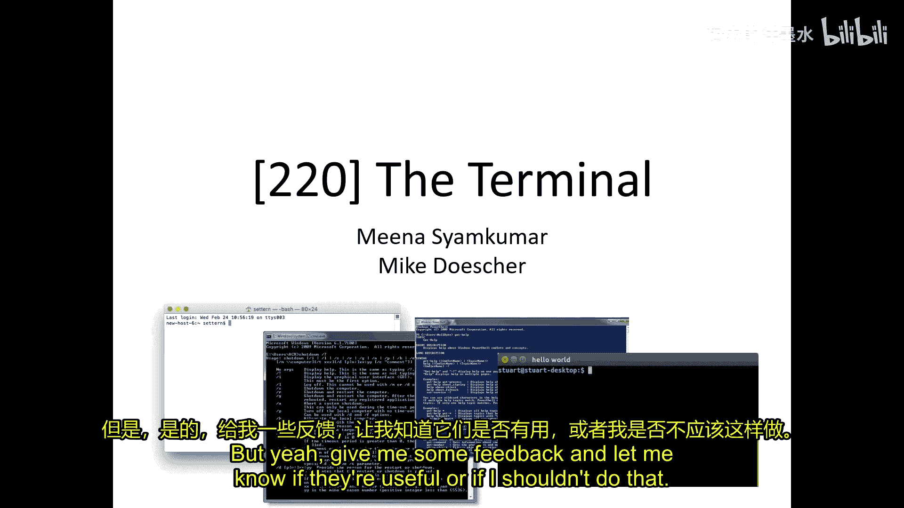

The other thing， I've gotten a number of questions about how do I go to office hours。

 So just want to pull this up。 This is our course schedule。 We're right here later on。

 you're going to need to download this worksheet。um。For the like last third of the lecture。

 But how to get help。 How to visit office hours。 This is that link right up here。

 How can I find help And it goes through all the different ways you can contact us Lab hours are right here thatll just jump down to what you can see right here。

 lab hours are just an open time， you can show up or not work on your lab。

 Think of it like giant group office hours in a way。

 just a place to go and ask questions where there's gonna be other people around So there won't be any sharing of code to use office hours。

 this will get you a oneon one appointment with you and potentially your partner with one of the Ts to do that。

 use this office hour request tool right here。 So put in your name on  Mike。

 you need your Wisconsin email Id what kind of question you have then type in your question and theres subproject tabs here。

 If I click project it's gonna to ask me which project， what question number， that kind of stuff。

 And then all I do is click submit。Allright， once I've done that， I've got two more links here。

 I can go to the dashboard。 That's also what this is right here。If I just click it。

It'll take me into the dashboard， and this is going to show me all of the people。

Who have put their name in the list ahead of me。After that。

 I can see that there are people having office hours right now and。嗯。When my turn comes up。

 whoever is doing office hours will grab my name， move me over to in progress and then come find me。

 Alright， So what I'm going to be doing is waiting。For them to come in a canvas。

Blackboard Collaborate office our groups。 All I do is I go here， and I'm going to hang out in the。

I get main room， general common room。 I forget what it's called。 And then when it's time。

 they will pull me into a breakout session。 And you can see that right now Akil is in breakout group2 And so when it's my turn。

 he'll pull me in。Alright， so that's enough of that。 Let's go back to the terminal。

 How do I get there。

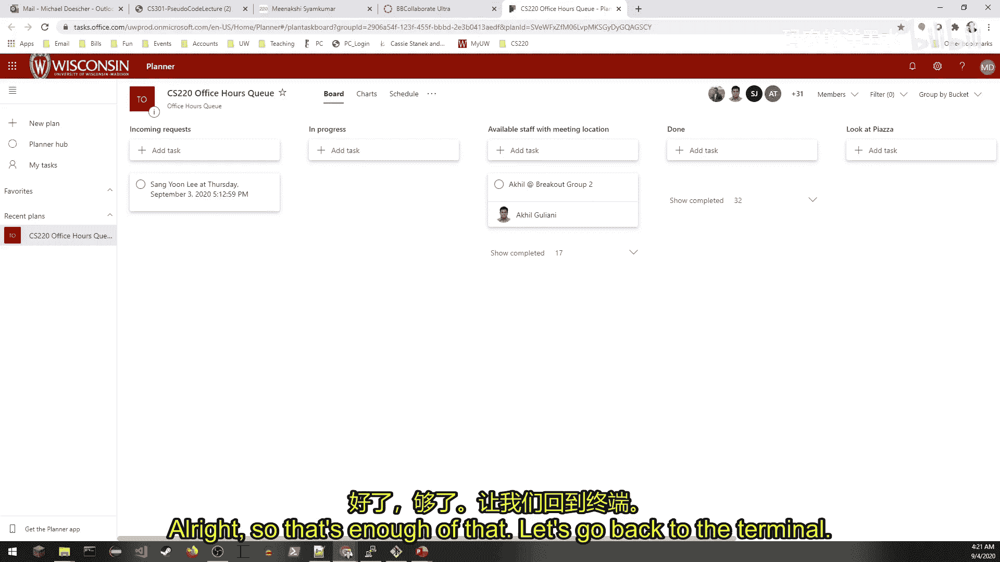

Parkpoint slide。 Yep， okay， the terminal。 So for a lot of you guys。

 using the terminal might be a new way to interact with your computer。

 So we want to just spend a little time and make sure you guys become familiar with it。

Let's take a little look at the history。 real quick。 A long time ago。

 back when computers were first invented。 they were very expensive。

 Most people would not have their own computer。 In fact。

 department like the computer science department might buy one computer costing millions of dollars back during the 60s。

And what they would do is they'd want to get as much use out of that computer as possible。

 So they would purchase these dumb text based terminals to connect to the powerful mainframe。

 These eyes are just little more than a screen and a keyboard and nothing else。

 They you type something in。 They send it to the mainframe where it does all the work。

 And then it sends back whatever wants to be put on the screen。Today， we have much， much faster。

 more powerful computers。 And what we'll do is we still have the ability to use terminal like features through a terminal emulator like these ugly boxes right here。

 And the question is， why would I ever want to use a terminal emulator or a terminal。

 And the reason is a lot of times typing on the keyboard is faster than actually going and using the mouse。

 if you think about like navigating your file system。 If I know exactly where my file is。

 I can type the names of all the directories I need to move through much faster than I can like click on a menu and then' spot the right thing and click on it。

😊，When I know what I'm looking for。Okay， so a couple of career tips here。

 The first one is that ask yourself， is this a good tool。

 I using the terminal a good tool just because I don't know how to use it right now。

 and I'm way faster， you know using Viile Explorer or finder and clicking things But if I were to invest some time and get really good at it and get faster with it。

 would I be faster， Is it worth investing the time。

 And I think this is true for a lot of data programming tools， data science tools。

 computer programming tools， they can make writing code significantly faster when you're good at them and can be well worth the investment。

😊，The other thing。Where's the other one。 Yep， the other tool tip is a。

Find some tools that lets you do this job from anywhere。 For example。

 if there's a global pandemic and you're stuck at home。

 you still want to be able to do your job the world is still going to any data scientists out there who are analyzing data。

 maybe potentially data about the genome of a vaccine or a virus or producing a vaccine or just counting number of cases of the virus。

 In fact， using a terminal emulator is going to let me connect to the computers at the university and I can do my job from anywhere right now I'm sitting in my basement three weeks from now I'm going to Las Vegas。

 you guys will never even know that I've left the house and that I'm actually sitting in a hotel doing my job。

So when we start up a terminal emulator on our computer and I'm going to be using PowerShell on my computer because I'm a Windows user。

 Minina is going to be using it's actually her terminal emulator is called terminal on her computer。

 She's a Mac user。 So if you want the Mac version， she's got a。

Her demo is done with the Mac and it's her lecture two or the video number two for today。But anyway。

 once you open up your terminal emulator inside that is another program called a shell。

 And shells are really great programs theyre。Basically， just ask one question。

 what should I do and you give a command， and it asks。

 what should I do again and you give it another command， And then it just continues like that。

 And it really only does two things。 It lets me navigate through the files and folders on my computer。

 and a I can run programs。Some of those programs are oh yep。

 so I'm going to start using the word directories。 I use folders all the timeca I'm a Windows user and they look like little folders。

 all of the commands that we'll be typing in have the abbreviation。

 like change directory is going to be changing from one folder to another。

 they always use the word directories。 So all the abbreviations have a D in them or a DIR。

 So directories。Alright， we actually have lots of options when it comes to shells。

 I'm a Windows user。 I'll be using PowerShell。 CD is another shell available for Windows。

 This one has basically its own set of commands that are a little different from everywhere else。

 Mac users and Linux users in general have the same commands and Powerhell is the Windows version that adapts and uses those commands。

 So it's a little more friendly for Mac and Linux users。

 I'm only going to be discussing commands that are universal and available in Powerhell and on Mac and Linux。

😊，All right， for the Linux the rest of these guys are available in Mac and Linux， the one。

 the default version when you open up your Mac terminal is going to be bash。

 it's short for the B again shell。 It's based on the B shell developed by Stephen Boourne back in like 191979 right there And then people reworked it。

 And when you rework something。 It became the B again shellll。 They all end in S H。

 and this was just kind of a cool name。嗯。So next up。

ll talk a little bit about running programs from a shell。 It's easy。

 You open up the terminal emulator。 The shell is already there。

 You don't even think that there's two programs。 It just looks like one。

 and I'll demo this in a little bit。 So all you need to do is from the prompt。

 So this here is the prompt。 This full part right here。

 This is telling me that this is the name of my user and this is in the name of the directory I'm in。

 And then I've got a dollar sign。 That's the prompt。 So I'm just gonna click and type a command。

 This LS。 It stands for list。 It's going to be listing all the programs and directories in my current directory。

 So there they are。 I've got a bunch of stuff there。 yep。

And let me just highlight some of these things。 I've got the prompt。

 I typed in the name of the program that I want to run。 It gave me some output。

 the name of all those directories and files， and then it gave me another prompt。 So basically。

 this prompt is asking， what should I do， What should I do next。

 And it's just going to continue forever。Alright， so next up a little bit about navigation so。

Navigation is going to be trying to find the files that we want or directory and just looking around。

 Probably you're familiar with using either file Explorer where， you know。

 you'll double click on the folders and move around or the Mac version。I love this。 Switch to a Mac。

 All right， awesome。So I got distracted there for a second。

 So navigation is looking for files that we want。 we're using file Explorer or finder。

 we can do that in Windows or Mac， but with the shell， we're going to be navigating using commands。

 We'll type in a command and a command runs a program that does something like in this case change the directory or make a new directory I'll demo all those in the live demo in just a minute。

So let's take a look at a little bit about where the files are really stored。 So file。

 because we want it to stick around forever， we don't want it to be lost when we shut the computer off。

 we're going to write this on a hard drive， either one of these style hard drives of mechanical。

 hard disk or an SSD and on a Windows system， I'm going to talk about Windows first we'll go through all the details and then we'll talk about the differences between Windows and Mac。

But each drive is going to be given its own letter so I may start out with a C drive and I might collect a lot of videos that I make it for YouTube and fill this up。

 so I'm going to go buy another one。 This will be my D drive。

 And then what I find is that I want somewhere I want my games to go faster so I'm going to buy one of these high end super fast SSD drives。

 It's going to be E drive put all my games over there。Al right， next up。

 I want to just talk about files a little bit。 So every file has its own file name and a path that's associated with it。

 So if I take a look at like this， this file right here， Readme dot text is found on the C drive。

Is the file name。The complete name， including the path here and the file name is the path name。

C is the drive letter。And。That TxT is the extension that's going to tell us what kind of file it is。

 And right here in red the separator Mac and Linux use forward slashes for their separators and Windows uses backslash for their separators。

 This is going to be one of those key differences where your code runs well on your computer and you turn it in and we grade it and it completely fails when we give you a zero。

 It's that separator that's going to be a problem。 And I will highlight that when we get to working with files and the operating system the last third of the semester。

 It's not going to be a problem right away。So in the first lecture we talked a little bit about input and output。

 a keyboard mouse was our great input input devices， the speakers。

 the monitor output devices files can also be either input or output so we may have a program right here in blue that generates some output and we save that to a file。

 store that on the file system and then later on we run the program again。

 we may want this file back and we'll open it up and put it back into our program as input。

Direectctories on our computers can hold either files or other directories。 And just like files。

 the way they have a path name， directories also have path names。 So just as an example here。

 I've got three files， file 1，2， and 3 in my directory。 and that exists on the C drive。

 So the complete path for file 1 doc is going to be this entire thing。

The path for the directory is just' going to be the sea drive。

And all three of these files are in the same directory。If I add a couple more to the list。

 I can see that in directory 1， I have another directory， so directories can contain directories。

 and this one also has file one， but because these are in different directories。

 I've just reused the name， but these are actually different files。 This one has this path。

And the other file one has this complete path。We have two different kinds of paths。

 two different ways we can refer to different files relative and absolute。 In this case。

 all three of five， all five of these are absolute paths。 They tell me exactly how to get there。

 Let me use a simpler example。 If I ask the question， where's the computer science building。

 All right I know you guys， we're not in the computer science building right now。

 We're all sitting at home。 Some of you guys are on the other side of the world。

 So just bear with me。 This example works way better when we're in a lecture hall across the street from computer science building。

 But here's the idea。 I've got two answers to this。 I can tell you， it's1210 West Dayton Street。

 Madison， Wisconsin 53，706。 That's exactly the information you need to know where the computer science building is。

Or。Well， I could say on the other side of Johnson Street。Answer one pretty much always works。

 you can go plug that in your phone， you can look it up see exactly where it is。

Answer 2 really is only a good answer if we are across the street from the computer science building。

 and then I can tell you it's right there across the street。Now。

 this is oftentimes a lot more convenience。 It makes a lot more sense to people If I am standing across the street from the computer sense building and I give you this address and you have to get out your phone and plug it in。

 you're gonna be like。I'm wasting your time If you could just set it right there， cross the street。

So the same thing will happen with path names。 We'll see that we have both absolute and relative path names。

 The absolute paths are always possible。 we had some examples on the previous slide right here。

 These are all absolute path names。And the relative paths are only really good if we already have some under information。

 We need to know where we are and that where we are is known as the working directory。

 It's our current location。So let's just take a look at some examples right here。All right。

 so what we're looking at here in the middle is the working directory。

 So this is if I open up file Explorer or finder and looking at a particular directory。

 this is the one I'm looking at。Over here， I have the absolute path of a file。

 and what I'd like to do is just go through some examples of the finding the relative path from an absolute path and a working directory。

So in this case， in the first example here， if I'm on the C drive and I'm looking for this path right here。

 the test dot text is already on the C drive。 All I need to do is type in test dot text。

 So this one's very straightforward。The second one is very similar if I'm in directory X， Y， Z。

I've navigated through Finder and found that particular spot and I see that my file is in directory X。

 Y， Z。 All I need to do there is type my doc， and I'm good to go。If， however。

 I'm one level up in the directory tree， if I'm sitting at directory X Y and my file is actually at X。

 Y Z， my doc， what I'm going to need to do is type Z， my doc。Let me see if I can bring this up y。

Dictory Z backslash my doc to get to that location。And we can do the same thing with directories。

 so if I'm actually trying to get to a directory X Y Z and I'm sitting at a directory。

 Ill always be a working directory will always be a directory if I'm just in directory X and I want to get to Yz I can just type y slash Z to get to there for the relative path。

All right， a couple of other little things here， special directory names。

 There's actually three of them I've got two right here。 The dot dot means move up one directory。

 So like if I'm sitting at directory X Y here and I do dot dot。

 that's going to move me up to just the X directory。

 which I get right there and the dot means just the current directory。

So here's a couple more examples。 if I'm looking for。Test dot text， one of the things I can do。

 I can also refer to this as dot slash text， test dot text。

There's no reason I can't put this and it doesn't really。

 it's not really necessary in a lot of cases。And I'll point out some examples where it is。

 I can also do dot slash that's says current directory in the current directory dot slash again。

 test dot text Al right， great that works。 It also works with directory so I can do dot slash Y Z。

 So it's just this example one more time with a dot slash in front of it also works for directories。

嗯。And then let me just talk about this example a little bit real quick。 If I'm in a directory X， Y。

 Z， I'm three levels deep into the tree of directories。 And I want to get to this absolute path。

 That means I need to move up。 So dot dot basically is going to remove。The Z here。

 I'm going to move up one level， and then I'll be in Y。 I'll need to do that again。

 So I'll add another dot dot s， and that will move。 Where's my mouse。Up out of the y into the Z。

 whoops， x， that's the letter X directory， so it should look like dot dot slash dot dot。Alright。

 one more example here。 In this case， I'm looking at a working directory of。C， E drive a directory。

And what I really want to get to is in the B directory， file that text。

So give this a thought for a second。 pause the video。

 jot down what you think the relative path will be and then。Come back， and I'll tell you the answer。

Alright， welcome back。 So here's what we're looking at。

 What we need to do is we need to get out of the a directory， move up to or at the top level。

 the C drive do that I'm going to do dot dot。Okay， now I'm going to be at C from there。

 I need to move into this B directory。 So I'm going to do B and then another back slash and then file that text to get to the file。

Alright， maybe， let me do a couple of picture versions。 So right now。

 this is my current working directory here。 I'm in the A A。Folder a directory on the C drive。

 So if C drive has two folders， A and B， This is my current working directory。

 What I need to do is first use the dot dot to move up to this C drive。For there。

 I'm going to use B to move over into the B directory。And from there。

 file out text gets me into the file that I care about。

 And we'll do a couple more examples of this kind of stuff in the demonstration in a little bit。

Allright， I want to just discuss a little bit of the few differences between Windows and Macintosh computers as far as like the drives go and Windows。

 all of the absolute paths are going to start with the name of a drive that C calling back slash like D calling back slash。

 It tells us which drive our data is stored on。 However， on a Mac， first。

 the separate is always going to be the forward slash and absolute paths always begin with that forward slash know。

 Here's an example。 forward slash users Tyler my file doc。

 it never tells us which drive we're actually storing this file on。

 So how can we have multiple drives if every file path starts with the same symbol。

 we really can't tell what drive it is not by just looking at the absolute path。

 basically all the different drives just feel like different directories。 And in fact。

 if I'm looking at some different files， If on a Windows system I've got file that text in users Tyler。

On a Mac， it's going to just have the forward slash。

 there's going to be no drive letter so users's Tyler file program files here is a a directory on C drive here here that's equivalent to the user's local bin。

If I'm looking at the D drive。On Windows， this might be volumes back up。 volumes back up A。 And。

 in fact， the E drive could also have volumes movies。 So this， these drives could have。Basically。

 it's， it's designed to look the same。 So think about like this way。

 Supp I've got my hard drive and it fills up with movies。 And then I have more movies。

 So I buy another hard drive。 I don't want it to look like I've got lots of drives。

 It's going be all kind of。What's the word I'm looking for hidden from me。 Does't on a Mac。

 the path doesn't tell me what drive I'm on。 They all just look like directories。

So I can move my movies around。 I can move them to this new hard drive that I just bought。

 and it still feels like they're in the same place as far as like， how I need to， you know。

 write the。To to find them。

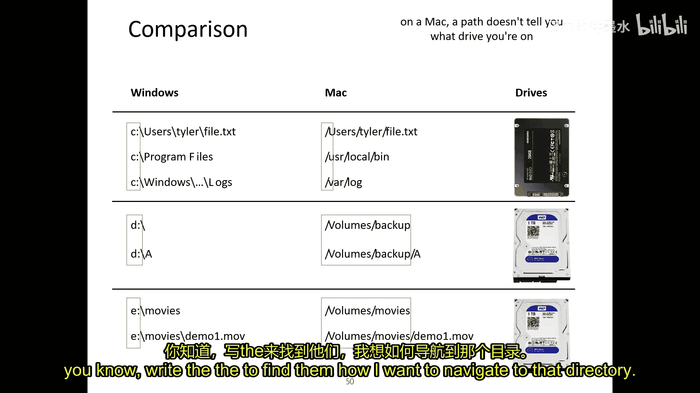

How I want to navigate to that directory。All right。

 I want to just walk through a couple of simple examples in the slides。

 So when you guys pull up power the Pf of the slides and are walking through this， you。

 we've got some examples and the ones I'm going to talk about here in this slide。

 they're all based on the Mac computers。 you can see the。Oh forward to that。And。

And then I'm going to do my demonstration with the Windows machine and highlight some of the differences there。

 I'm going to focus only on commands that work in both Mac， Linux and Windows in Powerhell。

 So the first command I want to talk about is PW D。 This is going to tell me where I am。

 It stands for print working directory。 So when I run this。

It's going to just print out exactly where I am。 Now， check out my prompt right here。

 P slash users T RH scratch， this prompt already contains the name of the director。

 That's pretty common。 Powershell does that by default。

 The bash prompt on the CSL machines does not So PwD can be very valuable。

 I'm personally not a fan of having the directory in the prompt， it takes up a lot of space。

 makes it hard to see what you're typing if you're really deeply embedded in your machine。

And you're in file directory。 and there are ways to change that and。

I'm not going to actually go into that for this class。 Okay， next up。

 so it's printed out the current directory right here。Next， if I want to make a change。

 right now I'm in the Sc directory， CD dot dot will move back up one level。

And now my current path is users TRH。From here， if I want to clear the screen。

 it's getting kind of full， I can use the clear command。 And now I back up beautiful， clean。

 black screen with just a prompt。 So from there， I can move back into the name of the directory using C D。

 It's short for a change directory。 And I just need to type the name of the directory that I want to go to。

 This one happens to be where I just。😊，Was。So C D scratch。

 And now I'm back there exactly in my starting position。

The C D slash command will take me to the root directory， So just。

The very topmost level and this angle bracket is the prompt。All right。

 LS is going to list the contents of the current directory。So when I type LS， it's a program。

 and it's just go through and print out all of the contents of the root directory in this case。

 the top most level。Another command that we're going to be find to be really useful is the cat command。

 Cat takes one argument。 read me dot text in this case is the it's the name of a file。

 And all it's going to do is print out the contents of that file right here。 So if I click go。

This file says hello， and that's what the contents of readme。t textext are。Da saved。 There we go。

 Arguments。 So some commands like cat here require an argument。 This is input to the program。

 cat is the name of the program。 It needs to know which file you want me to read。

 So that's known as an argument。All right。Echo is another well， in a lot of ways。Here。

 let me just give you a demonstration。If I type echo， it takes an argument。 in this case。

 I'm giving it the word hello， all it does。His print out Ho。That's all it does。

 It's just going to take whatever is on this line and print it out for us， which is not super useful。

 But it turns out that it's a great way。Yep， print out whatever the argument is。

It's a great way to create new files because the right angle bracket is the redirection operator。

 and that's going to send output to a file。 So if I type E hello， use the angle bracket。

 give the name of a file it's going to create this file and it's going to store the word hello in that file So then。

やっぱ？This first case it was printed on the screen note that it's not printed on the screen here。

 but just gave me a prompt because it actually redirected the output to output dot text instead of。

Printing it on the screen。And then when I read output dot text。

 cat is again the command that I'm going to use to read files。 So cat output dot text。

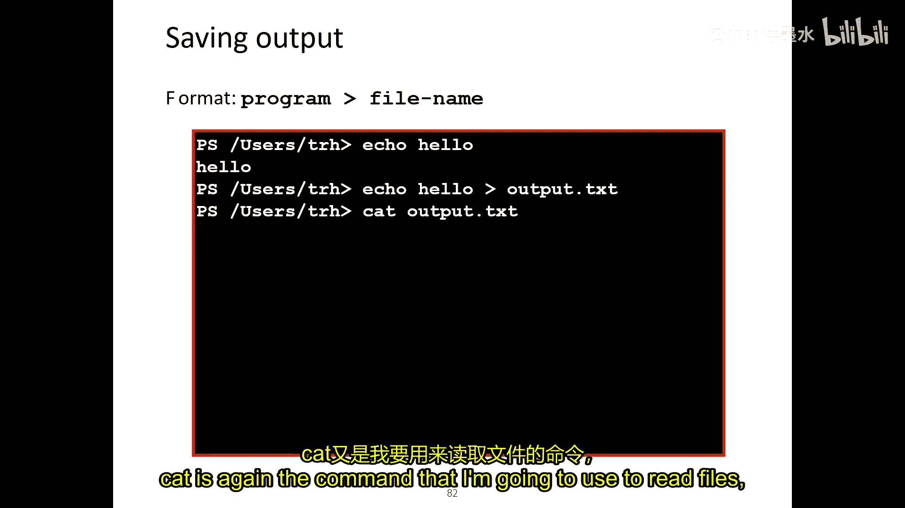

And there we go， hello。Al right， next， Id just like to open a Powerhell and go through demonstrating some of these things for you。

 If you're trying to follow along and do this on a Mac to get to the terminal。

 you're going to go to finder。Then applications then utilities and terminal Mina's demo lecture 2 under today actually is her demo。

 She's done it as a separate video。 If you have a Mac and you want to follow along with the Mac version。

 I recommend you just jump over watch her video too and then come back and you're welcome to stick around watch mine。

 You might learn。Something else， I'm not sure entirely what she's done。All right， so。

I'm going to get out of this to get to Powerhell。 I'm just going to click on the Windows start button。

I can't spell， get a W power， there we go。Type a good power。

 and that's enough to get to the Windows Powerhe。 This is the1 I want right up here without any of these extra letters at the end of it。

 the short one， simplest one。 All right， when I click that， it opens up Powerhell。

 I can see that it's telling me I'm in Powerhell。 The P S here stands for Powerhell。

 and it's giving me this prompt。 that angle bracket there is the end of the prompt。

 And this particular prompt with powerhell tells me what my working directory is。 So in fact。

 the command to get the working directory。 And we're only gonna worry about it may be8 commands today。

 But Pw D is the one that tells me what my current path is。 So this is my current working directory。

 and then it gives me another prompt right here。

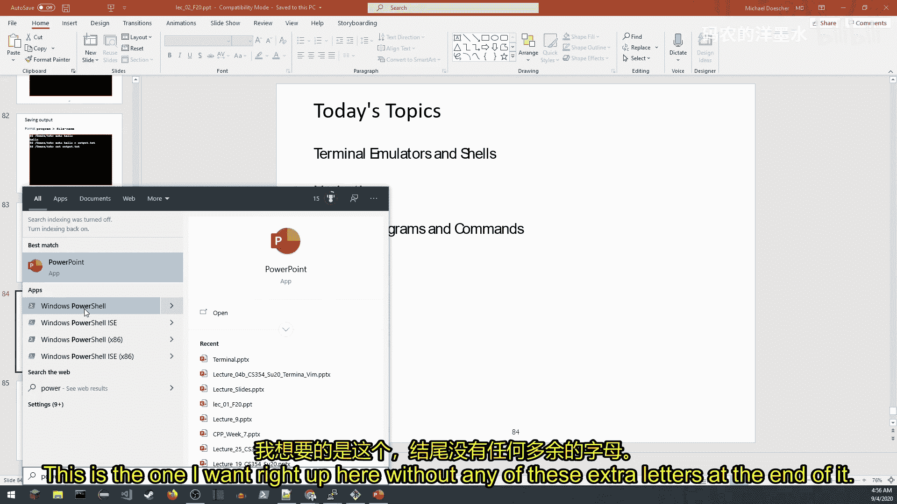

Okay， to get help， the command is man and let's just get some help on PwD。

 So man is short for manual like instruction manual。

 and I can type the name of any command following that and that will give me some help。

If I read this， some of these can be really complicated。

 but they they usually have this same structure。 So what it's telling means the name of this command has some aliases。

 GL for get location。 I can actually type get location on this machine。

 now we'll also do the same thing as PWD。Let's just go ahead and do that now。Get。Location。All right。

 there were good， so multiple commands that do the same thing are known as aliases。Alright， next up。

 let's do one more。 And let's see。 we had C D was one of the other ones we talked about。So。

Also known as set location。 We've got some other aliases。

 It tells us the optional parameters that we can put in。

 I just want to point out here that this man is a program that I'm running right now。

 All it does is display information。 It's got this more here。 I can click enter to get。

And finish the program。If I go back and do this one more time。

 I can also type C C to kill the current program。 we'll find that to be real useful when we write programs that have loops that just don't end。

All right， I want to just take a moment and talk about efficiency。 So a moment ago。

 I was describing how。It can be more efficient to use the keyboard to navigate your file structure than it is to click through。

 Heres take a look at this。 So this particular my my home directory has a ton of stuff in it。

 All that stuff is there。 If I want to get to my teaching materials， All I need to do is type。

Let me see how many letters did I really need T and then tab。

 So tab completion will let me move into basically finish the word for me。

 I't type all those letters。So I moved into teaching， and then I've got all these classes here。

 Let's， let's check out。How about C， S 3，6，8。C plus plus。In here， I've got a bunch of stuff， too。

 So CD DC S。 So at Cha tab， and it's going to give me the first option that that matches。

 Tab again will move down and give me the second option。Let's see what else we got here， CDE。

Homework。See， I'm going to I have homeworkmark one。And that's as deep as it gets。 Okay。

 now this is one of the reasons I dislike Powerhes the way it puts in all the files。

 because when I'm working on my classes， I've got all these directories。

 everything is sorted very neatly。 Otherwise， I lose track of stuff。

But it takes up like more than half of the screen。 And I got to fix that。Lve that later， though。

 Allright， So next up， I mentioned that there were three special commands。

 C D dot dot moved me back up one level。 C D dot is the current directory。

 And C D Tilda is the third one。 That's gonna take me back to my home directory。

 My home directory was at C user's mic。 So see any Tilda gets me back there。

 It doesn't matter where I am。I could go all the way up and be looking at the C drive and CD Tilde will take me back to there。

Alright another way that we can write use the the terminal very efficiently is with the up arrow。

 If I've already entered a command， I can just use the up arrow to go back and look through the commands I've already used。

 So here I can do。CD teaching。I can do。About get location。Okay。

 so that's just one more way that I can save myself some typing。

I have a lot of students that come to office hours。

 and I watch them type things where they could use tab completion。

 where they're typing the same command again that they just did。

 particularly if they're trying to like compile some C code or something that can be a long command with lots of little options that they need to get just right。

 The Alarrowro saves tons of time。 So these are those little tricks。 You know。

 learn the keyboard shortcuts for the software you use。

 whether it's Microsoft Word or whether it's high end programming software。

 learn learn how to use it。All right， next up。The history command。

 This is gonna give me the list of all of the the things I've typed in recently。

 And then once I've got this， I can use control R to do a search for things。

 And this is going search from the bottom of this list starts to number 30 and moves back higher in the list。

 And all I need to do is start typing something。 So G gets me get location。

 Look like I've done that a bunch of times。 I'm going to delete that。 Let's go with。

So the most recent thing that has an emmin is homework， if I do MA。

 the most recent thing that has MA in it， it looks like we're there on line 12 man C。

 and I can just push enter now and it'll run that command again。Ctrol C to kill that。Alright。

 so that's the history， the。What does it called that。

 I think it just told me that now the backward search。All right， so next up， let's get out of here。

How about running other programs， things we might be familiar with？

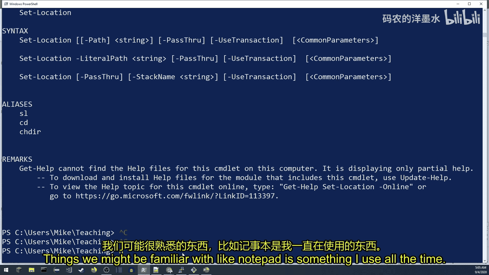

Like noteppa is something I use all the time。 If I just type notepad， it opens it up。

 I can read my files from here。

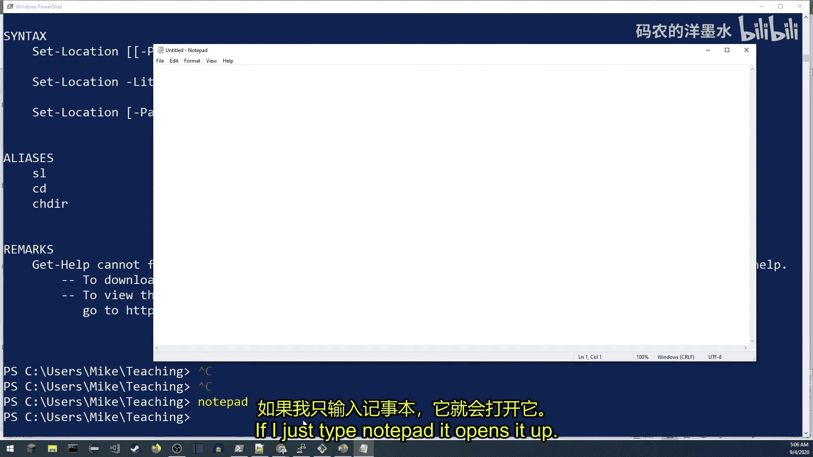

And close that for a second。 What about Chrome。I use my web browser all the time。 But when I do this。

 I know Chrome is on the computer， but it's not recognized。 It turns out that。

This isn't on one of the places where Powerhell is going to look for programs。

 It's not on the right path。 So what I would like to do right now is walk you guys through how to add Chrome to your path to the system path so that you can just type Chrome from the terminal。

 and it'll work。 This is for Powerhe only for Windows only the Mac version is different。

 If you want to add this to your computer using a Mac。 go watch me in this video。

 Its number her second video。 Okay so here's the idea。I want to add Chrome。To my path。

 So then I can just type Chrome from the terminal and get it。 So to start out with。

 I'm going to go and just look up Chrome。Here it is right here。I'm going to， you。

 I click the window button。 I type Chrome。 I'm going to right click on this。 And then right there。

 the second option is open file location。 So I'm going to click that。Alright。

 there's actually two steps。 This first one can be a little deceptive。

 I'm actually looking at the start menu programs。 So these are just all the things that are in the start menu。

 This is actually not the program。 It's a shortcut to the program。

 But that's perfect because the shortcut knows where it's located。 So I'm going to click on that。

 That's a right click。 Then I'm going to click properties。

 And one of these things here is going to be the target。So this target， I'm going to copy that。

Look like it's actually quite long。And now we should be able to go to that directory。

So I'm going to go back over to Power shellll。 Let's just take a look at this。 So I want a C D。

I'm going to right click because in Powershell， right click is both copy and paste， very convenient。

 It's already in quotes， I don't want a Cd with this Chrome do EX E。

 I want to just Cd into a directory。 So I'm going to delete some of this。There we go。 Now。

 this should take me into the right directory。要。There it is right there。 It' third one down crumb。

 Okay， so great。So I can type Chrome and it still gives me an error。It's not recognized。

 So part of the problem is， I'm going to need to add the path。

To this file right here because of the way the directory is organized。It's not recognizing it。 Okay。

 so here's the idea。 I'm going go。To windows again。I'm going to look for path。

 That's where I need edit。And over here， edit the system environment variables related path。

 This is the one that I want。 Edit the system variables。 So I'm going to click that。And。

I hope this is big enough for you guys to see。The it's an environmental variable， the path。

 I'm just gonna to click right there。 And then I can see I've got local variables for me as a user。

mic and system variables that are for everyone。 I'm just going go here and just edit it for me。

So I' click path。 I'm going to click edit。 And then what I see here， all the different paths。

 So when I type a command like。Chrome or Nopa。 It searches all of these directories to see if that program is there。

 I'm just going to go down to the bottom right here。 I'm going to add a new path。

 I'm going to paste in that。The path to Chrome。I don't want the Chumbdot EXE。

 I just want that directory。 so now it knows to look in that directory。And then let's see， okay。Okay。

Okay。And I'm going to need to start a new instance of Power shell。Let see here。

I've got it on my hot bar right there。And now I should be able to type Chrome。

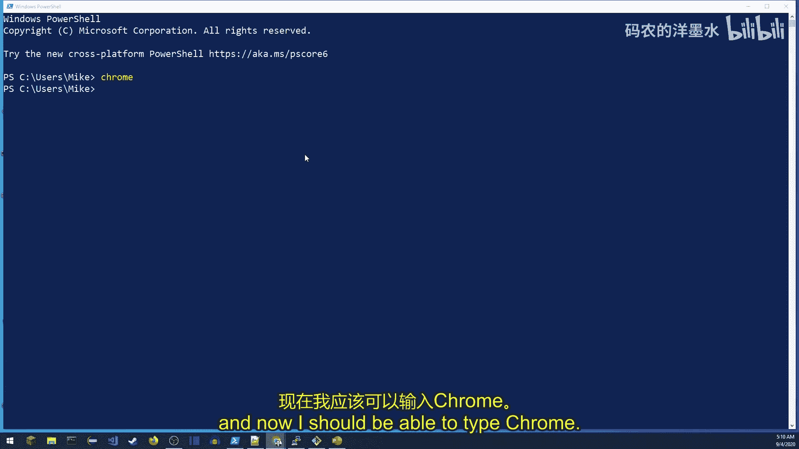

And it opened down the other window， that's awesome。

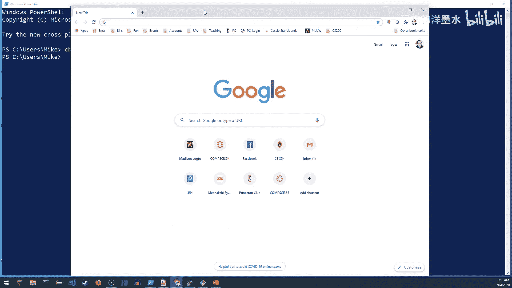

Let me try it this way。 Let's see if the last instance of Chrome is right here and it'll pop up on the other window monitor。

 All right， trust me， it totally worked。

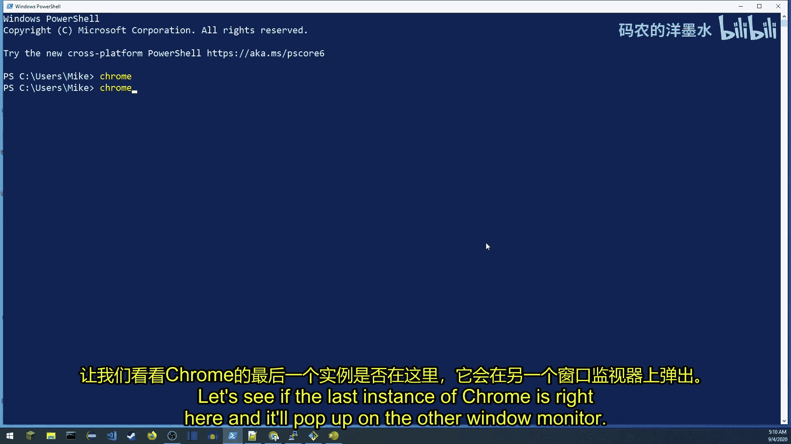

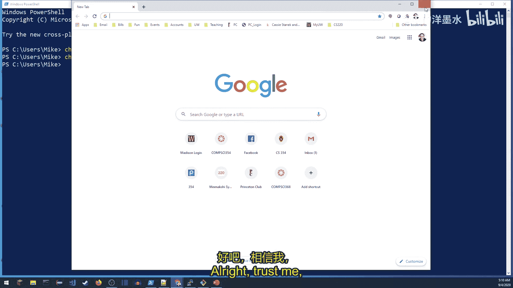

Hold on， wait one more try。 one more try。Okay， I had a couple of instances of Chrome open and they were all on the other monitor。

 so it was trying to open them on the other monitor， but check this out。

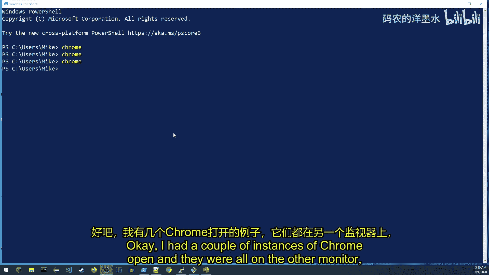

Our Chrome enter，vo a， it's totally working。

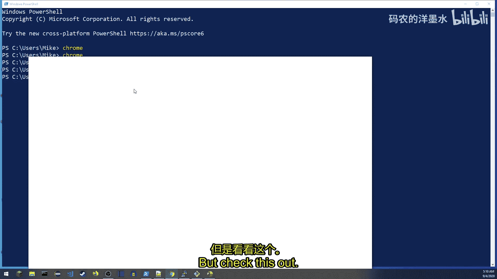

All right。Let's try one more thing。 I can also put the name of a website that I want to go to。

So I can type Chrome。

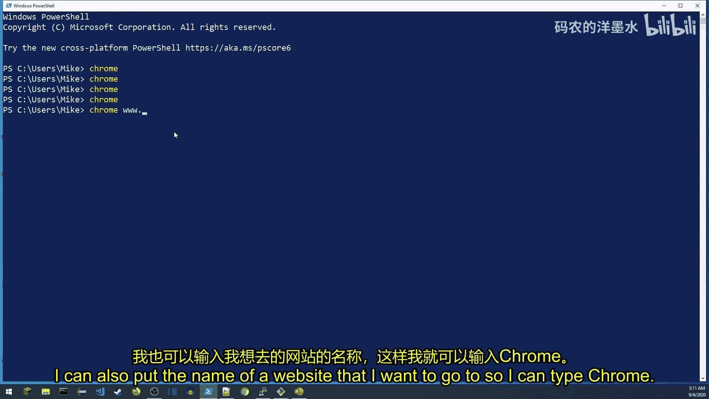

Let's try that。A puppy。 that's cute， though。

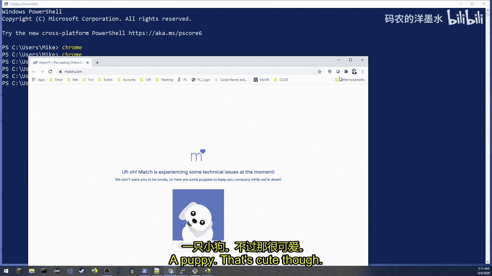

All right， for moment there， I was like my heart was racing a little bit thinking。

What if something comes up and it's not good。 Can't put that on YouTube， alright。All rightNext up。

 I just want to do a little bit more with changing directories。

 including creating a new directory and then using that echo command to create some files and copying and moving them and reading them with cat。

That's going to wrap up this part。 Let me just demo that real quick first。

Then move over to the desktop。And then I'm going to shrink this a little bit so you guys can see what's going on。

I've just navigated the to the desktop。 If I do echo and I type in。A word。

 this is just going to print it to the to the console right there to the， to the screen。If I do。

The angle bracket this will let me write in into a file。

 and that should appear on my desktop right there。 Let's see here， Let's do。嗯。H that text。

So when I write that。Let's see where did it go。 Yep， there it is down at the bottom left。 It's tiny。

 high do text。Allright， I can also create a directory so I can do maketer。What's。Let's call it myer。

It tells me I've just created directory and there it is up there right at the top。Then what's some。

 let's go ahead and copy。So we'll make a copy with C P I dot text， and we'll move it into。My dear。

And then I need to give it a name。 We'll go hello， that text。Okay， so copy takes two arguments。

 the first is the file I wish to copy， and the second is the destination where I want to copy it to。

So check it out high stays right here if I open up my door。

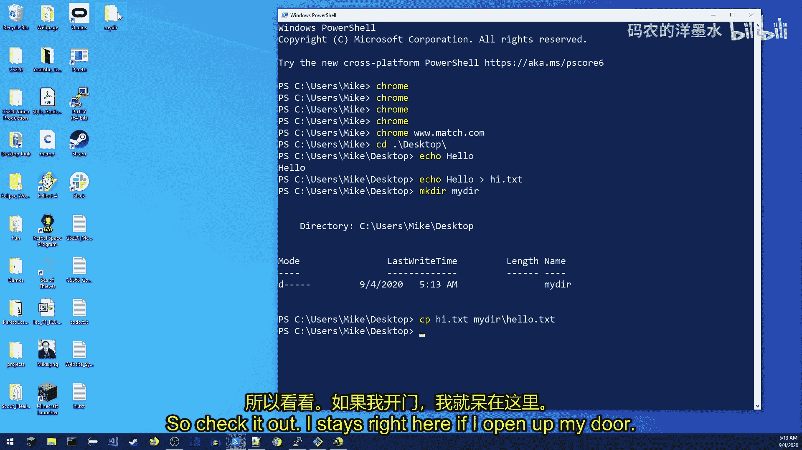

What I see is there it is。 Hello， that text。 I click on this， Noad will open it up。

 and it does indeed say hello。

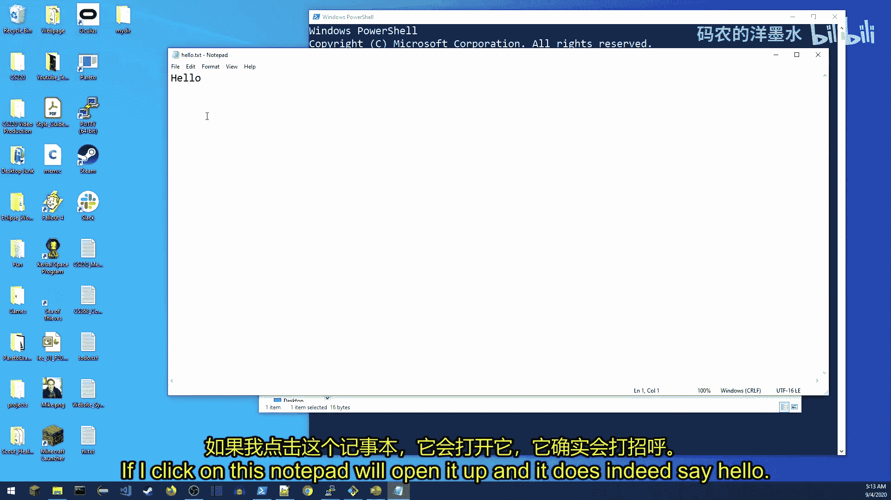

I should have done that over here when I created it when I。

Open up high that text that also says hello。I check this out if I do。Let's go。

E go world to hide dot text。And I go back over here， Check it out。 It no longer says hello。

 It just says world I。Basically， destroyed the contents of that file。 So let's do。

A little bit different version of that the double angle bracket will append to the end of this。

 It won't just nuke the old file， and start over。So now if I do this， it says world peace。

Let's see what else。 Ohright， Cat， Cat is the command that reads out files so I can give it cat high dot text。

And that's just going to print out the contents of that file。 Looks like my screen is getting full。

 We'll clear that。Let's see what else。 I didn't talk about move yet。 So if I want to move a file。

 that's gonna let me take it from one place to another， or it can let me rename things。

 So let me just demonstrate that If I have high dot text as my source。 and I want to rename that to。

How do Well， we just change it to say world peace。 Let's go with。

I'll call this Christmas list dot text。 What do you guys want for Christmas。

And then it's changed the name down here， I can see that。

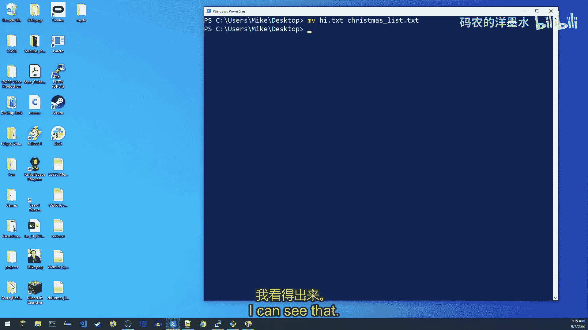

If I double click that， I can open up， still says world peace。 And now it's I can see right there。

 the name of the file is changed。

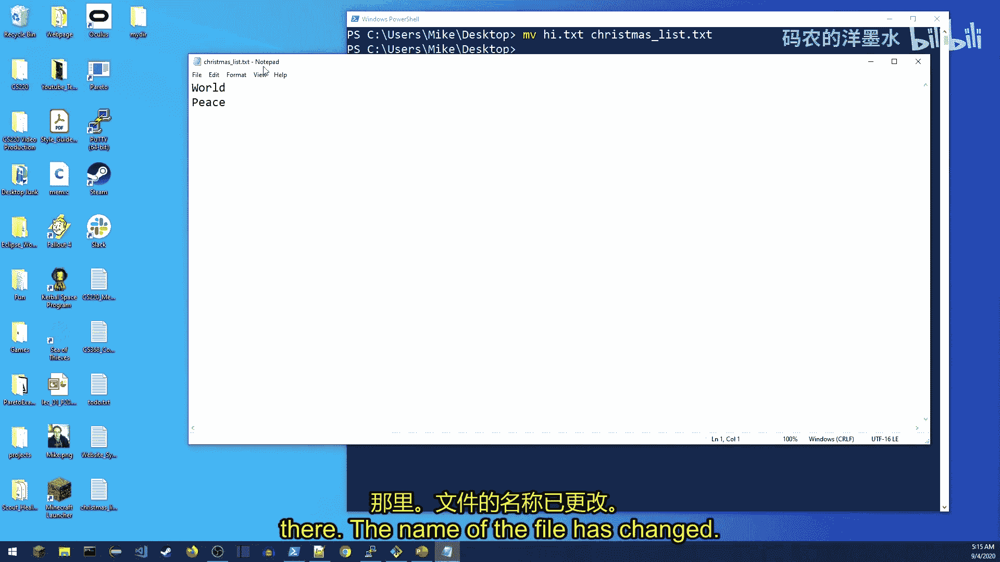

Al right， I feel like this video is getting kind of along。

 but I want to just have a little bit of fun right here at the end。 So first thing I'm going to do。

 I'm going to create a file。😊，When must stick that in A。Lose， stick that in B。

 and I pay very careful attention。I'm going to move B to C。I'm going to move A to B。

And I'm going to move C to A。 and then I'm going to cat a。Pause the video。

 Tell me what's going to happen。 Make a guess。 write it down， commit。And then come back。All right。

 I'm here with the answer。 I'm going to push enter。And we'll see what comes out。Oo， he was losing。

So here's what happened。 We got a team very careful track of this in order to figure out what's going on。

 So when was stored in A， lose and B， and then B was moved to C。 So B is gone。 We've renamed it。

 It's now C。 So I've got two files A and C。And A is the one that's got win in it。

Then we moved A to B。Mu A was gone。 B is created。 I now have two files There B and C。

 And B is the one that says when。Then I moved C to A。When I use move。

 it's going to get rid of C that's gone。 And I have a。 And I've got two files now。 there are B and A。

 and A is the one that says lose。 And B is the one that says win。All right。

 so I hope that made sense， I hope that was a little bit of fun。

I'm going to go grab the worksheet that goes along with the left final part of this。

 and I'll be right back。

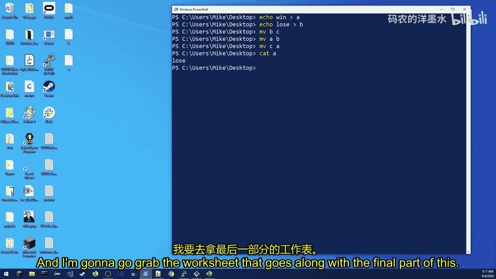

So for the final part of this， I'm just gonna to be going through some of these questions on the worksheet。

 So go to the web page， click the work worksheet， pull this up and。

I maybe even print it out or get some scratch paper so you can work through this alongside with me。

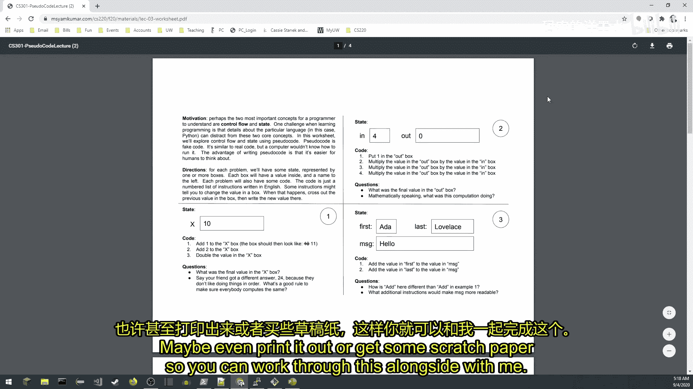

So this worksheet has a bunch of questions on them。 and we're only going to look at four of them。

 The idea here is that we're going to pretend we're computers and we're going to be going through and following these directions and just going through the process。

 The idea here is we're gonna to learn about control flow。

 which I mentioned briefly in my first lecture Control flow is the first five weeks of the class Data was the second five weeks and then special topics data programming was the final third of the class。

 So control flow is all about what is the computer doing right now What is it doing next。

 What is it doing next So that's what we're going to be doing is just going through some of these instructions。

 So I'd like you guys just go ahead and do this Just take a look at this problem and walk through the code pauseuse the video。

And I'll be right back and I'll go through it myself and then we can talk about it。 So pause now。

All right， welcome back， guys。 Hopefully you got a chance to do that so。What I like to。Whoops。

 that's not right， That's not right。 There we go。 Got a mouse in the right spot。

So as we go through this first， I've got my X box there。 The first line says add one to the X box。

 and then the box should look like strike through 1011 because of the way I'm using PowerPoint to do this。

Is that easy to do worse trick through？Nope， I'm going to go delete and write one， there's an 11。

 okay。Sorry， I'm not following the directions exactly because I'm not using a pen and paper。

Hopefully this still makes sense。 Next， I'm going to add two to the X box。 Alright， so it says 11。

 I add two to that。 I'm going to get 13。And then finally， I'm going to double the value in the X box。

 so 13 times 2 is 26。All right， for we go， final answer。嗯。26。 Now， the question here is asking。

 what if my friend got a different answer，24。 They're troublemaker。

 and they don't like doing things in the right order。 The question is。

 what's a good rule to make sure that everybody gets the same answer。 If we have a set of， you know。

 if everybody in the classroom brings a laptop and they do the same， you know。

 give the the same code to them， they should all get the same answer。

So the idea here is this is the first part of control flow。

 and that's we're going to do the steps sequentially。In order one at a time。

 and we're going to execute each step exactly once。So we'll do step one， then we do step 2。

 then we do step 3。 we're not going to mix up the order。 We're not going to do things more than once。

 We're not going to skip anything。 So that's rule number one for control flow。

I forgot I made a slide for this。 sequential execution。 first rule。 All。

 let me pull up that second example。 Next， we're going to be doing problem 4。All right， guys。

 I got the example set up here for us， go ahead， pause the video， take a moment。

 walk through these steps and then after you come up with your answer。

 go ahead and come back and push play again。Alright， welcome back。 let me just walk through this。

 Step one， If the value in x there it is x is negative， continue to step 2。Otherwise， skip to step 3。

 Okay， it is negative so。Multiply the value in x by negative one and put the result back in x。

 So let's go over here。 Let me grab the right spot。 I need to multiply by negative  one。

 and that makes this positive4 excellent。Then I'm going to continue on because my first rule of execution says first rule of control control flow says sequential execution。

 So I'm going to do step 3， says copy the value of x into the ABS box。So I've got0 there right now。

 It needs to say4 what is this function really doing， It's computing the absolute value of a number。

 If x had been positive for when we began just like it is right now， positive 4。

 let's walk through this again。 If the value in x is negative， continue to step 2。 All right。

 It's not negative。 Otherwise， skip to step 3。 So we're going jump down and do step 3 now。

 And we just directly copy the value of x into the A B S box。And it's already there。

 So here's the idea。 The second rule of control flow is a technique we can use to skip things。

 In this case， this is known as a conditional statement。 And the keyword here is if。

 So these are going to be known as if statements or conditional statements。

So that's our second piece of control flow。All right， for the next example。Like do problem6。

 So go ahead， pause the video， walk through this yourself， and then come back for the answer。Alright。

 I'm just going to walk through this。 So put one in the total box。 Let me click over here。

I'm going to put a one in there。 If n equals 1， it does not， It's 4。 If n equals one， skip。

 otherwise continue to step 3。 So I want to do step 3， multiply the value in total by the value in n。

 put the result back in total。 So totalal is1。 N is 4。

 I want to multiply those together and put the four back in total。Just like that。Allright。

 then I want to decrease the value in n by one。So right up here， it goes from 4 to3。

And then I'm going to go to step 2。 All right， Great。 So I'm back at step 2。 If n is equal to 1。

 It's not， it's 3。 So I don't skip to step 6。 Otherwise， I'm going to continue to step 3。

 multiply the value in total by the value in n and put the result back in total。

 So that looks like  three times 4， which is 12。All right， next up， next steps。

 next rule says we're going to do sequential execution。 So we go to step 4。

 decrease the value in n by one。So3 becomes two and go to step 2。Step 2 says if n equals 1。

 skip to step 6， it does not otherwise go to step 3， step 3。

 multiply the value in total by the value in n。 Put the result back in total。 So  two times 12。Is 24。

Then I'm going to go back and decrease the value in n by one。Go to step 2。If n equals one， ha ha。

 it does skip to step 6。I don't even need to read the last of that。 I' just gotta go to step 6。

 copy the value in total into the answer box。Okay， great。 Everything looks good here。

 looks like this。This little piece of code here is actually computing the factorial。

 So4 factorial is 24，4 times 3 times 2 times 1。So what we've just seen here is an example of iteration。

 We as we went through the code， we did step 2，3，4，5，2，3，4，5，2，3，4，5， and 2，6。 Well。

 so we did those steps over and over and over again。 And in a loop。 So the next piece of。There we go。

 Control flow is this idea of iteration or looping where we're going to do a bunch of steps over and over。

 So again， control flow was walking through what is the code doing right now。 And if it's in a loop。

 it's going to go through and execute that sequence of steps multiple times。All right。

 to wrap up one more。Go ahead and take a look at this example。

 go ahead and do this on your own and then come right back。Al right， welcome back， guys。

 So I'm only going to do part of this。 This is getting to be a really long video。

 but let me at least get started here。Main code。 put two in the moves box。 There we go。

 Now we're going to perform the steps under move code。 Then continue to step 3。 Allright。

 so we jump down over here to move code。 If moves is 0， it's not。

 Stop performing these steps and move code and go back to where you were last in main to complete more steps。

 Okay， it's not。 So we're going continue with step B。

 move the robot forward one square in the direction the arrow is pointing。

 This is the robot right here， it's the one that has the arrow。 One second。

 Let me go ahead and do that。All right， I've got the robot moved Next up， it says in step 3， there。

 decrease the value and moves by one。 There we go。Then we're going to go back to step A。

 this looks like iteration。 We just talked about that。 So if moves to0， stop before。 Okay。

 it's not 0。 So， so B， move the robot forward by one square in the direction the arrow is pointing。

 So we'll get out the robot。Move him up。 There we go。 That looks pretty good。U。

Then we're going to decrease the value and moves by one。Alright， go back to step A。 If moves to zero。

 stop performing and go back to where we came from。 That was up here in line2。

 perform the steps under move code， then continue to step 3。Alright， next up。

 rotate the robot by 90 degrees to the right。 Let me see if I can do that easily。There we go。

 the hooks pretty good。All right， then we'll put three moves in the move box。So， three。And now。

 as we go through， it says perform the steps on their move code， then continue to step 6。

 So I go down， move code。 If moves a 0， it's not move the robot forward one square。

 the direction the arrow is pointing。 that looks pretty good。 decrease Mo code by one。

 So it's gonna say2。 Allright， I hope you guys can see that it's gonna to take one more step forward and then one more step forward after that moves it go from 2 to1 to 0。

 let's just fast forward this。We'll drive the robot over there。And it ends up on the heart。All right。

 excellent， so here's the idea。 this next piece of control flow is known as functions。

So what I've done here is I've taken a bunch of steps and I've pulled them out from the main code。

 I could have easily just said in step 2 right here。

 just copying and pasted all four of these lines right there。

 and then in step 5 where it says go to move code， I could have put these four lines right there。

 but then I would have had it those same lines twice。 And if I needed to make a change。

 I would have made two changes in order to get this to work。嗯。

So this is the idea where I'm going to just step out of my sequential execution。

 go do some stuff and then come back， and it lets me sort of extract pieces that do the same thing over and over again。

 pieces that I need。So that's the idea of function calls and finally to wrap up。

 let me click on this and put in all four pieces of control flow that we'll be talking about and how to do them in Python over the next four and a half weeks。

All right， this is going to do it for me。 Go ahead， do the rest of the problems on that worksheet。

 walk through， get some practice， thinking like a computer。 If you have any questions。

 bring them to our live Q& A or office hours and have a great day， everyone。😊。

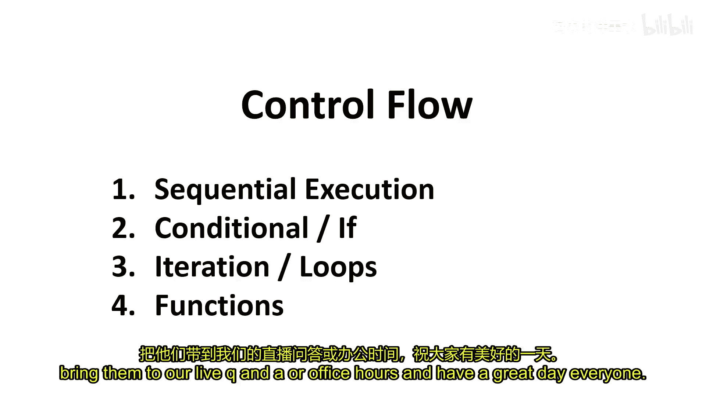