# 【全集】威斯康星大学-Python数据编程-CS220-中英字幕-1080P-p04-Project-1-Windows-上的操作指南--BV1VxvsBLEmv_p4-

Hello， everyone。 I just wanted to do a quick video walk through for Project 1 in case you have gotten stuck on something or having a little trouble。

 So first， we've got the web page here。P1 is right here under Wednesday。So I'm going to click that。

 That was a left click。 And when I scroll down， I can see the instructions for this。

 So the first section is about setting up the environment。 Hopefully by now。

 you have all gone and watched either the windows or Mac video about how to set up Python and gotten that correctly working。

All right。 The next thing we're going to do is we're going to download the project file and sort them in a folder。

 I want to just introduce you guys to how I recommend keeping track of everything。

 keeping everything sorted out so that。You can stay organized。 So first。

 I'm going to go over here to file Exper。 This is the Windows version of this video。

 So I'm going to be using file Explorer and Power Shell。 And just in this PC documents。

 I'm going to go ahead and create a new folder。And I'm going to name it C S 220。Okay。

 and this is where I'm going to keep all of my documents for this class。 I'm going to go ahead。

 double click into here and then add a new folder here for each project。

I'm just go ahead and name this first one， P1， and I'll have a P2 and a P3， et cetera。

 There's 13 projects。 So I'll end up with a bunch of folders by the end of the class。Alright。

 so the next thing I want to do， let me go back over to。The wrongron one。The lab。

 we've created a subfolder P1。Just using file Explorer。

 then I want to go and download this file from the Github。 this。

 this page right here that we're looking at is Github。 it's a place for hosting files。

 and we're going to download test do P Y。 This is the the program that we're going to run to test our homework。

 We'll be providing one of these for every assignment。So it's a little tricky to get right。

 I'm going to go over here， hover over test do P Y and left click。Okay。

 if I right click on it to give me some options， one of them is save link as that is not what we want。

 That's going to be an HTML version。 We want the actual real code。

 So we go here and we're looking at the actual real code that this program is going to run to get this。

 we want to go over to the raw button。And save link as。Okay。

 so I right clicked on raw to bring up this little menu。 and I'm going to left click to save link as。

 And this is where I want to put it in that folder I just made。 So whoops， documents。third is CS220。

P1。 All right。 I'm just going to save it right here。And this should come in as testta P Y。All right。

 so the next thing I'm going to do is go over here， and I need to get。To Power shell， Mia。

 show you on the actual handout where we are。OhI need to click back。Okay。

 so this was setting up the environment， downloading the test Py。

 The rest of those files are all of these images that you see on the page。

 So this is the steps we just did we left clicked on test Py。 We right clicked on raw。

 we save link and we put it in the right folder。Allright。All right， so the next step， step two here。

 we're going to be creating a Python notebook， and so we need to know where we're going to be doing that。

Am。And there's several options for getting this in the right spot。

So I need to open Powerhell and navigate to the right spot。

 I'm going to show you guys three different ways to do that。first one is from this folder。

 I'm looking at file Explorer right here。 Here's my test stop P Y。

 I'm just going to take some of this big white space over here。 I'm going to hold down shift。

 and I'm going to right click。And one of the options here is open Power Show window here。

There we go in the right spot。 That was the easiest。 If I just right click。

 this is without the shift。Hands off the keyboard。 It doesn't give me that option here。

 So it really does need to be the shift。 right click open Powerhe window here。Correct。Okay。

 the second way we can get to this site。Is going go over here to the window menu。 I can type power。

 at least enough of it so that I get some choices。 This is the power shell I want right here。

 not the ISE， not the X 86， not， and he says， I want the shortest one， the simple version。

 I'm going to click that right here。

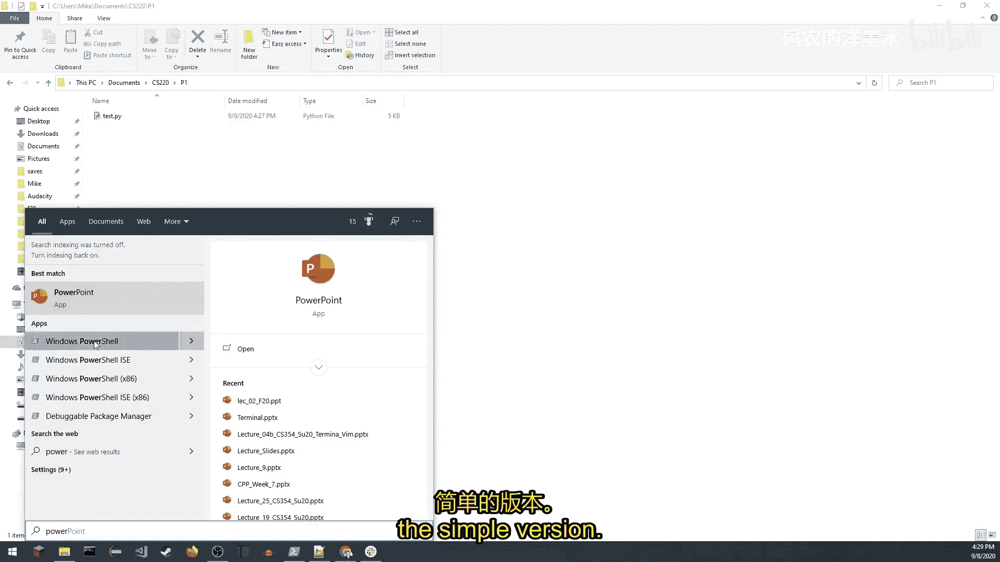

This will take me to my home directory from here I can use the navigation command C to change directory I need to go to documents so I can type Doc just enough the word and then when I push tab。

 it'll autocomplete that for me。Now， I made a CS S220。 So CS S2 tab to complete that。

 And then I had some projects。 It was P1。 There's only one folder。 So P is enough to get me that。

Wush enter。 And now if I do list， I should see that test dot pi to just confirm for me。

 I'm in the right directory。All right。

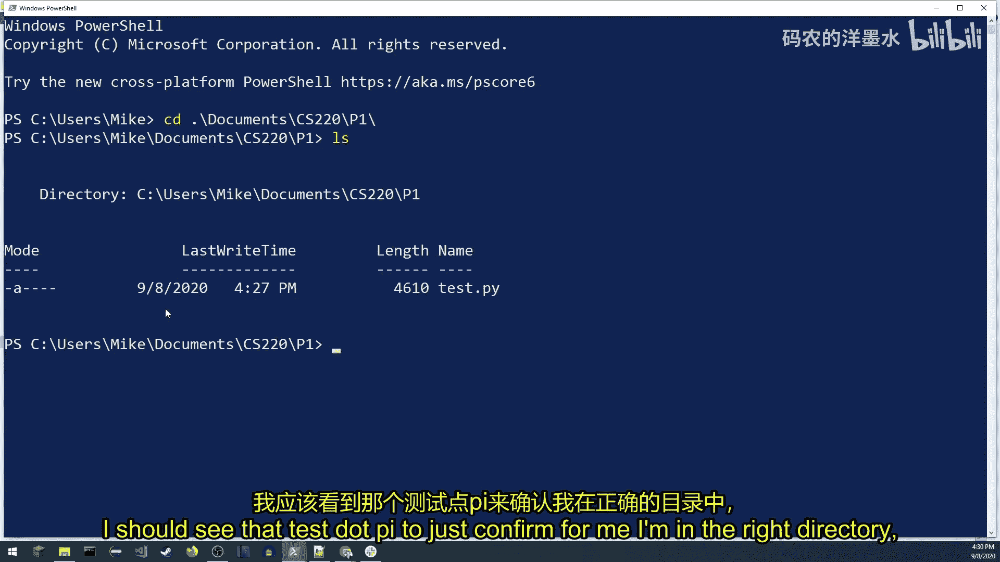

Third and final way。 I'm going to go back to file Explorer。 if I right click。Nope。

 that's the left click on this thing right here。 it's going to highlight the complete path to this folder。

 but I can use control C to copy that。And then if I open a new instance of Powerhell。

Just do it like that， power or shell that one。

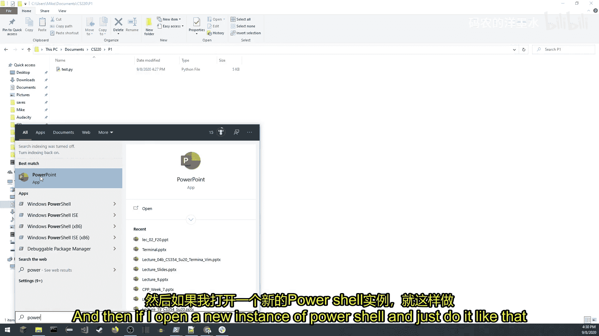

And then I want to do C D to get to that directory。

 So this is using the absolute path to paste in Powershell。 It's really easy。

 All you need to do is right click， and it'll paste that entire path。

 And I can do that to get there to copy， it's also right click。

 So if I want to just copy some text like that I right clicked I right clicked。 and it gives me。

The paste function。O。So three simple ways to open up Powerhell and navigate to the right spot。

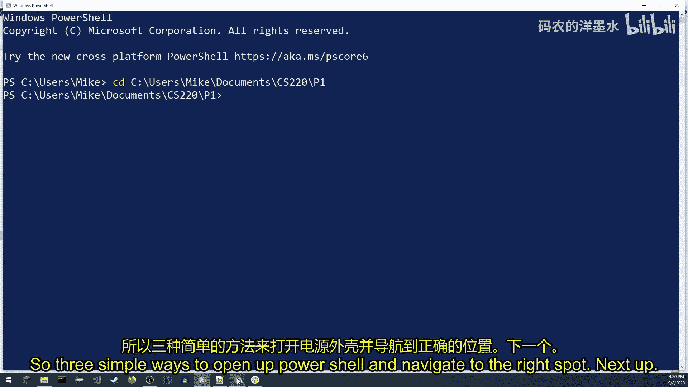

Next up。Let's see。 Where are we。We've just done this。 we've got Powerhell open。

 We've gotten to the right path。 So the next thing we want to do is open a Jupiter notebook。And。

Get that started。 So let me go over here to one of my three instances of Power shellll。

 We'll go with this one。 It's in the right spot to do this。Easy ways to just type Jupyter notebook。

All right， let me show you， there's two things I want to show you here first。

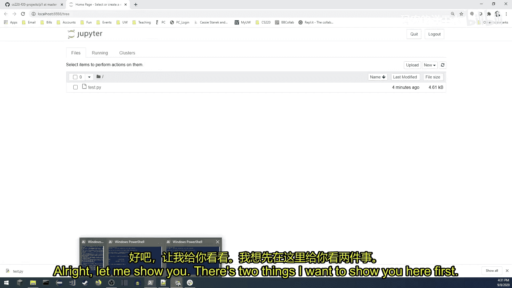

That was。Not that instance， this one over here， I use the one on the left。

This one instance of Powerhell is now running a program called Jupiter Note book。

 There is no prompt here。 See， the prompt starts with that P。 S。

 And then the path to wherever my directory is。 This is still running right now。

 And what this program does is it's going to hijack my web browser。

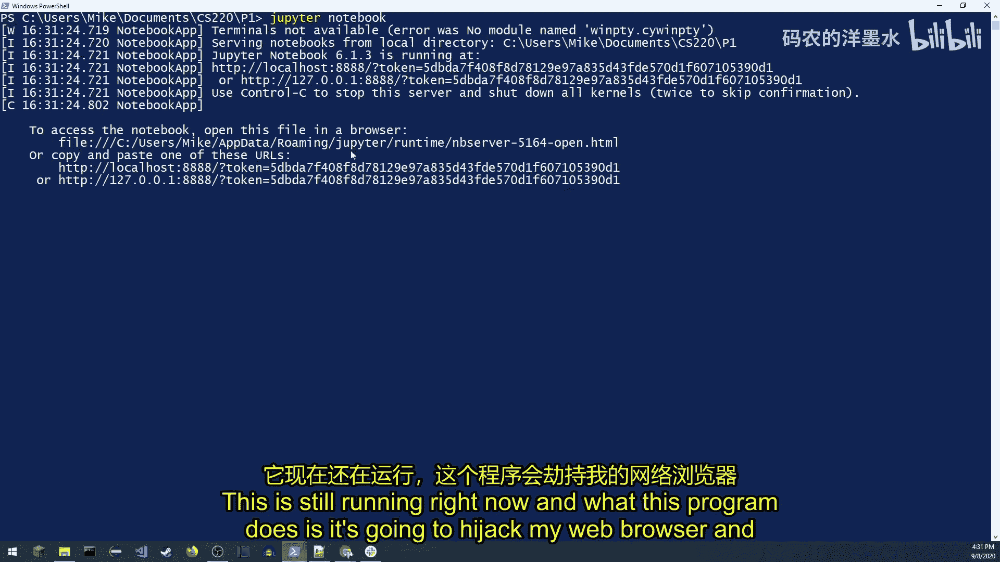

And use the Web browser to display this H M L page for the Jupiter notebook。

 You can see that it's locally on machine。 It's not connected to the Internet。

 This will work if you don't have Wi Fi。 if you unplug your ethernet cable。

 it'll work on an airplane because of this local host here。 That means it's using your computer。

 not connecting somewhere else。And this first screen kind of looks like a file Expr。

 Got my file here。 I can create new folders。 I showing me。

 test do Pi is in the directory that I'm in。嗯。

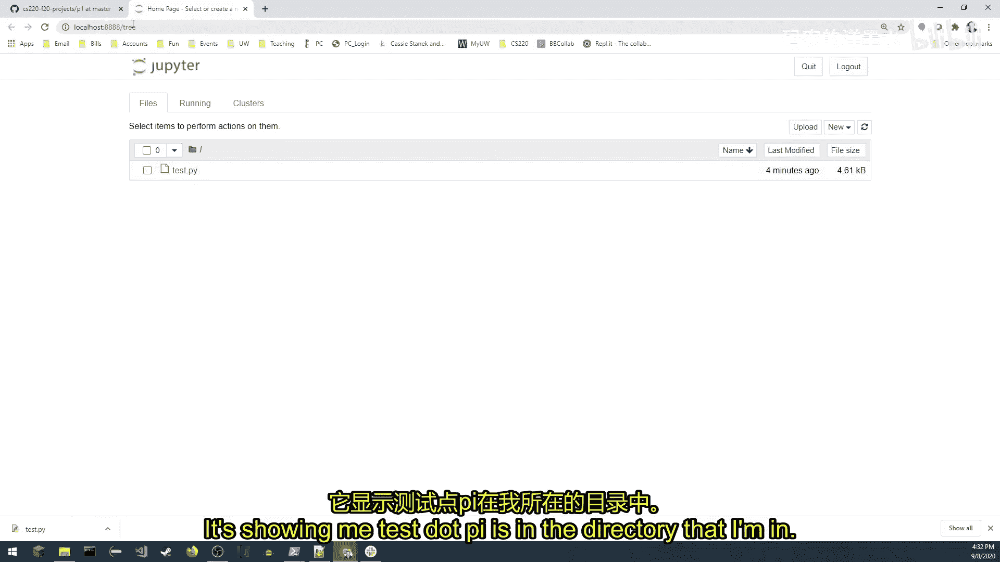

Yeah， so just one final note。While it's running， don't close this instance of Powerhell。

 This is the one that's running Jupiter notebook。 If you close it。

 it'll shut down the Jupiter notebook in Chrome， and you'll lose all of your progress。

 So don't do that。

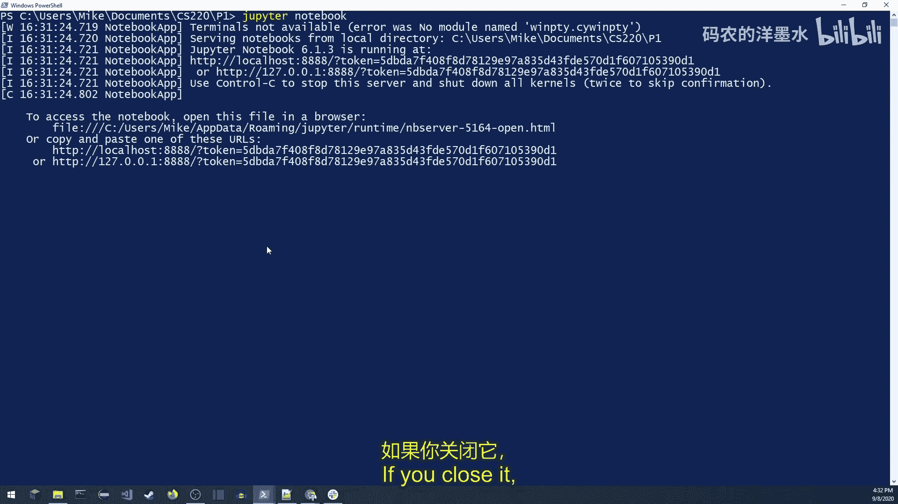

Alright， to get a new notebook with the Python code that we're going to be entering。

 I'm going to go over here left click on new， and I'm looking for a Python 3 notebook。

 So I'm going to select that one and it'll just automatically open up the new notebook。Alright。

 the first thing I'm going to do is go up here to untitled。 and I'm going to give this the name main。

 That's what it tells you to do in the directions。 Our test dot script test Pi looks for a notebook named main。

 So we'll rename this。

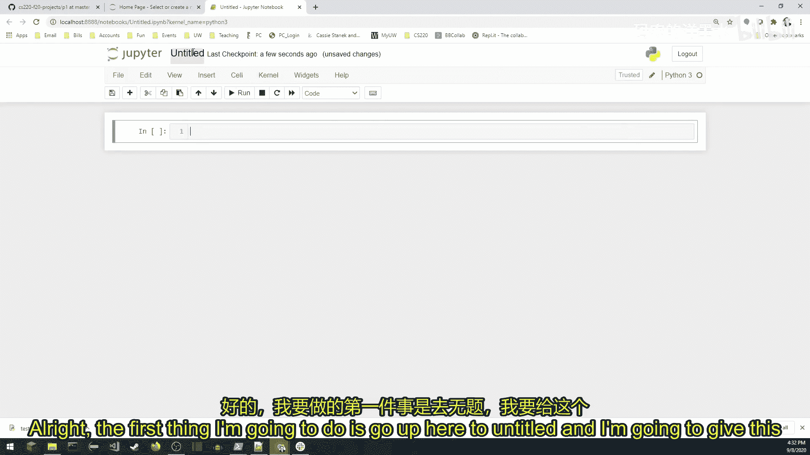

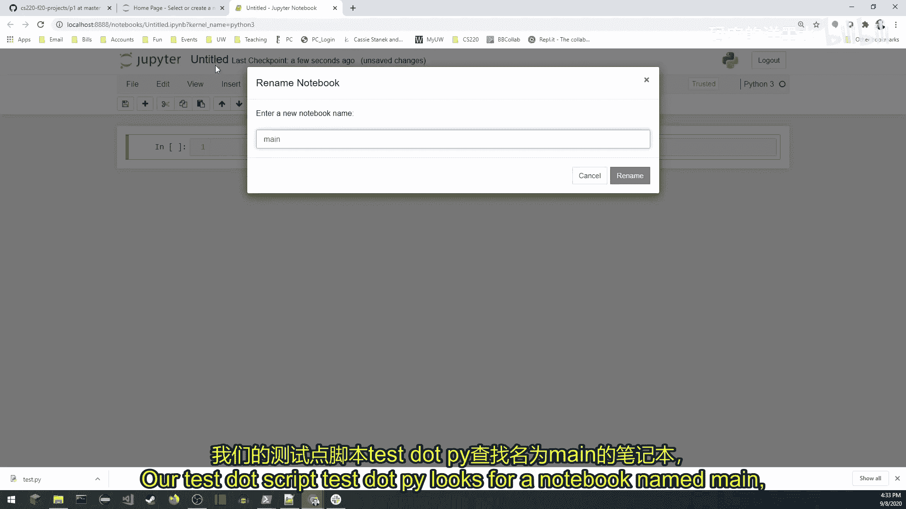

And now I'm going to go back to the directions real quick。 Yep。

 right here because the first thing we're going to do is copy and paste in some code。

So I'm going to grab this code starting with the pound sign Q1。

And I'm going to paste this into the first box right here。 Now it had been blue。

 And when I clicked in the cursor's active， it changed to green。

 I'm going to paste that right here and now got my code to run this particular little piece of Python code I can use hold down shift and push enter。

And it's going to execute this code。 And it prints out Hello world in the out box。Allright。

 just a quick note， this pound sign Q1 is very important。 Our grading script looks for this symbol。

 Po sign Q1。 Poside Q2， there's gonna to be one for every single question。 it searches for that。

 And then it looks for the answer in this outbox to grade。

 It'll either be the contents of a variable or something you have printed。 There's two things。

 and it'll show you that in project2。 So you can either。

 we can either look at the contents of a variable and grade that。 Or if you print something。

 there's gonna to be like text that will be printed to this。 white space region。 you know。

 it's in the blue box right here。 But before we get to the next in box right there。All right。

So I've just run that code。 The next thing I'm going to do。 I want to go ahead and save this。

 So file， we will save and checkpoint right there。 We've already given it a name， so。

We can just go ahead with that1。 And now I'm going to go back to Powerhell。

 I don't want this instance right here。 This is the one that's running Jupiter。

 I want to go to a separate， fresh instance of Powerhell。 do Els again。

 So the first time I did this only file here was test out high。 Now that I've come back。

 I can see I've got this I， P Y N B checkpoints。 That's like a backup copy。

 And then here is my row code right here。 main dot I P， Y N B。 That's the stuff I just did。

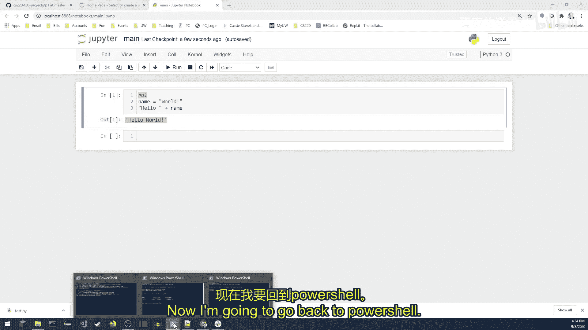

Alright， so the next thing I want to do is test this code。Python。Test do PY。

 I'm going to just run this like this。If you're on a Mac computer。

 you will need to use Python 3 as the command that you enter。So let's see here， converting notebook。

 executing notebook， writing。To this file right here。So now I can see that I do have this test filed。

 that was run。 And when I look at the output in this region of the。

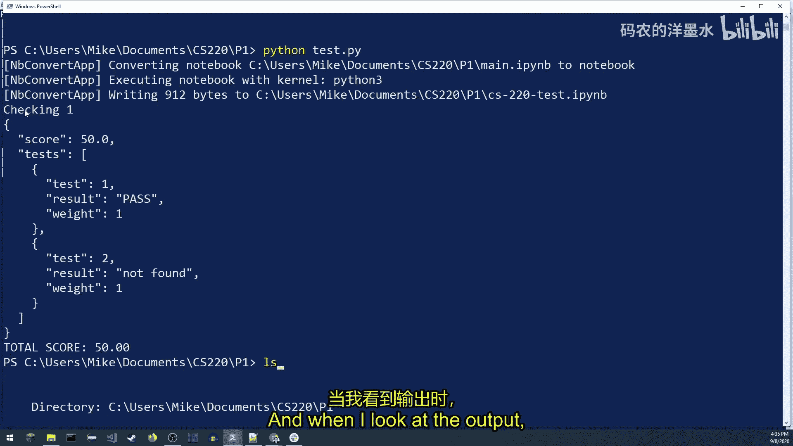

Green right here。 I can see that I'm getting a 50%。 There are two questions。

 I'm gotten the first one right。 So test 1 has passed。 it's weighted at one。

 They're both weight at one。 And it looked for test 2。

 It searched my document for a pound sign Q2 and did not find it。 So print not found。

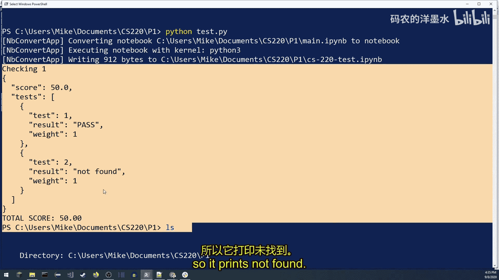

All right， next up， let's go ahead and do the next question。

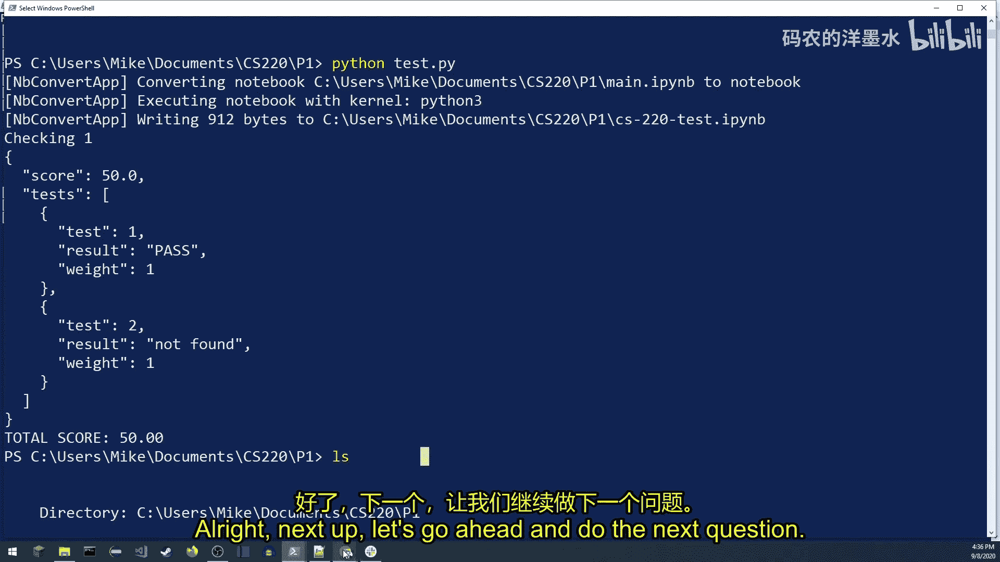

So I'm going to jump back over to Jupenter notebook and here's the project page。

The next thing it tells me to do is in a new cell。Copy this code and enter questiontion 2。All right。

 so let me go ahead， shift enter for that1。 I find out that 34 times 67 is 2278。All right， great。

 let's go back and run that test again。 that was in this window right here。

 I can just type the up arrow to bring back， I had to click it twice to bring back up that command that taps Python test do pi。

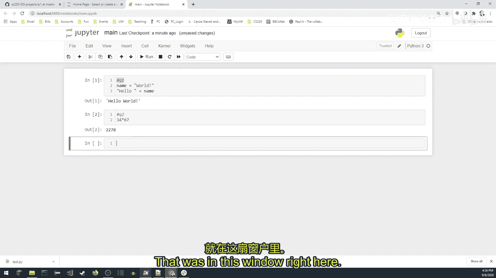

Enser that。 It's going to run that test script。 and I should get a 50%。Oh。

 you know what I forgot to do。 I forgot to save my work。 One second。 Well， real quick。

 go back up here。 I need to go to file， save and checkpoint。

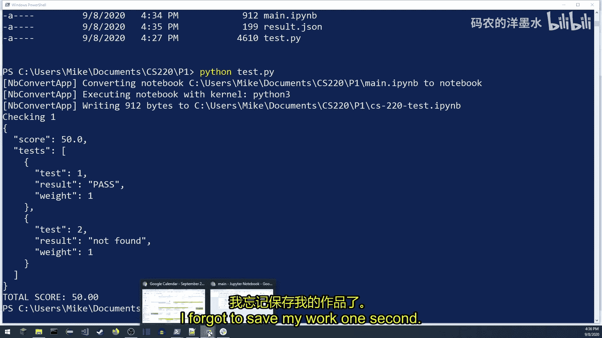

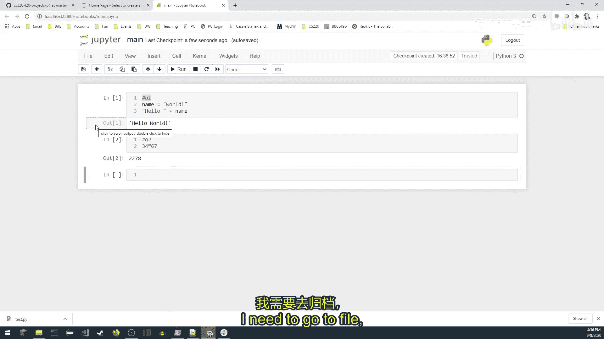

Now， when I go back。I'm going to climb up arrow。Enter。It should run。

 I should get 100% now now that I' have saved my work。 excellent。 Okay。

 so the next thing I need to do， I need to go back。

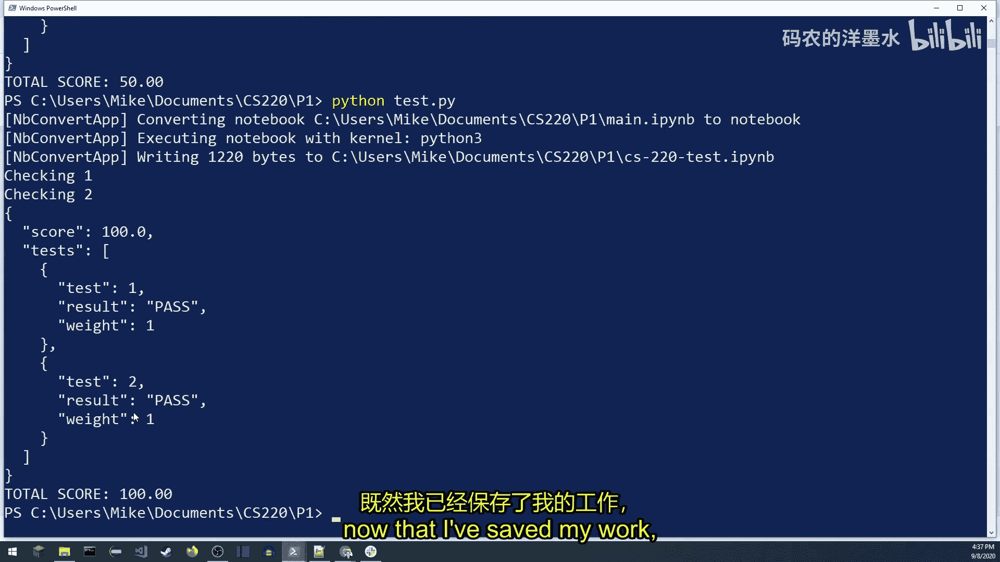

We'll follow the directions。嗯。We ran the tests。And now， when we hand in the project。

 I need to make sure that my name is on here。 So our testing also looks for what project are we working on and my name。

 I'll be the submitter。 I'm not working with a partner。

 Let me go ahead and go back over to Jupiter notebook and I want to put this in。

 There the very first cell。 So I'm going to click over here somewhere。 So it turns blue。

The a will give me a new cell above。B will give me a new cell below。

 And all of those like shortcut keys。 I think they're important to learn。

 it can make you much faster。 But all these things are like。Also found in the menu。

 if you're interested in clicking a lot。 Alright， So now I've got that。

 I'm going to paste that code right here。I don't need to do anything here。

 I don't need to change the project1。 I'll be the submitter。

 I'm going to leave this as it is for a quick demo to show that when you guys turn this work in。

 one of the common errors， and then I'll come back and fix it。But first， file， save and checkpoint。

 a quick note on the like keyboard commands。 This is control S。 So if you want to save a little time。

 control S， just frequently type that one。 It'll save and checkpoint it for you。All right。

 I also made a change。 So I'm going to go ahead and go back over here and run that test one more time just to make sure I didn't break anything。

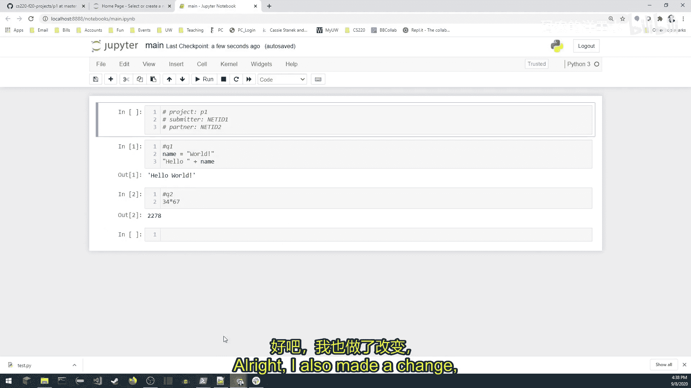

You have no idea how many people turn in work where they have added their name。

 and it causes their whole code to fail， particularly in more advanced languages。

 happens a lot in C plus plus。 So they'll put their name in and not make it a comment。

 and the compiler fails。But this worked just fine。

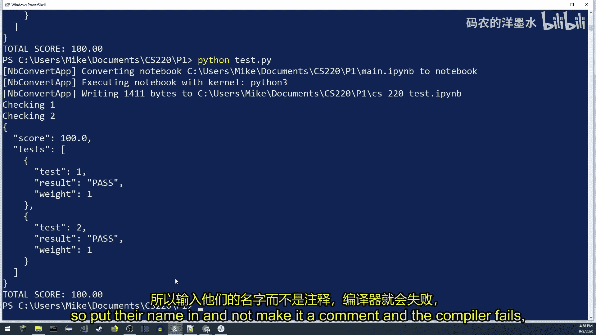

The next thing I'm going to do is go ahead and turn in this code。

 So I'm going to go back to our web page。See， I've got that book marked great。 I missed。Right。Here。

There we go。 I'm going to go to projects and submit this project。 First。

 you need to be logged in with your WISC account。 I'm already logged in like that。

 If this is a problem， you may need to open a new instance of Chrome in an incognito window and log in or you can be just switch your login right here if you wish。

 there's a note there that reminds you you need to be logged in correctly。All right。

 I'm going to be submitting Project one。And I'm going to choose my file。 So I'm going to go。 it's in。

Documents。CS 220。P1。 And there it is main do I P Y and B。 That's the file I want。

 So it's been selected right there。 I'm going to open that。And right right now。

 I'm just going to click submit。So it tells me that my submission was not uploaded due to errors。

 so this is important， wait for the like correct worked message， Otherwise you are not done yet。

Alright， so the error that it's given me is that it's expecting M Doher to be the submitter on that document。

 not net I D 1。 And it checked that and saw that they did not match。

 And so I cannot submit this work。 This is pretty easy to fix。

 All I forgot to do was put my name in right here。 So this is M Doher for me because that's my log in。

 And I'm not working with a partner。 It will also recognize that net I D 2 is not a valid entry。

So I need to indicate that my partner is none。Please， please， please only have one partner。

 submit the work。 You do not。 if you're working with a partner。

 you do not both need to submit your assignment。 The reason that this is so important is that we use automatic cheating detection tools that compare every project versus every other project in this class and last year and the year before。

 and they look for similarities。 And if you and your partner both submit the work。

 they are likely to be very similar， maybe with the two names exchanged as the only difference。

So you're going to get a message saying your work has been flagged as being very similar to someone else's and you're going to have to explain why your work looks very similar to someone else's so please only one person needs to submit。

Al right， so I've got my name here， I'm going to do a real quick control S to save and checkpoint。

 you can see that up here last checkpoint a few seconds ago。

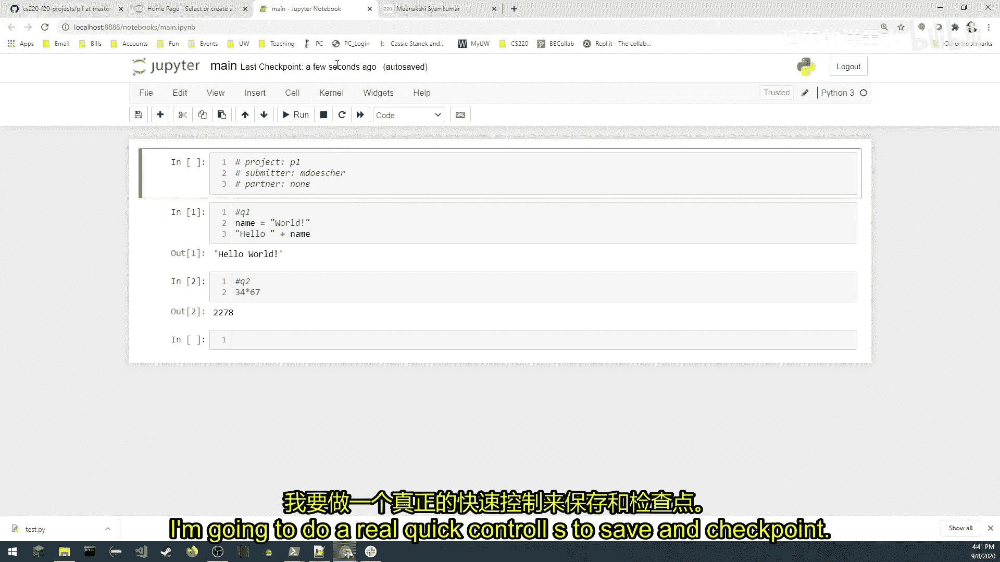

I'm going to go back to Powerhell where I was doing my testing up arrow， run the test。

 make sure I didn't break anything。 Still looks good。 So next， back over to the submission website。

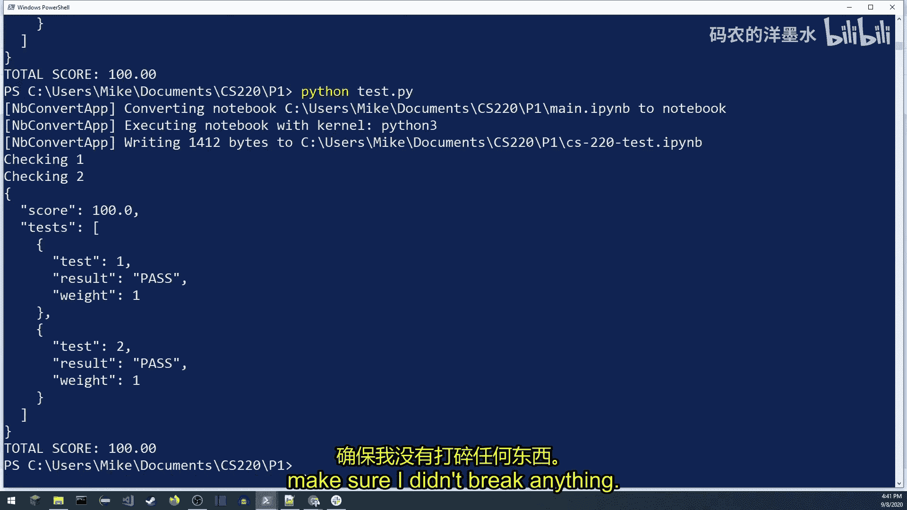

And I'm going to upload my coding in， I'm going to choose File。There we go。

 it's the same directory so I can click main at IP PY and B。Open that up。And now。

I am curious if this actually works for me。 Yes， it did submitted。So that green message popped up。

 Things are good。 So the next thing I can do is I can actually view my submissions。

 So I'm going to go here to project 1。And view the submissions。 This is the first time I've done it。

 So there's only one here。 Please note that you can submit things as many times as you want。

 And we're just going to grade the most recent on time submission。

 and they'll appear here with this weird date time code in universal time code。Units。All right。

 it tells me this one hasn't been graded yet。 when it is graded。

 this is where you will go to view your score and any comments made by the reviewer。嗯。

I believe I'm looking at the greater view。 So your version will be a little bit different than mine。

 I can go ahead and add comments as the greater。 And then I can come back and read them later。

 So the student version is slightly different from the instructor version。Anyway。

 this is how you'll go back and get your results。All right。

One last detail that I made a note of should something go wrong with the opening Jupiter notebook book。

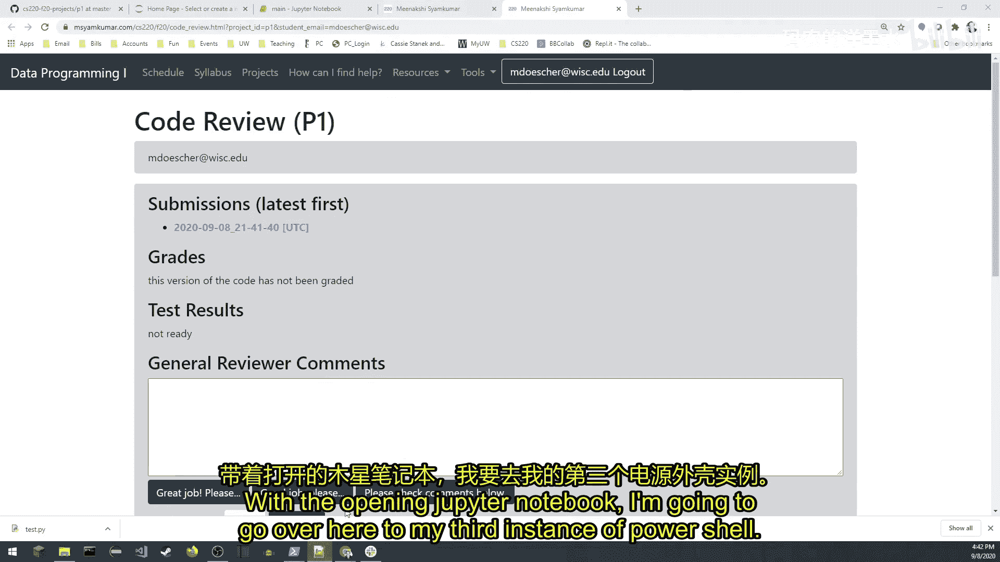

I'm going to go over here to my third instance of Powerhell。

I'm going to appuse the recording for a second and look up， okay， I found it。

Should something go wrong opening Jupiter notebook， You can also use Python dash M。 That's a space。

 dash M space notebook。And this should also be capable of opening Jupyter notebook。

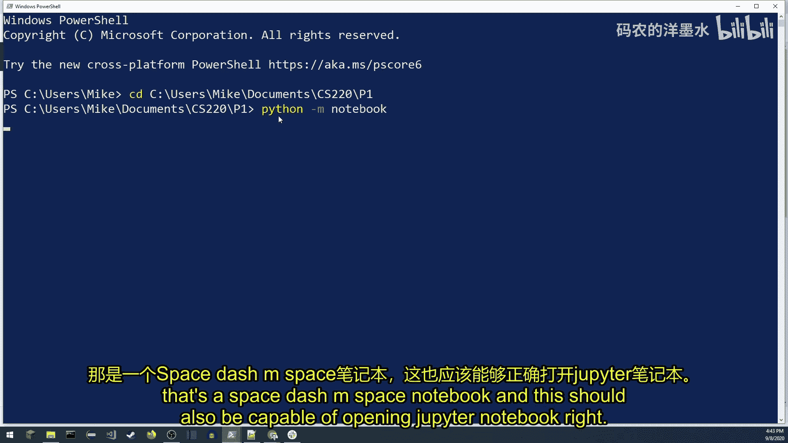

There was an error message that popped up saying it's already open in the same directory I've got two instances should not be a problem。

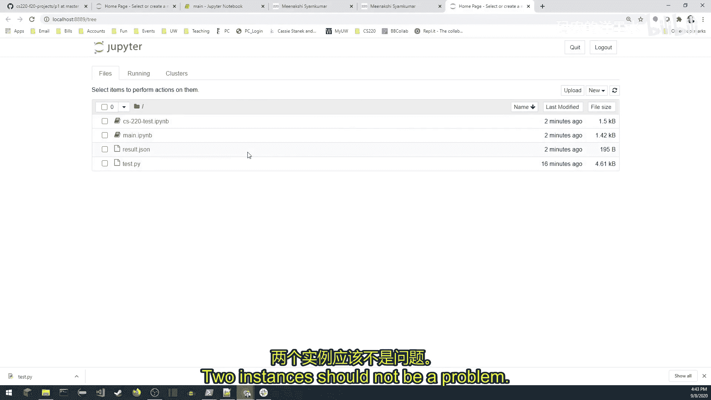

All， that's it for this video。 Have a great day， everyone。😊。

