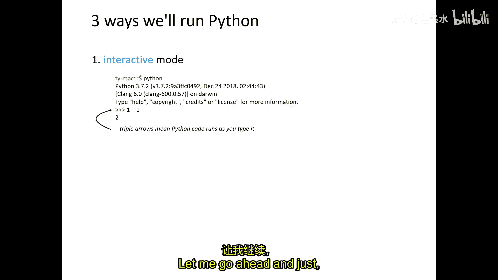
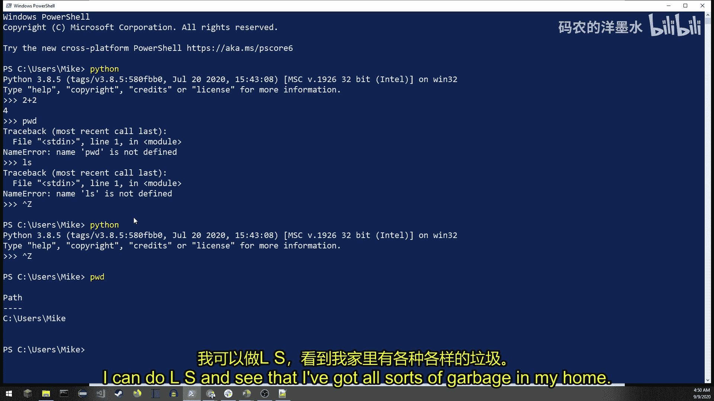
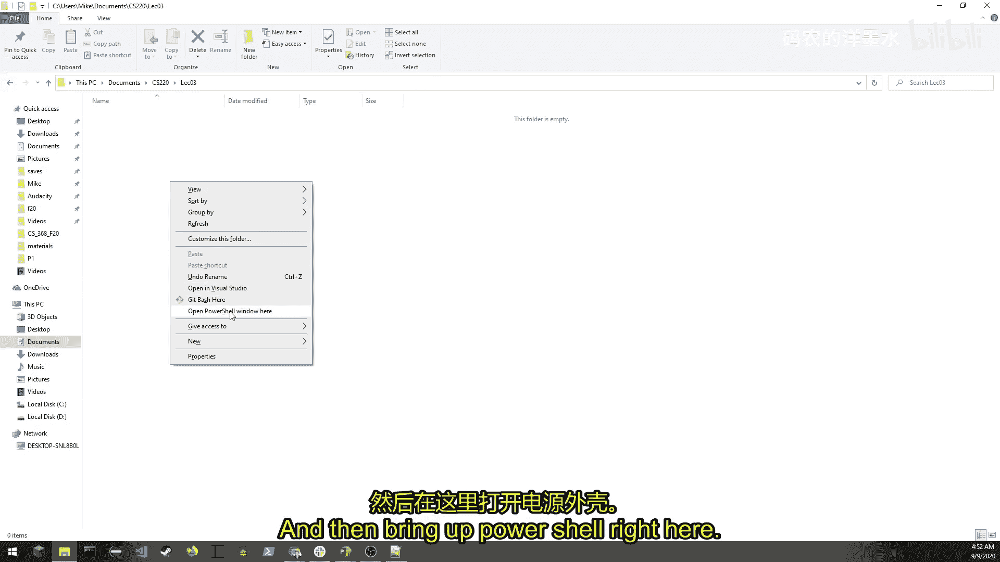
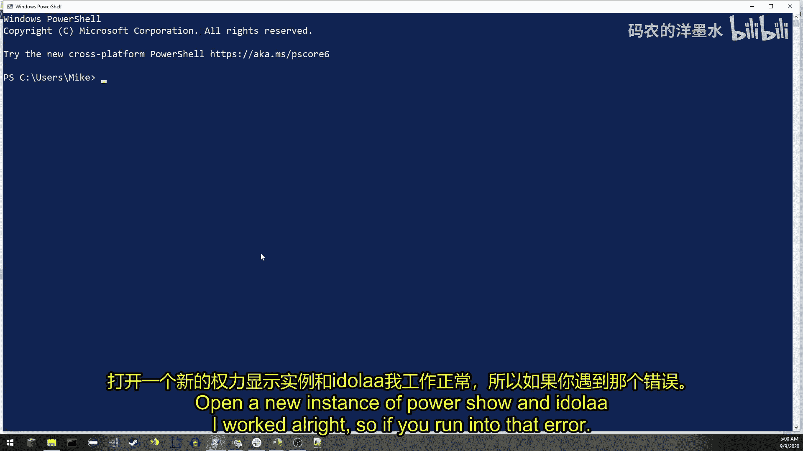
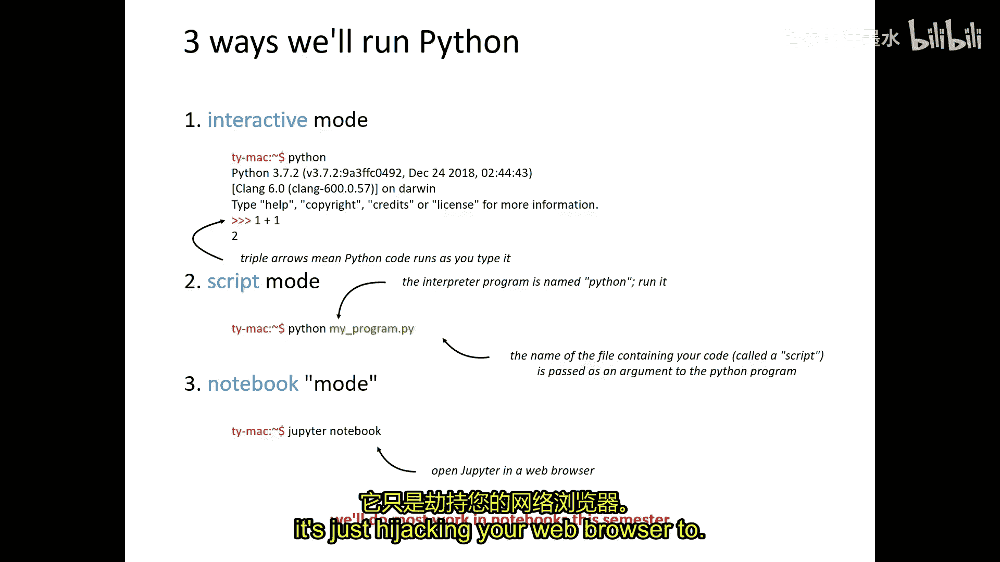
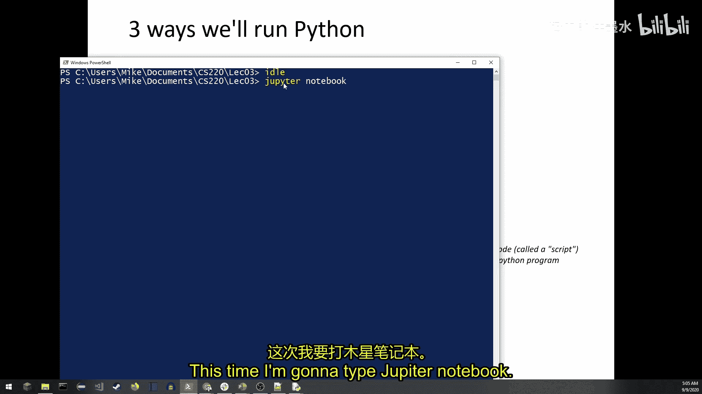
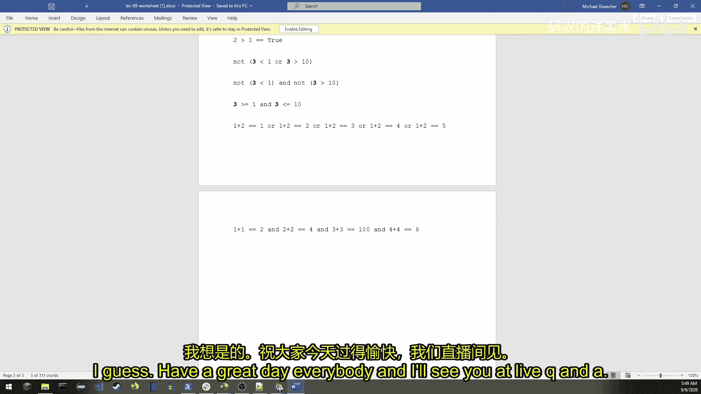

# 【全集】威斯康星大学-Python数据编程-CS220-中英字幕-1080P-p05-Lecture-3---Python-导论--BV1VxvsBLEmv_p5-

All right， everyone， Welcome back to data programming  One。 Today is the day we've been waiting for。

 We're going to go ahead and start actually writing Python code today。😊，First up。

 I want to just quick jump over to our web page， and we're right here Wednesday， September 9。

 Here's the topic list， just a couple things to note first， this is our first reading assignment。

 Go ahead and read downy chapterer 1 if you don't remember where to get the links of the textbook it's found on the syllabus。

 which you can connect to right there at the top tab。

The lecture slides that I'm using today you can find the link right there。

 There's a worksheet that goes along with today's lecture。

 I'm probably not gonna to get a chance to get to do any of these problems in class。

 but you can get all of the solutions to the worksheet by entering the code into Python itself and trying just trying out and experimenting a little bit with the material I see that Minna has already beaten she's making me look bad again。

 she's got her lectures up while I'm still recording This is the code from her lecture。

 If mine is significantly different I'll go ahead and put that up too。

 but just looking at what she's done we have the same plan。

 we use the exact same lecture slides so it's a。Probably gonna to be almost identical And then just a quick reminder that lab1 or P1 P1 is due today。

 so go ahead and submit that I made a quick walkthrough video for anyone who is still stuck on that so you can go check that out the walkthrough is up here on right under where that's assigned It's the only time we're going to be doing a walkthrough for the labs or the projects the rest of them will be on your own and please note that lab P2 and project P2 are now available this one is due next week they're pretty much always due on Wednesday。

So to get us started today， we'll be looking at actually running Python code as well as using Jupiter to run Python code。

 we'll be learning about some of the common operators of math comparison logical。

 we'll be talking about different data types， we saw strings and math。

 you know sort of numbers integers in the worksheet we used last time and we're beginning to talk about Boolean logic。

Al right， so today， first up， the kinds of things， the kinds of software we need just to get started writing Python code。

 First up， Python is an interpreter。An interpreter is just the software that lets us run Python code Well we need an editor and it doesn't matter which one this is the software that's going to let us actually write the code。

 manipulate it read it， change it。 Idle is one that comes built in with Python。

 So we'll walk through how to use that one and then we'll also talk about using Jupyter notebooks。

 this was one of the extra packages that we installed at the end of the Python installation video。

 using Pip。 So if you weren't able to get that to work， go to office hours。

 get some help if you haven't done it yet， just make sure you get that done。All right。

 so an interpreter is a program that runs another program。

 It's a little weird to think about it like that。 but Python is an interpreter。 Python is a program。

 and Python runs Python programs。 The idea here is that it's going to interpret something that humans can read like nice Python code to something that the computer can use。

 which is all ones and zeros。Have you guys heard the phrase before that computers speak ones and zeros。

 it sounds horrible to try and speak in ones and zeros。

So we're not going to be doing that this semester。 Instead， we'll be using the interpreter。

 one way to think about it。 Suppose we reflect back on that worksheet we did last time that we're giving us very specific instructions to follow human instructions。

 And it might say something like put 11 in the box right there。 Our brain is an interpreter Also。

 It's going to take that command。 easily readable put 11 in the box and translate it into instructions that our hand will follow to make sure an 11 ends up in that box。

 First， we might grab a pen go over here and set the pen down on the paper。

Move the hand down and then we move the hand down and that will draw the number one。

 Then we'll need to lift the pen up。 We'll need to move our hand up into the right。

 set the pen back down on the paper and then bring our hand down。

 And now we have the number 11 written there。So our hand is a lot like the computer in this case。

The worksheet is like the code， and our brain is the interpreter。

 What we'll see is that Python is doing essentially the same task for us。 We'll have Python code。

 something like this。 name equals Tyler， print， Hello plus name。

I' me give you one guess what that does。Think about it for a second。

So anyway Python is going to take that and turn that into something that a computer can read。

 computers have wires that go into them that either have high voltage or low voltage and that's going to be a sequence of how we're going to interpret this as ones and zeros and they use that information to display Ho Tyler on the screen。

So Python is that interpreter that takes this。You know， readable。

 that's with some little air quotes there。Code and turns it into something a computer can use。

All right， yeah， I said that already， okay。Next up。

 we'll need an editor to be able to read Python code。So Python files are dot Py files， for example。

 this one here on the left is main dot Py。And this is just gonna to be something that lets us write code just like a word processor or a text editor。

 Python code is plain text so we can use any editor that can edit text to write Python code Idle is a great example。

 it comes prepackaged when we install Python we can use any other text editor if you're using a Mac something like text edit or if you're on a PC like I am something like notepad。

 it doesn't need to be anything special at all。 However。

 code written in an editor that's designed to help you write Python files like Lidel on the left。

Looks just looks better than the text edit on the right。

 One thing is that they've taken the time to color the code and like highlight so that certain things pop out like the print statements are all purple here。

 And the text that's going to be printed is green。 over here。

 everything is just black and white and a little bit smaller。 So it's a little bit harder to read。

 it doesn't jump out exactly what it's going to be printing。

 So some choices for editors are better than others。And then next up。

 we'll also be using notebooks We can use the notebook as an editor if we write Python code in just the editor like I had on the previous slide like iddle。

 generally will have one big file notebooks are going to be broken down instead into cells。

 small chunks。And let's see if I have a， yep， that's a good picture。

This is gonna let us put Python code and then results and then more Python code and more results In the past。

 if you were a scientist and wanted to trade some data with someone。

 supposeupp you made a chart like the one there in the picture。

 and you wanted to share it with your coworkers。 You would give them a spreadsheet or something that you use you know like Excel that you use to create that chart it can be really different difficult to trace through what's going on in in a spreadsheet because you've got calculations in cells。

 everything is a cell there， calculations our cells。

 the data is cells and then if you're looking at the chart， how did you do that math Well。

 notebooks make this incredibly easy， we can just go through every cell does something we can compute the intermediate results。

 we see what's going on here。 It kind of separates the data from the manipulation and makes it all visible in sequence and then we can see exactly where the chart came from and we can mix them in Matlabs getting really good at doing this too。

For those of you guys using MatLb and mathth courses。Allright。

 we'll see that we have three different ways that we'll be running Python code during the course of this semester。

 The first one is the simplest。 it's just interactive mode。

 so I can just type Python from the command prompt。

 So right here in interactive mode I have a command prompt This was photographed with Tyler's Mac。

 So here's the prompt he's going to type Python to get us into Python。

 This is code right here that the output here tells him he's loaded up Python。

 then he can write Python code。Let me go ahead just。

Let's just demo this。 So on my computer， I'm going to go ahead and open up Powerhell。Here we go。

 See user's mic。So this is my prompt rate here， P。The user'smic tells me the directory I'm in。

I can just type Python， and that's going to go ahead and put me into Python mode。

 And this is an interpreter mode。 So this is my new prompt。 This is the Python prompt。

 Just to note if you're on a Mac， you probably need to type Python 3。Just like that。

 it could also be just PI or PY to get into Python depending on how you have your system set up。

 but for my computer， I just need to type Python， I also want to very carefully make note that I'm on Python 3 Python 2 is significantly different。

 They made a number of important changes and it just things will not work the same for you guys。

 So if you see Python 2 here， make sure you go back and verify that you can get into Python 3。

Alright， so once I'm in here， I can do， I can basically treat this like a calculator if I want。

 I'm going to do two plus2， and that'll print that out。Great for， for really quick experiments。 Now。

 if you look at this， I do have a prompt here。 It feels a lot like the shell。😊，But I can't do P W D。

 That's not a function in Python。 This isn't the shell。 This will appear with the shell。

 This was soon as I type Python。 I'm in Python mode。 So I don't have Pw D。 I don't have L S。

 These are all giving me error messages。 So traceback is the beginning of an error message。

 This happens to be a name。 error。 P W is not defined。 Same with this one。

 L S is not defined inside of Python。 So to quit。 And Windows， I'm gonna hold down control。

 push Z and then push enter， and that'll get me out of Python。So that was control。

 click Z enter on a Mac， it's going to be just control D to get out of Python。

 So here I'm back in script mode。Python mode tro Z enter oops shell mode shell mode。

 So now I can do I working directory。 I can do Ls and see that I've got all sorts of garbage in my home。

 All right， next up， the second way we will run Python code is called script mode。

 This is where we're going use an interpreter to write a large Python file dot P Y。

 And run this script。 So let me just go ahead and real quick demo of this。

 I'm going go ahead and use idle。 So first up， I'm going open up。

File Exper。 This is where I was recording my P1 project demo。 So I'm in documents CS S 220。

 I'm just going to go ahead and make a new folder for lecture。 Gosh， are we on three。All right。

 we're going to pretend it's three。I'm pretty sure we're on lecture 3。 I'm just gonna hop in here。

 I'm going to do hold on shift， right， click。And then bring up Powerhell right here。

 And this will give me a place where I can type idle。 Ile is just that text editor will use。 So I。

Oops， looks like I've got a bit of a problem here。 Now， I it's giving me an errorant。

 Na is not recognized。 So this is a Powershell doesn't know where to look to find this。

 So I definitely have idle installed。 I've got Python on my computer。

 I was just using that a moment ago。 So I what I need to do to fix this is tell my computer where to go to look for idle。

 So I'm gonna just on Windows， click the window button。And then type title， and I can see right here。

 I've got actually several versions of it。3。8，64 B。 That's the one I want。

 What I want to do is to make sure I can tell the computer where to go。

 So I'm going to open this file location。 I want to right click on idle Python 3。8。

 I'm going to do the 64 B version。 And instead， I want to go to properties。

 One of the things here is target。 So this is gonna be what the program actually runs when I type idle or when I click idle from the start menu。

 So I'm going to go ahead and copy this entire thing。Inside the quotes， it was already highlighted。

 I'm just going to copy that。 And the next thing I'm going to do。

 I'm going to go back over to Windows。And I'm going to type path。But I'm going to spill it， right？

And this is going to be let me edit the system environmental variables。

 This is where Powershell is going to look for programs somewhere along the path。

So let's see here environmental variables are right there。Then I want to edit the path。

 and I'll just do it right here。 Local variables from my computer。ll edit that。

 I need to add a new location to the path。And I'm going to paste that。Right there。 Now what I。

 I don't need the entire piece of this。 I just need the this piece of it。

 where idle is actually stored。And I don't need the name just the directory。

 So C users like update a local programs， Python， Python 3。8 Lib， and then idlelib。

I think that's what I want。 Close Powerhell。Open a new instance of Powershell and。

Idle， well， ha， it worked。 Allright。 so if you run into that air。

Rewind watched that section of the video very carefully。

 and hopefully I didn't screw it up enough to make it really confusing。Alog if I did。

 if you need help， come to office hours， we can help you add something to the path。Al right。

 that was actually creating a file in my home directory。 Instead。

 what I want to do is go to this new lecture 3 directory that I created。 I'm going to shift right。

 click open Powerhell here。And open idle from this location。 Now， when I save this file。

 it'll be in that folder for me。 If I wanted to， I could have navigated using Power shellll。

 or I can use file save here to save it in the right spot。

 But that just seemed like this would be faster。And hopefully instructive。 All right。

 so once I get here。I can create a new file。Create new file。 And this will be a Python file。

 I'm just going to go ahead and save this right away， save as。And it's in， yeah。

 already in the correct directories。 We'll just save it as main。

Dot pi main is a very common thing for programmers to use for their primary。File its stores code。

 Okay， and then we'll just do  one plus 2，3 plus。4， just get us started， we'll save this。

I'll file save， and then we can go to run and run the module。 this file。 So click note。

 this is F 5 from now and I'm just going to click F 5 to save some speed。Save some time。

 Go a little faster and check this out。 So it's restarted。 This was the old prompt I had before。

 it restarted right here。 I can do one plus one right here and it'll work。 This is interactive mode。

We see that it。 Yeah， when we ran the script， we see that nothing actually printed out。

 So I'm going to go back over here to my script in script mode。

I need to specifically tell Python to print out everything。 The command for that is just print。

If I want to print something to the screen and I need to add it for everything。

 So let me just do that or。I'll file save at5 to run。 and once I've saved it and used print commands。

 now I can see that I'm getting the three and the7。If I go back。Just do one of them。 save at 5。

 Then it only prints the three。 What it's doing with this 3 plus 4 right here in this mode。

 It computes the answer。 It's a 7。 But then Ith's just like。

 you're not telling me what to do with it。 You didn't say print it。

 You didn't say store in a variable。 You didn't say do anything。

 I'm just gonna move on and forget about it。 I did the work。 But it didn't。

 didn't tell me what to do with it。And final thing with this particular。

Idle and using it with the the run option here。 We have all these restarts。

 It's telling me I'm running this file where it's stored。 Here's my root directory。

 I've stored a document CS 220 Le 3。 I called it main dot pi。

 But restart is just telling me that we're starting with a clean slate。

 This will be a little bit different from Jupiter notebook cells。

 Suppose we had stored some information。 some state。

 might have some variables that have data in them。 We are going erase all of those and start fresh。

 That's what that restart refers to。Al right， the last mode we'll be looking at is going to mean what's known as notebook mode。

 I've got this in quotes here。 Most people will not refer to this as a separate mode。

 but we're using Jupyter notebook in the cells of a notebook in a web browser to do to write Python code。

 It's not actually connecting to the Web。 It's just hijacking your web browser to。

Write the code。 So for this， I'm going head back over to Power Shell。 It's still open。

 I can see the last command I type is idle。 Instead， this time， I'm gonna to type Jupiter。Notebook。

Please remember to miss Bell Jupiter。

And。Yep， there we go。 So this is going hijack my blood browser。 You can see that it's a local host。

 That means the file is right here on my computer。 It's not connecting to the Internet。

I can see it kind of looks like a file browser in this window right here。 I can see main。

 I can use this to you know move up a directory and manipulate my file treat move around I can create new files。

 I can actually go over here to I can just。Double click this and it'll open up that main that I just created in iddle。

And I can run that from here。 not what I'm looking for right now。

 instead what I want to do is go and create a new notebook。

 and this is going to be a Python 3 notebook。First thing I'm going to do whenever I open a new notebook is give it a name。

 and I'm going to call all of mine main。 It's a very common starting name for where I put code。

In Python， in any computer science， any programming language。Okay。

 so now what I'm looking at is that the main。 And this is the the very first cell。

 I'm just going to go ahead and type some of these things in。 So we do one plus2。 I can go to run。

Right here。Run that。 Otherwise， there there's a much faster。

 The keyboard shortcut to one is shift enter。 What we see is that。

When I have my python code here1 plus2， it puts the answer in the outbox。

 So this is a little bit different from script mode， which required me to use that print。

 And it's a lot like the interactive mode。 But check this out if I do1 plus。2。

 and then in the same cell，3 plus 4。 And then I run this with shift enter。

 It's only going to print out the last one。 So this is a little bit special。

 There's this out box right here where it's going to take the very last thing and essentially run it in interactive mode and stash that in the out box。

😊，When you guys do your homework， there's always going to be like Q1 or something like that。

 Our grading script is going to find that poundside Q1 and look at this outbox。

 the outbox that matches the inbox right there for the various questions。

 So when you do the homework， make sure you put that poundside Q1。

 and then make sure that the answer you want grade， it is in that outbox。

 So if the answer happened to be three。 and I was looking at this one point this needs to be the very last line of this cell in order for this to work。

 it can't be down here， it's got to be the outbox that matches this cell。Alright。

 if I did want to print out that one plus plus 2， I would need something like print 1 plus 2。

And then I can do 3 plus 3 plus 4 like that。 When I run the cell with shift enter。

 it will print the three。 And then I've got the 7。 So check this out。

 I've got three essentially zones。 I've got my in where I've got my code。

 I've got this print zone where things have been printed could be a graph could be something with a print statement。

 We'll talk about graphs at the end of semester could be via graph Sc plot tables。

 And then this outbox is what happens if I run the very last line in interactive mode。😊，Alright。

 so I think we're good there using Jupipyter notebook， the different。

 the three different possible zones， how to print stuff。

 So next what I want to do is go and talk about some operators。So we've already seen。

 let' me just put that right there。 We'll run that cell。

 So a little comment to write comments in Python。 That's code that doesn't execute。

 We just begin the line with the pound sign and everything following that pound sign on the line is ignored by Python。

 Lets me write comments， notes for you guys。All right。

 so let's just talk about some of the common math operators we've already seen addition。嗯。

I've got addition， we've got subtraction 2 minus3。It negative one。

 we have multiplication that's going to be  three times 5。When that we get 15， check this out3 x5。

 This is another common way that we would write multiplication if we were just writing it out by hand。

However， this isn't going to be valid syntax for us。 So I'm going to write pound does not work。

So we've got to make sure we're using this star for multiplication。

 so I'm going to run that cell again。And check this out。

 It went from cell in 8 to in 9 when I did that every time I run a cell。Increments that number。

 So it keeps track of what order I run the cells in。 and that can be important。

 I can go back if I run this one again， it's going to go from 5 to 11。

 So you can see I'm running the cells out of order。All right。

 another thing that doesn't really work if I want to do three times5 like this。

 this would be great if I are writing this in algebra crs online paper。

 but in Python this is going to give us another cryptic error into object is not callable。

 Maybe you missed a comma it just means that we can't do math like this and we'll talk more about this type of error message later in the course。

So this also does not work。We'll run that cell again to get rid of the error message。Al right。

 and then some other things I want to talk about real quick。 Let's see division 1 divided by one。

Run that， we get 1。0。1。0， check this out。1 times 1。 When we ran out was just one。

1 divided by 1 was 1。0。So what's going on here， what's going on here is about types。

 So Python has decided that if I take an integer， that's a number without a decimal。

 just a whole number， natural number and multiply it by another integer。

 I'm going to get an integer back。And Python has also decided that anytime I do division。

 I'm going to get back a floating point number， it's going to just convert that to a number that has a decimal point。

So check this out if I D3 divided by 2 and run that。

 it's going to just going to give me the correct answer 1。5。

Not all programming languages work like this。 C and C plus plus， for example。

 if I do division 3 divided by two， they'll do what's called integer division and just give me the。

Quotient without the remainder。 So they， they round down essentially to the nearest integer。

 So that would return the value 1 because 2 only goes into 3，1 times remainder 1。

If I want to do that in Python， if I want integer division， I need the double slash2。

 So 3 integer division 2， this should be equal to1。And。3， if I want the remainder， that's modulus 1。

3 mod1。 That's the percent。Oops， I， I' meant2 come out 3 on2。 that should have a range of  one。

 You know， this is a terrible example because they're both one。 Alright， let's change this up a bit。

 Let's do 11 divided by 4。That's 2。75。 we'll do 11。In your division by 4， that's going give me 2。

 and we'll do 11。Remainder 4 or red 11 modulus4。 that should be three。 Okay。

 that's a much better example。 you guys can go。 you could play around with Jupiter notebook like this and do some experimenting。

 You can go to interactive mode through Powerhell or through the terminal and do some experimenting there just to kind of figure this stuff out。

Al right， so that was multiplication， division， addition subtraction。 Next。

 I want to talk about types a little bit more。 So right here。

 we were looking at integer types and floating point types。 Let's just do this real quick。

I can just use the command type and give it a value。

 And Python will tell me that this is of type integer int。I do the same thing， type 2。5。Run that。

 it's going to tell me that this is afloat。And so I can go ahead and just experiment with Python and teach myself using T as we go。

 One of the things I want you guys to walk away from this class with is not just skill using Python。

 but skill in learning to use new programming languages。

 You might be taking a class where you're using Matlab or。You're using you know。

 JavaScriptscript or something like that。 it's important to be able to grab tools from the language that lets you learn about the language through these little experiments。

 So definitely take advantage of this Every time we run into something new。

 go ahead and use type to figure out what's going on with that。So next up， let's do。

 let's see just how good Python is。Can it divide by 0。Go ahead and run that with shift enter。 No。

 the answer is no， I cannot。 So0 division error。 It detects right away that we're trying to divide by 0。

 you can't do that。 And it's giving us this error。 Let me， let me put a couple more things in here。

 And then we'll talk more about this error message and how to read it。

 This is gonna be very valuable for you guys。 So I'm going do one divided by 2。

 Then we'll do one divided by  one。 and then we'll do one by by 0，1 divided by negative 1。

 Then we're。We'll run this。And we're still going to get an error message。Oh that's right。

 But I'm going to I'm change this a little bit print。One divided by two print。Give me one sec。

I'd already forgotten。 I wasn't in。Interpreter mode。And that it's not going to print out stuff。

 unless I tell it to。 Okay， let's run that again。 So Python is going execute each line one at a time。

 So it's going to print out whatever the result of  one divided by 2 is 0。5。

 It's going to print out the result of 1 divided by 1。 So 1。0。

 then it's going to print out the result of 1 divided by 0， which is this error message。

 and then it stops。 We never actually got to the  one divided by -1。 Now。

 if we look at this error message。 What it's telling me right here， is that。

It's a zero division error in I Python。 That's interactive Python input cell。

 This part right here is very important。 This is the one we want to focus on 27。

 which is the most recent one。Sometimes we'll write Python code that has a function somewhere else。

 and one of these other cells will be the reason that this fails。

And so this is going to be really important when that happens when you're like， this is perfect。

 There's nothing wrong。 I don't see where my mistake is。

 It tells you where the mistake is right here。 It's in cell 27。

W whichch is the one that it happens to be right here， But that's not necessarily true。

 And then it gives me a little error showing me that the exact line where I'm dividing by 0。

1 divide by 0 right there。If your version of Python doesn't have the line numbers here yet。

 the very first time you install it， if you haven't switched that over。

 you can add those by going to view and then toggle line numbers shift L will bring those up。

As the quick command key。 So right here， I can do shift L。 The line numbers go away。

 Shi L there back， or I can use the。The menu at the top。Alright。

 just something a little weird you might run into。 if I do1 divided by 100。Let's print that out。0。01。

 perfect， right。 Now， what if we do1。1 divide by 100 should be。0。011， right？Shift enter run that。

 Instead， we do get 0。011。But then it's0 lots of zeros and a1， so it's closed。Like really close。

 But it didn't give us the exact right answer that we would expect if we were doing this in an algebra class。

 So what's going on here is that inside of Python things that are nice round numbers for humans。

 You know， if I'm dividing by 10 or 100 or 1000， I could just move the decimal place over。

Those nice round numbers for humans are not the same as nice round numbers for computers。

 They're working with in binary systems。 So things that are nice round numbers are 2，4，8，16。

 They're all powers of two。 So at Python has to do to do this calculation right here is take the 1。

1 turn that into a binary representation。 It's got to take the 100 and turn that into a binary representation。

 Those neither of those are nice， like multiples of 2，4，816 at all。 And then it does the math。

 And then to display the result for us。 It's got to take the resulting math in binary and turn it back into a decimal number。

 So you guys can play around with this。 This will never be a problem for this class。

 All of our grading scripts are just going to look at the first couple of digits。

 and make sure that you're close enough。 because this does happen。

 So just something you might be interested in seeing is that。

The way that Python does math is not necessarily the way you get it algebra。嗯。Alright。

 the next thing I want to talk about is suppose well。

 Im want to go back to that modulus function for a second。 So a moment ago。

 I was using it to get the remainder。 it can be really useful to unpack numbers。

 So if I have a packed number like this 987。 and I want to get the last digit。Modulular 10。run that。

 We'll extract the very last digit。If I want to extract everything except the last digit， I can use。

Divided by 10。And in this case， it will work。 Yeah。

 I'm using the integer division so that it rounds off I I get another integer back。

 That's going to give me everything except the last digit。 If I want to get the middle digit。

 for example， if I want to unpack that， I'm can do something like 9，8，7。

And that will get me the first two digits。 I'm going to put that in parentheses。

And then that should be the 98。 Then I can do modo 10 again， and that will extract。The metal digit。

 So a lot of weird， like little manipulations with math to unpack digits We'll find this to be very useful if we're looking at things like dates and we want to just extract the month out of a date or something like that。

And a lot of times we'll see that numbers are packed together。 a good example of that is colors。

If you're using。You know， 0 to 256 for the red，0 to 256 for green and 0 to 256 or 255。 sorry。

 for blue。 They'll just take all of those digits and match them together。

 And if you want just the blue， for example， you'll need to extract that from the leading digits。

 You want just the。Wt blue or green blue。 It'd be the the least significant digits。 If you want red。

 it's going to be the top digits。 So packing numbers like that is very common in computer science。

All right， next up， how to raise something to a power。 Let's see， if we want。

This absolutely does not work。 The carrot symbol， like the one you'd have on your calculator to use a raise a number to a power does not work in Python。

That's going to give us one the。Carrot operator or the shift 6。Is the binary？Exclusive or。

And that's all I'm going to say about this， we will never use that in this class。So get that instead。

 what we're going to need to do is use。The double multiply and double star，2， star， star 3。

Lear on this。 now we're getting the exponentiation that we think of。

 This also works with square roots。 So I can use two star stars 0。5。

And that will give me the square root of three。 So Python is very powerful。

 it knows exactly what to do。Check this out。 I want to talk a little bit about precedence。

 So if I do-5， sorry 2， just take a second and predict， what do you think this is going to give us。

5 squared is 25， negative5 squared is 25。Is it going to be 25， Will it be negative 25？In this case。

 it's negative。 And that's because this piece right here。

 the five squared happens before the negative。 So it kind of looks like this。5 squared。Goes first。

 That gives us the 25。 and then we're going to make it negative。

 So this is a great introduction to operator precedence。So that means that， let me just PowerPoint。

Yeah， operator precedence。 So Python is going to work by simplifying expressions so that anything that I can resolve and make simpler。

 turns it into a number or a string of text or something like that is going to be an expression。

And Python' is going to go thread and just simplify the expression one operator at a time。

 So right here， if I look at this， I've got three times3， that times isn't an operator。

 I've got a plus。 That's an operator， another multiply operator。 The exponentiation。

 operator division is an operator。So what it's going to do is it's going to choose one of these operators at a time and simplify it。

 And the very first thing it's going to do is look for parentheses and then。

Look inside the parentheses。 So in this case， the very first thing it's going to do is this division right here。

So yep， it's going to resolve that and turn that into 0。5。

 And now everything within the parentheses has been resolved。 So let's go back。

 The next thing it's going to do is scan through this and look for exponentiation。

 We have them right here，16 raised to the 0。5。 So that'll be the square root of 16。Which is four。

Alright， and then it's going to do multiplication and division next。

 and it's going to break ties using the left to right rule。

 So I've got two multiplications right here。 It's going to do the leftmost one first。3 times 3 is 9。

 and then it's going to do the other multiplication。2 times 2 is 4。 So now have 9 plus 4 plus 4。

And now finally， it's going to do addition and subtraction。 In this case， we have two additions。

 and it's going to do them left to right first。 So it's going to take this operator and do 9 plus 4 and get 13。

And then the remaining remainder of that expression is plus 4。 And finally。

 we only have one operator left。 It's going to resolve that and get 17 and then do whatever we want with the result of that expression so。

Takeaway here， Python' is going to simplify things one operator at a time。

And the order that it chooses to simplify things is follows this table right here。

 So parentheses are at the very top。 It's going to do things in parentheses first。 Let me back up。

 I've got that right here。 work within parentheses first， just like algebra。

 And then the order of precedence for all of these things。 Exponentiation is first。Now。

 check this one out。 Sign are next。 So this is making a number positive or negative。

 This is a unary operator， meaning it only has one argument， and that argument is to the right。

 So this negative right here is only going to act on the X。And make it negative。Following that。

 we see we have multiplication and division， as well as the integer division and the modo。

 these are all resolved at the same time， left to right。Following that addition and subtraction。

 let me click to the next slide where I've got these divisions。

 So this block of stuff right here are all of the arithmetic or math operators。

And then after we've done all of our math， this is the resolving expression。

 simplifying one operator at a time， then we can do something with the results of those expressions。

 including comparing them， so we can do one computation compared to another one。

 So we could say is three less than4 plus 2。 It's going to resolve the4 plus2 and get6。

 Here's my less than operator。 So it's going to do that comparison and three is indeed less than6。

 So that'll be true。Just a quick note on these guys。

 the double equal is going to be what we use for a comparison equals。

 It is something equal to another iss the question a single equal is going to be an assignment operator for us。

 So it's not going to fit in right here。 then。The exclamation mark equal is going to ask the question。

 Is it not equal to， So if something's not equal to something else， Then this will be true。

 And then less than， less than or equal， greater than greater than or equal。And finally。

 we'll talk about boolean logic at the end of this lecture。

 but we'll have like some true and false Boolean only has two variables or two， two。

I want to say numbers two things。I forget what they're called My brain is failing。

 but true and false。 and there is only three operators， not and in or， and they go in this order。

 not as the highest precedence and is next and is like multiplication and finally or。

 which is like addition。Al right， a moment ago， we were talking about types。 We had integers or int。

 and we had floating point numbers or float。 There's other types available in Python  too。 In fact。

 we have strings of characters where we're going have our text。 So suppose I type in hello。

And we'll run that。 It's going to give us an error because it thinks I'm trying to use a variable name or maybe name of a function。

 hello is not defined。 I the error message。 All that's telling me is that if I'm trying to use hello as a string of text。

 I need to put it in quotation marks。And then run that。 Okay。

 so let me just put a comment right here。Be quotes。To use。Sttrainring of。And then I had hello there。

 Okay， and check this out。 Let me run this to get the error message。 I don't like error messages。

 I like to make them go away immediately。 So once I've done this， I've typed in the text hello。

 just like in calculator mode for interactive mode。 When I ran this， it printed out in the outbox。

 whatever the last thing evaluates to In this case， it's also doing the same thing。

 It's printed out hello。 and it's evaluating to hello here。😊。

But they've changed from double quotes to single quotes in Python they we can use either set I want。

I can type below with single quotes and run that。 and still going give me the value back with single quotes surrounding it。

 So it's just telling me that this is a string of characters。 It's treating it as text。Alright。

 this is really useful。 Suppose I have a statement， something like。Oh， it's a good one。She said。

Hello。And quotes。 And I've got。The outside quotes to be。Tell Python， it's a string of text。

 and the inside quotes， I want to be part of the string。

 while having two different kinds of quotes makes this real easy。

 This one's gonna to give me an error。 I can see from the colors that it's already messed up。Yes。

 syntax errors。 If I go back， if I want to fix this， I can just switch to the other kinds of quotes。

 And now the whole thing is red。And it's going to give me。Oops， I got too many quotes。Yep。

 now it's going to give me a string， she says hello。If I want to print this。Actually。

 I'm going to keep this one。 I'm going to keep that same string。

 I'm going to print it out right here。Copy， paste， run that。 Now。

 it's just giving me the she said hello without the quotes。

 So Python has kind of two different modes。 There's like a programmer mode where it's just going to evaluate the contents of this last cell and print out exactly as it is。

 And then there's another version where it's like user mode where it's printing things out in a way that's been formatted like we want here for the user。

What if we have more than one kind of quote in the same statement than I want to print out。

 So here's a great example。 What if we've got she's going to the store。And he said。Hello， okay。

 so now I've got an apostrophe here and double quotes over here。

 So what do I do if I put in single quotes around this whole thing， It's still problem。

If I put in double quotes around the whole thing， it's still a problem。

 This hello is now going to be an issue。 So Python gives us a way to deal with this。 Also。

 anytime I have something that's like a complicated string with more than one kind of quote。

 I can use what's known as an escape character in this case。

The backlash those two things together form an escape character that tells Python。

 I want to use a real quote here。 This is not in the end of a string。 Use the quote in the string。

 I'm escaping it by putting in the back slash。 And I'm going need to do that for both of them。

So that now both of these， the second quote around Ho and the leading quote for Ho are both now real quotes。

 the outside one， that one right there。First one right there。

 those are the quotes that tell Python that this is a string。

 So let me go ahead and run this real quick。And it's。Yep， see。

 Python has now gone ahead and done the same thing。 It switched to using the single quotes。

Because they're always going to return the strings to me with single quotes。

 So if you guys want to use that so things match， feel free if that's your first choice。

 but it's also recognized that it has to use an escape on the apostrophe because this is part of the string and it's gone ahead and switched that to the escaped version of the single quote。

Al right， some other escape sequences that are really useful are the new line。

 So suppose I want to break this statement into two pieces。 The new line is just slash n。

So I'm going to go ahead and put one in right here。

Back slash n is going to be these two characters right here。Will be a new line。

 So when I print this out。If I do it like this， in programmer mode， programmers like to see this。

 we want to be able to know exactly what code is going into format this string。So。

 but if we want this in user mode。Print。And I'm going just copy this text right here。

A code and run this。 It's now gonna add a new line。

 like the same thing as pushing enter to move the text down one line。 So that's backslash。

 and this is。Extremely important you're going to use this tons and tons of times。

 so if you're taking notes， jot that one down right now， stash it in the back of your brain。Allright。

 there's a lot of other cool things we can do with text also check this out if I have three。

 I put it in quotes to make it text。 It's not a number now。 it's actual text。

And I have the number four， what do you think is going to happen here？So3 plus4。

 both of them as text。 I'm going to run this with shift enter。 It's going to give us a new string 34。

 It's just going to concatenate them together。K cat whoops。C， ON， C， A T， E， N， A T。

 I ON concatednation is what we're looking at right there。Go ahead。

 So that was with the addition operator。 What if we do three times four and try that。

See what's going to happen here。That doesn't work。 I can't multiply。

 So addition is defined as just jam the two strings together and make a new string。

 Multiplicationation is not defined。 Can't multiply sequences of type string。 So this doesn't work。

D my little doesn't work。Run that again to get rid the error message。 Al right。

 what about three times。4 I've made a little change here。 up here。

 the three was in quotes and the four was in quotes。 So I had two pieces of text。 Now， here。

 I've got text times。A number。So let's run this one。 And we see that this actually does work。

 It runs。 What it's done is it's taken the text。 the number three here and just concatenated it to itself four times。

 So I have 3，3，3，3。This can be a lot of fun。 I really love this example。😊，We just take hard。

The string H A with a space after it， times 100。It's really easy in Python to just laugh maniaically。

 When you guys get frustrated at some point， you're going to feel like rage quitting。

 My son started  seventhth grade yesterday。 Everything's on here in Madison And about 4 hours in。

 He had his little rage quit moment。 The Pokemon cards flew across the room。

 He still hasn't picked him up。 He's got like 500 Pokemon cards that had been sorted that are now just a big heap on a pile of dirty laundry that I need to go fix。

Just take a moment。Laugh manialy。 Ha ha， ha， ha ha， ha。 And then。

As for help at this point in this class there should never be any rage quitting。

 we have a lot of ways to get help。Yeah， come come see us before you get to this point。Alright。

 so that'll do it for the arithmetic operators。 how they apply to text。

 Next thing I want to do is talk a little bit more about that next blockdown。

 the relational operators or the comparison operators。

 you may remember that when we did those exercises last time with the worksheet where we gave you instructions。

 you know we would。If this then execute this block of text or these these instructions。

 if it's false， then skip down to step 5， those guys。

 those required if kind of conditional statements， if something is true， then do this。

 if a number is equal to zero， do something， whatever。But anyway， here's the idea。

 If we do something like， is 5 greater than 3。 and we run this， this is going to output true。

 So this is a relational operator that compares two expressions。 In this case。

 just the number 5 is an expression compared to 3。 and 5 is， in fact， greater than 3。

 and it's returning the value true。 Okay， so this is kind of fun。 Every time we see something new。

 Let's go ahead and grab the type of it。 So type true。😊，This will tell me what it is。

 and it's going to be of type bo。 So let me jump over to the slides real quick。Oh。

 before I do that quick note， this one is case sensitive。So if I have type of lowercase true。

 this would be an error because true is not defined。 It's the capital true。

 So when you need this in your writing code， make sure you choose the right capitalization。

 And to be honest， guys， I'm going to make this mistake over and over and over again。

 The other class I'm teaching is C plus plus and true and false are lowercase and C plus plus。

I don't know how I'm going to do it， but I'll forget video editing。

 I'll get it always right through video editing， but I'm going to make that mistake a ton。

So just a quick intro to Booleing logic， Booleing logic was invented by George Bo。

 and it has two values。 That's the word I was looking for earlier values。 true and false。

 And then three operators and or and not。 So frequently。

 we'll see these truth tables that just sort of outline all the different possible combinations。

 And I've got the very simple here。 The very simplest ones where I just have。

Something and something else。Under what conditions is when I simplify that， are they true。

 So if I have my first operator true， false and false， true， the only situation where。

The resulting simplification of a Boolean and operator is true。 is when both。Operrans are true。

For the O operator。If they're both false， then that's gonna， all right tell you about， let's。

 let's look at some examples。This isn't making sense， suppose。I have the statement with an and in it。

 It's a Saturday， and we're in CS 220。This is only true if the piece that comes before the and is true。

And the piece that comes after the end is true。 So if you guys happen to be watching this on a Saturday。

 I'm recording it on a Wednesday， but if you happen to be watching this on a Saturday。

 then this first part will be true。 And we're in CS S 220， absolutely， the second part will be true。

 So in that case， this entire statement will be true。

If you're watching it today and it's a Wednesday。That will be false。 And I'm done。

 I don't even need to read the rest of it。 I know that this is false。

 doesn't matter whether this is true or not。 So the only situation which an and statement will evaluate to true。

Is it both operas are true， if we have a。Oh yeah， I animated some。 I forgot about that。So。Yep。

 all right moving on。Next up。So if we take a look at this or operator， project1 is due today。

Or I will eat my hat。So it's Wednesday Project one is due today as I'm recording this。

 so let's go with that for a second if you have to be watching the video later Project one will have been due in the past if it's not today anymore。

 so project one is due today， that's true。Or I'll leave my hat。

 I don't even need to read dust of this。 Project 1 is due today。

 That's true or something else doesn't matter。 This will be true。

 So I'm looking here at the project 1 is due today。 This entire row is true。

I don't even happen to be wearing a hat right now。So。And finally， the not don't have a。

Great example for not。 But it just is going to reverse whatever we have here。

 So something that's false， if it's not false， is going to be true。 Something is not true。

 It's going to be false。 Allright， so back to demo time。 So some of the other things we can do。

 if we just do， let's just take a look at。Some of these true and。True。We that。

 it's gonna give me true。 They both evaluate the true。 If we do true or true。

Also evaluates the truth。 What about。Z。Falox。I'm having terrible timetyping。That can be true。

 Alright。 So this is a just take these go experiment on your own as you're trying to figure stuff out。

 use interactive mode in， in the course of the， the projects we'll be doing in a lot of this conditional work beginning。

Very soon。And some of the conditional statements can get really complicated， like I can have。

Not true。Not。Not， not。False， whatever。 I don't even know what this is going to be。

 but they can become very complicated。And just jump into interactive mode。

 try some of these things out， remind yourself which things are which ones are evaluated first if I have true and false。

Or true， depending on whether the and， whether this is simplified first or this one。

 sometimes the statement will change。 So we may need to use parentheses。

 It turns out that the and is evaluated first， So this will be true and false will be false and false or true will be true。

 So this should give me a true in the end。Because and is like multiplication and or is like addition。

 and not happens before everything。So。Al right。 one other the thing I want to do is with more with the relational。

 We did three less than5 a moment ago and saw that that was true。

 We can do the same kind of thing with text。 We can say as A A less than B。There we go。

And that's going to evaluate the true。 It turns out that Python is going to take all of the letters in the alphabet in all text and convert that into a numerical code。

 And then it can use。that code to decide if something is in order or not。

 so they're going to use a dictionary ordering or alphabetical ordering for text。

And what they're going to also do is decide that。 here。

 let's just do an experiment is a less than capital a。Fall， so okay。

 so that would mean that the capital letters come first。

 That code is known as the ASI code for each of these letters。 So every letter gets a number code。

 They're in a certain order。Alright， just one final topic。

 and then I'll jump over to the worksheet and walk you guys through how to get started with that。

 So first up。We talked about how we have types。There we go。No， wow， failing to type。 Okay。

 so type 2 is an int type 2。0。 This was a float。 So if I want to compare the two of these。

 I need to use the double equal sign， like2。If I do two equals one plus1。

 that's going to give me an error because it's trying to use the single equals as an assignment。

An assignment to a variable， and the number two is not a variable。

 So here what I need is two double equals 1 plus 1。

And that's going to be true because one plus one is equal to two。嗯。 get rid of the air。 Okay。

 so if I'm looking at types， I can also use types to see if they're equal to each other type of two。

Is type 2 equal to type 2。0。 I take a guess， guys， what do you think is going to happen。Commit。

 write it down， in or float。Wait or note。Inint。Is equal to float。 Is that true or false。

 should be false。Yeah， they're in fact going to be different so we can use this sort of test to learn more about the language。

嗯。Just open up the interactive mode， do some experimenting as you're going through trying the homework。

 It's good to just have that open in the background at all times while you're running。

 while you're working on your projects for those like， how does this work again。

 just one line at a time， do some experiments。All right， last thing I want to do。

 I'm going to head back over to the worksheet。Open this up。That's the wrong link。 Time out， time up。

 Time out。 Is this right。It's downloading it。Alright， I'll get that fixed in a second。 Yeah， okay。

 here's the work。 I want。 I want to take a look at。 So it's just gonna ask some questions。 and then。

As you go through these， you can like， what are each of the following evaluate to。 Take this。

 make your best guess， figure out what you think it's going to do 1 divided by3。

 What's the remainder should be one。 But go ahead and then type that into Python in interactive mode or use a notebook and just get some practice。

 The goal of this is to give you guys some problems that ask you to think about how Python works on the inside。

 What it's doing and。Make some predictions。 So these can be kind of fun。 Like。

 take a look at this one，2 greater than one。Is that equal to true， So two greater than one。

 that should be true，2 equal to true。True， equal to true。 That should also be true。 All。

 So without maybe that wasn't wasn't all that complicated。

 But you can open this up and just try some of these as an example。 Alright。

 that's gonna do it for me today。 I guess have a great day， everybody。

 and I'll see you at live Q And A。😊。

