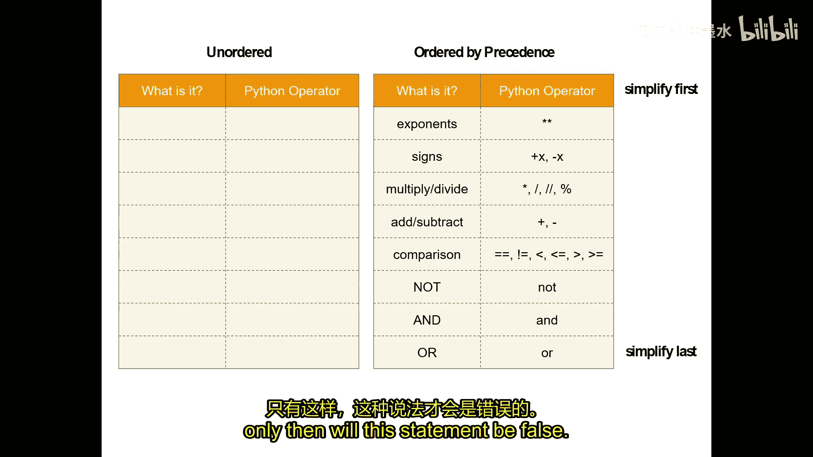
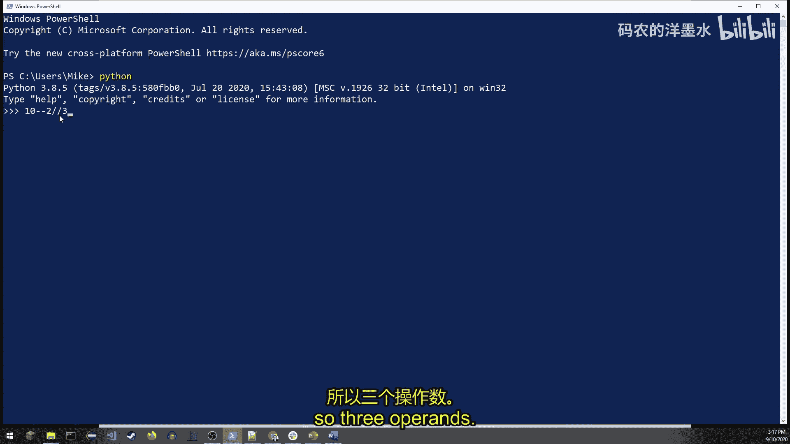
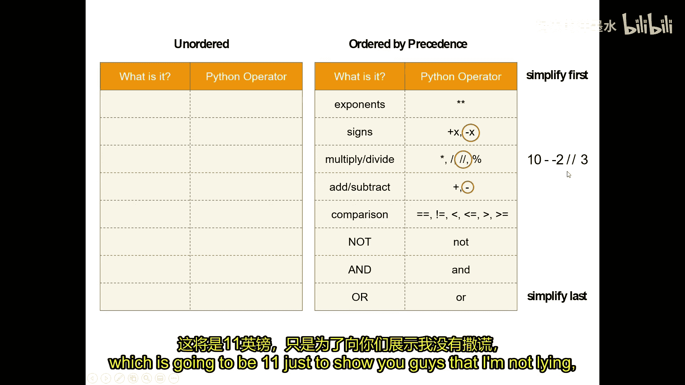
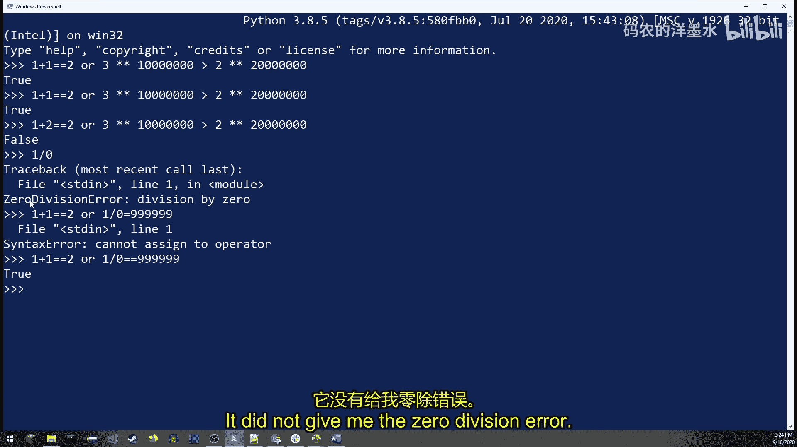
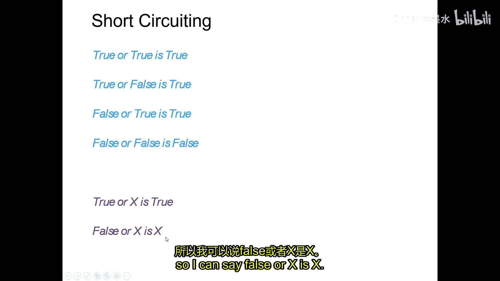
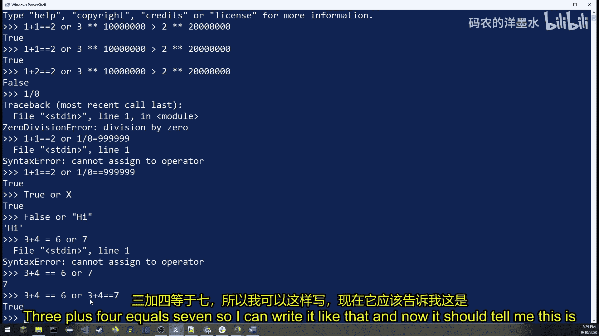
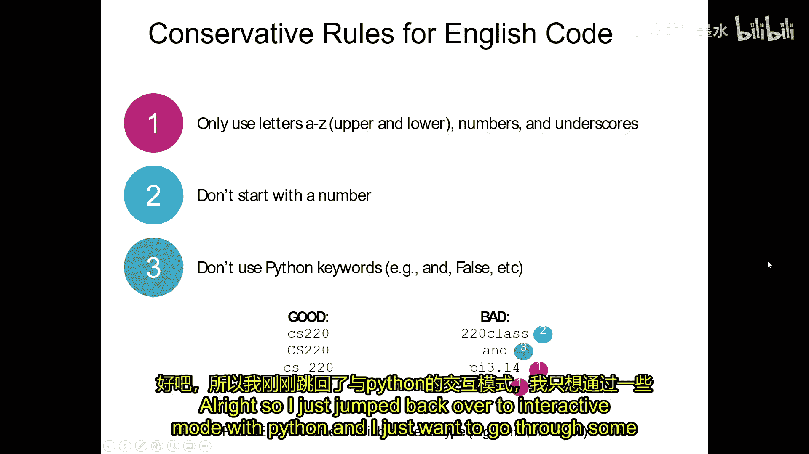
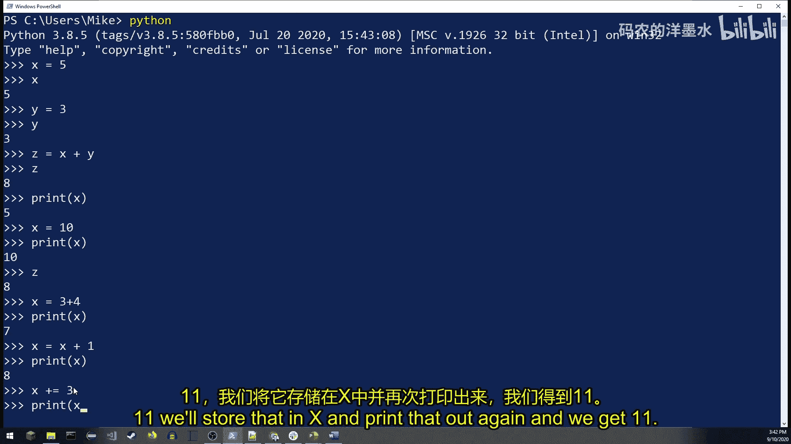
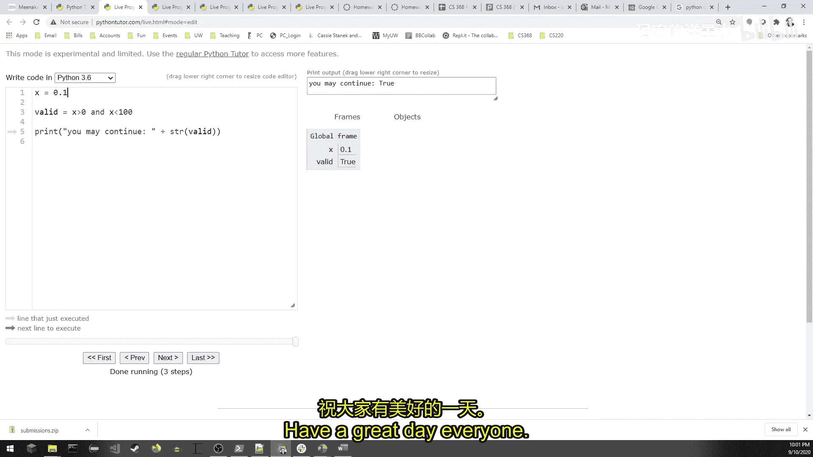

# 【全集】威斯康星大学-Python数据编程-CS220-中英字幕-1080P-p06-Lecture-4---变量与表达式--BV1VxvsBLEmv_p6-

All right， hello， everyone。 welcome back to data programming1。

 Today we're going be talking about variables and expressions。

 and we're getting into the doing some programming。

 So the course is starting to get a little bit exciting。 As we do that。

 I'm going to be doing a lot of examples and a lot of programming exercises。

 please try and follow along， pause the video if you need to writing Python code really builds your like muscle memory and just typing it is another way to learn things。

 So by following along and actually doing all of the examples while I'm doing them。

 helps you learn better。😊，I want to start out with just a little bit of review。

 Last time we were talking about different operators。

 and I've got a list of a bunch of the operators right here， but I've mixed up the order。

 What I want you guys to do is think a little bit about precedent。

 Some of the operators if they're merged into the same statement will be acted on first。

 So Python is going to take any expression and try and simplify it。

 simplifyim it down into a number or a text or a boolean value like true or false。

So what I'd like you guys to do is just take a look at this list。

And figure out which one of these is going to be the highest precedence， which one goes first。

Alright， if you've made up your mind， I'm going to go ahead and give you the answer。

 and we'll just go through this list one at a time， highest to lowest。 So。

 and I'll pause between each from， you can give it some thought and make a commitment。Write it down。

 maybe。Okay， the very first one is。Exponentiation， that's the double star operator。

 not the shift 6 carrot。 just so you。 And I'm going to go ahead and make that mistake a couple times during the course。

 justca I can't remember。 And Malap does it differently。All right， so next up。

 what do you think is next？If you said。The signs。These are the uninary signs that make a number either positive or negative。

 then you are correct。All right。 Keep going。 What's next。That's right， multiplication and division。

 and this includes the regular multiplication， which is the star， not the X。Sort of regular division。

 just like your calculator does， that'll give you a floating point number with a decimal place。

The integer division that will round down for you。 And it's always going to be rounding down。

 If you get negative 1。5， it's going to round down to -2。And then the modullo operator。

 or the way we would say it is mod。 This is going to give you the remainder。All right。

 what comes next guys？Add and subtraction。 That's right。

 This is These top four here are the math operators， otherwise known as arithmetic operators。

 Those are always going to come first。 So we do all of the math first before we do any。

What comes next。Comparison， And quick reminder that the double equals is the is this equal to I the left side equal to the right side。

 The single equals will use for assignment that's coming up to day later on in the lecture。

 but the double equal is used for comparison。 The exclamation point equal is used for not equal to。

Then we have less than less than or equal， greater than and greater than or equal to。Okay。

 and these are all of the comparison operators。 So they all fit in one box here。

 They all have exactly the same precedence。Allright， now we only have three left。

 These are the Boolean operators。And they go in this order， first up。Not。

 So not is just going to take anything that's true and make it false or anything that's false and make it true。

Following that， we have。And so and is a lot like multiplication for an and statement to be true。

 both the left hand side and the right hand side need to be true。 So when we simplify one of these。

 if the left hand side and the right hand side are both true。The composite statement will be true。

 otherwise it's false。And finally。Hopefully that one you guys got is the or statement。

 And this is going to be a boolean statement with the left hand side or the right hand side。

 if either of them are true or both of them are true。 Then it'll be true。 If they're both false。

 only then will this statement be false。 All right， Let's take a look at a quick example here。

 Let me pull a powerhe and get into Python。 Remember。

 that's Python and Windows and Python 3 on a Mac。 If I have a statement like 10。

us-2， slash slash 3。 So a look at this one。 I'm not going to push enter just yet。

 but what I'd like you guys to do is answer the question。 how many operators do we have here。

And how many operas。All right。I'll pause the video。 Give this some thought。

And then when you're ready。Make a commitment。 You' like。

 write down your answer so that you've got made an informed decision， your best guess。Alright。

 hopefully I have stall long enough。 So the answer is we have three operaans，10。

2 and 3 are all operarans。And we also have three operators。 We have the subtraction。

We have the negation。 So that's going to make this -2。 and we have integer division。 So three operas。

I' jump back over to my PowerPoint slides。 So when we look at a statement like this。

 here's what my three operas， the very first thing that's going to happen when we evaluate this is we'll take the negative2 here and actually make this2 into a negative number。

And then we're going to use integer division。 if I take negative 2 and divide it by3。

 that would be two thirds， negative 2 third， and we're going to round that down to negative1。Okay。

 following that， we're going to do subtraction。 It's going to be 10 minus negative 1。

 which is going to be 11。 And just to show you guys that。

I'm not lying， I'm going to go back over here， get focus to Powerhell。And execute that statement。

All right。 What happens if we rewrite this a little bit。

 Let's add some parentheses so that the division。Actually comes before that negation。

 what's going to happen now？Make a prediction about what you think the answer is going to be。

And then。Push play again。So what's going to happen here is I'll take two divide divide。

 So that's integer division by 3。 So it goes in0 times with a remainder of2。

 So that's going to be a 0。 And then when I take 10， subtract。Then negative zero。

the sign will come next of negative 0， which is still just 0。

 And then 10 subtract 0 is going to be just 10。 let's do one more of these in Powerhell。

 I can just highlight， right click and then right click again to copy and paste。

What I want to do is answer the question now what happens if？I do the。Division last。

Got an extra character in there。 Okay， so 10-2 slash slash 3 integer division 3。

 So what's going to happen here is 10 subtract negative 2。 The negative two will be first。

 Then we do the subtraction。 We'll get 12。And 12 divided by 3 is going to be 4， remainder 0。

And indeed， we do get 4。Allright， let's take a look at one more example Here I have one plus one equals 2 or three raised in power of 1。

4，5，6，7，8 looks like 10 million greater than2 raised in power of 220 million。All right， go ahead。

 give that some thought and pause the video when you've got an answer， what does this evaluate to？

Let me know。So， the answer here is。True， of course。

 all I need to do is look at the one plus 1 is equal to 2。 That part is true。

 And the moment I know that a statement is true。 Then I don't even care what the rest this is for an or statement。

If either side is true， then the whole statement is true。 And Python's good at this。

 It's only going to take a look at the left hand side。And then if that's true， it's done。

 it skips the rest of this。 If it's false， then it does need to go over here and evaluate the right hand side。

 So let's， let's take a look at this one more time。 Let me copy this。

We'll paste it and just run this again。 watch how fast this happens。Okay。Awesome。

 now I'm going to change it again。 I'm going to ask if  one plus2 is equal to 2。

 So that will make the first part of the or statement to left hand side false。

 and it will have to evaluate the right hand side。 So check this out。 So watch how long this takes。

All right， that was about 13 seconds。 No video editing magic。 I just let it run。

 and I've got a pretty decent computer here。 It's a few years old， but not bad。All right。

 so Python knew instantly that it didn't need to do this horrendous computation。

When it skips doing the second half of a boolean statement。

 either because an an statement has the first half false or an or statement has the first half equal to true。

 that's known as short circuiting。 In fact， we can do some really interesting things here。

 Supp I take  one divide by 0， that's going to give me a division by 0 error。

 But if I do something like  one plus 1。Is that equal to2 or one vi by 0？Because。Something。

 something big。啊。Hopes you got your typo there。I need my double equals。There we go。

It's going to know instantly that's true。 It did not give me the zero division error。

 It never even needed to try and divide by 0。

So just to be really complete when I'm talking about short circuiting here I have all the different possibilities for an or statement。

 True or true is going to be true。 Tru or false is going to be true。

 falsese or true will be true and false or false will be false。

 So take a look at these first two statements。 They both begin with true。

 It doesn't matter what this is。 So I can say that true or whatever X is going to be true。

I also know that if either of these are false， then Python has to go back and evaluate this second one。

 so if I say false or x， note that true is true， those two match， false is false， those two match。

 so I can say false or x is x。

Al right， now check this out。 This is fascinating。 So if I go back and say true。Or packs。

It doesn't even need to evaluate X。If I say false or let's give it something valid， like hi。

It's going to know that it doesn't need to it's going to skip this first part。

 It knows it needs to evaluate high。 And instead of getting this to return a number or I'm sorry。

 a balloon value， it's just going to return whatever this is。

 And this can be extremely deceptive for new programmers。 and even myself。

 I make this mistake occasionally。 I thought it's really powerful。

 But this is one of those things that tends to trick it up。

 What if I'm trying to find out if 3 plus 4 is equal to 6 or 7。 I just can't remember。

3 plus four equals six or seven。Make perfect sense in English。

But this is actually going to evaluate to 7。 here。 Let me just push go， whoops。Check that out。

 I forgot the double equals again。That's。Whoops twice in one lecture。All right。

 I hope you guys are countning my mistakes。 You can put in comments。

 how many mistakes I make at the end and just make a fun game of it。 There we go，7。

And here's what's going on。3 plus 4 is not equal to 6。 So this is false。

 The first half evaluates the false。 And when I have an or statement。

 then I need to evaluate the second half。 And this is going to return 7， Not true。

 I expect this statement to be true。 So if I want to do this， what I really need to write is 3 plus。

Plus 4 equals 6， or。 and then I need a complete expression that's going to be true or false，3 plus 4。

 equals7。 So I can read it like that。 And now it should tell me this is true。

Alright， just move on。 I want to talk a little bit more about expressions and operators and operarans。

 All of these things here are expressions。 probably the best way to think about an expression is an expression is something that Python can simplify down to a number or text or Boolean value。

 true or false。 So 5 plus 5 could definitely be simplified。

This expression can be simplified all way to do is the math， this one。

 I've got a relational operator here， so this is going to be true or false when I evaluate it。

And even this complicated one with the modulus and the assignments， it's got an o in there。

 should evaluate to true or false at the end。嗯。So each of these operas， everything in here。

 all these numbers are examples of literals。 A literal is just a value that's fixed。

 can't be changed。Like of the way that a variable can be changed。

 So here a variable is just gonna to be a place in memory that I've named that stores some information。

 some data。 So x plus y is an example of using variables。 X could hold the number 5。

 Y could hold the number 6。 and I could use that to evaluate in expression。

 But because I'm using variables， those are not fixed。 at a later point。

 I could change the value of x and execute this again。

 and this expression would then give me a different answer。

 So all of these things in red on this page in my examples here are examples of variables。

 These are the exact same expressions I had over here。 So here I had 5 plus5。 Now I've got x plus y。

 I'm just using variables to hold or to represent those numbers here of diameter and pi Here I had my diameter 8 and pi 3。

14。 All right， I hope that makes sense。All right， so pop quiz。I'm just joking。 No points on this one。

 Take a look at this list and identify which one of these are literals。

 and we'll go ahead and circle those。 And the rest of them are going to be variables。All right。

 so take a moment， identify which is the first item in this list that is a literal。All right。

 if you picked。0， then you're correct。0 is a number。 It's a fixed value。

 It can be used to represent something else。All right。 look on the list。 identify the next literal。

And if you picked true， you're correct。 So check out this one0 here is the the word0 not actually the number。

 So Python is going to use the number to represent， you know， the literal value， the number0。

 This is going to be a variable name。 In fact， you can use this。

 I've actually used it in code that I've written。 usually to represent0。

Numb1 is a great example of a variable name。 It's not something that we would say as a number or text or a boolean value。

So true with the capital T is the next literal。 So the two boolean values that are available are true or false。

 both capitalized。 That's another mistake I'm going to make a lot because my other class is in C plus plus。

 and they use lowercase。 Forgive me when I make that mistake。

 I'm not even sure you guys should count that one。 If you're talling up how many mistakes I make。

All right。One more here in this list。 if you guessed good bye， then you're correct。

 Good bye is a string that's in quotation marks that those quotation marks are going to make this a literal。

 We've got some text here。 Hello， also looks kind of like text。

 but it doesn't have the quotation marks。 So that means this is gonna to be a variable。

 And we can use full words as variables。Allright， so let's talk a little bit about assignment。

 Let's go back here。 These are those same expressions I had before。 After I evaluate them。

 it would be great if I could store that data right now。

 if I use these in immediate mode or in Jupyter notebook。

 It's just going to print out the value of whatever the expression yields to the screen。

 If I'm using this in a script， It's going to go ahead， It's going to take the time to compute it。

 And then it says， okay， I guess you didn't want me to save it or print it or anything。

 So it's going to go away。😊，And Python will not remember it。 So to do a variable assignment。

 all we're going to do is first， I'm going to make some space on my slide so that I have room to put in the equals。

 And this is the single equals。 We'll be using the double equals like this one right here for comparison。

 The single equals is assignment。 and then we'll put in。😊，The variable names。

 and I can use anything I want for variable names within with some rules。 I can use you know。

 complete words。 In fact， I think the variable the name rules are on the next slide。

 but I'll get there in a second。 A great way to think about this is the the name of the variable。

 And then in your mind， read gets。Okay， so total gets whatever this expression evaluates to。

So Python is going to do the right hand side first。 It's always going to simplify these。

 It's going to bring this down to a number or some text or boolean。

 and then just store the result of this computation in total。 So total gets if x is 5 and y is 5。

 then it's going to store 10 in total。All I skipped way ahead because I wanted to talk about a little bit about the name rules first。

 then we'll come back to the demo。All right， so。The name variable naming rules in Python are actually really complicated。

 Python 3， the designer's goal was to make this as friendly as possible to non English programmers。

So there。So there are lots of characters that are allowed So what I want to do is give you guys some guidelines。

 if you want the complete rules got the website link right there。

 you can go and check it out but what I want to do is give you guys some guidelines about things that will always work。

 So if you're working with an English keyboard if you use only the letters A through Z uppercase lowercase are both fine numbers and underscores you'll be fine。

 limit yourself to those there are a lot of special characters that are also allowed。

 do not start variable names with a number that's not going to work。

And don't use any Python keyboards like true or false with them capitalized and is another one。

We're not going to cover any of the naming rules in other languages。 So in my demonstrations。

 these are the only variable names I will use。 I will follow these as rules。Alright。

 so let's take a look at some of these here。 I've got a list of。Farables that are good。

CS220 is perfect。Capitalize， also good。 I'm allowed to use underscores。

 I can even start my variable names with underscores。 A lot of times。

 these are used for special things。And we'll talk about conventions， probably in the next course。

 not in this class。 Allright， And here's some examples of things that are bad。

 So let's just give a look at these。 So 220 class。 this is bad because it's using violating rule number 2。

 It's starting with a number。Yep， there a rule number two。 And his reserved keyword。 In fact。

 it's in my example right here of things that are bad。 Don't use that。 pi 3。14。

 the decimal point right there， P。The， yeah， the dot period。 that's the word I was going for is。

 is not permitted。Letters， numbers， underscores。 So that's going to violate rule number one。

 and the exclamation mark also not allowed， will also violate rule number one。

 There's a lot of things in Python that are not keywords。 They're not reserved。

 but they're used for specific things like the type of a number that's an integer is called an int。

Type of text is called a string， SDR stir some built in functions like length LN are also things that Python will let us use as variable names。

 but that's going to replace the like built in things with the new variables and then that'll lead to errors elsewhere so please please please never name your variables after types or these not keyword but like things that are built in it's going to lead to problems。

All right， so I just jump back over to interactive mode with Python。

 and I just want to go through some examples of variable assignment。 so I can just say x equals 5。

And it's not gonna print anything out。 The assignment doesn't do that。

 So if I want to do that in immediate mode or interactive mode， I can type X。

 and it'll give me the value。 So there I have assigned 5。

 the number 5 and stored it in memory location called X。 Let do the same thing。 Y is equal to 3。

 So there's a second one。 I can print out Y。 Allright。

 I can also do something like Z is equal to x plus Y。 And that'll store whatever 5 plus 3 is in Z。

 Let's find out what it is。All right， indeed，8， so that looks correct to me。All right。

 some other things we can do So because interactive mode here or immediate mode is going to let me just text the name of the variable if I'm in a script or if I'm in Jupyter notebook and it's not the final statement。

 I'm actually going to need to print things out。I can use。I meant x。

 I can print out in variables using just the print statement。

 Print X is going to give me the value of x is 5。 I can go ahead and change the value of x。

 I can say x is now equal to 10。And now， if I print X should print out 10， because I've changed it。

 So the 5 is now gone。 If I print out Z， however， So remember Z was x plus y。 that was 5 plus 3。

 I stored an 8 in there。 It did not go back up and update Z。 Z got the number 8。 It's storing 8。

 It's not remembering that it's x plus y and recomputing it every time。

 It's just evaluating the expression。 And then giving it the。The number at that time， from then on。

 it's frozen。 Okay， so the right hand side can also be an expression。

 I'm just going to do something simple 3 plus 4。 So it'll evaluate the expression and then store that。

That means that I can also you。Print that out 7。 just to show you guys。

 I'm actually pretty good at math， but I make mistakes when I'm doing stuff like recording or have an audience。

 A lot of mistakes。 Allright， because they evaluate the right hand side first。

 and then store whatever that simplifies to， to in the left hand side， I can do stuff like this。

 X equals x plus 1。😊，So it's going to go when it evaluates this， it's going to go to x。

 find out that it's 7， add one to it， this right hand side is now8 and store that in x。So那。

Print out X， we see that it's 8。This sort of。structure is extremely common where I'm updating a variable with something。

 So Python actually gives me a shortcut to do anything like x equals x plus something or x equals x times something or x equals x subtract something and this is going to be the plus equals operator。

It has the same precedence as the assignment operator， so I can do x plus equals。

 and then I can add three more to it。So this is going to be exactly the same thing as though I had typed x equals x plus 3。

 I recognize that it's only saving me one character of typing。But if I'm using longer variable names。

 this can be actually。A lot more efficient。 So this is going to say。

X equals x plus 3 or 8 plus 3 is equal to in this case， 11， we'll store that in x。

AndP that out again， and we get 11。Alright， at this point， I'm back over on my web page。

 We are down here on Friday。 I'm actually recording this early。 Check this out。 It's Thursday。

 That says PM， not AM。 I'm very excited about this。😊，All right。

 and eventually our code will be or the video will be right here， the reading。

 please read downy chapter 2， while I've got this open to remind you guys。

 we'll have the code from today's lecture available， as well as the slides。

But what I want to do is introduce you guys to a brand new tool that's just awesome。

 I really wish I had this when I was learning programming。 It's under tools。 This is Python Tutor。

 So I'm gonna click this。 It'll open it a new window for me。 All right。

 And this lets me type Python code in this window and then visualize the execution。 This is great。

 but I really love the live programming mode because it shows me what's going on to step by step。

 So I just click that live programming mode。😊，Let me make this big enough that it shows up well if you're watching on a mobile device。

 hopefully。Alright， so I'm just going to type some Python code。 I'm going to say x equals 3。

Y equals 4。Print X plus y。 And as I go through， it's going to go through and do all of this stuff。

I can say。Let me make a little smaller so that I can actually see the controls。

 So I'm going to go back to the first step and just。So I clicked first。

 this red arrow tells me the line that's about to execute。 It's the next line that will be executed。

 So if I click next， it's going to say， go grab some space。 Here we go。 Name it X。

 put the value 3 in it for right now， ignorere this global frame。 ignore the blue box。

 That stuff isn't important yet。Next thing I'm going to do。

 the green arrow is the step that just executed， which will be important when we start skipping overcode with conditionals like we did in lecture 2。

But the red ones can be the next line to execute。 So so I'm going to click next。

It's going to reserve some space， call it Y， and stick the value 4 in there。Alright。

 now as you guys go through， as you're using Python Tutor， it's a really great learning tool。

 What I want you guys to do is it's really temp me to just click next next。

 next last and see if it worked。😊，But what I'd like you guys to do is before you click next。

 make a prediction about what you think is going to happen and then see if that really comes to pass。

 Python Tutor is a great learning tool， but all of our homework is going to be done in Jupiter notebook that does not provide you with this immediate feedback。

 letting you know what's going on or a picture of what's happening in the the memory。

 the memory model that Python is using。😊，So let's do that。 We are about to print x plus y。

 So we're going to take the value 3， add the value 4。 We get 7。

 and it should stick that in the print output box right up here。 So let's do that。There we go，7。

All right， I want to do a couple other little things while I've got Python T open。

I'm going to print x plus capital Y， and just see what happens。And we'll go to last。

It gives me an error here。 I have got the screen too big。 Let me shrink this down a little bit。

 Sorry for about you guys on mobile devices。 It says the name Y is not defined。

 So as it went through this， it went to X， grabs the3， went to capital Y。

 It looked at my list of named not variables。 and found that there was no Y。

 And this is known as a name error。 How make things all the time。 I misspell things。

Particularly if I'm on it live programming or recording。I'll probably leave a bunch of them。

 I won't edit them out just so you guys can see the things I've done wrong。All right。

 let's do another one print。Let's do x raised to the Y power。

And I'm going to go ahead and delete this line。 Actually， X plus capital。 I'm going to leave this。

 but I'm going to put in a pound side in the beginning。 This is going to make this line a comment。

 So comments are code that is not executed。 It's completely ignored by Python。 In fact。

 I can write comments at the end of the line。 and everything from the pound sign on is ignored。

All right。Python， there we go。Excuse me so if I execute this statement right here。

 so we'll do that one next。う嗯ん。Looks like it already did it。 It's giving me something weird。

 It's giving me 7。What's up with that， Remember， this is not the exponentiation operator。

 This is not what I intended。 I wanted to do X rays to the power Y。

I'm going to go ahead and we'll comment that out and then。If you remember。

The actual exponentiation is the double multiplication side， the double star。

 And that's giving me something looks a lot better。 Three ways to the fourth power。 Let's see。

3 times 3 is 9 times 3 is 27 times 3，81。 That looks good to me。Allright。

 so I want to go back now and talk about some of these mistakes that I made。

 This one is known as a semantic bug。This one is a syntax bug。

Feel like syntax error feels better when I write it。 I'm going to go with that。 Allright。

 so let me jump back over to my slides， and we'll start talking about some of these different kinds of errors。

 So syntax errors are like grammatical errors。 They're things that never make sense in any context。

 Python won't even run these statements。 So here's a good example，5 equals X。 It's trying to say。

 okay， go grab whatever it is in the memory location X In my example。

 I think I had a three in there and store that in the number 5。Well，5 is a literal。

 It's not the name of variable， so I can't store it。 So 5 can't get X。 Remember。

 we can use the word gets to try and make these statements make sense。

 Here's B be a better example in English。Maybe it's not better。 I don't know。

 but just some word soup。 Catt dog the of chase any。

That just doesn't make sense when those words are in that order。

All right the next kind of category of error is something that's grammatically correct。

 like this sentence is false。I'd think about that for a second。Dramatically correct。

 If we get to an English professor， they would say that sentence is fine。 If we go to a philosopher。

 they would say， don't make my head explode。 I can't think about that stuff。 It's a semantic error。

 No， oh， I use the wrong word。 A runtime error。 A runtime。 Yeah。 runtime error。

 A runtime error is something that's not actually that we don't recognize that it's incorrect until we try and do it。

 until we think about it。 We can look at the grammar and say it's fine。

But only when we try and do it is there a problem runtime errors。

 we've seen a bunch already the like divide by 0。You know， syntax wise。

 far as like the rules of grammar， I can put a number here。 I can put a divide。

 I can put another number， So the grammar is fine， but it's impossible to divide by 0。

 So this is going to give us the zero division error。 That's a runtime error。All right。And finally。

Here's another example， one week is10 days long。We go to a grammar expert。 They're going to say。

 sure， I got a subject， a verb， I got nouns here10 days long。 It's all good。

 but it's not actually right。 If you go and ask someone who's I completed first grade。

 they're going to tell you there are seven days in a week， not 10。

 So this one is known as a semantic error。 It runs without an error。

 but you don't get the answer you expect。 Like here's another one square area is equal to square side times2。

 We're trying to compute the area of a square。 So I take the length of the side。

 I square it But in this case， I haven't square it。

 I'm multiplied it by two to fix that I would need another star。All right。

I want to ask you guys the question， which one of these three kinds of errors is the most bad。

Personally， I， oops， Jen he move on。 Personal， I really， really dislike semantic errors。

 Those are the most difficult to track down。Syntax airs。

 Python tells you it straight up tells you there's a problem with that line right here。 And you go。

 oh， there it is。Runtime errors。 They are also brilliant。 The computer crashes。

 It gives you a zero division error and tells you which line has the problem。 Those are a joy to fix。

 and you're going to spend a ton of time debugging probably more time debugging than you actually spend programming。

😊，Semantic errors。The programme runs just fine， and the answer is wrong。 Those are hard。

 You've got to look it like every single line。 And throughout the course。

 we'll talk about some strategies for trying to identify what's going wrong。

 Where a semantic air is coming from。Alright， guys。 I'm back。

 I just took a break because I had a meeting。 Then I worked out Thursday， Zoom night。

 Then we had some dinner， and I'm pretty sure I was going to do this demo next。 Anyway。

 I'm going to do this demo next anyway。 Let me just tell you a little about it。

 All we're gonna do is take these four variables that have the values 3，4，5。

 and 6 assigned to them and red little code that sums up the odd values。 In this case。

 it'll be 3 and 5。 We should get a is the answer。 Let me hop over to Python tutor。

 and we'll get started。 First off， I'm just gonna copy that problem。 So we've got a is equal to 3。

 B equals 4 C equals 5 D equals 6。😊，And when we run this， we should see ABCD over here。In our。

The box， don't worry about what global frame means。 We'll talk about that later。

 but I've got the variable name and the value。All right， so I've got this。

 Eventually I'm going to want to print out the answer so。Print。Something all right。

 and the answer in this case is3 plus5。All right， now this isn't the best way to do it。

There answered with 8 right there。 This is not the best way to do it。 I've hard coded this。

 I didn't use any of my variables。 Suppose the next person comes along and says， well。

 let's make a 2。 It's still going print 8。 No matter what， Even in fact， if a is still odd。

 let's make it 5。 Now，5 post 5 should be 10。 It's still printing 8。

 It never really took advantage of those variables。So let's go back and let's fix that。

Change this to a plus C。 Those are the two odd numbers。 That's great。

 We're still getting the correct answer。 It's 8。 If we change this to another odd number。

 there we go。 It's 10， perfect。😊，This is also not exactly what we need。 It's still not。 You know。

 What if B happens to be 5， It never updates， It doesn't account take into account the fact that B is now odd。

 and we need to include A B and C。 We should be getting 15。So how can we make this better？

We really want is some code that's going to work for all inputs。 I need a way to figure out。

How to make sure that if it's odd。We get it added into the sum。 If it's not odd。

 we want to leave it out。 Allright， so beginning in then like another week。

 we'll talk about conditionals。 That's a really easy way。 It's elegant。

 easy to read kind of way to make this decision。 We can just ask if a is equal is odd。

 Then we'll add it。 if B is odd。 We'll add it。 But for now， we haven't talked about in conditionals。

 Yeah， we're going to have to do a little mathematical trickery。 So here's what I want to talk about。

 Let's just， for a moment， make this a simpler problem。

I'm going to comment out a B C and D and we'll just work with A for right now。

And when we it's frequently a good idea to work with the smallest possible data set that we can use to solve the problem。

Alright， so here's the idea。 What I'm going to do is using the modulus function。 a mod to inf fact。

 And when I print that out， a right now is an odd number。

 When I divide by 2 and look at the remainder。 If the remainder is one。

 then this number must have been odd。Let's try some other ones。 if it's 4， divided by 2。

 then the remainder。 By the way， it's printed out right here in this output box can make this a little bigger while we're doing this。

There we go。 0。 If it's 3， the remainder is  one。 That's an odd number。 So here's the idea。

 Here's what we're going to do is we're going to take that either 0。 if it's even one， if it's odd。

 and we're just going to multiply。Let's do this。 A equals。A times。

 And then that we need a zero one right here。 So we're going to do a。Mod 2， just like that。 So this。

 this piece right here will either be 0 if it's even or one， if it's odd。Okay， when you do that。

 I can use this reassignment， so we've got three times one in this case， so a should still be3。

Let me take this out and just print out a。There we go。 we had three。 We put in an even number。

Put in four this piece right here， a mod 2，4 mod 2 is going to be 0。

 anything multiplied by 0 is going to be 0。 And so we reassign it。

And also remember that the entire right hand side is evaluated first， even though I'm using an A。

 and then it's reassigned to this A over here。We can take a look at this and watch it happen。

Let me go here， we'll go back to first。And we'll just step through this。

 First thing that happens is a is equal to4 and makes this。Now。

 it's going to use the four in this expression and reassign a to be 0。 There we go。 made that change。

 and last。We will print it out。 Allright， So here's the idea。

 This is what we're going to do for all four of these。So I can just copy， paste， paste， paste。

 I've got to make some changes here。 We need a B， C， and D。AB CED。BCD。

And now we can add them together。Plus B plus C plus D。And let's just make sure this works。

 Do I have any mistakes in here。 Yes， I do。 So look at this right here。

 I have a name error of some kind keyword can't be an expression。

 That's because I no longer have a B when I run this。 I commented out the line where B is equal to 5。

 So it gets down to this line right here and says， I need B times something。And B in this， wait。

 it's using these parenthees first。 So B mod 2， there is no B。 I can't find it。

 And so this is what's giving us the error， in fact， if I。Put that comment back。We should see that。

 There is now an error。From the sealine。Let's go back to first。Run the code。嗯。😊，B is not defined。

 It's right there。What am I doing wrong？The word can't be an expression。Allright guys。

 I' anything about this。 See what I'm doing wrong。 Let me pause the recording。 Allright， I found it。

 This is a valuable lesson right here。 So I'm going to keep this mistake in there and I'm trying to figure it out。

 But here it is， keyword camping expression line 11。 I never finished reading this。

 So check it out right here。 A plus B plus C equals D。That needs to be a plus。

And then it totally works。So in this case， I've run the code 4，5，5，6。

 It should be adding the5 and 5 together。 When we do these little math manipulations。 at the end。

 the even numbers should be changed to zeros。 The odd numbers should be retained。

 Let's just check this with some simpler things。 We'll put a one in right there。0，0， zero。

We should get one if they're all 0， it should be 0。 if We put in a one and a1。Should be two。

 let's move that around。21。And then let's do the real problem。 All this seems to be working。

 So we'll do 3，4，5，6。Should get eight。All right， so I hope one of the things I want you guys to learn when you watch me do this and fumble through things is that I'm doing things step by step。

 and I'm checking my work after every single step。I made the problem simpler to talk about just the a line and put at every single step I had this print here。

 I wrote it before I wrote anything else， and I was just printing out some stuff。

But every single time I looked at my code and made a change。 I printed it out。

 and I checked what's going on in the output box。All right， my son has karate right now。

 I'm going to pause the recording again， He's gonna go work out and I'll be back for two more demos maybe when I edit the video。

 we'll see how much time there is and put in however many fat。All right， beer back。Alright， guys。

 we're back from Karate。 I want to do maybe a couple more of these。

 If you're one of those people who are really frustrated when the lecture goes past 50 minutes。

 I'm just gonna to do like three more when you get to the point where we hit 50 minutes。

 go head stop， ignore the rest of this For those of you guys who want to like see all the demonstrations and maybe learn as much as possible。

 Feel free to keep listening。Alright， so here's what we're doing。 I'm going to start with $1000。

 We're going to have the interest be 7%， and we're going to wait 30 years and just see how much money we have at the end of 30 years of accumulating interest at 7%。

Al right， so I'm going to hop over to Python Tutor。And start taking a look at this problem。

 So first up， we have starting money。 Let's just call that start。And that's $1000。

 So we'll just create some variables。 We'll give them values。And see here we also had interest。

And that was 7 per cent。 And then we had a duration。 Let's just go that years。 And we had 30 years。

 Okay， the formula for compound interest is basically。

 it's the amount we start with the principal times the interest rate raised to the power of how many years we have。

 So let's just break this down a little bit more。 Let's sum， we'll print out the answer。

Let's call this money。And then we'll compute the amount of money we have。Say， money equals。0hous0。

 we'll just start with that。And we'll run this。 Just make sure that we have 1000 printed up here in the box。

 All right， cool。 So here's all of my data。 Start interest years。

 all three of those variabless are there with their values， perfect。

 And then I just assigned money a fake value 1 thousand00。 We actually started out with start。😊。

For the amount of money。 So let's go ahead and put that in。

 just make sure that we do have 1 thousand here。Al right， then when we accumulate interest。

 I'm going to multiply by， let's see。 it's a percent。 So that means I need。1。07。

If there's only one year， so O great。 But we really have 30 years。

 So let's go ahead and raise that to the 30th power。All right。

 there's the formula for compound interest。I've got some a couple of issues right here。 First up。

 what if I change the interest rate， what if we actually make eight？

That doesn't change anything because I hard coded it right here。 So that's not a great plan。

 So let's go ahead and change that back to 7。 Here's what we're going to do， instead。

I'm going to go ahead， and I need this to be 1。07， because we keep all of our original money。

 That's the one。 And we get an extra 7 per cent。 So that's really the same as saying 1 plus 7 vi by 100。

 That's my interest rate。 This one， because I keep all the money that I had。

 And this is how much it grows。 That's 7 per cent。 So let's actually。Redo this。

 Let's call it interest。 We'll just reuse that variable name， and we need that 7。

To be the original number here。 So when it computes this。

It's going to see I've got a variable named interest。 It's going to go grab that 7。

 put the 7 in here， and it's canvert this to， well， actually， maybe I don't want to use interest。

 Let's call it multiplier。Yeah， I like that better。That way， my interest will stay at 7。

 We're not going to change it。 And we have a new variable multiplier。

 So I'm just going to pop that down into my equation right here。Alright。 looking good。

 I still have one more thing hard coded， and that's years right here。 instead of 30。

 what I really want to use is the number of years That way， supposeupp I only have 0 years。

 That should give me 1000。Alright， if we have one year， that should be like 70 bucks more。

 Is that about right，1070。 Yes， we have two years。 It should be about 1140。

 but we also earn interest on that extra $70。 So a little bit more than 1140。

 So that's all looking good。 Let's go ahead put that 30 in。 That'll be the final answer。

And I'm just going to not worry about the rest of those digits。 What's a floating point number。

 we'll talk about how to get rid of those later in the course and turn this into something that actually looks like money。

Good enough for right now。 Alright， I want to do this example， too。 I really like this one。

 So this is just。😊，We've got two people playing the game。 Alice and Bob。 Alice has 8 points。 Bob。

op Alice has 10 points。 Bob has 8 points。 What we want to do is make a bar graph with these vertical bars。

 So we set a 1，2，3，4，5，6，7，8，9，10 for Alice。 And 8 for Bob。 So we're going start with this version。

 And then we'll eventually make it look like that version。 All right。

 So let me go ahead pop over back to Python tutor。 and we'll walk through this example。

 So just as a reminder， I'm going to put two comments at the top。 We want Alice， Col space。

 and then 1，2，3，4，5，6，7，8，9，10。And we want Bob， Col space，1，2，3，4，5，6，7，8。

 So that's what we're going for。 That's our first。target。Alright， so first。

 let's make up some variables。 Let's see。 I could say that we could have。Alice， score。Equals 10。

 Bob score equals 8。And then we could just print these out。 Let's see， print。Alice。CoCo，1，2，3，4，5，6。

7，8，9，10， and print。Bob。1，2，3，4，5，6，7，8。Alright， let's see what this looks like。

 Do I have any mistakes。 Yes， I do。 I forgot the quote。I've got another quote right here。

Now there we go， exactly like we wanted， it's doing， it's perfect， right？

So I want to ask the question now， how can I make this better？

What if we want to use this same system， But Bob is actually playing against Carl。

 So I want to be able to change their names。 So let's go ahead and upgrade with that。 So let's see。

 what should we call these people about。Player1。Equals Alice。Player  two equals Bob。Yeah。

 I kind of like that。 And now we can get rid of this part down here。 We have player。1。

And we'll just use string concatenation to add in。That hole in the space and the bars。Yeah。

 it looks pretty good。 Al right， let's do the same thing for Bob。 We'll go to Bob。

 We'll have player 2。Plus right there。There we go。 Look the same。 But now if I wanted to。

 I can change out Bob for a cor， and it's still going to look good。 right。Weve it from Bob right now。

 Next thing I want to do is what if Alice actually gets 12 points？That doesn't change my bars。

 I've hard coded these。 So instead， what I want to do is upgrade this a little bit。

 I want to be able to actually use this Alice score variable， where it can change。

In my print statement right here。 So let's go ahead and change this a little bit。

 I'm going to add a quote。 and then let's just put in one bar。All right。

 Do you guys remember during the previous lecture when we were laughing maniacally。

 I was able to take a string of text and just multiply it by a number to repeat it。

 Ha ha ha ha ha ha ha。 Okay， so now this coming to do the same thing。

 I'm just going to put in one bar here。 and I'm going to multiply it by 10。😊，And voah。

 it's giving me 10 things。 Now I've hard coded this。

 This is not desirable because it's still not going add 12 bars if Alice scoress 12 points。

 And I change it up above。 Instead， what I want is。You know what， Let's not call this Alice score。

 Let's sort of make it match this one。 Let's call it player1 score。

And then we'll have player1 score right here。How's that look。There talkingrken again。

 Let's make this。25， and see if it gets bigger。 Check that out。

 I'm looking right up here in the output box。 That's looking good。All right， put it back to 10。

 should shrink back to 10 bars。Perfect， alright， so let's do the same thing for player 2 right there。

 We'll just go ahead， plop that down like that。 I've got change my ones to twos。One right there。

 one right there。And then instead of Bob score， I don't have a player to score yet。

We need to make one of those。There we go。 it's looking good。

 So now I can change the names of my players。 I can change their scores。

 Let's just make sure that works。Yep， that looks good。Now。

 this would look even better if the bar graph right here for both of those scores lined up a little better。

Allright， so I'm going to make that upgrade right now to do that。

 we need to know how many letters are in their names because we need to add some spaces。

 An easy way to do that would be to just hard code this like that。And now they're going to line up。

 There's an issue here。 I've got my colon， though。 Hol on a second。 Did the example have a colon。

Yeah， an example had to call。Take me back over here。So we could put the colon in right here instead。

But that would be hard coding。 What I want to do is show you guys a better way to do this。

 And for that， I'm going to print out。Let's just call this blank。

Equals the function I'm going to use。N机。Length equals the function that's built into Python that I'm going to use as length。

 It's just like print。In that it's going to compute something。 and it just takes a string。Player1。

 All right， and then we'll print this out。HereIT。Yeah， if you guys took out the clock。

 it got laid on me， it's almost 10。So this is telling me that。5 letters， Alice， A L I C E。 cool。

 I can do the same thing with player 2。 It should tell me that I've got three letters in the name。

 Bob right there。 perfect。 Now， I'm going to make an assumption here。 I'm going to say。

 let's assume that the longest player name we will ever see。😊，Is 7。E name equals 7。Okay。

 let's go ahead with that。 And then what I want to do is add some spaces。

 So and the number of spaces I need。Will be。7， the longest name。

 take away the length of each player name。And we'll go and put the spaces in that way。Al right。

 I made a change。 change of mind。 I want to put the colon in right here。

 We'll have Alice with the colon， Bob with colon， except I'm not going to do it like that。

 I kinda like my player names to not have that。Right there。

 when I stick the name in I'm just going to do this player one equal plus equals。

We'll give the colon like that。 Then player2 plus equals。The colon。And now when I have look up here。

 I should have two colons， so I'm just going to get rid of this。

 I don't need to print that out anymore。And right here。

So let you give me the same thing I had before。Now。

 what I want to do is add spaces to my player 1 and player 2 names so that they take up 7 spots。

 So player 1 will add spaces， and the number of spaces I need is longest name。

Take away the length of layer 1。So in this case， I've got six。Characters。

 because I added the colon right there，5 there，1， makes 6，7。Oops， oops。

 slow it on like stoppinging mistakes。I need to just move that line up。

And that's going to add to player 1 plus equals。 not the longest name。 What I really want is。

Space times， last name， I got add text。There we go。We do the same thing for Bob。

 So let me walk through this。 So Bob is named player 1。's player 1 right now has Bob and a colon。

 And now I'm just going to add spaces to that。 The number of spaces I'm going to add is。

 in this case，7。 Take away the length of Bob's name with the colon。 So that's 4。

 So I'm gonna to have 7。 Take away 4 is 3。 I'm going to add that many spaces to Bob's name。

 And that's going shove all this stuff over。 And now I can see easily that Alice is kickings。

 about 10 to 8。 Well， she's winning by 2。 that's kind of hard to count。

I'd have to like stare at that。Alright， so that's doing exactly what we wanted。

 I'm printing out some extra stuff right here。 I'm going to go ahead and take that out。

 I no longer need it。 So now I have a complete， awesome。

 gorgeous looking program that does exactly what I wanted。😊，Alright， final example。

 This one's pretty straightforward。 What I want to do is check to see if a number is between 0 and 100。

 If it is that I want to print out and you may continue true， If not， you may continue false。

All right， so let's head over to Python Tutor and do it there。Here we go。

 I've got a brand new Python tutor。Set up running。 So first thing， let's just， we need a number。

 Let's call it X。 and let's give it a value。 something that's definitely going to be in the in the zone between 0 and 100。

And now I need to know if this number is valid。 So what we're going to do is a little bit of math。

 So if x is greater than 0。And。X is less than 100。Then we， we want to keep it。 We want to print。

 This is gonna be the true。 So basically， we can take this Boolean expression right here and assign it to a variable frequently。

If we're testing to see if something is valid， using valid as a variable name makes a lot of sense。

All right， hopefully this makes sense。 I've got two Boolean statements here。 On this side。

 I've got a relational operator that's testing if it's greater than 0。 And then if less than 100。

 then we know it's going to be good。 That's the value we want to keep。 So when that's true。

 we want to print out。Me to quote you may continue。Colon space。And then we just want to add valid。

Alright， this is going to give me an error right now because print does not type bull。

 We need to turn this into a string。 All right， this is coming up in a future lecture。

 So this is just a preview of the future to turn something into a string。

It's a function called stir to turn it into string。 And now I can just give it an integer， a float。

 whatever I need to turn into a string。 And when I see up here， you may continue is indeed true。

Alright， let's test a couple of other numbers just to make sure this is really working。

 So between 0 and 100 is valid。 So let's stick in a million and see if that's valid。 No。

 you may continue false， not valid。 Let's try exactly 100。It says it's got to be between 0 and 100。

 So I'm taking that to mean greater than 0。0 is not included。 So this is a。And less than 100。

 So 100 should not be included either。 So not like 99 should be good， though。Let's see 99。

9 should also be good and see if that works also true。And zero should be out。False， but 0。

1 should be in。Okay， that looks good。0。False。0。1。Where am I tapping out focus point1 true。 Alright。

 so this is gonna do it for me today。 I'm gonna， for if you guys who are watching in the live stream。

 we'll have some live Q And A。 If you're not， if you have any questions。

 you can post them on piazza or come visit our office hours。 Have a great day， everyone。😊。

