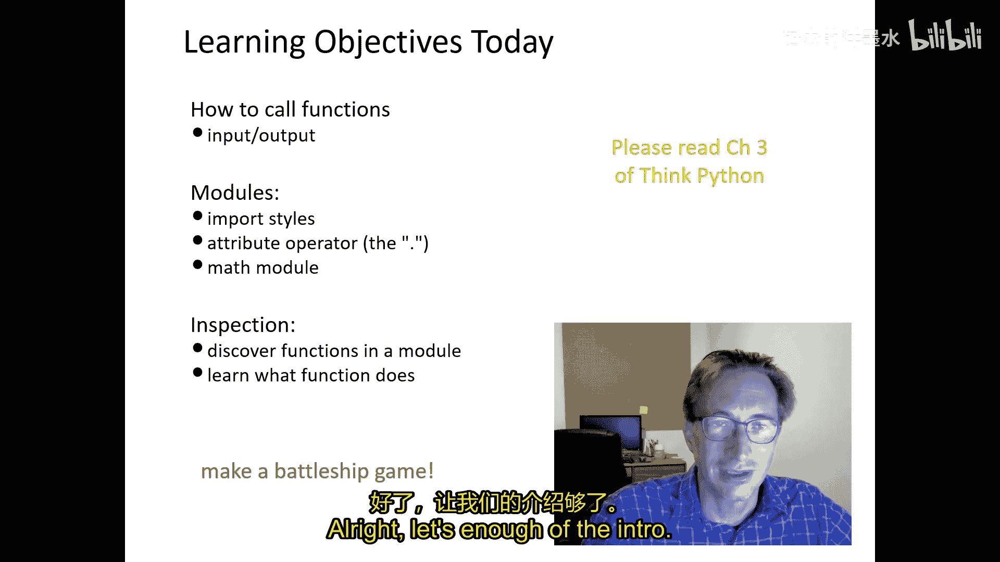
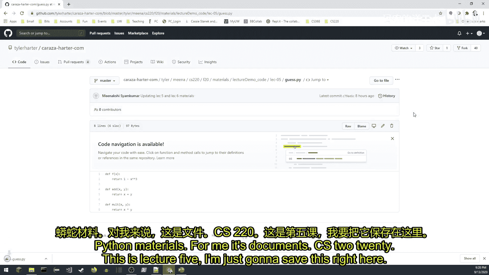
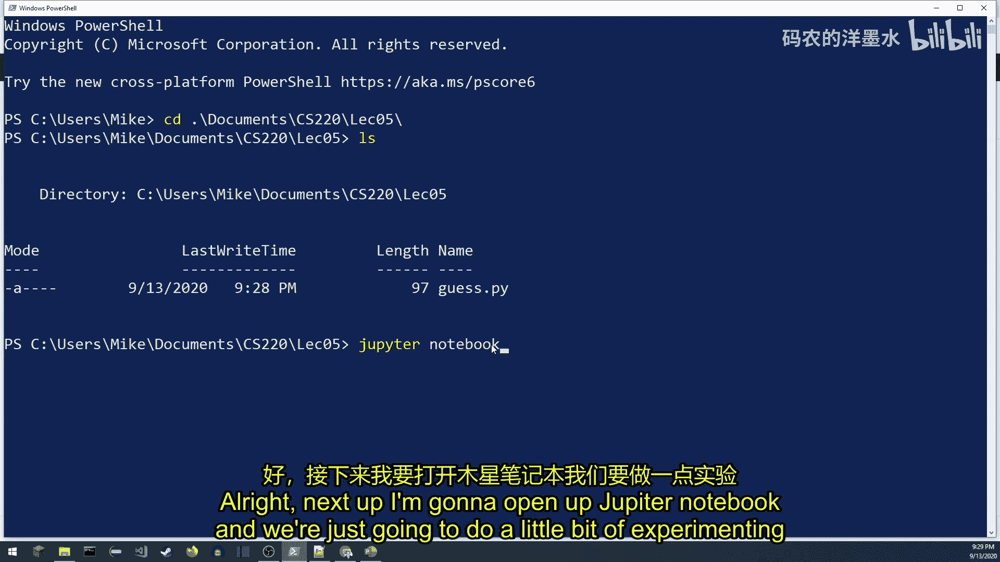
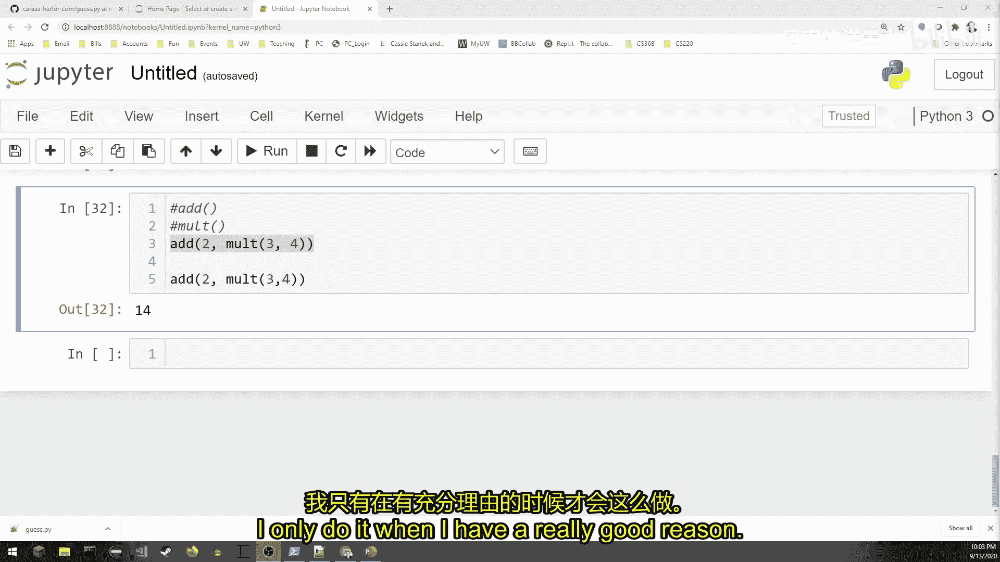
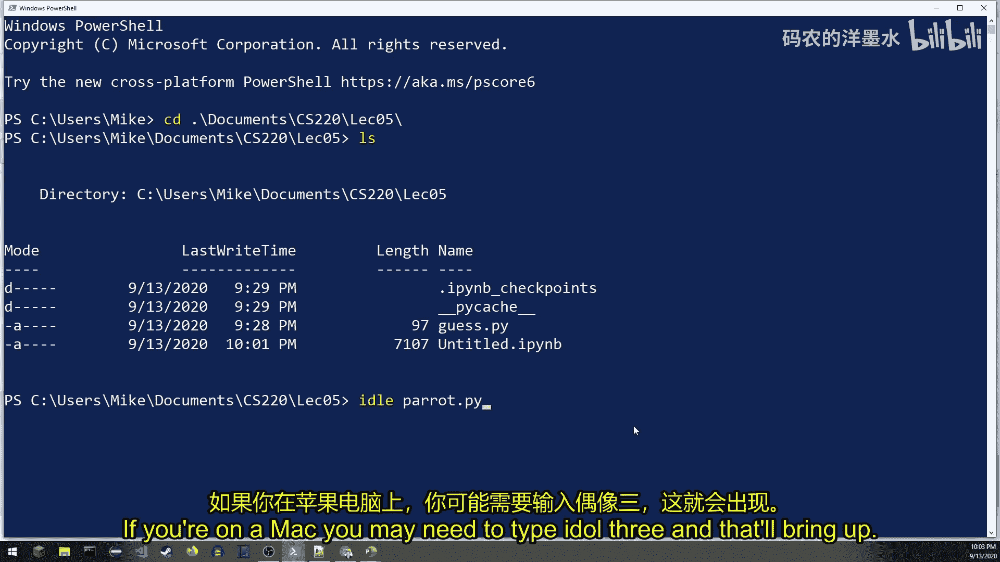
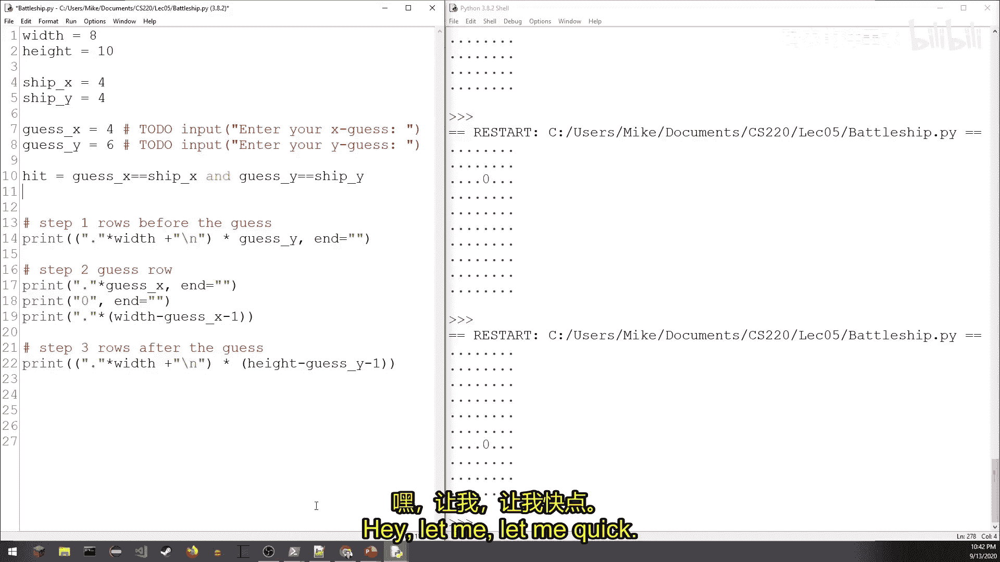
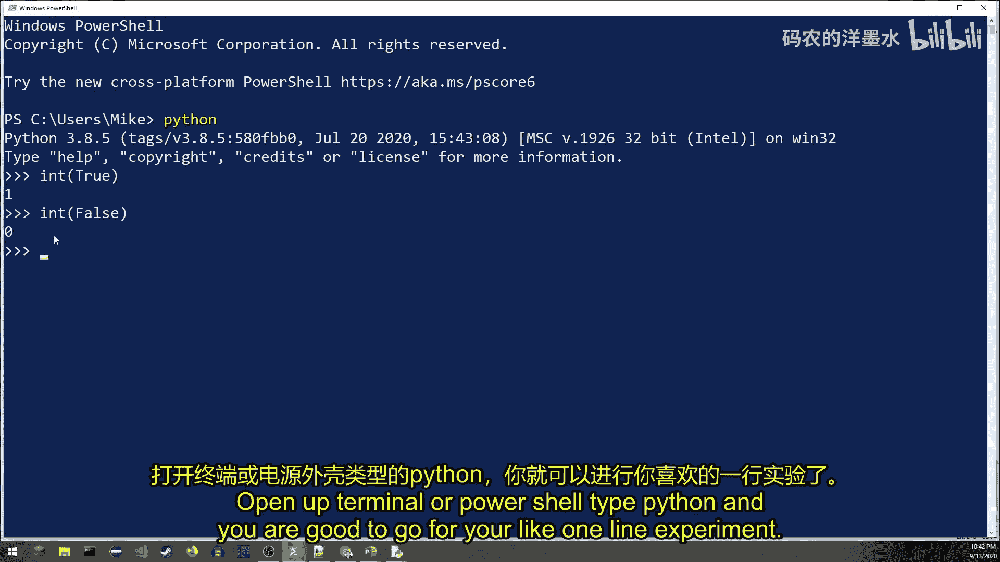
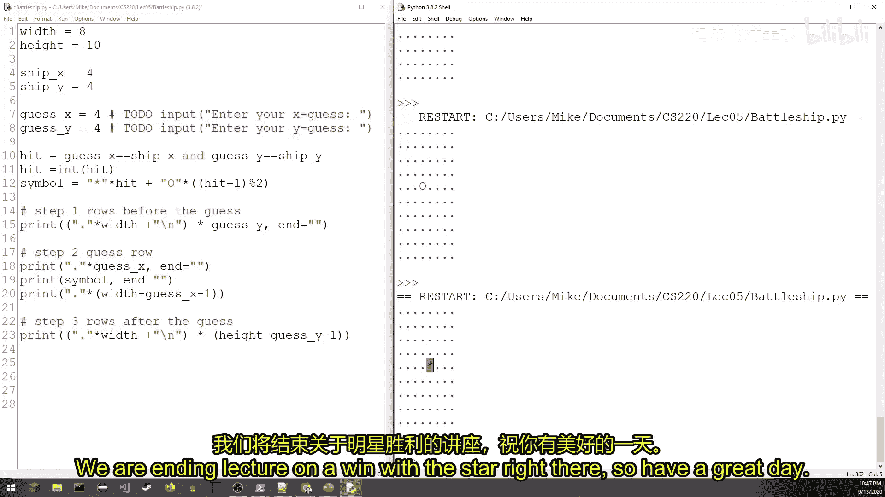

# 【全集】威斯康星大学-Python数据编程-CS220-中英字幕-1080P-p07-Lecture-5---函数--BV1VxvsBLEmv_p7-

Alright， welcome， everybody。 I'm glad you're here watching the video today with us。

 I had a really good time making this one。 And just a reminder。

 I'm gonna continue to play the livestream video lecture at 8 AM every Monday， Wednesday， Friday。

 you're welcome to come join us on Blackboard Collaborate。

 It doesn't matter which section of the course you're enrolled in。

 Mea and I are using the same slides。 We're talking about the same concepts。

 We do have a little bit different style。 So choose whoever's videos you prefer。

 come to the live stream gives you a chance to ask questions in chat， I'll be there to answer。

 you can see what questions other students have。 And if you're having trouble with procrastinating at this point。

 this will keep you on schedule。 If you have to make yourself accountable and come watch the video at 8 AM with us。

 So if you're interested， please remember this is an optional extra component of the course。

 which is providing this is a little incentive to keep on schedule an opportunity to interact with other students。

 but the video will always still be available on YouTube。

 You're welcome to come watch it at any time you want。 So today。

 we're gonna be learning a little bit about functions。 One of my favorite topics。😊。

So we're going to learn about calling functions using them。

 we'll find that functions in programming are a little bit different from the mathematical functions you may be familiar with let me skip down this is what makes it my favorite lecture of the semester we're going to make battleship。

Allright， so while I'm on the topic， please read chapter 3 of Downy's book about functions。 Allright。

 let's enough of the intro， let's jump into this。

Alright， so as we get started， we're gonna need a couple things for the beginning demo。 First up。

 this is today's video lecture on the schedule page。

 I can see that Mea has already finished and is once again making me look bad。

 but we're gonna need some materials from under the code directly。

 So click code that'll bring up the Github page。 We can see that Mea's work is already here。😊。

pe me to it again。 What we're going to need， though， is this guest dot Pi。

 So go ahead left click on that right click on raw。

 and we're going to save link as to download this file。Alright。

 then go ahead and find where you keep your。Python materials， for me， it's documents， CS 220。

 This is lecture 5。 I'm just going to save this right here。

Alright， got that downloaded。 That's finished。 Then I'm going to go to Powerhell。

 I'm going to navigate to documents。C， S 2，20。Lecture5。And from here。

 I can see that I've got guest do Pi installed in this directory。 All right， Next up。

 I'm going to open up Jupyter notebook。

And we're just going to do a little bit of experimenting here。Alright， there we go。

 Jupiter Notes open。 I can see that I'm in the directory with guest at Pi。 That's perfect。

 I'm going open up a new Python 3 notebook to get started。😊，In the very first cell。

 I'm going to go ahead and bring in the functions that are in that module。So go ahead。

 just type this line like its magic。 and we'll explain how it works later from guess。

 Now as the guess dot pi module we downloaded is within the same directory from guess import star。

 That'll bring in all the functions that were in that。 I'm just gonna run this with shift enter。😊。

And it doesn't produce any output。 It's just gone ahead and done that for me。All right。

 so next thing I'm going to do， I'm going to pause the video and put some text up here one sec。

Alright， I just wanted to make sure all this was working。 get some stuff set up。

 So what I'd like to do is focus here on cell number 2。 I've got a couple of commands here。

 I'm assigning the value 0 to the variable x。 So x gets 0。 And then I'm calling a function。

 So y is equal to F of X。 That's one of the functions in guess。 And then I'm just writing Y。

 This is just going print out the value of Y。 because it's the last line。

 it goes in this outbox in Jupyter notebook。 I don't need to worry about typing that extra stuff for print。

Alright， and what we're going to do here is just kind of have a little fun with this。

 I'd like you guys to do is go ahead。😊，Get this set up， pause the video and do something like this。

 Just copy and paste this cell。 Let's change the value of x。 Let's try x equals 1。If there we go。

 and then we'll shift enter， and it prints out a new value。

 So it's going to recompute the value of the function when it gets x。 So when F of1 is equal to y。

 we print out Y。 I can copy， paste this again。 We can change X is equal to 2。

 We can run this cell again。All right， what I want you guys to do is experiment a little bit。

 pause the video， try some of these things yourself out and see if you can figure out what mathematical function F of x is。

Alright， and if you kick back just watching this on mobile， you know， while soap operas are running。

 I'll go ahead and throw in a couple more guesses just so that those you guys who don't have it open。

can see if we do x is equal to3。There we go minus 26。What are some other numbers you want to see。

 Should we try negative  one。Negative one gives us two。 How about。10。😔，-999。I want。

 I want negative 10。Shift entered around that 1001。If you guessed that F of。

 I'm going to make this a comment。 So this code is not actually meant to be run。 This is the answer。

 F of X equals。Minus X。Raised to the third power plus one， you'd be correct。So check this out。

 let's go back here when x was0。Z cubed is 0 plus1。Gave us one right there。 When it was 1。

1 cubed is 1。 Negate that -1 plus 1 is 0。2 cubed is 8。Negative makes negative 8 plus 1 x-7。Alright。

 so I hope this yeah here， Let's take a look at-10。-10 cubed is negative 1000。

 We negate that as positive 1000 and add  one to at 001。 Okay。

 so it fits for all of the experiments we've done so far。Alright。

 so next to what I want to do is just show you guys something that will likely go wrong for you at some point during the semester when you're doing homework。

 Alright， so I've got this code up here at the top。 I've got x equals 3。

 I've got a little cell here that computes y equals F of x and prints out y。

I'm just going to go ahead and execute this cell right here。So I moved the cursor up to it。

 I clicked on， and I shift enter， and it prints out 1001。Now， if x is3， in fact。

 I've already done x is 3 right here， I should have gotten minus26。Now， the problem is。

Jupiter notebook book remembers the order that all of the cells are run。 So it did here we go 2，3，4。

5，6，7，8。 The last time we assigned x was here in cell 8 and-10。 And then we came up here。

 and I did this one。 number 9。 And then I ran this again。 But here， it thought X was -10。

 Even though in the page and the cell right before this， x is equal x is equal to 3。

 I have never actually run this cell。 That's got a no number right there。 It's never been run。

So if you ever run into some weird errors or if you're trying to run our test dot pi and you get something that totally works for you。

 but it doesn't work on test dot pi。The secret is going to be to go up to kernelel and restart and run all。

Allright， so when we do kernel restart and run all and actually click the correct option。

 it goes ahead and it starts with cell 1 and executes it。 Then it does the next one， executes this。

 Then it does this one。 So we've signed value of 3 to x。

 We run y equals f of x and print out Y we do get the minus-26。

 we'd expect three times3 times 3 is 27， make it negative add1。

So if you rendered anything a little weird， go ahead and give that a try。

 that's going to be an important thing。 restart run all， remember that's there。All right。

 Hopefully you guys remember this sample problem from lecture 2。

 where we were going through sequences of steps and just tracing through and trying to think like a computer。

 This robot move program was an example of using a function。

 So this move code box right here are some steps that are outside of the main code that we jumped to in line 2 and 5。

😊，Let me actually advance the there got them circled the perform steps under move code。

 then continue step three， perform steps under move code。

 Those two lines right there are known as a function call or a function invocation。

So some other vocabulary about functions that are going to be really important。

 We're going to be giving functions values。 In this case。

 we gave the value2 to the function move code stored in that box。

 that's not shown in this one and then。The move， the move code function here knew that it needed to move forward。

 you know， for example， two squares。 If we gave it a two。

 the value that we give the function is called an argument。

 And that can be stored as like in a variable， or it could be just straight up a real value。

 I put two in the moves。Inside the function that moves is going to change names。

 it's going to be known as a parameter。 And inside the function。

 it will always be a variable that's just being assigned a value from the outside。

 whether it's like a straight up number， a literal or whether it's something that's already been stored in a variable。

 Not all functions take arguments。We're also going to learn how to ask functions questions so they can return an answer。

 This move code function doesn't actually give us any response back。

 All it does is move the robot forward。 But we just saw an example of that。

 the F of x function that we were looking at in Jupyter notebook moments ago。 We gave that a value X。

 and it returned to value for Y。 All， later this week。

 we're going to learn to write our own functions。 But today。

 we're just going to focus on using existing functions。😊，Alright。

 let's just take a big step back and look at some just general function concepts。 So in example here。

 I've got some code， some more code， some code in a blue box， more dots， more code。

 Another identical blue box with code in it。 So my meaning here is that these are exactly the same lines of code as these lines of code here。

😊，So that means at some point we copied and pasted the code。 that's in general。

 a very bad idea because suppose this was wrong。 And I need to make a change right here。 Well。

 I've also got to remember to go make a change everywhere else that I copied and pasted it。

 And it makes my entire code longer。 So one of the things we're going to do as we write code throughout the semester is known as refactoring。

 That's going to be the idea that we reorganize the code。

 and take repetitive things or things that I may need to use twice and put them into functions。

So once we have a function here， I've already mentioned parameters and arguments。

 but now that I've got a picture。 So I've got my code out here on the outside。

 I've got some arguments。 Those are the values that I'm going to be giving the function。

 like the x value。 X in my F of X example at the beginning was the argument。

 I'm going to pass those arguments to the function。 And inside。

 I'm basically just going to assign the values of the arguments to these parameters。

 So parameters are variables inside of a function。😊。

And then once the function is done doing whatever it needs to when we call or invoke it。

 it's going to return the result， and we can do， we could store it in a variable。

 we could print it out。 we could ignore it lots of things。

I also want to point out here in my little picture， I just have blue box。

AllI'm not actually telling you what this function does or what how it works on the inside。

Ask yourself a question for a second。Are you a good driver。

 Can you get behind the wheel of a car and drive successfully without crashing。Hopefully。

 most of you guys are。 Now， ask yourself。Do you have a really deep understanding of what's going on under the hood of your car。

 How does the engine really work， What's the Could you identify the distributor。

Can you change the spark plugs。And。Now， ask， is it possible to be a good driver without actually knowing how the engine works。

 And， And， of course， it is。 All we really need to know is how the car behaves。

 We're going to be giving the car inputs， like pushing down the gas pal。

 If you know that pushing the gas pedal makes the car go faster。

 You don't need to know what's going on with the engine of the transmission。

 just that pushing the gas pedal makes the car go faster。 functionss are going to work the same way。

 All we really need to know are what inputs do they require。 How do I give them the inputs。

 And what's it going to return。 It doesn't matter what goes on inside this blue box to get to the answer。

 could be complicated and hard， Someone may rewrite it later to make it easier and correct。

And then it's going to return to value so。Now， once we finish writing our function or if we're using someone else's function。

 we don't actually really need to remember the details of how it works。

 So this is one of the main features of functions is I can write a little piece of code that does something。

 And then I don't need to remember how it works。 I just need to know what to give it and what it's going to give me back。

 So although like little details are taken care of。

And this is like this is really how the huge gigantic software projects are written with teams of hundreds of people。

 lots of people contribute。 they all write functions。 Those functions are used by other programmers。

 and the other programmers don't need to know how you figured out to solve whatever little problem your function does in order to use your function to contribute to the entire project。

I was just looking at my list of。Vocabularary prefactor， change the organization。

 parametersameters and arguments are basically the same number。 This is on the outside。

 We're giving the value。 parametersmeter are internally where I store the number inside the function。

 they're going to return something， a return value or a result。

 We'll talk about this a little more detail。 But we also have the potential to have default arguments。

 These are our values that are just put into a parameter。 If we don't pass anything。 So in this case。

 I'm looking at argument one gets passed in。 but we never actually passed argument 2。

 but the parameter requires two things。 So we can thus assign it a default value to use if the user never actually puts anything in。

We can also have something known as named or keyword arguments。

 And we'll see an example of this in just a moment when we talk about printing。 But in this case。

 we can say that pram 1 equals something very specifically Use the name that the function uses on the inside and give it a value。

 In this case， Arg 1。 and then that gets put into the correct spot。Alright。

 so just a little bit about calling and invoking functions。 First up。

 we always require two things at minimum。 we need the name of the function In this case the print print is a function。

 we've been using that for a couple days now and when we use the f of x function we require the f。

 so we always need the function name， we also require parentheses is's these parentheses that tell Python that this is a function。

Then there's some optional pieces， too。 argumentsguments will go inside of the parentheses。

 Sometimes we'll have one， sometimes we'll more。 We may not have any at all。

 in which case we still require the parentheses。 We'll just have an openhesesis followed by closed parenthesesis。

 It's the signal to Python that this is a function。We also sometimes may produce a result。

 This is known as the return value， and we can do pretty much。

 we got a bunch of choices as to what to do with it。 We could store it in a variable。

 We could print it out。 We could completely ignore it。

Or we could even use it as the input to another function or another expression。All right。

 I'm back over in Jupiter Note book。 I tweaked a bunch of the controls。

 Hopefully this is now big enough that everyone can see it。

 And I just want to do just a couple of quick demos of using some functions。 Print。

 We've used this a bo already。Hello。Slash， back slash n。Hello， world。There we go。

 When print this out， shift enter will run this。 It's going to print out hello and world。

 So it takes an argument。 in this case， this string。

 quick reminder the back slash and will be the new line。

 So it remembers to go and put this on the next line down without that。If I just put a space in。

 it's all on one line。There are some others， we've also learned the type function type of one should tell me that that's an integer。

Type of 1。0， 90， that good。Is a float。Type of。Hello。Is a stir or string？Type of， let's see。

1 equals in 。0。 What do you guys think this is going be。Is a bo。 Allright。

 so we've used type of bunch。 Those are the four main types we'll be using for the next couple weeks。

 we can store the results of these things in a variable。 I can say T equals。

 And then I can go and grab this。Text right here， paste it。And now the result of this。

 I can store in the value T， so。Let me run that， and I'm actually going to add one more line just to print out what T is。

 So it's been stored in the variable。 T is printed right there fact。I can print to you。Interesting。

 so。It prints it a little bit differently with the print command。 here it just tells me the fool。

 adds up， it's giving me this in angle brackets， it's telling me class。

 It's the same thing with a little bit different structure as how it's displaying the information。

So something else I can do is I can use this function， it returns the type。

 and I can just print it directly。So I have a function。

That returns something that's actually the input to another function。

 so the return value is the argument。I do that。 This is a lot。

 It can be confusing for people the first time they see that I can just like chain all these things together。

 But you've actually been doing this for a long time when you did algebra。

 Think about a problem like this，2 plus 3 times 4。 If you do a problem like this。

 first thing you do is you're going say， well， the three times 4 comes first。

 So I'm going to do the multiplication and I get 12。And then I'm going to say 2 plus 12。

 I'm going to use the result of this computationutation as an argument for the next edition。

 and I'm going to get 14 when I'm done with that。14。Let's see。 but that's the syntax。

 You know what pipelineth' will just do this for me。 I don't need to do that。 There we go。 In fact。

 it's completely possible for us now that we have functions to write our own programming language that doesn't use any operators at all。

 Consider this same problem，2 plus  three times 4。 I've got two functions in that guess module that we imported at the very beginning。

 This won't normally work。 but I've， I've got an ad。天气。Multiply module。 they are function。

 and modules are just collections of functions。 That's what we brought in is the ability to for Python to access these functions。

 So a just takes two parameters and returns their sum。

 Mot takes two parameters and returns their product。 So if I wanted to do this same problem。

I need to do the three plus four。Whoops， three times4。 so I'll be doing mot。3 times 4。

 And I need to separate all the arguments with a comma。 So I'll have this。

 And this is going to be what I want to add to the two。 So there's the。Arguments for my add function。

 those will go in parentheses， Then I'll have add。I kind of did this in a backwards order。

 I started you knowing that I was going to do this multiplication first。

Maybe another way to think about it would be。If I were to write the same line in a different order。

 I'm going to be adding。 It's a function。 I need my parentheses， and I need。Two things。Okay。

 takes two parameters。 The first one here is going to be the number two。

And then this second thing over here is going to be the three times four。So that's a product。

 So I'll be pulling in the multi function right here。That's going to take。Two things。 Also。

 I need to separate them with commas。 And those things are 3 and 4。

And then I made it kind of ugly with some extra spaces。 So there go。 Now it looks pretty good。

And when I run this， I can see that the result is 14。Allright， for my next example。

 I'm going to jump over and use idle。 I know that switching from one tool to another is confusing and slows down the learning process。

 And I only do it when I have a really good reason。 So first， I'm going just go， oops。

 I need Powerhell。 And this is the one that's running my Jupiter notebook。

 I'm going to leave this running。 So I'm going instead。

Right click there and open a new power shell。 There we go。

Change back to my directory so that was documents。St S 220， lecture 5。 I can see， yep。

 there's guest out high。 I'm in the correct one。 Next， I'm going to run idle。

And I'm going to create a program in Python called Parrot。Parrot dot Py。

 So I'm going to add that do Py extension to tell it that it is program。 If you' on a Mac。

 you may need to type Ile 3。

And that'll bring up。Momentarily idle。 If this is not yet working for you。

 come to office hours and we'll get it all straightened out。 Allright， the reason。

I wanted to switch to idle is I really prefer the way the input from the user as it， you know。

 if I'm the user running my code， it lets me type stuff in compared to Jupyter notebook because those cells are designed to be like continuously like one cell then the next cell and the next cell。

In this case， I'm going to write a complete program。You run the program， have a get some input。

 then the program will end， and then I'm going to want to start the beginning again。

So that's why I'm switching to this technology。 All right hopefully this is all large enough that you guys can see it。

 So right here， it tells me that I'm editing parrot do pi。 After I get some some code written here。

 I'll click run and I'll run module。 But right now。

 let's go ahead parrot is going to be really simple。 It's a virtual parrot， not a real one。

 Only thing it's going to do is it's going to ask for some input。

 the command to get input from the user， it's a function is called input。

And it'll take that input and what we'd like to do。Pted out。All right。So pretty straightforward。

 So when we get input from the user， I need to store that。 I'm going to put it in a variable。

 We'll call that words。Gets whatever the result of the input function is。

 and then whats print Dlto's words。That should be the minimum we need to just get started and see if where I've messed up。

So I'm going to go a click run。 I see that run module is F5。

 So I'm just going to go ahead and use F5 from now on to run this。Save before continuing。 Okay。

 so I can see that it's got to restart。 and I've got a cursor here。 Now。

 we didn't actually give the user any decent instructions。 It just is a blank cursor。

 So it's confusing。 It's not telling us what to do。So we'll go ahead and we'll just type something。

 This is how the user input function works。 to type something I push enter。

 And then the blue text there is from the print。 So it's printed out the same thing that I just gave it。

So that was confusing。 It's not exactly what I would love to see。

Let rearrange these windows a little bit。It would be a much better program。If it told us what to do。

So。Iport can actually take an argument。 Also， say something。 There we go。

 and put a coal in a space because the user will type right after that。 And I want it to look good。

 let's try this again now。 So I'm going to just click F5。 save yes。

 I need to set up to automatically save next time。 Allright， say something。

 what's another good pirate phrase。Bury them deep。And the pair replies buried and deep。Oh。

 that's actually good。 And right now， in my virtual pair doesn't actually say it's a parro。

 Let's go ahead and upgrade this a little bit。 We'll have the。Parrot says。

And then so that will close up this first block of text there， and then we'll just add words to it。

How' does that look， all right， let's run this at5。Save， we start to say something。Wock the plank。

Part says walk the plank。 All right， That's looking pretty good。All right guys。

 I've got a trick question for you in this print statement right here。

How many arguments am I giving the print statement。Think of this as an example question。

It's one of those things。 It's hard to Google。 It's hard to do an experiment to figure it out。

 you've got to know your stuff， which is why it's going to be brilliant for like the midterm coming up。

 How many。Arguments， do we have here， All right， make a guess， commit。And the answer in 3，2。

1 is one argument。So when we have a string of text like this and we use the plus operator to concatenate it。

 Python is going to go ahead and simplify this as much as possible before it does anything。

 So it's going to end up with one string of text。And that will be the argument。 Now。

 it's totally possible to give the print statement more than one。Parameter。

 I can just put a comma in and separate them。Let's go ahead and just see what happens when we do this。

 All I've done is remove the plus， put in a comma。And I need F 5， save and run。 Let's see。

 what else do pirates say。Dead man， tell no。Tas。Okay。Now， I just want to point out， too。

 that this is a little， I should have done the same thing。

 so I could see there's exactly one space right here。If you're following along at home。

 you can like hover over with your cursor。In this version， there are two spaces。

 One of them comes from right here。And one of them comes because when Python takes more than one argument in a comma separated list。

 it puts in its own space。 So that's where that second one comes from。AndPretty soon。

 we'll talk about how to change that and how to control what exactly the print statements look like。

But more on that in a moment。 All right， I want to explore using input just a little bit more。

 So I'm going to go ahead and create a new file。 I'm going to save this。Save as。嗯。

It's called it calculator。Dot pi。 and all it's going to do is add two numbers。

 So we're going to say input。Needs to be a string enter X。We'll get a number from the user， and then。

We'll get another number from the user enter Y， we'll go ahead and prompt them so they know what they're supposed to do。

We're going to want these later， as it is right now， if I just type input。

 Python is going to forget it。 I need to say store that in a variable。 let's call it X。

Store that one in a variable。I've got a good feeling about that。And then。The sum of。X。Why is。Plus。

Why。Alright， the odds of me typing out correctly and getting this work on the first try are pretty low。

 I'm going to push F5， save and run it and figure out where I've made all my typos。Alright， enter x。

 So let's go with2。Enter Y， go with3。Okay， guys。What is the sum of X and Y， Just make a guess。

 commit， write something down say， I think it's going to be。 And I'm going to push the go in 3，2，1。

The sum of 2 and 3 is 23， of course。Interesting， I also have two spaces right there。

 That's because I'm using comments。 I'm going go ahead and get rid of。That one。Let's move that over。

So now it'll look good next time around。Now what's going on here， why did I get 23 instead of five？

The problem is what I'm really doing。Ias I'm going make a comment here。 I'm adding strings together。

 I'm adding string 2 plus the string 3， because the type of the input。

 the type that input returns is always a string。 So let's go ahead and just verify that。

 I'm going to print out the type of X。Right here， and we print out。Type of Y right there。

 And we should see that it tells us they're both strengths。 I'm just going to go ahead and run this。

And we'll enter an X。 we'll go with two。Other on screen2。And 3。It says they are both strings。

That means when we did this。X plus Y right here。 I was taking a string 2 and a string 3。

 And when I combine two strings with the plus operator， that means concatenation。

 So we're going to need to upgrade this a little bit。

 We are going to need to turn those strings back into integers so we can add them。Alright。

 the technical term for this is known as casting。 So I'm going to do that right up here。

 So I'm going to say that x is equal to and the command to turn something into an integer is just int。

 It's awesome。 The name of something you want to turn it into when I'm casting is the name of the function。

 So and I'm going to use x again。 I'm going to use x on both sides。

 So it'll take this string value X quote to quote turn it into an integer and store it back in the same place。

 So the type of my variable X just changed with this line right here。We'll do the same thing for Y。

Gos。And why， all right， I'm going to run this code。Save， runs it， enter x 2，3。

 It's going to tell us they're both integers。 And now we see the sum is correct。4 calculator。

 we got five。All right， guys， let's try and break this。I really enjoy this this part of。

Priting program and testing enter X。 Let's try2。 So I'm putting this in as a string using characters and3。

There we go。 And we see here is， of course， it breaks。

 And we do get this error message trace back is the beginning of an error message。

 Most recent function call。 So the important thing here is where do we start seeing a problem And that is in line 3 right there。

 And it prints out the line。 This is the one。 The error is invalid literal for int。

 So this is the casting to an integer。 So it actually needs to take a number with like real decimal digits。

 It can't take this input string of text。If you guys， if we go back and look at the code。

 it says it's line 3。Just while I'm here， if you guys are using idol， So line3 is right here。

 if line numbers are not turned on and I don't think they are by default。

 it's under options right here right here， the middle option hide line numbers because mine are turned on。

 it says hidede， if I click it it'll take them away and then I can show line numbers。 So easy。

 peas right there。Alright， let's let's try and break this one more time。 I'm going to just push F 5。

 That'll run it enter X。 little about 1。0。And。3。4。Another error。

 Al right Let's take a look at this one。 It's actually the same error message invalid literal for int with base 10。

 So what we really have here are floating point numbers， not integers。 So to fix that。

 what I really need to do is take this text that I'm inputting。 right now， it's an int。

And we'll upgrade this to a float。Now this should work with both integers and floating point numbers because they can both be stored in floating point numbers。

Allright， I'm just gonna we'll run that one more time enter X 2。0 enter y-3。6。

And then it says class float， class float， so we did successfully convert them。 We'll bring that。Oh。

 there we go。I guess full screen。And then we can see the the sum of 2。0 and minus 3。6。

 and that is the correct answer。All right， enough for that example。

 I moved back over to Jupiter Note。 I really only wanted to use iddle for the examples that had input and the things that are larger program style。

 things like the battleship game。 But for this exploration， I want to just jump back over。

 use Jupiter。 So alos me save everything。 I can put it online。

 I suspect I'm doing the same examples Me at will。 So we'll probably just use her version。

 It's already there。 But there's significant difference as Al Min。

So what I want to do now is just a little more exploration with print。 So if I do print a moment ago。

 I told you it can take more than one argument。 So if I print out numbers 1，2，3， shift， enter that。

 There we go。 Pri 1，2，3。 Now we have some power over。啊。How this looks。I can。Add the keyword argument。

 Sep。Shirt for separator equals。 And then I can put in whatever separator I want here。

 I'm going to go ahead and use the comma。 So when I didn't use anything。

 the default was just a space。When I change this to a comma。

It's now printing them out with a comma se。 If I can do comma space run that。

 So this separator lets me change what goes in between items。

When I have more than one argument to this print function。So that's going to be very useful for us。

 Another really useful one。Is end。 so I can just add another comma add another argument。

 This is a keyword argument， because I am saying the keyword equals something that equals is my big clue that this is a keyword argument。

TheThe first three here， the numbers 1，2，3， these are known as positional arguments。

 We don't need to give it a keyword because it's the first thing here， the second thing here。

 the third thing， Python knows what it is and what it needs。

 how it's to be used because of where it is in the sequence of arguments。

And all the keyword arguments need to come after all positional arguments。All right。

 so I've got separator here that changes what happens between things。

 and there's an end that changes what happens。At the end of the line。 So if I run this。

 I've just changed the n from well。I guess it's a new line。To a period。So check this out now。

If I were to go， just， I'm going to keep that I' make a copy print this down here。

 and I'm going to add another statement。 printnt 4，5，6。

 We'll go ahead We'll keep separator equal to the comma comma space and end equals。The period。

 all right， let's see what this looks like。In this case， I've got 1，2，3。4。

 So the period was the end of that first line it。And then 4，5，6。

 it didn't actually add the new line this time through。 So you may have guessed it。

 but the default value。Remember， functions have。好。Key value keyword values。

 parameters and default parameters。 The default parameter for end is the new line。 and that's why。

If I were to do this， actually， yeah， let me demo this without any of these。Default。

 we' use the default values because we won't tell them what we want。If we do that， it just prints 1。

2，3， and then on the next line 4，5，6， the default version is the new line。 That's the back slash。

And character。 So if I want that behavior， I need to go ahead and add in my own back slash n。

 if I'm revising this。 So let me run this block again。

And now we should be able to see that it printed in 1，2，3，45，6 on two separate lines。

I think that's a pretty good introduction， we will talk a whole lot more about these keyword positional and default arguments as we start to write our own functions and learn to use each of these features in great detail。

All right， so for my final demo today， I want to make a little version of battleship。

 We're going to use input and we're going to use all of these functions we just learned about in print。

The print options， the separators， the end to。Recreate battleship。 Now， this version。

 I hope hope you guys aren't embarrassed， but it's going to be the minimum viable product。

That we could reasonably pass on and like show our friends and not be embarrassed。 You know。

 one week into class。 So our version of battleship， you know。

 when kids get together and they play battleship， they have these boards like this。

 There's little ships on the board。 One player will say they will choose some coordinates。

And bomb that coordinate。 And then if they hit， if there's a ship there。

 the opponent tells them you hit and they they get to put a little red peg。

 and then they take turns guessing and trying to figure out where the ships are。

Our version is going to have one ship。We're only going to let them take one guess。

The ship is only going to be one space。It's smaller than the tiny submarine。

 We're not going let it move around。 We're going to fix the position。

And our grid is going to be based like this， the top left corner is going to be 0，0。

 and we'll have increasing right。Will be increasing x and going down will be increasing Y。

 And we're just going to use periods for the graphics。For you know， for the pegs。

 so it'll have horrible graphics。What we're going to do， though。

 is when the player decides where they're attacking， it's going to go ahead and write in。嗯。A 0。

 if they miss and a one， if they hit。Okay， so I'm going to jump over because this is a complete program。

 I'm going to want to run it from the beginning many times。 I'm going to go use idle for that。

 I believe I already have it open。 Yes， here's my parro program and said。

 I'm going to use file new and file save as we'll call this one。Battleship。Y， all right， cool。

All right， so first up， I'm going to want to draw some pegs。So we'll be printing out some periods。

There we go。 There's the first row。 Let me just copy this and we'll paste it， paste it。

 paste it there。 Now we've got some， some pegs。 Let's go ahead and run this。Save it。

Just reconfiguring idle so I don't have to prompt me to save every single time。

 And I want to rearrange the windows So they're nice side by side looking like this。

 Maybe we'll move this over a little bit more。That looks good to me。 Okay。

 so we can see that we've printed out a bunch of rosa pegs。 But over here。

 this was not done in the best way。 I copied and pasted Any time I find myself copying and pasting。

 there's almost certainly a better way to do this。 So let's go ahead and'll make this a little more general。

 First， I'm going to be printing。😊，Let's just go with one peg。And then let's see here。

 I need to know how many pegs are in the row。 And we'll go ahead use that text multiplication。

 And let's just say， there's 8。Pigs in the world。And we'll try that。 What's this look like？ So at5。

 it's restarted there。 I've got one row pegs。And then if I want another row of pegs， I can。

Let's see here。 We just multiply that by， Let's see。 it's an 8 by8 grid。

 We'll just multiply that by 8。runun that again。 There we go。 Now I've got enough pegs。

 but there's not rows。 They're all in one row。 It's because I need to put a new line in。Right here。

 plus quote back slash N end quote。And we need some parentheses around this。There we go。

 So now it'll take the period， make eight periods in a row， tack on a new line。

 And then that's going to be multiplied eight times。 So let's see what this looks like。

That's the wrong command。 There we go。 There we go。 G。 Now we have a beautiful battleship grid。

 I did some things I'm not super happy with here。 I hard coded the8。😊。

So let's go ahead and switch out the84 length and width。With。Lnk equals。And equals。

 and then we'll just go ahead， we'll say those are let's go eight and just so they're a little different。

 we'll make them 10。And then the width is how many dots are in one row？And that is the。Wait。

 let's go with height， He is much better。For something that's vertical like this。Running。

 there it is。 Let's just change that to 18 and make sure it still looks good。Yep got wider。

 and I think for this board， we'll just go ahead and keep it at 8。Now we're going to need a ship。

 so let's go ahead and add the ship and we'll put the ship。And like I said。

 we're going to hardcode the location of the ship。 We're just going to stick that hide it right in the middle。

 Well， the exportorant will be4 ship Y will be at 4 hidden in the middle。

 And then we're going to need a guest from the user。So we'll go ahead and guess X。

We'll get something from the user using input。And we'll prompt them to。坚持。有儿。X。Gues。All right。

 and then after that。Guess why？Itこ。Enter your Y guess。B and R there。 Allright， let's say。

 let's give this a try and see what it looks like。 So I'm just gonna hit F 5 to run this。

 enter your X guess。 We'll guess 4 and y guess is 4。

That would look better if we put a colon in space， colon in space。Well， I'm having trouble typing。

 There we go。 Okay， so that's gonna look really good。 Now。

 one of the things is that when we are writing some code like this。

 if I have to enter a guess every single time， it's going to really slow me down。

 So what I'm going to do instead is just hard code my guess right here。 So I'm going to guess one。😊。

And then I'm going to put a pound side to make the rest of this a comment。

 And I'm just going to add a bag to do。That means I need to delete that and go back to enter your guess。

 so the user guest is there， but this is going to speed things up。So Mike。

 don't forget that at the end。This is one of the things when I teach this live。

 I run out of time and I never get a chance to put that back。Alright。

 the next thing we're going to need to do is actually take the location where the user guesses and either put in a0 if they miss or a one if they hit。

So to do that， I'm going to need to break this problem down into I think three pieces should should do well。

 So if the user guesses， I'm looking over here， if the user guesses that square right there。

I'm going to need to print out these first two rows of dots。

 And I've got some code that does that already。 right there， print out dots。

 I'm going to need to print out this row。 And if that happens to be where the ship is with a one or this row with a0。

 So that's printing this row。 And then we need to print out the rest of these dots。

 And we've got some code that print out dots already。 so we can use that。

 So I'm just going break this down into step 1。These are going to be the rows before the guess。现在呢。

Step 2。How about the guest row？The road of the guest， and then step 3。The row after the guess。So。

Yeah， let's just go ahead， we'll make this。We'll do this in a couple steps。

 So here I've got some code that prints out some， some dots。 Let me just copy。

 paste that right there。 I've got some code that prints out a block of dots。 We use that right there。

And then in the guest row， I need to the printer a one or0。 Let's just。Print it。0肉。For right now。

 and that'll be my guest rope。 All right， let' me go ahead and run this and see what it looks like。

There we go。 Here's the restart。 This is everything it's done。 I've printed out a bunch of rows。

 It's too many。 I know that。And we've printed out the。0 there。 that's working。

 And these are the rows after the guess。Allright perfect。 This is a great start。 Now。

 we just need to tweak the size of these， these rows。 So that's going to be right here。

 instead of printing out height， you know， height is 10， It's printing out 10 rows。

 If I'm guessing row 2， I need to print row 0 and row 1 because remember this corner is 0，0。😊。

So instead of height， what I really want is。Let's see。Is it， guess why， I that going to work。

 Let me just run this and see what that looks like。 Yeah， guess why prints out exactly two rows。

 perfect。And then on the other side of things， I need， I've got 10 rows total。Roow 0， row 1。

 row 2 is where they're guessing。 And then we need 3，4，5，6，7，8，9。And 10。Let's see。

 This should really be height， take away。Guess why。I' get a typo here。I just forgot the parentheses。

So it's doing this multiplication first， and then it's trying to subtract a number， a string。

 subtract a number， and that's not a valid option。So we'll get some parentheses around that。

 So let's here's 0，1，2， is my guess row 3，4，5，6，7，8，9，10。 That looks pretty good。

 I think that's going to work for me。😊，All guys， I just went back and looked at the description of the problem。

 If I have 10 rows， I've got rows 0，1，2，3，4，5，6，7，8，9， not a 10th1。

 Good row 10 would be the 11th because I'm starting counting at 0。 So yet another。

Keep track how many mistakes I make。 I'm going to go ahead and put in a minus1 right here。

Run this again。 And now I've got 1，2，3，4，5，6，7，8，9，10 rows， just like I want。

 And they're numbered 0 through 9。Alright， it's looking pretty good。 I've got a couple of issues。

 I've got a blank row right here。 I need to take care of that。

 And that's coming from this line right here where I'm printing this row of blocks before my0 row。

So what's going on here is that I'm printing a new line every single time I've got my row。

 print a new line。And it's also got that default end line that we're putting in。

 So what I want to do to fix this is just add my own custom end。And in this case。

 I'm just going to let it be the。Nothing。So let's see if that works。There we go。

 that has now gotten rid of that blank， the yeah， the blank line。Alright， we're getting close。

 Were getting close。 So next what we need to do is figure out how many dots to print before the0 and then how many dots to print after the 0。

 we can do this in a couple steps。 So we'll do dots before。 So this is just going to be print。

 I dots。 And however many I want。And let's see how many do I want。 So if the user is guessing one。

 I still need to print out row like column 0。 So I think what I really want here is just。Gs X。

Let's see what this looks like。Yep， there we go。 So it's printed out one dot right there。

 I've got the same problem。 It's put in a default new line right at the end of this。

 I'm going to go ahead and do the same thing I did above and just make the end the。Nothing。

'll tryry this again。 There we go。 I've got the first dot。 It's printing the zero。

 and now I need the rest of the row of dots here so。Just need some more dots。Times， let's see here。

 we've got width。Minus guess x。So that'll be if I've got a width of eight， I guess two。

 I take that away， that should be six more dots。Great， I guess one。

 didn't I what's this look like to the z？Needs parentheses。I'm getting there， guys。Run that again。

 there we go。All right， interesting。 This row now has a new line。

 gotta take care of overlooked at it and equals quotes。At 5， there we go。 perfectfect。

 I do have an extra dot here， though。 I guess I also need the subtract  one。 Oh， yeah。

 that makes sense。 Okay， so I've got the full width。 I take away。

 however money we guessed from the beginning。 I also need to take away one more for that square right there。

And do that。 There we go。 Perf grid。 It's looking good。 I'm guessing that position。

 Let me go ahead and just make some little changes here。 instead of guessing position X is 1。

 Let's go。 We' change that through 4。Fify that it moved over。 let's make the Y6。Fify it moves down。

 okay， it's moving around， things are looking pretty good。Allright。

 so now the next thing I want to do is I want it to change from a0 to a one if we actually hit。Yeah。

 later on， we're going to learn about conditionals and how to do， you know， pretty elegant stuff。

 And for now， we're going need to just do this with some math。 So here's what Im going gonna do。

 I'm going just declare a variable hit and say this is。It's going to be a Boolean variable。

 We'll just say， guess。X。Exactly equals shipback， if that's true。And。

So that will mean that the X coordinates are matching and。Guess Y exactly equals ship。Why。

Then this will this entire expression will evaluate the truth。If either of these are wrong。

X coordinate or the y coordinate are wrong， then hit will be false。So。

 and then we can take that value。Hey， let let me quick。

Open up a new powerhe。Jump into Python。 and we can say。Cast。True。

 we can take Boolean values and turn them into integers。True。Just like that。

 And it's going to tell us that in is a true is always one and false is always going to evaluate to 0。

 Okay， so if you ever have any doubts， you want to just like make a real， real quick check。

 open up terminal or Powerhell， type Python。 and you are good to go for your like one line experiment。

So I'm going to jump back over to。Battleship。And I'm going take advantage of this and just recast hit as。

Did't hit。Like that。And then， instead of printing。This text right here。Quote0， quote。

I'm going to print it hit。Okay， so if I run this right now my ship is at 44。

 I'm guessing 46 when I run this。I messed up somewhere， time out。Equals。There we go。

 She give me that0 right there。 If I go ahead and change the guess to 4，4。And run this。

It should print a one right there， so it looks like it's working。All right， last thing I want to do。

Is really upgrade。 So to be honest， when I score a hit。

 getting a one there is not quite as satisfying as if that were a star， a 0 or a star。

 I'd like to make that little upgrade right here using the functions we've just been learning， so。

Instead of hit right here， I'm going to do one more thing。 Hi is now a number。

It's either a one or a zero。I'm going to say that symbol equals star。欧文。It's go capital O。

 that looks better。 I think。 So we'll either put in a star or put in a capital O。

 And what I can do here is if it's a， if it's a hit， I can just multiply that by hit。

 So hit will be one that gives me exactly one star。 If it's a miss。Then that'll be false。

 This will give me a 0。 And so I'll be multiplying that star by 0。 So hit is a1 or a 0。

 When I multiply the symbol here by one or 0， I'm either going to add  one。To simple or0 of those。

In fact， let's。And then the other way I need to look at this is if it's a miss。

Then I want to add a 0。 So if hit is 0， I want to add one right here。 And if hit is。

One that I don't want to add anything。 I want the exact opposite。 I want to flip this hit around。

 and we can do that using some of the math functions we've already learned。

 So here I'm going multiplying by。Itit。H。Moud 2。Or it's hit plus 1 mod 2。

 because I can take advantage of this odd even testing。 So if it's a hit。

That means that it's going to be true， so I'll have one right here。

Hit mod 2 will have a remainder of one。Yeah， I think。I've just got a good feeling about this。

That I need， I need to switch it from。An odd number to an even number。 and then take the modulus。Oh。

 I don't know。 I don't know。 I wordss gonna experiment running code。

 So it's printed a one right there right now。Because I hit let' move my guess somewhere else。

 We'll try right there。And now it's printing a0。 Oh， wait， wait， wait a second。 Mike。

 you've got this symbol。 You just computed。But you didn't replace it in here。

 You're still printing 1 and 0。 So on line 20， where I'm printing stuff out。

 that's where it needs to go。 All right， let's try this again。There， it didn't print anything。

 My symbol somehow failed to get to this point。 So I think I do need that plus one。Run this again。

 there we go。So now it's printing my zero or capital O。 If I move it back over to the direct hit 44。

 run this again。Yep， now it's printing the star。 Personalally， I find that so much more satisfying。

 This math was kind of ugly， though。 I've got some extra parentheses。 I'm clean it up a little bit。

Yeah。So if this。Got a bunch of extra spaces in there too and clean that up。Yeah。

 hopefully this made sense。 The way I I I was using the modulus to decide if it's odd or even it was the wrong parodity。

 So I added one more to it。 and that let me get either a1 or a0 to multiply by this。

And this gave me a one or a0 to multiply by the star。I was just having a good time。 Allright guys。

 this is gonna do it for me。We are ending lecture on a win with the star right there。

 So have a great day。

