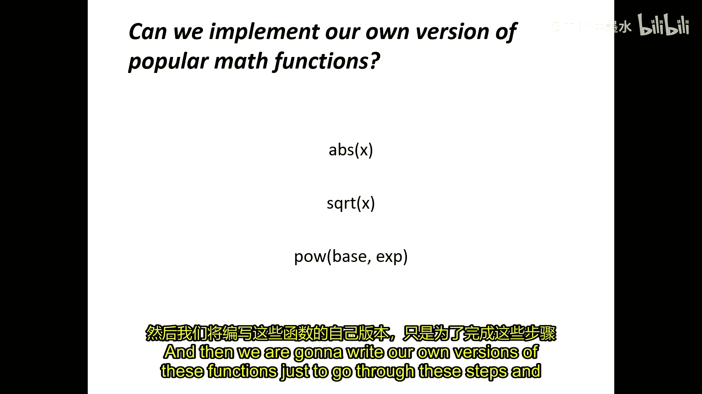
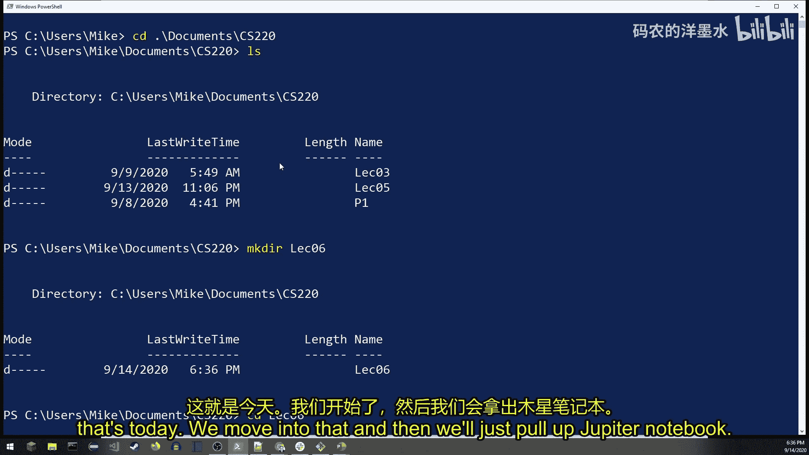
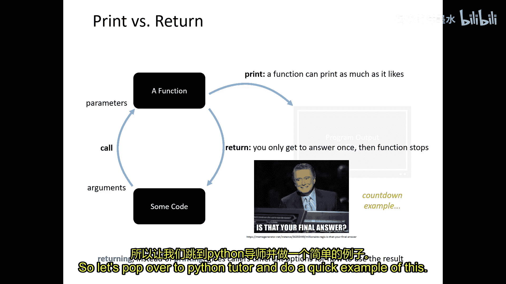
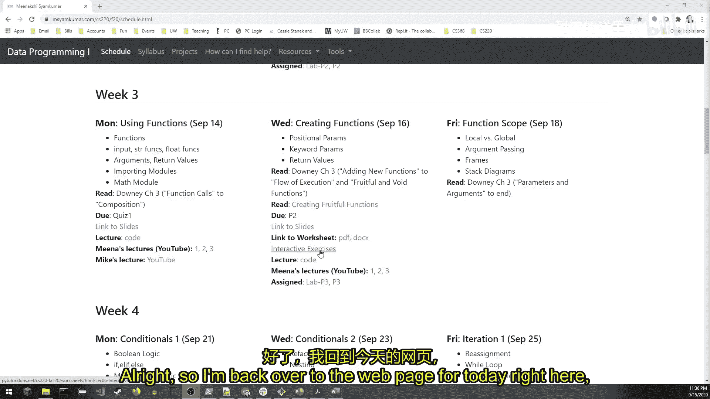
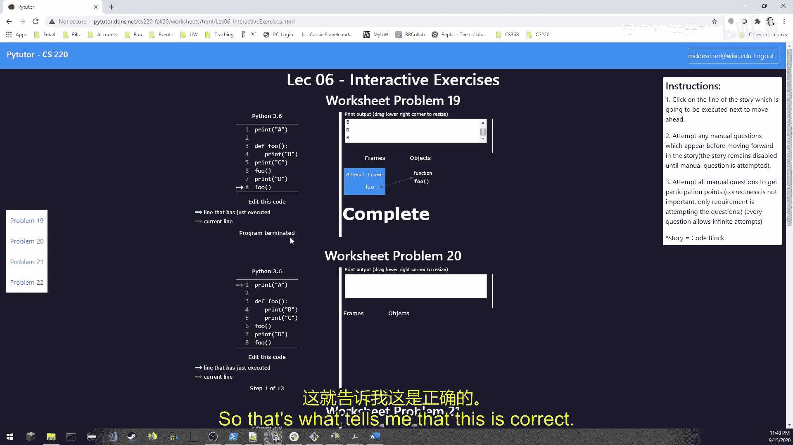

# 【全集】威斯康星大学-Python数据编程-CS220-中英字幕-1080P-p08-Lecture-6---创建函数--BV1VxvsBLEmv_p8-

Alright， hello， everyone。 welcomele back to data programming 1。 Today。

 we're going to be talking about creating functions。 But first。

 let me remind everyone that I'm gonna be live streaming my lectures Monday， Wednesday， Friday。

 at 8 AM。 come join us on Blackboard collaborate。 You can ask questions in the chat。

 I'll be there answering them。 We've gotten about 20 people on average over the last couple。

 So I'm gonna keep doing it。 You guys are welcome， come join us if you're looking for a little incentive to like make sure you keep up。

 having a scheduled opportunity to watch the lecture。 might be just the little push you need。

 Allright， so let's go ahead and get started。 I'm gonna take the camera off and jump right into this。

😊，Alright， so today we're going to be learning about creating our own functions。

 We'll be learning about function syntax， including just the basic structure。

 how we like we have to write the code so that it works。 Well， how to。

Look at input and output to our functions， they take parameters and we'll have three different kinds of parameters or arguments。

Whether they print something or just return something。

 whether they actually like compute something for us or they just do something。

 and then we'll trace through some examples。 Well on this page。

 please continue to read chapterpt 3 of Downy's book we started that last time。

 and also under today on the schedule there's a link to another article called Creating Fruitful functions。

 So definitely go ahead and read that one out also。Allright。

 I know I keep coming back to this robot code， but I like this as an example for functions。

 Our robot just wasn't very smart。 It had the power to move one step forward。

 And that was it to make it move more steps and be able to have a little control over how far it moved。

 We have this special block of code the move code。 This is our function。😊。

This is an example of a function that does something。 It's not producing a value。

 like like maybe a math function would， but instead it's actually doing something。

 It's moving the robot， printing value， something like that。

So we'll have two different kinds of functions functions that do something。

 maybe they print something， they may change some variables or they may produce a valuable like produce a value like a math function we saw an example of that last time when we have the F of x So we might say a math function computes something and returns a value down he calls these fruitful functions he's the only person I've ever heard used that word。

Okay， everyone else just says that they return to value。

 so be aware of that if you use that outside of the context of this class。

 and there are even functions that do both of those。

So I want to start out with something you guys may be a little more familiar with。

 the math functions。 in math， we would have a function， something like here。

 F of x is equal to x squared。 I want to talk about exactly how we would turn this into Python code。

 And the example is right here。 And I want to walk through all the different pieces and show you how they they do match up。

 So first up。We need that function name。 Okay， in math， it's going to be F。 We've got it right there。

 First thing we see in Python。 the function name is F also。The next thing we need are the parameters。

 in this case， the math function takes x， we need an x here， and the x goes inside those parentheses。

Then in Python we need to tell it it's a function in math we just use the equals and we've got a function。

 but in Python we need to tell Python that we are defining a function。

 so we're going to be using the keyword def D EF followed by the name of the function。

 We also need that colon there， the colon is more or less the same thing as the equals in math。

 it's telling Python that all the stuff that follows is going to be part of this function。

 it's all the steps that we need to do operations to simplify whatever to get the to do what we want the function to do。

All right， and then in math， we have the right hand side。

 this is what's going to be evaluated and returned when we call this function。In Python。

 we actually need to explicitly state that this is what we're returning。

 We may have a function that does a bunch of other stuff。 maybe it's printing out debugging code。

 but so we need to actually say this is what we want to return and we may have more than one line。

So note that all of the statements inside the body of the function are indented。

 and this is how we tell Python that these are the statements that go inside the function。All right。

 Python is really uncaring about most spaces， I mean。

 I can put a whole bunch of spaces if I want between the X and the stars or I could not have any spaces there。

 but it is extremely pickgy about the indentations for functions so make sure you've got four spaces here。

Every time you do this or however money you're using， it's got to do the same amount of spaces。

All right。Let's take a look at one more function here。So in math。

 I'm computing the area of a circle from a radius。 So Py r squared。 So to do that in Python。

 I'm going to have all these pieces。 I still need the name of the function G。

 I'm going to need the radius that goes inside the parentheses。

 I need those parentheses to say that this is the function list of parameters。 I need the colon。

 That's going to be the same as the equal sign right there。 I need that key word de。

And then I have to tab over all the statements， I have to tell Python exactly what I want to return because I could have multiple steps here。

 and then I need whatever I'm going to re returningturn in Python there we have to write out the value for P unless we import it from math we'll be talking about that later today and then we need to explicitly multiply and explicitly use the exponent double star。

All right， now we may have。This version uses a longer word radius frequently in programming we'll have much longer but easier to read simpler versions that do things。

 we use more variables， math， it's very concise often very difficult to read but very short in programming we'll see that we we tend to break things down into more steps and so it's important to have variables that are very descriptive so we'll often use whole words for variable names like write out the word radius。

We also may have more than one step in this case， instead of the using the radius。

 I'm starting with the diameter。And in order to compute the radius from the diameter。

 I'm going to add a second step here to just divide the diameter by 2。

 and then that will give me the radius。All the lines of code that belong to a particular function body are going to be indented with those four bases。

Alright， so next up， I want to do some demos。 We're going to go。

 and we're going to take some built in functions so we can explore their behavior。

 just things that are already in Python。See what they do。 See what they look like。

 And then we are going to write our own versions of these functions just to go through these steps and get some practice。

 Allright， so next up， I'm going to pull up。

Power shellll， I'm going to go to my directory where I'm doing all my work。

 So it's going to be documents。See yes， 220。Now， if I look here， I've got some folders。

I'm going to make another directory for lecture six， that's today I'll move into that。

And then we'll just pull up Jupiter notebook。And there it is， All right。

 so the first thing I'm going to do is just go over here to the new and open up a new Python 3 notebook。

I'm going to save this as main。Very common name for pretty much all things programming。

ll go ahead and save that and then。Hope this is not deceptive。

 I want you guys to just completely ignore this magic。 Kate。

 I'm going to copy and paste in some code。 This is an H M L window。 When I execute this。

 it's going to make this white box wider。And that's going to let me use more of the screen so I can show you better what's going on。

Let's start out with this A B S function。 Ay， A B S。

 we'll give it a -3 and just see what it does shift enter to run that gives us some positive 3。

 A B S， positive 3。What does that do， Poitive3， Okay。

 so you may have guessed from the name that A B S is actually short for absolute value。

 That's going to take any input that's negative and multiply by -1 to make it positive And anything that's positive it's just going to retain as that positive version。

Okay， so if we're going to write our own version of this， we're going to need some pieces。 First。

 we're going to need a name for the function。I'm going to be a little more explicit on'm programming。

 I'm going to use the entire word absolute value， so I know what I'm doing。

It's going to take one parameter。 I'm going to give that in x。

I need to use the key word de so that I'm telling Python that I am now defining a function。

 and I need to end that with a colon， just like my equals。 When I push enter here。

 Jupiter notebook is really smart。 It knows that I am defining a function It is already tabbed over one spot for me。

Allright， now we don't have conditionals yet。 we'll be working on those really soon。

 So right now I'm just going to use some mathematical trickery。

 So to take a negative number and make it a positive number。

 one of the things I can do is square it because a negative number times a negative number is always a positive number so I can use X。

Squared。And then what I can do is I can take the square root of that。

 The square root function will return a positive value。 so I can just raise this to the 0。5 power。

And now this is going to be the absolute value。 So I've squared it。

 That'll take the negative sign and make it go away。 squared root returns the original number。

 Last thing I need to do is tell Python that I want to return this value。 Okay， when I shift enter。

 it tells Python to store this function somewhere。 Remember where it is。

 And now I can start calling it。 I could say。Absolute。Value， and then I can give it minus-3 again。

Run this cell， it's going to return 3。0。One of the differences here that they have built in A B S function returned of an integer in my version。

 when I started doing the square roots and exponents returns of floating point value。

 I'm okay with that。 Let's test it with the positive numbers， make sure it works。Absolute value。

 positive three。Run that and again we get a positive 3。0。Alright。

 let's take a look at the next example。 I want to do square root。 So that's S Q R T。

 Let's give it the square root of 25。 We should get5 back， right。Shift enterer will run that。

 and I instantly run into a problem。 So Python has built in functions。

 and then it's got things that are installed with packages that I need to import。

 And square root is one of those functions that's in the math module。

 So I'll need to bring in that module。 and a module is just a collection of functions。

 So let's go ahead and do that。 The keyword to or the command to bring that in is going to be from math。

Import。S Q R T square root。 When I run that will shift enter now， I should be able to。

 do square root of 25， and it should work just fine。 It's gonna return the floating point number 5。0。

 Okay， so if I want to use something else from that package like Pi is a member of that package under to print。

Pri out a pie。It's going to give me a name error here， so I could do from Matt。Import pi， run this。

 And then when I type pi， it knows that it's a variable that's been assigned that value。 Now。

 I don't want to have to do this for every single thing Every up time I want to use a little bit math。

 So there's another shortcut。Ys。Fingers on rent keys。

 I can just import star and that star will grab everything from math。Shift enter will run that。

 And now we've got access to all of the functions in math。

 We're talking a little bit later about how to explore the math package and see what functions are actually there。

 But right now， I want to take a look at writing my own version of square root。So again。

 if I'm writing a function。I'm going to give into the keyword def to tell Python I'm defining a function。

 I'm a programmer。 so I'm going to go ahead and use a long variable name or a long。

 long name for the function square root with the underscore between it。It takes let's see。

 with just one parameter。 I'm going call it X because I'm doing some math。

 And then the colon in there is just like my equals。 So that's 1，2，3，4 parts。 Alright， next up。

 I'm gonna be computing the square root。Python has a really gorgeous built in exponentiation function。

 and I just grazed this to the half power and we are good to go。Last thing。

 my function needs to return this， so I。Can actually use something with it。

 not just compute it and forget it。 When I run shift enter。

 Python is now going to remember that square root is in cell 14 when it needs that。

 it's going to come back there。 So now I can start exploring this。It's very root。

 and we'll give it 25 again。Run this gives us 5。0 perfect。Let's try。 Let's try negative 25。

 Let's try and break this。 One of my favorite things to do。 It turns out that in Python。

 it actually has like the built in capability to work with imaginary numbers。

 So when we take the square root to 25， we do get an imaginary number。

 So for those of you guys in math， you find yourselfsels using a lot of Python someday。

 It's a very powerful language。😊，So right now， we're just taking this variable because it's the last line of these cells。

 It's just being put into the outbox。 If I were to store this in a variable instead we'll call。

I won't call this just S equals。Square root。Of 25。And we run this cell。

It doesn't actually print anything out。 I need to go back。And print S like this。 And then I get。

The value， or I'm going to copy this。 And iny in in Jupyter notebook and the command line intermediate mode。

 I can just type S。 And if it's the only thing on that line， it's just going to print out the value。

 So I can do that again like that。 And it's up to us how we want to use our functions。

 Whether we want to store them in variables， Pri them or use them in other expressions。

 The next what I want to do is P。It's going to raise a number to a power。

 This function takes two arguments。 So I could say take two raised to the third power and a run that should give me8。

2 times  two times 2， it's going to be 8。All right， so。Now， to write my own version of this。

 I'm going to call this function power。 so I don't want to reuse the same name because that will deny me access to the one in math。

 It takes two parameters。 So and of course， as a programmer I can choose longer words。

 I'm going go with base and exponent， but I'm gonna short enough exponent a little bit。

 I need to end this with a colon just like my equals and I need de to tell Python that this is a function。

 Allright， I'm going to push enter， it gives me that automatic tab over。

 this function is gonna be returning a value。 all the math ones are going do that。

 and this will just be base raised to Xp。 I know it's a little silly writing this one it's already built into the python as an operator。

 but it's a good demonstration， I think So I'm going to go ahead and shift enter this。 And in fact。

 just to be clear with Jupyter notebook。 I can define a function。

 and I can use it right here in the same cell。 There's nothing preventing me from doing that。

 but a lot of times programmers will like to write all of different。

sAnd put them up near the top of the Jupyter notebook and then keep their their work organized a little。

 better。 In this case， just to demonstrate those， I can。Using my function right here。

 I can take two raised to the third power calling this function and run that。

 and it defines a function and runs it all in one cell。 So totally possible to mix these up。

 So this is a function with two parameters。 It's not too difficult to keep track of them。

 but it's possible We may have functions with many， many parameters。

 and I don't want have to go back and look up the order they go in every single time。

 So one of the things I can do is call the function with the So as it is right now。

 the two will go into base。 The three will go into Ep。 they're called positional parameters。

 They just assign you know， match them up。 first one goes into first parameter。

 First second argument goes in second parameters。 So if I want to。

 I can actually explicitly say that the base is gonna be two。An exponent is going to be 3。

 And when I run this， this Python now knows exactly where I want to put this to。

And I did put them in the same order， but I don't have to。 Let me move this round。There we go。

 When I run this， it still matches them up。3 went into the exponent spot and two went into the base。

 Allright， so these are known as keyword arguments where I'm explicitly stating the name of the variable。

 the parameter。Inside of the power function and telling it what I wanted to be。

 we saw this last time when we used the print statement with Sep and end。

 those are key word parameters。Important to note that keyword parameters always come after the positional in the list。

 positional arguments always come first， and then the keyword parameters。All right。

 and once we have keyword parameters， they can come in any order we want。

 they'll mag get Matub correctly。Alright， And finally。

 keyword parameters are often confused with default parameters。

 So I want to just do a quick demonstration of a default parameter。

 So I'm going to go ahead grab my function。 I'm going to make a new copy down here。

 And what I'm going to do is say， what if I really use my power function to square things。

 Like all the time， that's the most useful thing in the world。😊。

So I'm just going to give it a default argument that says if nothing is specified for EXP。

 we're going to use two。Allright， And then when I run this， I can call the function power。

 I can give it a base of4。 This is a positional argument。

 So it's going to go in that first spot there。 There's nothing for E XP for the exponent。

 So it's going to just default to the two。 So if I run this。It's gone ahead and said four squared。

 If I were to put in， I could put in the two if I wanted to and run that still going give me 16。

 If I put in 3， it's going to say， okay， I put in a positional argument， just ignore the default 1。

 I don't need it。So I can do that， I get 64， I can even specify。That the key word argument here。

 E X P equals 3 should give me 64 again。Allright， and I just want to stress one last time that the positional ones need to come first and we'll go ahead and we'll do this the wrong way。

 the XP equals 3， and then we'll put the four in。 so we'll put the positional argument after a keyword argument。

 When I run this， it's going to give me a syntax error。

 and just let me know that positional arguments need to come after the keyword arguments。

 it's very clear。Alright， so just a little bit more about the rules for filling in parameters。

 Python gives us a lot more options than a lot of other programming languages do。

 So I just want to make really clear how all three of these work and they fit together。

 So take a look at this example function right here。 dev fo。

 So in programming foo and bar are frequently used as names of functions when we're just talking about a generic function that doesn't actually do anything。

😊，In this case， this function takes two variables X and Y。

 and the y here is given a default argument default， I can see the little equals right there。 Now。

 what I want you guys to do is when you see a function。

 the first line of the function is the one that we be executing first。 this definition。

 and it's going to tell us we have an x and Y。 and these are exactly like assignments。

 variable assignment。 So it's the same thing as though I'm saying x equals。

 and then whatever x is getting， it's coming from the outside of this function。Same deal with Y。

 Y is getting something from outside the function。 Or if we don't specify something。

 it's getting this -1。 These aren't actually part of the code。 It doesn't show us this。

 but you can imagine it as though the first two lines where x equals and y equals。

 or x gets and y gets。 if you like that language better。

 And that's going to happen when we call the function。

 So we have to define it first so that Python knows where to go when I call F。 And in this case。

 I'm calling with 99 and 100。 So these are positional arguments。

 the 99 will match up to the first parameter of the x。 So it's the same thing as saying x gets 99。

 And then the second parameter， second argument。 100 goes in the second parameter Y。

 So we don't use the -1 will instead use this 100。 And y will get the value 100。

I made a slide for this and forgot about it。 So the 99 goes where the x is the 100 goes into y。

 first parameter to first， first argument to first parameter， Second argument to second parameter。

Okay， another way that we can call this function is by using keyword arguments。

 I've got them here in order of priority。 So position， top priority。 keyword is second。

 So the moment I run into a keyword argument。 And Python knows this because when I'm calling the function F。

 I can see right here that I'm using the name of a parameter and equals and giving it a value。

 So the equals is the clue to Python that this is a keyword argument。

 It tells it we are done assigning positional argument。 and now we're on a keyword。

 So the y here is going to map to the one that's actually the parameter Y。 And then when we have x。

 it'll map to the parameter X。😊，And finally， if I don't have enough arguments， if I never specify。

The y parameter here。 So in this case， I have 99。 It's a positional argument。 There's no equals。

 It's going to go in the first position where x is。 And then I've got this closed pres。 I am done。

 So Python's going to go and look at the rest of this line right here to see that it needs to use the value-1 for y。

 Let's head over to the worksheet and get a little bit of practice。Alright。

 so I just jumped over to our web page。 Here's the worksheet I'm talking about on Wednesday。

 September 16， I'm going to go ahead and grab the word document 1 so I can write it on it during the course of the lecture。

 Let me just go ahead and pull this up and scroll down to the first problem。Al right。 I'm back。

 Got the worksheet pulled up。 So I'm Minister start right here at the very top is this reminder。

 positional arguments number one keyword arguments number two， default arguments。 Third Joce。Alright。

 And so we're going to be looking at this function right here。 It just has two parameters。

 This one just adds two numbers together。 But as far as the worksheet goes。

 the ad part is not important。 We're just looking at calling this function。

So let's just take a look at let's just start with problem one。 So take a look at this guys。

 do you think So the goal here is we want to either identify what value will go in x。

 what value go on y and decide whether it crashes or not。 So I'll go through。 I'll do the first one。

 So X here。 I have my three。 that three is the first parameter It's going to go into X。

So I'm going to just stick a three right there。Then I'm going to notice that I'm out of arguments。

 There are no default arguments。 So there's nothing here for why。 So this is going to crash。

Let's put a big all X right there。All right， let's take a look at number two so。

If we put the very first position， it's going to go into x。So'll put a three right there。

 The second position is going to go into that position。Second argument goes into second parameter。

 So y is equal to 4。 And this is going to be just fine。 This will run。Alright。

 let's take a look at number three。 Now， What if I switch them around， Is this still going to work。

So the first argument will go in the first parameter X。 So in this case， itll be。

 and the second parameter will go in argument。 Second argument will go in the second parameter。

And W3。 So this should work just fine， too。 I've got exactly the right number of arguments。

 Python will be happy。All right， this one。Take a look at number four。

 what do you guys think will happen？So the first position will go into the first parameter。

 second position。Go into the second parameter。That over so they're lined up。 That looks good。

 But then I've got an extra parameter。 Python will not be happy with that。 So this is going crash。

Definitely。All right， let's take a look at this。Yeah let's skip down and take a look at number six The best way for you guys to use this worksheet is probably to come back later。

 you know when you're studying for the exam， which is in about two and a half weeks or studying for the quiz on Monday。

 So come back to this worksheet， grab a blank copy and run these guys in Python tutor。

Watching me do them on a video is probably the least efficient way to learn this stuff。

 But to do it yourself， you will learn more。 So let's take a look at this one on number 6， the first。

Positional。Argument is going to go in the first parameter up here。 So x will get the value 7。

My the right line。 Yep， and then it's telling me that x is equal to 6。 There is a problem right here。

X has already been assigned to value 7。 Python knows that。 and at that moment right there， crash。

Al right， same do with number 7。 We're going put the 7 and the 8 in first。 So we have 7。

Oops I missed and8。 and then it gets here and says x is equal to 9。 X already has a value。

That's a big old crash。Alright， these last two look good to me。

 We're just going straight to the keyword。 So it's gonna take a 10。

And put it in the exposition 11 for y。 that should be just fine。 Same deal if I switch the order。

 Python does not care。 It's just got to fill everything in， So it'll put a 10 and y and 11 and X。

 And as soon as everything's all filled in， Python's happy。 So that'll be fine also。😊，All right。

 at this point， if you're watching at home， pause the video。

Go try number 10 through 18 and then come back and I'll go through a couple of them。

 You can check your work。 If you're watching the live stream version， I'm not going to pause。

 we're just going to go right through。Alright， let's take a look at number 10 first。

 So this has absolutely no arguments whatsoever。 So the next thing we're going to do is go to default arguments for T。

 It's going to be assigned to value 1。And is going to be assigned the and nothing。

There we go and it's going to crash because there is no nothing assigned to the parameter word。

 so that's going to be crash。Alright， if we actually assign the word。

 So this is the first positional argument。 So word is going to get the value hot。

Just like that that then we're done。 So we need to go to keyword。 No keywords。

 defaultult will be next。 So T is going to equal 1。And end will be。The empty quotes。

 and everything is happy。 We've got all three filled in。 It's good。Alright， let's take a look at 12。

 Again， we're going to put Ha in the first spot。 So this is going to go right here。

T is going to get the value to。 So at this point， we're done with positional arguments because I see that equals。

 So we're on keyword。 So T is going to be assigned to。And then。We're done。

 so we need to go up to default arguments next， and end is going to be assigned the double quotes。

There we go， wonder why my quotes are different。Oh well， no worries。Then on number 13。

 this one's a good one。 So in this case， we've got Ha。That's going to be assigned right here to word。

 No problem's the first positioned。So we'll just p that down right there。Then。

The next one is a keyword and is equal to the exclamation point。

 I'm to just copy and paste so the quotes are fine。That's fine。

 And then we need to go to default arguments because we're out of arguments here。

 And we see that T does have a default argument of one。 So I'm just going copy that。

 paste it right there。 And again， this one will also be fine。

No problem because all of the arguments are filled in。All right， next up。

 So we go straight to keyword arguments。 we sign T the value 2。Word gets y。And then。So here。

 tea gets2。 We filled out in it first。The word。It's equal to yo。Good to that。 here to that。

 There we go just like that。 And then we have to go with this default value for end。

And everything is filled in， everything is happy。Nothing was used more than once， okay。

 so check this out。Assign W right here to word， no problems with that。I don't think I grabbed a copy。

Still， then get it。There we go。All right。W right there。Then we have three， three goes into T。

Check that out and then EB。Goes into。The final one end。Just like that。 Okay， again。

 everything is happy。 It all looks good。Let's see here this one。 T is equal to 3。

 So I put a three right there。 We're down to。 So this is keywords。 There's no positional arguments。

 Then we're on to default。 So we've got。Double quotes here for end。This one's going to crash， though。

 because we never assigned a value to word。 There's no default for that one。

 So this is a big old crash。All right。This one， let's see what we got here。

This one's going to crash you。 I can tell right away。 So we're going to put a W。In two words。

 it's the first position。Then we're going to write。 So at this point， we are on to keyword arguments。

 That means we are done with positional based arguments。 So N is going to get the period。

So quote period quote done。 And then this three here is going to say， whoa。

 it's not a keyword anymore。 keywords always go at the end that we're done with positional arguments。

 The moment Python sees that， we're going to crash。And then this one's obviously going to crash。

 Do we have too many arguments， one question mark and an exclamation point。 too many。

 It's going to crash。The font will go into word， the one will go into T， the question mark into end。

 and at that point it knows that there are too many and it crashes。

 I'm just going to put an x rate here。Al right， I do want to spend a little bit of time talking about modules。

 You may have noticed on the slides from the previous lecture that there are a couple of slides at the very end of about modules。

 I didn't get to those。 That lecture was five minutes too long anyway。

 So I've moved that to here in the this lecture。 So modules are just collections of functions。

And they come from packages， so packages come from a number of places。 Some of them are built in。

 These modules like the built in modules contain like the input function we talked about， print。

 length， etc cetera。 We also talked about some of the like I'm going to call them pre installedst。

 We saw an example of that with math。 We had the square root sign cosine pi。

 a lot of that kind of stuff in those。Some of them we had to install ourselves。

 So when we used Pip install Jupiter or Pip install。

Map plot Lib are those other things that we started with the like how to install Python video。

We had to install those modules and then we can also write our very own modules those would be custom modules I've got a demonstration here we're going to go take a look at a prebuilt dog module that the team wrote and then we'll write our own cat module so head over to the website。

And then go ahead and click on the code right here。 What we want to do is grab the dog dot high。

 So I'm going to left click on that。 I'm going to row a missed。

Right click raw and then save link as and I want to put this in the same directory where I have been working。

So this is lecture five。I need to go to lecture 6。 I'm going to save this right here。All right。 Now。

 when I go back over to look at my Jupiter notebook。I can see that I have dog right here。

 First thing I'm going to do， I'm just going to go ahead and double click this and open it up and take a look at what's here。

We see that there are two functions。 The first one speak， and the second one is fetch。All right。

 so those are things that dogs can do。 Let's see here。 let me head back over to Jupiter notebook。

I'm just going to rearrange my windows so they're side by side。

 Next thing I'm going to do is we're going to need to bring these functions into the Jupyter Noote into Python because this is a separate module。

 It's in a dog dot P Y file。 So to do that， all we need to do is。Dog。Import， we' grab of everything。

 That'll bring in both functions。 So shift enter to run that。

 And now we can use the functions that are available in Dos， We can。Use the speak function。

 I need to put the parentheses in to make it call the function。 Swiftener。 will'll run that。

 And we can see this dog bark bark， bark， bark bark as dogs do。 can do the other one， too， so。

T us out to fetch。 we run this with shift enter。 The dog brings us a stick。So next thing。

 we can also， I want to just highlight one thing。 There are functions that do things and functions that like return things。

 And we can store those values。 Let's see， I'm gonna to use RV to store the return value。 Oh，'s。

 there's two functions。 Let's go。 RV 1 equals。😊，Speak。

 so we'll just grab whatever the return value is here。 and run this。And run this。 There we go。

 We see that it's still box， park， bark， bark， bark bark。 Let's go the other one Now。 RV 2 equals。

Frech。Shift energy around that。 Now， check this out。 The first time we ran fetchch。

 It returned a stick。 St it right there in the out box。 This time， it didn't do anything。

 It turns out that we have actually stuck the value stick in RV2。 So if I just put that in there。

And run it。 Jupyter notebook will print out the value of the last thing。 And this is the only thing。

 So it is also last。 So it's in the albox right there。 I can also just print this。

And I would need to do this if it were not the last line， so there we go， printed stick。Now。

 let's take a look at RV1。 So I'm going to do RV1。Nothing， I'll try and print this。

On that it's actually printing out none。 So none is a special value in Python。

 It tells us this is the absence of a value。 when we have a function that doesn't return anything。

 So return none right here， It actually specifically says it's not returning anything。

 I don't actually need to put this in。 If I were to delete this line。And we'll save this。

It is file save， done。Then we'll go back over here。

 We need to rerun the import because I made a change。 So I'm going to shift enter that。

And then I'm just going to rerun a couple of， I'm going to rerun everything。 kernelel。

 restart run all。Run all the cells。 There we go。 We can see that。Oh。

 there's a bug because I didn't change。This one。Time， let me get this all。 All right。

 Just commented out the one with the bug。 Let's see if this works now。

 So I want kernelel restart run all。 Okay， there we go。 We can see this still works。

 even though I took out the implicit or the the the explicit return none。

 it automatically adds that every time we have a function that doesn't return anything。

 just means that it didn't return anything。Alright， so next up。When we write functions。

 we have a choice a lot of times about what we want to function to do。

 It's up to us to implement it and a lot of times we need to produce a value that will print to the screen and we've got choices。

 We can either have the function In this case， we call the function with some code。

 we give it arguments， the function does its stuff。

 arguments are put into parameters and when we return something。

 we return a value and that lets the user decide whether they want to print it out。

Another option would be the function could print out whatever happens。嗯。In this case。

 this arrow down at the bottom indicates that we've returned something。

 and then the function is printing it。 so we can call print either inside the function or outside of the function。

In this case， in this example， suppose I wanted to print a series of numbers so I could send those numbers to the function。

 The function can print them out 1，2，3，4 on the terminal。

 and that could be then another option would be what if I wanted to use those numbers for something else。

 So I call a function， It computes some numbers for me。

 and I'm going to send them back to the user that user then could do whatever it wants。

 maybe it wants to make a bar graph or add them together。

 So by returning the value and letting the user do the printing it makes our program a little more versatile。

 it gives the user more control。 So it's almost always better to have it return the value rather than print the value itself。

 So compute something and return the value and then the user can print it out as they see fit or they can do something else with it。

One final thought on the printing versus returning issue。 We only get one chance to return。

 There is only one answer。 Maybe be you are familiar with this show， who wants to be a millionaire。

In that show， we just always asked the candidates。Is that your final answer。 And when they say yes。

 final answer， they don't get to change it anymore。 There is no second choice。

 They don't get to go back and give them a different answer。

 So let's pop over to Python Tutor and do a quick example of this。

So I'm back over our webage under tools。 we have Python Tu。

 I'm going to click that right here and jump over。 I really prefer the live programming mode。 I mean。

 really， why wait。When it can just like see what's happening， So the first thing。

 I'm just go ahead and define a function。Would do countdown and need parentheses in a colon。

 So remember， I need the keyword def， the name of the function parentheses with my parameters inside and a colon is's a lot like the equals。

 This function is just gonna print some stuff out。 Pri 3。P two。Point1。

And then that'll be the end of it。So let's go ahead and call the function。

And just sort of walk through and see what happens。All right， so I'm going to go back to the first。

And then I'm going to click next to walk through this。

 So the first thing Python does is it says this line right here and just makes note of the function countdown is on line 1。

 just remembers where it is。 And that's all that's going on here in this global frame。

 Then when we get to next， it calls the function。And we jump up here into the function。

 That wasn't next。 That was last。 All hold hold on。 First， next， next。

 Then we jump into the function。 This line right here says assign all of the parameters。

 There aren't any。 So it's， it's done with that line。 Then we're going to print 3。 There it is。

 print 2。 There it is。 print 1。 All right， excellent。 It says that it's， you know。

 it's on the last line。 The return value is none。 that's going to get put back over here。

 If we had a variable like x equals。 then that variable， the value， none would be assigned to it。

 I'm not doing anything with it。 So the none is just going to be ignored as soon as I click next。

 and then it's finished。All right， I'm going to make a little change right here。Instead。

 I'm going yeah we'll print， countdown whatever the value is there。

And then instead of printing these guys， we're going to。Returned。3。Return to。Return one。Alright。

 so we go，' start the beginning first。 All right， that first thing it does is remembers that countdown is online one。

Then when we call the function right here on line 6， it goes in and says， okay。

 assign all the parameters。 There aren't any。After that。

 it's going to go to the setup line2 where it returns3。Allright， there it is。 The return value is3。

 So it's going to pp that down and replace it right here。

 It's like basically simplifying this part of the code right here and putting a three in。

So it hops down here， prints out the three。And then it's done。

 It never actually gets to these two return statements。 The moment it hits a return。

 it's done with the rest of the function。 This is actually known as dead code。

 because it can never be reached。 Never will we see this executed。

 because it will always get to this return value first。Al right， next up。

 I want to talk about creating our own modules， and our dog needs a friend or an enemy。

 So I'm going to go ahead and use a new file。 but this time I want a text file。

And the first thing I'm going to do is I'm going to go ahead and name my text file。

 I'm name it cat do py。 So modules are named with the extension Py。 And then I can just click， okay。

 there we go。 We've got this thing here。 I'm going just pause and rearrange my windows so we can see。

Alright， now I've got the windows arranged。 So I've got cat over here。

 dogs down here and my Jupyter notebooks are over here。

 So I'm going to go ahead and start giving the cat some functions。 And just like dogs。

 cats can also speak。So we'll give it a speak function， de name of the function。

 parentheses and a colon。 Allright， so we'll just print out。Cats aren't that loud。

 We'll just give them a subtle， tiny meow。 and that should do it。

 So I need to go up here to menu file save。Close that up so you can still see everything over in here。

 I need to import my new cat。 So let's go ahead and do that。Import。Right， I'm doing this wrong。

 I'm doing it wrong from cat。Import star。 There we go。 That's， that's the right order。

 my brain cramped up for a second there。 Okay， I'll run that with shift enter。

 And now we have the cat there。 So now we should be able to type speak。And we'll get the。

 the cat speaking。 There it is。 It says meow。 All right。

 the problem with this is I just lost the dog。 Check it out。 Speak， is always going be the cat。

Doesn't matter how many times I do this。 I'm never getting the dog back。

 I have replaced that function。 The dog speak right here。 this one。With the cat version。

 So Python has just overwritten it。 The fetch should still be good， though。So if I do fetch。Run that。

 that function is still available。 If I want the dog back， the dog barking。

 I need to import or from dog。Import star。He know。Figingers on the wrong key speak should be the dog。

 But now the cat is gone。 So if I want to get around this because both functions have the same name。

 I need to import them a little bit differently。 So in this case， to preserve both functions will do。

Import。Dog。And him。Port cat。Now， when I do this， I've imported the modules。

 It's got the list of functions， but I didn't just import the functions that。From dog import。

 that says， go get the actual functions。 B these in。 When I just import dog and cat。

 I've imported the entire package， the module and to call the functions from within the module。

 I need to actually specify which 1 I want。 So I need to say dog dot。Speak。

And then shift enter will actually bring up the dog speaking from the cat。 I need to say。

 I'm using the cat module now。 Cat dot speak。And that will bring up the cats version。

 But now both of them are available。 I just need to tell Python a little bit more information about which module I want to bring these functions in from。

Al right， and as we're learning more about Python， we've introduced a new type。

 we've got modules here。 I just brought in a CA module。

And one of the best things to do every time we do this is to explore。With type。

 So I'm going to run this with shift enter。 And What I see is it tells me that it is a module and do the same thing with cap。

Type。So if enter again， a module， I believe I can do the same thing。With。To speakpeak。

Without the parentheses， and that should tell me it's a function。

 So I've got all kinds of things I can do to learn about Python。 And another one of those things。

 there's a command。Built into Python called D。 It stands for directory。

 but I can go ahead and do that for。A module。 And this is going to list all of the functions available in that module。

 There's a bunch of stuff here。 There's anything beginning with the double underscore we can pretty much ignore builtil ins cache doc file all the way down。

 And we can see here that it actually has two functions。Fetch and speak。

 I will talk about some of these later on。 But for right now。

 this is just a way to grab that list of functions。Let's take a look at。

The functions available in math， I can do the same thing， du。Math。Or I could Google this。

I forgot to import it。 so we'll just do import。Math。Got that。 Now we can do。就是。M。Run that。

 there we go， and this is going to be a long list of all the functions available in math。

Whole bunch of them。 And again， all those special variables beginning with double underscores that we can ignore。

Alright， let's just pick one out。 Let's take a look at seal， C， E， I L。 This stands for sealing。

 It's going round up。 So it's going to take any floating point number and round up to the。

Nearest inger， but always rounding up。 So some things we can do， Let's type。Ma that seal。

 without the prince， let's just see what this gives us。Okay， and tells us that this is a function。

 and this is because this is the last line of a Jupyter notebook line。

 Otherwise we'd have to print this out。All right， so it's a function， that dot seal。

 it takes one parameter x。Alright， next up， let's。Try and get a little more information about this。

 always type type。Matta， C， E IL， there we go。 And this tells me it's a built in function or method。

 awesome。But to figure out what it really does， we need some documentation about it。

A way to get that so I can type math dot CL dot。 and then one of those special variables we were just talking about with the double underscore doc。

 This is the documentation for this function。So if we do shift enter， I don't know that。

 it tells us exactly what this is doing。 It returns the ceiling of X as an。Integral。

 this is the smallest integer greater than equal to X。 Let's just try this out Now， math do C O。

 and we'll give it a 2。3。There we go， so this should be the integer 3。

 the largest integer or smallest integer greater than that number。

I was just looking at this output for a second。 It's got these like back slash and back slash and。

 It's kind of awkward to read。 This is the programmer version of a string。 Instead。

 it might be better to actually print this out where we get the user version。 So again。

 that was math dot C， I dot， underscore， underscore doc， underscore， underscore。

 and ship enter run that。 There we go。 returns the ceiling of X is an integral。

 I think they made integer。😊，At least that's the language I would have chosen。

 This is the smallest integer greater than or equal to x。 There we go。 Now it looks good。

Let's go ahead and try this same thing with our new cat function。 So let's see here we have print。

Can't speak。Dot underscore， underscore， doc， underscore， underscore， and run that。

 And we find that there's it's none。 We have not actually provided any documentation for the speak function for the cat to do that。

 all I need to do is go。 And for the first line of the function， I can just add a string。

 And that string will be the documentation。 When Python imports this module。

 It's going to take this special variable。 underscore underscore doc。

 and give it the value of whatever I put in this string。 So I'm say this function。Makes the cat。没。

And the quote there， and now I need to save this again， so file。Save。

And now I'm going to need to reimport this because its we need to rebring it into Jupiter notebook。

 so import cat。And now I'm just go ahead and copy and paste this function one more time。

But I screwed up somehow。 Time out。 What I do wrong。And I got it working， here's what I had to do。

 I needed to go back to menu， kernel， restart and run all。 That was the secret soon as I did that。

And closeose that up。 It now is giving me this documentation string and it prints it out the cat。

 This function makes the cat Sam just like I told you would。

 you're going to run into little things like that with Jupynter notebook book where something will not work。

 that You think it should。 And the answer is restart and run all。Alright， so second。

 the last thing I want to do today is go through one more of these worksheet problems。

 And then I want to introduce the interactive exercises。 So first up。

 this is number 21 from the back of the worksheet。 So going through this and trying to decide what is Python going to print out valuable exercise to be able to read code and coming up a lot of the exam questions and quiz questions are not about writing code。

 But they're about understanding what code is really doing。 So in this case， as we walk through this。

 I've got my starting arrow there pointing at number one。 There we go。 So the first thing。

 Python's going to do is say that， okay， function C is defined on line 1。

 I'm just going to remember that。 The next thing it's going to do It's going to jump down。

 And it's going to skip over all of the。😊，Content of function C gets to line 4 and says， okay。

 now I need to remember where function B is defined right there on line 4。

 It's going skip over all the content of function B。

 It doesn't need it right now and then go down and say okay， on line 9， I'm defining function A。

 I need to remember where function A is。 It's going skip all of that stuff and go down。

And execute function A。 That's the next thing it's going to do。 Allright。

 so it's going to jump up into function A。Right there， see that we don't have any parameters。

Then it's going to go print out a1。Alright， so I just grabbed a little box and wrote down a1 so I can remember what's printed。

 Alright， Next thing we're going to do。 it's going to go down。Go down and call function B。 Okay。

 I'm going to leave this arrow right here， and I'm going to grab another arrow and move it up to function B。

 because when we're done with function B， it's going to return to right here。Alright。

 But it jumps up to function B next。 It looks at the parentheses。

 sees there's no parameters and moves down from here， it's going to print out B1。

 So I'm going just quick add a B1 over there。From then。

 it's going to keep going one line at a time in order and call function C。All right。

 so let we grab another arrow。 It's going to jump up to function C。 Check out no parameters。

So it's going to print out。不See。Wops， hold on， Mike， Oh crazy there。 There we go。

 Print out the letter C。 After that， it's reached the end of this function。 So it's going to return。

 And it's going to go back to where it came from。 It was function。

 function C was called right here on line 6。 So then this arrow is going to advance to line 7。

 and it's going to print B2。So let me go ahead and grab a B2， put that in。From there。

 we've reached the end of the function。 So this is I'm going to delete this arrow。

 and it's going to jump back to where function B was called from in line 11。Then finally。

 it's going to move to the next line there and print out A2。All right。

Let me pull up those interactive exercises and just introduce them to you guys。 All right。

 So I'm back over the web page for today。 right here， the interactive exercises。

 I'm just gonna click on that。 It's gonna go ahead and log me in。 I've got my name up here。

 so it can keep track of my progress and use this for participation or whatever we choose to in the future。

 right now， this tool is still under construction。 It's pretty good。

 It's in the shape that I'm willing to share with you guys。 So here's the idea。

 It's based on that Python tutor I've been using for my demonstrations。 But it's got a little more。

 it's designed to help guide you guys to do the learning process。 So I'm kind of excited about this。

 So we just take a look at one of these。 The idea is we're going to click on the line。

 and it's going to tell us what's going to be executed next。 A little glitch right here。

 It looks like I should be clicking the first line。

 but it's going be what's executed after the line with the red arrow。 That's the current line。

 So what happens next， is it's going go remember where Fo is。

 So that's the first line I need to click。 Then it's going skip down print is going to be in the next line。

 And this kind of walks us through things。 Then it's going。😊。

F，So we jump up into functionF。And then the next line to be executed was that print B。

 And here's one of those examples where a question pops up。 It blurs the text。

To like give me a clue that I need to go do something else。

 I need to put down that it's going to print a B， and I'm going to check this。Cool。

 that's the end of this function。 So the next line to be executed after the red arrow。

 line 6 is where it was called from。So I don't need to click line 6， I need to click line7。

 there we go。And that's going to be the next thing to be printed。 So after this is executed。

 it will print that D。And then it's going to ask me which function is being called F。

And that's all I need to type。 I don't need those parentheses。 Got that right。

 So then it's going to go back up。Into the function fo， this is。

 I need to click on the depth line because that's where the parameters would be initialized。

 But there this doesn't have any。 Next thing it's going to do is print out that B。

 And then it's going to return。To that very last line。 And I see programme terminated。

 So that's what tells me that this is correct。

All right， that's going to be it for today。 Have a great day everybody。

