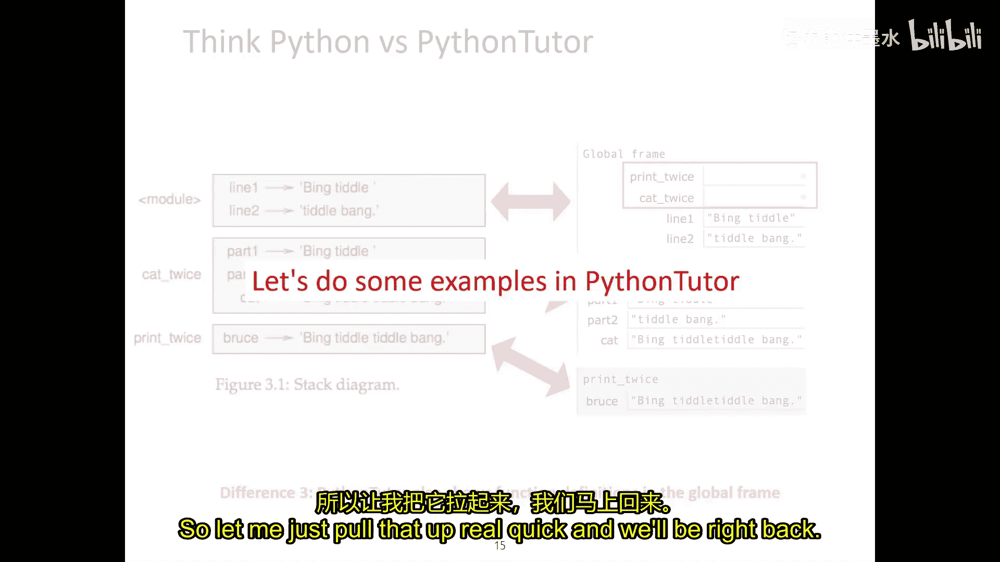
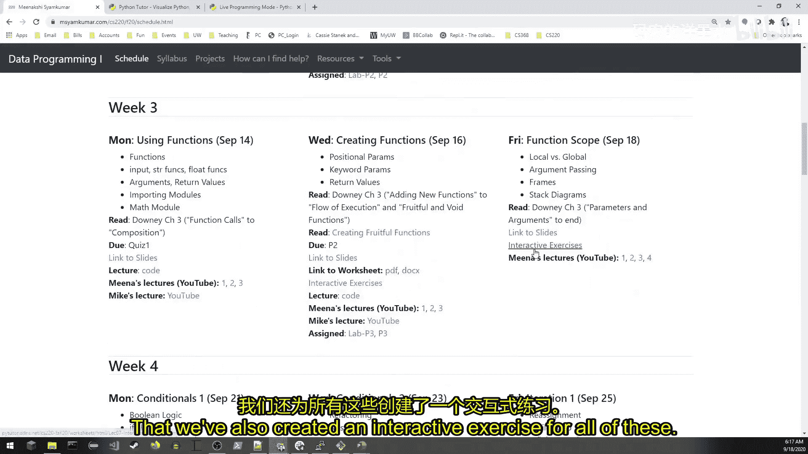
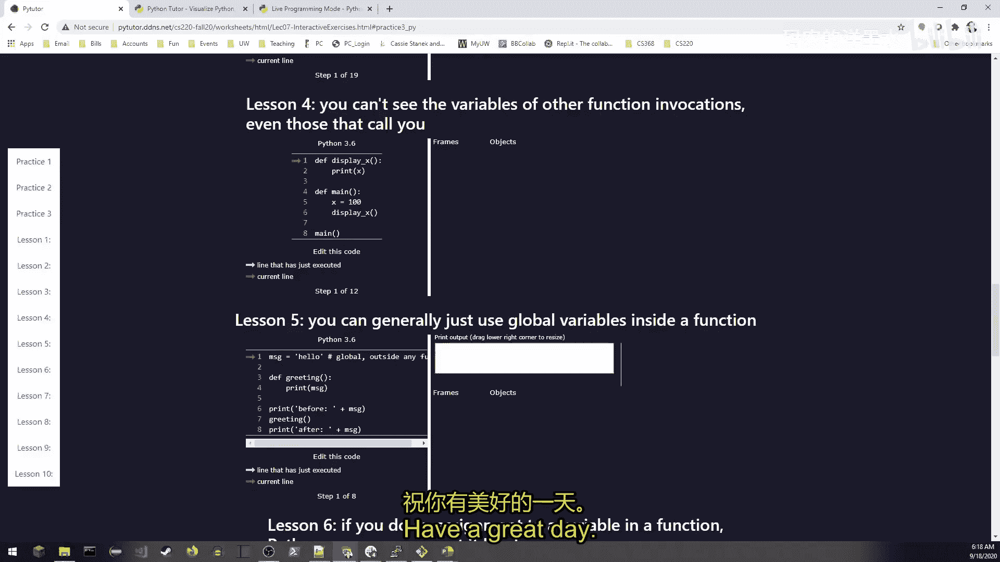

# 【全集】威斯康星大学-Python数据编程-CS220-中英字幕-1080P-p09-Lecture-7---函数作用域--BV1VxvsBLEmv_p9-

Al right， Good morning， everyone。 Welcome back to data programming1。

 This is our third lecture in a row on functions。 And today we'll be talking about function scope。

 Before we get started， I'd just like to remind everyone that I'm going to be live streaming the lecture video Monday。

 Wednesday， Friday at 8 AM on the Blackboard Collaborate channel。 You can connect to that through。😊。

Our Canva webp page， if you find yourself like getting a little behind。

 maybe procrastinating a little bit too much， this is a great opportunity to just get it into your schedule。

 get it out of the way first thing in the morning， make sure you're caught up on the lecture and at the same time you can ask questions in chat and I'll be there to answer them or you can just read what questions other people have and get a little bit more out of the lecture experience。

All right， so just to put this particular lecture in context for the entire course。

 let's think about where we've been so far。 So we began talking about expressions。

 And all an expression is is a mixture of operators and operas。

 And we've talked about some operators that you guys are likely familiar with， addition， subtraction。

 multiplication division。 and things like less than or greater than stuff you probably learned back in like。

Third grade。We also introduce some things that might be new。

 like Boolean variables and the and not or operators， the Boolean operators。All right。

 And then after we talked about expressions， we went on and talked about variables。

 We introduced the idea that we can store the result of an expression in a variable and。

We also talked about how expressions operate on operas， they could be literals like numbers or text。

 but they could also be variables。So next up today we're going to be talking about functions and the relationship that they have between functions and variables。

 and this can be a very tricky topic if you've never seen it before we're going to devote an entire lecture to it。

 The core of this is known as scope and it has to do with which variables can we see which ones exist and which ones are accessible。

 We're going to talk about how variables can have the same name in different places in the code but represent different numbers。

We can see so we're going to go and we're going see we've seen how variables are created。

 how they're born。 Today we're going to go and talk about， you know what happens when they die。

 when we're done with them， we're going to learn the rules about who can see what how are they shared how are variables connected to functions and' going to divide this into three parts and develop overall 10 rules。

 The first four rules will be about local variables。

 The second four rules will be about global variables and the last two will be about passing arguments to functions into their parameters。

So just a quick note here， it's important that you guys actually understand the concept。

 don't just memorize the rules， I'm never going to ask you to write these rules。

 but you have to understand them in order to be able to interpret code that I give you or to write your own Python code and some of these rules may be different from things from the way things work in other programming languages we're going to talk specifically about Python。

Allright， and maybe just to give this some context and talk about how you may have seen this in real life。

 let's talk about for a moment how the same name can mean different things in different contexts So I've got some some things here where I've got I may have lots of students in my class。

Some of them are likely named Nicholas。 There's 830 of you guys。

 Nicholas is a very popular name for people in this age group。

So if I'm just referring to Nicholas out of all the people taking this class。

 there may be eight or nine of you guys， you know， in the class with the exact same name it's possible。

 So how do I decide which Nicholas I'm referring to。Or if I'm just looking at a street address。

 State Street， for example， the street， I'm referring to may refer to the city。 I I mean。

 the context means I need to know which city I'm in。 my hometown across Wisconsin has State Street。

 and Madison has a state Street， but they are different streets， even though they have the same name。

We'll see the same thing happen in programming。 In fact， last lecture， we created modules。

 and we had two modules， a cat module and a dog module， and they both had a speak function in them。

 So how can Python tell which speak function to call。

And my guess is at this point you guys have written several programs， several Jupiter notebook。

 and named it main。ipy and B， and the actual main that we're running is going to depend on which directory we're in。

 which which directory is the working directory。So what we're going to do is in order to keep things organized。

 we're going to use this mental model of variable organization and they're called frames。

 so we're just going to group the variables into a box。

 we're going to call it a frame and then we can the hython will know which variable referring to based on which frame is the active frame and we'll learn the rules for this。

So let's dive a little more into this concept of frames。

 So the idea here is that every time we call a function or invoke a function。

 we're going to create a new frame。And what we're going to find is that all of the variables that we create inside that function and the parameters are going to exist inside that frame。

 They're going to be called local variables。 In addition， there's also exactly one global frame。

And all functions can access the variables in the global frame。So when we access a variable。

 Python looks first in the functions frame， the functions invocation frame I call it here。

 and then second it looks in the global frame。 if we have two with the variables with the exact same name。

 it's going to choose the one that we've created in the function invocation。And then second。

 if it's not there， then we'll look at the global one。

 and we'll talk about rules for accessing the global one inside of a function。All right。

 I want to just take a look at this example from the Downy book chapterpt 3。8。

 If you haven't finished reading that yet please go ahead and finish reading chapter 3。

 I don't care if you do it before the lecture after the lecture。

 I know there's a lot going on in this slide right here。

 So the first thing I want to do is just focus at the code in the upper left hand corner and walk through it。

There's a lot of red， which I find really distracting when I look at this， so I apologize。So。

I want to just talk about what Python does when it sees this。

 It's going to start at line 1 and see that we have the definition of a function print twice。

 takes a parameter called Bruce。Okay， then the next thing it's going to do is jump down to line 5。

 And it's going to notice we're defining a second function。 cat twice。 And that has two parameters。

 Part 1 and part 2。 Okay， so it's going to jot down that that's on line 5。

 Then it's going to jump down to line 9 and start executing the code here。

 So it says line 1 equals Bing Tittle。 Line 2 equals Tittle bang。 I little side here。

 I don't know if you guys knew this。 but Python is not actually named for the snake。

 It's named for Monty Python。 And in one of the Monty Python sketches。

 they sing this song that begins with the Bing Tittle Tittle bang line。

 And that's where this example came from。 All right， all right， Not for these side。All right。

 finally， then we'll call the function cat twice， and that's going to be given arguments line 1 and line 2。

So Python remembers that cat twice is up here on line 5。 It's going to take these two arguments。

 So line 1 is big tittle。 It's going to put it into part one。

Titttle B line 2 is going to get put into the parameter part2。Okay。

 and then cat1 is going to just add those together。 And when we have strings。

 it's going to concatenate them。 So cat， as in concatenate， will be Bing Tittle tittle bang。

And then it's going to call the function print twice。And that's going to be， given the argument， cat。

And cat is then going to be stuck into Bruce。The parameter for print twice。

 And then print Bruce is going to print out the bang Tittle Tittle bang for that first line line 2。

 And then in line 3， it's going to print it out again。 So the output's going to be B tittle。

 Tittle bang， B tittle， Tittle bang on two months。Okay。

So now the idea of frames here is that each of the functions I've got one here on lines one。

 two and3 and another function in line five，6 and  seven， print twice。

 cat twice is each going to get its own frame at some point。

And then there will always be a global frame and in the global frame we're going to have line1 and line2。

 So if we were to draw a picture of all the possible frames that may exist at any particular moment。

 This is a good example it's known as a stack diagram。

 So at the top of the stack here we have the module where the global variables are held。

We'll find out that Python Tutor calls it the global frame， and Downy's going to call it the module。

 That's okay。 They mean the same thing。 Anyway， line 1 and line2 are going to be in the global frame because they're not defined inside of a function。

 They're defined outside of all functions。Then when we call a cat twice on line 11。

 it'll add another frame。 This is a local frame。Well， for catwise， a function in vocation。

 And inside we have local variables， Part1 and part2。 Those are the parameters。

 We create a new local variable cat。 And so those are the three variables that are local to cat twice。

And then。When we call print twice， it's going to add a third frame and that just has the one parameter Bruce so thatll be the local variable in this frame。

All right， so。When we're in this section of code lines 9，10 or 11。

We will just have the global frame accessible。 So if we're not inside of a function。

 so that means this part of the code right here can only access line 1 and line 2。

When we call a cat twice， cat twice can access any of its local variables， so part1， part2。

 the parameters， the local variable cat， and it can also see the global frame。

 so it can access line 1 and line 2。And then， finally， when we call。Print twice from within cat。

 the only variables it can see are Bruce， its local parameter and the global ones， line 1 and line 2。

 It cannot see the cat twice variables， Part 1， part 2 and cat。

 even though cat twice was the function that called it。These variables are not accessible。

 and so we call those out of scope and variables that it can access are known as in scopepe。Alright。

 finally， those last two rules we'll be talking about today。 I'm going to do 10 rules，4 for local。

 four for global and two more are about passing arguments。

 So what we're going to see is that arguments line 1 matches up with power1。

 their' positional parameters。 This is known as pass by value because Python is going to make a brand new copy。

And essentially， when I look at the what's in these variables， I have line 1 is equal to Bing tittle。

And so line1 matches up with part one， and this is going to get copied directly into part 1。

 and it makes a copy， so it'll have Bing tittle in cat twicey。

 even though these variables have the exact same data， they're separate。Because I've made a copy。

And the same thing goes before line two and part two。All right。

 just a couple of differences between what we'll see in the textbook。

 Downy and the way that Python tutor is going to display this data。 First， when we have a variable。

 we're going to see that it gives Downy gives the name of the variable and then an arrow to indicate the contents of the variable。

 A Python tutor also has the list of variables here So here's the variable line 1。

 and then it sort of uses this half box。And puts the contents of the variable in that half box。

 So those two mean the same thing， just a different picture to represent how the variables and their data。

Then。Another difference is that so while all of the frames here are given these nice gray boxes。

 this one is labeled module， Python Tutor is going to call this the global frame。

 which is perhaps a little bit better name And then the frames get this vertical gray bar to say this much is the global frame and then down here this much is the function frame for cat twice。

 I like the gray box is a little better。 It's a little more illustrative and check this out the active frame。

 whichever one we are currently using is going to be given this sort of light blue box。

So I like that， too。And then finally， another difference is that in the global frame。

 when we have defined functions， Python Tudor will remember the names of those functions and tell us what's available as far as functions that we can call Downy doesn't actually put the function names。

In his global or module frame。Alright， I'm going to jump over to Python Tutor。

 I'm going to do 10 examples and maybe a couple of when I get distracted extra bonus examples。

 but to go over all of those rules， so let me just pull that up real quick and it'll be right back。

Alright， so I just pulled up our course webpage if you don't remember how to get to Python Tutor or you were not watching my Eal S and you just switched over welcome to the team on a webpage under tools at the top。

 we can get to Python Tutor right there。Now personally。

 I really strongly prefer the live programming mode and let me see what's going on immediately I love that and I'm just gonna go ahead and type in my examples today that way if you're following along during the live stream。

 hopefully you'll be able to keep up if you're not if you're just watching the video go ahead and pause the video if you fall a little behind and then go through these and do them with me I think there's a lot to learn by just typing things and seeing the little mistakes you make and it builds that muscle memory。

If you can remember the function definition， ozzens and a colon。

 and your fingers just type it without having to think about it， you'll be faster。

I so my first example， I'm going to define a function called set。

It's not going to take any parameters at all， and I need to end with that colon。

Then Python Tutor also is smart enough to know that I'm defining a function。

 So it's going to auto tab over for me。 I'm just set x equal to 100。And then we'll print it out。

All right， so let's go back to the first line。And just walk through what's happening here。

So first up， when I execute the very first line。We'll have a global frame and the first thing Python does is it sees that I have to define a function。

 So it's going to jot down that on line 1， I have a function called set X and store that function somewhere off in space。

 Those are the instructions the lines of code in the function。

 which is basically just x equals 100 an assignment。Our next thing we're going to do。Is print X。

 And I've got those red bars here。 Alright， let me shrink this down。

So we can see that there's actually an error that came up。I wonder if。If I can make it big。

 yeah we go， kind of like that。Allright， and it's the name error。 It says name X is not defined。

 So it's trying to print this x right here。But it hasn't been definedified。

 It's not available in the global frame。We have an X up here。

 but that x is going to belong to a frame for set X。 and we never actually call this function。

 So rule number one。So I'll put this in a comment right here。Rule 1。Functions。Don't。

Exe unless they're called。So we never actually assigned 100 to the variable x because we never called that function。

All right。That's pretty simple。 Let's try calling it before we print it out。

 So I'm just going to go ahead。 This is my second example。 I'm going just add one line to this。

I'm just going to call set X。All right， from then we'll print it out。

So let me go back to first first thing Python Tutor does is remember where I have my function that's defined in line1。

Al right， next thing it's going to do。 it's going to call set X。 So we'll jump up in here。

 set X gets its own frame now。 that's the blue active frame。Then we'll go ahead and execute line 2。

 and it's going to create。A variable X x is now equal to 100。

 We've just seen the birth of a variable。 And then we've reached the very last line。

 And so it sees that there is no return。 I'm not returning anything。

 So the return value is going to be none。 It sticks that in the frame right here。

 And then that's going to just get set back over here。 Basically， when you have a function。

 A function is something just like an expression that gets simplified to a value。

 So this line right here。 set X is being simplified to none because it doesn't return anything。

 And none on a line by itself isn't going to do anything。

 We're going to ignore it and then move straight on to print X。All right， now check this out。

 I'm going to click next。And proof。My frame for set X is gone。

 As soon as I'm no longer in the function， the entire frame and all its variables get nuked。

 They're gone。 So then when I reach print X right here and run， execute that line。

 I get the same name error， X is not defined。 And that's because even though we did run it。

 it was nuked。Alright， so rule。It says variable is created in a function。

 die after the function returns。All right， let me see here。 let's see if we can make this。

There that looks good。 They foot on the screen。All right。All right， for the next example。

 I'm going be creating another function， we'll have define count。

And this is going to have one local variable。 x equals1。

 We're going to go ahead and say x equals x plus  one。 And remember。

 this is so common in Python that they give us a shortcut for this。Plus equal plus equals one。

 this is just going to mean that we're going to take x。

 we're going to add1 to x and store a abouttic in x。All right， and then we print it out one。So。

 I just wanted to。Pause the live mode for a second。 So we can talk about what's going to happen。

 So it's， it's stuck on step1 right now。 It's not executing anything until I push next。

 What I want you guys to do is make a prediction about what this code will print out。So。

Take a second， jot down what you think will be a printeded， make a you know， a decision。

 commit to it。 And then if you find out you're wrong， you'll learn from something that。And then okay。

 I'm going to just walk through it now。So first thing that happens is that Python is going to execute line1 here。

 define count。 it's going to go and create some space for that function store the instructions over here。

 lines 2，3， and4。And remember where that is。 Next thing it happens， It's going to call count。

 So it jumps up into line 1 and creates a new frame for account。 This is the active frame。 It's blue。

We're going to create a local variable on line 2 inside of that frame for count。

 store the value1 in it。 Then we're going to go and do the x plus equals 1。

 that changes to 2 and then finally after we execute line 4 prints out two。

 we've got that up here in the print output box and prepares the return value none Now remember that this function doesn't actually have a return statement。

 This is an implicit return。 And because there is no return， I'm not returning anything。

 Python has this special value none which basically means the absence of a value。

 And so when count is simplified， I'm going to get a none right here。

 and then Python's going to ignore it because we didn't tell to do anything with it。

 All So the next thing that happens is we finished that。 we're back， we're about to execute line 7。

 we just finished 6 and that frame for count got nuked。 It's gone。And when we execute line 7。

 we create a new。Frame for count。And then we had a new variable x。X is now1， we upgrade that to2。

Land。Prted out， preparepa the return value。 jumped on。 We just finished line 7。

 We're executing line 8。 Now we get a brand new function invocation for count。 So check it out。

 a lot of people think that there's one frame for count and every time we call the function we're jumping back to that frame。

 Now， it doesn't work like that。 when we're done with a function， it gets crossed out， it's gone。

And we're going to start fresh with a brand new function invocation。

 a brand new frame and all brand new variables， local variables。All right。

 so we go through this again。WeGet a brand new X。 We're going to add one to it。 We'll print out。

 All of those x's were different。All right， and then I'll just finish up。 That gets nuked。

 And the only thing left in the global frame at the end is the definition of count。 All right。

 I already got my rule 3 joted down here。 I did that in the first take。

 that didn't work so good far as like my choosing words and putting me in the right order。

 It's kind of early。 So still working on like。Co。Speeding incorrectly。 All right。 But anyway， rule 3。

 variables are going to start fresh every time we call a function。

 We're not going to retain variables from a previous call to a function。

That's not always true for all programming languages， most of the ones I know work this way。

 and Python certainly works this way it's why I'm putting this rule in。Alright， guys。

 example number4。 first thing I'm going to do here is create a global variable。 X is equal to 100。

 Then I'm going to define a function。I'll call this one display。X。And it will take no parameters。

 All it's going to do is print out X。Okay， then I'm going to go up here and on line two。

 I'm going to call that function。Display X。 I need the parentheses。 Everything look like it's。

Tyd correctly。 It's going to give us a name error because when Python goes through the first thing it does creates the global frame。

 and it's going to remember to store 100 in the variable x。

 Then it's going to go ahead and try and execute this display X function。

 But if you see over in the global frame， we haven't actually define the function yet。

 that doesn't happen until line 4。 And so it doesn't know where to find display X。

 And then we get this error。Okay， let'sum。We got a number of reasons we might want to do things like that。

 It can be very useful to organize all of the code so that the core stuff is up at the top of the program easy to find。

 and all of these functions are just。Listed at the end。So with that in mind， we do。

 I just want to verify that this really works。 So we'll move it down here。

 put them in the right order。 When we begin with first。

 we create a global variable x store 100 in it。 Then on line 4， we learn where display X is stored。

 It's on line 4。And then after that， we call it。 So here we go into display X。

 It's going to print out X。 Remember， it's going to look in the local frame first for the variable x。

 It doesn't find anything。 So then it goes and uses the global 1，100。

And just prints that out and then prepares return values none， and that should wrap it up we're done。

Okay。So that's great。I want to move this back up here because a lot of times I do want to have my core main code all in one spot at the beginning and all of my functions defined elsewhere at the end。

 I don't want to have them cluttering up my screen while I'm trying to read stuff。

 So this is really common。 And what we're going to deal with this is I'm going just tab these over。

 I'm going to define a main function。Just like this， it's going to have all of my core coat in it。

And then I'm going to do。Call Ma when I get down to the very end。So all of my code is right here。

I've got all my functions at the bottom。 and the very last line other other than my rules is going to be calling my main function。

 So this kind of structure is very common as a way to help organize code。Alright。

 so let's just walk through this again。 Go back to first。 First thing I do。

 It's going to jot down where main is。 Second。 Python's going to remember where display X is stored。

 and then it's going to call main。 So it jumps back up into main。 I've got x here。

 So it's going to create a 100。 Now It's going to create a variable local variable x store 100 in it。

 And it's going to call display X。 That's going to add a third frame for display X。

Display X is going to try and print out X。 It's going to give me an error right here。

 name X is that name X is not defined。 And that's because it's first going to look in the display X box right here。

 this frame。 It doesn't have an X。 Then it goes up and looks in the global frame。

But there's no X here either。 X is only in main， and this function cannot actually see the variables in main。

 They are out of scope。All right， so my rule here is that you can't see the local variables of your color。

Only if unless they pass in the values argument。 So here rule for。How about functions。

Can't see the local variables of。They're called it， a little less personification there。Alright。

 so next up， I've got four rules for global variables。

 I'm just going clear some space here and we'll start fresh with global variables。 Okay。

 so I'm going to have a message equal to hello， this is gonna to be my global variable and we'll be printing this out。

😊，Next up， I'm going to define a function。Call that greeting， and we'll just print。Message。All right。

 so great next up， I'm going to just call greeting。And we see what we got here。

Let's go back to first。 It's going to create the variable message in the global frame。

 jot down that it's storing the。textex hello。 Next， we're going to define greeting。

 It's just going remember that's on line 3。 Next， when we call greeting， we'll jump in there。

 and we see that。It gets its own frame。It's going to print message。 Now。

 there' is no message in greeting。 So it's got to go to the global frame and find this one。

And in general， this works great up here in the out box we have hello。

I'm going to do one other little thing。 This is my side effect detection system。

I'm going to print out the message before we call the function。IGo that。And。After the function。

Allright， then we'll just jump to last and see in the print box。

 I'm printing out before and after and of course， in the function。 So we got hello hello， hello。

 perfect。 We see that it has not changed the value of message。

 I'm just going to keep this structure here the whole time。

 So it's a way to detect changes that we may not have intended。 So side effect detection。All right。

 so rule number five here is this is really easy to do。

 I didn't have to do anything special to use a global variable， and in general。

 we can use global variables with no special effort。So。R5。Alright， and now I'm going to go back。

 and I'm going to put use in not just air quotes， but in literal quotes， because we can use it。

 we can access it。 We can print it。 We cannot change it。 So the moment we try and use assignment。

 we have problems。So let's go ahead and try doing that。

 So this is something that works a little weird in Python that I really didn't expect， Okay， so。

Example number。6。So first thing I'm going to do here。

 I'm going to go ahead and type message equals welcome。And then we'll print it out。Alright。

 so let's just walk through this。 So again， in the global frame。

 I'm going to create a variable message and store hello in it。I remember where greeting is。

 We print out before。 it should say hello。 then we'll call greeting。 Okay， so up here in greeting。

 it gets its own frame。 There are no parameters。 so that's good。Then we go ahead and we create。

Or we create a brand new variable message install store welcome。 and I check it out。

 I've got two of them。 Now。 There's one over here in the global frame and one here in this blue active greeting frame。

So then when we print it out。First thing it's printing message。

 It's going to look for the local frame and see I've got a welcome right here。

 So it's going to print out welcome。 and then return。 Then we're back on line 8。

 When we get to line 9， it's going to print out the global one because that frame was nuke。

 The only message available is Ho in the global frame。All right， so the rule here。

If you assign a variable inside a function， like using the equals operator。

Python is going to assume it's a local variable， we're creating a new local variable。どうす。

Let's do this。There we go。 That looks good。You can't make it any wider， so this is what we get。

All right， So next up， Rule 7。 and this one blew my mind when I learned it。

 And I'm still shocked that Python works this way。 I'm just going switch the order of these two statements right here。

 Okay， so I'm going to print our message。 And oh here， let's walk through it。

 First thing I'm going do is。Create my global variable message store helloin it。 Def greeting。

 Then when we print out before， Then when we jump into greeting， it's going to get to。

 sorry I've created my own frame for greeting。 It's going to get to print message。 in my brain。

 I really thought， O， I have not yet defined find that there is no message here。

 It should go grab this global one and print it out。 But it doesn't。 Instead。

 it tells me the local variable message is referenced before assignment。

So Python knows anytime that I have an assignment like in line 5 right here。

 that makes it a local variable for this function。I get either global or local inside a function。

 All of messages are either going to be the local version or the global version。

 So Python looks ahead and it knows that it needs a local version for message。 And here。

 when I try and print it out， it's not going to go to the global because I haven't defined it yet。

 Instead it's going to give me an error because the local version has not been defined yet。All right。

 let me say that one more time。Python's going to look ahead。

 And if I ever use an assignment with that equals， Python thinks this is a local variable。

 And so it's going to use a local variable for the entire function。

 This is the only time I know of where Python's going to look ahead and code that hasn't even executed yet can mess with what I'm trying to do right here。

All right， so I need a rule for this。57。Python looks。There we go。

 Python looks ahead for future assignments， and those become local variables。All right。

 last rule about global variables。 We have the power to tell Python to use the global version。

 and that's just giving it the command。Global in the name of the variable that I want to be used globally。

 All right， And that's going to override this assignment piece right here that would make it local。

So let's just walk through this and just sort of observe what happens。

 So the very first thing is that Hiythhen' is going to create a global variable message。

 store hello in it。It's going to remember where greeting is。

 It's going to print out the message before， which is， hello。 It's going to jump into greeting。

 createates a brand new frame for the greeting function。It skips over this global。

 this is just it's not an actual line of code that gets executed so much as it's like just a signal to Python to treat message as a global variable instead of a local one。

 even though there's an assignment right here。We print out message。

 so that's going to go grab this global one right here， check it out。

 This frame does not have its own local variable message。And then。

We update the global version with welcome right there in line 6。 messagesage equals welcome。

 I changed that variable right here。 gets ready to return。 We jump back down to line 10。

 finishish that up。 There's no assignment。 We didn't do anything with the none。 So it gets ignored。

 And then we're going to print out the message after。Now check this out。

It has actually changed the value of the message。 And now we print out a different variable。

 This is known as a side effect where a function has some sort of effect outside of just what's going on inside the function。

 We've actually changed the value of a variable outside of the function。

All a couple other little things to note， we have to use this global designation before we use message anywhere。

 All right， so in general， programmers logistics all of these at the very top of a function just list every variable that we're going to be using as a global variable at the top and then we don have to worry about it and keeps it organized for other people reading the code we can see oh。

 use the global one， use the global one use the global one for all of the things that people the programmer wants to use as a global variable。

Al right， the other thing to think about a question a lot of people have in their first studying is why not just make all of the variables global。

 And then I never have to worry about any of these rules at all。I can skip all 10 of them。

And just make everything global。 The problem you run into is it gets messy really quickly。

 especially once you get to a larger project and we're going to get to larger projects by the end of the semester where you do not want to have to deal with that confusion in particular。

 if you're working on a project where perhaps other programmers are also working on the project。

 Even things like this。 I've got three lines of code in a function。

 and one assignment changed a global variable。 Maybe that's intended。 maybe that's not what I wanted。

And tracking down issues like this where everything is global is horrendous pain if there's a bug。

So it gets messy and my recommendation is actually to minimize the use of global variables to keep things as well organized。

So in order for a function to get the data that it needs， we're going to be using parameter passing。

Oh， first， I'm getting ahead of myself。 I need to write down my rule for this。One sec。All right。

 so here we go。Rule 8。Using global declaration。Overrise。Pythons assumption。Bad。

Let's call this variable assignment。All right， so using a global deck whoops。

Global Dec overrides Python's assumption that variable assignment is going to make the variables local。

 So yeah， when I'm reading the code， any time I see an assignment instantly tells me that Python's going to use this as a local variable。

 Global overrides that turns that off and just tells it to use the global one and lets。

Side effects happen。Alright， so my last two rules are about parameter passing。

 So I'm just going to do a quick example here if I define a function app。We'll give it a parameter X。

And then。We'll just say x equals B。So we'll redefine whatever x is and we'll print it out。嗯。

Inside up， we have。Print out X。 there we go。Then outside of the function。

I'm going to have a different variable， call it A。Nope。

 we'll call it Val and we'll assign it to value A Now words in right order。 Then we'll print it out。

 print。 Let's see for the function。There we go， We'll print it out after the function call。

And then we will call the function， and I'm going to give， I need to give my function a parameter。

I'm sorry， I need to call it with an argument。 it's going to be stored in this parameter x。

 and I'm just going to give it vowel。And then let's walk through what really happens here。

 So very first thing Python does is remembers where I've stored my function F。 Okay。

 I've got a global frame and list of all the functions somewhere out in memory。

 I've got the the code for that function。Next， we're going to print out value。 Os Next。

 we create the variable value Val， store a in it。Then we're going to print out the value before。

Then we call the function。All right。What we're going to find here is that I've got my function。

 It's that very first line want to execute it。 has a parameter。

 So this is just like a variable assignment。 I'm going to have a parameter that's being that's the value a stored in it。

 Now I want to point out here that I've got a over here twice。

Value is a space in memory where I've stored the letter A and X in the frame for F is another variable where I've also stored letter A。

 We made copies。 A lot of programming languages will just have two arrows that both point to the same letter A。

 Python doesn't work that way。 It's going to make a copy。So I've got two different versions of a。

 and that means when I go down to this next line and say x equals B， it only changed one of these。

 Valal still has the letter A， and now x has B。 It didn't have any side effects on the code outside of the function。

Alright， so then I'm going to print inside F。 we've got B， and then after the function， v is still a。

All right， so here's the idea。 changing a parameter that's a local variable dysfunction doesn't change the argument outside。

So。Rule nine， these glass two are about parameter passing。新证给。

Changing the parameter doesn't change the argument。

 So the argument here is fell did not get changed when I changed the parameter。All right。

 the last rule， very simple。 The only thing I'm going to do is get rid of Val。

 and I'm going to replace it with x so that every variable I'm using is x。

 This can be a little confusing。 So bear with me。 I'll walk through it。There we go。 Valal is gone。

 Everything is now in X。 Let's go back up here。We'll just walk through this kind of slow and make sure that。

 well， I'm probably going to confuse you， so rewind， watch it again。So first thing that happens。

 Python is going to note down where I'm defining the function F stores that location in the global frame so it can get back to it when the function is called。

Next thing it's going to do is going to create a variable x in the global frame and store the value A in it。

 So right there I have an x with an a。Then we'll print it out before。 Okay， pretty straightforward。

 Then when we call the function on this first line here， line 1， I have a parameter X。

So it creates a variable x。Then it goes and says， okay， the argument that's getting passed in is x。

 this has to come from the global frame， so it looks up this x right here。

And finds out that it's got the value a in it， so it copies a into the second x。All right。

 then we're into this function F code。So the next thing that happens is On line too。

 we reassign the value B to x， and so we see over here that this x。

 the local version gets the value B， it doesn't change this X， it doesn't change this A out here。

 A is still stored in x in the global frame and B is still stored in a different x and the local frame and remember Python is always going to look for the local version first and only if it's not there will it go and use the global version。

Alright， so then when we print out x inside of the frame F， it's going to print out B。

 and that was the last line。 So it's going to prepare to return。 got a return value here is none。

And then when we jump back， we've finished line 7， we're about to print out。X from line 8。

 And now it's going to choose the global variable。 That function F frame is nuked。 It's gone。

 We no longer have the second x。 So we've this is the case where we've got two variables with the same name。

 I it just like having two different cities with streets named State Street。

 or two different students in class， both named Nicholas。 They're different。Alright。

 so let's see here。 how should we write this rule 10。H。Alright， let's code。

I'm just going to keep it pretty straightforward。There go。

Changing a parameter doesn't change the argument。 So we changed the parameter X did not change the argument X。

 even though they had the same name。All right。To tell you what a little bit of bonus material。

 What he about。If we return x。What if we do something like this。

 Does this have the power to change the argument on the outside。 Let's say jump back to first。So。

First thing I remember where F is， we create a global variable， store A in it， we printed out before。

 then we jump into the function。Up here， we've stored the argument， which was an A into the local。

parametermeter X， redefine that as B， we'll print it out。 And then when we return X。 So check it out。

 Python is now prepared a return value of B。What this is going to do is it's going to take this F of x line right here when we return。

And replace it。 It's going to simplify that with a B。And。Call it a be in quotes。

 when I execute this line。If I were just to start here and execute that。

Let's see oh it's done already。Yep， because I took out the function call， when I do this。

 this is just ignored any sort of text onal line by itself。

 any sort of number and expression onal line by itself with no other， like don't store it。

 don't print it is just ignored by Python。 It still does all the math， but it doesn't do anything。

 So I'm going to take this and put it back to F of x。嗯。And then when we finished the print out after。

 so it still doesn't change anything， it' just returned a value what that wasn then ignored。Al right。

 so let's try it one more time without ignoring it。 Let's say x equals F of x。

 and we'll see what happens here。So go back to the beginning。Remember where F is。

 create a global variable X。 print it out before。 jump into the function， create a local variable X。

 A second X。 Give it a copy A， change it to B。Print out in the X inside。

 Then we'll prepare to return it。 So when we do the return， this x right here looks up the value。

 In this case， it's a B， puts that in its own special little red return value box。

 And that's going to get sent back。 So essentially， we're going to take this F of x。

 This is getting simplified to letter B。And then that will be stored in X。 So let me just。I do that。

That B is getting stored in X When I run this。 It's changing the B in the global frame。 In this case。

 That's because I've done this reassignment。And then at the end， after I'm finishedished。

 X in the global frame now contains the letter B。Alright， guys， that's going to do it for me。

 I suspect this video is gonna be a little bit shorter。 I hope you're okay with that。

 I wanted to do something very focused on just function scope。

 My advice is that you when you take notes for this。

 we've got an exam coming up in just a couple weeks and there's a quiz on Monday to make sure you've got a list of all 10 rules written down in your notes。

 maybe with these examples， I also want to point out， we head back over to the web page。

That we've also created an interactive exercise for all of these。

 We've got a couple of practice problems， practice 1，2， and 3。 And then below that。

 we've got an example of all of these different rules。

So I highly recommend you take the time， go through these， make sure they make sense。

 do them on your own。 And the moment you run into a question， wow， this。

 this didn't work like I expected it to right here this line。I didn't expect it to do this。

 come to office hours， we'll walk through it again。

And just make sure that you really do understand that that would be an example of a really good question。

 You know， I'm seeing this line right here and it does not do what I expected。 Can you explain this。

Alright， so that's going to do it for me today。 Have a great morning。

 everybody and enjoy your weekend。 I'm going to be out of town this weekend。

 So if you have any questions， I will not be getting back to you until Monday if you need more immediate help go to Piazza or send an email to a TA。

😊，Have a great day。

