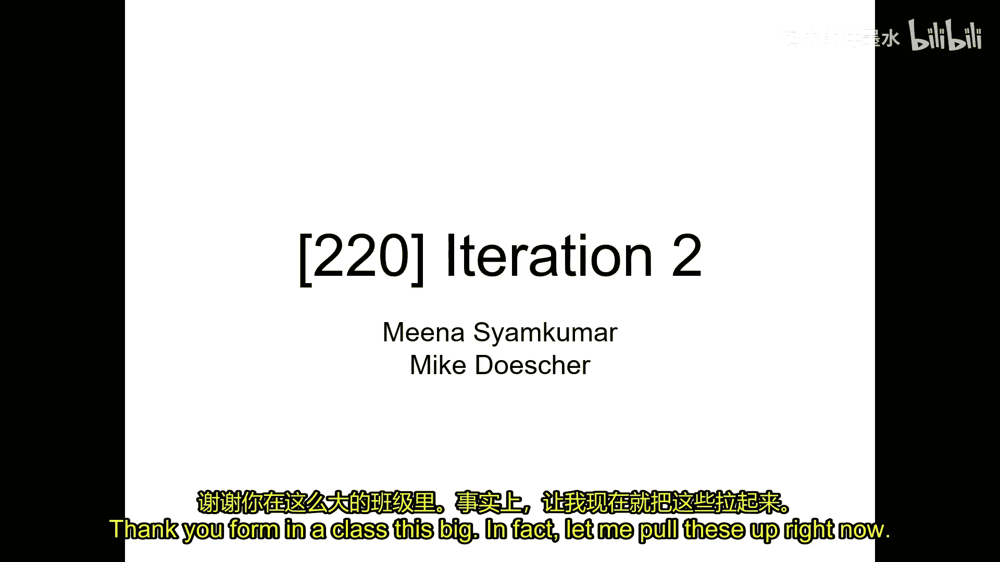
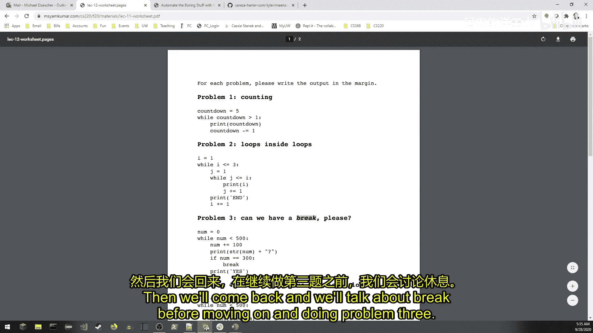
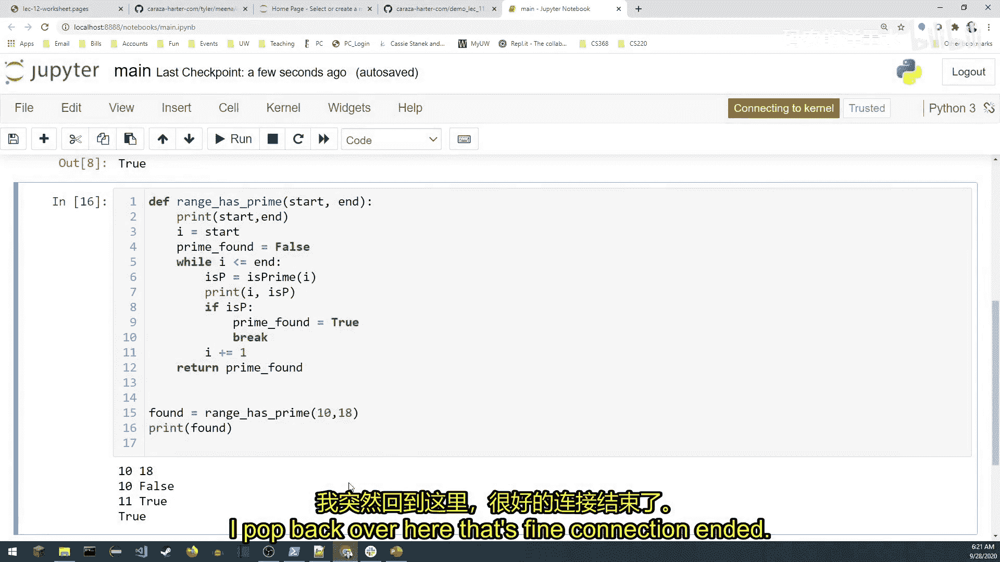
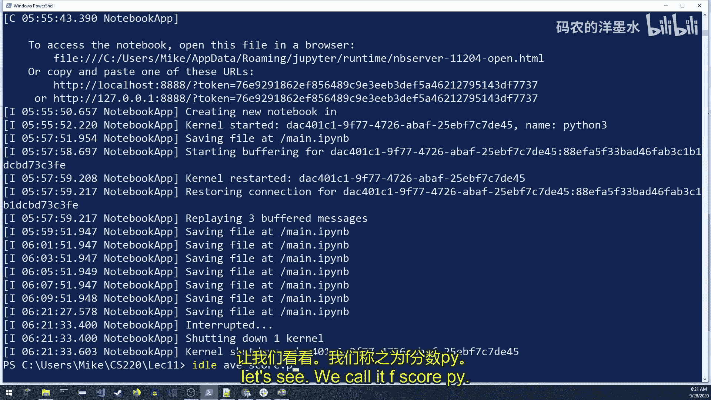
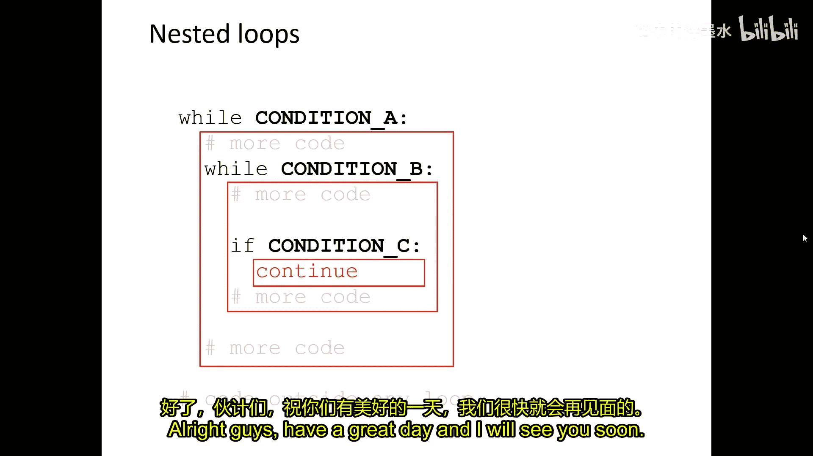

# 【全集】威斯康星大学-Python数据编程-CS220-中英字幕-1080P-p10-Lecture-8---第二轮迭代--BV1VxvsBLEmv_p10-

Al right， welcome back， everybody to data programming one first， as I get started today。

 we're gonna to need the worksheet from the web page。 we're gonna to be using Jupyter notebook。

 and we're going to be using idle。 So if you're watching the live stream。

 you can go ahead open all those up while I'm going over the announcements。 Otherwise。

 when the time comes， you can just pause the video and pull those up yourself。 All right。

 a couple things。 first， thank you for all the messages。 I'm back。 I still don't know what's wrong。

 I had chest pain a week ago Sunday。En up in the emergency room this afternoon， I have more tests。

 they're doing an electrocardiogram and a heart stress test。 so Im I won't be there for office hours。

 Those will resume tomorrow for me。 I apologize for those of you guys who need to come see me。

 and again， thank you for all the messages wishing me well。 I really appreciate them。All right。

 a couple of all just thoughts on course logistics。

 We do have a partner matching form if you're looking for a partner beginning for the next project's coming out Wednesday。

The projects get longer as we go through the semester and near the end of the semester。

 the projects can take up to eight hours per week for students who've been from past semesters。

 So the partner matching form is going to be there for anyone who's looking to connect with a new partner。

We fill out the form， we'll send you the contact info of someone who we feel will be a good match for you if it works out。

 that's awesome。 you can contact them if not fill for you to fill out the form again and we'll suggest someone else。

 So find someone that you enjoy working with who makes you learn better。All right。

 we also have a thank you form in a class this big。

In fact， let me pull these up right now。Here we go。

 So these forms are available under resources on our tools on our webpage tools， class surveys。

 The partner matching form is number 6。 The thank you form。

 If you find that a T A has been particularly helpful if you've been office hours。

 there's over 800 students in the class。 So if you find that a T A has been a particularly helpful。

 a lot of times this can feel like a thankless job。

 we want to let them know that they're doing a good job and that their work is appreciated。

 So go ahead fill that out if if someone helped you and you're particularly excited about what happened。

😊，All right， next up， our first exam is on Friday。 Now， Minina sent an email with all the details。

 I'm not going to go over those here， but people often ask me what is the best way to study for that exam。

 In particular for an online exam。 this might be the it's probably not the first online exam you've taken。

 but it might be one of the one of the first。 So I highly recommend going to。

 let's see where resources our old exams are right here。Under exam 1。

 you can find all the exams we've given for the past several semesters。 Go ahead。

 take a look at those。 now I want to stress that all of those exams were given in person。

 You would go to the classroom。 You didn't have access to Python or the Internet or the anything that all the lecture material。

 the PowerPoint slides， the worksheets。 all of those were just taken on Sctron with a pencil and paper。

 So the questions were going to be asking in those exams are a lot of the time。 Here's some code。

 What does it print out。Obviously， we'll be changing the structure of those questions because any question that you could copy and pasteing the Python and just run。

 you don't actually have to understand what's going on in order to get the answer。

 So it doesn't work well for us。 It doesn't demonstrate that you understand what's going on。

 So this the type of questions will be changing a little bit and。

You will have access to the Internet。 You will have access to all your notes。

 The only thing you may not do is talk to another person。 That means any person。

 whether it's online in person asking questions on piazza or chgg。 We check all that stuff。

 And as of right now， we're not going to be using any sort of online proctoring tool。

 Let's face an honor lock is pretty invasive。 and you not want to see a 360 degree rotation of your room。

 I don't want to know every time your roommate walks past in the background。

 So until we find evidence that anybody is using ch or piazza during the test or talking to another person。

 We're not going to turn that on。 We're going to use the honor system instead。

 and we just trust you guys， we'll do your own work。 You do have a lot of freedom。 to grab stuff。

 you know， look up stuff on the Internet。 If you learn something during the exam。 That's awesome。

 on the other hand， it's timed。 You probably won't have time to look up more than one question。

 So I would highly recommend making sure that。You are ready。

The other thing we can do to get ready is take a look at the schedule page。 I'm sorry syllabus。

 I missed and check out swaggarts Read the automate the boring stuff。 That's the other reading。

 We'll be pulling a lot of stuff later on in the semester。

 But he has the first three chapters of his book， Python basics， flow control and functions。

 Go over a lot of the same things that we are talking about。 We designed readings from Downy's book。

 Those are good。 This is just a different perspective on those same topics。

 It doesn't introduce anything new。 It kind of duplicates what's there before。

 So if you've already done the reading from Downy。 and you're looking for just another quick review。

 but it's not the exact same wording。 This would be a great source to go to。😊，All right guys。

 So with that in mind， I'm going to go ahead and jump back into the lecture with iteration to。

All right， I hope you guys enjoyed watching Mea's lecture。

 I apologize I wasn't able to be there for the last three days。The last three lectures。

 I went and watched those lectures myself。 So I think I could just pick up right where she left off and not have any kind of break and continuity for you guys。

 But today， we're going to be going over a number of new things。

 We've talked about expressions and variables。 We talked about conditionals and functions。

 We started to be going over loops。 today， we're going to be looking at some things that I would refer to as advanced iteration。

 including break and continue。 And there's just， there's a ton of ways to combine all these things we've learned so far。

 The expressions and variables， conditional functions。

 And what we're going to look at is some of the very common patterns。

 There's a lot of ways to to combine these。 But programmers in general。

 to stick to some very simple patterns。 and understanding those patterns can make it a lot easier to read someone else's code。

 particularly if they actually stick to the common patterns。

So we've seen design patterns in lots of other fields that very common the example that jumps to my mind。

Is like the mechanical engineering design process for making a part。

 but not everyone's familiar with that。 Most people here took English composition or composition in another language。

 sometimes during high school。 So this is pretty common to see description of the five paragraph essay。

 So I think this example works more universally。 But the five paragraph essay has five paragraph。

 There's an introductory paragraph， three body paragraphs and a conclusion。

 And people who are familiar with this five paragraph essay format。

 particularly people who teach the stuff and grade your work。

They may not necessarily read your essay in order。 They might start with the introduction to find your thesis。

They may go to your conclusion， Read that second to see。

 you know where you're trying to go with your essay。

 And then they might look at the body paragraphs to see that they're actually developing your thesis toward reaching that conclusion。

So those are all like a pretty common example， and the same happens with code。

 People who are familiar with code and people who write code don't necessarily write it line by line in the order that it executes。

 We follow certain patterns。Alright， so here's an example of the very first design pattern。

 And one way we can think about this is that we can just walk through the code in order and think about what's happening。

 This is never a bad option。 It's called tracing。 We use it frequently when we go through things like Python tutor and talk about the sequential in order execution。

 So in this case， the very first that thing that happens is line 1。 We declare variable I。

 We assign the value 1。Al right， there we I've got a box up here。 I'm keeping track of my variables。

 and I currently has the value 1。 Then we go into the while loop。

 We see that while I is less than 30。 we're going to do I'll create a new variable N and as equal to I plus 2。

 So I've got a new box or n up here。 assign the value I plus 2 I is 1 times 2 gives us 2。

 we printed out。 So now I've got an output box over here。 We've just printed 2。

 And then we increment I。 So I becomes1 plus 2。 we'll get that up there and store the new value of I。

Then we'll go back through the loop。 We said we say I is。

 is it less than or equal to 32 is indeed less than equal to 30。 So we jump into the loop。

 and we have n is equal to I times 2 again。 That will give us 4。 We print it out。

 It's in the output box。 and then we'll increment I。 so that becomes  three。So I'll cross up the two。

 put in three right there。And then I'll continue while I is less than or equal to 33 is indeed less than 30。

 we'll go through and you can do that forever， I'm not going to do that 30 times。Dear idea here。

 I that， while， that's great。 We can go through in order。

 But knowing that a certain piece of code is written using a common pattern。

 we can look at it as a different way to break this down。

 So experience programmers will first look for a couple things。 The look for the loop variable。

 So in this case， we've got the loop condition right here， some number one loop condition。

 So Ill find the while statement， we see what I is less than or equal to 30。 number two。

 identify the loop variable。 In this case， this is an I。 All right， number 3。

 find all the places where I changes。 So something where I equals or I plus equals or I minus equals。

 So in this case， this is the assignment。 I starts out at one。😊，And then down here at the bottom。

 we see I is incremented and goes up in the loop condition here。 we see that it goes up to 30。

 So our loop is going to run with values of i equals 1，2，3，4， up to 30， All right。

And then this highlighted section。 This is the piece that's actually using I。

 It doesn't change right here。 So I don't highlight that when I talk about when I change it。

 this is just using it。 So this is I don't know。 I'm going to call it the sandwich。

 It's sandwiched inside the while loop in the here's the declaration of wall loop。

 I've got my coal in here。 This whole thing all three lines would be the block。

 So it's not technically a block。 this is the part that uses I。

 its sandwich between the wall loop and the increment。 So what we can do is just sort of。

 I guess step 4 would be to unroll this。 and look at what happens if we put in a one here then a two here and a three here。

 So it's a little bit different way of thinking about things。 So oh。

 I got my slide for this unrolling。 So we put in a one。 We put in the two put in three。

 And these two lines。 We can think about this as though it's just unrolled like this。

 Let's see there it goes through the loop 30 times。 I've got two lines here。

 This could be 60 lines of more or less copy paste。😊，In code。

And that's how I'm going to think about this as I go through and think about what happens。

 It means I don't need to trace through every single line to decide what's printed。

 It's going to print 2， then  fourth， then6。 And I can recognize that pattern。 Okay。

 this is a pretty simple example。But it lets me figure out what's going to happen much more quickly than if I have to trace through the code。

 So here is the general design pattern for doing something n times。 In this case， N was 30。

 So I need。 here's my loop declaration。It has the variable I in it。

 So I need to be declaring I before I use the loop。

 I'm going to have the details of whatever want to happen 30 times or n times here。

 And then the bottom line is going to be the other piece of bread on my sandwich。

 The I plus equals one， the increment。Allright， now check this out。 We're going 30 times here。

 We can either start at one and use less than or equal。

 This is actually a lot more common to start with 0 and go up through I less than n。

 And a lot of that's because。If we have a list of things in Python。

 oftentimes the index will start with zero。 So is this one's actually more common。So in this case，1。

2，3，4 up to n， it actually includes the n or like the 30 in that last example， or we could see 0，1，2。

3 up through n minus1。 so in a list of 30 things the last one would be number number 29 because it would have a number0 element。

Alright， the second design pattern is very similar。 In this case。

 we're going to be looking at just doing something with all of the data in the set。 In this case。

 we probably know that there are n items in my data set。 there are 50 states in the United States。

 So if I have some data in a table about all of the states and I'm looking to just add up the population。

 I can go and I can get row 0 from the table and then row 1 from the table for California and then row 2 from Minnesota。

 I can go and add up all those。 So the specifics of adding up the populations of all the states would go here for data table like this。

 I would likely have a function that tells me get the population of state 0。

 get the population of state 1 and we just put in the specifics here。

 So I'd have a sum equals 0 and then I would just go through sum plus equals population of each state。

So the idea here is I want to do something with all of the pieces of data。

So I would have a function count rows， and I would put that right here instead of n。

 that would tell me how many states we have。 And I went it would be generic or universal for all kinds of tables like this。

frequently people who write modules will include a function like how many size of the table get the rows。

 number of rows。And then we would have a function that grabs the population for each of the rows。

 And we take that index。So here we go， those count rows functions get it right here where n is。

And then， my population。Gets placed right here。 get the population and do whatever I want with it。

 You know， I could be looking for the biggest 1。 I could be adding them up， find the smallest one。

 something like that。 Whatever I want to do goes right there。And when we have a table， again。

 we're going to assume that the first row begins at 0 because that's how most tables are stored in Python。

 So that's why the I equals 0 to I is less than far more common。Alright， and design pattern number3。

 also very， very similar。 So we're gonna to just do something until we get to the end of the data。

 this one not might not necessarily have that bottom piece of bread on the sandwich。

 the I plus equals one， the increment step。 But a lot of times programmers who write modules that are used by other programmers。

 we use this kind of structure， their module have two functions， one of which that just says。

 is there more data， And this could be written like this because we don't necessarily know how big the table is if it's designed to work with the generic table。

 or if it's a function that's designed to work with user input where we don't know how much data there is even after the you know from the table。

 So it'll have a function that just says has more。 This function is going to return to boolean value。

 either true or false， So I can just stick it right here as my loop condition。

 This just needs to be something that evaluates to true or false。

And then the function or the module will also have a get next so I can just grab the next piece of data。

 This could be a function that asks the user for a number。

 or it could be using a generic table and just says， okay。

 get the next piece of data from the table and inside the module get next will' keep track of which row of the table I'm on。

 So it takes here that I plus equals one for me。 This is another very common design pattern。

That just goes through the entire set of data。Alright， next up。

 I want to jump over and take a look at the worksheet available on today's website the schedule for today。

Let me scroll down， we are on iteration to link to the worksheet is right here。

 let me go ahead and pull this up。So go ahead if you haven't pulled up the worksheet already if you're watching the live stream or if you're just watching the video on your own pause and go grab this worksheet。

 what I want you guys to do is figure out what's going on what is being output So go ahead and just do the first problem on your own during a live stream I'll pause right here for one minute Otherwise pause the video yourself and then I'll go ahead and do problems one and2 right now Then we'll come back and we'll talk about break before moving on and doing problem three。

Okay， so let's take a look at problem one and think about those four steps。

 The first thing I'm going to do when I'm looking at this。

 I'm going to consider finding the loop condition。 the top piece of bread in my sandwich。 So。

 and that's right here。 Well， countdown is greater than one。

Step 2 was to identify in the loop condition variable countdown。

 And then I'm going to find all the lines where countdown changes， not just where it's used。

 but changed。 So I see it's initialized before the loop， very important。s going to start out at 5。

 And in the very last line， we're going to see that it's decremented。 So it's going to start at 5。

 we take away 1， it's 4，3。 as long as it's greater than 1。

 We're going to continue decrementing and doing whatever is in the loop。 So when it gets to 2。

2 is greater than1。 When I get to1，1 is not strictlyulated greater than 1。

 So it's going to evaluate to false。And we will skip the loop。 So 5，4，3，2。

 And then when I check out the meat of the sandwich， not technically a block。

 I don't have a better word for this。 but we're just going to be printing it out。

 So when I think about the output， it's just going to be 5，4，3，2。 So pretty straightforward。

 But I wanted to do an example that definitely just shows the structure。All right。

 let's take a look at the second example now。Allright， as we start taking look at this problem too。

 this has loops inside of loops。 So experienced programmers are going to find all the word whileow to begin with。

 So we have wild I less than or equal to3。 And here we have an interior loop inside loop。

 while J is less than or equal to I。 So I've got a double loop here。

 So I'm going to take a look at the very outermost loop。 The one that's to the left。

 So the block that's inside this goes from here。 this line J equals one down to the bottom piece of bread in this top automost sandwich。

 the I plus equals one。 And this is the whole thing that's going be controlled while from this top w。

😊，Allright， the second while loop is the one that's got J as the control variable。

 It's just two lines in the block here。 we've got the sandwich with the well statement。

 we've got the J plus equals1， that increment and the meat of the sandwich here is just print out。

 So in this first case， we've got 1，2，3，4，5 lines in the the meat of the sandwich。

 and just one line here。So I'm going to go through and think about the outermost loop first。

 And I'm going to work my way in as I go through things that have more than one nested loop。

 So in this case， let's take a look。 step 1， identify the loop control the while statement。

 So right here， while I is less than equal to3。 Step 2。

 I is the variable that we're going to be using to control the loop， the loop control variable。

So now I'm going to find all the places where that's changed。 Here we go。 I equals one。

 where it's initialized in the very top。 And down here， I plus equals 1。 All right。

 I has used a bunch of other places like right here and right here。 But in those two lines。

 it's not changed。 So I don't care about those right now。 I just want to know where it's changed。

Alright， and then step 3， where it's changed。 Step 4 is going to be the， the meat of the sandwich。

 So all of these things。 And I'm just going to consider what happens as I go through。

 So I'm going to just make a list of。The values of I starts out at one。 Well。

 we see here we're incrementing by 1。 So it's going 1，2，3，4，5。 Okay。

 but we're going to stop when I is less than or equal to 3。

 So that means we're only going to be getting the values 1，2 and 3。

 And then when it gets to 4 right here， we'll jump out of the loop。 This will evaluate to false。

After I do that， what I'm going to do is take this inside sandwich。

 The from the line J equals1 down to this print end。 that's my limit meat of the sandwich。

 This is what I'm going to unroll。 This piece right here。

 those five lines happens exactly three times。 And I can just think about grabbing this， copying it。

 pasting it。Pasting it， pasting it。 So I've got three different copies of it。

 The first copy I is going to be one the whole time through that loop。

 So I can just take this eye and mentally replace it with one。

 That eye can mentally replace it with one。And that second pasted sandwich meat。

I can replace it with I equals2， I equals 2。Alright， now I'm going to take a look at this step 1。

 find the while statement。 I can see that the loop condition variable here is J。

 So all the places where J changes up here， it starts out at one in the initialization line。

 We've got an increment。 So it's going to go from 1，2，3，4。Now。

 in that very first pasted sandwich meat， J is going to start out at one。

 And while it's less than or equal to I equals 1。Then we're going to go through the loop。

 So itll it'll be j equals1 right here it increments to two。 and this will evaluate to false。

 So it'll jump out of the loop， this loop and go ahead with the utterermost loop and finish up the stuff in this block right there。

Alright， then I've got a second pasted version where I is equal to 2。

 J is going to start out at one again。 I re initialitize J。Then I'm going to go through。

 J is going be 1，2，3。 When I get to 3， it's not less than or equal to2。 So that's going to be false。

 So all I get is  one and 2。And we go， let me just bring this up。

Then it's going to go through in that third pasted loop here for the outermost loop。

 I is going to be equal to3。 So J is going to start out at one。

 As long as it's less than or equal to 3。 Remember I can just replace this。

 just delete that I put in a three in my third pasted block when I unroll the loop。

 And so J is going to be1， 2 and 3。 when it gets to 4， it's not less than or equal to 3。

 So it's going to stop。 So these are my values of I and j every time I go through this innermost loop。

 So what I find here is that I'm going to be printing out I not J I。

It goes through this entire loop will once， then twice， then three more times。

 That's six times total。 and prints out I on every time。

 The first time through we'll have I is equal to1， second time through I is going to be equal to 2。

 and then two again， because we'll do it twice。 The third pasted block。 We do three times。

 So I is going to be three， then three then three。Now check this out to。

 We're also printing something in the outermost loop block。

 So it's going to go through and print out I is equal to one。 Then that loop is done。

 this innermost loop。 and it's going to print out the word end。

Then it's going to go through I is going to be incremented to2。

 We'll have twice through that second pasted block。 We'll print out2， and then two again。

 then we'll print end。 That's the end of the innermost loop。 So print end。

 Then the third time through I is equal to3。 we'll do it three times， we're just counting up on J。

 this is doing something n times。 in this case， n is changing So that's the pattern here。

 We print it out 3，3，3。 and then we'll print end。 So the output looks like this we have one1 because that' we're printing I then end then we print it out twice。

 because this is do it n times kind of loop。 then we print out n from that outermost loop。

 if this we're tabbed over one more。 Then it would be inside the innermost loop。

 we print one end2 end2 end3 and3 end。 but it's tabbed over into this block。

 So it doesn't happen inside this loop。If you guys have any questions about this。

 if you're watching the live stream， post them in chat。

 otherwise go to Piazza post your questions about this。

And I'm going to move on and just to assume this is making sense， I hope it is。

 I really can't tell when I'm recording a video， not the best way I'd love to be live again。Alright。

 let's go ahead。 We're going to talk about break real quick。So our basic control flow for iteration。

 The while loop has a structure that looks like this。

 So we're going to begin here with while and some sort of condition。

 If this condition evaluates to true， then we do whatever is in the block。

 and that's everything from the colon all the way down through the end of the indentation。

 That's a block。Could be many lines of code。 could have other loops nested in there。

 Whatever it doesn't matter for this block。 I'm just going to find the colonant and work all the way down。

 If the condition evaluates to false， then we jump to the code after the loop and we don't execute any of these lines。

 And when we get to the bottom of the block。 and we jump back up and check the condition again。

 So there hopefully there is something inside this block that changes the condition。

 Otherwise we'll have an infinite loop。Now， break is going be a way to。Change that control flow。

 It's going to immediately jump out of the loop。 so we'll see the structure for break almost always has if with some sort of other condition followed by brake。

That brake skips everything after it。 It's just done， and it exits the loop。

 So it adds an extra arrow， an extra way to get out。 You can think of it a lot like this condition。

 It's going to be a different condition。 Most certainly， Otherwise。

 we would have just jumped out of the loop right here。嗯。But break final answer。

 it's a lot like return， just gets out of the loop， stops executing this。

 stops the iteration jumps to immediately after。All right， I want to talk about。

Places where this is commonly used。 number one thing that jumps to mind is where I've got a list of data。

 This is data programming。 When I'm searching for something in the list。

 What if I'm looking for a state that begins with the letter I。

 I can go through my list of states until I find one and I can stop as soon as I get there。

 Or if I'm looking for a state with a population greater than 20 million。

 I can go through my list of populations， find one， And as soon as I find the 1 I want， I'm done。

 I don't need to continue searching through the list of states。

So I'm going to go ahead and do a quick example where I'm using this。 In this case。

 we're going to go back to the prime numbers。 So Minina wrote a function at the end of last class where we were search trying to decide if a number is prime。

 I'm going to go grab that code and then bring it up into。Jupipyter notebook。

 and we'll go through and we'll actually write a program that searches a range of numbers。

And just decides whether it contains a prime number or not。So， for example， this sequence right here。

 10， 11，12 through 17 actually contains three prime numbers。So 111317。 Now。

 as soon as I find a prime number， as soon as I get to 11， I don't need to keep searching any more。

 So I can immediately say true。 This contains a prime number。

 This is a good great example of using break。 If I'm looking for a sequence like 1415，16。

 I'm going to check the 14s。 I know 15， no，16， No， And I do have to check everything in this 141516 sequence。

Because I don't find a prime number。Let me go ahead and pull up to Bner notebook book and go ahead and write this code。

Alright， so I have a brand new Jupiter notebook pulled up。 I've already saved it。 Maine。

 It's in my working directory for lecture 11。 And I've copied and pasted in my code。

 You could ignore this top part。 The only thing this code does。

 is makes the width 100% of the screen。 So it gives me more space to work in。

 They're working at home。 You can copy and paste it if you want。 but there's no need for that line。

 The next thing I'm going to do is I'm going to go back under iteration 1。

 we have all the code that Minino wrote。 I'm going to go ahead click there。 Here's the demo she did。

 I'm going to pull up the code for that demo。😊，And just， it's great。

 I can just take a look at this because Jupiter notebook files are HTMLl。 When I look at this。

 it's already in H L mode。 I'm just going to go down and find her function that finds prime numbers。

😊，Right here， I'm going to copy and paste this into the second cell right here。All right。

 when I run this block， it's now， I just did shift enter to bring this up。

 I now have defined the function as prime。Now， mean is great。

 Well let's just go ahead and test this couple times to make sure that it's working as we expect。

 So I'm sorry is prime 14。 We'll run that false It's not。 What if we do 15。Also， fall 16。

 So that was that interior range。 Let's try some of the ones that we know to be prime， like 11。13。

 true， 17。 Okay， so that's looking good。 It looks like it works。

If you don't remember how this function operates， go ahead and go back。

 watch Mea's third video and review。Alright， I'm going to go ahead and take a look at that example problem next。

 and I'm going to write a function。 Let's just call it range has prime。嗯。

Because we're going to be looking at a range of numbers from some starting number to some ending number。

 we're going to need two parameters。 and all of my function definitions in a colon。

 Jupiter knows I'm defining a function that already tabs over for me。 So that's awesome。

 Let's just go ahead and make sure this is working that something's happening。

 So I'm just going to print out start an end。And then go ahead and try calling this function。

 We'll go ahead and。It lookss strange as prime， and we'll go ahead and give a 10 to 18。Allright。

 and right now， all we're going to do is print those things out。 That's not what we want。 in the end。

 We're going actually want to go ahead and see if it has a prime number。

 So we're going to go ahead and test all of these numbers inside that range。So as we go through。

 I'm going to need a counter variable。I've been using I the whole time。

 I'm just going to keep it as eye。Next thing， we need the while statement。 While in this case。

 I is less than something。And then inside that。I me add the colon so Jupyteral tab for me。

 I'm going to have my sandwich meat。Where I'm going to do something。

 Maybe that's a better way to put it for the example。Do something。 And then I've got that iteration。

 So I'm going to be going all the way up to the hand block。 So I plus equals one。All right。

 let's fool in some of these question marks， and then we'll just make sure that things look good。

 So I is actually going to start out。At my start。Next thing， I need to know how far I goes up to。

 so we're going to go all the way up until it's equal to end。

I'll be on to include and it'll stop one number two soon if I do it like this。

 So I'm going to go ahead and add the equals here。Well I is less than or equal to end。

 I want to do something。 I just to make sure this is working。

 first thing I'm going to do is just print out I and make sure I'm getting my numbers， in this case。

10 through 18。Let me go ahead and run this。So I still have that first line that prints out the range。

 and then I've got all these numbers here 10 through 18。Alright。

 let's upgrade this even a little further。 Instead of printing out just I， I want to do something。

 So I'm going to say。Is。I'm just going abbreviate this because my function is actually called is prime。

I'm going to call is prime。 we'll stick it in that variable and we'll just give it I because it's going to go through each time。

 So now I'm printing out I。And I'm going to print out is P。

And that should be a bunch a list of trues and falses。 We can make sure this is working here。

 So 10 is going to be false。 Awesome，10 is not prime。11 is prime。

 can't divide it by anything and still get a。A remainder with0。 Okay， so anyway。

 it looks like it's working。 time and visual 11，13 and 17 in that range。Alright。

 the next thing I want to take a look at is I don't actually need to do all of this stuff to decide if something is prime or not。

 What I really need to do is keep track of。Prime number found。Okay， awesome。 right now。

 at this point， I haven't found a prime number。 So I'm just going to start this out at false。

Sound good。 All right。 And then if I find a prime number。In that case， so I've got his P。

 Is it prime or not， That's a boolean。 So I can just say that if。Is P， It'll be true or false。

 I can go ahead and say prime found。Equals true。And then at the very end of this， I can return。

Hos I'm out right here， return。Is prime。 So I've just added three pieces here。

 This is another really common pattern。 If I'm searching for something， in this case。

 I'm searching for a prime number。 I'm going to start it out as I didn't find one。

The moment I do find one， upgrade this to true and then return this at the end。

 So another design pattern for finding， it could be finding the biggest something。

 We willll keep track of the biggest one found could be keeping track of just is it there or not。

All right， so let's go ahead and run this。And。We'll go ahead and print。 We'll do found。Equals that。

 That'll store that in a variable。And we'll print out found。Alright， so that didn't work。

 I actually have two typos here。 First up， I'm using the variable prime found。

 and I spelled it wrong here。 And then I didn't return the right thing。 I need to return prime found。

 Not the name of the function。 Allright， let me run this again。And now it looks like it's working。

Now it's not working。 Check that out。So it started out at false。 It never got upgraded to true。

 Let me take a look at this and see if I can figure out what I did wrong。

Found it that took me way too long to spot。Okay， guys so。

The mistake steak is right here inside my wild loop。

 I'm actually returning his prime found the moment。

I go through the very first iteration loop because this is inside the wall loop。

 So I starts out at 10。 is it prime。 No， that's false。 If it's false， it skips this。 We print it out。

 That's the 10 false increment。 It's now I of 11， but we turn the false immediately to fix that。

 I need to add one more tab。So but as I went through this， that was called tracing。

 I just sort of went through what is really going on when I recognized that it was returning the value for 10 and not checking everything in the loop。

 That was the moment， that aha moment for me。 Alright， let's try this one more time。There we go。

 Check this out。 Now it's going through all the items in the list。 It's going through false， true。

 false true。 The moment it gets to this 11， though， it's identified that it's found a prime。

 I no longer need to check all the rest of these numbers。

 So what I'm going to do is go through upgradegrade this。 The moment I get here。 I found the prime。

 I can break out of this loop。 That will jump out of the while loop right here。 This is the block。

It's going to skip to the very next line， which is return prime found。If we never find one。

 this value will still be false。But because it's upgraded right here to true。

 we no longer need to check everything else。 So let me just run this real quick。

You can see I do the 10。 It's false。 I don't actually print this out until after my condition where it jumps out。

 Let me move this up。So we go through 10 was false， 11 is true when it's true， we're in here。

Prime fund becomes true， we break and return that value。Al right。

 let's jump back over to the worksheet and to sort of walk through an example with break。

 This is problem 3。 So I'm going to go through these very first up step 1。 find the loop。

 So while loop is right here， whilenm is less than 500。 Step 2。 Find the loop control variable。

 That's nom。 And look for all the places where it's changed。 In this case， it starts out at 0。

And then right here， we're plus equaling。 That's an assignment。 So we assign nu nu plus 100。 Now。

 check this out。 It's not the sandwich structure we've seen before。

 This is a different design pattern。 but it's still design pattern。

 It's just that we're incrementing is the very first thing。

 And then the meat of the sandwich comes after that。

 So let's go through and think about the loop control variable。 What values does it take。

 It's going to start out at 0， then be 100，200，300。

 So these are the values it's going to take up here as we do all of our checking。 All right。

 when we get here when nu plus equals and gives us， you know，0100，2 and 34，500。

 This next time through the loop， it's not going run。Now， inside the sandwich meat of the loop。

 we are using numb twice in this case， but we're not changing it， but it increments first。

 So inside the loop， inside the sandwich here。 When we get to that print statement。

 the values it takes on are actually 100200，3004 and 500。

 So using this kind of design pattern adds an extra step in my brain。

 while I have to go through and think about it。 I like the very first design pattern we talked about best where the increment happens last。

 It makes it easier for me to think about it。 This kind of design pattern a little bit more difficult for me to think about what's going on。

So as you guys are writing homework questions， you can use either one， they both work。 In fact。

 there's hundreds of ways to combine all these things together so that it gives us valid answers。

 but some of the patterns are easier to work with than others。All right， so let's talk about output。

 Now， the inside of this sandwich me right here， the print statement is going to at first print out the number。

 turns it into a string so I can use the string capnation with the question mark。

 So the first time through the loop first time through the sandwich here， I will be 100。

 So it's going to print out 100 of the question mark。 Then if numb equals 300， it doesn't。

 So skip that。Print， yes。 So we got the 100 question mark。s going print。 Yes。 Next time through。

 it takes on a value of 200。 So it's gonna to print out the 200 with a question mark。

 Is it exactly 300。 No， skip that print。 Yes， next time through the value is 300。

As we go through the sandwich。 it's going to print out 300 with a question。 mark。

 then it's going to ask if 300 is exactly equal to 300。 Yes， it is。 that's true。 Do what's in here。

 break。 That's going to skip outside of this block。 So here's the block。

 It's going to jump all the way。 Theres no statement here。 So the program is just going to end。

 And the output's going to look like this。100。 Yes，200。 Yes，300。 don't print the Yes。

 we skipped it because of that break。 Just final answer done with the loop。

 Skip all the way out of this。All right， so next up， I want to talk about the continuous statement。

 It's a lot like brake。 It gives us a way to change the control flow within a loop。

 but it's a lot less aggressive。 We don't just stop and end immediately。

 We go back to the top of the loop instead of jumping out of the loop。

 So it's going to look something like this。 here， I've got my basic control diagram for a loop。

 we've got the loop condition。 If it's true， we do it's in the block If it's false。

 we're going to skip all the way to the end。At the end of the block。

 we'd go back up and check the condition and we need to go through until the condition is false。

If we add the continue statement， it's going to look design pattern for the continuous statement says if something。

 then we're going to continue。By continue， it means continue with the loop。

 so we'll jump back up to the top of the loop and check the condition。

And we skip the code that happens after the continue。 Now， I had a very similar picture with brake。

 The brake had the arrow that went down here to code after the loop。 Con makes one little change。

 It makes the arrow go back up and checks the condition again。 and it's going to go through the loop。

 If that condition is true。 many potentially many more times。

 If the condition here is falsesome the next time it skips the continue and it'll do the more code。

So。A great place where we want to use this。 an example that up now。 I'm going to do in my next。

demonstrationmon is to skip over values that are outside of the range out of bounds。

 So if we're going through and looking at scores， if a score has to be in the range 0 to 100。

 If someone enters 100 million for their score。 we want to skip that。

 So this is just going to be computing average score。

 and' keep a running average of scores that a user provides。

 So I'm going to go ahead and use idle for this demonstration。

 you haven't pull it up yet while I'm rambling on about the example you can pull that up。

 And I like idle。 I know you guys don't like switching between Jupiter and idle So trying to get through the lecture it makes it more tools to keep track of。

But I really do like idle for user provided input。 I think it gives us a better way to do that than Jupiter。

 So that's why I'm switching。 I do have a reason。All right， so our couple other details。

 input is going to accept the letter Q so we can quit and we'll keep running until we get to that queue。

And we're going to recompute the average every single time the user enters a number。

 I've got an example here。 If they put in something outside of bounds。

110 will print out bad input skipping。I probably won't remember it exactly。

 but I'll get something along those lines。All right。

 I'm just going to go ahead and go up to my Jupyter notebook， I'm going to save this。

Save and checkpoint。 There we go。 And now I can go back over to Powerhell。

 I can control C to quit this。 That'll exit the Jupiter notebook。

 probably give me an error message every yep， when I pop back over here。 That's fine。

 connection ended。 But what I want to do now is in the same directory。 We'll go type idle。

 and then we'll give it a name of the file。 If you guys are on a Mac。

 you'll probably need to type idle 3。

不是。We'll call it F score dot pi。

All right， that's going to open up idle for me in just a second， here we go。All right。

 let's go ahead and。Just start off with an infinite loop。

 We don't know how many pieces of data or how many scores the user is going to input。

 So let's go ahead。And while true。That's going to give me an in loop。

 This will always evaluate the true。 I can stick in anything I want here。That evaluates to Boolean。

 true definitely evaluates to Boolean。Alright， the next thing I need to do is I need to get some input from the user。

 So x equals input。Let's help them out。 We'll tell them enter a score。

That needs to be between 0 and 100。 So let's just remind them right there，0 to 100。

 and then or Q2 quick。There we go。 So then they're going to give us a value。

 They're going to put it in X。 Let's just go ahead， print it out。X。X equals。Com X go。

 and this will just give us a way to make sure this is really working。Alright， so let's see here。

 I'm going to click run and remind myself that the running the module is just F 5。 So if I do F5。

 there we go， it gives us。A second window。 Let me just arrange these real quick so we can see everything。

There we go。 Looking good。 Okay， so enter score。 Let's try for。X equals 4。

 that I don't like the way that looks。 I wantna space right there。 Maybe even a colon。 Alright。

 that will come up looking better next time。 Men another number。 We'll throw a 10。 Looks good。

 good at a Q。 Alright， we didn't actually quit。 So let's go ahead and add that piece next。

 I'm gonna jump back over here。 instead of just printing it out。 But I really want to do is say if。

X exactly equals the number Q。With letter Q， then。We're gonna to do a couple things。 We'll print out。

Exiting。And we will break。 That'll get us out of this loop。

 So let's just go ahead and test this and make sure that this works。 So， again， I'm gonna kill this。

I'm going to go back over here。 I'm going to push F5 to run it and do a score Q to quit。 So 10。

 just prints it out。 Q quits。All right， excellent， looks like that piece is working。Alright， next up。

 I'm going to have them entering a bunch of scores。 So let's go ahead and。

Do a couple of things I want to keep track of the average。So average equals， we'll start out at 0。

 The problem with this is it's really hard to just think about computing average and getting it updated。

 The average is going to be the total divided by the number we have。 So， in fact， let's do that。

We'll just keep track of the total。 start off at  zero。And the number of entries we have。

 that's going to start out at zero also， and I'm not going to bother trying to keep track of this。

 We'll just compute it every time we need it。All right， next up。

 So if the user actually enters a number， we're going to need to turn that into a number。

 So x is equal to int。All right。Once we do that， because input always returns a string。

 important to remember that。When you're taking the exam， input always returns a string。

 If you don't remember， this will just give you an error when we try and add up the numbers。

 So turn this into an integer。Then we're going to be adding that number to the total， total plus。

Plus equals x， and we have the number of entries plus equal， we just entered one more。All right。

 now at the end of every time we go through this loop。What I would like to do is。

Go ahead and add their score and I would print out the total。 That's what I really want mean。

 Pri will just say average。Equals。And then we will compute the average。 Let's see that's total。

 divided by a number。Alright， I'm going to go through and just test this much。 So right here。

 F 5 to run。 It's going give me the restart。 And let's put in 10。Alright， the average is 10。

 Let's give it another 10。 Right now， I've got an average of 10。 If we put in。

 let's see what's something， we're gonna have three numbers。 I've got a 10 and 10。 My total is 20。

 Let's put in 40。I can't see that。 All right， there we go。 Let's put in 40。

 run that Now I've got a total of 60。 I've got three entries。 The average should be 20。 All right。

 it looks like this is working alright。And then， some。

personerson who's not paying attention enters their score at 100 million。And all of a sudden。

 we have an average that is way out of bounds。 And it's really hard to recover from that。

 So what I want to do is ignore all of these inputs that are outside of the right range。

 So I'm going to push Q to quit。 I'll get back over here。Pop that screen back up like that。

 Let's see。 Wheres idle。 Here we go。 Looking good。 What I want to do now is skip all of the bad values。

 So right here， instead of putting them in the total and the number。

 I want to just go back up to the top of the loop。 So I'm going to say if。

X is less than 0 or x is greater than 100。 and we'll go ahead and use the inclusive version。

 So if they put in 100， it's still going to work。Coll and end that up。 We will just。

Continue and I believe we've said something like print out。Bad value。

And we'll remind the user that this needs to be between 0 and 100。

I don't remember exactly what it said on that demo slide， but this it gets the idea across。

We'll make that capitalized to capitalize everything else。 Oh， it looks good。

 Let's test this out and make sure it works。So we'll go ahead， we'll restart this。

 We'll make that big。 Allright， enter number。 So we tied 10。10， we tried 40。 So that that looks good。

 Average is 10。 Average 10。 40 gives me a total of 60 divided by 3。

 Let's go ahead and try 100 million。It's going to tell me bad value。Al right。

 now I ahead an average of 20， let's turn another 20 and just make sure that we have an average that's still 20。

Alright， awesome， looking good。 Then if we've got 2020。Or 10，10，2020， that's a total of 80。

 If I stick in another 80， I've got 1，60， that's going to give me。

I ID was the wrong choice to get something easy compute，160 divided by 5 looks like yeah，32。Alright。

 so it looks like it's working。 and you to quit。 I'm going to jump back over to the worksheet and do one final walk through。

One second， while I set that up。Alright， so here we are looking at the problem number four。

 the continued one。 If this video is rambling on too long。

 I'm just going to stop it during the live stream。 You guys at home can continue watching。alm。

And go ahead and do those problems on your own。 All of these problems are available on the interactive exercises on the web page。

 You can get there from the links。 Go ahead and walk through these after you think about them。

 And this might be a little cleaner way to just do the tracing because it'll go through one step at a time。

 But the point is， I want to talk about the patterns that we see。

 So the Python tutor examples are not going to give us this。 Theyre going to do the step by step。

 Not a bad way， but this might be a little more efficient for us to think about it。 Allright。

 this is the exact same demo we had a moment to go。With the brake statement。

 the only difference is we put continue in here。 So we're going to see that nu goes from 0 to 400。

 The increment is first。 So in the sandwich meat of my while loop。

 I'm actually going to have already incremented it。

 So it's going to give us 1002 304 to 500 inside the loop。

Are inside this block right here with four statements。 So when we go through and print it out。

 first it'll print out 100 with a question mark。 It's not 300。 So we skip down I'll print yes。

 then I'll print 200 with a question mark。 That's not 300。 So we skip down and print yes。

Then it's 300。 we print out 300 with a question mark， it's 300 this time， so we will continue。

 that's going to jump back up and we will then number is going to be 400。

 We'll print out 400 with a question mark， not 300 skip that print。 Yes， then 500 question mark。

 skip that print， yes。So the outputs going to look something like this。

 The only thing that we have skipped with this continue is that yes， after the 300。

 So that's missing right here。Alright guys， I'm going to call this the close to the video。

 There's one more example。 This is why we have nested conditions here。

 This is just a really good practice problem， particularly for the exam。 Go ahead。

 do this one on your own。 I feel like the video is probably more than 50 minutes at this point。

 So go ahead do this one on your own。 you can walk through it on Python tutor。

 But think about that design pattern before you go look at the final answer。😊。

So just a quick preview， we have multiple wall loops right here with this continued condition on the inside。

 So go ahead and investigate what happens when we put a continue in here。

 I'll tell you a secret right now， It's only continuing out of the innermost loop。

 But go ahead verify this for yourself。 When we hit this continue it's going to jump back up to this condition。

Not that one。And again， I've got this design pattern where my if condition with a continue。

 This is inside an if block。 So this is almost always how it's used。

 Well rarely see continue outside of a conditional statement， like an if statement。

And when we hit this， it's going to jump back up to the innermost while loop。All right， guys。

 have a great day， and I will see you soon。

