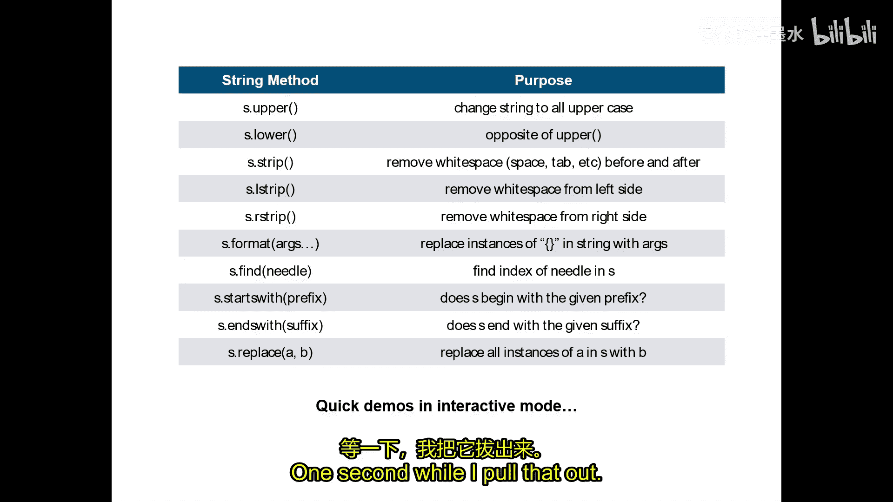
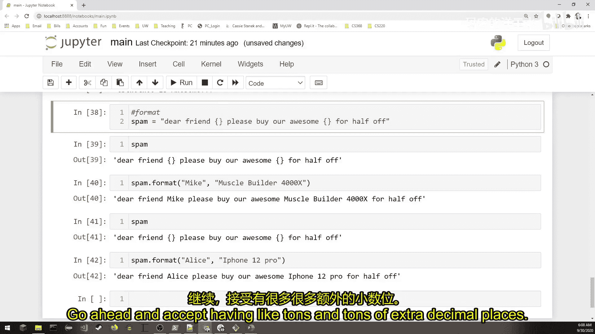
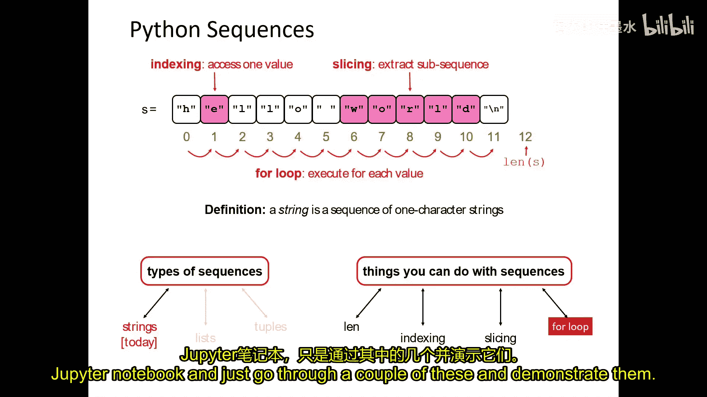
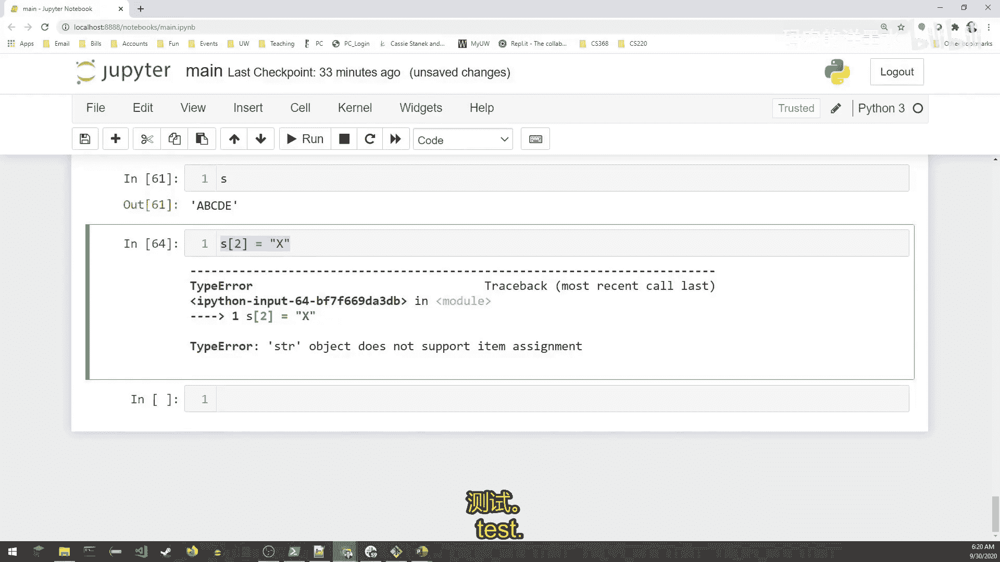
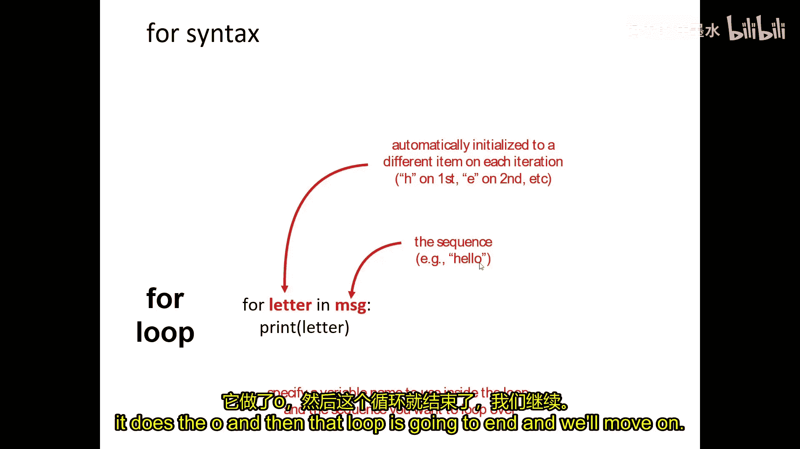
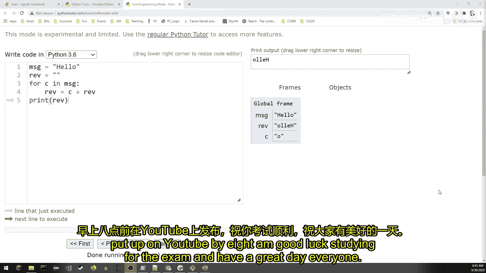

# 【全集】威斯康星大学-Python数据编程-CS220-中英字幕-1080P-p11-Lecture-9---字符串与-For-循环--BV1VxvsBLEmv_p11-

Hello， everyone， welcomele to data programming one。 Today。

 we're going to be talking about strings and the for loop。 But before I get started。

 this will be our last lecture before the exam on Friday。

 So I'm still going be doing my live Q and A session on Friday。

 but there will not be another lecture。 So as you guys are studying if you go look at the old exams if you come up with any questions you want to see me work through or if you just want to come and see what questions other people have。

 you're welcome to come join our live Q& A session。😊，And heads up。

 one of the Ts has discovered a way for us to embed hidden characters in the code that we'll be using for the exams。

 So this is going to be great。 I really would like my exam to be asking questions that ask you guys to demonstrate understanding of Python code So exams are about reading the code projects are about writing your own code。

 So this is going to let me ask questions that are very similar to the ones we've asked on previous exams so those are going to be great tools for you to study from now。

With that in mind， I don't want to test people's ability to copy and paste code and run it and just see what it does。

 I'm looking for an understanding that you guys can read it and figure out what it's supposed to do。

 So by embedding these hidden characters， Python will not be able to interpret those embedded characters。

 So if you do copy and paste the code into Python， it's not going to work。

 if you're welcome to try it。 I recommend you don't waste your time。 It is a time to test。

 you will likely have time to maybe copy one question into Python。

Or do maybe a better way to think about it be to do some small experiments。

 like if you don't remember what an operator is， just open up Python。

 do a quick experiment and then use what you've learned to read the code。

 That's how I would recommend using Python So you're still gonna have access to the Internet。

 you'll have access to Python。 The only thing you can't do is talk to other humans post on Piazza or check interact with any other human who might give you the answer。

 something like that。 So if you run across any practice problems or old exam questions that you'd like me to work through。

 go ahead bring them to live Q&A session Friday morning the exam will be available beginning Thursday at midnight through Friday and midnight。

Potentially a little earlier。 if we get it ready to go。

 there will be an email about that coming from Mina shortly。 All right， So today， as we continue。

 we're going to be looking more at strings。 we're gonna we've already seen some of the basics that we've talked about some string comparison。

 We've talked about some string functions like the length。

 We' talked about concatenation where we use the addition operator to join two strings together。

 the multiplication by an integer where it's going repeat。

 That was the ha ha ha example of the N niagical laughing。😊。

But today we're going to introduce a lot more functions in particular particular kind of function known as a method that operates on a particular kind of data。

 we've seen an example of this with the dog module that we wrote very similar to that。

And then we're going to be talking about some very general things that work for all kinds of sequences。

 specifically strings are a Python sequence， it's just a bunch of characters that are in order。

 but there's lots of different kinds of sequences that we'll be talking about in Python。

 but today we'll be focusing on strings and just using some of these general things that are available for all sequences applied to strings。

And then we'll wrap up with the for loop for loop is another type of way to do iteration。

 just like the wall loop， but it's specially designed for working with data here。

 what we'll see is that it makes it very easy to go through and access all of the items in a list of data。

Alright， so first off， we'll start out with comparison。

So we've been looking at comparison since we started talking about the relational operators。

 They're just going to be something like one less than2。

 That's going to be true because one comes in before2 when we're talking about numbers。

200 is less than 100。 That's false。 We can do the same kind of thing with strings。

 So Python lets us compare one strength to another。 So if by looking at cat is less than dog。

 That's actually going to be true。 But it's true because cat appears alphabetically before dog in the dictionary。

 So we'll use the alphabetical ordering or the lexographical ordering。

 not because cats are inferior to dogs。嗯。And there's a couple of little tricks。 first。

 if things start with the same letter， what we're going to be doing is looking for the very first letter that's different。

 So in this case， if I'm comparing dog to dodo， I have the very first different letter is G。

 they both begin with Do O， that's a common prefix In the second word in Dodo。

 we've got the letter O， so G is alphabetically before O， so this should be true。Yep。

 we're going to look for the first letter that's different， and it's true。Alright。

 there's a couple of other gotchas。 So in Python， all uppercase letters will come before the lowercase letters。

 So someone out there a long time ago needed to assign a number code to all of the letters。

 and decided to put the uppercase letters before the lowercase letters。

 It's just something that we've lived with ever since then， probably going back to the 1960s。

 and almost all programming languages use this same ordering。

 So if you have an uppercase word and were comparing it to lowercase。

 we will see some weird behavior。Second with numerical digits， you know 1，2，3，4，5。

 if we put those into strings as characters， so not talking about integers。

 we'll see some weird behavior there too， and we'll go over that and then things that are prefixes of another thing。

I've got a great example that'll become clear in just a second。 let's talk about case。

 So if I've got letter like the letter A， capital letter A less than capital letter B。

 that makes sense。 that's going to be true。 capital letter Y， less than capital Z。

 They're an alphabetical order。 Those make sense。 All the lower case letters， A less than B。

 makes sense。 Y less than Z， also true。Okay， but now if we have a comparison between an uppercase letter and a lowercase letter。

 like capital C is less than lowercase B， that's true because the uppercase letters are all before the lowercase letters。

It's a little less intuitive， it's just somebody made a decision a long time ago that we're going to put the uppercase letters first when we sort anything or do any sort of relational operator with strings or characters in Python。

All right。 Now， the second little gotcha is when we have digits that are part of strings。

 So I'm not talking integers here。 I'm actually talking strings。

 And that's so I've got quotes all over this whole page。 So this is the character 0。

 is less than a character of one。 And that's true。 The digits are all in order。8 less than 9。

 also true， it's going to make sense。 Now， the trick is Python is going to treat multi digit numbers when their strings as though they're just strings of characters。

 So if I have 11 less than two。 It's going to take this very first character。 The first digit。 right。

 there is a one and the very first character here，2 and make the comparison based on only those two characters。

 It's going to treat them like their words in a dictionary。 So it's going to say one。😊。

That first one right there， less than two is true。 And it's going to return true。

 Something like 100 less than 15。 They both begin with one。 So it skips that。

 It looks for the very first character that's different and 0 and 5。

 It's going to say0 is less than 5。 That'll be true。 So in that case。

 the string 100 will be less than 15。 Oh， I put boxes。 I forgot。 All right， yeah， so first character。

TheFirst character that's different。 And then we make that decision。Alright。

 and then the third gotcha is prefixes。 So this an example of this is if I take a look at the first three letters of the word bat and the first three letters of the word battman。

 they're the same B A T and B A T。 It's just that。When I try and find the very first character that's different。

 I'm looking here at a no character。 And over here， I've got an M。

 So those are the very first two characters that are different。

 And Python has decided that the empty string or the no character is going to be less than anything else。

 So this is always going to come first。 So string 1 will be less than string 2 in this case。

All right， oh yeah， there's a worksheet on the web page。Well the way。

 I'm not going to do any of the problems from the worksheet this time。

 I've got enough stuff that I'm going to be quite busy for this entire lecture。

 But what what I want you guys to do with that worksheet is go back。After the lecture。

 they are all problems that you can just take a look at there are things like the questions we've just been looking at。

 you know， is cat less than dog and make your decision So make make your prediction。

 then you can just copy and paste all of the questions into Python and it'll tell you whether you're right or not so you don't need me to get the answers in less time than I can do all of them。

 you can copy and paste them in and see whether your predictions are right and just use this as a way to double check your understanding of the things we've just talked about。

Alright， so next up， we're going to be taking a look at some common string methods。 So first up。

 a method is just a function。 we've been working with functions for the last couple weeks。

 but this is going to be a special function that's associated with a kind of data。 And in this case。

 we're looking at strings。 So these are going to be special functions that work for strings。

 and they're called methods。But we could also have special functions that work for integers or special functions that work with the dog module。

 those are all going to be methods and。Yeah， here's a great example of one。 So here we have length。

 This is actually going to be a function that's available for any of the sequences and strings are a type of sequence。

So blank is a normal function， it returns a number。

And it's just the number of characters in a string。So hello， 1，2，3，4，5 has five characters。

 it just returns five。Alright， now the method functions are going to be ones that are accessed like the way we were accessing the dog speak in the dog fetch function with the dot and then the name of the function。

 So is it's a special function。 These are called methods and they operate on the string so。Basically。

 I take my variable name， or I could take the string itself。 Hello in quotation marks。

 Python knows that this is a string， and I can call the function using this dot operator。

 And this the is digit function the way this works。

 It's just going to determine whether all of the characters in the string are digits， you know，1，2。

3 all the way up to 0。 in this case。None of these are digits， so this function will return false。嗯。

Another way to think about this is we have a string module。

 and a member of that module is the is digit function。 and that's going to operate on strings。

 So we could put in the message right here。 These are exactly equivalent ways of calling this。

 So just like we had the dog module。 It was dog dot bark。

 And then that printed out bar bar bark 20 times。 This is an equivalent way to write this。

 It's redundant in that I already know that the message is a type string。 It's right here。

 Python knows this already。 So for me to go back and say， go to the string module。

 Python doesn't need that。 It already knows that the message is of type string。

 So I can just call is digit directly without having to use this extra information。

 It makes it a little cleaner。 It means that I don't have to remember exactly where everything is。

 I just can just do message dot is digit。And it's shorter to type。

 and I am a huge fan of saving what am I saving here like four letters。3， three letters， yeah。

A huge fan of that， if I don't have to type it， I'm lazy rather not。

 but these will both do exactly the same thing。In this case， oh yeah， here's the answer。

 hello does not contain a single number between 0 and 9。 So it's false。

 Any character in this will cause us to be false。All those boxes missed。 Al right， let me fix that。

I got the boxes fixed。 That sometimes happen when we convert from keynote to PowerPoint。

 So I'm a Windows user。 So I'm using PowerPoint and the conversion sometimes moves the boxes around a little bit。

 All right， as I was saying， both of these functions like the generic length function and the is digit function。

 They're both operating on the string message but they're called in slightly different way。

 So length is just a regular function and is digit is going to be a method that's written specifically to work on a string。

So we use we call them slightly differently using the the dot notation here or putting an in parentheses there。

Al right， so here's another example message do upper upper is just a function that's going to change whatever the string is into all uppercase letters if it's already all uppercase letters。

 it doesn't do anything and just returns the all uppercase letter version of the same identical thing。

Alright， so by just looking at this， we can see that this is a method because of the way it's called because it's a string with the dot operator and then name of the function。

 this is going to make this a method that's going to be specific for working with strings。

 It's not a generic， regular function。And just to be complete。

 we can call this with any kind of string， whether it's a variable or the actual string literal itself。

 so I can just put in quotes， give it my hello world text and this is a string so I can use the string functions dot upper in this case。

 I can use is digit if we have number 220， this will return true because every single character is a digit If I have 220 a。

 it'll return false because I've got something that's not a digit in there。 same deal with length。

 I can just give this the string directly rather than you know using a variable name。Allright。

 so one of the things I want to do next is just to go over a bunch of the really super useful string methods that are available for Python and just do some examples and go over the ones that I use all the time and you know sort of demonstrate how they work。

So let me go and pull up Jupiter notebook and if you guys just have the PowerPoint slides open and you' in to this。

 you can have Jupyter notebook open and go through and do some experiments on your own as I'm going through。

 That's kind of just how I'm gonna take the next few minutes of the lecture。Once I go。

 I pull that up。

Allright， so I've got two betterder pulled up， renamed it main。

 So I'm just going to go ahead and start us off with。stringring and we'll just say CSs 220 is。

Awesome。Do some exclamation marks on there。 There we go。 Now I've got a string。

 I can work with shift end that so that Python now of Jupiter remembers that for me。 Next up。

 almost just use some of these。 So we have。I'm actually going to be even laziier。

Let just show that up to just x， S for string， and then we'll call dot upper。

On there and we'll just verify that it changes all of the letters to upper case piece of cake。

 and check this out。 If I do S again， shift enter， it hasn't actually changed S。

 this S dot upper produces a brand new string。So if I wanted to， I could say S2 is equal to S。啊不是。

And then S 2。And that is going be the new string。 So this creates a new string。

 It doesn't change S at all。 And I can do whatever I want with this return string。 In fact。

 here I saved it to a variable here。 I'm going to print it out。 Pri out Hopper。There we go。

 I can do all kinds of things with that。 I can use this as。

A function that's chained with other functions or embedded in other function calls。

 All kinds of useful things。 It's just gonna produce a new string that spits it back out。 Allright。

 There's also the equivalent lower。 So I' can have S dot lower。We'll run that。

 it's going to take all of the characters and put them in lowercase so the CS was capitalized before the A and A was capitalized note it doesn't change any of the numbers。

 it doesn't change any of the spaces， it doesn't change any of my punctuation marks。

 exclamation the only thing it does is it takes the A through Z and turns them into lowercase letters。

Al right， we're also going to see that we have a number of functions that are designed to work with white space。

 So let me just make a string here that's got a bunch of white space。 So I've got my quotes。

 whitespace are things like space is at the beginning， maybe a tab。

Maybe we'll put some letters in some more spaces， a be。New I。See。More spaces， we can put a tab in。

 the backslash T is for tab。And we'll throw in。Mdie， with more spaces， another new mine。 Alex。

 that looks plenty good。 So if I just run this。And then type W。

 it's going to print out this string exactly in like programmer mode if I print it。

Then it'll put it in user mode where I can see that I've got a bunch of spaces here。

 This is spaced over after the new line。 I've got a new line at the end。After those spaces。

 so it's got a lot going on。 Now there's a bunch of functions。 There's three of them， in fact。

 designed to help us work with strings that have leading or trailing white space。

 This is really useful if you're accepting input from a user if they're typing in something and they put a bunch of spaces。

 we may want to get rid of those。So the first one is Str。So we'll just do W strip。

 This is going to return the program remote。 So I had a bunch of spaces up here。 They are now gone。

 So it removes all of the leading white space before the first non white space character。

And it also takes all the white space off the end。 So here I had a whole bunch of spaces and a new line after my D。

 those are all gone。 It removes from both sides。And again， it doesn't actually change the。

Sttrainring itself。If I want to， I can print。W strip。

And we see that it's going to shift all of this over。 if I move this up。

 there was a leading white space here and I printed it。 It's now gone。 There was a blank new line。

 and that blank new line is gone here。All right。Then。There's also two other options。

 There's a left strip and a right strip that's L。Striip。

And that's just going to remove the leading spaces， the ones on the left side。

 but keep all of the white space on the right side。

 although spaces in the new line are still on the right。And there's an equivalent。Our strip。

 which just does the right side。 So it's going to keep all the leading spaces。But in this case。

 it took off the spaces and the new line at the end of this string。And again， all these functions。

 they return a new string， it didn't modify my W string at all。Alright。

 so the next string function that I want to talk about is find The way this works。

 I'm going to have my string。 Let me just remind everybody that it says CS S 220 is awesome。😊。

And when I call find on it， this is going to take another argument。 In this case。

 let's go ahead and start off with find the number two。And it's going to return too。

So let's just do a little bit of experimenting right here， just looking at this string。嗯。

Let's try capital S。Okay， that's going return the number one。 Let's try。Capital C。There we go。

 that's zero。 So if you look at this。Capital letter C is in the very first position of this string。

 that's the only C that's there and it's returning0。So a string is just a sequence of characters。

 and all of those characters are given a number based on their position。

 Then that's called the index。 So， and then Python begins counting at 0。

 So this very first character is in position 0。 So find it's going to give us a 0。

 When I search for the S， it's now finding。😊，The character at position one。

 So that's why it's returned the number one here。Here I have a two that's in position 0，1，2。

 It's not finding the number 2。 It's actually finding the position in the string where I have a two。

 and it begins counting at 0。 It only finds the very first one。 I've actually got two twos in here。

 and it's lazy。 It quits after it finds the very first one。

 If we wanted to do more if we wanted to find all of them。

 It's not very difficult to just write a while loop to go through the entire string and locate all of the twos。

 It's even easier if we use the for loop， we'll be talking about at the end of the lecture that for loop is designed to work with data like sequences where we want to do something to each character in the string。

 for example， and like check and see if it's the number two。 It's very simple to get everything。

All right， some other things we can do。Let's see here。We try and find。Yes， this is what I want。

 I want to find a。 So go ahead and run this。 And we find that it returns the number 9。 So 0，1，2，3，4。

5，6，7，8，9。 So a right there is in the ninth position。 So it is counting the spaces as characters。

 So I just wanted to highlight that it it gives you the exact position and spaces。

 even though you can't see them。 there's nothing there。 We don't write them if you're printing。

 do take up space。 And the Python uses that to remember the position in the sequence where they are。

Alright， let's do one more experiment here。 Let's do find。

 Let's see what I want is a letter that's not in here at all。 Allright， I do not have a lowercase Q。

And we'll see that Python returns negative1。 It doesn't give an error。 It doesn't crash。

 It just returns negative 1。 That's the clue to me that there is no Q。 It reached。

 It searched all the way to the end of the string， Never found a Q and is going to return -1。

 So before you use any of the data with that it' return by find。

 You want to make sure that it's 0 or greater。Something else we can do is find。 let's see here。

 where's my string again， I'm going to scroll up。I'm going to look for the capital letter I。

Just is like that。 All right， and we find that there is no capital letter I。

 Let me pull this up so we get it all in one place。 There's a lowercase I， but Python is very picky。

 Lowcase I capital I are different。 and it's going to be very clear on that and frequently we're going to be looking for a term。

 but we won't care if it's a capitalized or not。 So one of the things we can do is called chaining。

 first thing we'll do is we'll turn the string entirely into uppercase。

 Let me just remind you what that looks like。Allright。

 but I'm going to go back here and now right find。And we'll look for the capital letter I。

 And that will use the uppercase version。 So it's going to turn the string to uppercase first。

 So these， the methods， when we call them， they're chained left to right。 So it'll do this one first。

 Then we'll find it。 And this should return。Let's see，0，1，2，3，4，5，6。

 should find the I is at position 6 and looks like that's working。If this was at all confusing。

 I encourage you guys to go to some of your own experimenting。

 try and find the capital E maybe or maybe make the entire string lowercase using lower and then look for an A。

DoSe up your own experiments and just make sure that this makes sense。Al right。

 we can also use find to search for larger piecess of text， not just a single character。

 so we can do something like find， and then we'll look for the word is。

And we find that it's going to return6。 and that's because the first character of the string I'm searching for is found at character 6。

 the same location where I just found the I。 So it's find it finds the I right here。

 let's see it's Yeah， let's do another example I that find。SO， for example。We see this is at 12。

 it didn't find the S here in is， it went all the way to character 12 there to find that S。Alright。

 cool。 Hope that makes sense。 I'm going to move on。

 I'm going to talk about starts with and ends with， so。It'sEx like it sounds starts with。

 if I'm looking for。Does the string start with C， S。 I run this， It's going to be true。

 It's going to just look at the very first couple of characters in the string and see if they match whatever is right here。

 Let me try this again with something like。Let's see。 I've got a 220 very near the front。

 but this should be false because it doesn't exactly start with this。 Sure，2。

20 is right there near the front， but not good enough。 It's got to be the first characters。All right。

 we also have Answorth。And I believe my string ends with an exclamation point。That should be true。

有没です。Bring that up again so we can see it。 Yep， In fact， it ends with three exclamation points。

 So I should be able to。Ands with。Three exclamation points， and this should also be true。嗯。And again。

 even though it ends with awesome。And some punctuation marks， if I just search for awesome。

With the ends width， it's going to return false。 It doesn't exactly end with awesome。

 There are exclamation points。All right， next up， we've got replace。Let's see here。

 what's a good example for this one。 So here's my string。Let's do that。 I take the string。

 It's a method， so I'm going to use the dot notation。We'll call replace。 Now。

 replace actually takes two arguments。 First， whatever I want to replace。

 Let's go ahead and do the E， because there's two of them there and we'll replace that with。

Capital X。Cause that'll be big and noticeable。 All right。

 And it's actually going to go ahead and replace both of those E's with capital X's。

 So it's a little bit different than find find only finds the first occurrence replace will replace everything。

 It's kind of like a find。And replace。Just like you， if you're using Microsoft Word。

 you can hit controlr F， type in what you want to find and replace with。Yeah， so let's do this again。

 What's what if we。Replace and again， this just makes a copy。So this is。

 this is not changing the original。 So this is should go back。To its。Without the。

 without the X is in it。 Allright， But in this case， let's place the two with。嗯。About TWO。 and again。

 it's just to like find and replace。 In fact， it's going stick in however many letters I want。

 You know， in this case， I've got TWO。 that's three letters。

 It's replace the number two with three letters here。All right， I saved format for last。

It's the most complicated of all of these。 So I'm going to go ahead and create a new string and just go through this by example。

 And this is the example we used last year the year before。

 I'm pretty sureminina is doing the same one。 But if you guys ever gotten those like spam emails that say something like dear。

Friend。And then they stick your name in。 Somehow they get your name。 Dear friend， Mike， please。

By our awesome。Some sort of product for。Half off。What I to do is。Quickly automate this。

 they don't want to just write out a message for me and then for Nate and for Alice and Dave and Bob and Carl。

They want to just write one message and have Python put in all the words and the product that they want to pitch to us。

So in order for Python to do that， we're going to be using the format。

 So it's going to take a string。 it's a method it'll be string dot format and the signal to replace text。

Its going to be。The curly braces。 So we're going to see there's lots of braces。

 We've been using parentheses for function calls。 We use parentheses for precedes。

 These curly braces are going to be used as what I'm going to replace with in my string。Using format。

 we're also going to find later today we'll start using square brackets。

So there's a lot of we have to keep track of all these。So if just write this out， there's my string。

I can do spam and then format will， let me replace those brackets with whatever text I want。

 So I need， there's two curly brace pairs。 So I need two arguments here， dear friend， Mike。

Please buy our awesome。 Alright， let's see， What do I get tons of advertising for。

I'm a 45 year old adult male， let's go with。That's not a good example let's go with。Muscle builder4。

000 X。Capital X。Yeah， that'。I don't think that's a real product。

 but I get advertisements for stuff like that all the time。

And what we see is that it's going to go ahead and take this first string。

And replace those curly braces with whatever is in the first string。

And then it's going to take the second string and replace those curly braces with whatevers in the second string。

 So we， in the end， we get different， Mike， please buy our muscle builder 4000 x for half off。

And again， this doesn't actually change the string。So I could still have spam。

 It's still with out the curly braces。 But now we can go。And pitch a product to Alice。

So we've got hotel focus there。Alice， and I'm absolutely certain Alice is in the mood to go shopping for the latest。

IPhone， what are we up to 12？If we have a pro yet， 12 pro， that sure that's out yet。

But it works the same way。 It'll now take that string， replace the curly braces with Alice。

 and pitch to her the new iPhone 12 pro。For a half off， sounds like a really great deal。

 so you should probably jump on that。Alright， so that's pretty much all there is to format as the beginner level。

 we can just replace text。 format can also accept special formatting strings that lets us do some pretty amazing things。

 we just put those inside the curly braces， it gives us a way to decide how we want numbers to look。

 we'll come back and do that at a later date。 when we get to when we want to like print things out so they look like money。

 And until then， we'll just like。😊，Go ahead and accept having like tons and tons of extra decimal places。

Allright， so I just jump back over to PowerPoint。 I want to introduce the idea of sequences a little more deeply I already hinted that they are my scrolling。

 just basically a collection of things。 but I've got a bunch of values here。

 and these don't have to be characters in strings they're gonna be characters but they could be other types of data sequences more generic than that。

 but the key is that they're going to be ordered and numbered。 So here I've got a list of things。

 I've got something at index 0， something in index 1， more data at index 2。

 I didn't skip any numbers。 and I began with zero。 All right。

 so we have a bunch of different kinds of sequences that we'll be talking about very shortly。

 The only one we're working with so far before the first exam is strings and then beginning immediately after the exam sometime next week we'll begin diving into lists。

The next so the first five weeks are mostly about control flow operators， conditional statements。

 loops。Things like that， the second five weeks of the class are all about data。

 and so these are all examples of data structures that we'll be looking at。

And we have a number of things that we can do with pretty much any sequence， including strings。

 And so we're talking about strings today。 I'm going to demo all four of these things on strings。

So we've already seen the length function that just is going to return the number of characters in a string。

 but we can also do indexing， slicing and use the for loop to access every single character in the sequence or in the string。

Alright， so as I start going through these things， I have replaced my string here。 instead of values。

 I've actually got a string。 that's got characters in it。

 Hello world with a space and a new line at the end。 So as we go through。

 if we take a look at length， length is going to return the number of characters in the string。

 In this case， this string has 12 characters。😊，Numbered 0 through 11。

 So 0 through 11 is actually 12 different digits。 So one way to think about this is that the length returned is one greater than the largest index。

 So if you want to use while loop to go through all of these indexes。

 you can go from 0 to less than length of string， not less than or equal to that leads to frequently my mistakes made by me where I'm off by one。

 and I try and access one space past the end of my string when I try and get to 12 at really common mistake。

 everybody does it。All right， I've never seen me do it， but almost everybody does it。

So some of the other things we can do， we can get the length indexing is going to be accessing exactly one value so in this case the index is one and I'll show you how to do that in a demo in just a moment。

 but this is going to get one value in that case， this is going to return the letter E。

Slicing is going to be where I want more than one value， like a substr。 So these are going to be。Oh。

 what's the Gordon contiguous or sequential range of numbers from the sequence。 In fact。

 because these are still values in order， this will still be a sequence or a sub sequenceequence in this case。

And then let's see here the last one， the for loop is just going to start。

 and we're just going to iterate through every single character and execute some code with each one of the characters one at a time could be changing them from lowercase to uppercase。

 it could be just saying R U and E return true or false， Give me a list of Boolean values。

 Whatever it is。 So next up， I'm going to jump to。Jupiter notebook and just go through a couple of these and demonstrate them。

All right， let me pull that back up， all right， here we go。So let's go ahead and grab a string。

 Something maybe a little simpler that's easy to count。 So just reassign S to ABC D， E。 There we go。

 That should be five letters。 So let's go ahead and execute that。 We'll print it out。Looks good。

 Alright， So then we'll do。Length is a generic function， so I can do。Length S。

 and that should return 5。Actually， that's pretty much it for length。

 It just returns a number of things。 works for all the different kinds of sequences we'll see in the next coming weeks。

 So I'm going to move on to indexing now。 So if we take a look at this string to get a particular value out of it。

 Like if I want to get the letter C there， I'm just going to use square brackets following the name of my string。

And I want the 0，1，2 position to get the C。 Remember it always starts at 0。

 If you have any doubts about this， if you're working on an exam， maybe go ahead。

 pull up Python in interactive mode and just repeat a demo， you know， a quick experiment like this。

 and just double checked to make sure you're grabbing the right character。 So S2。

 because it starts at0。 In fact， we can do this S of 0。Is going to be the A S of1。

 Just some quick experiments like this。 S of3， be D and S04 will be the E S of 5。 will be an error。

 But wait， my string has five letters in it。 It told me that。 but there are 0，1，2，3 and 4。

 There is no letter 5。 or index 5。 That would be the6 letter。 And Python is great。

 This might not look great right now， especially when you start writing your own project Home code。

 and it fails。 but this tells you instantly that you have made a mistake。

 It says your string doesn't have that many things。

 And in this yeah here it is string index out of range。

 And it even tells me exactly what line it own。 It's actually on line 1 of cell 53。Right here in 53。

Line 1 with an arrow that points directly to where the problem is。 So this is great。

 These bugs are easy to fix。 There are programming languages out there that will let you access element 5。

But this isn't an element in this string， it's accessing data somewhere else。

 those programming languages very challenging to work with。So anyway， so this isn't going to work。

On the other hand。The writers of Python decided that using negative indices is perfectly acceptable。

So in this case， they're just going to count backwards。 So a quick reminder， my string is ABC D E。

 The -1 is just going to be the last character。And you'd think why not start at minus0 when you come backwards and just you know do the same sort of thing。

 0，1，2，3，4， but negative0 is still zero in Python， so that would actually return a。All right。

 so next up， we can have S minus2。That's going to be the Ds。inus3。It's gonna be the C， S。in-4。

S minus5。Ohoops， need the brackets， square brackets， there we go， minus5。

That's going to be A S minus6。Down should also be an error。 This one's out of bounds。

 So we do have a -5， but there's no plus 5。 and -6 is the one that's out of bounds。

 string index out of range。So it's important to remember that every single element in a list。

Or every single character in a string actually has two different indices by which we can access it。

 We can either use the positive one counting from the beginning or we can use the negative one counting from the end。

 And Python doesn't care。 We can mix them up。 We can switch them back and forth。 They are all good。

All right， one other thing I wanted to talk about real quickly is if I have a string element and I want to reassign it。

The something interesting about Python and the way it's implemented is that it won't actually let me do this。

 I can't say go take the second emomelet， which would be the C there，0，1，2。

 and change it from a C to an x。 So string object does not support item assignment。

 So I can't actually make a change to the string。 I can make an entirely new string if I want to。

 And that's how I would have to do this to make that change。

 We'll talk about that in a moment with slicing。But it's not Python doesn't directly let me just access an element in a string and change it。

 So this is gonna to be an error。 I'll quick heads up if you're taking an exam and there might be a trick question that asks you this is another really quick。

 easy thing you can just pull into the Python interpreter and test out if you don't remember how it works during the test。

Alright， so next up， I want to talk about slicing。 and I introduced this idea a little bit ago。

 So indexing was a way to get one character。 Slicing is gonna to let me grab multiple characters of a piece of the string。

 So quick review indexing， if Im going to be slicing something， What better to slice than pizza。

 So I've got the word pizza here。 And I've got the positive indexes listed above here。

 Let's see we can also use the negative indices。 So every single one of these letters has two indexs to indexdices associated with it。

 I can use either one to grab like the letter P here I could grab with number 0。

 The I I can grab with the number one。 The a， I can get with a -1。

 Now the question is what if I want several letters。 And Python gives me a way to do this。

 It's called slicing。 I just need to give it the starting and ending values。 And in this case。

 the starting value is inclusive。 So that means whatever I put here for the starting value。

 it will be grabbing that character。 So here I've got the one here。😊，And grabs the eye。

 The4 is exclusive， which means that it's going to be the first character that's not grabbed。

 So it's going to grab everything all the way up to the for， but not the four。

 So this is one of those things that the designers of Python had a choice。

 and they decided to make it work this way。 And I think they had a pretty good reason。

 I'll talk about that in a moment。 to use different meanings for the numbers。 This one's inclusive。

 That one's exclusive。 anyway， this is just how it works。 So this is one of those things。

 you just have to learn。 That slicing includes this one。

 And this is the first one that's not included。So in this case。

 this will grab that is out of the pizza。All right， so yep， inclusive。Exclusive。Here it is。 Oh yeah。

 So if you're watching the slides， I think I just said all this stuff， but。

Quick reminder for those of you guys at home。 Start as inclusive and is exclusive。

 I can also use any sort of combination of these indices so I can go， I can say from 1 to 4。

 or I can say from 1 to-1 that's the same as the4。 I can go from -4 to get the I all the way up to 4。

 And I can use -4 and -1。 So any combination of those。 will give me the exact same thing。

 Just a reminder that every single position or letter has two indices that go with it。

Slicing is also a lot more forgiving。 So indexing， when I was describing one character。

 it had to be in the valid range。 If I were to try and grab index 5， it doesn't exist。

 It would have given me an error。But Python will say， I'll do the best。

 Just give me what range you want。 I'll do my best to give it to you。 In this case。

 if I'm looking in this example from character 1。 So include the one all the way up to character 100 way out here。

 But don't include 100。 So keep the 99。 Don't keep that。 It knows that this isn't there。

 And it's gonna stop returning things As soon as it's to the end of this string。

 So this is gonna return I is E A and just ignore the fact that this number is huge。

 It's not going to complain。I can do the same thing I can ask for 50 to 100。

 so Python knows that there's nothing out here， these are empty。

And it's just going to return the empty string。 It's not can complain that the numbers are out of bounds。

All right， grabbing just the beginning of the string or just the end of the string are also very common operations。

 And Pythons made it easy for us to do that。 we don't need to put in the0。

 or we don't need to put in the last letter if we want the entire like the beginning or all the way to the end。

 it's just a shortcut。 All right， I'm not not sure I said that very clearly。 But for example。

 if I want just the first two letters， the P and the I。

I can use the colon without that first number to say， I I could put the0 in if I want。

 but I don't need to。 I can leave off the0。 If I want two letters， that's going to be up to index。

 but not including2。Or two letters either way you want to think about this。

 And I think so this is the reason I think that the writers of Python made the two exclusive because I want to be able to say grab up to the beginning through the second character。

 So that's a two。 It's not actually grabbing index2。All right， I think that's why they did that。

And it makes a lot of sense to me。Yeah， it makes a lot of sense。 I don't know。

 it just comes naturally for me。So anyway， I'm free to weave off either number or both。

 and this will grab the P。 If I want to grab the rest of the word。

 then I can also use the same index。 So begin it index to skip the first two letters。

 however you want to think about it。 the colon then without a second number。

 just means go all the way to the end of the string。

 grab everything else there and return that substr。So we're free to leave out one or both numbers。

 If I want to grab the entire string and just make a copy of it， then I can just put the colon in。

All right。And because of this， it makes it easier to like insert things into the middle of a word because I'm going to be using the same number in both places。

 so if I wanted to add， for example， three dots in the middle of my pizza。

 so from the first three characters like between the two Z's I go from the beginning。

 so I leave off the zero， I put the colon and I want three letters。

Then I'm going to use string concatenation because this much will return a string。

 So I'm just going to add the three dots in quotes。 And then I'm going to add the rest of the word。

 So in this case， it's going to be the substr or the slice of the string beginning that index 3 all the way to the end。

 and I don't need that other number there。 If I wanted to put in the -1 to be the last character totally fine。

 but it's not needed。So the inclusive start and exclusive end just makes it easier to split and get the entire word if I'm building a new thing。

Alright， so the final topic for today is going to be the for loop。

 in particular looking at the for loop over a sequence。

 We're gonna have a couple different kinds of for loops。2， two kinds of for loops。

 we'll look at it in the semester。 This is the first one。 For loop is another way to do iteration。

 So the wild loop that we talked about over the last two lectures is very versatile。

 The for loop makes it much easier to look at particular kinds of data like sequences。 So we'll。

 we'll take a look at that。 supposeose we wanted to print out just a pretty simple example。

 We want to print out every single character in a string on its own line。😊，So to do this。

 if we're going to use a wall loop， we would have some sort of standard structure that uses wall loop like this。

 we start out with a counter variable， we'll give it an initial start value。

 we have our conditional statement here as the loop termination condition I is less than something and then we'll increment it down at the bottom and then heres we'll do whatever we want with with the string。

So in this case， I was going to start out at  zero because indexing starts at 0， not one。

 Some computer programming languages use the one based indexing like MatTlab。

 I have just a terrible time switching back and forth。Um， it's a bit Python is zero。

 I'm in zero mode right now， I haven't talked abouted for a while。So I'm good。

 So we'll be starting I add 0。 Next thing we want every single character。

 So we'll be incrementing by one。 We don't want to skip any of the letters。

 Now let's see for the loop condition here， we want to get all of the letters。

 So we'll be using the length of message。 And remember， this is going be 1，2，3，4，5。

 This will be the number 5 for hello。 and we want indexes 0，1，2，3， and 4。

 So we'll be using the my cursor。 The less than the length of the message。 And all we want to do is。

😊，Grab each letter one at a time。 so this is a great way to do it。 We'll take the message。

 we'll use our brackets to index them。And store this in letter。

 and then we'll just print out the letter。I could have done this in one line by just print and then using message。

 bracket， I bracket。 This made me a little clear the first time through。

 but there's a shorter way to write this。 All right， let's take a look at the for loop version。

 stuff like this is really common where we've got some data。

 I want to go over all of the data and just look at do something to each piece of it。

So I just move this up。 This is exactly the same thing I had before。

 and the for loop version has this kind of syntax。 It's going to be four letter in message。

Print the letter。 So two lines， instead of what I have appeared，5，5 lines。All right。

They do exactly the same thing。 So let's take a quick review of the ways that variables are created。

 so far， we've seen two ways to create variables。 We can do something like this up here。

 I equals 0 and assignment operator and it could be I plus equals that's also。

 I suppose the variable exists if I'm using that。 but the assignment operator equals is how we create variables。

 That's the number one way small simple。 We also create variables when we use parameters in a function a function that's going to take a number and double it。

 I can。Pass an argument to a parameter in the function。

 And like like I'll hear message right here would be the argument passed into length inside of length。

 there's a parameter that accepts that when we use a parameter in a function definition。

 that's going to create a variable。Well， this is a third way to create a new variable。

 This letter here is going to be assigned the very first piece of data in the sequence message or the first character。

 because this is a string。 So we're creating a brand new variable。 In fact， yes。

 this happens automatically。 This letter equals message of I。Right here。

 every time we go through this loop， it's creating a variable letter and assigning it the very first value。

 very first character and message。 And then the second time through the loop。

 it will be assigned the second letter。 and the third time through the loop。

 it will be assigned the third letter and message。 And it's just this four loop is just going to go until it gets to the end of the data in message。

 The last character。Alright， so yeah， three different ways to create variables， for loops。

 parameters and straight up assignment。Alright， so this is the basic syntax that we always need。

 We need the word for。 That's the keyword。 We get to pick the variable name。 We need the keyword in。

 This is the source of that data， and we need a colon。 It requires a body of the loop here。

 So this is going to be indented。 we can do whatever we want here。

 So is no need to worry about indexing or incrementing that particular index。

 all those details are taken care for us by the for loop。 So much shorter。

 The letter is automatically initialized every time we go through the loop to a different。

Pies of data。Now these arrows missed again。 That's what happens when you switch from keynote to PowerPoint。

Alright， so this arrow is actually pointing to message。 and that's gonna to be the sequence。 hello。

 All right time on， I get to fixed。 All right， all better。

 So letter is going to be H the first time through because the sequence here is hello the second time through the loop。

 it'll be the E。 and it'll print out the E。 The third time it'll grab the L。

 and it just keeps going through until we get all the way and it does the O。

 And then that loop is going to end and well move on。😊。

Alright， so I pulled up Python tutor。 I want to keep this pretty simple。

 So we'll have a message equals。Hello， just like in the example。

 and then we'll go through and we'll do for， I really like see as my abbreviation for a character。

 So though。the PowerPoint slides we using a full word letter。 If that makes more sense to you guys。

 feel free。 So， but I want for each character。In message。Throw on my colon。

What I'd like to do is just print it out， print out C。All right， and then。

Let me shrink this up so we can go back to the first thing， and we'll just walk through this。

So first thing we do is in the global frame， we'll grab the message。

 the string hell will stick it into a variable message。All right， next up。

 we go into this loop and notice that it just created the variable C as soon as I'm in this loop。

 soon as that line2 executed， and now C is assigned the value H。

 It's grabbed the first character from the message， stuck it in there。Alright， next thing we're do。

 we're going to print it out Here it is。 It printed the H。 and then it's going to ink。

 the next thing to execute Q will be that red arrow line2。 So it goes back up to the for loop。

 And now it's going to move the second letter into C。 So it'll change。My variable C。

To the character E。And then it's going to go through， it'll print it out。It's near the new line。

Then when we go back and execute line2 again， it's going to update C with the third letter。

Or index 2 HL。Clicking next we'll execute line 3， and it'll print it out。

 clicking next executes line 2， it goes and grabs the next L。Next， we'll print that out。 Next。

 we'll update C with the letter O。 Next， we'll print that out。 and then we're done。

 We finished the program terminates。Alright， so I encourage you guys to go ahead。

 set up your own example， print out your own thing。 Maybe make this a little more complicated。

 In fact， let's do that。 Let's some。Modify this code a little bit so that not only does it just print this out。

 but in fact， let's get it to reverse the word hello。

So this is another last time I was talking about patterns in programming。

 This is a really common pattern here where I'm going to start out with。

A variable that's completely empty。 So I'm going to start with an empty string。 And as I go through。

 I'm going to add data to this empty string every single time。But I can't just add to it。

 I need to create a new string and assign it。So I'm going to just modify this real quick。

 What I'm going to do instead is say that the verse is going to be equal to whatever was already there。

 So it starts out the empty string。So we'll add the empty string。

 and then I'm just going to put in the new character。So this is， this is a very common pattern。

 When I do this， if we go ahead and just walk through this。So we get in the global frame。

 we'll have message。Then we'll create the reverse string。 It's empty。Then we'll go through the list。

 we'll create C and grab the letter H。And then we'll put the letter H。Into here。

 we'll have the empty string plus H gives me just the character H。

 and we'll put that into the variable RV reverse。All right， we'll go through the list again。

 we update C with the letter E， and then we'll take H。Plus the Owen。

 we can see right now I've done it backwards if I click next。It doesn't reverse it at all。

Let's get this fixed right now。 What I really want to do is。

Add the variable or the new letter to the beginning of this string。And then， the rest of the drink。

All right， let's walk through this and make sure I didn't screw up again。

Let's go back to the first step， All right。Create a variable message with the word hello in it。

Create a new reverse string that's empty。 We go through each character。

 So we're going to create C is the first character that's an H。And then we'll put。C。

 which is the letter H right here， plus the empty string， which is just H。

 We'll store that in reverse。Okay， that looks good。 Then when you've grab the second character。

 that'll be an E。 What we do is I'm going to go let say E plus H。

Put that in a new string so that'll give me EH。That looks good。 Go get the next character。

 That's going to be an L。 I'm going to put the L in front， and then the E H from。Reverse right there。

 that'll give me LEH。Letm gonna to grab the next character L。

 And every time I go through and do this， this much is creating a brand new string。

 It's using string concatenation to grab whatever letter as I go through H L O O and sticks it at the beginning of a new string。

 And this is the rest of the letters。 And I'm just storing that in the same location over here。

 Sam variable name。😊，Reverse， so as I go through， this is a way to reverse the string。

 And then after I'm all done with this， we can print it out。Print。

And we'll just jump to last and there it is printed out。All right guys， it's 645 a。

 I got to have this all edited and rendered put up on YouTube by 8 a。

 good luck studying for the exam and have a great day everyone。

