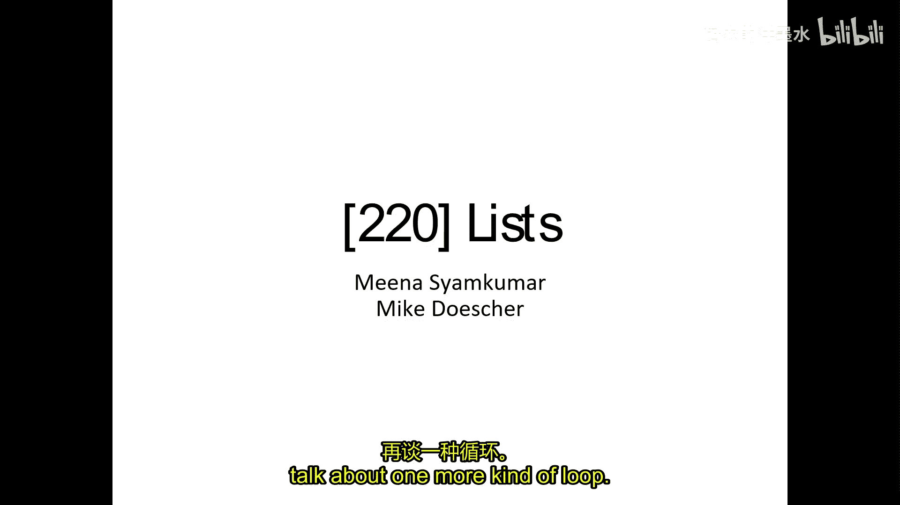
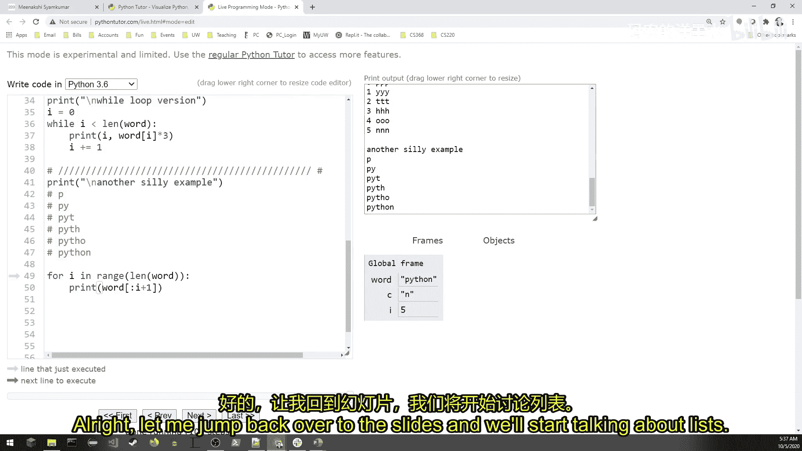
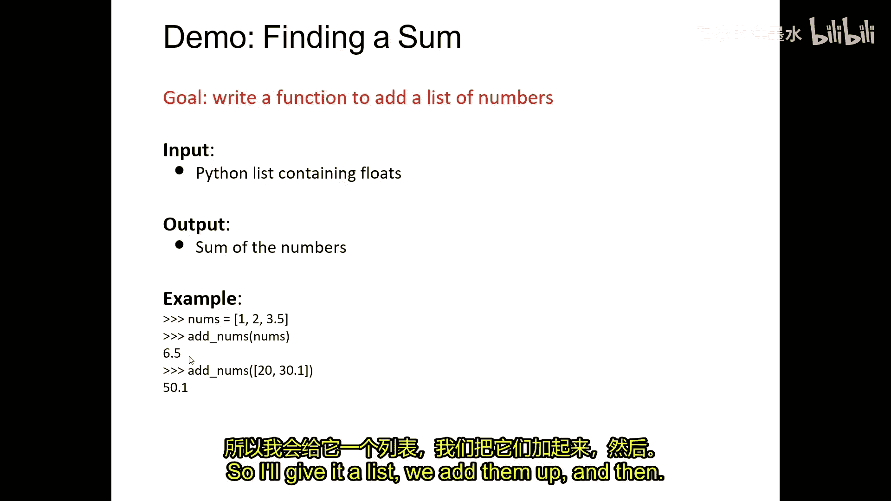
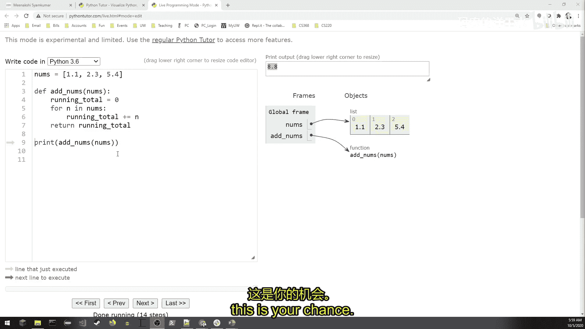
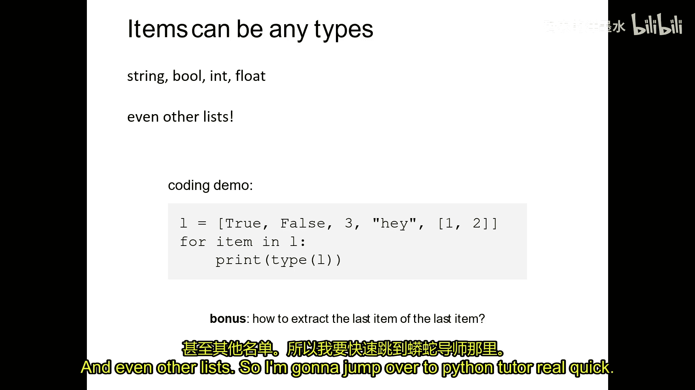
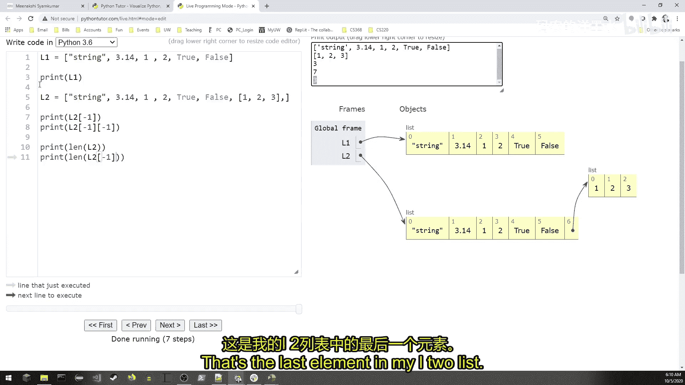
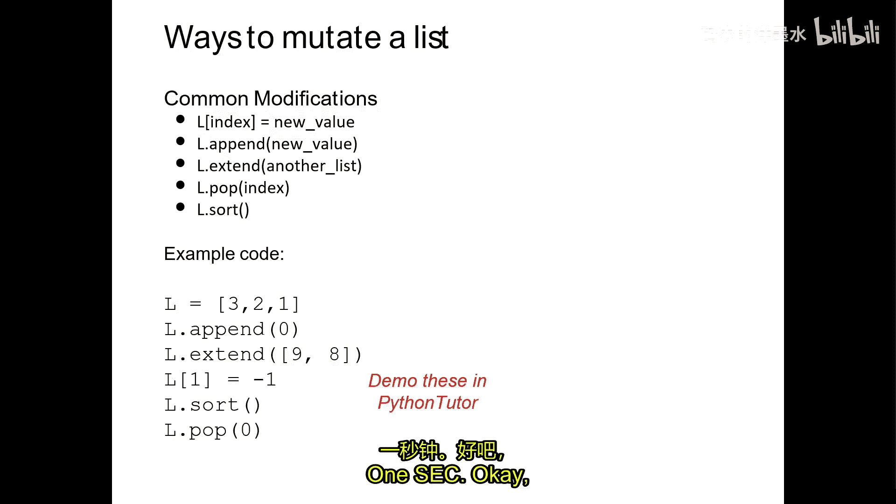
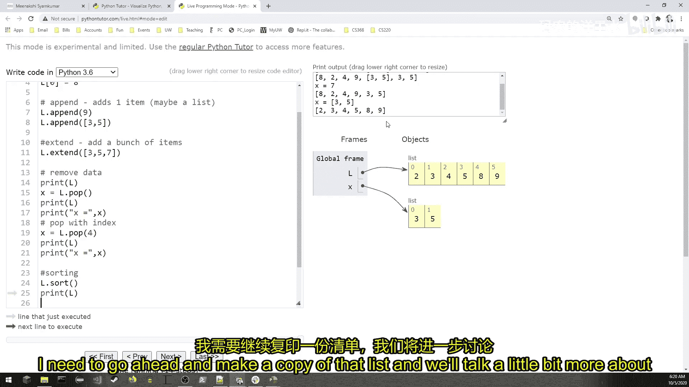
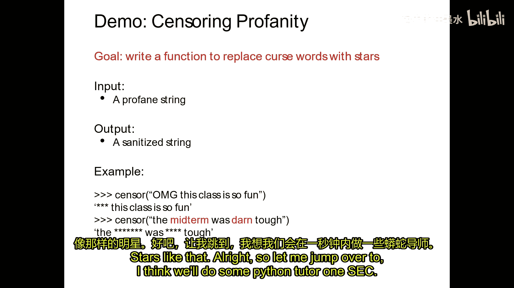
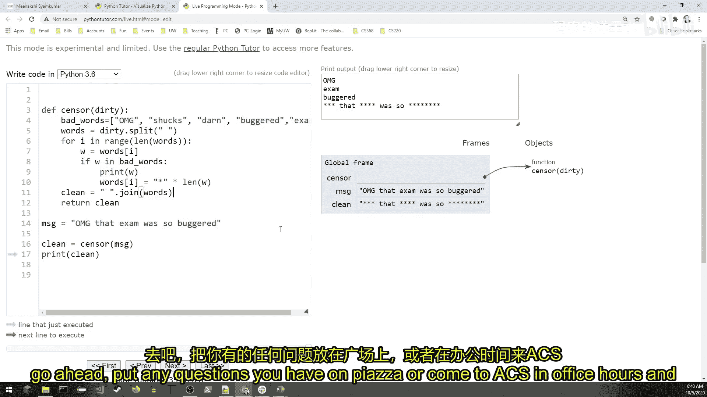

# 【全集】威斯康星大学-Python数据编程-CS220-中英字幕-1080P-p12-Lecture-10---范围循环与列表--BV1VxvsBLEmv_p12-

Good morning， everyone。 Welcome back to data programming 1。

 Before I go ahead and get started talking about lists。

 Let me just first say how Sarah I am about all of the problems that happened with our exam。

 It wasn't just our class。 It was pretty much all of the UW system。 not a star class。

 not just Madison， but every UW school in Wisconsin。 the atomic assessments tool went down。

 It just couldn't handle the load and we'd been working with them ahead of time。 You know。

 we knew there were issues with the quizzes and they scaled up their system。

 They added more servers and we didn't think it'd be a problem。 turns out it was。

 I know how stressful it is。 You know， you need to take an exam。 You opened it up。

 You get a 503 error or you click submit and it doesn't seem to be working。

 It doesn't submit the clock is running out。 I know that's stressful。 whenever that happens。

 definitely write to me write to meina whoever。An instructor a T and we will help you out。

 These are problems that we can work with I know they're stressful。

 but I don't want technical problems to ever like influence your ability to do well in the course So I apologize once again for that。

 and we still have students who are dealing with these technical issues and have not yet taken the exam we've just given them extensions or additional tries if you're one of those students make sure you go ahead and continue working on this as quickly as possible for everyone else。

 please do not post questions about the exam on piazza。

 if you've got something wrong you want and how it works。 you think wow。

 the exam's over now it's safe to post please don't do that yet there will be a moment when everyone's finished and then we'll take questions about how the exam works don't post them on Piazza feel free to go to office hours and visit with one of the Ts and discuss how things work there。

All right， before I dive into lists， I also want to just quick jump over to Python Tutor and talk about one more kind of loop。

So at the end of this， we're going to have three different kinds of loops that we'll be able to use。

 I've just got a silly example。 I'm just going to print out PP PP， Y， by Y， T T T， H， H， H， O，0， N。

 N， N。It's kind of hard to say an easy way to do that and the simplest kind of loop we have。

 and to be honest， the one that you will probably most frequently use is just the regular for loop。

So for and this is the iterator style for loop。I'm not sure it's got a better name than that。

 but anyway， what we're looking at is for in this case。

 I'm going to be looking at something in something。 and you can think about this as this is my data。

And this is one piece of my data。 Alright， And then I'm going to be doing something with。

One piece of my data。 Okay， so in this case， what I'm going to be looking at is actually the string Python。

Just all six of those letters。And I'm going to be going through this data。The string of characters。

 sequence of characters and grabbing one character at a time。

 printing it out on its own line three times。So in that case。

 I'm just going to because I'm looking at characters。

 I'm just going to call it C short for character。嗯。Let'll print it out。Greatrim to see。Alright。

 so when we do this， I've got my output window over here。 I can see I get each character one time。

Now to make it happen three times， I can just multiply the character by three。

And that's gonna give me the exact effect I want。 So this is the first dial loop。 It's the shortest。

 It's the most concise， very focused， great for going through data。

 And we'll see that not just strings， but the topic for today is lists。

 We're gonna be going through lists of data using loops that look a lot like this。

 So I'm describing one piece of the data。 Okay， I'm going to leave this up here。

 But the next thing I want to talk about is another kind of list。Not list， whoops， for loop。

 This is going to be the range for loop。 And let me just real quick demo how this works。

 And then I'm going to talk more about range for in this case。

 I'm going to have for something in somethingca it's a for loop and then I'm going to do something with that。

for this time， I'm not just going to be looking at the data。

 I'm actually going to be looking at a special kind of structure。Call the range。And in this case。

 Python has six letters。 We'll just do range 6。 What range is going to do is going to give me the indexes。

 indices，0，1，2，3，4， and 5。All right， and I'm going to call these indices just I short for index。

An I print these out。Hi。And now， so I left my original code up here。

 So it's still printing out Python。 And then I'm gonna， let's just actually。

Print a new line right here。 so that are spaced out a little bit。That looks pretty good。Okay。

 so then when I print the indices， I've got 0 through 5。 And that's great。

 because now the other thing I would like to do is be able to say， you know what。

 I've hard coded Python right here。 Let's go ahead and just change this to。😊，Word equals。Python。

 and then instead of using the word Python， I'm going to go ahead and leave it right there。

 I could replace that with word。But instead， I'm going to use word right here。

And I want character well， first0， and then one， and then 2。

 And I'm just printingprinting them about in the same line。And again。

 these are just individual characters。 I'm using indexing into a string。

 and indexing gives me one character。So I'm going to multiply that by three。

I wish you didn't shrink that box on me。 I've got to resize it every time it runs。 Now。

 I've got the three P's， the three Y's， the three T's， and so on。All right。Alright， alright。

 I changed my mind。 I'm gonna go ahead and put in word right here。 Hardd coding is just not good。

 If I want to change my example to Pythons or Pythons are。Snakes or something like that。

 That's gonna make this。Much more interesting。So this first example。

I'm going and doing all of the letters in this data。 Pythons are snakes。 And the second example。

 I hard coded the six here。So。Not such a great thing to do。 So what I really want to do。

 I'm going to change it back to Python。 and we'll fix that in a second。Ill leave it that。

We'll fix it back to Python in a second is not hard code The size。

 What I'd really like to do is know how many letters are in this string。

 And there's a function for that。 We talked about it a little bit。 That's just going to be length。

And then I named my variable word， even though there's more than one word here， singular。

But it's going to get the job done。 So now I can see that I've got 17 letters。I'm sorry，18 letters。

0 through 17。 So that's 18 total letters， in fact。Print。Bk。Word， what does that give me。 Yeah。

 that's going to print out。That 18 right there。 Okay， perfect。 But now it's no longer hard codeed。

 It's going to adapt and print out the entire string。 I want to keep this a little shorter。So Python。

 now it's changed the length to 6。 We do have six letters。Al right。

 so let's explore what's going on here a little bit more with range。 So I've got range of something。

 I'm just going to go ahead and print this out。 and see what it looks like。

I'm using Python Tutor because it's going to give me all sorts of extra information over here on the side as we run the code。

 In this case， this is a special kind of data in Python called range。

 and it's going to give me the starting value 0， ending value 6。All right， and。A moment ago。

 I actually， you know， I actually sew here。 I'm printing out。D。

Indices generated by this range function。 So we can think about this as the data structure or the data。

 just like when we are going through data here and grabbing one character here。

 this is a data that's data structure that's going to be giving me one piece of data at a time。

 And those pieces of data are just numbers0 up through whatever number I've put in here。

So like that version looks like this， there's two other versions of range。Hell me， me just。

Put them in like in comment mode here。 So you can see the。 So this will do the number 0，1，2，3，4，5。0。

1，2，3，4，5。Okay， we also have。The version that starts with a starting number and ending number。

And that will print out2，3，4，5。 and it's just like the indices when we were slicing。

 the first one is inclusive， the last one is exclusive， so it's not going to do the six here。

Let me just demo that real quick。In fact， I'm just going to copy and paste this loop。

I don't need to print out the word three times， I just want the index。Yeah。Right here。

 I want two through 6。And now I can see I'm getting two， three，4，5， just like I predicted。

I'm going to leave this， actually。I'm going to put each one of them in。

 So if I only give it one number， it gives me 0 through 5， but not the 6 because that 6 is exclusive。

 It starts at 0 It's giving me  six numbers。 I can put in a different starting number if I want。

 so I can start at 2 stop at 6。 And then there's a third option to。

 Suppose I only want like every other number。 I can put in an increment。 So this is going be。Start。

Finish。An increment。 So that's going to be this one right here，2，4。 It doesn't include the6。

 starts at 2。 Second number， we add this。 So now we have four。And then for the third number。

 we would add this again。 we see it's a six。 that's too big。

 So we just get the two and the four from this version。Maybe this would make more sense if I had。

 like。11 or something。 Then I can see I'm getting to。Can't see it because it's tiny，2，4，6，8。

10 when it gets to 12，12 is too big， it's bigger than 11， so it's going to stop。All right。

 And just to be complete here， if I wanted to do the same thing with a while loop， I。

 I certainly can。 In that case， I'm going to need a loop， a while loop。Ws。Something。There we go。

And this is going。Hold on here。It gets more space。Gll that up。 All right。

 we need a loop control variable， So we'll have let's go with high equals。 we'll start at zero。

 And while I is less than。The length of。Word。Then we need to I plus equals one。 Alright， there we go。

 That's sort of the minimum we need for a while loop。 And now I can use that I for an index。

 and I have a line up here。The this one。This is the exact same thing we've got to do。

I'm just going to paste that in right here， and now。Let's see here。In between all of my examples。

 I went back when I pushed pause on the recording。And put in print statements。

 a blank line between everything。 and a little comment about what I'm actually doing。

 Let me show you what I mean。So I've added all these comments。 So this is the range 6，0 through 5。

 This is the start at 2。 go up through 6， but not include 6 right there。

 This is the one with the increment。 and this will be the wild loop version。So。There it is。Alright。

 so we had three different versions。 just quick recap。 This was the first one。 just two lines。

 grab each character in the data word。 This is the one your first choice because it's the simplest。

 If you need the index。 then we can't use this， this is not going to work。

 we need something that gives us an index。 So this is our second choice。 the range for loop。

This will give us the index。 we can still easily grab the data we need。

 It's not quite as concise as just you know the letter C。

 but I can use the index and the data to grab the piece of data that I want。

And then for the maximum in versatility， I need to go with the while loop。

 This is going to be even more writing， a little bit more difficult to keep track of。

 but it gives us everything we need all in one loop。Alright。

 what I want to do next is just walk through this a little bit。

 So first thing I'm going to do is create the。String word， store the text Python in that。

And then I'm just going to go through these first two and compare them as what Python is really doing。

 When I get to this loop for C in word， the next thing it does is it's going to grab create a new variable。

 Remember， we saw three different ways that we can create variables。

 You can just do assignment like line 8 right here。We can use the loop。

 or we could use a parameter in a function。 So this creates a variable C and is going to grab the first letter and stick it in that variable。

 So it's getting the letter P。 Then it's going to go down and print out C three times。So， PPP。

Then it goes back to this for loop and checks to see， are we done with the word， If not。

 grab the next letter。 So it's going to assign whoops。I don't realize that dragon them around。

 It's going grab the Y and assign that to see。Gets updated right there。

Then it's gonna to print that out three times。 And it goes back to check to see if it's done。

 It's not。 It grabs the T and stores that in C。 So right here。

 we now have upgraded that variable C to a T and so on。 So T， H O N。All right， and then new line。Now。

 this next version， what we see is we're going to create a new variable right here， I。

And it's going to get the value0。 Okay， so this is going to give me a list of numbers。

 Then we go through， it's going to grab and print out the0。 It's going to go an index into Python。

 The word。 The word is Python and grab the P。 So this much will be P。

And then it's going to print that out three times。So there we go， then it goes back up to line 14。

 grabs the second number from this structure right here。

 you can think about range as just like a magic black box that you know the for loop is going to say give me the next number。

 give me the next number， give me the next number and range just knows that it's going to give out the number 0 through6 in this case。

 well，0012，3，4，5。嗯。Yeah， so then it's gonna go through it updates I。 I is now one。

 It's gonna go through print out I， print out the。Index 1 that's。

The letter Y character from the word variable， three times。All right， maybe one more time for I。

 I is now getting updated to2 right there。And then it's going to go through print out two。The letter。

 the third letter in index2 position three times。Al right， guys。

 I just have one more silly example that I want to do。 It's going print out another silly example。

 And then what we're going go for is to create the letters Python with the first letter on one line。

 the first two letters on the next line On line 3， we want three letters， line 4 gets four letters。

 Okay， so the most simple version of the loop。 the4 C in word isn't quite going do it here because we need to keep track of how many times we want to print out everything。

So I'm going to go with the range loop here。And this is a great opportunity to use slicing instead of just indexing。

So we could use a double loop and just go through and print out the first letter then the two set first two letters and the first two letters。

 But Python gives us that cool slicing feature。 and we should take advantage of that。

 So here's the idea。 I'm going be using4 and then something in something。There we go。

And then I'm going to do something with it。 And what I'm going to be doing here is。

All range style loop。 so I want range。And I do want it to begin at 0。

 So all I need to do is put in the。The maximum length。 and that's going to be length of word。

There we go。And now because these are giving me numbers， I'm going to use them as indexes。

 I'm going to call them I， I for index。 A lot of people use I and D or I X， something like that。Now。

 what we want to do here is print something。 And what we're going to be printing out is word。

And we're going to slice this。 We're going to use brackets。

 We're going to start with the very first letter here。 In fact， I just put that in 0。

 and we want to end at。Let's try。 I don't think that's exactly what I want。

 Let's see what it looks like。New parentheses。Alright， now that should be enough to see some。 Okay。

 so I've got another silly example here is my header。Then I have a blank line that I didn't type。

Then we've got P， E， P， Y， P， I T， And it stops here。 This is the bottom1。

 We're missing that last letter。 So it's going on here as I'm actually trying to print out。

And let me just do one more line here。So we'll print out some stuff so we can see。The next line。

And then we'll print out word。The first time through。This is going to be a 0。

 I is going to be 0 the first time through that loop。So when I do this， when I print out。

When I exp spell。Bring word 0 to 0。 It's going to say， okay， grab the first letter。 It's got to be。

Les than the final letter， so it prints nothing。Because this is exclusive。

 So it's got to meet both of these criteria。 It's got to be bigger than this one and less than that one。

Bigger than or equal to， bigger than or equal to less than that one。 So print nothing。

 That's why we saw this blank line right here。 It's why nothing got printed after my gibberish line。

 I print nothing。So what I really wanted was not 0 here。When that was I， I was0。

 I want one more than that。So let me go ahead， I'm going to delete this experiment。

Go back right here and put in I plus 1。 And now this should be good。

 So the first time through I is 0， but I do want to print a character。 So I need I plus 1。

 The last time through， I don't want it to stop when I get to number 5 because range is going to go 0。

1，2，3，4，5。 I want to print out the entire word。 So 0，2，6。And that 6 is exclusive。 Allright， Also， I。

 since I'm starting with0， I don't actually need to explicitly say 0。

 I can shortcut that just a quick reminder for you guys that that's totally an option。All right。

 let me jump back over to the slides and we'll start talking about lists。

So the first five weeks of the course were about control flow and the second five weeks of the course are really going to be about state。

 We're going to start talking about data。 This is， what does the program know。

 What variables does it have access to And we talked a little bit about this。

 we've already been using variables for a number of weeks now。

 Think about the battleship came though， The battleship we。Had something like， I du't know。

8 rows and 10 columns or the other way around something like that。

 And we had enough data there so you could play one round of the game。 You could guess X。

 and you could guess why。But that was only one turn。

 If you wanted to record like all the possible guesses that a player could make。

 there would we need a guess X and a guess Y for every single peg on the board on 8 by 10 grid。

 that's 80 pegs。 and two variables， X and Y per peg。

 That's something like 160 variables just to keep track of where the user guessed throughout a battleship game for all possible games that you could play's that's way too much。

So what we really want。Is to be able to hold more pieces of data。But not use more values。

 or maybe we want to。 And that's kind of the purpose of a data structure。

 We want to hold more values。Am。I think I said that wrong the first time， more data。

 not more variables variables。 So data structure is going to hold more values。

 They're going to be organized in some kind of way。

And we'll just have like one variable to refer to that entire structure with with tools that let us access the values inside。

 So today we're going to be starting to talk about lists which are a great data structure。

 The next one is dictionaries。 that's the， But between the two of those big ones。

 that's the majority of the next couple of weeks。And there's a couple others that we'll bring up also So to begin with a list。

 a mutable sequence that can hold anything。 I me just think about this as a bunch of boxes all in a row that we can put values in because their sequences just like strings are we can do a lot of the same things we can do for strings。

 indexing， slicing， we can go through with a for loop we can use length。 we can use in。

 we can concatenate the multiplication。 I'm going to demonstrate all of that stuff today。

 I'm going to come back and talk about mutating and switching between strings and list at the end。

 but that's kind of the plan。So today， as we get started。

 I'm going to compare what we learned for butt strings because they're sequences and bring over the things that are in common from strings to lists。

And let's just dive into that redign right there。Alright， so a sequence is just， I'm sorry。

 a string is just a sequence of characters。 I've got a bunch of boxes all in a row in a string。

 they have to hold characters。 So I've got hello world here。

 This is the same example we had from last week and I've got three things demonstrated here。

 I can access one value with indexing here S with the brackets one。😊。

So S of1 is's going to give me the character E。 I can slice out or extract a sub sequenceence。

So in this case， this would be S of6。Colon 11 would give me world or 6 colon-1。

 because I don't need that last character， or we can use a for loop and just go through every single character and do something to it。

All right， just a couple of examples。 as we walk through this。 Sove got a message high world here。

Quz yourself。 If I do message of one。 And that's how you read the brackets of。

 So I might say brackets 1。 I might say of one。 But the idea here is that we're going to be， okay。

 make a guess。 write it down， commit。Did you guess I。All right， remember， they started 0。

 So H is going to be message of 0。 I is going to be message of 1。 Let's do another one real quick。

 Mes of3。All right， what do you guys think？Da you guess W。 And we have to count the spaces。

 So H is 0， I is 1。 spaces 2。 W is 3。Okay， so that's indexing， we're just grabbling one character。

Let's talk about slicing for a second。 So slicing is going to get us a sequence of characters that are all in a row。

 basically a substr。So if I start with three， this is going to give us。

The entire world with the exclamation point， because the colon means go all the way to the end。 So 0。

1，2，3， it starts with W all the way to the end。 If I do this one，3 to -1。 Remember。

 we can use negative indices， but they're just going to count。

 Start counting from the back of the string。 move forward。 So this' is going be -1。 This will be -2。

These indices， when we're slicing， the first one is inclusive。 So 0，1，2，3。

 we will include the W goes all the way over the-1 is going to be this exclamation mark。

 We are not going to include that that's exclusive。

 So this is just going to give us world when we do that slice。All right。

 and then if we use the for loop， you get these dots if you're using like Python and interpreter mode。

 I've got them here。So if I have four character in message。

 this is what I just did with the word Python in my range like pre demo， I just printing it out。

 it's going to go through and grab each character one at a time， printed out on its own line。

All right， so the question that the list answers for us is。

 what if we have data that are not just characters， But I want to do something like this。

 I've got a bunch of boxes all in a row， and I want something that's like a number or a boolean or something else。

So the answer in Python is we use a list， it can hold any kind of item we want。 All right。

 so check this out when we create a string。Oh， it's got to start with the quotation mark。

 It ends with a quotation mark。 I've got a sequence of characters in there。

 It doesn't actually have to have any characters。 It can be an empty string。

So this is the syntax to create a string。All right， when I create a list。

 I also have syntax I need to follow these are the rules that Python needs to be followed so it understands that I'm creating a list。

First one， it starts off with a square bracket。Then I put in my values。

 but they have to be separated by commas。 The commas can either come between or after or another way to say that is everything gets a comma separated list。

 but I have an optional comma at the end。 I can put one here or not after the 33。

 And then I've got to close this up with the brackets so that Python knows that I am done creating my list。

 So rules for creating list。 I need square brackets。 I need commas between my data items。

 and I can put pretty much anything I want in a Python list。All right。

So go through those same three things I can index slice and access with the for loop。

 So here I've got nus When I create list， typically I will try and use plural variable names for thing for lists that because they can have more than one thing。

When I index into this， if I get nu 0， that's just going to grab the very first data item。

 In this case， the 22。 if we grab nus -1 again， it can count backwards from the end。

 So this will be the -1。 That'll be -2-3 index。 So-1 is going to give me 33。

 Exactly the same way with strings。 So this is great。 If you've got strings。

 lists are going to be easy。😊，Same deal with slice。 Whoa， hold on。 I'm not quite done with indexing。

All right。I wanted to point out one really common， confusing thing for new programmers。

And that's that we are now using brackets in two different ways。

 So check this out in my line right here， nums equals I'm using a bracket to say we are creating a list。

 Hey Python， this is a list of data， use the list stuff so I've got my opening bracket right here。

 I've got my data and I've got a closing bracket I'm going just rewind a second。Over here。

 this black bracket。 I'm using this black bracket to index。 So I'm using。

Bracket right here to create a list， a bracket right here to index。

 and Python knows the difference because it looks at what comes right before this bracket。

If there's the name here in this case， if there's the name of a list or a name of a string。

 it knows that this is indexing because it's following some sort of data that can be indexed。

 if that's not the case， in this case it's the assignment operator and equals。

 it knows that it's creating a brand new list。So here I've got two different kinds of brackets。

 In fact， let me color code them a little bit。 the green brackets here are creating a brand new list。

 There is nothing to the left of that green bracket。To indicate that I'm indexing。

 So Python knows it's creating a list。This red bracket over here follows a list because Python just。

 it reads left to right。 It knows it just created a list。

 So it knows that this bracket is used to index。 So I've got two different kinds of brackets。

 It can be very confusing if you're new。 It's something you get used to， though。 So trust me。

 you'll probably get confused。 If you've never seen this the first time it comes up。

 And then you'll figure it out。' be like， oh， yeah。It also makes really good quiz questions。

 so best of luck with those。2好。Next up， slicing。 we can still slice just like we can with strings。

 So in this case， I'm going to be grabbing from item 1 all the way to the end。

 Remember it starts at 0。 So we're going to skip the 22。

 item 1 is inclusive so that'll grab the 11 and then the 33。And also， this one's kind of interesting。

 If I choose the numbers。 So I've got， in this case，0，1，2。

 there is no L item 3 to include all the way to the end。

 Python is just going do return an empty list。 It's not going give us an error。

 It's just going to say， okay， your list。 None of these are valid。 So it's an empty list。

 We have was unable to transfer any valid items to the new list。Allright， and then finally。

 just like we could with strings， for loop is just going to be the same syntax for in this case。

 I'm using x， their numbers in nus。Print them up， it's going to go through and print out the first one。

 the second one， third one， each on their online。Alright， so real quick。

 I'm going to pop over to Python Tutor and just write a function that's going to add up a list of numbers we're going to have a list containing floats and it's going to produce some of those numbers。

It's going to look something like this if I use it from the Python interactive mode。

So we'll give it a list， we'll add them up and then。

Print out the answer。All right， before I get started。

 I still have all of this code over here in Python Tutor。

 I grabbed all of it and I' put a link to this exact demo it'll be in the description you should just be able to click that the link It's actually if you just generate permanent link Anyone can do this you can create a link to your code。

 you can send me things that you've done in Python Tutor。Anyway， I've done that。

 it's in the description if you want to see exactly what I've done here。Otherwise。

 I'm going to nuke it。Okay， so the next thing I'm gonna do， I'm gonna。

Just write a function that adds together a bunch of numbers， so in that case I need some numbers。

And I'm going to create a brand new Python list。So I need the square brackets when I tap。

 I tend to put in both brackets right away。And then I'll left click over and start putting in my data。

 So let's add up 1。1。Let's focus there second， 1。1。A common separated list。 So we'll put in 2。

3 and then 5。4。 That would be pretty simple，1 to38 point。8， it looks like。 alright。

 So now I've got my list。 Next thing I'm going to do is define a function。 Let's call this。嗯。え。Nouns。

All right。This ad nus needs to take a list of numbers。In this case， I'm just going to call it Noms。

 It'll do some stuff。 I'll come back and fill that in a second。 and I'm going to call the function。

And nus。我 give it。Numbs and we'll print it out。So right now the function prints。

 it doesn't do anything。 it doesn't return a sum at all。Instead， it just passes。

 which means it does nothing。 So this is printing out none because I don't have a return yet。 Here。

 let's， let's upgrade this， Let's。Be偿。0。Now it should print  zero。 Okay。

 that's obviously the wrong answer。 We need to fix that。But it's something。

So we're passing in a list of numbers。 Let's go through。 We're getting to go through the entire list。

And do something with them。 So let's get started with that part next。So here we go four。Something in。

 and my data here is Nos to list。 I'm going to make it plural because I've got more than one thing in here。

 And I'm just gonna， how we just print them out。Print， and then I need a variable name。

Let's go with n。It's going to grab the first item in dumps， the 1。1， store that in N。

 and then we'll print it out right there。Alright， let's just check and see that this is working。

 So I'm going to go back to the beginning。 First line。

 it's going to create this variable Nos and store 1。12。3，5。4 in it。 Check it out。 Python。

 Our Tutor actually is going to display all the numbers。 It's going to show me the indices。

 That's great。😊，Next thing， I'm going to define the function。

 So it's going to remember where that is。 Then we're going to call the function。

 So it's going to jump in。 It's going to say the parameter here， nus。

That nus right there because this is in the add nubs frame is going to point to this list。

So it's going to have the same numbers that are in numberss。

 So I've got two variables that are using the same list。Alright， next thing for n。

 So I should be able to， yep， there it is。 there's my N。

 It's going get a copy of this first item on the list。 So 1。1。

 Then I'm just going to print it out right there next time through n gets updated to 2。3。

 printed out。 then n gets changed to the 5。4。And we print it out。Al right。

 so that's kind of how that works。 Now， instead of printing them， what I really want to do is。

Return the total。 So as I go through， I'm going to have a。Running total。

 and I'm going to start that off at0。And then instead of printing the numbers。

 I'm just going to say running。Total plus equals N。All right， cool。 So then as I go through。Next。

 next， next， running total， it gets the sum of all these 8。8。I don't actually want to return 0。

I want to return the running total at the end of this。Got a blank line in there。 I don't need that。

Clean that up。Let's jump to the end， it's going to print out。8ight。8。Alright。

 so hopefully though was clear。 I hope I didn't go too fast for those guys trying to follow along at home。

 pauseuse the video if they need a little more time to catch up and make sure this works。

 If you want to do any experiments here， This is your chance while you're right here。

 If you have any questions， go ahead and post those on piazza。

Alright， so just a couple more things that we can do with any sequence that means strings and lists。

 All right， length， concatenation in and multiplication。 So just go through this side by side。

 I've got strings on the left。 lists on the right。 The first one is length。

 We can compute the length of any string。 The length of any list。 So here we've got 3，2，1 go。

 That's got 5 characters in it。 The length is 5。 This list has a 99，11，77 and 55。 That's  four items。

 So the length is 4。😊，Pretty straightforward concatenation when we use concatenation with this string。

 3，2，1， go， add exclamation marks to that message， it just extends the string and adds those extra characters。

Remember lists， sequences with concatenation are going to work exactly the same way。

 so if I have two lists， 99， 11， 7755， and I add  one23。

 it's just going to tack those onto the end and I get a longer list。

For those are guys used to vector math， if I have two vectors of the same length and I add them together。

 oftentimes we'll see element wise addition that is not what Python is doing here。

 It is not doing vector math。Alright， next operator is in。

 we've already seen the in operator with the for loop， but this is just going to ask the question。

 is there a G in message and there is， So this is going to be true。 same deal with lists。 I can ask。

 Is there an 11 in this list of items。 Yes， there is。 It's right there。 That'll give me true。

And finally， multiplication， Oops， I got two examples here。 I there a Z， No， is there a tan， No。

 both of those are false。Now multiplication。 Okay， so in Python， when we talked about strings。

 multiplication here was really just the same thing as adding message to itself。 in this case twice。

 if we had a three here， it would be message plus message plus message。

 So it's going to give us the same thing as concatenating the list to itself or the string to itself。

 So in this case， we just get 3，21 go repeated twice all in the same string。Again。

 when we do this with lists， we get the list just repeated twice。 And again。

 those are you guys who are good with math。 You've seen a vector edition， vector multiplication。

 This is not what's happening here。 Python does not do vector math with lists like this。 Instead。

 it's just going to have two copies of the list。Create a new list and make it better。All right。

 so that was all of the things that strings and lists have in common。

 All of the sequence things right here， indexing slicing， four loops， length。

 concatenation in and multiplication。Now， there are a bunch of things that strings have that lists don't have。

 These are specific string methods like find， replace， switched uppercase， lowercase， formatting。

 those kinds of things。 lists do not have those。 They're a lot more general。

 But what we will see is that we have flexible types。 And I'll explain that next。

 And we are also able to change the data in lists。 So that's known as mutation。

 That's coming up shortly。 Strings don't have either of those available to them。

 They're forced to be characters。 and you cannot change some of those characters。😊，Al right。

 so flexibility of types will be next。Here's the idea。 I can have a list。

 They're just little boxes all in a row in order。 They've got an index or a number associated with them。

 but I can put in any kind of data I want so far， the data we've seen strings， booles， integers。

 floats。And even other lists。 So I'm going to jump over to Python Tutor real quick。

And again， I just made a copy of this code。 There'll be a link in the description。

So you can come back to that。 So in this case， let's make a new list。 L is equal to a list。

 and let's put in。 Let's see here， a string。Flote。An integer， maybe two integers。

There we go and a Boolean。In both of them。There we go。

 and this is just going to show me that I can put in every single one of those types of data I can print it out。

Prit out my list。There it is。I've got my string。 It's actually the word string number integer。

 integer float Booying， Booying。 All right， awesome。I'm going to upgrade this a little bit。

 and just do。Okay when we make another， we'll make this L1， then we'll have an L2。

I'm just going to add。Another list to this。And what I see here is that the last item in my list is actually another list。

So。Let's talk about indexing for a second if I wanted to grab this very first thing and print it out。

Pretty straightforward， I would grab L2， I'm going to use indexing。

And I'm going to grab the first index， the zeroth position。 That's going print out the string。

If I want to grab the 3。14， that's at the index 1 position prints out 3。14 right there。

If I grab the last position， the-1， that's where this list is。

 it's going to print out the entire list，1，2，3， the entire last item， which is a list。

 it can print the whole thing。While I'm thinking about it。The comma here at the end is optional。

 I can put it there or not， so I can think about either each data item having a comma after it or comms between。

 it doesn't matter Python is good either way。Okay， okay， got distracted。 Focus  Mike。 Allright。

 now suppose I wanted to print out the last item of the last item。 So that last item is a list。

 I want to grab that three from that position right there to do that。

I'm going print out so this much right here， let me highlight this。Is a list。

And I can index straight from a list by just using more square brackets。

 So let me grab those we put in the square brackets。 And if I want the last item， that's another -1。

All right。 So I hope that was pretty straightforward， at least with my explanation。

 if you need to hear that again， pause the video， rewind about a minute and play that last minute over again。

And while I'm in the middle of demonstrating stuff。Let me just real quick print out the length。

Of my list。And we'll talk about this for a second。 It's giving me 7。Okay， so I've got the string。

 that's one。 the float is 2，3，4，5，6， and two balloons， and one more list makes seven。

So it's giving me all of the sort of top level list pieces。 So here it is。1，2，3，4，5，6。

 and then 7 is that list。It's not counting all three of these as separate。 If I wanted to do that。

 that's known as list flattening。 and we'll be getting there in perhaps a couple。

 maybe two or three more weeks。 If I knew that the very last item here was a list and I wanted the length of that。

All right， this much gives me the first list， the top level。

 And then I would just grab the last item。And this should print out the three now。

 because there are three items，1，2，3。In the very， the list， that's the last element in my。

L 2 list。All right， back to PowerPoint。Alright， next up。

 we're going to talk a little bit about mutability。 So mutating means we're changing something。

 So if something is mutable， that means we can change it。 If it's immutable。

 that means it's unchangeable。 Now， I'm going to tell you right now that strings are immutable and lists are mutable。

 So we can change lists， but we cannot change strings。 You're probably thinking way a second Mike。

 I know that I have seen you change strings。 In fact。

 the very last lecture that you are changing a string。Let me just flip to the next slide here。

And we need to be really careful here。 So it's about the values being changed， not the variables。

 So variables can always be changed。 let's take a look at this left most column right here。

 I've got lists on top and strings on the bottom lists in all of these cases。

 I am like creating a brand new list and assigning it to a variable here I'm creating a new list assigning it to a variable。

 So I'm setting a variable to a new value。 that is always allowed。 In fact。

 I'm doing it here with strings。 I'm creating a string， A B and assigning it to a variable。

 So S gets A B。 Then I'm creating a new string， C D， saying S gets Cd assigning that to the variable。

 I can actually do the plus equals。 This is gonna take C D with a value stored an S。

 it's gonna plus E to it do concatednation that generates a brand new string C D E and we'll assign that to S。

 and in each of these cases， we lose the data。😊，That was in the string before the reassignment。

 So this is setting a variable to a new value。 All right， that's not what I meant。

 When I said we can't change the strings。 This is changing a variable。 Okay。

 so here's what's going on when I change an existing value。

 So here I'm going to be digging into the list or into this string。 So in this case。

 I've got numberss here，2，2er 9。And I'm going try and get an access the very of the second number。

 So I want it to be C S 220。 We always use 220 for any kind of number of example。 So。

 but this is wrong。 We're not 229。 We need to go in， grab that 9 and replace it with a 0。

 So in this case， numberss 2 is going be 0，1，2， the 9。 This is allowed。 I can change this list。

 I've got that data element。 The 9。 I can change it by just indexing and assigning it a new value。

This is absolutely forbidden with strings。 If I have string 2，2，9， I am not allowed to change it。

 So S 2 does index that character。 It gets the character back。But it's immutable。 I cannot change it。

All right， guys， I'm going to jump back over to Python Tutor now and talk about ways that we can change lists or ways that we can mutate them。

One sec， okay。

I'm going to nuke this stuff。And then I'm going to create a new list。 Let's call it L equals4，2。Oh。

624， that's what I really meant。 Okay， there we go。 Now I have a small list。

Now I'm going to talk about a couple of ways we can change the list。

 First one is just known as updating， and this is just going to be using indexing or slicing。

 In this case， I'm going to grab the L0。 we'll change this2 and 8。

I can see over here in my global frame after this code is run。That it's now it's gone from a6。

2 and 8。 So it's 64。 now it's 824。 So this is just known as updating。All right， next up。

 if I want to add more data to the list。This is known as a pending。 In this case。

 we can just type the name of the list。 it's a method， So L dot， and it is a list method。

 what do you think， How about a9？So I do L do aend， that's going to add a9 to the end of this。

This can be a little bit tricky because if I do。Eepend， it's a function。

 So I need those bracket parentheses。 If I add a list to it。 So let's put in。Let's see，3，5。

What I see is that it's actually appending an entire list as item at index 4， the fifth item。

 If I wanted to add a bunch of album items all at the same time， that's known as extending。

So append and extend are very similar。This one adds a bunch of items， a pen。Adds one item。

Maybe a list。All right， so quick demo this。Let's go with L dot。Extend。

Give it some square brackets we'll put in a list， in this case， we'll do the  three，5， I don't know。

7。So now I can see I still have that for there。 The fourth item is a list。

 but now I've added three more itemss。 So 3，5 and 7 at indices 5，6 and 7。All right。

 hopefully that was pretty straightforward update and more data。And then。Removing stuff。

Remove data from the list。So the easy way is just pop so L dot pop。

 this is going to grab the very last item and remove it。So here let me do this。Print。然。

So that'll print out a copy of my list， I'm going to pop from it。And then print L again。

Without any typos。 and we can see that it's removed the very last item。 perfectf。

 That's so Papa is always going to do that。 It's going grab the last item， take it out。

 And if I want to， I can store this in a variable。And then we can print out。The variable。

 And we can see that x now contains。That。So let me see the stacks equals。There we go。Looks good。

 And use space。Looks really good now， okay。Now P can also be used with an index。So。L dot pop。

 And now if I want to get rid of this list， that was at index 0，1，2，3，4。 So I'll just pop index 4。

And then we'll print the list again。And we see that it's gone。 if I store this in X。X equals that。

So that will replace the7。 I can print this out again and see that X now contains that list that was popped。

All right， finally， one more cool feature sorting。This one is really straightforward and take the name of the list。

 It's a method， so I'm going to use the dot and then the name of the method。The method name is sort。

 give it some parentheses， and it's going to go ahead and sort that list for me。

Now check this out if I print out hell after sorting。It actually modifies the list。

 it's not creating a new list and returning it， it's actually sorting it in place right there in the data structure。

 so 234589， if I want to preserve a copy in the original order。

 I need to go ahead and make a copy of that list and we'll talk a little bit more about copying lists and upcoming lectures。

Allright， I want to wrap up with transforming between strings and lists。

 There's a lot they have in common。 and we've got two methods we're going to learn。

 They are split and joined。 They're both string methods。 So in this case。

 if I've got the string a quick brown fox。 And I take the name of that string and use dot split on it。

 That method。 It takes a separator。 In this case， I'm using this space。

 It's going to break this into a list。 So it's going to read the first character， find the space。

 This will be the first item in my list。 It's going to be the word a。

 Then the second item in the list at index 1。 will be the word quick。 It finds another space。

 This is going to be the third item Brown finds another space Foxox。

 So it's basically creating this list of strings。😊，All right， and then going backwards。

The join method is also a string method。 So it's going to take a string。Dot join。

 And then as part of the， how it's called。 And then this takes another argument。

 This is the list that we'll be joining together with this separator in between all of them。

So take a second， think about what joining these sequence of letters， this list of strings。

With the separator eye is going to give us。And here's a hint。

 This is actually a picture of my hometown。 I'm from La Crosse， Wisconsin。

 with 800 people in the class。 There is almost certainly someone else out there from La Crosse。

 This is the Cary Bridge home of the big Blue Bridge Blues blast every summer。

 At least while I live there。 I't lived there for a while。 I don't know if they still do it。

 But this bridge spans。 What river。 Here's your hint。😊，And the answer is the Mississippi。All right。

 one quick little detail here。I did have to put this extra blank string here because the eye is a separator。

 So it's going to go in between these M I S S right here， I S S， I P P。

 And then in order to get that very last eye in Mississippi， I needed to have something to separate。

 And I wanted the empty string。 because I don't want more characters， the last letter in Mississippi。

 isn't I。If I were to leave that out。Then I get Mississippiisip， and that's not spelled right。

 I'm a horrible speller， but。That one I just can't stand。All right。

 so next up one final demo for today， suppose Piazza is getting a little crazy and。

Everyone's frustrated about how terrible the exam experience was。

 And we're starting to see a lot of bad words appear。 Well。

 I don't want to have to go through and change all the bad words myself。

 I want it to be done automatically。 So what we're gonna do is write a function that takes in a string containing profanity。

 And we're gonna。Return a new clean string where the profanity has been replaced with stars。

Right like that。 Alright， so let me jump over to， I think we'll do this in Python Tutor one sec。

All right， guys， I just jumped over to Python Tutor。 We're going to start writing this。 First。

 we need a function。I'm going to call the name of the function sensor。

And it's going to take in a string。 let's a string containinging bad wordss。 Let's call it dirty。

30 string， and we'll go ahead and clean it。Then let's see right now we'll just pass here。

 we'll print。stringing。And just see what we got， and that'll be the end of the function for now。

So then we need an actual string。 Let's call it our message。

 Just use a different variable outside the function。 Let's see here。 We'll say messages。OMG。That。

🎼Exam was so。嗯嗯。Remember're really recording， Mike。 It's going to be on the Internet。 buged。

 There we go。 Now let's throw in some exclamation marks。哎你知道。We'll just leave it like that。

 I don't need that much emphasis。 It wasn't that bad， was it guys。Okay， all right， anyway。

 then let's just try calling this。Sensor。Message。And when we run this。

 if I didn't mess up by putting that there should print out that exam was so bug。 Okay。

 looks like this mu is working at least。So instead of printing it。

 I think instead I'd like to return it。Because we're going to be cleaning this up。If you guys ask。嗯。

Yep， return does not require parent。 Ill just pop those off。 And instead， what we'll do is。

Clean equals the return message， and will'll print out。Clean message。 There we go。

 should be still good。 Alright， al right， looking good。 Now， we're gonna need a couple things。

 We're going need to go through each word in the dirty phrase and do something to it。

 We need to know if it's bad and if it's bad， then we need to replace it。

 So I'm going break this down into a couple of steps。 We're going take that dirty string。

And we're going to split it。And we're going to split using the space。 Okay。

 this is going to return a brand new list， and it's a list of words。 So let's call it words。

Some will be good。 Some will be bad。 And then let's just go through and print them all out just to make sure that things look good。

 So we'll go4 W in。Words。Pri W。 and now this should print out。

Should print out all of the words was out there it is。That exam was so buggered。

 and then this is printing out the clean one， this last line right there。Okay。

 so now next thing I need， we need a list of bad words。 Let's go ahead and's put this up at the top。

 We'll make of the first line。 The function。 We don't need it outside the function doesn't need to be global。

 So we have bad words。Al right， what are some common bad words， Let's see we'll make this a list。And。

Let's see。 How about O N G， How about。Shoucks。Im darn。Bggared。All right on。哦。After this week。Exam。

 we're putting an exam on this list。All right， let's go that good and we can add more， you know。

 you guys use other words that some people might find offensive， we can add those later。Al right。

 see。 So now I've got all these words。 instead of printing them out， what I really want to know is。

Let's print out just the bad ones。 So if。And I can say， W in。Bad words。

 This will be true if the word is in this list。 And in that case， I want to print it out。

So let's see here if we just run to the end， Alm G exam and buged。All in the list， okay。

Wonder if Bggard has two Rs。 And what you know。All right， nope， thats spelled correctly。Alright。

 so to this point， what I want to do is once I've identified bad words。

 I've actually got two choices here as to how I proceed。

 The first one would be to try and replace them with the stars。And the second approach would be to。

Every time I go to a word， I either add the word to a new list of words。

 or I add stars to the list of words。 If it's bad。 So I've got two choices here in the projects。

 you guys will be doing both of those。 Just remember， you've got options。

 I'm just going to show one of them right here。 And the one that I'm going demonstrate is the replacing。

 So if I want to replace something。 If I get to a W。 And I know that it's wrong。

 I actually need to know where did that come from。Was it the position 0， position 1。

 position 2 to replace that。 So this is not the right kind of list to make that replacement not the right kind of for loop。

 I really do need the range style for loop。 So I'm going to go ahead。 I need to change two lines。So。

 instead of。W， I'm going to be getting an index。 I'm going to change this to I for I in。Range。Length。

Of words。 So now that will give me 0，1，2，3 up to all of the words。 There's a problem here。

 I no longer have a W。 So this should give me an error if I ever run this。

 So instead what I'm do say W equals words of I。 And now this should all be good。 Let's just。

Run the code again， see I'm getting exactly the same result。Alright。

 now I have the index where that bad word is。 So if I find a bad word instead of printing it out。

And we'll keep that for a second。T out what I can do is I can go back and say words of that position。

以こ。We'll place it with a start。All right， then。Yeah， that should be。

 So I'm returning the original string right here。 So this should actually just be printing out。

Now lets go to the end。The same thing。 So I haven't actually changed。 I changed this list of words。

 but I'm not returning that。 I'm returning dirty。So not quite what I want to do yet。

 what I want to do is create。Let's see here。We'll create a new list， we'll call it clean。Oh。

 I've used that。 That's fine。 That's fine。We'll put in the join。 And the way join works。

 It's a string method。 So it takes a string， And this is going to be whatever separator I want。

 because I'm making a sense。 I want spaces between all my words。

 I'm going toend this with the string。 That's just a space。Alright， and I'm going to be joining。

 It's a function。 So I need the parentheses。 and this function takes a list of things that I'm going to be joining together。

 list of it's a string function。 So a list of strings。So in this case。Words is my list of strings。

So I'm going to be putting that together， maing into do a brand new string， and we return this。

Al right， so let's see what this looks like so next。Last， there we go。 So in this case。

 I can see that I've replaced all of the bad words from。My sentence with stars。I don't feel like a。

 well， actually， let's leave that for a second。 I can see this first bad word has three characters。

 and I've only got one star here。Second one has four letters。 I've only got one star。 So， I mean。

 the bigger the word is， I feel like I should replace it with more stars。

So one of the ways I can do that is just use that multiplication。 So here I've got words of I。

I know the length of my word。 It's a length of W。 So I'm just gonna multiply it by。

Let's make this length the W。And instantly it's updated so now I've got three stars， four stars。

 and however many stars are embugged。eight is looks， maybe。Alright， so let me see。

 let me check my notes。Allright guys， this is gonna do it for me。 Everyone to have a wonderful day。

 If you're watching the live stream， I'll hang out and answer any questions you guys have if you're just watching it on YouTube later on。

 go ahead put any questions you have on Piazza or come to OCS and office hours and everyone have a great day。

😊。

