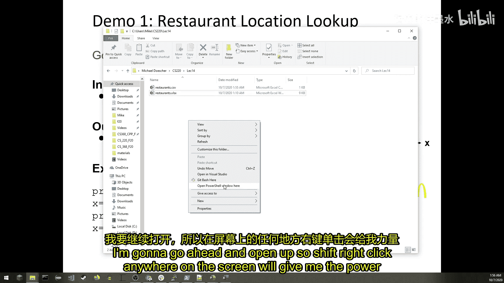
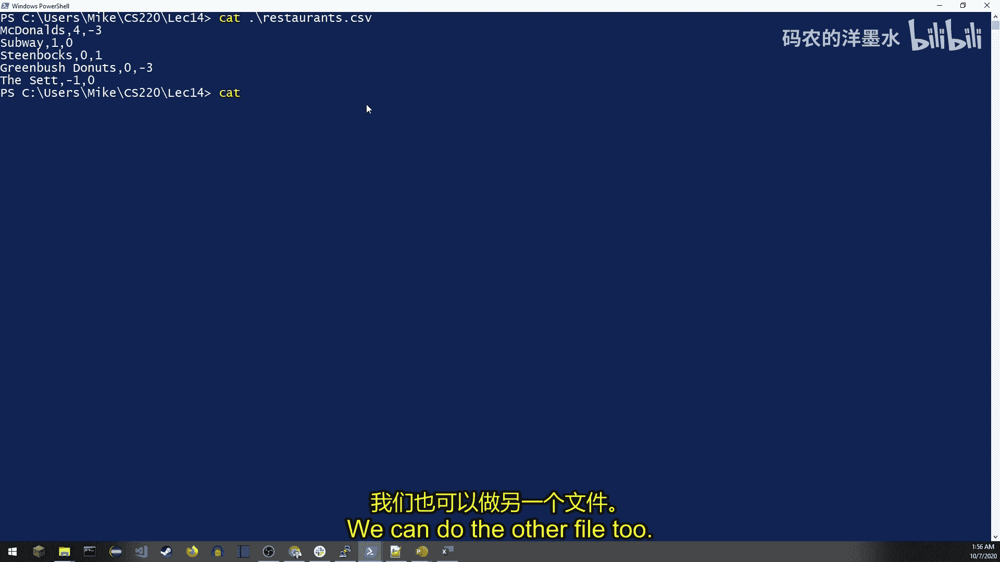
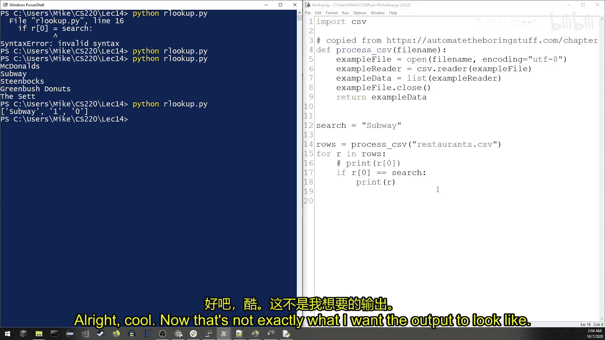
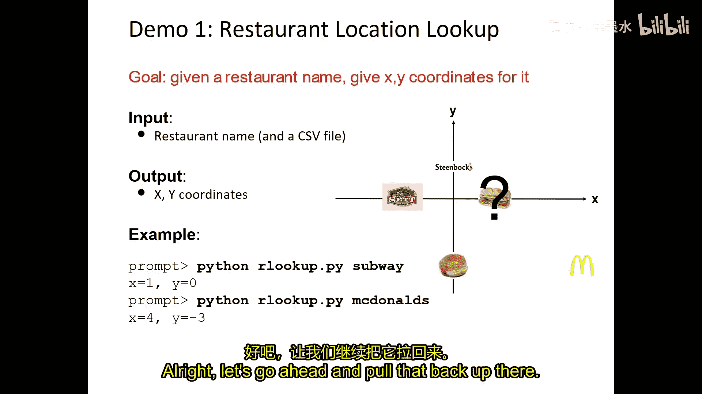
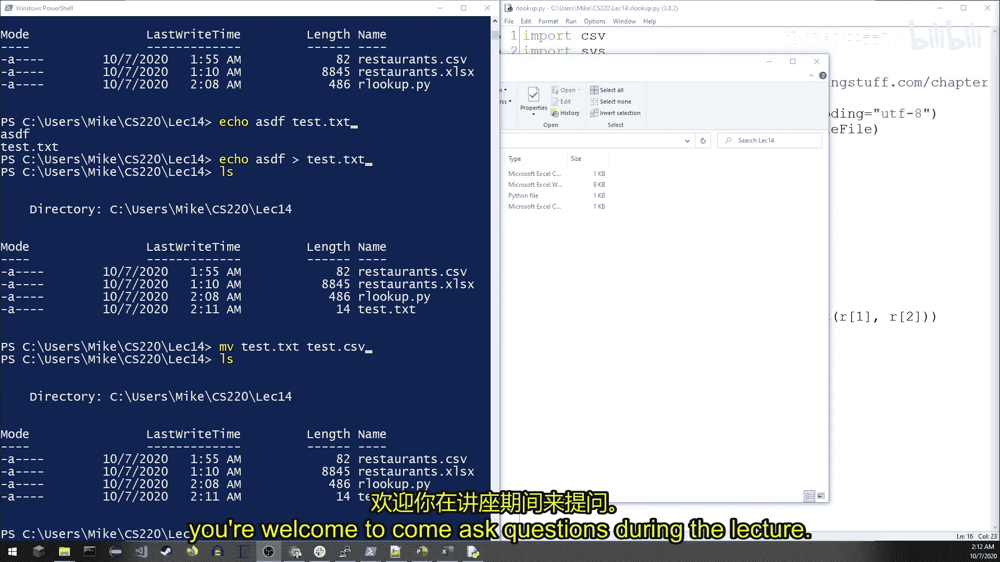

# 【全集】威斯康星大学-Python数据编程-CS220-中英字幕-1080P-p13-Lecture-11---表格数据与CSV文件--BV1VxvsBLEmv_p13-

Alright， everybody welcome back to data programming one today we're going to be talking about tabular data but I just have a couple of things before we get into that first please remember that don't post any questions on Piazza about the exam yet if you do have questions feel free to bring them to office hours or I suppose make your post private because we still have people after the disaster last weekend who are trying to take the exam we plan to release the answers on Friday everyone should be done by then so until then please refrain from like leaking information to those students who haven't taken it yet。

Alright， next up， a couple of things we're going to need during the lecture today。

 Let me switch over to our web page。Alright， so here we are today CSV tables， October 7。

 there's two things here。 First go ahead and download the slides and open those up。

 It's a PDF document， but we're going to be copying and pasting some very important code as you guys go through this and this code you will need for examples for the next。

5 weeks。 Okay， the other thing you also need it for the projects。

 So it's in this the slides right here。 I'll show you exactly where in the middle of the lecture when we get to that point。

 go ahead download that， have it open and ready to go。

 The other thing we're gonna need is a piece of code from the code folder。

 So I'm going open this up under files right here。 So you can see lecture code is the code that Me has already prepared for her lectures。

 she'd be me again And here's the notebook。 under files， though。

 we've got a number of data files that we'll be using the only one we need for today is restaurants Excel Sx。

 the Excel file go ahead download that。 We will be using all of these over the next couple of lectures。

 So if you want to just go ahead and download all of them right now， That's perfect。😊。

The bottom one is the one we need for today。Allright。

 so I'm going to go ahead and start off with a little bit of review。So last lecture。

 we were talking about lists。 And one of the examples that I didn't get a chance to do using lists was computing the median。

 So the median is as you guys may remember for math class。 It's the middle value。

 If I take all of the values in a list。 I sort them。 and I find the middle one。

 So it's a little bit different from average where I would just add them all up and divide by the number。

 And that third thing you probably learned the same week in algebra is the mode。

 That's the the one that appears most common。 We'll come back and do that in a different example。

 in the future。 Allright， So here's what we're doing today。 We're gonna to be computing the median。

 And I'm just going to write a function that does this。 So we'll define a function。

We'll call it median。 we'll need something right here。 And in a colon。 And for now。

 we're just going to do nothing。 Allright， now for the rest of the example。

 I'm going to need to test it with some numbers。 So got some numbers。 We'll just call those nus。

 And again， I'm making a list。And it's going to have more than one item。

 so I'm going to use a plural variable to like remind myself that this is a composite data type。

Alright， and then we'll just throw some numbers in here your minus-2。Meet some commas minus 1， 30。

 20。And it'll tell you to make the math easy。3， okay， so that they add up to 50。

 I've got five numbers。 A should be 10。 We're not doing average。 we're doing the median。

 So let's see the median in this list。 If I sorted them might have minus-2-1，3，230。

 the median should be 3 Allright。And then I'm just going to call my function。

And I'm going to need to give it the list of numbers。 There we go。 So we'll call that with nus。

 And that means that I'm going to need a parameter right here because I'm passing in my list of numbers and。

嗯。Could call it numbs， but that might be confusing because I'm using the same variable twice。

 Nothing wrong with it。 I could easily do that。But I might have other things I'm taking the median note to。

 so we'll go ahead and we'll call this items。I think that's the same variable name used。All right。

 just to get started。I'm going to print something just to make sure that I haven't screwed up anything yet。

 So I'm going to go ahead and run this cell and it looks like it's good。

 They didn't give me any error messages。 It printed out the list， just like I was hoping。

So the medians， of course， the middle number in the list when they're sorted。

 So the first thing I need to do is sort this list of numbers。

 And you might remember from last time that sort was one of the functions one of the methods available for lists。

Items。 sort。Go ahead and call that。 If we run this。

 we now see that it's taken the list of numbers and it's sorted them。 So I've got the-2-1，3，2030。

 exactly like I would expect。 still printing them out。 After that， I need to return the middle one。

 So I'm gonna go ahead and just。Return and I'm going to hardcode this for right now。Items。

 and let's see I want。 This is index 0，1 and 2。 So the very middle of one is going to be index 2。

I'm going to， okay， since I'm returning something， I'm going to capture this in a variable now。

 I'm just going to call it M for median。 and then we'll just write this out。

And that will go in the out box。So check this out， I've gotten just on the aside here。

 a valuable tangent。 I've got a number of questions during office hours about how the grading script works and what's the difference between printing stuff and this out box。

So we've got three zones here。 First， we've got the code writing zone。

 We've got the printing zone where I've printed the list。 And then the very last thing。

 And this is a feature of Jupiter notebook， not Python in general。

 is that I can take a variable put in the last line。

 Jupiter is going go get the value of that and put it in this out box right here。

 This is what our grading script is check， checking for。So if you don't have anything in the out box。

 you'll need to do that and if the test script fails， it's likely coming from right here。Okay。

 so anyway， just just aside。 Allright， I've got some problems with this。 It's。

 it works great for this list。 It works great for any list that has exactly five numbers in it。😊。

But the moment I start adding more things， let's put 88 and 99 in here， if I run this。

It's no longer giving me the right number。 So now 20 is the median value。But it's still returning 3。

 That's because I hard coded index 2 right here。 And， in fact， if I only had one item in the list。

 the median value is that one item， this would totally crash because there is no items  too。Alright。

 so here's what we're going to do。 We need to come up with a better way to find the right index。

 So I'm just going to go ahead and add one more variable。We'll call it the middle index。

 and that will be， let's see it's going to be items。Dot length。

I'm doing that backwards length of items。And but I don't。 So this this list has let' see，1，2，3，4，5，6。

7 items in it。I want to divide by2。 That'll give me。你 see you。7even0 by 2 is going to be3。

Remainder  one。 So the integer division here will give me the three。

 and that should be the right answer。 I think 0，1，2，3， oops，0，1，2，3。 Yeah， that should give me 20。

 So I'm going to go ahead and now put my middle index in here instead of the two run this。

 and make sure that we're getting 20 perfect。 let's add。A more， oops， add in the wrong spot。

 Let's add 5 and 6 to this。 See if we're now getting。 yep， looks good。 Looks like this is working。

But we are going to run into one little problem if we have in so this。

 all the all the things I've tested so far have odd numbers of elements。

 And so there's exactly one middle。 But what if I have an even number of elements， like 1，2，3，4。

The median of this is well here， let's just run the code and see what it does。

 It's going to return 3。 So it's going to take four items in the list。

 Integer division divided by 2 gives me a 2。 And so it's finding element 0，1，2， right here。 that's 3。

It doesnn't matter what order they're in。 I'm just going to leave it like this while I'm testing and then we'll try some other mixing it up。

But this isn't the right answer， because the median of a list with something that's even。

 I'm going to need to take the average of the two closest to the middle， the two and the three。

 So the answer should be 2。5。 This code is inadequate to get that。 It works great for odd。

Numbers of items in the list， but not great for even。 So we need to upgrade this a little bit。

 Let's go ahead and just。Yeah， this part's working。 Those two lines are great。

But I need to know this only works for odd numbers。 So we need an if。 let's see， length of items。

Mod 2 exactly equals one。 That means we have an odd number of items。

 So this is we're going to divide by 2 and give us the remainder。 The remainder is 1。

 It has an odd number of things in it。 Alright， let's see if statements need to colon and we need to tab this stuff over。

Alright， so that's great if it's。Then I' numberer， then else。

And I don't actually technically need to write this else because I've got a return here in the if statement。

 So this automatically will。Be fine。 I don't need the else。

 but I think I like the way it feels because there's only two choices it's either out or even。

 so I'm going to leave it with the else。Maybe I'll write the code and then what I really mean when I'm done。

So to get the median of an even numbered list， I need to take the average of two numbers。

 So the first number is going to be we'll do a little math in a second。

And the second number will do a little more math in the。In moment。 Okay， so the second number。

 this was actually giving me the three when I did exactly this。

So I'm just going to copy and paste that。 And the number right before that。

 I need the two in this case is going to be。So it by two just one sooner than that。

 So just subtract one from that。And then， I'm going to return。The let's see here。Items。First。Plus。

 items。Second。I you divide by that by 2。 And this all needs to be in the numerator。

 So I need some parentheses around that。 Okay， so this part right here will go get that first item。

And that's going to be the two in this example。 Then it'll get the second item， the three。

We're going to add them all together。That's the entire numerator。

 We divide that by two because we're taking the average。

 and this one needs to be the not integer division， the single slash。When we run this， all right。

 what I screw up？Okay， cool。 That was dumb。 So check this out。

 Let's go ahead and read the error message。 This is a mistake I'm gonna to make all the time。

 And you guys will probably too。 So when I look at the error messages， it's a type error。

 So I've got the wrong type somewhere。 The trace back is just all the steps backward from where the error happened。

 So it's telling me right here that the error is in cell 9。 That's 9 right there。😊。

In this line M equals median do no。 So that's right here， I'm calling the function median。

 So then the next blockdown goes into median and it's telling me the mistake is in well， first。

 still in cell 9。The mistake is right here on this line with those arrows。

 and I'm calling a function here。 I' calling a function called items because I've got。

The curly parentheses or the smooth parentheses， not the square brackets。

 So I'm trying to index into a list with the wrong kind of thing。

 And the error message I get is list is not callable because it thinks items is a function because I'm using these parentheses。

So let's go ahead and get that fixed。Put the square brackets in。Try this again。right。 A。

 Look like that worked。 So I'm getting 2。5 exactly as I expected。Alright。

 I'm just going to take a moment now and try and break this。 What can we do。To， oh。

 I also told you guys I was gonna go ahead and remove this else。 This line is not necessary。

And I can just tab these over if this happens to be an odd number of items in the list。

 then it'll do these two statements。And if not， it's going to go ahead and do those three。

 It'll just skip those two。 So if it gets to this point right here on line 8。

 it must necessarily have an even number of items in the list。 If it has an odd ones。

 it's going to hit this return and it will never get to this code right here。 So this also works。

 I've got two different ways I could write this。I just wanted to demo that my personal preference is to include the else because it just。

 I feel like it makes it clearer and more organized， so I'm going to put that all back。Yeah。

 it's like it's like making the blocks。For odd。 and for even。All right， cool。 back to breaking。

 Let's try a couple things。 Let's try a really short list。Alright， so if there's one item。

 it should find that if there's two items。Should find average of those two。

 What if there are no items。Okay， it crashes。Let's take a look at this error message。 Now。

 I'm still getting， oops， it's an index error this time。Not a type error。

 traceceback just means it's going to be going back through The error happened when I called function median in cell 13。

 note every time I run this， it updates which cell it is。 And I don't have to run these in order。

 I can move around and they still just it keeps track of the order that I run them in。

 not the order they are on the page。Maybe useful， That's why kernel restart run all is very valuable when you're like debugging your projects。

 Okay， and it's telling me that the problem is right here in this line。

 I'm indexing So the length of the list is going to be zero here。

 I do some math divide that by two subtract1， so I've got an index of 1 perfectly valid in Python。

 that should be the last item in the list。However， the list is empty。

 So this list index out of range， there is no last item。 So that's the problem right there。

So I cannot index into an empty list。Al right， some other things。Let's see here。

 That was an empty list。Let's try a。BC。See if we can find the median of this。It's going return B。

 let's go ahead and mix those up a little bit。 So if I put the C in front。

Then I should it should sort them， I should still get ABC。But then in it shall also return B again。

 Let's try that。 Yep， so it's sorts some ABC。What if I throw in some capital letters？We'll do that。

Yep， that's going to put the capital letters first。嗯。Find the middle index。

 So there is a little problem with this。 This' is kind of surprising that it works with letters。

 But if I put in one more letter slot I have an even number of letters When I run this。

 it's going to crash。 What it's doing is at first， it's going to sort the list to print it out。

And then it's trying to find the average of capital C in lower case A。 And that sort of math。

 like right here is not supported for strings。 I can't do。

Can't just can't just take the average of two numbers。 So item first plus item 2 for strings。

 that's going to concatenate them。 So this will give me capital C， lowercase A。

But I can't divide that by two。Alright， so back to today's topics， tabular data。

 So these are going to be just data that comes in tables。

So and in particular we're going to be focusing on CSV formatted data that stands for comma separated values it's a pretty standard way to just put a table into a text file let me just go ahead and point out to you that the reading that goes with this is chapter 16 of the swaiggar book that is the automate the boring stuff it's chapter 16 in the second edition it's chapter 14 in the first edition so if you could just go to this link。

In fact， all the links on our web page go to the first edition because we're lazy and did update them yet。

 but it's actually the same chapter。 He just added some other material in front of it。

 so it doesn't matter which one you go to。All right。

There's going be some stuff in this chapter because it's sort of near the， you know。

 it's not right at the beginning of the book that we haven't covered yet。

 I'll just go ahead and gloss over the stuff and focus on the CSV file in particular stuff。

 and how to， you know。How to read the data。From a CSV file。 All right。

 let's begin with a discussion of spreadsheets。 Spsheets are a way that a lot of people are familiar with organizing data into tables。

 So just let's start with a little vocabulary too just to make sure that all the words I'm using everyone's familiar with。

 So all of the data in the spreadsheet is going to be organized into cells。

 Each one of these little things is a cell and contains some data。嗯。So columns， yep。

 so the cells are organized in rows and columns。 So columns are just cells that are stacked on top of each other。

 and rows are going to be cells that are next to each other。

SeeA spreadsheets may also have a header row， This is going be a row usually the first one that doesn't actually contain any data。

 but instead contains something that describes the data in that column so I column B here has the header year in row1 and the rest of these are actually data items they are the years that those hurricanes take place this is from an early version of the project so the data you guys were working with for the hurricane project was looked a little different I think。

All right。So spreadsheets also let us do a lot of cool things。 We can put in different kinds of data。

 We can put in text。 We can put in numbers。 We can put in formulas and equations and let it actually do the evaluating for us。

 Python gives us a lot of control overt， you know， doing that kind of stuff also。😊，Let's see。

 Oh yeah。 here we go fonts so we can like format the data look a certain way。

 We could put borders around the cells。 We can color code things in a spreadsheet。

And we can have multiple sheets of data， multiple tables all in the same spreadsheet。 So right here。

 I can just keep adding more。Alright， there are some downsides to the using spreadsheets like Excel。

Theyre binary formatted data when you save something from Excel。

 it's just going to translate all of the data that you are working with into ones and zeros and basically to compress it。

 they store a lot of extra information about the formatting and things。But if they're going mean。

 it's going to mean that if we try and read out the file with， you know， cat。

 it's going to be not human readable when cat tries to translate all of the ones and zeros into characters。

 it can't do it。 So we just get garbage that's impossible to read。

 So reading Excel files into Python is really tricky without very special modules The breast stop just using an Excel file in Excel。

All right， so CSVs to the rescue。Since for comma separated values。

 there are a lot like simplified spreadsheets。 We're still going to have all of the data organized。

 basically in cells and rows and columns。Some of the simplifications。

 things that go on is we only get one sheet per file， so if we want to have more than one sheet。

 we'll just have to have more than one file。All of the cells only hold strings。

 Everything will be a string。 So even the numbers it's just going be a string of digits。

 a bunch of characters。 and if we need it to be a number。

 we'll have to convert from string to a number and if you don't remember how to do that it is very simple it's just the name of whatever type I want to turn it into。

 So if I want to turn it into an int it's int and then you put the string in parentheses。

 So we'll be doing lots of that during the examples so you'll get a quick review every time I do an example。

All right， and finally， there's no way to specify the font border or cell size。

 We can't put formulas in them。 It's just going to be the data。Allright。

 some of the good news is these are all plain text files。 So if I go ahead and use cat to read them。

 it just prints out the data easily readable by a human。

 So I can see I've got hurricanericane Bar in 1950。 I've got my header row name year miles per hour。

 It's not like got a lot of spacing in there to make it look good。 but plain text， we can read it。

 That also means that writing code that understand CSv files is also pretty easy。

 And we can pretty much use any text editor or we want， open these Noteepad， text edit。

 idle Jupiter notebook They're all good。😊，Alright， so the basics syntax， the。

 the vocabulary I just used still holds。 I've got a table here with my data。

 I have a header row with the names that describe the data in the。Columns， so date。Describes the。

Numbers here。So 1967， October 19th。嗯。In the CSV file。

 it's going to look like what we have on the bottom here， so the header row is encircled in red。

 the red box， we just still have all of the same words separated by commas。

What we see is that each row in the CSV is one line in the table， so the header is the first one。

 and then each one of these rows， like the second one here is the first row with data， IDd 1967。

 October 19th。All that here， all that is in one row。All right， the cells are separated by commas。

There we go。 there's the commas and all those commas are going to separate the data into the columns。

 So it shows me which piece of data goes in which column。Allright。

 so characters that act as the separators， they're known as delimiters。

 so we were using commons to delimit the cells in each row and we've got new lines to separate the rows。

So now what we would say that is new lines delimit the rows。All right。

 so there are some things that make working with CSV files potentially challenging for the very simple ones we've had we've just seen so far。

 none of these issues come up。 But what if we want to have a cell that does contain a new line in it。

 So new lines are the delimiters for rows。 But if I have a cell where I do want a new line。

 that's going to be a complication。If we want to have a comma inside the cell。

How do we take care of that because commas are used to separate cells。

 but it's totally possible I might want to put a full sentence in my cell and with punctuation。

 maybe a comma， the answer there is we're going to use quotation marks to indicate that basically the new lines and commas are not part of the structure of the CSV but are actually part of the data and that brings up the question what if the cell actually contains a quotation mark。

And what if we want to use like different delimiters tab separated data is also very common。

 they're still called CSVs。But other delimiters may be used spaces， tabs， other things。

So what we're going to be doing in this course is to use the general CSV module available in Python rather than writing our own。

Alright， so next up， I want to go into actually taking an Excel spreadsheet。

 turning it into a CSV file and then using that CSv module to bring it into Python as a list of lists。

 So we'll see as we have a list。 the outside list will be a list of rows and the inside list。

 that second list will be all of the data in each row and we'll go through a bunch of examples。

 So to start out， we'll have a as spreadsheet in Excel。 This is the one that。

The hurricane data in Excel format， and we'll just go ahead and save this as a CSV Excel makes it really easy。

 I can just go to file， save as and select CSV， and I'll demo this when I get to that the restaurant one the restaurant demonstration at the end of the lecture today。

So we saved that CSV somewhere in a file and it's going to look something like this。

 it's going to have all of the data from the header and then all of the data in rows just separated by commas。

Alright， next thing we're going to do is we'll use that module to read in the data and this code that reads in data from a file and puts it into a format that Python can use the list of lists So is known as parsing code and by list of lists。

 here's what I mean the outside brackets， there's one right here， one right here。

 tell me I've got a list。 and then the data items in that list are the rows。

 So each row is also gonna be a list。 So I've got brackets here to indicate the first row。

 the header。 it's got the name the year， the rest of the data。 I didn't put it all in。

 and then comma separating the next row。 this is gonna to be the first row， the data set。

 So it's got all the cells here separated by commass Bar in 1950。

 the rest of them So coming from right here。And this is probably kind of a good chance to just review and make sure that everyone understands what's going on。

 If I have data like this， if I read my file into a data structure called rows。

 it's going to be a list of lists。And if I have something like this， rows， bracket 1， bracket 0。

 the way I'm going to read this is rows of one of 0。

 And this is going to tell me that I'm looking at row 1。Item 0， column 0。 Yeah， row 1， column 0。

 So to figure out what this is， we'll just， I've got four examples here。 We'll just go through。

 So row 1。 So this is actually row 0。 the header。 row 1 is going to be this row right here。

 and item 0 will be baker。Just like that。 Alright， cool， Next example。 row 3，1。

 So rows of three of one。I don't have enough here。 I've got to go down here and see。 I've got row 0。

1，2，3 should be Eise， right， Ohpe， wait， wait wait，0， all numbers words now，0，1 should be 1975。

 I'm trip myself up。 Okay， cool，1975。 And I've got that in red down here to sort of highlight where that's coming from。

Alright， next up， rows 1 of -1。 Okay， so row 1 here this is row 0。 This is row 1。

 The -1 means that we're just going to take this list and go to the last item in the list using that negative indexing method should be 38 and there is 38 coming from right here in red。

Final example， row0 minus2。Let's see here。 So row 0 is going to be the head row。 the top1 right here。

-2 is going to give us， well， -1 would be deaths。 The last item，-2 will be damage。 Next one over。

 There we go。 damage。Alright， next up， let's take a look at this parsing code。

 This is the code that's going to take the text file。

And CSV and read it directly in and give it back to us in a form that Python can use。

 So let's take a look at what this looks like。 This is an example copied from Swwaiggars。

 either chapterpt 14 in the first edition or 16 in the second edition， it's in Baltimore。

 they're the same。And this is the code he's using to read in a CSV file。

 We're going to want to use this parsing code over and over over the next like 10 weeks of the course。

 So I'm going to go ahead and develop this into a function that we can use to basically read in any CSV file and you guys will need this function throughout the semester。

 So stash this somewhere， save it， just set it aside and realize you're going to be copying and pasting this in to most examples that we do for the rest of the semester and pretty much every project。

So let's go through this。 It's not necessary to understand exactly what's going on with this。But。

By the end of the semester， you guys will。 but for now。

 note that all of the stuff we need isn't going to be found in the CSV module。

 So we're going to import that。嗯。He's opening the CSV file。

Creating something called a reader from the CSV module or calling the reader function from the CSV module。

 giving it the name of that file that he's opened and then。Turning it into a list。

And example data here， if you print it out when you're all done， is a list。

 whoops example data right here is a list of lists。Put the right words in， Mike。Okay， list of lists。

So the CSV file looks something like this。 I've got here date and time， apples and a number 73。

 So each of these is some sort of data about timestamp， the name of a fruit and。An integer。

 So we should see that there's three items in each of these lists。So like this one right here。

 we've got the timestamp， the name of the fruit and the number。 All right。

 so what I want to do now is talk about how I'm going to turn this into a function so that we can use it sort of more generically for any CSv file that we want to read in。

 So the first thing we're going to do when we generalize this is identify a couple of key things。

 The input is example do CSv。 That's his CSv file that he's going to be reading。

 So we'll need to replace this with the variable so we can use any file name。

And it's returning example data。So this is the list of lists that it's creating。

 so this will be our output。Now I've got my input and output。And I know how to use those。

 It doesn't matter what the rest of these lines do。 I don't need to understand。

To be able to turn this into a function。 So first thing I'm going to do is I'm going to shove all these over with a tab and add my function definition up here。

 So de， and I'm calling it process CSV because it'll take pretty much any CSV and process it and turned into this list of list。

Allright， next， it's not good practice to import in the middle of a function。

 we should have all of our imports up at the very top of the file。

 so let'll just go ahead and move that to the top of the file and recognize that when you guys copy and paste this stuff this function in and use it in future assignments。

 you'll need to remember to do both import CSV and copy and paste the function。Alright。

 next thing we need to be able to get the data back out。

 So in this case we'll be returning the example data。

 The function is going to create a lists of lists and return that。 So we need to get it out。

 And the next thing we need to do is generalize the input。 So this is hard coded for example CSv。

 We don't want that。 We want to actually use a file name that we give to the function。

 So we'll put in a parameter I'm just going to call it file name。

 and then we'll replace that hardcoded example do CSsv with the file name。And finally。

 we have to remember to cite all of the code that we ever use from anywhere。

 So in this case this came from automate the boring stuff chapter 14。

 it's the first edition if you guys find some code online you know for example。

 if you looked up how to compute the median you find some general code on stack overflow it's totally okay for you guys to use that but you must cite your work you must give me and this is exactly how I want it comment copied from and then just give me the address where the URL where you copied it from one little caveat there if the project gets leaked online and someone post all of their answers to GiHub and you go and find a very specific answer to our questions please don't copy that。

This is the slide。 So if you open up the P D F， you can scroll down to。

I to go look it up AX scroll down to slide 44， this is the code that you will be copying and pasting into the Jupyter notebook or whatever idle as you write things that UCSV files So this is the one H on to this I've added a couple other little details right here the encoding UTF8 that makes it work on Windows and it's important that we close the file we opened it here need to close it。

Alright， so next up， I want to just wrap up today's lecture with an example And the one I'm going to do is just I've got a CSv that's got a bunch of restaurant names and they're Xy coordinates mean these are in blocks relative to the computer science building So X and Y coordinates for some of my favorite precovid restaurants and I don't even know if these are still open。

 I haven't been downtown in since March。 So anyway。

 I've got the set here Steambox subway McDonald's and Greenbu donutss one of my favorites and so here's the idea。

We're going to be taking and writing a little Python program that's going to take the name of the CSv file and we're going to give it a restaurant name and it's going to print out the coordinates so this is a program that we will be running from the command line just I'm going to be using Powerhell if you're watching me and's lecture she's a Mac user I'm sure she's using terminal either way it doesn't matter and you'll just go to the prompt I'll demonstrate this but you type Python we're going to give it the name of the program or writing I'm going to call it our lookup for a restaurant lookup and then I'm going to type the name of the restaurant that I want to know the coordinates of。

So we're going to learn a couple of things not just using CSV files。

 but this seemed like a good day to also bring in these are called command line arguments where I give Python extra information。

That this program is going to use。Alright， so let's get started with this。 First。

 I'm going to open up my working file Exper。 If you're working with a Mac。

 navigate to your folder where you've got the Excel spreadsheet。

I'm just going to go ahead and convert this into a CSV。 So if you want。

 you can follow along or the CSV is also available in the code director。

 you can just download it directly。 So first thing I'm going to do is just open this up in Excel。

Let's move this back over so we can see it。 And like before。

 it's just the names of a bunch of restaurants and X and Y coordinates for those restaurants。

 And this is blocks relative to the computer science building。We do not have a header row。

 It's just the data。 And that's okay。 So here's what I'm going to do。 I'm going to just go to file。

 We're going to save as。And then。Yeah， restaurants is fine， but I want to save it as a CSV file and。

Excel is a little tricky。 I don't want this 1。 I want the plane boring CSV。

 like halfway down right here。 That's the 1 I want without anything else going on。 So there we go。

 It's gonna save it in lecture 14， where I'm working today。There we go。 So it's now been exported。

 It's going to let me know that some of these features we lost， like the colors。

 coloration and the the bold on the font。Yep， now I need to go back here。

 so I see I've got my CSV file and I'm going to go ahead and open up。

 so shift right click anywhere on the screen will give me the power to open up Powerhell right here。

 That's what I want to do。

Alright， and just while I've got Powerhell open， let's just cat。Restaurant at CSs feet。

 and we can see that all of that data is in there。 Ca just reads out the file。

 We can do the other file， too。

Restaurants dot Excel。 And we can see that it's this garbage gibbish。

 I don't know if you guys heard that， but it just chimed。

 It gave me a like nasty sound from my computer as I try and print out。

Characters are actually associated with no like noise like the alarm bell。

Because of the weird way that the binary gets decoded。 Alright， cool。 So next up。

 what I really want to do， though， is we're gonna go ahead and write some code。

 So I'm going to go ahead and open up。 I'm going do my whoops， idle。 If you're on a Mac。

 It'll be idle 3。 And when did I， what did I say name this。Our loco dot pi。

 pretty sure that's what it was。 okay。And now we've got everything side by side， looking good。

Alright， so the first thing I want to do is actually copy and paste my function that's going to read。

Data files。Over into my idle window。 So I'll just bring that in right here。Alright。

 so let's get started by actually reading in that CSV file with all of my restaurant location data。

 So to do that， I'm just going to call the function。Process CSV。 You know。

 I need to give it the name of the file， and it's going to be a string。嗯。

Restaurants dot CS S V is name and I little smart enough that when I push I still start typing on push tab。

 it's going to look in the current directory for any files that。Start out like that。

 And then I'll see youll close that up。 This is going to return a lists of list。 In this case。

 it's called example data。 I want to capture that。 And I'm going to go ahead and call this row to remind myself that this is just a list。

That contains all of the rows of data。And just to make sure this works。

 let's go ahead and print this out。Print rows。 I'm going to save this。

 I'm going to go back over here， and type Python。And then we'll call our lookup。PY。

 and it should print out my list of lists。Al， awesome。 It's kind of hard to read。

 It'd be cool if each of these got their own line。 So let's go ahead and upgrade this a little bit。

 So instead of just printing out the list of lists， I'm going to print them out one row at a time。

 So I'm gonna iterate through all of the rows。😊，And I've got three choices。

 I've got three different kinds of loop I I could use。 This one is going through data。

 So I'm gonna use the the iterator for loop。 So for， and I need a name of a variable。

So I'm going to call each of the rows。 So it's going to go through the first row。

 I'm just going to call it R。So for our in rows。So the first time through the loop。

 R is going to be equal to this very first row over here， it's going to be the McDonald's。4，3。

 that row。 And as you printed out。 And then the second time through， it'll be the subway row。

 Allright， let's go ahead and save this。I'm going to go back over here， run this again。

 so this is a little messy。Quer， now we'll run it again。Let's see， what are we doing？Oh。

 I didn't change the print rows。 I'm printing out the entire data rose every single time。

Not what I wanted， all right， that should help。Clear and run it again there that looks really good。

 I love it， that's great。Allright， what this program is going to do in the end is I'm going to give it the name of a restaurant。

 and it's going to print out the location of the restaurant， the coordinates。 So eventually。

 I'm going to upgrade this to use the command line arguments。 But right now。

 we're just going hard code the name of the restaurant。 we're going to search for。

 I'm going to put that up here。Call it my search term。 And to get started。

 we're just going search for subway。 So we'll put in the strength subway。 And this is just my test。

 soon as we get this part working， we'll take this out and go ahead and use the command line arguments。

 Okay， so as I go through this， instead of printing out the rows。 What I'd really want to know is。

Well， I want to find if。This row corresponds to subway。So in this case， I've got the first row， if R。

 this is going to be an entire row， first time through it'll be the McDonald's。

If our and I don't want the whole row， what I want is just the name of the restaurant。

 So that's going to be in position 0 of the row。So the first time it'll be McDonald's。

 So are without the。Index gives me the whole thing。 R with index 0 gives me just the name。嗯。

And I want to know if this is equal to my search term。Then we'll print it out。All right。

 that look good。So we'll save this。Clear， run it， this should just print subway。If I。

Don't have any tableples， straight the skin。Didn't print anything。Itupposed to print the row。

 Hold on。 What did I do wrong。财吗。All right， I figured it out， so check this out。

 I went ahead and added to just print out the name of the restaurant for each of the rows。

And then I came over here and noticed that subway is capitalized。And it's not right there。

 So we just need to upgrade that like that。I'm going to just make sure this works。Yep， there we go。

 So now it's printing out the subway row because it is capitalized。 All right， cool。 Now。

 that's not exactly what I want the output to look like。

If you remember from the slide， let me pull this back up。 what I wanted to do is print out x equals。

 well for subway 1 and y equals 0。So let's go ahead see this was what tricked me。

 I've got the lowercase subway right there。All right。Let's go ahead and pull that back up。

 Here's that。

That。So instead of just printing out the entire row right here， what I really want to print out is。

The string， I's see it's going to look like x equals。

And then I'm gonna to go ahead and use that format method from strings so that I can just put in everything all in one row。

 and y equals。And then the to be replaced dot format。

Let's see here now the data that I want is going to be in。Row。

 and it's going to be in position one for the X and row position 2 for the y。

And then I need to close up the parentheesis for the print statement。get rid of that。

 it's not working。 And let's just give this a try。Figure out where I made mistakes。Oh。

 I didn't check that out。 It totally worked。 X equals 1， y equals 0。

 exactly like I wanted for subway。So at this point demonstrated reading in a CSV file using the CSV module and the code from Swwaggert upgraded to a function。

 weve got a little bit of a review with lists of lists and a little bit of review with the string formatting Next thing I want to do is I want to do one more thing and that's going to be the command line arguments。

So to use command line arguments， they're going to be available They're part of the cis module。

So I'm going to import the cis module just like that。 Next thing。

 I'm just going to go ahead and print out the command line arguments just to do a little exploring。

 a little experimenting。 So I'm going to print them out。

So command line arguments are stored in a variable called R V。

 So command line arguments A comes from the arguments and V stands for the values of those arguments。

So I'm going to print them out RV。 and then they are stored in the cis modules data。Ary。

 so we'll just see what this looks like。 And then we'll just go ahead and run the rest of the code。

 So it'll still print out the coordinates for subway。 I don't think I saved that。Now。

 Python our lookup， and I'm just going to go ahead and give it some command line arguments。

And we'll see what it prints out。Alright， so A V is going to print out a list。 Check it out。

 It's got the square brackets。 This is a Python list。

The first thing in the list item 0 is always the name of the program that it's running or the name of the Python script as a string。

 In fact， check it out。 All of these things are strings。

 It doesn't matter whether they are numbers or whether they're booolean， they're all strings。

So I don't really care about this one， the item0， I know what program it is because I'm writing it。

 so this is not useful information for me。But the good stuff starts right here。

So the next thing I'm going to do is instead of searching for hard coded subway。

 I'm going to go ahead and grab。This。Restaurant right here。 All。 That was garbage A D F。

 But next time around this， I'm going type subway in instead of searching for that hard coded version。

 I'm going to。Going to search for。Sist Av， this is a list， and I want item 1 from that list。

All right， save and we'll go ahead and run this again。And we'll give it subway。

And see if this worked。Okay， so here's my list of arguments in the name of the file。

 Subway is my search term， and it did find it。 So it's no longer hard coded to search for subway。

 It's giving me X and Y。Let's do this one more time and we'll search for McDonald's。Yep。

 it's found McDonald's at coordinates 4 minus3。Just a couple things that can go wrong。

 and I'm just checkingging up my notes here。If I。The set was one of the restaurants in the list， too。

 Now， if I do this， it's going to put the word the as one of the command arguments and set as another one。

 So when it does this， it's now searching for the in the list。 It goes through all the rows。

 It never finds it and doesn't print out anything。 So we could upgrade that later to deal with。

 What if I do， What if I search for something that's not in the data。

 But to actually get the set to work。 All I need to do is put this in quotation marks。

 And then it will accept this as one piece of data。One element in the list。

 and then it can go ahead and find the setup -10。All right， let me check my notes。One other thing。

 okay， one thing that may have gone wrong for you guys。

 If I do L S real quick I see I've got the restaurants CSv， the Excel version and my code。

 If you were to download the CSv file directly from the Github page where it's stored a lot of times。

 particularly on Windows Windows will replace the Cv with dot T X T for you and not tell you if you're actually looking at file Explorer。

 I've got mine set up to display all the file extensions so that I can see when something goes wrong。

 this is not the default mode for file Explorer。 normally， it hides these from you。

 and it can easily replace that dot cv witht TX T and then it won't be able to find the right file。

 This is really easy to fix。 you can identify the problem by just opening up Powerhell and doing the L S to list all the files。

 it does show you the file extension right there。 And if you do have let me just make。😊，A text file。

 So suppose I downloaded it。I forgot the little arrow。I'll put some data in test dot text。

 And now I have a text file。 and pretend this was downloaded from the Github page。

 And I want to turn this into a CSV file。 So all I need to do is use the move command。

 That's also the gonna rename things。Test a text。 and I want to rename it。Test dot CSv。

That's all there is to it。Now LS actually shows me that it's got the right file extension so this is a problem you may run into if you do it's pretty easy to fix if you struggle with any of these things definitely just bring them to office hours。

 be glad to help out this is a really common mistake that a really common error that sort of like just sneaks in and is really hard to spot because of the way Windows hides file extensions。

All right， that's going to do it for me today， have a great day everybody。

If you're watching this on YouTube and you would like to come join us for the live stream version of the lecture and have the opportunity to ask questions。

 you are welcome to join us， we're doing this every morning or Monday。

 Wednesday Friday at 8 AMm it doesn't matter which section you're and you're welcome to come ask questions during the lecture。

And we'd love to have you join us。Al right， oh， have a great day， everybody。

