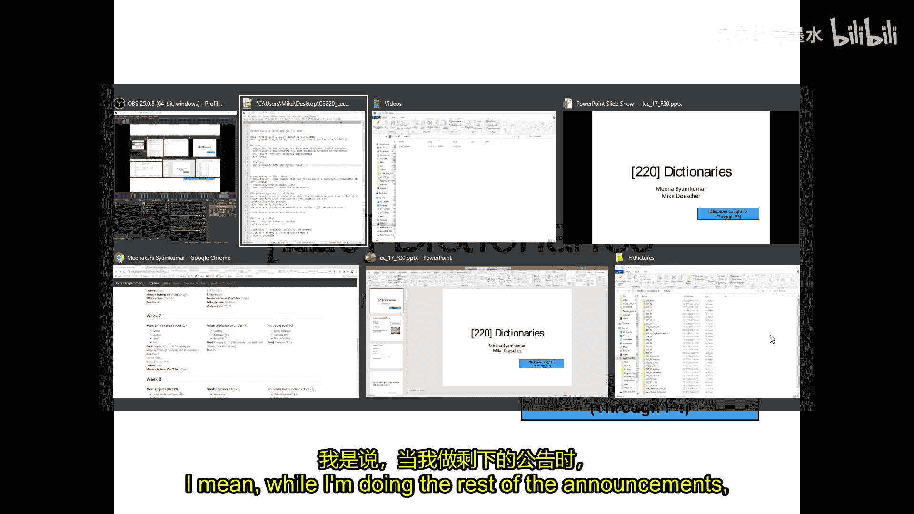
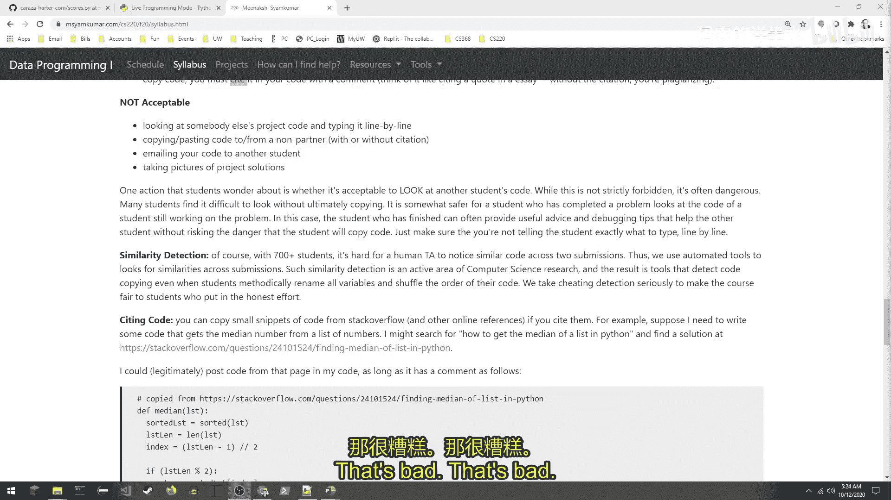
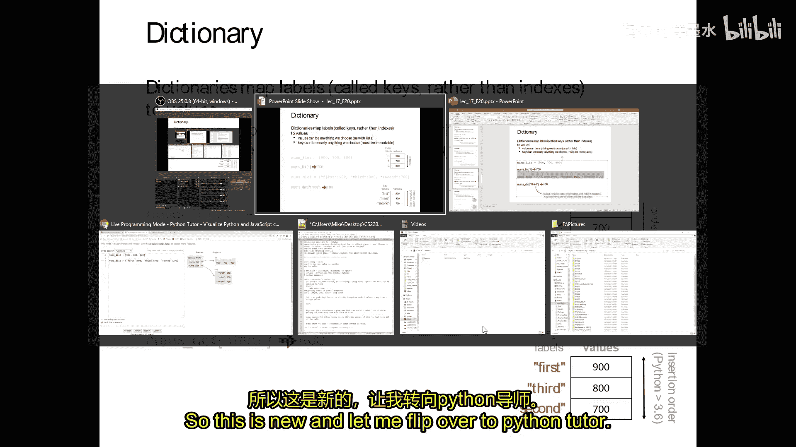
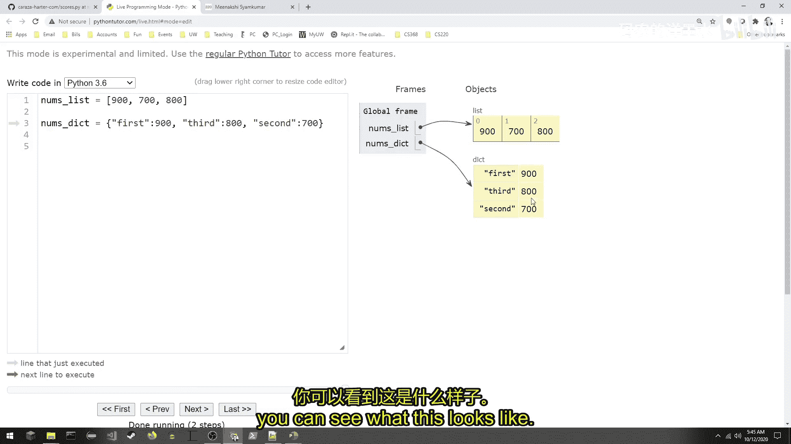
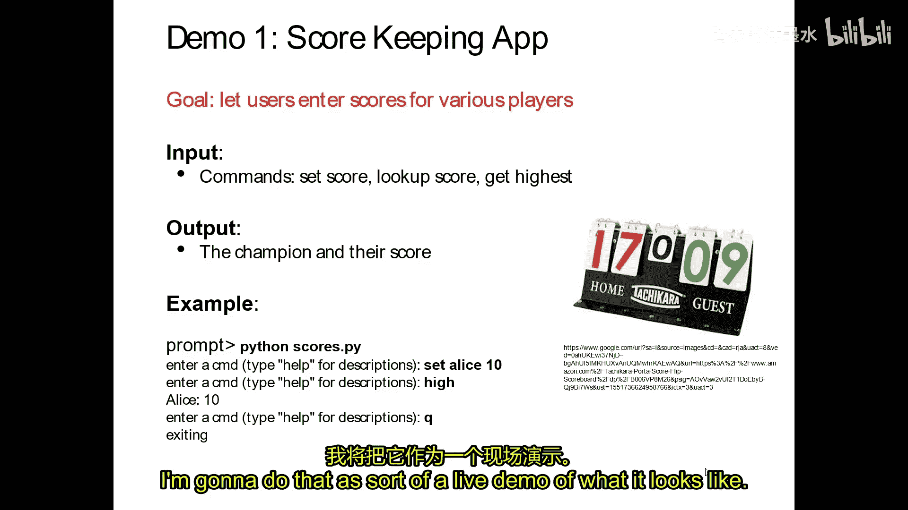
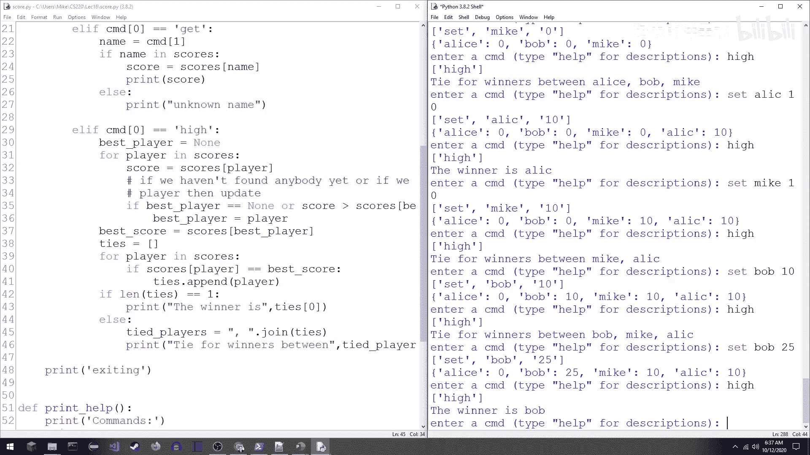

# 【全集】威斯康星大学-Python数据编程-CS220-中英字幕-1080P-p14-Lecture-12---字典--BV1VxvsBLEmv_p14-

All right， Good morning， everybody。 A couple of announcements as we get started。 First。

 I need to apologize for now letting you guys know right away that I was sick Thursday night。

 I didn't start。 I started not feeling good。 And I knew well before class started that I wasn't gonna make it。

 but I didn't send that email out until like 8，10。 And I know there were some people waiting for the live stream。

 I owe you guys apology。 And I'm sorry， I didn't get you the information soon enough。😔，Yeah。

 I ended up having a fever and I did go in， got tested for COVID， came back negative。

 I was thinking about the only place I've really gone recently has been the hospital and I guess it would have made sense because sick people go to the hospital。

 I could have been exposed there。Alright， anyway， I'm doing a lot better。

 And thank you guys for those of you who did write to me。

 I appreciate all the email I get wishing me well。 Alright， as we get started， a couple of things。

 I mean。😊，While I'm doing the rest of the announcements， let me see here， where is。

Google， okay， here we go。 So here's today。 we're looking at dictionaries 1。

 we're going to need a couple of things during lecture today。

 So if you want to pull up these things as we get started first， I'm going to be using Python tutor。

 I've got that available， and then I'm going to be looking at some code in iddle。No， no， no， no， no。

No， it's down。All right， I just need to click refresh a couple times and it came right back。 Okay。

 we're going to be looking at this file right here， scores dot pi。

 and this is the one we're going to be changing this into。

 So scores dot pi is some sample code that does not use a dictionary and we're going to go ahead and take this code and turn it into a version that's going to be a lot simpler and a lot more powerful that does take advantage of this new dictionary data structure that we're introducing today。

So as we get started， if you guys want to go ahead and download that while I'm doing introduction that would save you a little bit of time later。

 go ahead and do that。All right， the other thing I want to talk about I've got that cheaters caught so far during the first four projects we haven't caught anybody a lot of the code is so similar that you guys write I mean for Project one it was copied this pasted in copied this pasted in everybody turned in the exact same thing so obviously we didn't look for cheating there。

But with the P5， I've got a number of people that came up with similar software。

 It's we use the measure of software similarity， M O S S or Moss to detect cheating。

 And I just want to quick， Go back to the syllabus and review what is allowed and and what's cheating。

 So things that are acceptable。 You and your partner can do pretty much anything。 work together。

 You can share code。 You can write the code together。 You can talk about it。 All right。

 but you can also talk about code with anybody as long as youre。

Without looking at it or reading it aloud， you can share pseudocode or like strategies on diagrams with anybody you can point out online resources to your friends Piazza。

 Sta overflow a lot of what we do is it does have these specific patterns in it like finding the biggest item in a list you can do the worksheets with your friends。

Copying code examples from online that is not specific to your project like if you find some code that's good for finding the biggest item in a list and you copy that just go ahead and cite your code I'm going double click that right there。

 highlight it It's just like quoting somebody from an essay What's not okay is looking at someone else's code。

 typing it in， copying and pasting code from someone who's not your partner emailing your code sharing it with someone else taking pictures of the project and with this copying code online obviously if the project gets leaked and you find the entire answer set on Github or someone else。

 please don't turn in someone else's work， even if you cite it。All right。

 yeah we've got just over 800 students， so we use software to detect how similar things are and I've got a number of reports that I'm going to be working with this week。

 I will be contacting some people just if you've never been caught cheating before the first step at UW Madison is you are notified by me that your software is or your project is very similar to someone else's and you have the opportunity to explain in this course。

 a lot of times it's just， oh， my partner and I both turned it in and。We we work together if you。

 if you work with somebody， if you have a partner， then only one person turn it in。

 please otherwise you get flagged for cheating and I've got to like track you guys down and figure out why does your code look identical to another student。

嗯。But anyway， so that's the first step。And after that， if we decide that for most people。

 it's fine we figure out what really happened and make sure that in the future you guys don't like turn in。

 you know， put your partner's name on your project if there is an instance of academic dishonesty。

 you're pretty much automatically guilty and I turn you in。

 you get a zero and you have the right to appeal。So that's just how that works。All right， anyway。

 yeah， I believe last semester during the fall。No it's fault during the spring semester。

 we caught six people in this course。 we had only about half the number of students And over the summer when everything moved to online。

 the other class I was teaching had about 80 students and I actually caught another 8 students。

 I was like 10% of the class。 And I think there's a lot more incentive to feel like you can get away with cheating if there's not like a real classroom if you're just like everyone sitting at home。

 no one sees me doing it。 So be a little wary of that。

 the software tools that we use to catch cheating are the same。

 whether it's an in-person class or online and they're very good。 In fact。

 if you actually go look up moss， there's been some research done about how to get around it。

 you'll probably actually learn more trying to figure out how to cheat moss。 then you will actually。

Just doing the project assignment。But I'm not going to encourage that that's bad， that's bad。

 don't do that。

All right， next up dictionaries。Oh yeah， and I'm going to just list the number of people we catch 03 p4。

 Think of this as incentive to like not be called out。

 There was a study done of hand washing of nurses in England。

 a few years ago And what they found was that by reporting how well each of the different shifts did they put cameras by by the hand washing stations。

 you're supposed to wash your hands before you go into the patient's room and when you come out。

 and even when they were cameras， a lot of the nurses still did not wash their hands。

 this is precovid， this is a few years ago But as soon as they put up that scoreboard and kind of turned it into a competition。

 they found that hand washing compliance went from like 15% to 94% it was a huge dramatic change by just letting everybody know which shift did the best So that's what we're gonna to be doing right here。

 there's gonna to be a little scoreboard where if anybody cheats if we catch them。

 were going to start incrementing that number。Allright。

 so let's move on dictionary is a data structure built into Python it's going to be abbreviated dit D ICT And so what we're going to be doing today is just sort of going over a formal definition for a data structure talk about why we care about why would we ever want a data structure and we'll go into the specifics of dictionaries in Python and we're gonna to look at four things and pretty much only four things。

 how to create them and then they're the same kinds of things that we saw with lists。

 how do I update a variable， how do I index into it。

 how do I delete an item from that dictionary and we'll start with those and then we'll bring in more during dictionaries to on Wednesday。

And then we'll talk about。Basically， we have a choice。 Dictionaries are very powerful。

 Ls are very powerful。 One of them is almost certainly gonna be the better choice。

 So we'll talk about why we might choose one over the other。Okay。

 so the reason they're called dictionaries is that they are mapping a label to a value。

 And if you guys are familiar I。I'm just curious how old am I really， because I own a dictionary。

 It's over there on the shelf。 I keep with an arm reach。

 How many people have actually really used a paper dictionary， like a real book version。 Anyway。

 the idea here is there's words with their definitions。 and theyre mapped。

 So we have a particular word。 It is mapped to a definition。 in this book called the dictionary。

 In fact， this is opened up the Bager page。 I can see the Badger right here。 We've got a butterfly。

 There's a beetle。 I hope that shows up for you guys on the video。😊，But the idea here is。

It's this mapping structure。 So in a Python dictionary。

 we'll still be taking a label and we'll be mapping it to some sort of data value。

 And that's where that name comes from。All right， so data structures is now。啊。

So both lists and dictionaries are examples of data structures。

 so formally a data structure is just going to be a collection of data values and the relationships and the functions or operations that can be applied to the data right I know I'm not supposed to read the slides but this is a good definition so let's break this down a little bit better color coded when we talk about lists and I have a collection of data values a list is just I can put any kind of data in one I can put an integer I can put in floats I can put another list inside of a list。

Now a bunch of data values are varying types。Then as far as relationship goes in a list。

 they're all going to be ordered。 everybody gets their own index。 they've got。

 I can say that this item comes before that item because it's got a lower index that those indices。

 they started zero and they go up to however many items we have。

And then we've also talked about a bunch of operations that work on lists。

 we talked about indexing into a list， we talked about slicing， how to create them。

 how to append things to the end， how to iterate over them with for loops， what else do we got。

 sortinging length the pop to delete。Yeah， all of those kinds of things。We also talked about sets。

 another kind of data structure in P6， and what I want to have this like framework as you guys start going through。

 we'll have a number of other data structures that we talk about during the course。

 I'm going to keep bringing this table back。But if you kind of like organize your note taking or you're studying in this sort of fashion。

 it might be really useful because it puts all everything side by side easy to compare。

 So in the list， the values can be pretty much anything。

 the relationships between all the items in the list they're ordered with indices 01。

2 etc and a bunch of the operations we have I just listed those in a set the values I've got some question marks here they can be almost anything what makes this special if you guys are taking notes in writing a table like this is that they're unique I'm not allowed to have duplicate entries if I put the number two in a set。

 it's only in there once， I cannot put a second number two in。There's no ordering in a set。

 It's just a collection of unique items。 and some of the things that we were looking for in the set are the in operator you know。

 is the number two in the set or not it's going to return a true or false and equals are sets equal to one another。

 Alright so now as we go through the dictionarily， let me tell you a little bit more about it and you guys can fill in this table for yourselves。

So why do we need more data structures， Why do we need data structures at all？

 So here's the real reason We have lots and lots of data and we want to be able to access all of the data to manipulate it to look at it to do something with it without having to write more code this was kind of the reason for introducing iteration and loops we don't want to ever copy and paste something because if we need to change one little thing。

 we've got to change it everywhere that we copied and pasted it So loops are a way to go through all of the data many times whatever we need look at all of the items in a list for example。

 the same thing here for data structures if we have lots of different variables that can be painful if we have 10000 values。

 I don't want to have 10000 different variables and we may not even know how many values we have before our program runs So by using data structures as a way to organize the data and think about it with indexing or with a dictionary。

Seeing to save us a lot of pain as programmers and make it an enjoyable and fun to write code。

All right， so dictionary is a type of mapping。There are a lot of common data structures that we're going to use to store many values。

 and the idea is that I'll have a data structure and I want to go into that data structure and look something up or add something at a particular spot。

 And so we give each of those。Pieces of data in a data structure a label and we're going to use those labels to look things up so a list could be an example of something that's got a label In this case we're going to use many different values in my list and each of those is going to be indexed using a label as value in this case the labels are just going to be numbers so0123 they're going to be I guess implicitly attached to those we don't see them I never got to pick them Python does not give us a lot of control。

 they just their numbers， they start at zero and incr。Anyway。

 as I use those I'm just going to use the square brackets to access into my Ns data structure in this example and grab element 2。

 so 012 that'd be the number 400 so here I am using the label I'm mapping index2 in Ns data structure to this number right here 400 so that's the idea of a mapping I've got an index and it's going to correspond to some part of the data structure。

As I mentioned a moment ago， the labeling in a list is a largely inflexible Python has absolute control over how we want to or how it wants to come up with those labels。

 it's going to start at zero and they're going to be integers。Now， let me ask a question。

 What if we don't want to use integers as the labels， What if I want like the number is 0，10，20，30。

 but I don't need the ones in between or what if I want to use strings as labels。

 What if I want to have labels that are red， green。

 blue And so in order to facilitate that sort of labeling those goals。

 we're going to introduce data structure known as the dictionary。

All right I was rambling about this a little bit at the beginning。

 when I had the picture of the dictionary。 So there it is。

 this is a much better zoomed in view of an item in a dictionary。

 Here we have the key word sorry the word and in in a Python dictionary we're going to be referring to whatever we use as the label In this case it's the word in a dictionary。

 we're going to call that the key。 So the label in a list would be the index in a dictionary。

 it's going to be the key。 And then this is going to map to a value。 And in this case。

 in a dictionary， the value is going to be the definition of that word。 It is almost breakfast time。

 I'll be pausing momentarily to grab some food myself。

 So this seemed like an appropriate definition to use。Now， I do have a note here。

 Python dictionaries have insertion based ordering。

 What that means is that I add as I add items to a dictionary。

 Python is going to preserve that order。 And when I iterate through the dictionary or like with a for loop。

 they're going to come back in the same order that I put them into the data structure。

 This is going to be a little different from a like physical book dictionary because although those entries are going to be alphabetized and if Webster comes back and adds a new word later on。

 they're going to put it in alphabetical order， they're not going to put it at the end because it was added most recently。

We don't have to really worry about that because looking something up in a dictionary python will take care of that for us。

 So we don't need to like， worry about us being able to find it quickly。 Again。

 dictionaries are going to map the labels， the cult keys。To values All right。

 I'm going switch these order keys can be nearly anything we choose。

 The caveat is they must be immutable the only thing we've seen so far that's mutable is a list so the key may not be a list and we'll talk a little bit more about things that are mutable an immutable next time。

The values can be almost anything we choose。 They can be lists， they can be mutable。

 they could be immutable， they could be Boolean， strings， integers， floats。 So in this case。

A dictionary would let us actually use the label。If me I'm going spoke。

 This is actually the list example。 So here I've got a nubs list 900，700，800。

 and I'm indexing into that list with with the index， so position0 position 1， 700 is that position1。

 a dictionary is going to let us give 700。 a label other than just its numerical position。

 so I could do something like this。 I could say nus di。

And so this is how I'm going to be defining a dictionary。 And here my labels or my keys。

 So I've got first that's going to have the value 900 third。

 which is the third position here is going to have the value 800 to second position。

 We'll just give that the string second value 700。 They're the same values。

 I put them in a different order。 but they're the same values。

 And I'm using my user defined keys that I can go and use to lock them up。All right。

 a couple of notes， the dictionaries use the curly braces and lists will use square brackets。

 major difference。And that's really one of the big clues when I tell Python I'm defining a list versus when I'm defining a dictionary。

 So if you guys are taking notes， this is probably one of the things you probably want to jot down。

 And a little quick note， we use the curly braces as we learned in P 6 for both sets and dictionaries。

 I've got a slide that like separates those one moment。A few moments。Allright， so next thing。

 because I need to define more stuff， it's a little more complicated to write this。

 I need to tell Python what to use for all the labels or my keys。

 I'm going to separate the keys from the values using a colon。

 I don't need to do that here because the labels or indices are just automatically generated by Python for a list So not need to worry about that And if I'm confused if I'm trying to decide what am I doing here。

 the colon is a big clue that I'm created in a dictionary。All right。

And then to access things in a dictionary， I just need to we're going to use the same notation。

 so we'll be using square brackets for access， and then I just need to put in the name of my key and that's going to extract it's going to look through the dictionary。

 find the key second， we've got it bolded here in red and extract the value and return 700。

If I want to find a different value in my dictionary， I just need to put in a different key。

 so here I am looking up first， this is going to return 900。All right。

 with this slide I gray this out， what I want to do here is just reemphasize that when I create a list I'm giving it ordered labels and I want to show this in a second I'm going to flip over to Python tutor and show you guys what it looks like there and in a dictionary I have to the power to define what those labels are the keys and again in Python 3。

7 and 3。8 we're using 3。8 with this course dictionary ordering is based on insertion order in Python 3。

6 and below that was not guaranteed Python did whatever it needed to be most efficient about making sure that we can look things up this was not preserved they didn't even keep track of insertion order so this is new and let me flip over to Python tutor。

What we'll see here is that Python tutor is written in Python 3。6， so if we use Python Tutor。

 this ordering is not guaranteed。 It does so happen that for this particular example。

 when I have first， third and second， it is preserved that order first third and second that's not guaranteed in Python 3。

6 will not necessarily happen and again， just a quick way that Python tutor is going to show these different data structures in theumbs list it does give me the indices up here0。

1 and 2 and then the data values in the list for the dictionary。

 they're going to just represent this a little differently。

 I've got the keys on the left first third second and then the values 900，800700。On the right side。

 just you can see what this looks like。

All right at this point we've been using a lot of different parentheses。

 square brackets and curly braces， and they're starting to have more than more in meaning in a lot of these situations so what I want to do here is and in fact throughout the semester as we come up with even more uses of these symbols I'm going to keep adding to this slide。

 but thus far。I'm going just go through so we can keep track。

 we've used parentheses in at least two ways first for order of operations or precedeence to specify that I want the  one plus2 to happen before the multiplication。

 and then we've also used it for calling functions， so function invocation。Square brackets。

 we've used a number of places。 It's used to define a list。 so and。Used for indexing and slicing。

So we've seen this all with lists and if you guys are ever confused I see some square brackets。

 all I need to do is look to the left of the leftmost square bracket。 If this is a data structure。

 a list or a dictionary， then this is going to be some sort of indexing or lookup or slicing if I look to the left of the bracket here and there's nothing or an equals here I'm creating a list。

 so this is the major difference here， So four different kinds of square bracket uses。

And for curly braces， we've seen the curly braces used to create sets in P6 and we're now going to be using them to create dictionaries。

 The default version is actually I think that's the next slide yep。

 if I just use curly braces like an empty pair of curly braces。

You would think that could be a set or a dictionary in Python。

 the designers decided that just curly braces are going to be a dictionary and if I want to create an empty set。

 I need to do something a little special。Allright， I'm looking at this list。

 I feel like I'm missing something。 I feel like we've used brackets in more ways than this。

 So if you guys can think of something I've overlooked。

 put in the comments for me and I'll make sure I get it on the slide for the next time around。

 I App that， thanks。Alright， so creating empty list sets and dictionaries because the default use of the empty curly braces is going to be creating a dictionary。

 I need to create sets like this。 This is the only way to create an empty set it's just the word set It's a function so I'm going to follow that by parentheses that'll create an empty set they've provided that same option for dictionaries and lists I can just type diict and then add the parentheses or list with parentheses。

 those are functions that create empty lists， but I also have the empty curly brace and the empty square brackets as options also。

All right， now the major functions that we're going to talk about today are updating。

 deleting and inserting into a dictionary。Okay， so the slides are have a top half and a bottom half and they're not like real well sort separated with like a divider or something。

 but the top half is going to be a list example of an update the bottom half will be the dictionary example of an update So here's the idea if I have a list 010 and something that's not set to index into it。

 I just I'm going to use the list with the core brackets and an index。

 I can assign that a new value so now I've got 01020 and。There it is。 I have now updated the list。

 So it's pretty straightforward。 We've done that for about three lectures now， in a dictionary。

Here I have a dictionary with index a key0 with the value 0， a key 10。

 this is the integer followed by the string 10 and the key 20， followed by the entry not set。 Okay。

 so if I want to set something， I'm going to use the exact same structure of syntax for a dictionary lookup and assignment。

 So it's just going to use the square brackets， I'm going to give it the key that I have set right here。

And then the new value that I want for。 Okay， so dictionary updates very straightforward。

 very similar to what we've seen for lists。Deletion also very similar to what we've seen for lists。

 If I want to delete the 20。 I just need to use the pop command and give it the numerical index。

 and I could say 0，1，2。 or I could just use the -1 to get the last one from the list。

 This is going to return the 20。 I can store that in a variable。 and when I print out the list again。

 the 20 is gone， it's been removed from the list。Alright， same exact syntax。 again for dictionaries。

 We'll be using the pop command。 I just need to give it the key to go look up。 In this case。

 my key is 20， and it will remove that。 it's going to return the value。

 I can store that in a variable or I can use it directly。

 And then when I print out the dictionary again， I see that 20 is gone。 It isn't there。 It's missing。

Al right， so dictionary deletes and updates look just like they do for lists。

 Lo appar is very similar。Allright， insertion is where things are going to be a little different。

 Okay， so in a list， if I don't have an index available。 So in this case， I've got index 0 index 1。

 there is no index 2。 so I can't just say list index to equals something。

 This is gonna give me an error。 So instead what I need to do is use the append command。

 So list dot append， and then I can stick whatever value I want to add to the end of the list and Python will take care of that for me。

 for a dictionary insertion。 I don't need to do this。

 I can actually just go ahead and use the same access or look up and dictionary lookup and assign a value to it。

 So I initially have an a dictionary with keys 0 and 10 and values，0 and 10 and to add 20。 I just。

Use the square brackets just like I were indexing into the list or performing a dictionary lookup I give it the key that I want and assign a value and it goes ahead and takes care of adding that value so the dictionary doesn't have that same problem where I need to use aend I can just go ahead and access directly and Python will automatically create the new value and that quick reminder does not work with lists。

So here's the big idea of that coding demo that we'll be taking a look at。

 It's an app that's going keep track of scores。 So the goal is to let us enter scores for various players。

 I can say Alice gets 10 points。 Bob gets 20 points and then it can now return to me whos winning I can get the individual score for a player and it's going kind of look like but I'm gonna skip ahead I'm gonna to do that as sort of a live demo of what it looks like So next up I'm going pop back over to this is Github where that code is I'm just gonna copy and paste the code because it's short。

Straight into iddle。Alright， so here's the idea。 What I'd like to do is just take a look at the code really quickly。

 and then we'll just play with it by testing things out。

 So what I'm going to do is I'm going to start with all of the lines that are all the way over to the left。

I can see the first two are Allison Bob， I'm creating variables。

 these are going to be global variables to store the scores of those two players。

Then I have a main function。 This is another really common programming structure where I want to have all the really important code up at the top。

 but I might have some functions I'm going to be calling later that are not as important。

 I'm going to stick those at at the very bottom。 And my guess is that I'm going to be calling this main function at the very last line。

 That's a really common programming structure in Python。Alright， in fact， let me scroll down。 Yep。

 here's the function。 The print help commands。just print help so obviously this wasn't deemed to be very important。

 it's going to be just put at the end and then the very last line line 63 here print calls main。

Alright， so let's take a look at the next tab over and see what this is going to do。 Allright。

 so the main function is going to use variables。 Alice and Bob， they're going to keep them global。

 Awesome。 And then it has a wild true loop。 This is a pretty typical game loop where it's just going to continue going through this entire loop until we get to a break。

 My guess is that I always do that at the top that one of the very first things。

 We get some user input。 And then if the user wants to quit， we break。😊，Alright。

 that actually looks pretty good。 Also in the loop。

 we can see that it's reading some sort of command and those commands are help set get I'm looking at the ones that are sort of lined up with this level of tabbbing。

 So help set， get and high。Alright， so let's just go ahead from here and try this out。

 So the first thing I'm going to do， just like it says， I'm going to get help。 So。

 and here it tells me the syntax we're using all of the commands。 I can set things。And to do that。

 I'm gonna to just enter the name of one of my players when I've got angle brackets like that with a word in it that almost means almost always means that as a user。

 I want to put in the actual name of the player。 In this case。

 my choices are Alice and Bob and then I'm going to put in a number score。

 So the angle brackets are designed to be replaced with something。

 I can get the score and then I can print the high score。 So let's go ahead， let's set Alice。

 we'll give her a 10 points。Said Bob we'll give about 20 points。 We can get the score for Alice。

Alice has 10 points。 We can get the score for Bob，20 points。 And then we can Oh yeah。

 we can get the highest score。 So in this case， we should return Bob winning。

 He has the highest score。All right， so hopefully that's a good overview you guys can kind of see what's going on here。

Alright， but there is kind of one really big limitation。 What if I want to play。Setmic。

1 million the problem is。It doesn't know who I am。 It's going to give me this little error message。

 unknown name and not give me my million points。 So what we're going to do is we're going to go back。

 We're going to spend some time and upgrade this program so that anyone can play and。

And we don't know how many players there're going to be or what the names of the players are a dictionary is a really great choice。

Rather than having an individual variable like Allson Bob here on line 1 and two for the players。

 using a data structure that lets me index into things or do a dictionary lookup can be extremely valuable。

Alright， so as I get started， our first thing I'm going to do back over here in my execution。

 I'm going to push Q。I'm going push Q。And get out of this because every single time I update something over here on the left on my code。

 I'm going to save it and then I'm going to run it again and I need to start fresh。Okay。

 so as I start upgrading now， first thing， I'm going to get rid of Alice and Bob。 They are gone。

 I also don't need them to be global variables anymore。

 So I'm going to get rid of that line 3 right there。

And I need to add a new data structure to track all of the people playing the game。

 There's really no reason for this to be a global variable in this program。

 Everything can be taken care of in Maine。 So I'm going to go ahead and just。

Keep the data structure inside of the main function。 Allright， let's call it scores。

Because I'm going to be keeping track of scores for a number of players and we'll make it a dictionary。

There we go。 I now have an empty dictionary for scores。

 I'm going to go ahead and start this off with Alice and Bob。

And we'll give I zero points to begin with and。Bob。0 points。 I'm using strings for the names。

 I forgot to put Alice in quotes。 Let me get that fixed real quick。So there we go。 Now。

 I've seeed my data structure with two players。 So we'll have somewhere to get started as I'm like testing and debugging things。

 Allright， so the next part of this is my giant game loop， the wild true。

 So this is just going keep going through over and over until we hit that break statement。

And I should probably have spent a little more time on this command part right now。

 How does the user enter all of this。The instructions they want happen want to happen like the set Alice 10 that I typed over here。

 the set BobB 20 that's all taken care of in these two lines right here。

 First we're using input command， we're providing a prompt for the user so they know what to do and then the user types in their command。

Now， when they type in a valid command， here's the idea。

 we're gonna all of this is taken care of in one line。 I'm getting the command right here。

 and then I'm going to break this command into， well， let's take a look at this from left to right。

 I've got my string input by the user。 I'm going to call strip first。

 This is going to take all of the leading white space。 and all of the trailing whitespace。

 whatever it is。 and remove those。 It's just going to leave me with the string beginning with a real digit or a real character。

And ending with a real digital or a real character。 So it's gonna clean up the input。

The next thing I'm going to do is take the resulting string。

 It's still a string and turn it into a lowercase string that way if the user types set Alice。To。

And in capital letters， it's going to just ignore the fact that there's capital letters and make this case insensitive。

 And that's part of the reason that my scores up here。

 Alice and Bob are in lowercase because they won't actually be able to interact with。

The uppercase version， the user input will always be switched to lower case。

 so I needed to take care of that right there。Alright。

 so this is now remove the leading and trailing white space。 Make it all lowercase。

 And then we're going to call split。 Split is a string function。

 So all of this stuff here needs to be a string。 And what this split is going to do is it's going take all of the spaces and use them as delimiters and turn this string into a list。

 So， in fact， I'd like to do a little exploring right here。 What I'm going to do is print out。😊。

The command， after it's been modified with all of this stuff， and just see what it looks like。

So I'm going to go ahead，Save this。Run it again。Let me make this a little bigger again。There we go。

So I'm restarting。 I'm down here at the very bottom。 I'm going to set。Alice 10。

 And just see what it prints。So in this case， here we go， it's created a list。

The list has the string set in it， the string， Alice and the string 10。 So all of those things are。

What we have going on， we， we don't need to have all of those commands， we could in fact say。

Something like that and it's going to split this string。Based on。At every space。

 So ASDF will be the first thing or whatever that garbage is will be the second thing。

 and all the rest of this， the third string。Let's see。 I can also use capital letters。

And it's going to convert them to lowercase， So set。Alice 30， whoops。

 M S 20 turns it all back into lowercase。And finally， if I put a bunch of weeding white space in。

 there's some spaces， a tab set， Alice。25， followed by a whole bunch of more spaces。

 It's going to remove all of those extra spaces， and we just get set。Alice，25。All right。

 I'm going to push Q again。Close that up。 and I'm going to go back over here。 Let's see。

 what else do I want to change。Alright， if command0。 Al right， so this list if。

This if structure in my game loop， if， LF， LF， LF， LF。And that's the end。

 So I've got five choices here。 The major command is always going to be found in that first part of the list。

 So the first thing here was set。 First thing here was the Q。 First thing。 And this was the set。

 I had some gets up above。It's just going to take a look at whatever that string is in the very first position of the list。

 if it happens to be a queue， then I want to break。That one's fine。

 I don't need to make any changes right there if the command is help if that's the first thing in the list。

 still want to print out my help。 I'm not going to change how the program works from the point of view of the user。

 I still want that to work。All right， next， if the command is set， all right。

 this is where we're going to need to change some things because。This Alice and Bob。

 those are hard coated in here。So I'm going to need two pieces of information from that user entered command line。

 I need the name of the person whose score they're given me。

 that's always going to be found in position one of the list If they've done it correctly。

 So here is position 0， whoops。0 is set。 position 1 is the name of the the player。

 and then position 2 is the score。 So here， and now please remember that every time I use input。

 and then in this case， I'm splitting it， it's still going to be a string。

 although right up until this moment。 I'm going to use the int function to cast this string into an integer。

And that's what I'm going to store in score。 So the type of score is going to be an integer。

All right。So right here， this stuff， this is where I was hard codinging the variables， Alice and Bob。

 this much needs to go away， and I need to update that with my new score dictionary。

So what I'm going to have instead is score， and I'm going to be indexing or using a dictionary lookup here。

And I need to give it the name。As the key。And that's going to equal score。

So this should now change the name。Or change the score of that user。 So if I， if I type Alice。

 like I'm doing here in my example， name will be Alice。

 Alice is going to be the key that I'm looking up， and。The names are the keys， scores are the values。

And that'll be assigned the score。All right I'm actually done with this code right now。嗯。

So I'm just going to go ahead and delete it。And now let's go back。And test this out。 Alright。

 so I'm gonna save it， run it。 And I'm back over here at the bottom。

 So let's see your type of command。 I want to set。Alice， we'll give her 25 points。All right。

 looks like I made a tiny ty here。 Let me see what I did wrong。Oh， here it is。

That S score should be scores。Right there。Alright， control S。嗯嗯んん。嗯。And run again。We start set。

All right。 Well， it didn't crash， but I have no idea if it worked or not。 So let's go back。

 I'm right here in the set command。 I just set the score。

 I'm going to print out the entire dictionary scores。Let's see what that does now。

 So I'm going to go back over here。 We'll quit。Over here， we'll quit。Here we save。

 we run it again because I made a change in the code All right， let's set。Alice 25。Okay。

 now this line here is breaking out that command into the three pieces。 the set， Alice and 25。

 This line is printing out the dictionary。 So I can see that I have a character or a player Alice。

 with a score of 25。 I still have Bob， with a score of 0。

And now I can enter more command so I can say set Bob， give him 35。There we go。

 And now it's updated Bob's score to 35 and go back again Alice can earn some more points。Alice。

Pulls it had to 55。And that changes right there。All right， guys。The moment we've been waiting for。

What if we want to put Mike in the game。Weeping ahead to a million points。

Is this going to work or will it crash？ what do you guys think？Have I done enough work。

 Have I gotten this right so that I can add myself to the game and kick their butts。Allright。

 if you guess yes， you're correct， I've done enough work it that I can put myself in the game。

 So in this case， I'm calling set， Mike giving myself a million points。

 And I see it just adds me to the data structure right there。

 If you guys are following along at home and you wanted to like beat me。 Go ahead， add your own name。

 Patrick will be here。 Well， it's early right now， he's still sleeping。

 But Patrick will be down in a little bit。He will no doubt want 10 million points。啊。Os。

 forgot the keyword set。There we go， set Patrick。 And now he's been added to the list。 Allright。

 so the next thing I want to update is this， the get function that's built into the program。

 This is where I'm going say get Mike。 and it'll tell me what my score is。Alright。

 so that very important。 So this only takes two arguments。 I need the keyword get。

 and then I'm going to put in the name of a player。

 So I'm going to leave this part right here because I still want to get the name of the player。

 and that's going to be found in position one of my command list。CMD list。 Okay。

 and then this part is all gonna change。 I'm going to keep it here for reference right now。

 right now， if name was equal to Alice， it just prints out Alice。 If name was equal to Bob。

 it prints out Bob， otherwise unknown name。 So we'll come back to that in a second。

But here's the idea。 What I want to do is。Print。Print。And I'm going to look up scores。Of。Name。

let's break this down a little more。 So scores is my dictionary。 I'm going to index in。

 I'm going to get the name out。 And that's going to go up here if I've got a name like Alice。

 It's going to look up。 So this is a dictionary look up。 It's going to get her score。

 So it's going to grab that 0。 And then I'm kind of chaining things right here because I'm going to print this out。

In fact。If this is the first time you've seen this is probably。Would be better if I broke it down。

 Let me do it this way， instead。So I'm going to get the score。

For player 1 that's found in the data structure scores， the value I need to look up。

 So I'm going to use the square brackets to look something up。 The key is the name。

So I'm going to do something like this。 So this will give me the player score。

For that particular player， and then I can print it out。Yeah， I got a good feeling about this。

All right'm going to I want to keep this code here， there's nothing wrong with it。

But I don't want to actually run it to U and T。Coninue so this will jump back up to the next iteration through the loop。

All right， so let me go ahead，'ll save this。 We'll run it。Back over here， first set。Alice 25。

Now I can see the Alice is updated in the list now let's get。Alice。And see if I messed up。Dpe。

 there's the command。 get an Alice， and it returns 25。Bob should be in there， too。Get Bob。

 So he's in there by a default。 because when I created the list up here， I gave him a score of 0。

 What happens if I do something like this。Does it have enough information that it can go look up my score or is this going to crash。

 Let's find out。Okay， it's going to crash。 We can't actually look up something with a dictionary look up if it's not in the dictionary。

 So this is going to generate what's known as a key error。 This is a good thing。

 Crashing is always good。Are better than actually working and then not giving us the right answer。

 becauseuse I never did put in a score for Mike。 If we returned any number。

 that number would almost certainly be the wrong number。

 but it wouldn't crash and tell us there's a problem。 So this is good。 If I look at the trace back。

 this is a key air。And then it's got two things。 It's coming from line 60。

That was the main function call。 So I know what function I'm in。 and then line 23。

Is right here where I was using this function right here。 This is my key error。Al right。

 so reading trace back and idol is a little different from the Jupiter notebook version。

But still valuable。 Okay， so what I need to do instead is make this a little more versatile。

 a little rug， robust， rugged。So here's what I'm going to do。

 I'm going to get the name from the list。 and then I'm going to check and make sure that it's actually in the dictionary。

 So if。Ne。Pin。Scores， that's all I got to do here。 If it's actually there。

 then I'm going to print it out。So we'll get it in else。I want to print out。

 and I'm just going go down。 I'm going to print unknown names what I'm going to do And to do that。

 I just need to get rid of this much。There we go。And that should take care of that whole problem。

 so I'm going to try this again。Let's go back over here。Run this again。 So we'll set。And Is say 25。

 get。Alice， I didn't break that。We can still get Bob。 We can set Mike at。A million。Hundred000。

 that's， that's close enough。 We can get Mike。 This should now work。 It should return 100000。

But if we go out， try and get Patrick。This is going to， oh， it doesn't crash。 check that out。

 Instead it returns unknown name perfect。 it's not giving us a score。

 it's giving us useful information back and also not crashing。All right。

 The last part of this code is figuring out who is winnings。

 who's got the highest score at that moment。 Command was high。

 This is really straightforward with his only two players。 All I need to do is。

 is Alice bigger than Bob than Alice won。 If Bob is bigger than Alice， then Bob wins。 Otherwise。

 it's a tie。Now， if we have more players in that， using these two variables just isn't going to work。

 So what I want to do instead is actually iterate through all of the data and figure out what's the highest score。

 And that's going to be my winner。 Okay， so to do that。

 I can use a four loop that goes over data structure。

 And I've talked about how we have three different kinds of loops。 a number of times now。

 the while loop is the most versatile。 The range loop gives us numbers we can use as indices。

 And then there's the iterate over the data loop， which is just for And I'm going a question mark in。

Question mark。Just like that and we'll print out something。

Here's what I'm going do just because I don't know what's going on。

 and this is the first time I've ever introduced this。Let's face it editing a program like this。

 something that's quite complete， is' probably a terrible place to introduce this for loop idea I could have done better。

 but this is where I'm at and this was the plan。All right， so 4 x and my data structure。

Is just called scores。 I'm not sure what this is going to print。

 I'm just gonna give of a variable and we'll print it out and we'll see what happens。

 So I'm going to save this。I'm going to go back over here， we'll quit that other version。

We'll run this new one again。And now I'm just going to go ahead and print out high。

 I already built in Alice and Bob into my data structure so I can skip ahead。

 I don't need to give them scores。And what I see， this was the command I gave it。

 It's printed out Alice and Bob。 So as I use a four style loop like this。

 this thing right here is going to be the the names of the players。 And in a dictionary。

 those are known as keys。 So this is going to be for key in my data structure scores。

 It might be a little more useful the first time through learning this。

To think about them as players。 So for player and scores， it's going to go get the first player。

And then what I want to do is figure out what their score is。

 So the score of that player is going to be。Scores。Of Claire。Now， instead of just printing。

 I don't have an X anymore。Oopps。Print out clear， and we'll print out score。

 and we'll just try this again。Alright， so save。Run from the beginning， this time。We'll set Alice 25。

 and then we'll print high。 we can see that it is grabbing Alice first。 It grabs her score 25。

 Bob was set by default to 0。 Those are the only two players。 So this looks like it's working。

All right， so next up， I've got some code that goes through and looks at all of the players in the game。

 but it's not yet figuring out who's winning。So what I'd like to do is upgrade this a little bit and just keep track of who the best player is。

So this is a pretty common pattern that we'll see in programming。

 I'm just got a best player Now before I look at any of the data， I don't know who it is。

 I don't know who any of the players are。 if it were a list， I can just say， well。

 the best player so far。 you know whoever is an index0 and then we'll go through the list and figure it out。

 That's not a great way if the list is empty， there is no index 0。

 it will crash but it worked for a lot of lists。 So instead what we're going to do here because there isn't a good way to just go get what's the first thing in a dictionary。

We're going to set the best player to none because we haven't found one yet。 And remember。

 none is this sort of variable or data in in Python that just says this is the absence of data。

 I don't know what it is。 program a function that doesn't return anything technically returns this none type。

datata。Alright， so four player in。Scores get the score。 Now， rather than printing this out。

 what I want to do is say。If。We haven't。Found anybody。Yet， or if we found a better。Cllayer。

And update。me。Make this a little bigger。 So here's the goal。

 This is what I want to do in sort of plain English。Something like。Yeah， I'll put it in a comment。

 If we haven't found anybody yet， or if we found a better player， then we want to update it。

 So best player。Having trouble typing today。 We'll update this to player。

 which is the name of whoever we're looking at right now。 Alright。

 and I only want to do this if we haven't found anybody yet。 So that's going to be if。best。

Player is still equal to none。 So this is only the first time through loop。

 The moment I find anybody that are going to be my new best player。 who's first in the list。

 even if they have0 points。 So if best player is none。

 then I want to do update this to the new like basically get a best player。偶尔。

I want to do this if I found a better player。 So in this case， what I'm looking at is the。Mhm。

I want to get the score。Here score of my player。 If this is better than the score of the best player。

 and this is how I looked up scores of player。To get the scores of the best player。

I can do this very similar。Thing right there， if score is best player。 Then I want to update this。

 T that over， T that over。 So every time it updates， it'll tell me what's going on here。And now。

 remember that Python is one of those short circuitulated languages。

 So the moment it finds something true in an or statement。

 it doesn't need to execute the rest of this。 So there is no none。 I can't go scores of none。

 If best players none， this is going to crash， but it'll never reach there because I've already checked to see if it's none。

 And because this is an or。 As soon as I find that this condition is true。 it never does this。

And will instead jump down and grab the the new best player， whoever is first。Alright。

 let's go ahead and make sure that this looks like it's working。 So I'm going。Oh hold on。

 I'm going to save it， then I'm going to run it。Let's make this actually fit on the screen。 So let's。

We'll set Alice to one。 She's first in the list。 Sa Bob2， said Carl。To 4。 and then we'll set Dan2，2。

Now， if Ive got my dictionary like this， it's going to go through， it's going to check Alice。

 So'll become the new best player。 It'll print her out。

 Play score Bob will come along next and beat Alice。 So it'll print Bob and two。

 it'll do the same thing for Carl。 It'll print Carl and For。 but Dan is not better。

 It should not print Dan。So Alice Bob Carl does not print Dan。 All right。

 So that does look like it's working just as a quickie test。But that's not quite everything we need。

 I'm going to stop printing that out。 I'm going to tab back over。

 The next thing we need to do is actually print out who the winner is。 So at the point。

 I've gotten all the way through my loop。 I know the best player。 I can just print。The winner is。

Best。Player， alright， so I think that sounds good。 Let me save this， run it， and we'll set Alice。

To 25。Hi， the winner's Alice， I'm putting it twice one sec。All right。

 spottedpot what I was doing wrong。 Check this out。 Here's my for loop。

 All of this stuff is in the for loop。 So every time it goes through the loop。

 it was printing out who the best player was。 I'm just going to tap that back over。

 I don't want it in the loop。 So this should be everything I need now。 So let's try this again。

Make this fade a little better on the screen。 Okay， so set。Alice 25。Hi winner's El set Bob 35。Hi。

 Bob is winning。 Okay， said Mike。40。Hi， winner's Mike， S Alice。She should pull ahead if we do 55。Hi。

 winner is Alice， okay， set Bob 55。 remember Alice is 55。 we're upgrading Bob to 55。

 What happens here？Okay， winner is Alice set。Mic，55。Hi， winner is still Alice。

 So this loop structure that I was using。 it's pretty common to find the highest score。

 but if there's any ties， it's only going to find the first player。

 If I want with greater than or equal to， it's going to find the last player that tied for the best score。

So I've got， well， two really good options for common patterns to deal with ties。 Basically。

 what I want to do is produce a list of all the players who have the tying top score。 That's my goal。

 There's two good ways to do that。 The piece I've got right here。

 I can think of it like a like a twopa system。 find the best score。

 And then find all the players that have that best score。 and we'll put them in a list。😊。

The other option is to go through。And。As I find a new better score。

 I'm still going to keep a list of all the people that are tying for that score。

 But the moment I find a better score， I nuke the list and start from scratch。

And just keep adding people to the list。I think this one， the the first version makes a lot of sense。

 I've already， for the first time we're seeing this where we'll do two passes。

 I already have code that's going to find the best player。

I'm going to get rid of this print right here。 instead of printing out the best player。

 what we're going to do now is we know the best score。Is going to be。Scores of best。Player。

 so what I want to do from here is go through the list one more time， and。

Everybody who's tied for that score will add them to a list， so I need。

I'm just going to call it ties。 I don't know if there will be any。

 There will be at least one person with this best score。 If there's more than one。

 then they get added to this list called ties， and we'll print all those out at the end。Alright。

 so I hope that strategy makes sense。 Two passes。 The first time through。

 we're gonna get the one person who has the best score， one person who's tied。

 Then we know what the best score is so we can go through on the second time we'll go through。 Okay。

 we'll do for。All the players again， will go through the list one more time and everybody who's tied for that score gets added to this list。

 So if。All rightLet's see how to do this。Scores of player。

 So this is going to look at the current player。 if their score is equal to the best。Score。

 then we want to add them to the list。 So ties that append。And let's see what do we want to put in。

We want player。 We don't want their score。 We want player。Alright。

 so this should go through the list and let's them print out。Ts every time we go through this list。

And。We'll watch the players get added to the list just to make sure this is kind of working。Alright。

 so I'm going to save this， run it。Make this a little bigger。 Okay， so we'll set it。Al is 10。

And then， we'll。Run high。 as we can see here， what's printing out is the list from ties right here。

 That's the only print statement in this whole block。

 And so it found that Alice has the best score at 10。

 and then going through the list and adding her to the list of ties。 So not if we have set Bob at 10。

 and then we do high， it should print out Alice the first time through the list when she gets added。

 then the next player will be Bob。We find that Bob has the same best score and he gets appended to the list。

 so now we should have Alice and Bob both in the list。If。Said Bob。26。And then we do high again。

 there should only be Bob because he tiedqui he set Mike， 26， and then high should be two people。

 and it should give me Bob first。And then Bob and Mike。

 because it's going go through the first time it's going to find Bob Second time through。

 it's going find Mike。 So Bob is already there。 We get Bob and Mike。 Let me do one more， said Alice。

26。All right， perfect。 This looks like it's working too。 The first time through。

 it finds Alice puts her in the list。 Then it finds out that Bob's tied also adds him to the list at the end。

 We had Alice and Bob。Third time through， Alice， Bob and Mike， werere all there。

 And this is going through in this order。 So because I'm using Python 3。8。

 it's up here at the top thingsh that are maintained in insertion order。 So we've got Alice。

 Bob Mike。 It's going to check in that order every single time。 All right， Just to wrap up。

 I want to print out a little bit better message than just a list。

So what I'm going to do here is first， if there's only one winner， if there are no ties。

 and I can tell that because the length of my ties list。Will just be exactly equal to one。

 So if that's true， then I can print。哦。The winner is。

And then it'll be whoevers in ties in position 0。 And this is pretty safe to do。

 I know there is exactly one person in the list。 They must be at position 0。So this should work。

Let's go ahead and test this real quick， so save it， run it。Let's put it in exactly one winner。

So L is 10。Hi， the winner is Alice。Okay， now if there is a tie， that means the length will be longer。

 what I want to do is turn that list of people who tied into an actual string so I can print that out and。

Let's see here the print table it's going to look something like this。Print， let's go like this。

Timei for。Winners between。And then I want to know who's winning。お。I'll just call it tide players。

 So I need to fill that tide players in。Oh this needs to be an L too。Else。Tab that over。 T it over。

 Okay， T players。 Now I've got a list here called ties of all the players that have ties。

 What I want to do is take a list and turn it into a string。 Now。

 there's a string function called join。That lets me take a bunch of pieces in a list and merge them together into a string。

 It's a join。 ties。 Now it's a string method。 So I just started with an empty string。

 And what goes in this string is the delimiter。 In this case。

 I'm just going to make it comma separated comma space。

 That should look good when I'm printed it out。 Let me save this。

 run it and make sure I didn't screw up。😊，All right， so right now I've got Alice at zero and Bob at0。

 they are tying。 I've got two people exactly tied。So I'm just going to run it and see what happens。

Timey for winners between Alice， Bob。It looks like that's working。 What if we add set mic at 0。 Also。

 we're all starting out equal， It should。Tell me at the beginning of the game that I have a tie between Alice。

 Bob and Mike。 All right， excellent， Sa Alice 10， She pulls ahead。Oops， I mis typed Alice。

 Now we've got al Li。With 10， she's now winning。Said Mike 10。H， there should be two of us now。

 a tie between Mike and Elec， said Bob 10。Hi， yep， okay， Bob， Mike， Al， all tied。

 So this is looking good， too。 And let's just make sure set it。If he pulls ahead， he's got 25。

Yep winners Bob so all I'm gonna wrap this up now looks like this is working if you guys have any questions if you're watching in live stream。

 go ahead put them up in chat if you're watching this at home on YouTube go ahead take those questions。

 put them on Tazza or bring them to office hours We're glad to help and have a great day everybody。😊。

