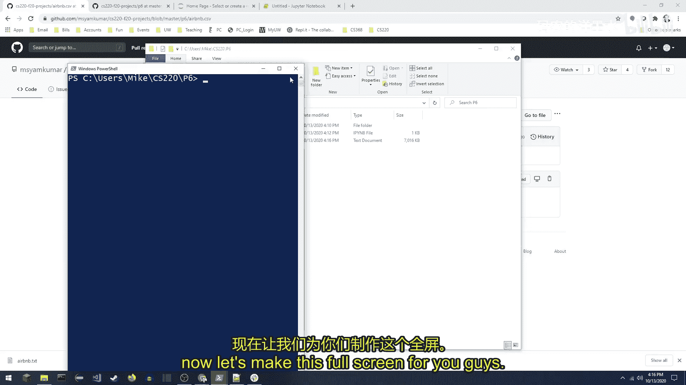
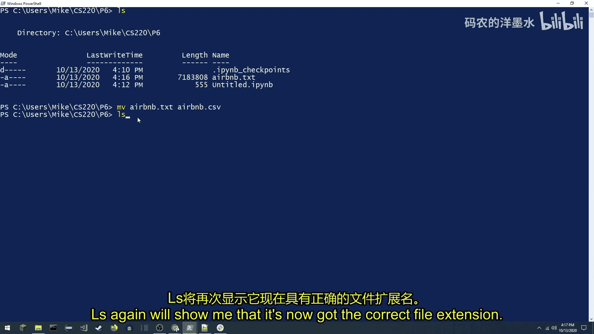
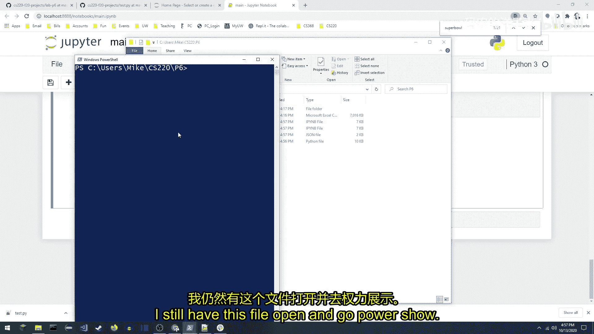
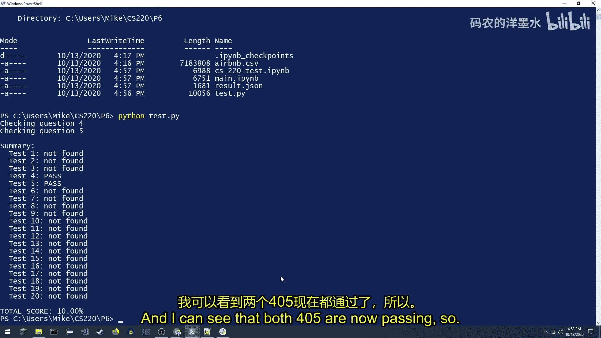
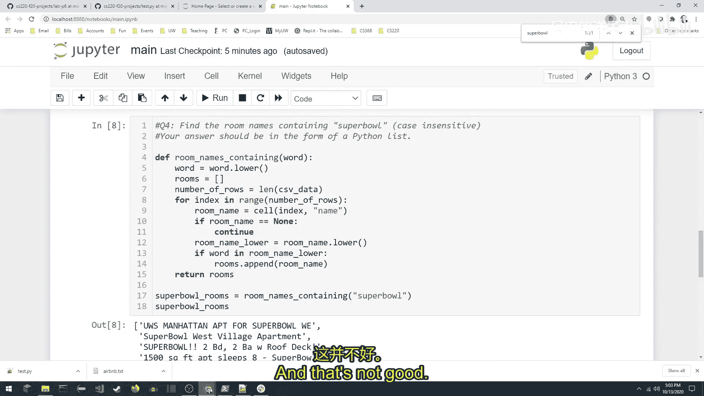

# 【全集】威斯康星大学-Python数据编程-CS220-中英字幕-1080P-p15-Project-2-策略指南--BV1VxvsBLEmv_p15-

Al right， guys。 welcomelcom to my strategy guide for Pro 4。

 The reason I'm making this is after meeting with a lot of students during office hours。

 I started to see some common trends in the kinds of problems you guys are having。

 So we're going to go over all of the steps leading up to problem 4 and then talking about strategy 4 actually approaching this kind of problem during the process。

 I will be reviewing some things and talking about different choices you have。

 So it's going to be valuable even if you've already finished the lab or at least do problem4。

All right。 so the first thing I'm going to do is download this Airbnb dot CSv file。

 Let me just right left click on that， open it up。 It's too big to view。

 But if I go over here and I right click on download。

I can see that I have the power to save the link as I'm going to do that。

That's going to bring up this menu right here。 I'm going to be saving this in my working directory。

 just under mic。Where's CS220？There it is CS220。 This is going to be lab P6。

 so I'm going to save it right here。Now check this out。 It's added this dot TX T extension， and the。

Prenhesy one。I'm just going to fix this right here。

I need this to be a CSV file and Github will automatically with Windows sometimes switch it to a text file because it recognizes that it's plain text。

 All right， you can switch it right there。 I'm going to leave it as dot Txt。

 if you've already downloaded the file， I'm going to show you how to fix that。

 So I'm going to put this right here。Save the file， it's downloaded， and it's already complete。Now。

 if I go over here， I can see that it's the dot Txt version because I have enabled file extensions。

 I'm not going to go over how to do that right now instead what I'm to do is I'm just going to open up Powerhell。

That's a shift right click。 If you're on Windows to easily get to the open Power Sha window again。

 shift right click。 open this up。 and now。

Lets make this full screen for you， guys， L S will show me that I've actually got the dot T X T version to fix this。

 I can just move。Or maybe not TXT to。Airbnb。csv。Alas again will show me that it's now got the correct file extension。

Alright， so I switch back over to the lab P6 description。

 The next thing we need to do is actually import this CSv file into Jupyter notebook so we can read the data。

 So I've got a Jupyter notebook already opened in my working directory。

 and I'm just going copy and paste this text right here into my Jupyter notebook。 Okay。

 so I've got an untitled one just opened up。Let's get this name to main so we can save it。

I'm going to get some cells。 this is the cell where I put my name。This is going to be my imports。

And then this cell is going to be where I put in that CSV function。

 I'm going to move imports up to my import cell。There we go， now I've got this process CSV file。

Note that this function is already going to call the process CSV file right here for me in line 10。

It's going to split it up into a header， CSV header。 And that's just going to get。Row zero。

 so the CSV file， when you open it up and read it， the header has all of the information about the different columns。

And then the CSV data is going to be all of the data。 So it's going to start at row 1。

 skip the header row and give me absolutely everything。 Okay。

 so let me just restart and run all that'll run all of these cells。All right， very good。

 Next thing I want to do。在。Add a cell below。 Well get us two cells。

 is's just print out what the CV header looks like。And we'll run this cell。Okay。

 so now I can see the list of all of the headings。 I'm going to come back and print this out many times throughout the lab because I have trouble remembering exactly what we named things。

Like the room ID， I can't remember if it's name I， or room ID name。

 I can't remember if it's room or name， I get confused。All right。

 the next thing I want to do is just take a look at what this data looks like。Now。

 the CSB data has something。 let's take a look at this。

The length of the CSB data is actually like 49，000 entries I don't want to print that much out。

So I'm going to print。CSV data。 and I'm just going to take a slice of this。 I'm going to get rows 0。

2，5。 and we'll print that much out。So here we go。 This is just looking at this。

 I can see a couple things already。 This very first bracket tells me I'm looking at a list。

Theres the closing bracket and the matches with that one。

 And then in each of these entries in the list， I can see that they are in themselves lists。

 So this first one goes all the way over here to that closing bracket。

 And I'm just printing out index 0，1，2，3， and 4。 So there's five entries here。

I can see that all of these things are currently strings， Even the numbers， the dates。

 they're all strings， floating point numbers。All strings。

 So the next thing in the lab is that cell function。 So I'm going to switch back and bring that up。

So the lab goes through a bunch of things， asks you to try some stuff out。 has some question marks。

 try and figure out what to do。 I'm assuming that you've already gone through and figured all of those things out。

 The next thing we actually need for project or project 6， a question 4， though。

 I this cell function。 This is going make everything during the lab so much easier to do。

 and for the most part， most of the people who have come to office hours thus far。

 they had trouble with this， their cell function has had a problem。

 And they either decided not to use it， which makes things a lot more work。

 or they were getting mistakes because of this。 So this is the number two most common problem。

 So I'm going to go ahead and just。Copy the wrong thing。All rightI'm going to get a copy of this。

 I'm going to put this in here。 and now we need to go ahead and finish this cell project。

So here's how this is going to work。 Ce is going to take a row index from the data。

 That's CSV data and a column name。 There is going to be a string。

 It's going to be one of these items from the CSV header， like maybe the name。

So what I want to do then is get the column index。From this one。 So if I put in name。

 this is index 0。 This is index 1。 internally， it's going to take care of this indexing for me。

 So the column index is just going to be。I'm going to use the index function that's going to grab which index an entry is in a list。

 So this is a list function。 The lab talked about that。So hopefully you've gone through that。

 This is just going to be the column name。Now， the value， I'm looking up a value in my data。

 So in this case， I'm getting something from CSV data。 It is a lists list of lists。

So what I need to know is which list I'm getting things from。 And that's going to be the row index。

And the column index I've just figured out right there。

 So it's grab one string from this piece of data。Giant table of data。

 So it's going to be the row index right here。Row Ix。All right， perfect。

Let's go ahead and test this real quick。 So I'm going to just run sell。 And let's see。

 let's grab the name of something。How about let's make sure we print out this one right here just to see how this works。

So cell takes two things。 It takes a row index that should be row 0 of my data。

 and it takes the name of a column。And I already forgot is this called， it's called name。

 I'm going to just copy that。And paste it right here。 I can use double quotes， or single quotes。

When I run this cell， it's going to print out that entry that I was going for right there。 Allright。

 so it looks like this is working so far。 The tricky part， what most people leave out is they。

 they take out either take out this value equals empty string。

 I want to return none or they don't copy it with from the beginning。Alright。

 so the next thing I want to do is convert the types based on the column name。

 I'm going to go ahead and do one of these just to demonstrate how this works。So if， in this case。

 column name。Equals， and I'm using the exactly equals with the double equals。

Let's go ahead and do the price column。So me should focus back over here。

 If column name equals price， then I want to change the result into。An integer。

 I believe there are integers， I don't think they're floating point numbers。嗯。

Let me double check that timer。Yep， they're all integers。

 So what I want to do instead is just return。I'm going to use type casting here。

 and that's just the function int。And I'm going to give it。Val， as my。Would I want to return？

All right， I will let you guys go ahead and do the rest of these things that are numbers to turn something into a floating point number。

 The command is just float。 Everything here is already a string。

 so we don't need to go and convert anything to a string。 The only ones we'll need to do are int。

And I'll let you guys take care of the rest of those。Finally。

 the last thing that I've seen a problem with is people don't put in the return vow。

 They'll just stop short of that。 And if you run this code without the return vow on anything that's not like。

Got its own type casting to change it into an int。 is just going to return none。

 So if I leave this out， it's going to return none。And that's a problem for a lot of other people。

 so double check and make sure you've got everything here that you need。Alright。

 so now I'm going to jump back over to the actual project and talk about questioning for。

So I'm going to scroll down question one， what neighborhood groups， if you can do question4。

 the strategies here will apply to the rest of these so you can rewind if you've gotten stuck on number one and just see what kind of loops we might want to talk about using。

But here's the idea。 question4 is the one that gets a ton of questions。

 so I'm just going to copy the question。And put it in my notebook in the next cell。There we go。

 Now it's already got the Q4 in there and it reminds me what question I'm working on so I can go ahead and answer that right here。

Allright， so the first thing I see， I'm going to be finding room names containing the text Super Bowl。

 And it says caseing sensitiveitive。 We'll fix that later。

 First thing I want to do is just go through。 I need to find to start with all of the room names。

 So as I look at this， I'm going to do a couple things to just sort of demo how I would approach this problem。

 to see all of the room names。I I'm going to need a loop。

 I'm going need to go through all of the rooms。 Now， in this course。

 we will have exactly three kinds of loops。 And let me just write a little bit about each one of them right here。

 Theres the data for loop。 This is going to be the simplest one。 This is just gonna to be four data。

In。And then I'll have a data structure。And then I'm going to do stuff。Alright。

 this is what they all look like。 We've seen a bunch of versions of this。 We have C in a string。

 will get me all of the characters one at a time in a string。 We're working with CSV data。

 If we do this， we'll have a row in the CSV， what do we call it data data。CSV data。

 that's going to get us one row at a time。 If we， let me just demo this。 If we want to print out row。

And I'm not going to do the entire data structure。 There's 49000 of them。

 I'm going to just slice this。 And this is extremely valuable for testing because I only want like a couple of rows。

 So let me just run this cell。 And I see it's now printing out a couple of rows。

 Let me make this even simpler。 Let's just do row 0 to 1。 That should include 0， but not include one。

 It should just be one row。 just row 0。 There we go。 So it looks like this is getting an entire row。

 which is a list。Well'll see the set also works with dictionaries。

 we can get iterate through dictionaries， so we'll have basically for a data item in a data structure This is my data for loop It doesn't have a real name that's me making up data for loop Okay。

 the next who sops。Im to do that。All right， I'm going to leave that here for a moment。

 The next kind of loop is a little more versatile。 This is going to be for the index in a range。

Index in。And for this course， for this project， I want to be looking at all of the rows in my data table。

 So I need the length of the CSV table， so。I'll just put that over maybe right here。

Number of items is equal to the length of CSV。Data。Let me make this with some underscores。

 so it's actually a variable。So if that's how many things we have in the list is length of CSP data。

Once I run this cell， I can use a number of items。 Let's do it rows。 number of rows。

 I'm trying to be as clear as possible with my labels for my like strategy guide。All right。

 and then we'll just。Print row again。nope， that's not a whole road。 We're going to print the index。

And then we'll print the CSV data。At that index。Just a demo that this is working。 And again。

 hold on a second。 I'm not going to actually do all 49000 rows for my demo。I'm going do。

Let's do two rows。And run this。Forgot the colon。There we go。 So now it's printing out the index。And。

The row。So this first one， let me just comment this out。There we go， index zero。Printing out the row。

 here's the entire row。 index 2， Dar 1。Forgivenive print out World one。Alright。

 and if I wanted to go through all of the data， I would put in。Number of rows。 If I run this。

 it's going to give me a giant list with 49000 things。Python' is really powerful。

 it can totally handle it， but it's a lot of data to look at。Alright， so this is the idea。

 this is the。The version of a loop that we will almost always use。 And we're going to use， I believe。

 exclusively for this assignment， there might be a couple places where we can get away with this version。

 But for the most part， we're going to need the index of the rows because we're going to want to be moving from one column to another and getting data up。

That were things that are connected within the same row of data， the same Airbnb。Alright。

 since this is a strategy guide， I just want to highlight one more thing too。

 I'm using the word index here。 I want to be very clear up here。

 I was using row to describe what I'm getting out。 It was giving me an entire row。

 It giving me a list here， I'm using index to remind myself that this is gonna be a number and starts at0。

 goes 1，2 all the way up to Har manyy There are。 I'm a big fan of just using I to shorten this up。

 So it's less typing。 I've also seen I D for index I X。

 This is what we actually used up here in or was it。😊，In the cell function。

 we use I X to indicate that this is an index。 We use name when we're giving a string。

 So I'm just trying to be really clear with my variable names。嗯。I'm going to leave it as index。

For right now because I don't want to change it everywhere。All right。

 And then I just want to be complete and remind you guys that we also have a while based for loop。

 a while based iterative structure。 while。 And this is just going to take some sort of condition。

 while index。Is less than the length of here， I'm going to use a number of rows。

Because I already have that。And comment that So this actually runs。

 This is gonna this is the most versatile。 I have the most control。

 but I also have to do three things that are kind of special that I don't have to do for these other loops。

 First， I'm in charge of my index or my my loop control variable。

 So I need to start out an index equals 0。 So I give it a starting value。Tpotypo。

I'm in charge of incrementing it。Index plus equals 1。 I got to remember that。 And then as I use it。

 I'm going to need it to actually extract the row itself。 So row equals。CSV data of。Index。

 so I'm in charge of getting all this information out。

 whereas these two lines and that line are all taken care of for me。 If I use the range loop。

 So this is an option， this one works for absolutely everything， it's the most versatile。

 but requires like three extra lines of typing that I have to remember， and if I leave them out。

 Like if I leave this one out， end up with an infinite loop。 If I leave this one out it crashes。

 and I'm responsible for actually extracting the data that I care about。All right guys。

 I'm not actually going to be posting this Jupiter notebook。 This is the strategy guide。

 and I feel like you will learn a lot by actually going through and doing this process yourself。

 typing things in， getting error messages and trying to figure out what they mean。

I'm going to use this second for loop， the range based for loop to go through everything。

 And now the next thing I really need to do we're actually finding room names。

 so I'm going to go ahead and get a room name。And as I go through。

 I'm going to get all of the room names one at a time。 The room name is going to be。

 I'm going to use my cell function to grab the room name。And I want cell from。 And if you remember。

 cell takes a row index and a column name。So the row index。Is just my index that I named right here。

 It's right there。 and the column name is。I already forget， let me scroll up to my header。Name。

 that's the one I want right there。 I'm going to copy and paste it right there。

And then we'll go ahead and we'll just print out。 I'm going to print out the index and the name。

Which I have stored in room name。 All right， I'm going to do one room or little thing while I'm doing my testing。

 I'm going to change the number of rows to just five。And we' comment out the rest of that。

 That's two characters that I need to type to change it back and make this work again。

 So it's giving me a much shorter list of names。 And I can just see that it's working。

 I'm now getting actual room names from my data table。All right。

 Common problem number 3 that I've seen during office hours。 I's take a look at this cell function。

 It's going to grab a value from the data table。 just one， given a row index and a column name。

 which we convert to an index。 So then this part right here。

 if the valve is equal to the empty string。 this cell function is going to return none。

 And in every case， we're going to want to skip， everything where something comes back none。

 So heads up， guys， every time I use cell， there's a chance that it could return none and room name is going to equal none。

 So what I want to do is just put a condition in right here and skip those rows。 So if room name。

 exactly equals none， that means there was no data there。

I'm going to continue And in pretty much every question。

 I'm going to have a group of lines that use a cell and then skips things where it's none。All right。

 you're going to need that in every case。All right。

 the next challenge we're going to run to is I want to just find the room names that contain Super Bowl。

All right， so in fact， I think string functions give a lot of you guys trouble。

 the kinds of questions I get during like the live streaming of my lecture。

During the Alice Bob scorekeing game， we're almost entirely focused on using the strings to get the user input command。

 So I think if you're still struggling with that， there's we did a lecture on strings of a few lectures back。

 go review that one。 If you watch my lecture， give Mena's a try。

 She does things a little differently。 They might click。 if you watch Mena's lecture。

 give mine a try。 Yeah， again， we， we do have different styles。 we were using the same slides。

 It's the same content。But just the delivery might be just enough that it jog something。 All right。

 So the idea here is that I've got all these names clean and quiet apartment home by the park。

 What I want to know is if it contains a certain string， in this case， Super Bowl。 So if。

And what I want is Super Bowl。So that's a text string is found in room。Name。

Then let's go ahead and print it out here。All right， let me just test this and see。

 it's only looking at the first five lines。 This should print nothing。 None of those things have。

Super Bowl。 And again， it gets me nothing。 A number of them now have the word park。

 I'm just going to test that。 I don't want to look at the entire data set。

 I just want to see it that it works。 And again， I've got park here， Park here。 perfectect。

 It does look like it's working with Park。So I'm going to put back Super Bowl。 I'm going to go back。

 Let's test the entire data structure now。 So I'm going to change a number of rows。

 So it's not just5 anymore。Deelete， delete， delete， but I'm using the entire data set。Al right。

 So it looks like Super Bowl by itself is not found in room name in any of these。

 It's probably not lower case。 And that's the next thing。 Ca insensitive。

 So what I want to do now is go and make sure that my room name。Is actually lowercase。

 I'm going to just go ahead and redo room name is equal to room name。 And now room name is a string。

 so I can use my string functions。The one of which was lower。

 so I'm going to go ahead and just call that function right here。Change room name to lower。

 And now it's going to find all of the room names。 It's made them all lowercase。

That have the word Super Bowl in them。All right， so it turns out that what I want。

 Let me go back to my project description。Is not actually to print them。

 My answer should be in the form of a Python list。 I'm just going to copy that over here to remind myself that I want a list。

 so。When I'm putting things into a list， a great way to start out is。To just create an empty list。

I don't have a really good idea for name。 Let's go with Super Bowl rooms。

And that's going to equal the empty list to get started。Alright， now， instead of printing these out。

 what I want to do is add them to the Super Bowl list of Super Bowl rooms so。

Super Bowl rooms dot and add whoops typo。To put something in a list at the end of it。

 I need to append it。So the function there is aend。

 I've got a couple of options for adding things to a list。

 If I wanted to add several items from my list all at once， I would use extend for want to update。

 I would use indexing。 But here I just want to add things。 in what I want。

 I'm gonna go ahead and add room name。This is almost going to be what we want。

I don't need to print this out anymore， but instead what I'm going to do is after I'm all done with my loop。

I'm going to print out Super Bowl rooms。 So when I run this。

 it's giving me all the rooms that have the word Super Bowl。 A couple things I want to fix。 First。

 I'm printing out the lowercase version of this。 Not exactly what I want。 So here in line 10。

 I'm making them lowercase。I'm just going to room name， lowercase， and in room name。Lower。

 so now I'm not changing room name。 I'm just storing a new copy。Let me make sure that works。 Yep。

 I have the lowercase name in a new variable。 So it does the test with the lowercase name。

 but I'm now pending。The version with all the capital letters。 So if you look at the answer key。

 you'll be able to see that they are the capital letter versions of the room names。All right。

 couple more details because the way our greater works。 it's looking。

 So Jupyter notebook actually has three zones here。

 We're seeing the code zone right here in the shadowed gray。

 There's an output zone for text that's printed。Let me run this again。

 and then for the very last variable。Let me actually remove those extra lines。

 It's going to have this special out zone where there's an outbox number 23。

 where it's printing the contents of whatever variable is their last。 that's what our greater checks。

 So you absolutely must have the variable just listed on a line by itself so that we know what to check。

Allright， this is perfectly acceptable。 It totally works for question 4。

 I want to go back and just talk about the strategy。 First。

 I know that I needed to iterate over all possible rows to test for the name。

 and I chose the range based for loop for that so that it gave me a value for the index。嗯。

Then I went through， my strategy included printing something out every time I changed something。

One line at a time。 I added one line。 I didn't write the entire code。 I only wrote one line。

 and then I printed something， Then I add one more line， and I printed something。

 So that's a great strategy for developing code for debugging。

 If you guys have gone ahead and you have like a whole bunch of code here already。

 and it's not working。 There's another strategy that I recommend。 it's called scaffolding。

 It's like building a ladder of print statements where every other line is a print statement。

 So like if I wanted to， I would print out。Super Bowl。With a typo。Super Bowl rooms right here。

 And then when I run this， I should be able to see that I'm getting an empty list。

If I wanted to remind myself what I'm printing。I can just add。Super Bowl rooms for the common there。

 And now it's going to tell me that。This is the variable Super Bowl rooms。

 and it happens to be an empty list。 So every other line。

 So here I'm going to print the number of rows in this line。 Then I've got my loop。

 Maybe I print out the index right here。 After this 1。

 I print out the room name And just make sure that everything that I do is printing what I think it should。

 Al right， I'm going to remove my scaffolding as soon as I get everything working。And this is great。

 It does work。 So those are a couple of strategies you guys can use to debug your code when things start to go wrong。

Next up。Right here， I can see that question five is very similar。

 so this was find room names containing Super Bowl。This is find room names containing dream room。

 It's almost like the people who wrote this， copied and pasted。 So here's what I want to do。

 I'm going to go back。 I want to use this code again， to solve the next problem。

So I'm going to go ahead and put this in a function that way if I find that I made a mistake somewhere like this is a really common one。

 if I accidentally left that out， I only need to make the change once because all of these questions4。

 five and6 can all be answered by calling a function and when I find mistakes I only need to change them one place。

 I don't need to remember to go back and change question5 and6。

So let me talk about how I'm going to package this up into a function。Allright， so first up。

 I don't actually need to print this out。 I'm actually getting the value right here from Super Bowl rooms。

 but I'm going to define a function。To find and， now I'm gonna use this for。Room names。

 room names containing， room names containing。 I'm just gonna steal this text right here。

 Room names containing。 And that's what I'm gonna to name my function。

 I'm just not feeling very creative today。Maybe you guys can come up with something better。

Room names containing。 And then there we go。 Now it's a function。

 I need to tab every single one of these lines over so that they're inside the function。And then。

 so right now， this doesn't return anything。 So it'll be returning type none。

 What I want to do at the end， though， is return。And what do I call it Super Bowl？Super bold rooms。

 Now， if I run this。Let me grab a copy of the function。Super Bowl rooms equals。

 I'm going to call my function right now。 I should see that。

The variable super Bowl rooms after I run this is this stuff right here。

 Let me just make sure I didn't make any mistakes。Okay， still looking good。

 Still got the word Super Bowl。 Now， I want to make this a little more general。

 I don't want to just look for Super Bowl。 I also need to find dream room and free Wi Fi。

 So that's going to mean that I need a parameter。In this case。

I need to name that parameter or something。嗯。All right， I'm going to go with word。

Because I'm feeling not very creative， but it's going to be a descriptive word about the room that I'm going to search my text for。

 And in this case， my word is going to be super Bowl。All right， first thing I'm going to do。

 I put it in lowercase right here， but the user may not。And because I'm using Super Bowl here。

 lowercase， I'm just going to real quick word dot lower。To change that right away。

 to make sure I don't forget later。 Alright， Now everywhere that I've used the word Super Bowl。

 I've hard coded that into my code。 I'm just going to replace it with the search term right here。

 word。And the only place I use super Bowl is right there。Alright， so this function should still work。

 Now。 I've made one little change， and I'm going to test it。Excellent， still giving me。

All of the names that have Super Bowl in them。 So it looks like it's still working。

Let me just read this real quick。 And is this enough。 So I've named my Super bowl， my my list。

 Super Bowl rooms is if it's a little more general if I'm looking for other things。

 that is probably not the best name for my room list。 So I'm going to rename this。

 let's just call it rooms。I don't believe I've used that variable name anywhere else。

So where is that Super Bowl rooms right there， Just rooms， Super Bowl rooms， just rooms。 Do I have。

Super Bowl anywhere in here， no looks like I've found all the places I need to change it。

So if I run this again， I still get the list of Super Bowl rooms。All right。

 right now I'm kind of feeling like this is enough。So I'm going to test it with。Dream room。

And see if I get the same thing。 So I'm just going to go down to the next cell。I'm going to call my。

Room names containing。Function。With。Dream room。This is going to be Q， I don't know25。

 I probably really want to copy and paste this just to remind myself。What I'm doing that way。

 when you come to office hours for help， it's right there waiting for me to remind myself。

Like the T A。Which room we're working on And Super Bowl rooms is probably not the best variable for this。

 Let's get that updated to just rooms。And then I'll call my function， let's see if this works。呃。

I need to print it out。Al right， I don't even know if that's the right answer。

 So I'm going to go back to。The test stop high and see if I'm getting these right。 one cycle。

 I pulled that up。 Alright， so when I run test stop high， I need to make sure that I've named it。

 main。 Council， I want to make sure that I do kernel restart run all。

I'm going to go to file and save and checkpoint just to make sure that everything's up to date。 Now。

 I'm going to need a brand new Powerhell window。 So I'm going to shift right click on that folder。

 I still have this file open。And go Power showll。And I'll just make sure I went ahead and downloaded test up。

There is test do Pi。To make sure I've got the latest version。

And then I'm going to just Python test that pi。 This runs pretty quickly because I've only done two of the problems。

And I can see that both four and five are now passing。

I hope you guys found this useful。 I would actually love to hear that this is something you find valuable。

 It's a great review。 If any of these things you guys were struggling with。 They know。

 what kind of loop do I use， That's number one。 If you're still struggling with。

 how do I decide what kind of loop to use， How do I write a loop that's going to give me an index。

 You need to go back and study this one。😊，That very first lecture。

 we put up a slide with some Swiss cheese on it。 We put up a picture with a ladder with a broken rung。

 This is that moment。 If there's a broken rung in your ladder stuff you've learned。

 If you don't have loops down， you're going to struggle for the rest of the semester。

The people are coming to office hours and getting help I having trouble with these so if it's making me worried that we haven't done enough in person。

 you know that's a lot easier to see when I'm making videos I really can't tell whether people get this or not or what do I need to say one more time so I'm hoping that a video like this this is one of those things that I can see that I need to say one more time。

The other thing that I'm seeing from students is the string functions。 You know， I've got a string。

 but I need to change it。 I don't know how I don't even know if it's a string function or not。

 A lot of the things that we're going to see in the next couple of lectures and the next couple of projects。

 and even later in this project I believe I don't remember for sure。

 but we're going need to be able to switch between strings and lists。And， you know。

 lists and dictionaries， we're going to need to be able to convert between these different types of data。

 So if you have any doubt about how these string functions work。

 go back and review that a few minutes spent today day reviewing string functions will actually meant getting this project done faster then trying to get to the point where you don't know how to use a string。

And then having to go learn it again。1 minute study spent studying now today day is probably worth five minutes studying three weeks from today the night before our exam。

 It's Tuesday right now， our exam is 22 days from now。 And if you just do one minute a day extra。

 one minute to make sure that you've got this stuff down or all right。

 maybe it's 10 minutes is going save you oodles of time。In the future， spent cramming。 Now。

 personally， my strategy on getting through school， you got to do three things。First。

 you've got to study every day。 You got to watch the videos。

 You got to make sure you know what's going on。 You got to attend lecture。 You do the worksheets。

 That's an everyday kind of thing。 That is the most valuable kind of learning because you're getting a small piece at a time。

 The more the information spends time in your brain， the better you'll learn it。Number2， cramming。

 the night before the exam is valuable。 You want to make sure you get enough sleep。

 But if you've missed anything during this that like couple of weeks before the exam。

 that's your last chance to go learn it。 Do it。 Spend us some time cramming。

Make sure you do have enough time to get some sleep， also very valuable。

 I survived most of college with cramming。 It's not recommended the first strategy you do it every day is better。

 and finally。For this class， you can learn it during the exam。 if yet if that what happens。

 if you learn something during the exam， that's awesome。 I'm still excited for you。The problem is。

 you only get two hours。 So coming back and trying to figure out， while I don't remember strings。

 you do not have time to go watch the video。 I don't know which loop to use here。

 You do not have time。 Those are things you need to figure out now， like to day， ahead of time。

 not the night before the exam， not during the exam。All right， as I wrap up。

 I'm not planning to do more strategy style videos like this。

 I'm going to come back with bonus videos when I see the need for them。

 they probably won't be focused on like actual project problems。嗯。

But I would like to know if you guys find this stuff valuable。 if you watch my video。

 if you benefited from it， go ahead and give this one a thumbs up。

 I don't think I've ever asked you guys to give a thumbs up on a video before。

 Don't ask you to subscribe。 I'm never gonna monetize my channel。 I don't give a。Dons bad wordmic。

 I don't care about that。But in this case， I would like some feedback to know this if you found this valuable that way。

 as I look for future， you know， things to add more like a review type content on I can help you guys out。

And one final little thing。If you made it all the way this far。

If your function looks exactly like mine。You probably want to put a citation in there。

 if you used my text exactly。 if you learned something and you change some of your code based on what you saw here。

 go ahead and put in a citation。 Here's an example of a citation says copied from this is going to say HtTP S Col YouTube。

 whatever the video link is if you watch this video and are copying something。

Hopefully you watched all the way to this part。 so you're remind of that otherwise I'm an accuse you of copying my work without citing it and that's not good。

 All right， Anyway， hopefully that's not a problem for anyone。 Have a great day。

