# 【全集】威斯康星大学-Python数据编程-CS220-中英字幕-1080P-p16-Lecture-13---嵌套字典--BV1VxvsBLEmv_p16-

All right， guys， welcome back to data programming1 Today。

 we're going to be taking a look at our second lecture on dictionaries。

 particularly focusing on kind of a complicated topic of putting these data structures inside of one another。

 putting a list inside of a dictionary or making a list of dictionaries。 but as we get started。

 I want to do something a little different with this lecture。 I've got a little bit different style。

 So go here actually let me show exactly where it is to go get the code that we're going to follow along with today。

I hope you guys like it。 I spent some time talking to people during office hours this past week and after lecture and kind of realized that I was getting away from my goal of making this class as interactive as possible。

 I feel like sitting back watching a YouTube video is probably one of the worst ways to learn something。

 But if you can actually do it， if you're forced to write， you're can have a much better experience。

 Oh， yeah。 So one of the results of those conversations that I had with students was。😊。

Strategy guide right up here。 It's on CSB tableables day when we released lab P6 and Project P6。

 I made a strategy guide that approaches question for。

 That's the one where we're trying to find all the rooms that have the word Super Bowl in them and just make a list of it。

 I think this problem in particular really goes over a lot of skills that reviews things we've been learning all the way back over lists and strings and just some like inative strategies for loops。

 So if you've been struggling with any of those。 Def go check that out。

 It kind of walks you through how you'd make a particular choice。 how you debug kinds of problems。

 I hope it's useful。 if you guys enjoy that kind of video I'm not planning to do it again。

 But I'm curious if that was useful and maybe how I can bring in that kind of idea in my future lectures to make things better。

 So if you have any comments if this is good， put them in the YouTube comment section。

 things that I can draw from if you just straight up blanket it give it。😊，Thumbs up。

 how don' actually you ask you guys to do that， you know， hit the subscribe button。

 I really don't care。 I'm not going to monetize my channel ever。

But that's one place where if that's useful to you。 I would like the feedback。 So let me know。

 I'm gonna use that like thumbs up button a little differently。 Okay， for today。

 the code you're going to want to follow along with is right here under lecture code。

 the slides right up there。 But this is what we want code。Alright。

 and this is the one you want for my lecture。 If you're listening to me right now。

 you want the templates for Mike's lecture， if we click on that。

 we can see there's it's a Jupyter notebook。 So just go over here。

 right click on raw and save link as that'll bring it down。

 go ahead and just get that open in Jupiter notebook right now while I'm rambling on about getting started and it's going to change a little bit as I add to it。

 In fact， I already added some color to this。 So it's gonna to look a little bit different when I'm all done with this。

 rather than this preview。 you'll have the like completed template。

 So I haven't finished writing it yet。Allright， so I pulled up the real notebook so I can interact with it as we go through。

 And the first thing I want you guys this， this first cell here， you can completely ignore that。

 That's so I could do stuff like had color。 It's going use the full width of the screen so that as I'm recording for YouTube。

 It's as big as possible。 And you guys can see as much as possible。

 I lift that in there so you guys can copy and paste it and use the same thing as you're writing your own code。

All right， But where I want to start is with this question。

 If you could choose only one data structure for Python， either lists or dictionaries。

 Which one would you want to add， Which one is more powerful， which one's more flexible。

 Which ones easier to use。 Why would you pick one over the other。

 I understand that we've only had one day with dictionaries。 So they're probably relatively new。

 and that we've been using lists throughout this whole last project。

 And you guys are likely more familiar with them at this point。 But so here's what I want you to do。

 Pause the video， go in here and just make a list of some characteristics of lists that you like。

 and then make some list of some characteristics are just stuff you remember from last lecture about dictionaries。

 And then I'm going to pause the video during the live stream give you guys a chance to actually pull this up。

 Fi this out。😊，And if you were just watching the video。

 just go ahead push pause right here and just go and do this activity。All right。

 so as I was thinking about this， just some things。

 some characteristics of lists that I really enjoy。Here， actually， I'm going to type some stuff。

 I'm going to pause the video， and then I'm just going to talk about it that way。

 I't have to type and talk。 That's a little awkward。 Give me one sec。All right， so I'm back。

 some of the things that I enjoy about working with lists， definitely indexing。 It's easy。

 All I need to do is use some square brackets and give it the index I want to grab the data。

 I can update it。 Slicing is super powerful。 It's gonna to get me a sublist or just pieces of a list that I can work with。

😊，Oh on， look at this green text。 So this is thinks it's actually Python code right now。

 out appear at the top。 it's listed as code。 The blue bar over here means it's in command mode right now。

 So and to switch back and forth， I just click on the text green is edit。 blue as command mode。

 If I just push M。 that'll change this to markdown mode。

 And that's gonna just treat this as text that I want to look a certain way。

 That's how I've got the text here with the red in it。

 you guys can switch it back to code and see the actual markdown code a lot like Hm。

 but little easier。 Okay， so now the color going。 It's not highlighting keywords from Python。

 And we just talk about it like I'm taking notes。😊，Allright， little aside。 Hope that was useful。

 But yeah， so I can iterate over data with for loops with data style for loop。

 It's easy to convert between strings and lists and lists to string using the join and split operations。

 There we go。 Now it looks the way I want。 So I love it。 It looks awesome， doesn't it。😊，Alright。

 anyway， so I can convert strings to list with join and split。 If you don't remember how to do that。

 it's needed for the blot of the lab， go back and watch the end of the string video。 And finally。

 why I love lists。 C S V files are just going to be lists of lists。

 We're going to use a ton of those throughout the semester。😊，Alright。

 so some characteristics of dictionaries。 Give me one second when we type this up so I don't have to type and talk at the same time。

Alright， so just a couple of the favorite， my favorite things about dictionaries。 Numb one。

 I get to pick my own indices。 I can name things anything I want。

 And a lot of times choosing the keys in a dictionary。

 the key value pairs can be very useful to help me keep track of what's what in labeling things。

 So I don't have to like use numbers to find things in data。

 It's really easy to add data to a dictionary。 I just need to use new brackets。😊。

Give it a new key and say what it's equal to。 I don't need to worry about an special appent method。

 And I can still iterate through things just like I can with lists。All right。

 now here is a little secret。Anything I can do with a list。

 I can do with a dictionary and anything I can do with a dictionary。 I can do with a list。

 So let me just go ahead and give you some examples。 I'm going to start with dictionary。

 So I'm going here on the in command mode。 I'm going to push B to get a new cell below this one。

 Click here and now I can edit it。 So， for example， if I have a dictionary like。D is equal to。

 I'm gonna to use the curly braces to create a dictionary。

 I've just got something simple look x is 3， and I've got another value。 Y is。9， there we go。

 So now I have a dictionary。I'm going to run this and print out Dfors so there we go。

 there's the dictionary。Now， if I wanted to。I'm going to go back to command。 I'll get a new cell。

 If I wanted to， I can do this exact same thing using lists。 All right。

 so some of the things I need to be able to do， I need to be able to index into it。

 If I wanted to index into a dictionary and get the value for X。

 I just need to do something like this and look up that value。 That's going return 3。 Allright。

 So I need to be able to have that kind of functionality。 So instead， I'm going to have two lists。

 I'm going to have L 1。I don't want to call it that。 I want something more descriptive。

 I'm going to call it keys。 And this is just going to be a list of X and y。Alright。

 and then I'm going to have another list called values。

 I want it to be the same length of vows equals。 And then I'm going to have。3。And 9。

 a little little spacing。 So it looks the same。There we go。 I love it。 Okay。

 now all I need to remember is that my key and value are at the same position in my list。

 So the X X is 3 in the dictionary has， is that position 0 in my list of keys and my list of vows。

 I can find the data。 So with this， I can do pretty much anything with list that I could do with dictionary。

😊，So even slicing， I that's a lot of work for a dictionary。

 I would need to use a loop and go through every single piece of data and decide。

 does it belong in my slice or not。 Soting is also really easy with a list。

 There's just a sort command to create a sorted data with a list。 that's a little more challenging。

 So but everything is possible。 I just would need a multiple loops in that case。Allright。

 it may be a little easier to think about going from a。List to a dictionary。 So in this case here。

 I've got a list。 It's just going to have the numbers。Oh， A B and C are not numbers， A， B， and C。

I it's not a list unless I use the square brackets， I'm getting ahead of myself。squarequare brackets。

Square。 Allright， there we go。 Now， just print this out。 Let's take a look。

 I've got a list with three letters in it， A， B， and C。 All right perfect。 Now。

 if I want to do a dictionary version of this same thing， I'm going to call this。Letter diict equals。

 And then I'm just going to do curly braces to make sure it's a dictionary。Now。

 when I have indices in a list， they're provided by Python。 I've got index 0。

 index 1 index 2 for A B and C。 I'm going to go ahead and use those exact same indices to duplicate that。

So I've got at index 0， I'm going have the letter A at index 1。 I'm going to have the letter B。

 and then at index 2。 I'm gonna have the letter C。 So here I've just completely duplicated exactly what I get with the list。

 in a dictionary， it's going to be a little more difficult to do things like slicing again that are easy to do with the list。

 But with a loop， I can go through all of these indices finds the ones that belong in the slice and do everything I can with either data structure。

 Now， I think the takeaway message here is that some things are really easy to do with the list and they're hard to do with the dictionary。

 But some things are really easy to do with a dictionary that are really hard to do with the list。

 So what we want to do is look at our data and look at the goal of the problem。

 What are we trying to solve and choose the appropriate data structure。

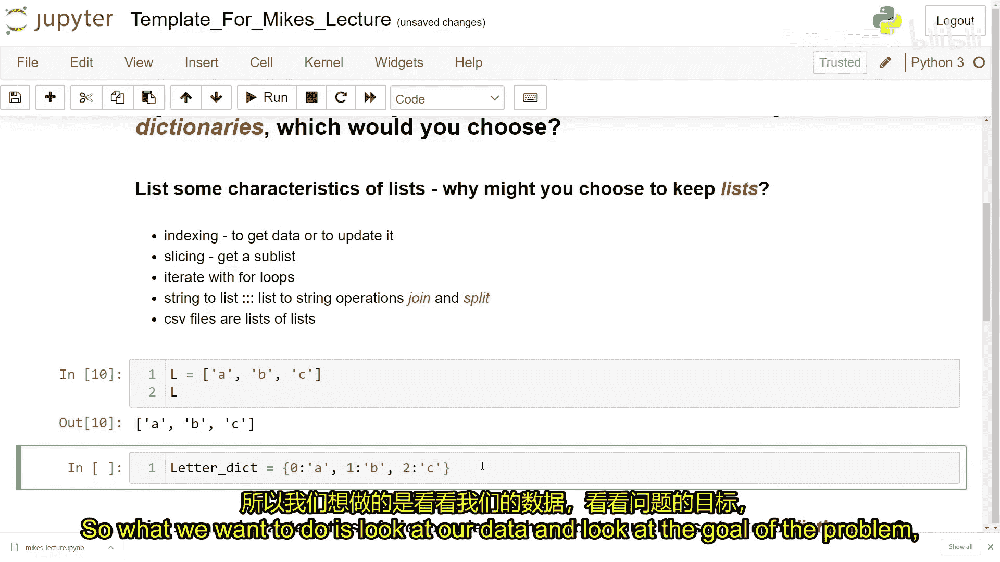

Alright， so I jumped back over to PowerPoint， and I just want to sort of go over some of the things that I'm going to be talking about today。

 First， we're going to go over some more dictionary operations。

 We really only got to the first really big three， how to create a dictionary， how to index into it。

And extract data。And how to remove data from a dictionary。

 So we're going to be looking at length and in for loops。 Also two new functions。

 keys and values and default values for get and P。Then the real core of today's lecture。

 we're going to introduce these nested data structures more about that when we get there and then common use cases。

 including bucketing or also known as bidding， which is a major component of our next lab。

 I just went and looked it up It's going to be P8 where we talk about this stuff but it's going to be going to be introduce today。

Alright， so some questions came up during my office hours that I think I just wanted to quick go over how do we create dictionaries。

 creating a nonac empty dictionary with data in it pretty straightforward。

 I'm going to use the curly braces that I need keys， whatever they are。 In this case。

 I'm using a as a key colon and then the value。 So these are all key value pairs。

 And I just make a list of them with commas。If I want an empty dictionary or an empty list or an empty set for a dictionary。

 I can just give it the empty braces。 This is going default to a dictionary technique number one。

 or I can use the the command dit。 This is known as a constructor。

 We're not can use that word lo during the semester。 fancy programming lingo。

 but diict as a function just returns an empty dictionary。

 And we'll see the same thing for list and set。 They also have constructors。

 which are just the name of the data structure followed by parentheses that makes them a function。

 It's a special kind of function that constructs an empty list that we can then add things to。😊，Okay。

 so next up， three more functions we're going to add to our list of things we can do with with dictionaries。

 First length in and for。 Alright， I've got slides here that I'm going to go through what I want you guys to do。

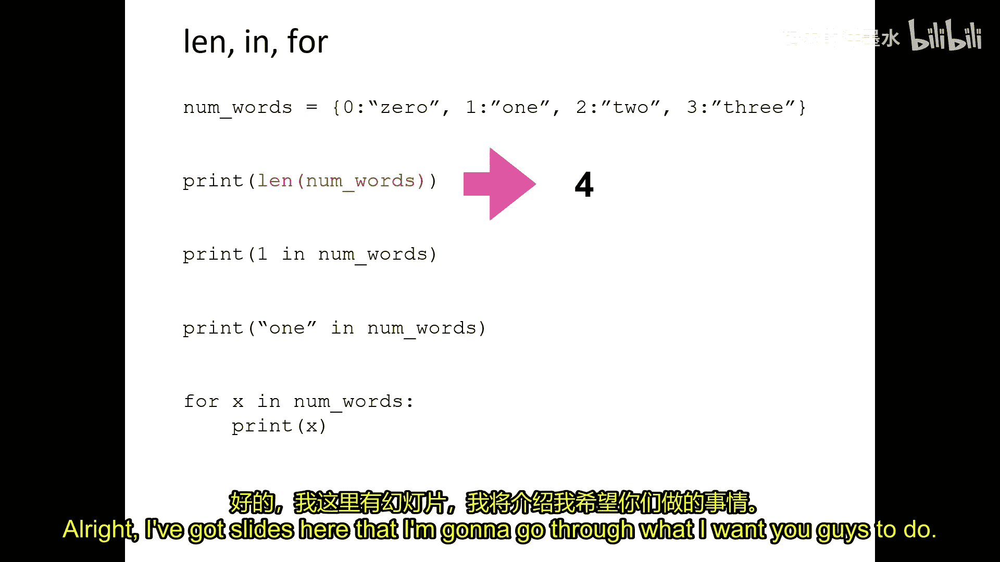

Is jump back over here。 I've already got that numb words data structure。 This is a dictionary。

 already coded in。 I just ran this cell。 I'm going to switch back to command mode with an escape。

 I'm going to type B。F times to give myself four cells。

 because we're about to do four demonstrations。 I'm going to go use the slides。

 I'd like you guys to type these things in and try and mo yourself that way。

 you've got everything all in one place， Some notes。

 and you've got the experience of doing it on your own。 If you need to， you can pause the video。

 but I think you'll be able to keep up。 All let me jump back to PowerPoint。

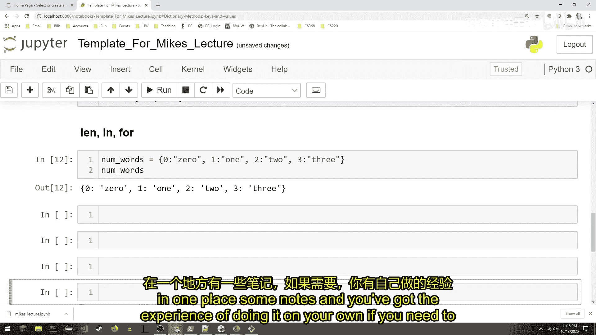

Allright， The first thing I'm going to do when I'm naming dictionaries。

 I almost always use underscores and have two things。 They're key value pairs。

 So what I'm pairing here is a number short to nu 0，1，2， and 3。 with a word for that number。

 in this case，0，1，2， and 3 written out with letters。 In fact。

 a lot of times when I write dictionaries， I'll actually include the word 2。

 I'll write nu 2 words to just remind myself that it's mapping something。

 And I would encourage you guys to follow that same pattern also。All right， next up， length。

 when we use length or Le Elen on a list， it's just going to give us the number of items in the list。

 Sam thing with a dictionary。 I can use a number words here， give it as a argument。

 the length function。 and it's going to tell me there are four things，1，2，3，4。 or yeah。

 four items in my dictionary。 Go ahead， try this out and Jupyter notebook and make sure that you actually get four for that list。

Allright， the next item is in。 So in is just going to test to see if something is in the list of keys。

For a dictionary。 So the designers of Python had a choice here。

 they could either use in to represent。 I it one of the keys or is it one of the values。 Now。

 with a dictionary， it is incredibly easy to go from knowing the key to getting the value。

 all I need to do is put it in square brackets。 It's really difficult to go from a value to figure out which key it matches to。

 So what they've decided to do is say that this in is testing for keys。 So if I do。Yep。

 one in numb words， one is one of the keys。 So this will evaluate to true。 If I do the string。

 the text string 1， it's one of the values， but it's not one of the keys。

 So this should return false。 So go ahead and give both of those a try。

Remember that Python is going to be checking keys， not values。

 and the designers chose that because it's easy to go the other way。All right， and finally。

 just like we can iterate through。The list， this is my。

 so I've got three different kinds of iterations I'm going to be doing。

 I've got the for loop that iterates over a data structure。 a data for loop。 That's not a real word。

 I don't know what else to call it， but I really like that。 We've got the range for loop。

 That's going to iterate over the range of numbers。

 That's a great way to get indices for going for working with lists。😊。

Dictionaries don't have that same indexing。 So this is really a great choice for working with dictionaries。

 And the last one is the while loop， which is really versatile。 Go ahead and give this a try。

 when you'll see that So x is a variable here。 that gets assigned value as it goes through。

 So when I do an iteration over nu words。 the first thing it's going do is find this key 0 and grab it and store that in x。

 let me see what is it print out， it's going to print out four things。 There's four items。

 The first thing it's going grab is the0。 And it's choosing to get the0 instead of the0，0 pair。

 because it's really easy to go back and grab the text to 0。 Once I know the key。 So in this case。

 it's going to iterate over them。 because these guys have been inserted in this order。

 So 0 was inserted first then one then two then 3， that's the orders are going come back out in Python3。

7 and 3。8。 We're using3。😊，8 now。 so insertion order is maintained in earlier versions of Python。

 they would do things to maximize the speed that they could retrieve data from the dictionary。

 And that means the order was kind of messed up。 It was optimized for a particular type of hash table lookup。

So， but they've upgraded that a little bit so that the order is maintained in the newest version。

 heads up Python Tutor is 3。6。 So you may see different behavior in Python tutor than you'll see in Jupyter notebook。

 Part of the reason I'm using Jupyter notebook for all my demos today。

 So I hope you guys go ahead and try this out in。Jupyter Note， you just made four cells。

 I'm not going to go ahead and type those in because I've got the slide here。Oh yeah， right， right。

 to get the values out from the keys， it's just a matter of typing the name of the dictionary and using those square brackets to look up the value。

 incrediblyed easy dictionaries do this very quickly。All right。

 the next thing I'm going to do is extract keys and values。

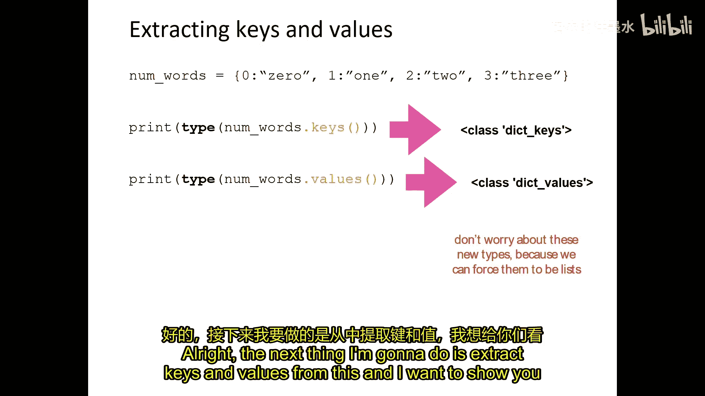

From this， and I want to show you what this looks like。Allright， this isn't that much typing。

 I've got the dictionary from my previous example up there。 No words。

 there's two methods that go along with dictionaries， keys and values。

So if I just type nuwords dot keys and hit enter， what it's going to do is it's going to return this special data object called dictionary keys。

Which。Has the keys in it to make this actually useful， though， something。A listist。

We need to put this into a list so we're going to convert this dictionary keys data type into a list just like this and now I've got a list that contains only the keys。

 so there's basically two steps here， the keys method gives me a special data object back another type of data structure and I can easily convert that into a list and now I can use all of my list functions on it。

Same thing with no words。Do values。 So this is a function that operates on a dictionary。

 It's called values。 If I run this cell， it gives me addict values data type up。 In fact， oh。

 let me tellmo this。 Every time we have a new structure of some kind， we can run type on it。

And that will give me di values if I print this out。Like the slide actually had us doing。

 It's going to tell me it's a class。 Allright， now what I really want is to put these in a list。

So I'm just going to go ahead and do that。 Sa too many， too many。 yup。 so I'm using this list。

 This is a list constructor， a function a moment ago I was using to give me an empty list。

 I can put a different kind of data structure in here， and it will fill in my list with that data。

 So if we do this。Now， it's giving me a list。 I've got square brackets with all of the values Let's see from this list。

 And now， because of the way Python is now， I'm using 3。8 for the Jupiter notebook。

 it's going to maintain this insertion order。 So they're all going to be aligned in the same order。

 so。Very good。

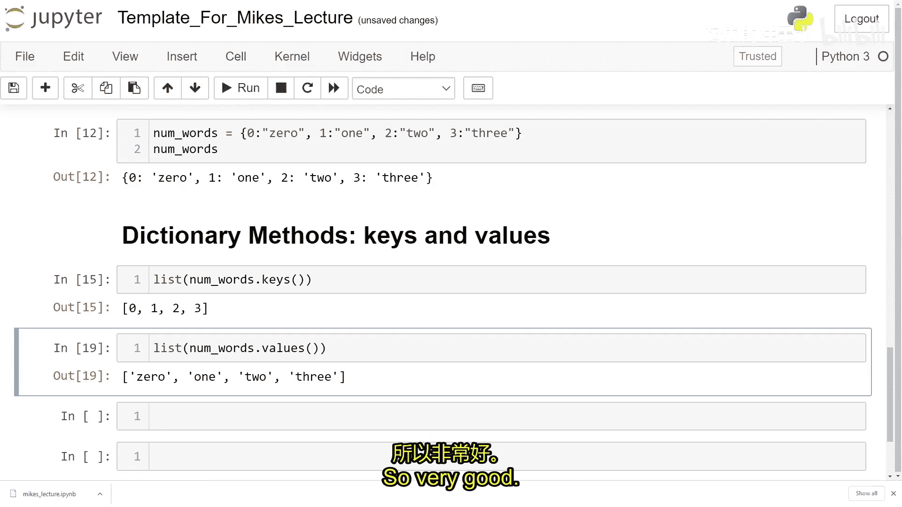

Alright， so now the last two things were last two new functions we're going introduce for dictionaries today are get and pop。

 which both take default values。 I know I talked about P last time as a way to delete things from a dictionary。

But if we try and delete something that's not actually in the dictionary。

 it's going to totally fail and give us an error message。 So here's a quick example。

 I've got my suffix。 You should be able to see this in the Jupyter notebook template。

 I just added it。It's got basically， if I'm looking at the numbers 1，2，3，4， and I've got first。

 second， third， fourth， and so on。 what I'm going to have is this really common S T ending for first。

 N D for second， R D for third， first， second third。

 This is going to fail if I try and grab the suffix for 0 and remove it from the list。

 It's going give me a key error。 If I try and look up what the suffix on fourth is should be a T H4。

 It's going to fail because there's no key 4。 Let me real quick。 hop back over。

 you guys can test this out。

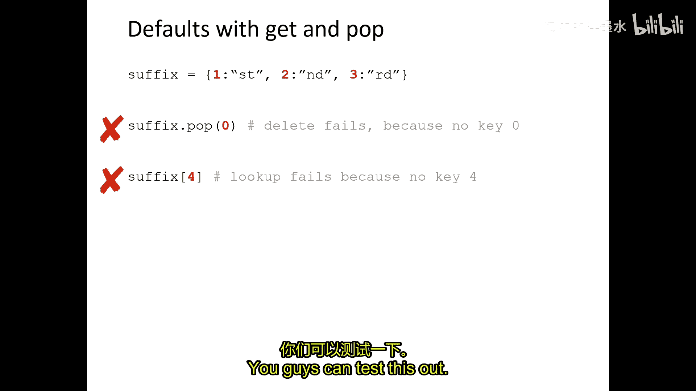

All right， just to demo this， go ahead， follow along you can probably type this faster than I can because I'm trying to talk at the same time。

I've got my suffix data structure if I want to way pop up first。

If I want to pop the element0 and I run this cell， it's going to give me a key error。

 So if I'm looking at this， it's in cell 10。Right there。It's pointing to the line right here。

 there is only one line and it's the key error， and the key that it's missing is0 right there。

 same thing if I try to do and just index into it's detection the dictionary lookup， not index。

 I got to use the right words。Solfix4。 And again， I'm getting a key error。

So those two things that arere not available because I'm trying to access elements that aren't in the dictionary。

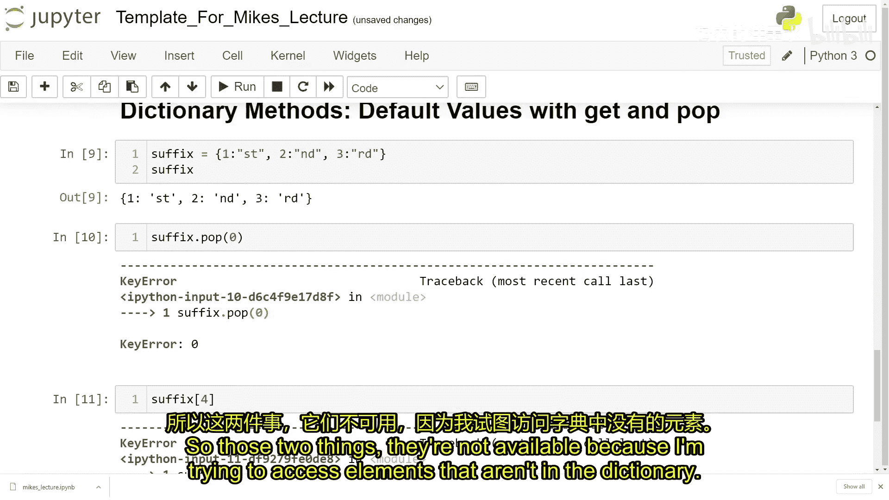

So the solution is to use what's known as a default value。

 Instead of just using the regular dictionary lookup。

 there's a function built into the dictionary data structure known as get。

 So it's a function that I call just using the dot method that makes it a method and I can look for4。

 and if4 is not there。 then it's going to return this T H。

 instead of looking up whatever the value for is very useful。 demo that in a second。

 same deal with the pop。 I can specify a default value with pop。 it returns that default。

 If that key is not there。 In this case， I'm just going to return T。

 and then I can iterate through all the numbers。 look up the suffix print them out。

 and I think it works all the way up through。21st， I think yeah。 so0th， first， second， third， fourth。

 from then on， from 4 through 20th， It's T H on all of them，5th，6，7，8th。Yeah。

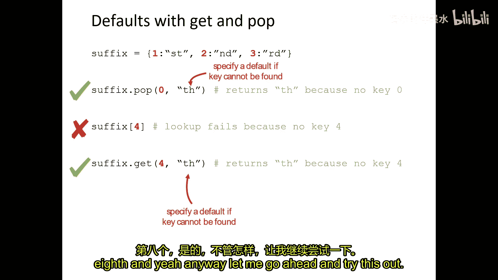

Anyway， let me go ahead and try this out。Alright， so I'm back over here。 I've got my pop。

 I'm just going to add the T H， the default value。 And now when I run this。

 it's going to give me T H back suffix indexing 4 instead of you not indexing dictionary lookup。

 Instead of doing that， I'm going to use the get， try and grab4。 But if it's not there。

 then I'm going to grab T H instead。And again， this works。

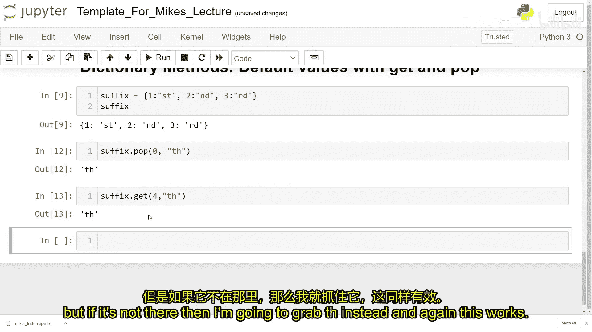

Al right， so just take a second， guys， if you're watching the video in the live stream。

 I'm going to talk for a little bit。 You guys have plenty of time to just type this in。

 I'm just looking at these two lines of code for number and range 6 that'll give me you know0，1，2，3。

4，5。 You can go all the way up to 20 and it's going to work just fine。

 we're just going to print out the number turned into a string and then we're gonna grab the suffix from the suffix list and this is what we'll see we'll get  zeroth It's going to use the orange default value。

For the TH there， first， it's going to look up and know that when it's a1， I need the ST。

 the second I need the N D to make second third， and then from there on it's fourth， fifth。

 all of them have TH。Alright， so the next two demonstrations here are going to be examples of using nested data structures where I've got。

 you know， we've already seen one example， the CSV file is going to be a list of lists。 In this case。

 what I'm going to be doing is coming up with a dictionary of lists。

And then this is also this is known as bucketing where I'm going to be just taking a set of data and maybe sorting it and dividing into a little categories。

 And my example here is going to be tornadoes I believe we did a hurricane dataset in a recent project I'm going to be using manufactured fake imaginary tornadoes for my data set so I'm going to bring this in as a CSV file and I'm going to go through each of the rows figure out what year they're from and then put them in their own dictionary based on that year So here we go。

 I'm going to use a for loop to go through all of the rows。

And I've got an example with like real code coming up to show you this in a second， but just。

A visual。 So this first tornado happens in 2018 has a speed of 100 miles per hour and a bunch of other stuff。

 So this is actually a list。 And I'm just going to move this into the 2018 bucket。

 And so this was a dictionary。 And the first thing it's going to have is this， this whole thing。

 The set of buckets is a dictionary。 And's got an entry for 2018。

 And that's going to be a list of technically lists。And then the next thing I'm going do。

 I'm going to go grab the next row from the data set。 This one's 2019。

 So I'm going to go add this to the 2019 entry of my dictionary。

 So all the buckets together are a dictionary and those dictionaries the entries are the values are the rows of my data table。

 and then we'll just keep going。 So yeah， they're all lists。And the whole thing is a dictionary。

I put the color codinging kind of backwards there， didn I。Okay。

 so here's an example with some like a real data set。 So this is my straight in from the CSV。

 I've got all of the data here。 They're color coded by years to hope like you can track what I'm doing as I go through this。

 The idea is that I'm going to be creating a list of buckets here。 I named them bins。

 It's also known as binning very common terminology。

 a pattern that we'll see frequently in programming。 So I can see that I've got a dictionary here。

 I've got the curly braces here and here。😊，And then here's all of my entries。

So the key is 2014 for the first set of entries。 And now this is a list。 I've got the bracket there。

 There's the closing bracket。 and it's got the row here， which is also a list。

 So the only 2014 entries right here that gets stuck in the 2014 bucket or 2014 bin。For 2015。

 we actually have three tornadoes。 So it's， as we went through with that loop。

 it found the first one， and it stuck it into this very first。Entry in the list。

For the 2015 key value pair。Then it found tornado C stuck that one in the list。

Then it found tornado D that one happened to be in 2016。 so I put it in the 2016 bin。

 So just looking at the big picture。 what I've got is I've sorted out all of my tornadoes by year and I've got them in this nice well organized data structure。

 So if I want to get all the tornadoes from 2014 I can just do bins with the bracket to dictionary lookup and give a 2014 and it's going to return this lists of lists。

 It's basically a sub CSV file。There I've like sorted out the ones from 2014 and just returns those。

 It makes it really easy to do some sort of analysis。

 like if I want to come up with the median speed of all the tornadoes from 2014 to 2015， 2016。

I need to sort through all of those and like select just the ones from 2014 and then do whatever kind of statistical analysis I want on those could be an median。

 could be the maximum speed， whatever I'm looking for。All right， so my next example。

 I'm going to go write some functions that actually do exactly this to compute the average speed of each of the tornadoes per year。

Yeah we'll do this in Jupiter notebook rather than this prompt version， so go ahead。

 go download that file， put it in the same directory with your the Jupiter notebook we're working on and I'm going to copy and paste that code that reads a CSV file that we've been using for the past couple lectures into the template so it's already there for you guys Once I want to go take care of that I'll be right back。

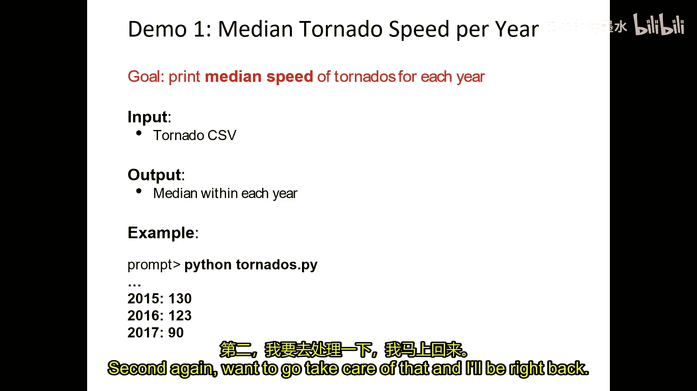

Al right， I've just got everything set up for this example。 I downloaded the tornado CSV file。

 I copied and paste it in the process CSV function。

 and I'm just getting ready to start exploring the data。 So if you guys click on this cell。

 you can push B to get a new cell below it enter will'll put you back into edit mode。

 and now we can start using this。 So first thing I'm going do is call process CSV。

And I need to give it the file name， that's tornadoes。Dont CSV。 The first time I tried this。

 it gave me an error message because it renamed。Tornadoes to tornadoes。 text， TXT。

 when I downloaded it。 So if that's an issue for you guys。

 I'll make sure that if you get an error message， make sure that didn't happen。Alright。

 so I just as I start exploring the data， I'm just printing out what this gives me。

 It's returning example data。 And this is going to be a list of lists。

 So I can see it's a list from this outside bracket。

And then each of the entries in this is also a list。

I can see right away that this data has a header row and then everything else has like the years。

 the idea of the tornado， the location of the tornado and the speed of the tornado。

 So first thing I'm going to do is I need to stash this in an actual data structure。

 let's call it data。Equals process ESP， it's going to be a list of lists。

The next thing I'm going to do is I'm going to extract the header。

And that's just going to be in row one of the data。So I'm just going to go row 0。

 the first row is at index 0。 so let's do that。And then。

I'll print out header just to make sure this is working。Cool， that looks like， that looks good。 Okay。

 I'm going to add another cell。 and then let's take a look at the data table itself。

The rows are going to be equal to data from row 1 to the end。So that looks good。 And then。

Let some print out rows 0 through 5。 I don't need to look at the whole thing。 There was like。

You guys saw it。 I just had to scroll through lots and lots of different tornadoes。

 But this is going to be here to remind me what's in my data table。 So there。

 I've done a little exploration。 and I see I've got a header。 I've got data with four columns。

Alright， so next up， I'm going to write a function that computes the average speed of all the tornadoes in a list。

 I'm going to start out and test it on the entire data structure。

 and then we'll go ahead and divide these up into their buckets by year and then compute the average over each of those buckets。

Down here。 So first up， write a function that computes the average speed of the data set。

 I'm going to push B to get a new cell below this。And now I'm going to be writing a function。

 So first up， I'm going to define my function。 let's call it。Average speed。

It's going to take a parameter， and that's going to be my data up here。 So rose is the the name。

 my name of the data。Actually， this is my prim dragon call anything I want。

 but I'm about to call the function。Average speed。And give it rows。 Okay， and just inside。

 I'm going to be using the same name。 So this rose gets copied into that row。

 I know that can be confusing， but it's so common that I think I want to use that and help I acclimate you guys to that sort of thing。

All right， and then let's just print out rows and see what we get here。

Just to make sure so when I write code， I like to write one line， print something， one line。

 print something。 So it looks like it's working。 I've passed in all of the rows。Alright。

 the next thing I want to do， I'm going to go through all of the rows and just get this speed out。

 So first up。For。Let's see。 what kind of lift shde or for loops shall we use。

 We need to iterate through everything。 And I think I'm going to use the one。

Where I just get for row in rows。 So we'll iterate through the data。 This is the data for loop。

 and then we'll print out each of the rows， one row。

 So this will be the first row first time through。 It's going to give me that much。

 And that's what it should print out。Then it's going to go and get the next piece of data。

 which is this row。 So they're going to be lists that I'm printing。

 Let me just run this cell and perfect， just like I was predicting。Alright， next up。

 what I want to do is because I'm going to be computing the total and dividing it by the number of things。

 Let me get a total variable。 We'll initialize that to 0。 And now， as I go through。

 I need to get all of these speeds out。 So let me go ahead and say speed is going to be equal to。

It's going to be row。 and now I need to index into each of these rows。 So this will be the first row。

 and I need to grab item 0，1，2，3。 So the easy way is to do this。I've hard coded it。

 This is not ideal。 And I'd like to just upgrade this right away。 So if I scroll up a little bit。

 I see I have this header， and I can use that index function available for lists that we talked about in lab to grab which item。

Is the speed column。And the way that works is。Let me see a header。Dot index。 So header is a list。

 The index is going to find a particular item in the list。In this case。

 I'm looking for speed and it's going to return that。 So I'm instead of printing out the rows。

Actually， I'm going to print the row and then the speed。 Let's just make sure that this just。

All kinds of data here。Adds the， the speeds。 Okay， so looks good。

 Next thing I want to do is these speeds， they're going to be strings because of that right there。

 so。Let's go ahead and fix that right now。 We're going to add them together。

 and I want to add together strings。 I just concatenates them。 So instead， let's do speed equals。

 And then the function to change a string into an integer。Is just int。And run this again。

 I should see something that looks almost identical。 There we go。

 It's not putting the speed in quotes because it's not part of a list there。Alright， next up。

 what I really want to do now that I have speeds is just add them all up。 So total plus equals。Speed。

 And then when I'm all done with that。Let's go ahead and print out。NowHere。

 let's do it right here for a second。We printrint out the total。 We'll run this cell。

 And now I can see it's added 1，75 to 0。 Now it's 1，75 plus 2，90。 There's the sum。

 The sum it should get bigger and bigger and bigger as we keep adding to it。

 It looks like this is working。So I'm going to get rid of this print statement right now。

 And now outside of the loop， I'm going to compute the average。

Average is going to be equal to my total。Divided by the number of rows。 Okay。

 and that's just going to be length。Rose。And then I'm gonna， let's print that。Print average。

But I can't type， I call it A V G。 There we go，213。 That looks reasonable based on the data。

 I'm looking at numbers around 200。 So I'm just going to go with that。

 I'm not going go check it instead of printing it， though。 what I really want to do is return it。

Make sure this still works。 Yep， it now appeared in the outbox。 Allright， now I now have a function。

That's going to compute the average speed of the entire set of data。

 So my next task is to collect all of the data into buckets。All right， so here's the idea。

 Let me grab a new cell and put this in edit mode by pushing enter。That the， at the end of this。

 I'm going to have。Data structure called buckets。 It's going to be a dictionary。

 and I'm going to have like let me take a look at this year like 2006。That's going to be my key。

 And then the data is actually going to be a list with all of this stuff in it。

 So I can just copy the first entry。Pasteted in。 Okay， that's what this is gonna look like。

 It's going to be， I need more brackets， a list。Of lists。

 because I'm going to copy the entire row and put it in this list。

Then the next thing it's going to do， I'm going to go back about 1996。

 So there's going to be a 1996 bucket。It's going to be a string。

The values are going to be list and there are going to be lists of list。 So I'm going to have。

This kind of stuff。Let me copy and paste that。Right there。Something like that。

 That's what this is going to look like in the end when I'm all done。 That's my goal。

 is to get to here。All right。So I just run this see if I have any typos。

 I now have a buckets data structure。If I just print it out， there it is。 I've got my first year。

 it's a list of lists， so I'm just going to take each row one at a time and put it in these buckets。

Alright， so that's what I'm hoping to do and print out buckets at the very end。All right。

 so strategy， I'm going to go through all of the rows。 So for row in rows。

 go through each of them that the row now will be the first one。

And what I'm going to do is I'm going to grab the year so I know which bucket to put in。So， actually。

Let me slow down a little bit and print this out to make sure that I get what I think I'm getting。

So kernel enter。 yep， there。 I'm getting all the rows。 Next up。 I want the year。

 So the year is going to be found in index 0 of row。 But again。

 I don't want to just go straight to something like this。 I don't want to hard code it。

 Instead what I want to do is go back up to my header。

 and see that I've got year right here in the header， letting me know it's in position 0。

 So header do index。And then I need to give that。The string year， so it knows what to look for。

And now when I print out the row， I can print out the year also， and it should look something。

There's a lot of data。 Control enter doesn't move it down to the next cell。

 Shift enter moves it down。 So here at control enter。Shift enter。

S matter means I need to scroll back up。 so I got to remember control。Alright。

 so it looks like I'm correctly grabbing the right ear， and again。

 this is going to be a string it doesn't put it in quotes because I'm printing it and it's not like part of a data item in a list。

So the next thing I want to do is go back and in my buckets。

I'm going to say buckets of and then year， that's going to go grab the right spot in this case。

 the 2006 bucket。And I'm just going to set that equal to the row。Wait， I don't want to set it equal。

 It want to append because this is going to be a list。I want to add to it。Append the row。

 That's what I really want。 I misspooke a moment ago。 Forgive me。 All right。

 so now let's go ahead and run this。 I'm pretty sure this is going to give me an error message。

Let's take a look at this。 So key Air 2016 right here in row 5， I am looking up 2016。

To append something to that2016 is not in my data structure。

 I only hard coded the very first two entries。And， in fact， I shouldn't have hard coded any of these。

 I should， you know， this was a me demonstrating what I wanted to look like at the end。

 So I I'll take this out。 We'll start with an empty dictionary when we do this。 But first。

 let's fix this key error。 So what I'm doing here before I append anything。

 I want to check and see if this is an entry because I can't append if there is no entry。

 So I need an if a conditional to test if something's there。 So I want to know if year in bucket。

 that'll test it。Is that really what I want？So if it's already there， this is going to be true。

And then I can append it。 What I really want to do is fix it if it's not。

 but I'm looking for something like this， buckets。Of。一人。And this is how I add something。

 and I want to just add an empty list that I can then append to。So this is what I want to fix it。

 and this will only happen if this is true。 So years actually in buckets， I don't want to do this。

 I want to do this if it's not。In buckets yet。I hope that was clear。

I had to like kind of work through this in my brain for a second。

 Let's go ahead and see if this still crashes because it should add an empty list now。

It doesn't crash。 That's good。 It's going through all the rows。 So now let's go ahead and。

I think I'm done。 Hol on a second。 What if I just print out buckets， it gets get rid of that。

 And we'll just see what buckets looks like at the very end。Okay， so 2006， I have a list of lists。

Here's the first entry， the first tornado， the second tornado looks like there's exactly 2。

000 tornadoes that happened in 2006。Then in 1996。This entry， this bucket has a list of lists。

 and it looks like we've got 1，2，3，4，5，6 tornadoes in 1996。 I like it。 I think this is working。

 This is what I want。 Let me just clean this up a second。😊，I'll just get rid of these extra lines。

 and I need to not。Hard code some data into my list。 I need to start with an empty bucket。

Let me run this again。Yep， it looks like there was only one tornado in 2006。

 I'd hard coded an extra one。 and then when it went through the data， it added it， forgive me。

 I needed to fix that。 I was trying to be instructive， but turned out to be a bug。Alright。

 so next up， what I want to do is take a look at the average speed per year。

 I first up this prints out so much data。 I'm going to delete that。 run that cell again。

We have a new cell to write this function for the average speeds。 Alright， let's take a look at this。

 So a moment ago， I I had those buckets。They have a year and then a whole bunch of data。

 basically list of lists for all of the， the data。 So here's the idea。

 What I want to do is go through for how about。Bucket name， that's the first thing。

 and the bucket name was the year in this case。Actually，s let's call it year for year。In buckets。

Yeah， that's going to work。 Let's just print out the year。To make sure I've got all of the years。

 Looks like they were tornadoes in lots of years。 Okay， so that's a great start。

 I don't know if you guys noticed， but the strategy that I use when I write code。

 no matter whether I'm demoing something for class or writing it on my own developing examples is that there's always a print statement。

 I write one line of code and I print something out。

 Then I write another line of code and I print something out。

 So what I want to do next is actually compute the average for this bucket。 So the data。

 if I look up buckets。P year。And print that out。I'm just going to。

 I've already got a print statement right here。 I'm just going to add this to this print statement right here。

And make sure that I've got that looking good。Okay， so my first year is 2006。

 Here's that list of lists。 This is what's in buckets year。 Now。

 it's a list of lists and that average speed function I wrote a moment ago。

 like at the beginning of this demonstration。Average speed took a list of lists。So in this case。

 what I want to do is give it。This list of lists from my bucket eye stuff， buckets year。

And we'll just store this average speed in a variable。Average。And I'm going to print that out。

 instead。Okay， now check this out。2006 is a great example。 There is only one year。

 and the speed was 175。So we should get 175， then in 1996， we've got 290238。1，87。2，0，9，2，90。

That's actually a lot of years。 I'm not that good at math。 Let's pick out a。

Let's just run the code and see that it looks like it's making sense。So I'm going control enter this。

 So 2006，175， just like we expected， the average of those 6。

 somebody good at math check and make sure that that comes out to 242。8。

 I'm very feeling very trusting right now。 So I'm just going to go with it。Alright。

The next thing I want to do is actually collect all of this data into a new dictionary。

 So I'm going to just create a new empty dictionary。 Let's call it averages。Make it empty。

 And then instead of printing all this stuff out， I'm just going to say averages。Of year。Equals。

 and then we'll give it that average number that we just computed， and then we'll print out。

The dictionary averages， after this。There we go now I've got all of this data easily。

 neatly stashed into a new dictionary。好。I don't really like the way it's not sorted。

 Let's go ahead and upgrade this just real quickly and print it out in order。So to do this。

 I've got my averages， I'm going to create a new dictionary。Sored averages and we'll start it out。

Empty。The next thing I'm going to do is I'm going to grab the list of all the keys and sort them。

 So to do that， I'm going to use that。Averages dot keys function。 That'll get me a。

A list when I convert it， just like we talked about earlier in the lecture。

 Let's see what that looks like。 There we go。 list of keys。And we'll store that in keys。There we go。

Itll enter。啊。Keys， there we go。 stored in keys。 Then I want to sort them。Sort。There we go。

 The keys have now been sorted。After that， we're just going to use another loop。

 We're going to go through all of the key assorted keys for key in。Pese。

What we're going to do now is just grab my sorted averages。Let's see， sorted averages。Of key。

It's going to equal。Yep， averages。O。And now the new version of Python is going to maintain things in insertion order。

 I'm taking advantage of that here。 previous versions of Python 3。

6 and lower will not work with this kind of thing。 So what this is doing is it's going to go and look up the key。

 It's going to go over here to averages and look up the value of the average speed。

 And then I'm going to put that into sorted averages with that same key。

And then instead of printing out keys at the end。I want to print out sortded averages。There we go。

 So now its gone and looked up all the right places。 So 2006 was that first one。

 It does match up to 175。 I don't remember what the others were。1996 was 242。8。 That matches。

All right， so it's looking good to me。Let me see。 What did I want to do next。 Guy， Yes。

 I wanted to bucketize by location。 Let me scroll up for a second right up here。 I have。

Some code that collects data into buckets。 I'm going to leave this right here so that when I put it online and you guys are looking at what I've done。

 it's there。 But I'm going to go ahead and take this code and turn it into a function。

 I writing this for homework assignment， I would。Write the function。

 And then I would replace what I've got up there with my new function。

 But if you're following along with the lecture， this might be more instructive。So first up。

 I'm going to define a function。I'm going to call it bucketize。

And this is going to take a parameter right now， I'm bucketizing by year。Instead。

 I'm going to bucketize by。All right， my script says call it bucket dies or bucket column。All right。

 and I will be calling this function。With。Let's start out with year just to make sure that it's still working exactly the same。

 We'll put this into a data structure。嗯。We called it buckets earlier。

 I'm going to keep the same name。Now， inside the function。I need a coal in there。Tab all these over。

All I need to do to change this is switch bucket column where I've hard coded gear here。

 I'm going to use that parameter。And then I need to return something。

This is going to create an empty data structure buckets。I'm going to return this buckets。

And that's going to get assigned to this variable at the end。 Otherwise。

 it's going to do exactly the same stuff。One little tip I've noticed during office hours and part of the reason I created that strategy guide was that I noticed a lot of return statements。

 one tab over， and I think a lot of you guys have your return statement inside the for loop and are getting data that only has one item or it's returning zero and you just it's horribly difficult to see where that's coming from。

That's the secret right there。 and Python automatically tabs things over for you so it can be really tricky to see。

That I've made a mistake right here。 Everything looks perfect。

Except that's return statements in the wrong line。 Alright。

 let's go ahead and test this and make sure that I didn't screw up。啊。Priint out buckets。

This should look exactly the same as I had before， 2006 with one entry in 1996 with those entries。

Oh yeah。 And I took out the print， but it looks good to me。

 Next thing I want to do is just make sure I can bucketize by location。

And I already forgot what the header for or it is location。 So I'm just going to copy and paste this。

Right here where I've got ear。 And I'm going to run this cell again。我知。😔，It's not giving me exactly。

What I thought， let me pause this and figure out what I did wrong。Nope， it actually worked。

 This has given me exactly what I thought I just forgot there were so many。

There's only actually three sight site A B and C。 The first tornado happens to be in sight B。

 So the site B list is first， and it's got that many tornadoes in it。 S C has all of those tornadoes。

 and site A has another huge chunk of tornadoes。All right， so it looks like this is working。

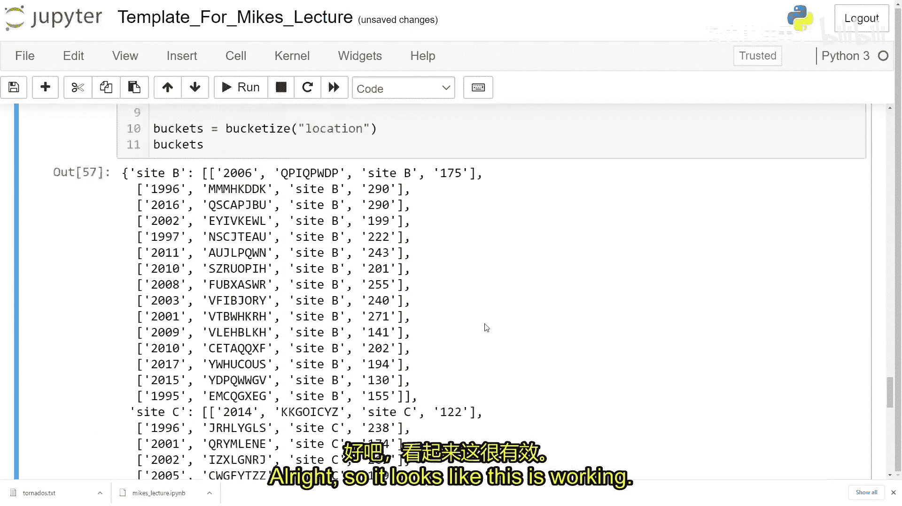

All right。 I strongly suspect that I'm going over time。

 but I want to do one more demonstration real quick。 I think this is important。

 and we're going to need this for the next lab。 So forgive me that this is long。 If it is。

 I can't tell when I record lectures I do so many little clips and merge them altogether that I really have no idea how long I've been talking。

It feels long， though。 All right。 So here's the idea。 Upp until now。

 we've been using C SV files that we've been representing as lists of lists。 We've got a header row。

 and then all the rows with data in them。 An alternative way to represent that data is to use a list of dictionaries。

 So basically my first entry here。 If I look at this row， the Alice row。

 is going to have a dictionary where I've got name。 and then Alice as my value。

 The key X is the x coordinate for her and the value。 And then another key Y with that value。

 And I'm going to duplicate the header more or less for every single dictionary。

 But it's going to make accessing data from this a lot easier。

 I don't need to worry about a header row anymore。 that's just gone。 And instead。

 all of my keys are going to be the the items from the header。😊。

So if I want to access something like this value 50 right here， if I have a lists of lists。

 I need to grab the Cindy row， which is 0，1 and 2 for my data。 So row 2。

 And then I need to figure out which column this is in。 I can't just say it's the Y column。 Instead。

 what I need to do is go to the header and look up where the y is with the index function。

If I've got my list of dictionary representation of this table。

 I can still go to row2 directly with brackets， and then I'm going to say I need the y value because this is a dictionary。

 it's going to use that dictionary lookup， find the Y from this row and grab the 50。

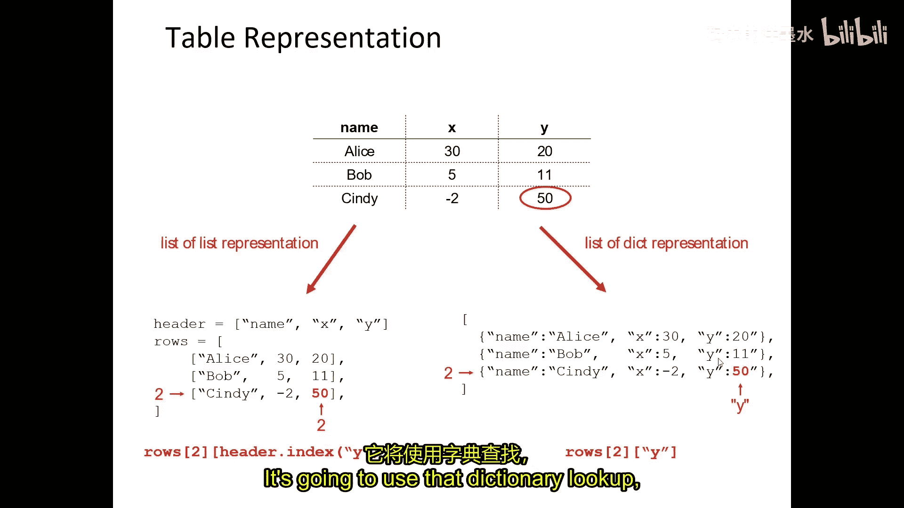

Allright， I'm just going to do a quick example of processing a CSV file into a list of dictionaries。

 I promise this will go pretty quick。 I'll extract one value to show you that it's working at the end。

 and then we'll I'll get back with our lives。 Okay。

 so first thing I'm going to do because I'm processing a CSV and I'm going to turn into a list of dictionaries instead。

 I'm going to go ahead and grab my explore the data thing right up here。That much。

And I'm going to paste it。Into the cell here。Then I need to part about rows。Right here。

Paste that into the cell。Alright， and now I no longer want to print out the header。

 and I want to print that out。 I just want this much。 I want to get my header， and row。Now。

 I'm going to iterate over all of the rows。 So for R in rows。 And just to get it started。

 I'm going to print R just to make sure I'm printing something following my strategy。

 will' print that out。Got all the rows perfect。 That didn't fail。

 I'm going to create a dictionary for each of these rows。So instead of this。

 what I want to do is create a new dictionary。 new diict equals that。Okay。

 now to fill in my new dictionary， I'm going to iterate over all the items in the header。

 And at the same time， all the items in the row and grab the items in both corresponding spots and put them in the dictionary。

 So because I I'm iterating over two things the same time， I'm going to use the range loop。

 for I in range。A length in this case， I'm just going to use the header。

And then in my new dictionary。The key is going to be that header item， header。Of I。

 And that's coming to equal row。 I named that artist in this time， row v。Alright。

 and then let's go ahead and print that。P带。New dit out right here instead of R。

See what this gives us。 Okay， so yeah， check this out。

 We've now created a whole bunch of dictionaries one at a time。 The year is the key。

 There's my value。 I D is the key。 There's the value。 Location is the key。 S is the value。 Allright。

 So now I don't actually wanted to print them out。 I want to collect them into a list。Of data。

 So let's call this。The dictionary list。Because that's what my notes say to do。

 I'm going to create an empty list。 And now instead of printing this out right here。

 what I'm going to do is append my new dictionary to my diic list。

You got to pronounce that very carefully。That。Append。 and now。The new date。All right。

 and let's just take a look。And what we get after this whole thing is created。There we go。

 I now have a list note the square bracket with all of my dictionaries in it。Alright。

 now we're quick demo to make sure this works。 How do I access the site or location of。

The tornado at index 1。Dict list1。 So this will be row 0， row 1 location。

 I can just quick go in and type。The key that I want。Dll enter is' going to give me site B。

And then let me comment that out real quick。It was indeed site B。 Let's grab the speed。

 something a little more unique。 Let's grab this one right here， because that's the only 1 I see。

 So that's going to be 0，1，2，3， row，3， speed。It should get 122。All right， tornado。Grow3。

Speed and again，1，22。 Alright， that's gonna to do it for me。 I hope you guys find this useful。

 This stuff。 Hang on to this。 You'll need it for the upcoming project。And otherwise。

 have a great day if you have any questions or about Po Piazza。

 if you're watching the live stream tomorrow morning。

 put them in chat and'd be glad to help you guys out have a great day。

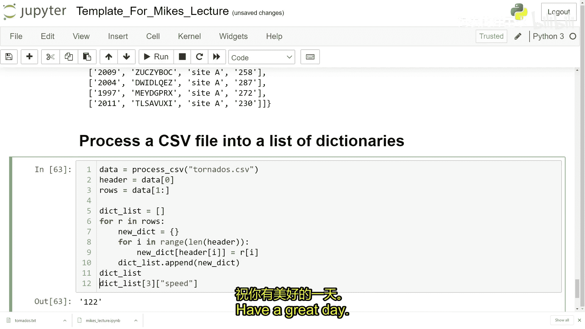