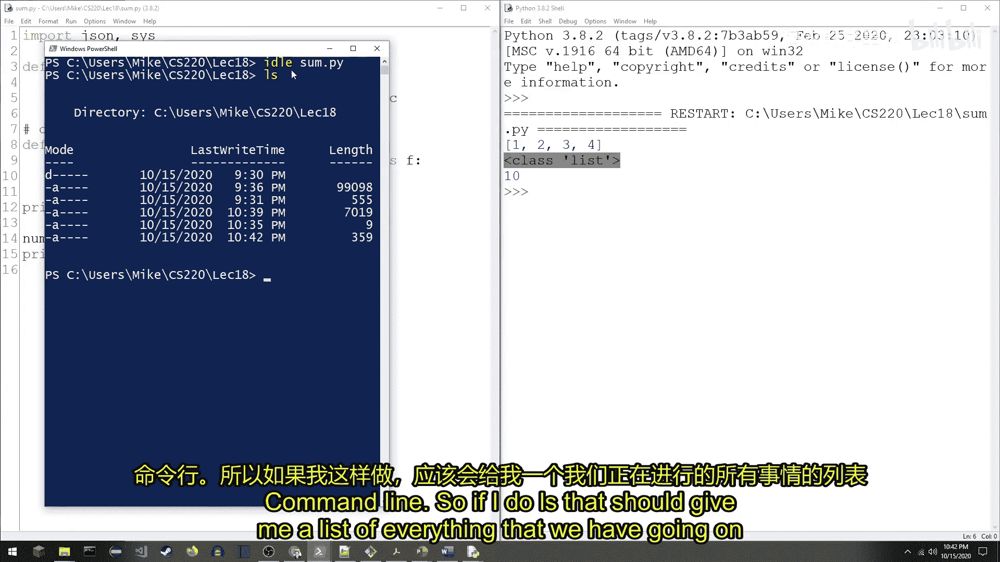
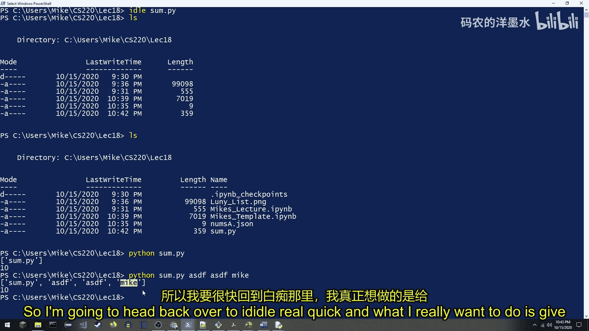
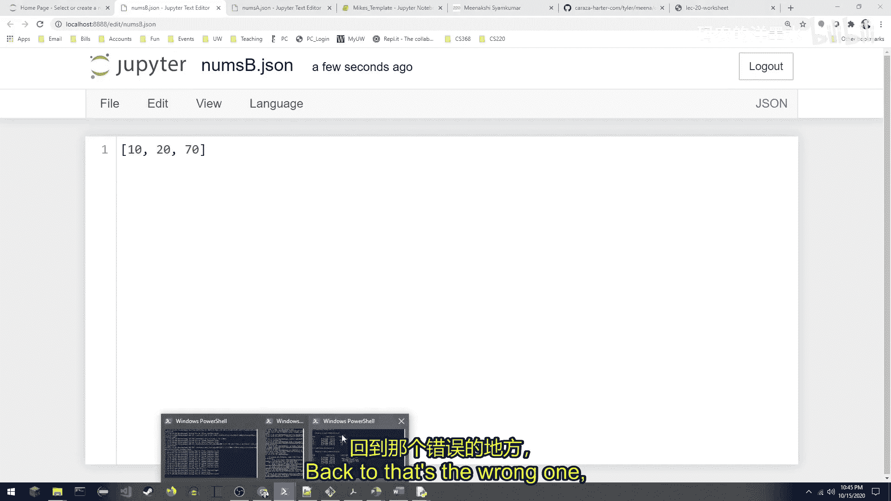
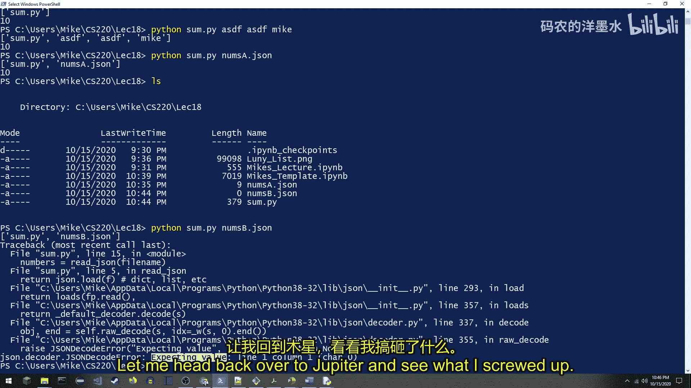
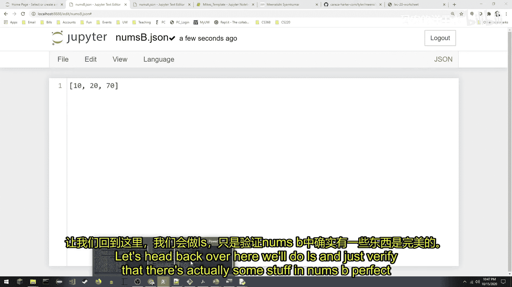
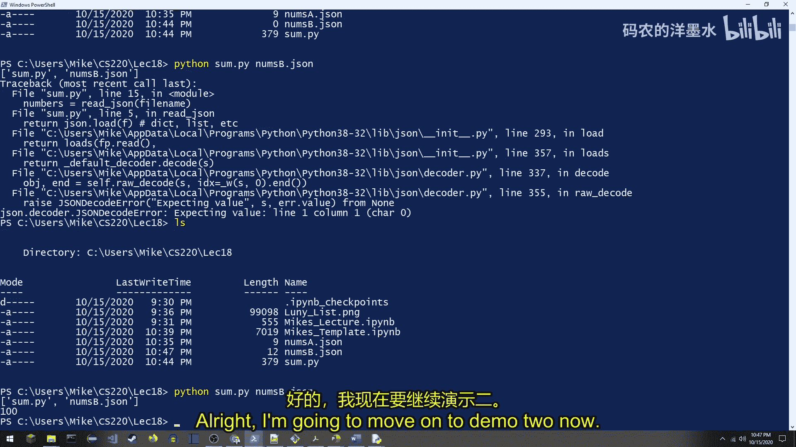
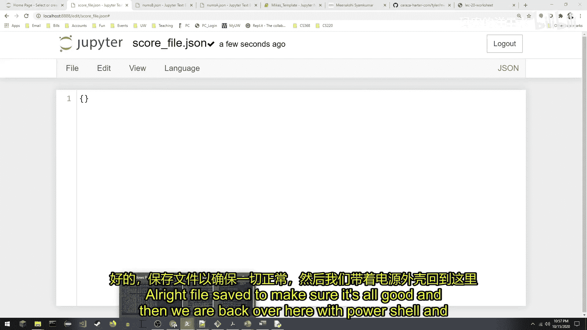
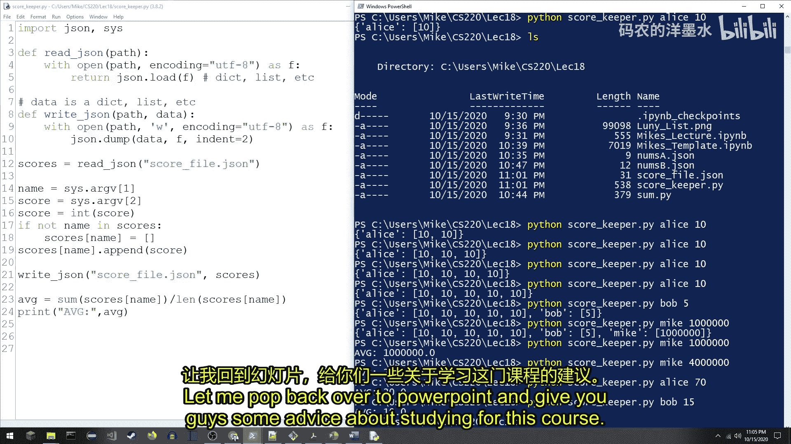
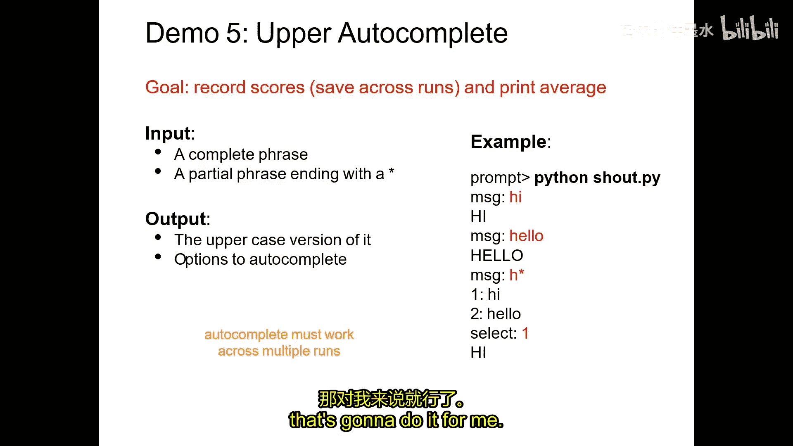

# 【全集】威斯康星大学-Python数据编程-CS220-中英字幕-1080P-p17-Lecture-14---JSON--BV1VxvsBLEmv_p17-

Al right。 Good morning， everybody。 Today， We have an exciting new topic。 Json files。

 It's another way to store data， a lot like CSV files。 But before we get started。

 I just want to do a little bit of review to get us started。 So first up。

 we're going to go over to the web page and download some files to follow along during this lecture。

😊，Al right， so I just jumped over to our web page。 We are right here on October 16。 Json Day。

 Please notice， go ahead and read Swwaiggart Chaer 14 about Json files。

 The Pdf slides you'll need to right here。 we will be copying and pasting some things into the files we're using today directly from the slides。

 just like when we talked about C fees。 These are just little functions that we'll read Json files。

 All right， we've got worksheets here。 we're going do one of the problems from the P Df workshe to get started。

😊，Two of the problems from the Pdf worksheet appeared on a really old version of the class。

 We've included the old worksheet because it's got some great problems。

 So we've got five problems on the old worksheet。 We moved two of them over to the new one and added that third problem。

 The third problem is the one I'm gonna be doing first up in class。

 All right in the code directoryve already got that open right here。 If you're watching my lecture。

 I've got a template right here。 Currently blank because I'm gonna build it as I go and write the lecture。

 So if you're here early， it's blank。 when I'm all done， I'm gonna have a lectured right here。

 this will be all of the stuff I do during class。 basically， I do the stuff during class。

 then I delete it。 So there's a template for you guys to fill in。

 You will also need this loony list picture。 let me show you the worksheet has these two problems。

 And then we've added the third one。 This is the loony list picture。 This is the one we're gonna do。

 but I'm going to do it in Jupyter notebook。 So I've made a copy of the picture。

 And in order for that to appear in your Jupyter notebook。

 you'll need to copy all of these files into the same director。😊，3。

And the rest of these we're going to be developing during class。

 you can see the are results of the versions we've created， come back to them later。

 or if you just follow along， you can create them yourself as we do go through the lecture。Alright。

 let's get started by taking a look that worksheet problem 3。

 I've copied the code over here into Jupiter notebook。

 I like the way it color codes that it gives you guys the opportunity to have cells and like actually do this yourself right here without having to print it out。

 If you want to definitely go print out the worksheet。 You can do this pen and paper。 I prefer this。

 especially for like lecture demos。 Allright， so this first up is a crazy data structure。

 This is the Python tutor picture。 Please never write code that ends up looking like this。

 It's crazy。 It's confusing。 But that's kind of the point is we're gonna be tracing through some things that just look silly。

 And making sure that we understand what's really going on。 So it's good practice。

 Don't ever do this in real life。 It's confusing。😊，Alright。

 so let's take a look at what we've got here。 first up。

 we're creating a dictionary that dictionary is named Webster， which is a little inside joke。

 if you're familiar with dictionaries and old like me。Al right， inside the dictionary。

 we've got three key value pairs。 keys are A， B and Z。 Allright， the value for key A is a list。

 I can see the square bracket right there。 It's got a bunch of words in it that all'll begin with a。

Then the key B is paired with the value here is another list。 I see the brackets there in green。

 a bike and debug both present in that list。 And the key Z has a dictionary inside of it。

 So we can do some weird stuff with dictionaries。 We've got lists and dictionaries is values。

 This particular dictionary has two key value pairs， name is paired with the value zebra。

 The key kind paired with value mammals。 So some information about zebras that you might find important。

Next up， we're creating a list。 This is named Loy list。 It has three values in it integer 8。

 integer 9， and that dictionary we just created up here。Let's just peek down here at the picture。

 So I've got my。In the global F， I've created Webster， which is this dictionary right here with keys。

 A B。嗯。NZ。Then we have Looneny list， which is this list right here with 8，9。

 and then the dictionary Webster up there。that's how far we are right now。

 Then Loy list is going to append another copy of Lony list。

 So we see here is that the very last entry of append something here is now pointed to the corner。

So it's got a copy of itself inside of itself， which is a pretty good reason for the name。After that。

 we are going to take Webster add a new entry by using these square brackets。

And we're going to put loooney list in the dictionary。

 So now we have this capital L key that is also pointing to Looney list。

 So it's getting a little crazy。Then we're going to find a function。 We call the function。

 So let's go back up here。 We are giving it Lony list。

 That's getting put into the parameter everything。 So here in the fo frame。

 we have a parameter everything。 and that's given a loony list， which is right here。

 This data structure， which contains Webster contains itself。

And then we're creating a new data structural final letter， which is Lony list or everything。

But just a part of it，2 and Z。So final letter here is going be just a piece of。

The everything or the loony list。 All right， So now what we want to do is go down here on the worksheet。

 There are like 10 different questions。 It's asking if we print out。And put。

 replace those question marks with Looney list one， what's going to print out？

If we go and take those question marks and replace them with Webster of a of negative one。

 what is it going to print out， All right， So if you just run some of these cells。

 they will just work。 But that's not how I want you guys to use this worksheet。 If you like。

 do Colonel restart runll， it'll fill them all in and you won't get the practice。 Instead。

 what I want you to do is take。啊。Looney list1。 and maybe just， let's go through this as an example。

 I'm going to find loony list over here。 It's available in the global frame。

 And I'm going to trace this arrow。 So this is loony list right here。

 When I point to the corner of something with by mouse pointer。 I'm talking about the data structure。

 Okay， now I'm going to grab element 1 here。 So right here， this is element 0， element 9。

 So now I've got my， oops， element 0。 element 1 is a 9， I've got the mouse pointer inside the box。

 it's now pointing to the 9。 So Lony list of  one should give me a 9 when I run this cell。😊。

And indeed， it does。 All right。 That's how I want you guys to use this。

 I want you to not just run the cell。 I want you to trace through。 I want you to make a prediction。

 put it down in there。 Maybe I'll do one more。 Webster， A-1。 So I'm going to go up。 Here's Webster。

Let me just use the picture。 I've got my data structure Webster。 It's in the global frame。

 I'm going to follow the arrow over here when I'm pointing to the corner。

 I'm thinking about the entire data structure。I'm accessing the key。 I think it wasn't A。

 What am I doing， Yep， I'm accessing the key A。 So I'm going to jump in here and follow this arrow to this set right here。

 And then I was indexing and getting element -1。 So at -1 in a list is just that very last thing right here。

 looks like we're looking at the text Eta and note I didn't show any quotes on strings。

 So all theses text just strings。 So I'm going to predict that this is going to give me ada。

All right， now that I've got my prediction， I've written something down。 I've committed。

 I can do a control enter and theyll actually look it up and see what this cell gives me。All right。

 what I'm going to do right now is just give you guys about three minutes to go through some of the He。

 if it's the live stream， I'm going to just pause。we'll come back。

 we can do some of these after classrooming and Q&A session if you guys have any questions if something doesn't come out the way you think it should。

The only one of these that I think won't run directly is the final letter1 because final letter is only oh final letter and everything。

 They're only available inside the function。 And as soon as that function terminates。

 they won't just run。 So the global runs。 Looney list and Webster will I'll just run on their own。

 But if you want to talk about any of these。 we can go ahead and do that。 All right。

 if you're at home， watching the video push pause， give these a try。 Just do this now。

 you have questions， bring them to piazza。 If you're watching the live stream。

 I'm going to pause the video play。 and。Give you guys a chance to just try some of these。Alright。

 do that now。 All right。 Wee back。 I thought I'd just pull out two of these and talk a little bit about more of them。

 First， this final letter 1， I'm going to make a copy of this。

 and I'm going to go ahead and just put it in。 So if you're curious about how to make the final letter  one work。

Going right here。There we go。 Fi letter。 Now， when I run this， let's just trace through this。

 Minal letter is available inside of the function。 So that's why I needed to copy it。

 When I trace final letter， I'm over here at this data structure。 I'm going to look up the name。

 So it is a dictionary。 And I can see I've got the key value pairs here。

 name is going to be this text right here， zebra。 And then when I look at the -1。 So so far。

 this much of it。 Final letter all the way through name is going to give me a string。Okay。

 so when Python looks at this， it's just going to be evaluating left to right。

 going through all of these brackets， tracing through all of the arrows。

I -1 is going to be the very last letter of the string。 the a。 So if I run this cell now。

 instead of printing out question marks， it's going to give me the a。All right。

 I'll go ahead and put that back because I'm going to use the same thing as my template in a little bit。

TheThe other one I want to take a look at is this crazy thing。 Loy list 31，3， minus-1，3，-1，3，-1，0。

Okay， so if I go up here， Loing list is available in global scope so that if I just run that cell。

 it will work。But Dedy is， I'm going to follow my arrow over to Looneny list。Se your 0，1，2。

3 is this one right here at the end， which contains a copy of Looneny list。

So I'm going to trace that arrow back over here to the beginning。

Then element -1 is the very last one。 That's this one right here again。 Trace it back。

Three is this one。Linus1 is this one。3 is this one。in-1 is this one。 So we just keep looping through。

Deeper and deeper and deeper， but it's the same data structure the whole time。 Eventually。

 that last item was 0。Unless I'm mistaken。 so this should give me an8 when I run this cell。 So， yep。

 last one to0。 When I run this cell， I'm going get an8。

So I hope that kind of makes sense if tracing through any of these like indexing into a dictionary or indexing into dictionary。

Or indexing into a list。 I think I said that wrong。

 or aim any of these nested lists inside of dictionaries inside of lists inside of lists inside of dictionaries。

 If any of this is confusing， you know， let's face that this has a lot going on。

 There are more problems on the word doc worksheet and more problems on the P D F version of the worksheet。

 So definitely go check those out。Al right， next I'm going to jump back over to the PowerPoint slides。

So in part 2 of the lecture， I want to be taught I start talking about different file formats and data structures that seem to work well with them。

 So we've already talked about lists of lists and how they're closely related to CSV files。

 So here I've got list of lists with my header row， name， X and Y。

 I've got some players and their positions on the board。

 X and Y positions where I've got Alice and Bob playing。 If I put this into a CV file。

 This is what it's going to look like。 I'm just going to have each of the pieces of text separated by commas。

 Each row is going to be their own list in the list of lists when we read this in。Alright。

 this works great for tabular kind of data here。 In fact。

 it's asking data we would want to use in list of list tables， things like spreadsheets。

 but not all of the data we're going to be using in Python are nice neat tables。

 Now let's take a look at this， for example， here I've got a dictionary。😊，Of dictionaries。

 So it's got this dictionary has two entries。 Alice and Bob are the keys。

 and each of them have their own dictionary as an entry or value。Inside Alice's dictionary。

 she's got two keys and two key value pairs， age。 she's 40。 and scores。

 It looks like she's played the game  three times and scored 1020 and 19 points。

 So this is actually a list in a dictionary， in a dictionary。All right， very similar for Bob。

 He's got a dictionary as his value， ages 45， same age as me。 And he's played the game of four times。

1523，1715。 Of course， he's older。 maybe he's had more time to play more。

But here's the idea if I wanted to put this data structure into a CSV file， how do I do that？

It looks like I could use maybe one row for Alice， one row for Bob。 And then just like here。

 the values， the first one could be their age， the 40 for my header， I could have name， age and then。

I'm not really sure。Alice's rows only could have three more pieces of data。

102019 sure I could put those in the row。Bob's data is going to have four more items。

 It doesn't make a really great list of lists。 What do I do， putting in a bunch of blank。

 empty strings for the rest of the scores for Alice。 This is a challenge。 And to the rescue。

 we have Json files， so。Here is the equivalent Json data formatted file for this dictionary。

 All right， I want you to point out a couple of things here。 First。

 there are some strong similarities between Json file formats and dictionaries。All right， first。

 we are going to use curly braces to indicate a dictionary in a Json file。 Second。

 we're going to use colons to separate key value pairs。Third， we're going to use brackets for lists。

 And an a Json file doesn't need to be a dictionary。

 It can also just be a list or just a floating point number or just an integer， or just a string。

But this case， I'm using dictionaries my example， and dictionaries can contain lists。All right。

 let's see awestrs are always going to be in quotes。

 just like in Python and integers will look like integers。

 floating point numbers look like floating point numbers。

Okay so just a little bit more JON stands for JavaScript Object Notation。

 it's developed to work with JavaScript， which is a programming language widely used in web development please note that JavaScript all one oops all one word is different from the other very common programming language Java JavaScript and Python are very closely related Java is a different beast entirely。

Anyway， so JSONs were developed so that these web design programs。

 JavaScript programs could store and share data。There are some minor differences between Javascript and Python or the Json file format in Python。

 First up Booles in Python， capital T in true， capital F and false。 Json， all lower case。All right。

 when we have no value， Ithon's going to use none with the capitalized none for that。

 Almost all other programming languages， including Json and JavaScriptscript are going to use null instead of the word none。

Qu Python will let you use single chs or double quotes。Jason only double quotes are permitted。

 The minor difference there to something to keep in the back of your mind。

 Maybe a reason to start using double quotes as your first choice。I don't know。All right。 commas。

 So Python will let us put an extra comma at the end of a list。

 There's a comma there following the two。 This is perfectly valid in Python and makes a really excellent multiple choice exam question for quizzes for exams。

 And it's also something that's really easy to just pull up Python and test， during an exam。

 So you might put that one in the back of your mind。😊。

Jason does not permit that extra comma at the end， that'll give you an error。

Keys in Python can be any type。 These are integer keys。 We can use anything immutable。

 We can't use lists。 but yeah， so integers， we can use text。

 we can use Booles And Json only strings are allowed。 So if I wanted to use three as a key。

 I'm going to need to put it in quotation marks。 Allright， cool things to remember。😊，Allright。

 let's talk a little bit about reading a JSsonN file。

 So assume I have a JSsonN file stash somewhere on disk。 It's just a giant string saved in a file。

 And when I read it in， I'm going to have some parsing code。

 We'll talk about what this looks like on the next slide。

 but that's just going to turn this into a Python data structure。

 This one' is going to get turned into a dictionary。 If this had a list in it。

 it would get turned into a list。 If that an integer be turned into an integer。

 But then once I get it into Python with the parsing code。

 I can go up and do whatever my analysis requires。 In this case I'm just getting out some data about Cindy。

 She scored 12 points here。Alright， let's take a look at what this parsing code looks wrong way like。

All right， here we go。 So we'll be importing the JsonN module。 And then actually， to be honest。

 you guys don't need to understand this at this point。

 we're just going to be copying and pasting this。 It's going to essentially open a file。

 and then it's going to load this using the JsonN module and return this JSsonN data。嗯。

Though I return the result of the Json load applied to the open file。

 which is going to be a list or a dictionary。 So all we're going to do is copy and paste this。 And。

 in fact， I'm going to do this right now。If you guys want to do it with me， let's see here。Oops。

 out dear。Come on， Mike， it is right。Copy， let's head over to Jupiter。

And I'm just going to stack this right here。Allright。Back to PowerPoint。There we go。All right。

 just a little bit more about data structures and files in the connection。

 Why do we need both of them， Why not just have data structures。

 Why not just use dictionaries and lists。The problem is that they die when our program ends。

 we lose that data。 it goes away。 So if I have data structures， if I've got a list of something。

 I need to save it if I want to come back to and use it again after I power down the computer。

So that process is called serialization where I turn it into a file Now files are going to be stored on the hard drive of the computer。

 They're going to be available after we turn the computer off and back on again。

 So why not just use files by the way， the process of reading a file and putting it into a data structure is called parsing。

Alright， so why not just use files。 number one answer here is speed。

 Read from a file is incredibly slow。 But if I had to read from the file and then go through data structures。

 provide all sorts of really nice features like being able to index into them for a dictionary。

 we can do key lookups。 They're Python friendly formats files， not so much。

 They're just giant strings。 And so converting it into a data structure makes it possible to do things very quickly to find the information we need。

😊，One thing as you guys continue on in the homework and doing the projects。

 if you find that when you do a kernel restart run all， if it's incredibly slow。

 one thing you might look for is am I reading a file more than once reading a file is slow。

 And if it takes several minutes for your Jupyter notebook to run that's one thing to look for。

 In fact， we're going to start checking to make sure you guys only read files once only download something from the web one time and then make you know put it in a data structure and use it for the entire time that you guys are working。

All right， next up， I just want to introduce the idea of serialization。

 It has nothing to do with breakfast。 This is the idea that I'm going to take a data structure。

 It could be something complicated。 In this case， I've got this is my code example。

 I've got my dictionary here。 got the mouse puter on the rock spot。 It's a dictionary with one entry。

 A serialization needs to turn whatever complicated data structure this is into a string。

 So it's gonna， by serial， we're talking about one thing after the other， one after the other。

1 after the other。 just something a lot like a list。 in this case， it's a list of characters。

 So serialization code converts whatever data structure we have into a string that we can save to a file。

 So What does this look like。😊，Going the wrong way again。 click the down button。 All right。

 here it is。 We're gonna import Json。 This is gonna be a right Json。 All right。

 please notice that a function like this needs two things。 The first one only required the path。

 All I needed to do was tell it where the data was。 and it gave it back to me。 This one requires a。

Where do I want to save it and what data do I want to save。 So two parameters。

 Now we're still going to open a file called the file F。

 and then we're going to use a function Json dump。 And again。

 you don't have to understand any of this stuff to be able to use it to use it。

 We just need to know what these parameters are our path and data。 and then it'll write the file。

 So path has a allowed file name。All right， I'm going to go ahead again。

And just copy and paste this over into my Jupynter notebook。 So I've got it available， copy。

Here we go Jupiter。 Let's get a new cell。Put this one right here。That's the wrong。 There we go。

 One of the little detail I'm going to add。I'm going to do all of my importing in one spot。

 and I don't need to import Json twice。 So I'm going just delete it from right here。

And I'm going to move this one up to my。 So where I import stuff。 and we'll just have。

Imports right there。There now I've got。My two functions reading。Got an extra line there。

 don't need that and writing， all right， cool。All right， Part 3 of today's lecture。 quick demo。

 What I'm going to do is I'm going to write some code that's going to just count the numbers in a list。

 but that list is going to be saved in a Json file。 So I need a couple things。

 I need the location of my file， and that's the path， including the file name。

 and it's going to help with this on。Well， when I'm all done。

 I'm going to be going to the command line， the command prompt I'm going to type Python or Python 3。

 running the name of my file and giving it this as an argument。 So we're going to go back。

 we're going to get some review of command line arguments。So first up。

 what I'm actually going to do is start out my development in Jupyter notebook。

 You guys already have that open。 It gives me a convenient place to put in some like templates。

 You can take notes， some extra cells。 And then we'll copy and paste the important pieces over to idle。

 So forgive me that I'm using lots of tools to do this。 I hope that's not confusing。

 My goal is to be instructive。 So hopefully you guys will learn some stuff。 All right， I'm back。

 I added some stuff to my template file。 So as you're following along。

 you can use these cells as a way to guide your learning。 First up。

 when I copied all these things in， I never ran any of these cells。

 So I need to go ahead and do shift enter to import things， shift enter to define my read function。

 shift enter again to read my data to the right Json the read Json file and the right Json file。

 Okay， now that those are available。 next， here's demo1。

 we're gonna write a program that leads a list of numbers from Json and output'll puts this sum。

 So first， we need a Json file with a list of numbers。 So I'm going go back over here to this。😊。

Page on my Jupiter notebook tab。 Yeah， I'm working on the template right now。 at the end。

 I'll save it as lecture。 Here's the luless picture。 I need another file。 I need a Json file。

 So I'm going to add a new text file。I'm going to name this nus a do Json。Al right， very good。

 And now all I'm going to do is put in a list of numbers，1，2，3，4。Oh。

 and I need to make sure that I don't put in that extra comma。

 I screwed this up practicingrac a second ago。 Allright， then all I'm going to do is save this。

 So file save。 And now if I go back over here， I can see that I've got nus A dot Json right here in the right directory already。

 So if I go back to my template where I'm working that's step 1， I just created that file。

 it's there。All right， step  two， so I'm going to click here， it's in command mode B for below。

 give me a new cell。And now I can start  typeping code right here。Alright。

 so the first thing I want to do is read in the data pretty straightforward because I already have that function。

Itslled read J。 I'm going to go up and grab that right now。

 I'll just copy this whole line so I can see what I'm doing。 All right， it's a function。

 I don't need the depth。 I just am going to be calling the function。 I need to give it a path。

And I believe I named my file， nus。A do Json。I'm going to go back and check it's right here。남ぞエジさんによ。

Alright， after that， when I call this， it's going to print out the list。 Now。

 I didn't actually start in data。 It's just a feature of Jupyter and notebook that it prints out whatever is on the last line。

 So these are my， my data。 Actually， their numbers。 I'm going to be a little more specific。Numbers。

All right， let me run this cell again。And now， we'll print numbers。

Just to make sure that I did it right， I also know， I'm curious。And can't type。

I just want to make sure that I'm actually getting a Python list。And indeed。

 when I print out the type of whatever I just read in， Jason can be dictionary。 They can be listed。

 They can be an integer。 It's all good。So printing out the type just verifies for me that I'm actually getting a list object。

Alright， so the next thing I want to do is print out this sum。

 There's a many of you guys have probably discovered this already。

 but there's a cool built in function that works with lists that's just called sum。😊。

And I can just give some the name of a list。 And if it's integers。

 it'll go through and just print them。 add them all up。 So one。Plus 2 plus 3 plus4 is 10。Now。

 when I get over to Idle， this is a great feature of Jupiter that it's just going to put things in the outbox for me。

But I'm going to actually need to print this out when I move this to idle。Okay， that looks good。

 All right， I'm going to go ahead and open up idle and move all these in because the next thing I want to do is be able to take the name of a file from the command line。

And then run this code。 So quick review of command line arguments is always good。

 So let me go ahead and get that ready to go。All right。

 I've got all my work put today in my directory CS220 lecture 18。

 I'm going to do a shift right click because I'm on a Windows machine and just open Powerhell right here if you're on a Mac go ahead use terminal if you prefer to navigate to your Powerhe or terminal some other way feel free。

Then I'm going to open up idle。And I'm going to give it the name of the code that I want to write。

 I'm just going to call this sum da pi because that's the one that Mea used。

 and it's already there because she's always ahead of me。Open this up。And in a moment。

 it should pop up。 There we go。 Alright， let me stop， rearrange the windows， and I'll be right back。

Alright， so next up， all I'm going to do is just copy and paste the pieces from Jupiter that I'm going to need。

Toward this function work。 So I'll be needing import。 I'll be needing the read。 I don't need right。

 but I'm going to need it for my next demo。 So I'm going to copy it right now， too。

And then I'm going to go ahead and have it read the numbers from the JSON file and print out the sum。

So there's all my steps。 I'm going to save this and just make sure that it still works。

 So F5 is save and run。What's hold on one sec。Do that and that there we go。

 So it's reading in the list。 it's printing out the numbers right here。There is my list。

 It's printing out the type。There's that。 And it's printing out the sum。 So indeed。

 this is all still working。 All right， I don't need these pieces for what I， my goal。

 So those were just scaffolding。 that's helping me go through and make sure that Im getting everything correct。

 Allright， the next thing I want to do， though， is use command line input。

 So if you remember about using command line input。 that was found in the cis。Module。And it was。

Ss dot Rrg V was the name of the variable that holds all the command line arguments。

 I'm just going to print this out， print。Start Rv and now I'm going to run this and make sure that it's still working。

But I'm going save it first， but I'm going to be running this from the command line。

 So I'm going oops run one。That's the one running Jupiter。 Don't mess with that one。Okay， here we go。

 command line。 So if I do LS， that should give me a list of everything that we have going on here。

Do it all as when it's big enough， we can see that right there， sum dot pi。

So I'm going to just do Python， some dot pi， and run this。Alright， first thing it does。

 it's printing out that cis dot Rrgv。 Those are all the command line arguments。

 And the only thing right here is the name of the actual program。 That's rarely useful。

 I know it's sum dot pi。 I had to type it right there。 So let's do one more test real quick。Python。

 summed up pi。And then we'll just give it some。Arguments。All right， so。Again。

 argument and position one of the list is the name of the file。 not useful。

 And then this first one here is that string。 Remember， these are always going to be strings。

 The second one is here。 My name is in position 0，1，2，3。 So it just creates a list。

 And that's what this Arg V is。 So I'm going to head back over to idle real quick。

And what I really want to do is give this the name of a file。 So I'm going to say file name。

I's going to be equal to Ss dot。Arrg v of 0 would be the name of this file。 does not what I want。

 I don't want to read the numbers from that。 What I want is instead， the first argument。

And now when I read something in， I want to use my file name。Instead of just reading in the。

That numberss a that I've hard coded。 All right， let me save this。

Head back over to Power Shell and test this out。 So let's see here。Python sum dot pi。

 And now the name of that file， it's actually right here。Nos a dot J。J son。

It should print out the list of arguments， and then it's going to go into that file。

 add up the numbers 1，2，3，4， and get 10。Alright， let's let's make another file and test this again just to make sure it's not just a fluke that it just happens to work with some dot pi or with nums dot A。

 Let's make nus dot B。 So I'm gonna head back up here to Jupiter。

This is my favorite way to make files today。We'll be going ahead and making a new text file。

 I'm going to put in a new list， we'll give it 10， 20， that's equal to 30。

 so we'll 70 and give us a nice even 100。 Just make sure this works。Save this as。Nos B Jason。

And okay， there we go。 all saved up back to。That's the wrong Powerhe， that powerhe。

Lll S， just to verify that I now have numbs beat out Jason。0 by。

 wonder if I' forgot to save it correctly。 Let's just try this anyway。Python。Some dot pie。Numbsbe。

 Json。Allright， looks like we're having a good teaching moment right here。

 So I'm going to read this backwards。 The bottommost one is the thing that actually caused the error。

 and it says expecting a value line 1 column 1 character 0。

 So it's it looks like we're getting no data in the file。

 And I suspected that I screwed something up because it's a length 0。

 But that's coming from the Json decoder， Json decoder， Json in it in it just all the way back up。

 And then this was from the file， sum dot pi and line 15。

 So that's the last thing I recognize this is where the error is coming from right there。

 And the error is expecting a value。 And the rest of this stuff is all inside the module。

 So let me head back over to Jupiter and see what I screwed up。

All right， file， save， that should be enough。Se back over here。

 we'll do L S and just verify that there's actually some stuff in numsB perfect。

 And then we'll go ahead and run this again and verify that sum is indeed 100。 All right。

 this is looking good to me。 Hopefully this was a useful review of command line arguments using Ss do Rrg V。

Alright， I'm going to move on to demo2 now， one sec。Alright， so demo2， here's the idea behind demo2。

 We're going to be tracking scores across multiple runs of a game。

 And this is just going to be the scorekeeper。 So the input is to this program is going to be the name of the player and the score that they're going to record。

 And then at the end， we'll output the running average for that person。 So here's an example。

 We're going to call Python。 Give it。Scorekeeper， a record do pi and give it 10 points to Alice。

 It's going to remember that there are 10 points。 Now， the program is ended right here。

 So then we're going to record called record pi， give Alice 20 more points and it's going to go look up what she got before and 20 more to that record of her scores and report the average 15。

And then if we call again with Bob， give him 13 points， it'll report Bob's average。Alright。

 so I just reviewed what I did with the previous demo1 using Jupiter and idle。 I didn't like it。

 I want to just stick to one tool because I， I felt that was confusing。 Alright。

 so let me go ahead and pull up idle and get it all lined up the way I want it to look。 Okay。

 one second。Alright， so here's the idea。 I， I just rearrange the windows。 I didn't do anything else。

 I'm gonna go ahead and rename my sum file'ca it's got those functions I want in there。

 Let's see where's rename。Save as that'll work。 And instead of a record。

 that just doesn't make a lot of sense to me。 I'm going to call this scorekeeper。

It'll be a Python file。 There we go。 Screkeeper。 If I do L S over here。

 should now see that I've got scorekeeper。 Allright， I want to keep the import， the reading。

 the writing， but the rest of this can go。Allright， so as I go through this in the end。

 what I'm going to want to have is a record of all the scores and this is going to be a Python dictionary where the keys are the names of the players。

 So something like Alice here and then associated with that is going to be the list of all the scores she's ever gotten。

Just like that。 And， you know， if we have a second player， we'll have Bob here。

 maybe he's only played the game once and did poorly a list of his scores。 Alright。

 so that's what this is going to look like。And now， as we run the program。In fact。

 let me make sure I haven't made a mistake yet， so we'll just print out scores。And we'll go ahead。

 We'll， we can just run this in idle。 see that we're getting that dictionary。

 It's definitely printing out。 Co， that looks good to me。 Alright， so the next thing I want to do。

 and I'm going keep this。 I'm going to write one line more or less and then print it out。😊，Alright。

 so next up， we're going to need to go get the name of the player from this command line arguments。

 So let's grab the command line arguments as。Equals ci dot R of V。And。That's gonna be on here。

 I don't need to do that。 Like I here's what I really want。 I'm getting the name and the score。

 So let's do it that way。 We'll get the name。And that's going to be something from that list。

And score is going to be。Something from that list。Alright， now Ar the very first element，0。

 the zeroth element was the name of this file， which is scorekeeper dot pi。 Do not care about that。

 The next thing we're going to do is give it the name until maybe Alice and the thing after that。

 So position 2 is going to be the score。Oh， good lord。Score， there we go。

 And now we'll go ahead and let's print both of those out， too。 So print。Name。

Having a horrible time with thety in today day name and score。 Alright， so let's print that。

 You will save it。 I'm to go over here and start doing。The Python version， Python score。

 keyboarder up high。Al is 10。Let's see what we got here。Alright， so Alice 10， perfect。

 It's reading it correctly。 and we've got。The dictionary I here with all my stuff in it。Al right。

 so next up， I've got my two things that I've grabbed from the command line。

 and I'm going to go ahead and take the dictionary scores。Wow。

 that's like the fourth time in a row at Miss Beld score。 All right。Anyway， scores of name。

 And we're going to go ahead and add to that。That's a list。So right here， it's this list right now。

 10 and 20。So we're going to append to that list， the new score。Alright。

 and then we'll print out scores again。 So let's just make sure this much works。 save it。Go back up。

 We'll add 10 more points to Alice。 And now Alice has 1020。 And ooh， it's a string。

Let's go ahead and change this。Score。Into an integer。We'll save this run it again。

Make sure we're getting some numbers perfect， because at the end。

 I'm going to want to take an average and print out that average score for her。 The other thing。

 check this out。 Let me run this again。And again and again， it's forgetful。

 It's forgetting that we add 10 to Alice's score every single time。 All right。

 let's go ahead and fix that next。 So instead of having this as our dictionary。

 we're going to want to read in the dictionary from a file。

 So I'm going to go ahead and create an empty dictionary in a Json file for us to use throughout the rest of this。

😊，Let's see what's the best way to do that creating files， I'm a huge fan of Jupyter notebook。

 so we'll just go ahead and we'll grab a new text file。I'm going to put an empty dictionary in here。

 and then we'll save this as。Score file。t Json。All right， file saved。 make sure it's all good。

 And then we are back over here with Puchhe。

And idle。Alright， looking good。 Allright， So now instead of having this dictionary being initialized just to this stuff。

 what I'd really like to do is read it from the file。 So that's pretty straightforward。 Just read。

Json， and now I need to give it the path and the path is。Gosh， I forgot what I named it already。

Here we go， let's pull this up all the files here， it was score file。So this tier requires a string。

Jason， there we go。 score file， Json。 And now when I do this。

 let's go ahead and just I added one line。 I'm still printing out the dictionary and the name and score because I don't really need that one anymore。

I just want to print the scores。So it'll save that。

 I'm going to come back over here and now run this again。Let's see trace back。

 That means I screwed something up。 Key Air。 Alice。 Oh， that's right。 So check this out。

 What it's doing here is it's got a dictionary that looks something like this。

Scores equals empty dictionary。 All right， Now there's no key here， Alice。

 So the moment it gets to write here and tries to look up Alice。

It doesn't have any data to go with Alice。 You know， if there were analysis， it could be an int。

 it could be a list， it could be another dictionary， and only lists have this append function。

 So it needs to absolutely know that the key Alice corresponds to a list。

So here's what we're going to do。We're going to check and see if Alice is in there。Name， So Alice。

 in this case， in scores。Then I want to do something。 Actually， that's backwards。 If she's not there。

 I want to do something。 So if not naming scores。 So that will take this。

 this is gonna give me a bullolean。 if she's not there， it'll be false。 If it's true。

 then I want to do something。 And what I want to do scores of。

Name in Alice is going to be just make this an empty list。

 We're going to use this kind of structure all the time。

 working with dictionaries as we want to add things。 If they're not there。

 we need to give it something。Al right， cool。 I'm gonna save and run this again。 Sa。

 let's go back over here and test this out。 All right， cool。 So I just ran it。

 We gave Alice 10 points。😊，Let's do this again。10 points，10 points。 Oh， still forgetful。

 So I'm reading in something from a file， but I never actually wrote it back out。

 So let's go ahead and write scores。 So now that I'm done with this right here。

 I need to write it to a file。 And to do that， here's the line for right scores。

 is the important part。I don't need to。It's not going to return anything。

 so I don't need to save it anywhere。pathath is going to be that。Score file at Json。

And the data that I'm writing is scores。 All right， So I've added one line。 Let's save this。

 and run it。Al right， Tea moment。 I screwed something up。 One second。 What did I mess up。Oh。

 copy paste mistake。 Check this out When I had copied the line so that I could remind myself that I needed a path and data。

 I didn't delete the colon。All right， so save and oh。

 I need he'd even pointed it to a little with a little arrow right there。Allright， save and run。

 All right， cool。 And now it worked。 It didn't crash。 I've got a dictionary that's being printed out。

 It's got a key Alice and her score 10。 Let's run this again。😊，And again and again。

 I was kind of hoping at this point that by reading it and writing it。I would be getting。

And to remember everything。 Let me see what I did wrong。T moment indeed。 This is it right here。

 So I was talking about how scores look like this。 They started out as an empty dictionary。

 and I left that line in there。 So the moment I read in a real dictionary， I nukeked it right there。

 and it's gone。That's embarrassing。 I hope you guys are laughing at home。Enjoyed。

 I make mistakes all the time。 All right， Let's try this again。So， Alice， just read in。

 She had 10 from the last time I ran it when I wrote it down here， Perfect。 That's looking good。

 If we run this again。And again and again， it now remembers that history。

 It's adding scores to for her。 If we do this again， But let's give Bob。5 points。And we go。

 We now have a second entry。 Let's Oh this is fun。Mike。Hundred000 points。 Indeed。

 things are looking good。 All right， this is almost doing everything that I wanted to。

 I don't want to print out the dictionary。 Instead。

 what I wanted to do was print out the average score for that player。

So instead of printing the scores， we want to print the average。And then。

Let's just make a variable called average。 and we'll compute that right here。 Average is equal to。

Let's see。 we're going to use this sum。 and now we can get that list of numbers from scores。Of name。

OkayAnd that scores of name is just going to be a list， we'll add them all up with some。Okay， great。

 And then we're going to divide by the number of scores。 so that will be length of scores of name。

I I'm not doing too much in confusing people。 So we're going to add up all the scores。

 This scores's name is a list with here it is right here，1010，101010。

 So Alice should have 10 for her average。 the length of the scores。

I'm looking up that listed scores and counting how many there are 1，2，3，4，5 for Alice。

 So 50 divided by 5 should be 10。 We'll print that out。 All right。

 I added two lines without printing anything。 One of them is a print line， though。

 I feel pretty good about that。 So save this。We'll run it again。Yeah， I got 100000。

 It's already in my data。 So if I add another 100000。

 I should get 200000 divided I by2 gives me 100000 for an average。

So I've got two scores now with 10000。 If I add in， let's say， 400000。

That should be 600000 total average of three， divided by 3 is 200000。 It looks like it's working。

 Let's go ahead and change Alice's score。Right now she's got 50 points with five entries。

 so we'll give her 60 points。That' would be1 and 10。 How about 70，70 points with6 entries。

 hundred and 20 points total divided by6 entries。 She should have an average of 20。Yeah。

 looking good， looking good， Bob has five。Run the again。 Let's get Bob。

And see if we give him 15 points。He'll have 5 plus 15 and 20，2 scores。 He'll have an average of 10。

 still in last place， but。He tries。 He tries really hard。 Okay， guys， this is gonna do it for me。

 Let me pop back over to PowerPoint and give you guys some advice about studying for this course。

 Alright， So here's the idea。 Almost all of our PowerPoint presentations have demos at the end。

 Demo1 here。 number count。 I did that one。 demo 2 score tracker。 I did this one。

 But there's three more here。

This particular one is using football scores or information about football players。 forgive me。

 It's got it's a dictionary of dictionaries for player IDs and a whole bunch of information about them。

 So the goal here is write a program that given Python lookup the name like an I number and the name of the data we want to write out go get the guy's name If you want the age then。

We should be able to write 2801 and give it the the keyword age and look up that dude's age。Alright。

 so let's idea as you're studying for this， if you can write this program on your own。

 just as extra practice， it's extra practice， you'll learn more。All right， there's another one here。

 Prime number caching。 So you remember early in the semester。

 we wrote a program that computed whether a number was prime or not。

 and it had to go start with one and then work its way all the way up through whatever number we were trying to find。

 Now， one of the things we could do is just store all of those numbers that we found to already be prime to a file。

 So。Let's write that function that is going as we go through and check to see if something's prime。

 if it's there， we'll go ahead and write it out as a prime number and just store that in a file that way。

 So input and， I might put in 100 and say how many primes are less than that number。

 I can go ahead and。Just read them from the file if they're there。 And if they're not there。

 computeute them。 And then when I'm done， stash them in the file。 So the next time I run it。

 it's a lot faster。All right， and then number four，5。The upper case auto complete。 So the goal here。

Ignore that。 That's wrong。And then get updated。 Okay。

 the idea here is that I'm going to put in a phrase。Or a partial phrase。

 And then a start to complete it。And the output is going to be the uppercase version。

Of whatever I put in or options to auto complete it。 So just here's an example。 I run my program。

 called it shout because we're going to make everything uppercase。 So give it a message high。

 There's no star。 It's going to take high and put it in its dictionary。 Store it in a Json file。

 messageage H。 It's going shout it out。 but it's also going to store that same message。In the data。

 in that data file， the Json file。 And then if I give it a message H with a star。

 that's going to be the clue that it's not complete。

 And so what it's going to do is give me all of the choices so far that it's seen that begin with these letters。

 in this case，' just an H。And then let's going to let me select from this list。And when I choose one。

 it's going to print out high， shout high。Alright， the idea is that we want us to work every single time we run it。

 So if it's seen a word before， we'll stick it in the dictionary。 This is excellent practice。

 So if you guys can get through this， it should be like a real message to you that you've nailed it and that this stuff is clicking。

 Allright， that's gonna do it for me。 Have a great day。😊。

