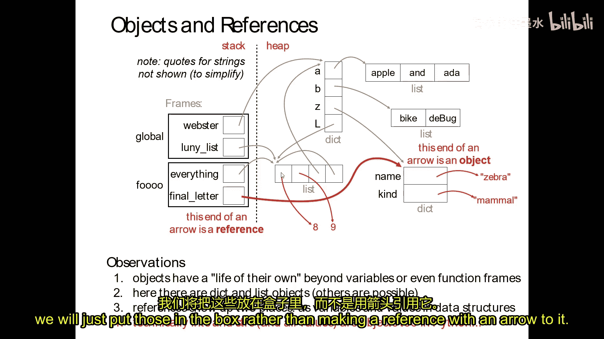
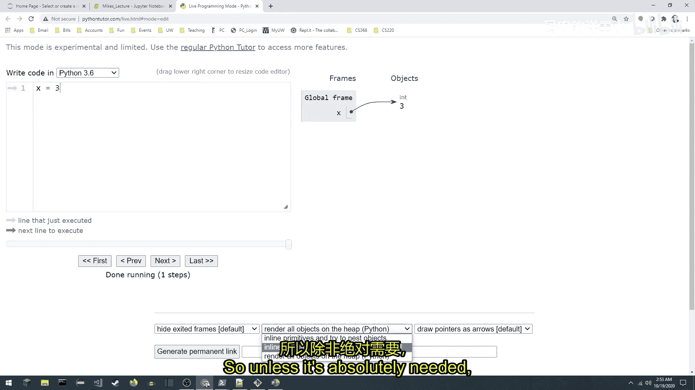
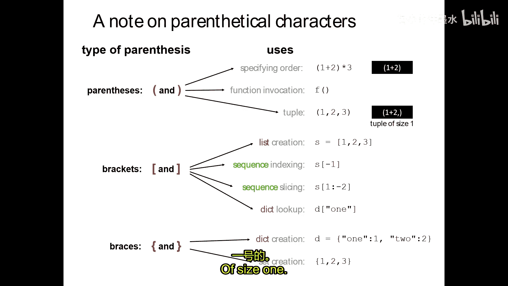
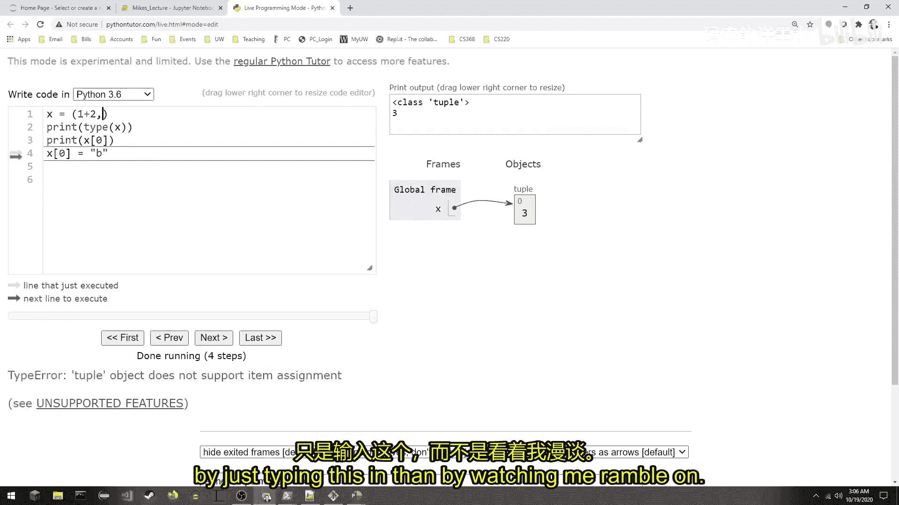
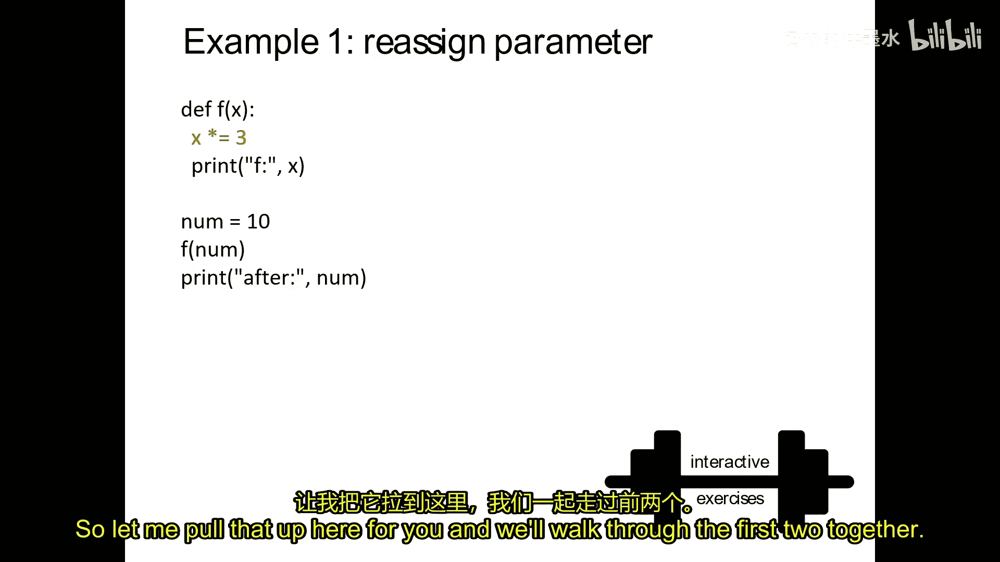
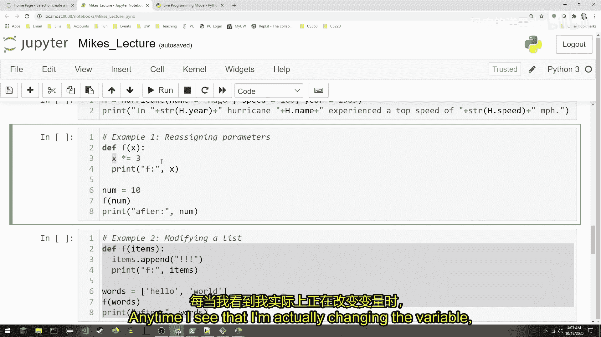
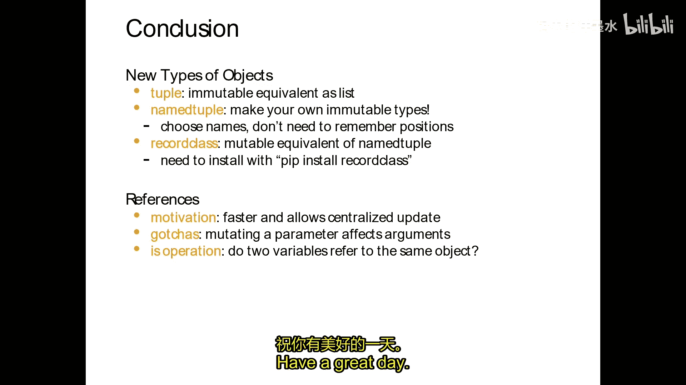

# 【全集】威斯康星大学-Python数据编程-CS220-中英字幕-1080P-p18-Lecture-15---对象与引用--BV1VxvsBLEmv_p18-

Alright， good morning， everybody。 Welcome back to data programming1 today。

 Just a couple of announcements as we get started under the code section。

 I'm putting together a Jupyter notebook more as like a note taking guide than anything else。

 probably not actually even going pull it up during the lecture other than to maybe copy and paste something。

 But for you guys， it's out there as we go through some of these slides。

 It's gonna be a place where you can write down your guess as to what's gonna to happen。

 maybe do a little experiment。 if you want to pause the video and try some things。 Anyway。

 it's under the code section of our webpage go grab that as you get started， pull it up。 All right。

 second， cheaters caught。 haven't caught anybody yet。

 all of the problems where partners who both partners turned in their work。

 but didn't put each other's names on it。 So if you work with a partner。

 please put your partner's name on it and only turn in one copy。😊，First。

 if you turn in multiple copies cheating detection software flags your work and I go basically go through the most similar works and write to everybody and find out what happened。

 if there are people out there who are really cheating and you turn in your partner's work it meaning it means that I'm not catching those people。

 it's also a lot of extra work for us to grade duplicate assignments if we have to do it twice。

 So if you work with a partner， please turn it in。 I know there's a lot of people who want to work with a partner。

 but turn in their own work and get their own comments， their own feedback。

 we really can't afford to do that as far as like the time investment that I spend trying to track on people who are really cheating and the additional work grading the same thing twice So I know that's desirable and you guys would like that。

 but we just can't accommodate it。Al right， and then a quick reminder。

 please don't post more than five lines of code on piazza。

As we go and look at more and more difficult projects， they're going to take more time。

 they're going to be more challenging， please refrain from posting your code on Piazza。

 just bring it to office hours。All right， so today we're going to be looking at objects and references。

 This is basically trying to understand what's going on inside of Python with their memory model。

 how Python is looking at variables and what the variables are referring to those boxes where we've been just writing down you know this is x is equal to5 and string or message is equal to hello that kind of stuff。

 We're also going be introducing some new types Some of these are going to give us more control like。

And some of them are going to limit the amount of control we have。

 which is going to let us turn bugs into crashes instead of having our bugs just straight up。

 give us the wrong answer。 Crashing is always better than getting the wrong answer。Al right。

 as we get started， I just have a couple of questions that are going to motivate today's lecture If you pulled up the Jupiter notebook worksheet already I've got these questions here there's a question and then a little box where you can just type a one。

 two or three and pick your answer。😊，So what I'd like you guys to do is just。

 let's take a look at question A first， what is the type of the following？

And that it's just the open curly braces。 If I just say， you know x is equal to open curly braces。

 and then I do type of X， what do I get？And that's a really easy thing to just do an experiment to find out。

 but you'll probably remember better that I screwed this up if you actually type in a number one or a two。

 commit to it and then do your experiment。All right， so put down a guess。

And then let's take a look at letter C first， sort of some motivation might give us a better clue to what's going on when we get to be。

 So C asks， which type is it mutable。 And remember， mutability is the ability to change， so。

Is it a string， a list or a dictionary， Which one can I not change。Now， in a lot of ways。

 this is kind of a deceptive question。 When I'm talking about changing something。 sure。

 we've seen that， you know， X equals hello， X equals hello world。

 It looks like we're changing things。 There's a huge difference between changing an object and actually just reassigning the object。

 So any time we use an equals。 We're basically reassigning。 That's changing the variable。

 It's not changing the data that it's pointing to。So the answer here。

I don't think I gave you the answer for Ay did I So empty curly braces， that would be a dictionary。

 not the set to actually create an empty set， we have to use the set with the constructor as a function。

 with the ST open and closed parentheses。Okay， the one that's immutable is this string。

 We're not actually allowed to go in and change。Like the characters is in a string and so。

If I use the equals， and if you're taking some notes here。

 maybe grab another cell and just remember that to change a variable， I'm going to use equals。

To change an object or the data that a variable is referring to。

 I'm going to use things like indexing or an append or a pop or any of the other methods that like sort or。

key lookup， any of those things I can use to change the data。

But the equals is the one that's going reassign it。 And those are different。 So by mutable。

 I'm talking about like indexing into a string and trying to change one of the letters。

 I cannot do that。 Strings are im immutable。Okay。All right。 So answer is number one for question C。

 Alright， so now let's go take a look at question B。 If S is a string and L is a list。

 one of these will definitely always fail。 and the other one might fail。Might work。 Okay。

 so give that some thought。 Maybe do an experiment if you need to to try and figure this out。

 but definitely take a guess because if you， you know， actually get it wrong。

 your brain will force yourself to remember better when you do learn why this is Okay， so。Hopefully。

 I've rambled long enough and paused enough that you guys had a chance to read this。

 And a lot of people get this wrong。 So if you get this wrong， don't feel bad。

's it's a very tricky deceptive kind of question。 makes a great exam question。

 But the one that's going to fail is S -1 equals the period。 It's like taking the last letter。

 The goal looks like we're going to take the last letter of a string and just replace it with a period。

 but this doesn't work because I cannot change a string。 Strings are immutable。

 This is indexing into it。And trying to change one of the letters。 This will always fail。

 Python does not let us change strings。Okay， this second one length here might fail and under the circumstances when it fails is if this length of s is out of bounds。

 If this is a list that only has like three items in the list and my string has 10 letters。

 it's going to be trying to access position 10 of a list that only has three things。

 so that'll be an out of bounds。Indexing error。 It's totally possible this will work。

 If the string is short and the list is very long， then no problem。 It can find the right。

 It's not going to give us that out of bounds error。Al right， last lecture。

 we had this crazy picture of all of these different data structures and we were tracing the arrows to go from like one variable through all of the square bracket indexing he lookup to get to a piece of data。

What I want to do now is take a look at this picture and talk a little bit more about why we drew the picture the way we did。

Alright， so I'm going to click the the next thing here。

 So we've got two places on the memory first over here on the left。

We have part of the memory called the stack， and then on the right。

 we have the other part of the memory called the heap。And we have objects。

 All of these things over here on the right are going to be objects。 This is our data。

 the actual numbers and words and strings， dictionaries lists that we're storing。

 And then on the left， we have variables。 and these are all references。

So a great way to think about this are the pointy end of the arrow。

 this right arrow right there pointing at that data structure。

 the dictionary means that this is an object。 So the pointy end of the arrow。

 Where's my plus pointer。 points at objects。 The tail end of the arrow means that this is a reference。

 Okay， so objects。References。So in this particular picture， we have what we got two dictionaries，1，2。

3 lists。 So those are all objects that are going to be stored on the heap where all the data is stored。

 Also， technically， all of the strings， So Apple and Ada， bikeike， debug，zebra mammal。

 all of those are objects also。And even Python will consider numbers in eight and nine to also be objects。

 and it'll store those on the heap。Objects are， they have a life of their own。

 They're not necessarily tied to one particular variable。

 There has to be an arrow that points to them。 But check out this dictionary right here。

 This one has multiple arrows pointed to it。 So they're not necessarily tied to just one variable。

In Python， the moment that no arrow is pointing at an object。

 it's going to clean that memory up and that object is going to be gone forever out of existence。

 So we could do that by， let's see right here。 This list has only one arrow pointing to it。

 All I need to do is reassign。 Let's see what is this。

 This is Webster with a key A resign that to something else。

 This list no longer has any arrows pointing to it， and it'll just be deleted。Alright。

 this half over here， the stack。 This part of the memory is where we're going to put all the variables。

 It's called the stack because when we have a function and that function calls another function。

 all of the local variables for that function are going to be listed here。

 They'll just add one more box。 If that function calls another function， we just get another box。

 And so all of those。😊，Frames get stacked up when the function ends， we take the in this case。

 we're going from top to bottom， we'll take the bottom box off and remove them from the stack。

 So this stack is actually upside down as far as like visualizing like visualizing like a stack of plates or something。

 But that's where the name comes from。Because of those function calls and stacking up the variables when the function ends。

 those variables are deleted， nukeked， gone。And any objects that no longer have an arrow pointing to them also nuped。

Alright， so check it out。 All of the variables here are references。

 So variables are definitely references。 They're going to point to some other object over here on the heap。

Now pieces of data over here on the heap can also be references like this very like the key A in the dictionary Webster points to this list。

 so this actual piece of data right here is another reference itself。

 so references can appear on both sides， they can be part of objects or they can be variables。

And then I think I just said this， but technically ints like the eight and the nine are objects。

 and so are all of the strings like over here is zebra and mammal。

 So even though like something up here like Ada doesn't technically have an arrow pointed to it。

 this should be a reference to that string， just like this is a reference tail end of the arrow to the string。

That makes a rather overly complicated picture when we do this。

 So for a lot of things like integers and strings， we will just put those in the box rather than making a reference with an arrow to it。

 This picture gets a little crazy。

Alright， so in Python Tutor， all I've done here is create a variable assign3 to it。

 The default version that comes with Python tutor is called inline primitives， don't nest objects。

 That's default。 So that's just gonna say if it's something like an int or a string。

 just go ahead and write it in the below box here。A better picture is the render all objects on the heap。

 And that's going say， okay， I've got a line right here， or I've got my frames。 These are the stack。

 And I've got objects over here。 And all of these things are going to be objects。 So instead。

 it's going to have an arrow that's drawn over there。 This one's more accurate。

 but gets way crazy and doesn't really add anything to our understanding of the picture。

So unless it's absolutely needed， I really do prefer this default version。

Alright so I hope this quick review really motivates why we want to take a look at this complicated memory model。

 We're going to talk about creating new types of objects and particularly the tuple。

 the name tuple and the record class those three We're going to talk about how we can compare objects and references now that we have this more complex picture。

 what are the advantages， Why do we need this。Alright， so next。

 I'd like to introduce our first new data type， the tuple。 So here I'm creating a list of numbers。

 Both of these are sequences。 for the list， I'm using the square brackets。

Tups are a lot like lists here。 The only difference in creation is I'm using the smooth round parentheses instead of the square brackets。

 They are sequences。 They are a lot like lists， just like lists。 we can index into them。

 We can iterate over them with four loops the same way。 We can do slicing。

 We can use all of the other list methods like。Length， for example， the only major difference。

 and this has a number of consequences， but the only major difference is they're immutable。

 That means once we've created the tuple， we cannot change it。So we can't append to it。

 we can' index in and change something。 We can pull out a number with indexing。

 but we can't go in and make it different。Alright， so for example， here I'm using。

X to grab the second piece of data from the nubs list。

grabbing the second piece of data here from the tuple， so 012， that beat the 300。

 both of these will put 300 into x。However， I cannot go in and access element 0 in this case and assign it a new value。

 I can't change that 200 to 99， whereas the list is mutable， and I can easily change the 200 to 99。

 So that's what this immutability versus mutability。 This will。This one will crash。

 This one works just fine， puts in 99 there。 The error message is going to be something like Table object does not support item assignment。

That item assignment is what I'm doing right here with the equals。 anytime I try and using equals。

 it's going to crash。So why would we ever want that First。

 it's going to help us avoid certain kinds of bugs。 For example。

 there's just some data that we don't want to change。

 If we think back to like the data set of hurricanes we don't want to change the year that a particular hurricane took place in the hurricanes don't you know travel through time。

 we're not going to change the number of deaths， all of that historical data。

 we don't want to accidentally change it。 So by choosing a data structure that doesn't even allow us to change it。

 that'll crash if we accidentally change something。

 we're going to know right away that there is a problem when we can fix it。Allright， also。

 some use cases require it Dictionary keys， for example， cannot be mutable。

 so we cannot use a list as a dictionary key。Check this out。 here's a great example。

 If I wanted to use like the X Y coordinates， you know。

 this is in blocks relative to the compside building。 So psychology building is two blocks north。

 Noland is four blocks to the east。 Yeah， you get the idea this won't work。

 I cannot use a list as a key in a dictionary。 However。Yeah， oh。

 the error message we get is unhaashable type list。

 You can think of this unhaashable just means that it's。

 it's a mutable object that I'm trying to use。 Hahing is actually just taking some sort of data and reducing it down to a single number that we can then sort so it can quickly find things。

 We're not going to cover any more about that in this class。Al right， so the solution， though。

 because I do want to be able to create a dictionary that uses coordinates as keys。

 is to use this immutable twobal data type， which works almost exactly like a list with the only difference being that I can't change it。

 And the moment I can't change it。 Then it's O as a dictionary key。 just to note here。

 we've now introduced even one more type of parentheses。

When I use the same symbol more than one way in computer science that's known as overloading。

 and this might lead to some problems， just like we saw with the dictionary and the set creation。

 when we were talking about what if we just used the open curly braces， it's true。

 if we've got commas if there's a list， Python can tell， oh， this is a set。

 if we've got a colon with keys separating that from the value and knows it's a dictionary。

 but just the open curly braces creating an empty dictionary or an empty set。

 we didn't know which was which Python had to choose the writers of Python had to choose and they said it makes a dictionary so we can run into some very similar kinds of situations here where we may have parentheses used for specifying the order or they may be creating a tuple。

And so the ambiguity there。Comes in when I only have one piece of data in a tuple。 Check it out。

 If I have a tuple with， you know commas， the moment there are commas， Python knows this is a tuple。

 And I'm not just saying this is higher precedentnce。 Do the math first。

But if I only have one thing here， one plus2， how does Python know， right。

 the writers of Python said if there's only one thing， then we're doing math。

 we're going to do this arithmetic first and then multiply it。

If I want there to be exactly one item in my tuple， I need to put a comma in。

 So Python supports these trailing commas in lists and tus here。

 I'm just going to take one piece of data。1 plus2 evaluates to 3。

 So this will create a tuple with the number3。Of size one。

All right， so check this out。Anytime I'm mom。Working with a new data type。

 I'm going to go over to Python Tutor or somewhere and just try this out。Created。A two bowl with 1，2。

3。 I'm going to print out the type。Of x。And see that it's class tuple。 Allright， so next up。

I just want to see this for myself if I go back and just put in a one in parentheses。

 Python is going to treat this as a single number an integer。1。2 it's going to change it to a float。

I can have the letter A， then it's going to be a string。 But the moment I put a comma after that。

 it knows that I'm switching that to a tubable。 I can also try and change it。 So x of element 0。

Let's just print that out。 That should work。 whoops， oops， oops。put in insert mode， X element 0。

So I can access it。 just fine。 I'm printing out a， but I cannot go back and say x of 0 equals B。

 That's a crash because object does not support item assignment。 Alright。

 in I note taking guide on a Jupyter notebook that you downloaded。 There's some。

 it just says go experiment。 So try something like this。 Try out type， try creating something。

 try doing。No， one plus。2， that's going to be an int。 throw a comma at the end of that。

 and it's going to be a tubple。Al right， you'll learn a lot more by just typing this in than by watching me ramble on。

 So pause a video， experiment a little bit。

Alright， in this next section， I'm going to be introducing the other two new types we're going to be talking about today。

 the named Tupple and the record class。 So we just wrapped up the tuple。

 which is just like a list except it's immutable。 does all the same things that lists do as long as we don't want to change it。

 and lets us access use it as a dictionary key。 All right， the named Tple。

 while the name seems very similar。 the purpose is actually to let us create our own custom types。

 So pretty powerful stuff here。 and my motivation here。

 it's going to let us write it's going to give us a lot of control that control is going to let us write code where it's a lot easier to catch bugs and to think about complicated large scale projects。

 Allright， So I've got two pieces of code here。 they're going to print out hello。

 Alice Anderson and the second one is going print out Ho， Bob Baker。😊，M。

 the first versions using a dictionary。In here inside the list for all of my data。

 the second version is using a tuple inside the list of people， just go ahead， pause the video here。

 see if you can spot the bugs， both of these pieces of code have a bug in them that's going to prevent them from doing what we want。

Yeah， that Jupiter notebook note taking guide I put out there on the download it from the code just has a little box to let you put down your prediction。

 and I'll explain in a moment if you need to do a little experiment， go ahead and try that out。

Al right， so let's go through this。 The， the bug in this first piece of code is very subtle。

 So I'm declaring people。 It's a list inside the list are two dictionaries。

 So we've got first name Alice， last name， Anderson abbreviated age 30。 So the keys are F name。

 L name and age， the values， Alice， Anderson and 30。 same deal for Na Bobb。

And then P is going to be people。 Here's my list index0。 so P is going to be this first dictionary。

And then I'm going to print out hello， I'm going to go to that dictionary。 The first one。

 look up F name and find that there is no key with a lowercase F here。 F name is capitalized。

 Python is case sensitive。 So we're going to get a key look up error。 some sort of key not found。

 And then it's going to point to right here saying F name is not one of the keys。 All right。

 that's the problem with the first piece of code up here。All the second one here。

 I'm just using twoples with my data。 I'm grabbing P is people 1。 So this is 0。 this is1。

 So this is the Bob Baker row。 I'm going to print out hello， and then I'm going to go grab P1， well。

 this is index 0。 This is index 1。 So it's going to print out Bar。

 and then I'm going to add to it a space followed by P2 which is the number 31。

 but I'm doing the kcatenation operation。 And if I take a string。And concatenate an integer like 31。

 that's going to fail。 I cannot concatenate those two things together。 So let me ask you guys。

 between these two versions， if we I mean， we could fix these bugs。

 this just needs to be a lowercase F。 This needs to be 0 and a1。

 Which version do you guys like better。Do you prefer the dictionary version or the two bowl version。

 or we could even do this with lists。Work just the same with the list。All right。

 My personal preference is the dictionary version。 I like that much better。

 Once you get to writing bigger projects， things that are larger。

 it can actually be really difficult to remember which index number。 you know。

 pieces of data are stored at。 Think about some of the CSV tables we used during the project。

 some of those had many columns。 And if you had to go back and look up what number it was。 In fact。

 that's part of the reason that we used this header row separated it out and then used our header dot index and then looked up the column name page or whatever it was or depths or。

Whatever that was。 its so we did not have to remember that it was column 8 or column 93 that had the particular piece of data that I'm looking for。

 I'm doing something like this。 This dictionary version lets me name all of the pieces of data。

 And in that case。It's a lot easier to remember F name。 This will crash if I screw it up。

 and I don't have to remember an actual number or like scroll back up to where I've got my header and figure out what it's from。

 So that's I've strong preference for the dictionary version。Alright。

 so that was my motivation for introducing this named tuple。 I've got it right。 oops。

 Sorry about that。 So I've got my two examples。 These are the corrected versions with the dictionary。

 and with the tuple。And here's the third version。 The named Tple。

 and the named tuple would solve both of those problems from either of these。

 So let me I know this is kind of a backwards using an example。

 but maybe not not that backwards as it might seem。 So here's the idea。

 Let me just walk through this。 I'm going import named Tple。 It's found in collections。

 So it's not just available regularly in Python。 I've got to do some work。

 But this is going let me create a new data type called a person In this case。

 That person is going to have three attributes。 First name， last name and age。

Just like my dictionary had three keys， first name， last name and age。

 there are some serious parallels between dictionaries and dictionaries up here and named tus。

 These are going to be known as attributes in a named tuupple instead of a key in a dictionary。

Alright， and then I'm creating my list of people exactly like I had in both of these examples。 Now。

 instead of creating like a dictionary here with with the braces or twos with the parentheses。

 I'm creating a new an object of my new type person。 And I've got to fill in these three attributes。

 So first name， Alice， last name Anderson， age 30。 Okay， same deal with person2。

 I'm creating a person object。 So this part right here。

 person with the parentheses is just like when I'm created a set， an empty set。

 I'd have a set with the parentheses or a dictionary， D ICT with parentheses。

 This is a constructor for this kind of object of this type。😊，Allright， and then when I use this。

 so I grabbed P is equal to p 0。 people is just a list。 So P is this first object of type person。

And it has these attributes to access the attributes。

 So up here I was using brackets to index or a key look up here to grab the first name here I'm indexing it's add 0。

 This is just accessing the attributes with the dot notation so。Not exactly the same thing。

 but gets the same job done。 So that's going to go grab the attribute in this first position F name。

 which is Alice and then。E name Anderson。 So this will print out Ho first name。 Hello。

 Alice Anderson。All right， let me break down all four steps that we saw in the previous slide as we talk about name Ts。

 First up， name Tple is in one of the built in modules in Python known as collections。

 and we'll need to import that So from collections import name Tple。My arrow mist。

 this is what happens when you。Tlate from keynote into PowerPoint。 the analyze is line up。Forgive me。

 I'll move that over， we'll get it right next year。Alright。

 so then this is the line that lets us create new types。

 So here I'm creating the name of the type goes right here person。Then I'm creating a named tuple。

 this is the command that's going to be creating a named tuple。

 this is going to be the name of the type here over here。

 I've got the name of the type again quotes this is actually what's printed out when we use the type command on objects of this type so almost always you want this to be the same thing as over here。

And then we just need a list， this is a Python list with square brackets of the attributes。

These attributes need to be valid variable names， so while in a dictionary you could put spaces in。

 I could use like a string because that's immutable with space in the middle。

 I'm not going to be able to be quite as versatile as the dictionary strings。

 because they need to be valid variable names， but then there's just going to be a list of variable names in quotation marks。

Allright， then。 so this creates the type。Now to actually create objects of that type。

 we need to go ahead and create use the constructor。Person， so that's just going to get。

And then enclosed in the parentheses， will have these three pieces of data。

 We need to give a first name， a last name and an age。

 or we need to put apply supply values for those three things。 and we can either use positional。

Put them in order， or we can actually use。Keyword arguments， just like calling a function。

And then using。The new person object to access those attributes。

 I just use the dot notation and I can go back in and get any of the pieces of data。

Sttored in my person object，Now， a couple of things here。 So this named tuole is creating a new type。

 Alright， so let's take a look at this。 We have several types of numbers in Python。

 We've got ints and floats。 Allright， So number is sort of like a big category。 And underneath that。

 we have two subcategories。We also have a bunch of sequences。 So a sequence is。

 all those things that we can index， we can slice， We can get the length。

And we've got several things we've seen that are sequences。 They all have those， you know。

 methods in common。 We have strings。 We have lists。 We have the tuple。

 So names tuple is a way to create subtypes here。 I'm using person as my example。

 but we could create other subtypes。 We could create a subtype for hurricane and put in you know。

 the number of deaths， the damage it caused the year。It occurred in the month。 It occurred in region。

 whatever we want。 samee deal with。You know， more or less。

 any kind of data structure that we're going to be looking at for the rest of the course。

 we could create a named tuo with all those elements from the table。Alright， let's see here。 Yep。

 this is what I just said。 This is going be creating an object of the person。

The subtype of a named tuple。Yep， just like list with Prince these creates the new list。All right。

 the arrows missed again。 Oh that's terrible。 All right， I'll get it fixed next year。

 So these arrows， they're all shifted to the right by about 1"。

 But we can use positional or keyword arguments。 And here I've got the first holy how。

 Is this terrible。 All right。 Time out。 We're fixing this。Alright， all better。 keywords。

 So I can say age is 30 and that's going to plop it down into this attribute。

 First name it's going to plop Alice into that attribute。

 Last name is going to put Anderson into that attribute。If I make a mistake。

 if I accidentally type F name that's capitalized， this is going to crash immediately。

 Cring is always better than just getting the wrong answer。 So this is good。Alright。

 I also don't have to worry about the indexing issue because when I use these attributes to access things。

 I don't need to remember that Alice is stored at position one and。Well， first name was position 0。

 Anderson was positioned to one。 Hol cow。 I'm already messing it up， see。Attribute names。

 solve that whole problem for me。Alright， so if you're taking notes， quick summary before I move on。

 name tubs are a lot like dictionaries。Technically， their sequences， they're like lists。

 If you have a list， we're going to be indexing with 012 if we have a tuple index with 012。

 a named tuple is going to let me name those indices just like I'm doing right here。

 So in that way it's a lot like a dictionary where I get to name the keys。

 So named think about named as in naming the indexes。It's also a tuple。

Which means that it's going to be immutable。 We can't change it。 just like you can't change a tuple。

 You can't change a name tuple either。 So these are immutable objects。

 which means that if you wanted to， you could use them as keys in a dictionary。All right。

 as we move on， there is a mutable equivalent of the named Tple called record class。Alright。

 the syntax for using the record class and name Tple is almost well。

 it is identical with like one exception here。 So up the top。

 I have the name Tple version from collections import name Tple that's a built in module。

 I need to include it。From record class， import record class is where I need to go get the record class。

Module note it's not in collections。 And in fact， we're going to need to use Pip install to go get the record class。

 So if you haven't done that yet。 if you're experimenting， if you're trying this out。

 go back to your terminal type Pip install record class to bring this in。 So it's available for you。

 Other than that， check out this line personed name twople。

Is exactly the same except I switched out the word record class for nametupple because I'm creating I'm still creating a new sub type。

 I'm still calling it person。 It's just that it's going to be mutable at this point。

 I'm still declaring Alice to be the same。 I've got ages 30。 first name， last name。

 I'm using keywords。This case， I had the option to use。Positional arguments also or positional data。

The the huge difference here is that the named Tupple is not mutable。 I cannot go and say。

 take the person's age and let her have a birthday。 I mean， who doesn't love birthdays， right。

 not everyone likes getting older。 at least watching that number tick up。 But if she has a birthday。

 we need to be able to upgrade her age。 named tuple version does not support changing。

 It's immutable。 And so she's not allowed to have a birthday。

 Once we create her These fields cannot change attributes。

 These attributes cannot be changed in a record class kind of object adding once her age is no problem。

 She can have a birthday。 All right， here it is。 I forgot to put this in here。

 You will need to install the record class with Pip install record class。

 just like during that very first week of of class。

 we had to install Jupiter notebook book with Pip install。

 and we put a couple of other packages in that list same deal for record class。Allright， so next up。

 I want to go back to that mental model of what's going on inside of Python when we run code。

For this example， let's take a look at just assigning the word hello to X。So here in version 1。

 I've got a box。 I've got the word hello there。 The next lines says y equals x。

 So I've got a box for Y。 That gets hello。 and then y plus equals world。 There we go。 Hello world。

 The problem it works really great for immutable types。 It's basically the same thing。

 We cannot tell from the outside that there's any difference。

 Python actually uses this a Python tutor uses it for strings。

 and things that are immutable like integers and floats。

 But it's not correct for things that are mutable and completely ignore performance。😊。

So let's take a look at an upgraded mark2 version of the mental model for what's going on in state。

 So I'm not going to draw any frame boxes。 I over here on the left I've got my variables and but I am going to draw all everything as an object here。

 So when x equals hello， I get a box for that it's going to reference this string object hello。Now。

 when I say y is equal to x， what this line really。

 really means is that y references the same thing that X does。 So I get another box for y。

 It's a reference to the same object。 So the arrows pointed the same place。

 They are both pointed to hello。 Now， the moment I do this plus equals。

 There's an equals right there。 I've got an assignment。 I'm creating a new object。Hello， world。

And I'm going to say， let why。Reference that new object Hello world， okay。

And the key takeaway is that these equals are going to be Y references the same thing that x does when I'm doing something like this。

 if x， if the right hand side over here of an assignment is a reference。

 Y is going to reference the same thing。Alright， and this is going to be true。

 So here I've got x is equal to whatever y references， whatever x is。

 no matter what this is assignment。 The same thing is going to be true if I'm passing。

A variable to a function。 So in this case， I'm calling here I I start here at the top。

 I define a function that takes a parameter Y。 Python' is going to remember where that function is。

 Then here I've got X。 I'm going to assign some value to x。

And then when I call the function and give it X， it's going to pass that data to y。 And in this case。

 remember， this says y should reference whatever X references。 It's the same exact。 I mean。

 check this out。 I copied and pasted that line。 Y references whatever X does。

So let's take a look at some examples。So I mentioned a moment ago that the way Python tutor shows stuff。

 I can either just show inline primitives， but don't nest them。

 That's this version where I just write the variable in the box。

 That's version one of our mental model。Version 2 is render all objects on the heap。

 This is really useful for tracking down what's going on with things that are mutable lists and。

Record class and。Dictionaries。Al right， so both of these are the same example。

 same code in both cases。 it's just representing them differently in the picture。

 And I demoed this a moment ago on Python Tutor。So let's take a look at。

The issue of why do we have this extra complexity， why are we separating things， you know。

 references and objects， keeping them， you know， like doubling the amount of stuff I've got to keep track of in my brain。

Why not just use the same original organization for everything。 And there's。

 there's really two reasons for this。 The number one big one performance。 So check out this example。

 If I use the version 1 where I've got two boxes， one for x，1 for y。 And I say。

 I can just create a character。 Let's a string。 Let's just put the entire contents of a book in this string right here。

 Lots and lots of characters。 All right， what I really want is for this line。

When I say X references the same thing， whoops Y references the same thing that X does。

 If all I have to do is draw an arrow。 This is fast。 drawaw in one arrow is very quick。

 say its points to the same thing。 This is just basically copying the memory address where I'm storing it。

 If I had to go and make the version 1 with two boxes and copy that string twice。

 It could take a long time。 twice as long。 In fact， All right。

 the second reason that I might care to do this。 is for what's gonna to be known as centralized updates。

 So there's a lot going on here。 let me just start right here and walk through what's going on。

 So from record class， import record class。 So I'm gonna to be creating something that's mutable And I'm gonna be creating my own type。

 Here it is。 I'm calling it person。 It's got three attributes， name， score and age。Again。

 this second person is what is printed out when I do type of that object。Okay。

And then I'm going to be creating two of my person。Objects， so Alice is going to be a person。

 she's got the name Alice， score and an age。 we don't need last names anymore。嗯。

And then we'll create a second person， Bob score 8， H 25。 Does it seem like Alice always wins？

I don't know。 Maybe Bob will have his day。 And then what I'm going to do is I'm going to create winter and have it equal Alice。

 So when I do this， let me just click through， oh， let me finish my coat。

 Alice is going then have a birthday， and I'm going to print the age of the winter out。

 So let's go through and see what happens。😊，So first， I create Alice。

 that's going to create an object named Alice over here。 Here's the name of the variable。

 It stores the data。 Alice， her score and her age on the heap。 When I create Bob， it stores his name。

 his score in his age。 So these there might be a little confusing because I'm using the name of the person as the name of my variable。

And then I'm going to say， okay， who's winning So I go through， I look at their scores。

Alice is winning。 So I declare Alice to be the winner and say winner equals Alice。 Now。

 that's going just say that winner references the same object that Alice does。

So both of those arrows point to that object over here。 Now， when Alice has a birthday。

 I can go back to Alice and upgrade her age to 31。And now， when I print out the winner's age。

 that also will already update winner because it's just going to go to this same object and grab the age。

 which just got updated。 So it's going to print out 31。Yeah。

 so even though we didn't directly modify winner， I didn't have to， it didn't make a copy。

 it's just referencing the same object。All right， I just want to go over a few examples now up where having multiple variables reference the same object can get us into trouble or be an advantage。

 Anyway， just thinking about this and walking through it。

 this is probably most easily done in Python Tutor。

 where we can actually see everything visually over there on the right side of the screen。

So what I've got here are things。Designed to be interactive exercises。

 They will probably be on the web page tomorrow evening at the latest。 They're not there yet。

 So what I've done is I've copied this code that it will be in the interactive exercises into my Jupyter notebook that you guys could probably be following along。

 I recommend copying and pasting it， though， into Python tutor and walking through this line by line to actually see what's happening。

 If you just run it in Jupiter notebook。 you'll be missing out on that step by step interaction。

 So let me pull that up here for you。 And we'll walk through the first two together。 All right。

 in the first example we'll be defining the function So this is just going tell Python that to remember where the function is。

 The object over here。 The function is itself an object。😊。

Then we'll be creating a variable nu。 And that's going to just so right now I'm using the don't nest the objects just use the inline primitives。

 So things like numbers and strings。 I'm going to go ahead and switch that right now to render all objects on the heap。

 There we go。 So in 10 will be over here。Then I'm going to call the function nu。

 which call the function F given nu as a parameter。 So that's going to take numb。

 it's going to say x references whatever numb does。 So if I go next。

When I get up here to my function， X is going to reference whatever nu does。

 So I get both arrows pointed to the 10。 Now 10 happens to be immutable。

 Can you imagine what would happen if we tried to change the number 10。

 it would completely break math。Alright， so when I go ahead and then inside the function。

 I've got this variable F， which references that object。

 I'm going to be multiplying it by 3 and then reassigning it to x。 What that does is it takes the 10。

 It knows the 10 is immutable。 and I can't just change this。 And so it's going to create a new。

Object on the heap， another integer 30。 and assign that to X。 We'll print that out， print out 30。

 The function ends。 It goes back here， and then we print out after andome。Okay。

 so excellent straight pretty straightforward for things that are immutable。

 like integers and strings。This does exactly like what we'd expect and what we've been seeing the whole time。

 All right。 Now， the moment we get to immutable data types， let me pull up the next example。

 I think I just misspoke。 I meant mutable data types like a list。 Let's check out this one。

 So the first line here tells Python to go remember where my function F is。The second line， actually。

 we jumped on to5 next line 5 creates a list with some words in it。 Hello and world。Alright。

 so when I do the render all objects， remember strings are objects themselves a list。

Has references to those objects， because these are objects themselves。 Okay。

 then I'm going to call the function and pass in words。 So what that does is it's going to say items。

 it'll create a new frame。The parameter items will reference whatever words does。

 because this is just another way to do assignment。

OkayItems is referencing the same list in that case。After that。

 we're going to call items append and give it some exclamation marks。Let's see。 there we go。

 Now it's added another string to the list。 However。

 both words and items both point to the same list。Now， this was app pending。

APending is a way to change the data。 It's not an assignment that's going to change a variable。

 It's actually changing the data。 So in a moment， I'll demonstrate just doing that with assignment。

 But in this case， So things like app or using the index or sorting。

 All of those are going to change the data。 Let me just finish this up。

 We'll print out F that's got all three items in the list we finished the function and we print out words which also references the same words。

 the same data， same object。 And so it prints out the new changed list。

 so check it out words before we call the function only at two things hello and word。

 after we call the function， it changed it。 and we now have hello world and some exclamation marks。

Alright， I want to do this a little differently real quick。 So instead of items append。

 we also have the power to say items equals items。And then we'll do， we'll just add a list to it。

And that list will contain。There we go。 So plus with lists is going to concatenate。

 Let's go back to the first step。 All right， remember where F is Word create word list。

 Hello and world Call a function。 It is now going to reference that list。 Now。

 the moment I do this with the equal sign right there， that's manipulating the variable。

 So it's going to create a new list， items plus the exclamation marks and say items needs to point to that list。

😊，So I need to be a little careful how I do things because this is going to lead to some bugs。

 you guys when you are working on the projects and you start manipulating。

 having functions manipulate lists that are mutable， adding things。

 changing them this gets complicated and really easy to make mistakes。

So that's kind of why I'm going through this in like it is hopefully enough detail and hopefully slow enough。

 Let me know if I'm， if you need to hear any of this again。

 Yeah back the example function is going to print out the items。I'm not clicking the right spot。

 There we go。 printnt out the items。 the new list， The function ends。 that list got nuked。

 The function is gone。 and now it's going to print out just the the words。 So this did not modify。

My words here。Alright， so guys， here's the Jupiter notebook with all the examples in it。

 Go ahead copy and paste these into Python Tutor。 I feel like this is going long already， so。

This is example I just did， I just changed this one line right there items。Yeah， just like that。

 But there's two more here。 Go ahead， copy and paste these in。

 There's lots of different ways that we can like， modify data。Indexing。

This appending popping lots of different ways， any of the methods that work on these， I mean。

 it's hard to even like put out like these are the exact things because there are methods associated with different mutable data types that allow them to be changed。

 but if what the key is if I had to say something is to look for the equal sign。In this case。

 it could be multiply equal or plus equal， those are the kinds of things where where I've got an assignment。

Anytime I see that I'm actually changing the variable， I'm not modifying the data。

But I want to wrap this up。 I've got one more thing that I need to talk about today。

 And that's the is versus equals。 So now that we have objects over on the heap。

 on my data over there， I need to be able to ask， not only are two objects equivalent。But are they。

The exact same object are two references equivalent。 Alright， let's take a look at this。

 here's my example。 I've got W is a list。 It's got the number one in it。 X is a list。

 It's got the number two。 Y is a list。 It's got the number 2 and Z。

Res to the same thing that y refers to。 So that list。All right， so first。

 how many objects do I have guys？Oh， it's right here，1，2，3。 How many references do I have，1，2，3，4。

4 references。 Okay， now it seems to me that these guys are exactly the same。 X and Y。

 they should be equal to each other， right。But doesn't it seem that Y and Z should they're also equal to each other。

 They， but are they more equal， The answer is not more equal。

 but Python' is going to give us a way to determine whether they're the same object。

Or they're just the same。So let's just go through some of these。 W equals x。 That's not true。

 This has a1 and that's got a two false。Does y equal z absolutely， not only do they have the same。

Number there， they're the exact same object， definitely equal X equals y。 Now。

 the makers of Python had a choice here， and they decided that yes， if。The objects。

 if I compare all the elements in the object， every little piece of it。

They're going to be equivalent if they have exact same data。Now。

 the next piece is this is a new operator that will check to see if two references refer to the same object。

 In this case， if I say x is y， no， these are different objects。 so that should be false。

And now if I do y is Z， both of these are， in fact， the same object， so this should be true。Okay。

 so that's all there to it。 That's pretty straightforward。

 One of the major reasons this is really useful is， you know， I know that x is equal to y。

 They had the same value moment ago。 But this will tell me that if I change one。

We'll see that it will also change the other one。 So just a quick way for us to check that。

 So if I append something to y and append is one of those modify a list methods。

 and then I it will also change the because y is the。Here's the gotcha。

 Sometimes Python will de duplicateupate equally mutable strings。 So in this case， it does。

 it does this for optimization。 Here， take that。 maybe look at this example。

 If a is equal to ha times 10。 So I've got ha ha ha， ha ha 10 times。

 And B is equal to ha ha ha ha ha and print them out。 they are definitely equal to each other。

 it's going to go through and check all the characters and make sure they're the same。

But then if we print A is B， some of this Python optimization will actually go ahead and say yes。

 they're the same。And actually make them the same object。 It'll just have。

 it'll put the 10 H's in the first line， and then it'll just have B。 say， yeah， check it out。

 It's the same。 and draw an arrow up there。 And this sort of optimization does improve performance because I don't need to like create the second string if I know it's exactly the same thing。

嗯。The problem， though， is the moment I replace 10 with something really big。

 it's actually a lot less efficient for Python to go and compare two monstrous strings。

 So if I put in 1000， we've got 2000 characters here， Python won't bother to check。

 and it'll just make its own string for B。Al right。

 I'm not sure I've actually like reached the conclusion slide before， but anyway。

 pretty much all the PowerPoints have them， but I just wanted to highlight we got three brand new types。

 a tuple is a list that we can't change。All lus to it。 Use parentheses。

 A named tuple kind of brings in some elements of a dictionary。 It's gonna to let me name the。

 they're not keys， but they're attributes。 It lets me name the index indexes。

It's also going to be immutable because it's a tubal so I don't need to remember like the position in the array and then I've got a record class。

 this is a mutable version of a named tuple。 it works exactly the same except I call it a record class。

So these things allow me to write code that's of higher quality。

 more easily find mistakes and fixed bugs， and can make my code a lot more readable for other people who are working on my project。

 helps keep track of like once we get to projects that have many， many variables。Many。

 many columns of data， for example。 All right， We also explored the python like mental model of what's going on with the memory with all the variables。

 This let us do two things we talked about performance。

 how some operations can happen much faster and allows for centralized updates and then some gotchas。

 like if we have two references to the same object。 that's mutable。 Then changing one affect both。

 Sometimes that's good。 Sometimes we overlook that that's going to happen。 It's a side effect。

 And we end up with bugs as a result of that。 So something you definitely need to be aware of。

 It's a tool we can use and sometimes it bites us。Al right， guys， this is gonna do it for me。

 Everybody。 have a great day。 And if you have any questions， this is hard stuff。

 go bring it to piazza。 If you do some experimenting。

 find an example that does something you did not predict， come to office hours， put it on piazza。

 and I will talk to you guys soon。 Have a great day。😊。

