# 【全集】威斯康星大学-Python数据编程-CS220-中英字幕-1080P-p19-Lecture-16---复制--BV1VxvsBLEmv_p19-

Al right， everybody， welcome back to data programming1 today。

 I're gonna be looking at a review of objects and references。

 I remember when I was first learning this stuff。 it was really challenging。

 This was one of the first topics I ran across that I don't think I got the first time through。

 and I had to spend more time on this。 So a lot of what we're going to do today is review that by going through a lot of example problems where you guys will do a problem。

 test yourself。 see if you， remember what's going on。 And then I'll talk about the answer。😊。

And then if this were a live lecture in person， the way I would love to do it。

 I'd be handing out a worksheet。 Everyone would pick up a copy of the worksheet at the door。

 we'd go through these problems， thered be some time when you would do it。

 and then I'd show you the answer。So I'd like to do as much of that as possible to capture that spirit where this is a chance for you guys to test yourselves。

 So there is a worksheet on the web page go download that worksheet。

 print it out or get some blank paper。 The problems will be on the screen but actually use paper for this one。

 The last couple of lectures I've been preparing like a note taking guide。

 We're not actually covering a lot of new material。

 This is like a chance to work practice problems So I'm not gonna to do that note taking guide thing Jupyter notebook for today。

 I want you to get some real paper and a pencil。Alright， and then after we're done reviewing that。

 that's like the first 80% of the lecture， we're going to spend a little bit of time and talk about copying data structures。

All right， so as we get started， let's go ahead and just start with some review problems。

So this is sort of a test yourself activity。 I would have this up as you came in。

 you'd be sitting there waiting for class to start。 and you could look at this。

 But let's just go through this together。 So first up， question a， what do variables really contain？

 Allright， do they into objects。Or do they contain references to objects。

 So on that blank sheet of paper that you got out or the works sheet that you printed out。

 go ahead and just write down a one or a two。Allright。

 question B there This goes along with a picture。 How should we label the blanks in the hierarchy？

 Alright， so here's the blanks。 They're black with question marks。

 The choices are put named tuple in this one and tuple in that one or do we put tuple in the one on the left and name Tbal in the one on the right。

All right， so just again， just choose one or two。And then for problem C。

 which of the following actually live inside of frames？Are they objects？Or variables。Okay。

 let's go through these answers now。 Hopefully you've had a chance to take your best guess and pause the video if you haven't give that some thought。

 Okay， so what do variables really contain， variables contain references to objects。

 If you remember from the last lecture， all the pictures we are drawing。

 we had we have the the frames over on the left hand side with all the names of the variables And then on the right hand side。

 we had the heap where all of the objects were picture。

 we had arrows that went from all of those over to the objects。

 So all variables contain references to objects。 and everything in Python is going to be an object。

 all of the data as an object and the variables just contain arrows that point to them。All right。

 next。 How shall we label the blanks in the hierarchy。 This one is number one Nad tuple is over here。

 Nad Tple is a structure that's going to allow us to create our own types。 So with a name tuple。

 we can create a brand new person type and then we can create objects of that of that person type。

 So new person type object of a person type。 we can create a new hurricane data type to store data specifically about hurricanes。

 and then we can create objects with the data about a particular hurricane。 an instance of that。😊。

Al right。 and tus， of course， do not allow us to create our own subtype。

 They are just going to create objects directly。 So name tuple and tuple on the right， number one。

And then which of the following live inside of frames。 Those are going to be variables。

 So and I talked a little bit about this already when I went over question a。

 but variables live inside frames， they have a limited lifespan。

 They are only active during the time that that frame is active when a particular function is operating when the function ends。

 those variables die。 All right， objects， on the other hand， They live on the heap。

 We can have more than one variable that refers to them。

 Sometimes they'll have variables in different frames that refer to the same object。 So， and again。

 they're going to be， on the right side of all the pictures that I'm drawing。

So the learning objective for today is 80% practice with object references。

20% learn about making copies of data。 And there is a number of reasons why we might want to make a copy of something。

 if we want to retain a copy of the original and then make a copy of the data to do some manipulation or some calculation where we're actually going to be changing that data。

 I'd be good to be able to make copies。 right now， if we've already learned how to make reference copies making a new reference and we'll do some review of this if this doesn't jump out as something that's obvious。

 This is where we just say x is equal to a list。 Y is equal to x Y is going to refer to the same list that x firstity。

 That's what I mean by reference copy。 But what that means is that either one of those could be used to change the list if we want to make sure that we make a copy we've got two different choices。

 Sha copy and deep copy， deep copy is the one that most people are familiar with exactly like you'd expect。

 it makes a copy of the entire list and all the pieces of the list。 everything all the way down。

 So here I want to introduce the idea of depth。depth is。

When I had a variable and I was trying to get to a piece of information。

 if you remember that loooney list exercise from a couple of lectures ago。

 the depth is how many arrows do I need to follow to get to the data that I'm interested in。

 Deep copy copies all the way down to the bottom depth。Shallow copy only copies the first level。

 Only one arrow gets copied。 If that particular entity。

 that data happens to be another reference to like another list or something。

 it copies the reference。 not the actual data。 And we've got some pictures。 We'll do some examples。

Allright， so we're going to talk about the implications for copying data。

 We'll learn different ways to make duplicate data。

 we'll choose we'll talk about why you would choose one over another。

 Why not just always use deep copy because it makes sense。

 And the reason there is generally performance。 Some of these are faster than others。Alright。

 please go ahead and read chapterer 4 of Swwaigggert beginning with references。All right guys。

 this is problem one on the worksheet。 That's where I want to go next with lecture。

 So if you haven't printed out the worksheet yet， pause the video go to that right now。

 I want you to have some real paper that you can write on。Al right， go ahead。

 I'll just I pause the video， give this a chance。 go ahead and try and fill in the table。

 These are all just true false questions。 For example， iss the list mutable， Tru or false。

 Is the tuple mutable， true or false， Is the list pre installed， Tru or false。 Put it right there。

 All right， And then I'll come back in a second， and we'll go through it。All right， guys， I'm back。

 Let's just go ahead and do this。 So first， can we change the the values of stuff in a list？

 That is true。 Definitely we can。 What about in a tuple。 Now， tus are immutable。

 That's why we can use them as keys for dictionaries。 Nad tuple。 Also false。

 That's just a tuple where we've got the power to name the attributes， record class， true。

 we can change it。 It's a named tuupple。 That's mutable。 All right。 That's kind of the whole point。

All right， pre installed。 What this refers to is， did I need to use Pip install to be able to use this。

 So list is definitely pre installed。 That's just available at all the time。 Tple。

 and didn didnt do anything special to use tus named Tple。 Yes， they're pre installed。

 I had to bring them in with the import。 but I did not have to use Piip installed to grab it。

 Record class was not pre installed。 I had to go in and grab that with Pip install。All right。

 hope that's pretty straightforward。 But in。 This is referring to。

 Can I just use it directly like a list， I can just go make a list。 I can make a tool。

 I don't have to do anything special to use a named tuple。

 I need to import that one's from collection。 So it's not built in。 It's available。 It's a module。

 It's part of Python， but I need to import it， so。Not built in。 And again。

 same with the record class that is not built in either。 In fact， we had to pre install that one。

Alright， next up， does it allow us to create new types。 No， now， the list does not。

 That's gonna to be false。 The tuple does not。 That's false。

 That was actually problem B on my like warm up exercises was about that。 Na tuple and record class。

 both allow us to create new types。 So they're just like little factories that let me create a new type with custom named attributes。

 Oh， that's the next column。 Hol on， Mi， Let's fill this in。Can I name the attributes in a list。 No。

 absolutely not。 It doesn't have attributes。 It has indices。 And Python's gonna to pick those for us。

 They started 0， and they count it by one。 A tuple。 same deal。 It's a list that is not mutable。

 More or less， it's got the same indices。 same indexing structure Were not allowed to name any of the attributes。

 Nad tuple has indeed named attributes as the name implies。 That's true。

 Same as with the record class。 The only real difference between a named tuple and the record class is that it's mutable。

All right， Before we move on， I want to just go over one little thing to clear up a common misconception。

 I'm sure not everyone's confused by this， but enough people are that I want to spend a little bit。

 just review real quick what assignment really is doing inside of Python。 So here in the first line。

 I'm declaring a variable X。 And I'm assigning a list to it When I see these square brackets I'm creating a new list。

And then the next line here is going to take y and say that y refers to the same object that X does。

 So this is the exact picture you guys should be thinking about when you see this。

 So I'm creating a brand new list。 This is going to be a list over here on the heap in object space。

 It's got A B and C as elements of those list And X refers to that list。

Then when I do Y is equal to x， that's going to say Y refers to the exact same object that X does。

 All right， here's the common misconceptions。 First。

 that y actually gets its own brand new copy of the list with independent elements。

 That's not exactly what happens。 If I change Y。 because they both refer to the same object here。

 X will also change。 Any changes made to this list through Y will be visible by X。

 So this is not the exact picture we want。 We can do this in Python。

 This requires copying it or creating a new list with the same elements。

 but we need different code to do this。 This code does not do that。

 And I'll demo that code in just a few minutes。To actually show you how to do this this is another really common misconception that y is actually referring to x and the arrow points over here to a variable nocode will ever make this happen in Python。

 There are some other languages programming language for which this model actually is how things work。

 but that's not true in Python。All right， so this is one place where we have seen variable assignment。

 There's another place where we've seen variable assignment。

 If I take a look at when I pass arguments to a function。 So let's see if we go through this code。

 First thing that's really going to happen is I'm going to be creating a variable X and putting a list into it same list I had before。

 Nothing new here。 But then I'm going to be passing X as an argument to this function。

 and it's going to end up in this parameter Y。 essentially， what happens on the inside is that。

You can think about it like an imaginary first line of this saying y equals x。 And in that case。

 y should refer to the same thing that x refers to。 These are going to be in different frames。

So I'm going to draw a little bit more here just to be a little extra clear。

 in the global frame we'll have the variable X pointing to this variable on the heap。

 the object on the heap。 sorry Ipo。 And then in the function frame F。

 we have a new parameter Y that's also going to refer to the exact same object on the heap。

So both parameter passing and just regular assignment like we used in the first example here。

 they work the same way。 We are not actually making a copy as those common misconceptions would suggest this is what's really happening。

 There is just one object on the heap。

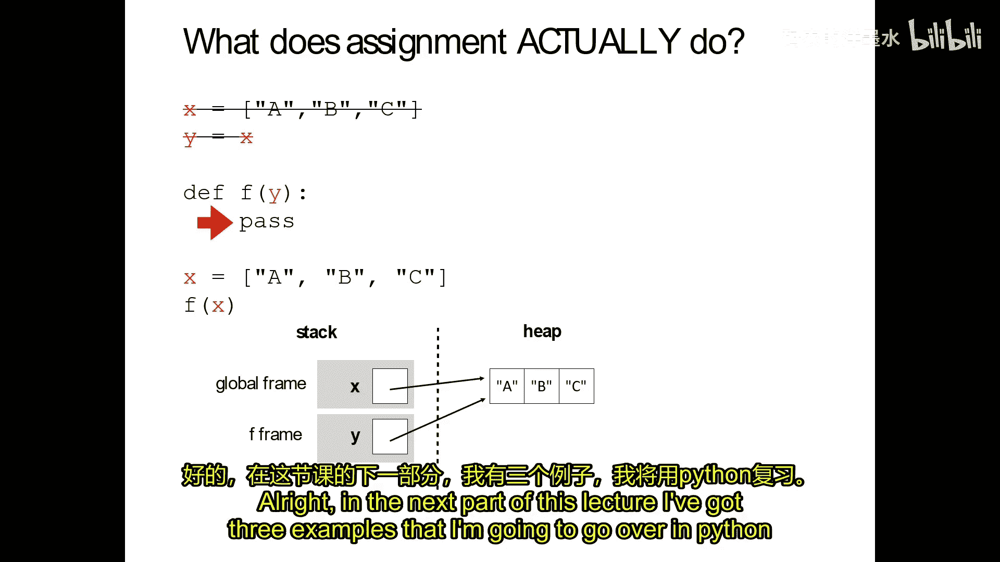

Allright， in the next part of this lecture， I've got three examples that I'm going to go over in Python tutor。

 These all three of these are available as interactive exercises。

 You can go to the links from the webpage and go through an interactive with this code yourself。

 and go through and it asks some questions。 It as you click on things to just make sure your understanding is rock solid。

 Okay， so let's go through this one。 I'm going to do the Python tutored version rather than the interactive exercise。

 And just I want to talk about what with this first example I want to talk about visibility。

 So a visibility is just which variables can see an object。 So here let's just go through this。

 first， I'm creating an empty dictionary。 labeling it X。 So the empty dictionary is the object。

 X is the variable。 It's in the global frame。 and this is going to refer to that empty dictionary。

Next， we're going to create a variable Y， and Y is going to refer to the same object that x does。

 this same empty dictionary。Next， I'm going to add a key Wisconsin and put in the capital Madison。

And that's gonna go ahead and add a let me right now， I have this in render all objects on the heap。

 Let me go to the default version， real quick。I like the way this looks better。

 It's a little cleaner for this example。 but technically， these strings are also objects。

 So in the dictionary， I had both the key and the value as strings with those extra arrows。

 But I like the way this looks for this example。 So in this case。

 I've added a key Wisconsin value Madison by accessing with the variable Y But X can also see that same change to this object。

 So in the next line I'm going to print out X。 and I'm going to use the key lookup Wisconsin and it will print out Madison right there because X and y can both access this object。

 That object is visible to both of them。 So that's the keyword visibility。

 let me grab the next example。 be right back。😊，All right， A slightly more complicated example here。

 But this is also going to focus on the concept of visibility。

 Which variables can see the objects and interact with them。 So the first thing， as we just。

 I'm going to walk through this code then I'm going to talk about at the end。

 We're defining a function。 So the first thing that happens is Python is going to remember where that function is defined in the global frame。

 functionss are objects， too。 So in the global frame， I've got a variable that first that function。

 yep。Gariable that refers to the function。 I keep using that language。 It's true for functions。

 It's true for dictionaries。 It's true for lists。Okay。

 so next thing I'm going to do is I'm going to declare variable items。

 this bracket right here means I'm declaring a new list that's going to be a new object over here。

And items refers to that list。Next number equals items。

 says create a new variable number that refers to the same thing that items does。

 that list right there。Then using numbers we'll call the function fo。So that's going to jump up here。

 The first line in F says， al right， give me a new stack frame。Then。Create a parameter。 Ns。

 and nus equals。Numbers， so that's going to say nus refers to the same data。

 the same object that numbers does。 So I've got an arrow that refers to that。 At this point。

 I've got three different variables that can all see this object。Alright。

 so we'll go through the rest of this function right now。 So nus dota pan 3。

 It's the first thing we'll add a three to that， and then we'll print out nus。Right， there it is。

 So that's the numbs version inside the function。 All right， after the function ends。

 we jump back down and we'll print out items。 So I should mention， let me just go back one。

 that function right here。 existed。 I've got a stack right。 Nums is a live variable right now。

 I was using it。 The moment I return。 That gets nuped。 That's gone completely。

 I'm drawing my mouse with like an X right there because it's not there。Allright， so next up。

 the next line that executes will print out items。And that's going to give me this  one，2。

3 note that nuums was actually able to change the list， to change the object inside of the function。

 and that change affected both items。 and let me click next and numbers。

So that same object was visible to three different variables at one point during this。Alright。

 I'm back with my third example here。 So this is an example where I'm going to be creating a new object on the heap。

 So let's just walk through this。 First， x is equal to that shortlist with A A A and BBB。

 So there we go。 exactly like that。 Now， there are a number of ways we can create new objects。

 This is one I'm using the bracket right here。 that creates a new object on the heap。 Also，😊，Slicing。

Concatetnation anything with beginning with a quotation mark， anytime I'm like using immutable data。

 So strings with quotation marks in them straight up just regular numbers。

 Those are all creating new objects on the heap。 So in this case， this is slicing。 I see。

 I've got the square brackets。 And I'm using the colon。

 This one happens to be a slice from well no beginning to no end。

 So it's going to include the entire。List， so we're getting the entire list。

 and this is going to create a new object。 So slicing is one way。 And。

 you'll see this in people's code。 If they want to make a copy of something， this is a quick。

 easy way to just make a copy so that y doesn't actually change X。In fact， if I go ahead， well。

 the next line of the code changes X。 I'm going to go ahead and pop 0。

 So that's gonna take the very first element。 Now let me put this back a second。

 The first element at index 0 and remove it from the list。 If I wanted to。

 I could store the in variableable， I could do something with it just calling it X pop by itself。

 just。loses that is just gone。 So I've changed X now。

 And then the last thing I'm going to do is print the length of y。

 And I should see that it still has one，2 elements in it。 So again， let me just。

 let me just for you guys take a notes at home。 So slicing。Concatetnation。Using the brackets。

 those brackets。Those brackets， quotation marks， numbers。

All of the time all of those things are going to create new objects and will actually do something like this。

嗯。Yeah， all right。 And then things that don't make new objects are just an assignment to a variable that's going to create a reference copy。

 things that append or pop or use a built in methods。

 There's a lot of places where built in methods are used。That don't create new objects。

 So it can be tricky to figure out which ones are going to create a new object and which ones are going to create a variable that points to an existing object。

 It's really challenging。 So my advice is to just get some practice。 Eventually。

 it'll become second nature。 and you'll just know that all this creates a new object。

 So it won't mess with you know， this won't mess with X。 that'll be separate。

 I can't They can't affect each other。

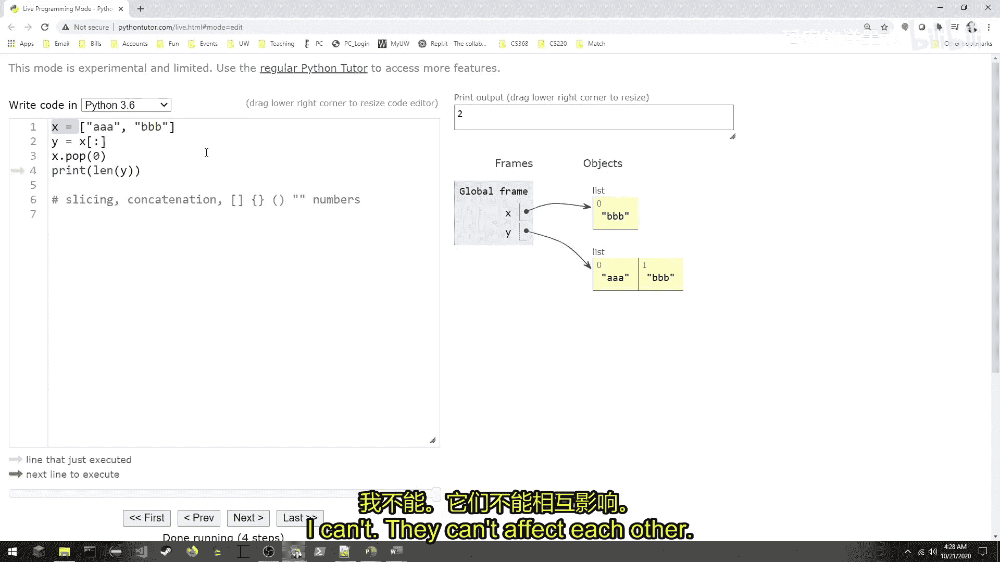

Al right， next up， I'm going to go ahead and go through worksheets problems 2 through 6。

 Let me go ahead and pull this up。 Hopefully that looks good。 scroll down a little bit。

 We did number two is done for us。 So the idea here is that we're going be looking at some code and drawing the picture by ourselves。

 by hand， the Python tutor would draw for us， where the arrows to show how it all works。

 where thearrow go， where the references are， where the objects are， where the variables are。

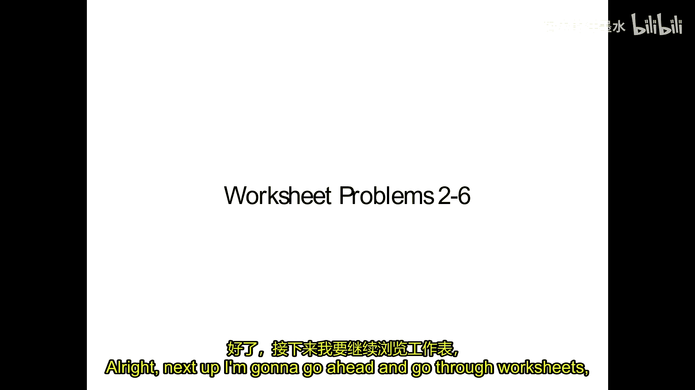

And I think this is really the most valuable to do on pen and paper。 Unfortunately。

 I don't have a document camera。 If I were in a real classroom。

 I'd be doing this on the chalkboard or with a document camera something。

 I don't have one of those cool tablets。 So I'm going be pulling this out in PowerPoint and hopefully it's probably gonna look really good at the end。

 but this is gonna to be like an hour long ordeal to do each of these problems for me with all the like PowerPoint manipulation。

But my advice for you guys is grab the worksheet， pauseuse the video and do these。

 and then come back and listen to the explanation and just make sure that we ended up with the same thing。

 And I'll probably have some extra details in there to add more information。

 So even if you're certain you've got them all right， there's probably value in listening。Allright。

 let me just take a look at this one that's done for us。

 So the idea here is we're creating a variable X and assigning it a list。

 So I'm going to draw my variable X。 I'm going to give it a little box。

 and the list is an object that's going to go over here on the heap。 And it's just going have 1。

2 and3 in it when I first draw it。 And then I'm going to put in my arrow。

 the reference and the object。 So arrowhead goes that the object reference goes with the variable。

 Next， I'm creating why this is check it out。 I've got a new bracket。

 This is creating a separate independent list。1，2，3。 because I'm using the brackets。

 It's not going to refer to the same list as this one。😊，Next， z is equal to x。

 so I've got another box here for z。It's a reference。

 It's going to point up here to the X list because Z will refer to the same object that X does。

 That's how you read this。 Z refers to the same thing that X does。 And then Z will append  for。

 That's going to add 4 to this top list here。 That change is going to be visible both through X and through Z。

So that's sort of the process that you guys are going to go through for the rest of these。

 I'll scroll down a little bit so you can see at least three of the problems。Alright。

 pause the video go do these。 I am gonna go put these into PowerPoint and figure out a good way to draw pictures。

 So I'll be right back as soon as I finish that。

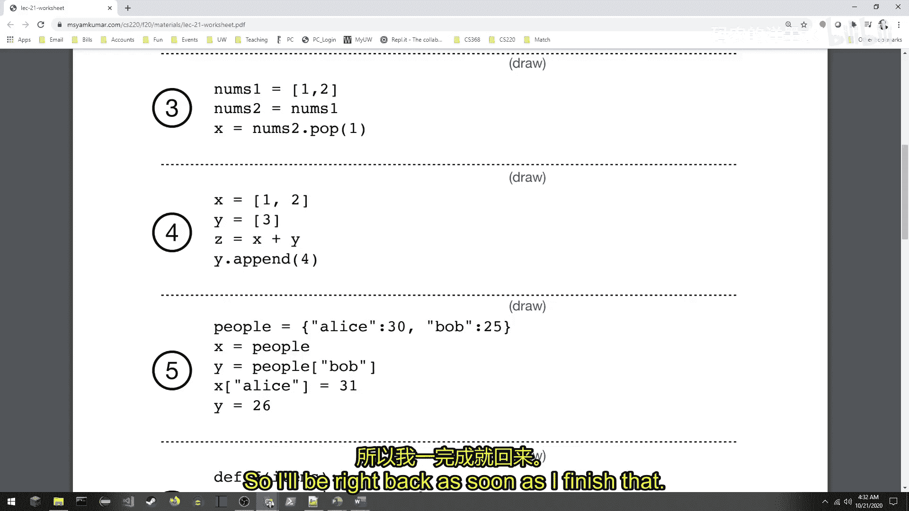

Alright， so I've got the first problem pulled up here。 I've already got started。

 I've got my vertical line here with my variables and the stack frames。

 Everything's global right now。 So I'm just gonna leave the stack frames alone。

 It adds extra detail that I think will be confusing。 variables on the left。

 objects on the right on the heap。 And so far， I've got nus 1。 So I got a box。 I've got an arrow。

 So nuumbs 1 refers to this list over here into list with values 1 and 2。😊，Alright。

 the next thing that's going to happen is we're going to create nus 2。 So let'm me go ahead and。

Cre a numberss，2。That nus 2 is going to refer to the same list。

'm trying to do PowerPoint and talk at the same time。 The same list that numberss 1 does。

 So it's going to look like this when we draw the picture。 The next thing it happens。

 we're creating another variable X。So， let me give another。Box right here。

 this one's going to be called X。And this is going to， I've got。

 I guess I've got two ways I could do this。 We're going to pop something from nums 2。

 So nums 2 refers to this list。 we popping。 this is element 0。 This is element 1。

 So we're going to be removing that entire piece of data。 It's a number two。 Okay。

 so this gets simplified to the number two。 I could either put it here in this box。

I'm gonna do that a little differently because the text is white in that box。

 So I can draw it like this。 But this is that innocent little live version because everything is technically an object。

 What I really have is at number2， over here on the。Im me get some text here。 We'll put a number。

Two over there on the left side。Make it a little bigger， I like it。And。Get an arrow。

Here we go there's another arrow。 That arrow is going to refer to that number 2。Like that square。Now。

 make it square。Alright， I can't make it square。 We're gonna to leave with the rectangle。 Okay。

 so here's the number two hanging out in the object space。

 So this is what's really going on at the deepest level for things that are immutable。

 like numbers and strings。 it doesn't really matter if we put them in boxes because Python is going to behave the same as though we believe the little lives。

 Or if we treat them as objects。 or we're going to get the exact same behavior。Alright。

 so there's number three。 Let me go ahead， pull up number four， get this ready to go。

 and I'll be right back。 In the meantime， you guys take a look at number four。All right。

 So I've got example 4 pulled up here。 and I started out。

 The very first line says X is going to be equal to a list。 This is a new list， new object。

 I see the brackets right there。 So I've got that over here on the right hand side on my heap。

 The next thing I'm going to do is I'm going to create another new list in a variable named Y。

 So let me go ahead and。😊，Make a quick copy of the X。

 And then we'll just manipulate this a little bit。 So this new variable is actually going to be Y。

 It only has one element in the list。 It's a three。So it's going to look like this。Alright。

 so far so good。 Allright， line 3， this is going to be creating a third new list with x plus y。

 So if I have a list and I use the plus operator with another list。

 this is going to concatenate the two lists together。 So what I'm going to end up with is。😊。

Let me make another copy of that。 We're going to get a Z。And then this is going to be a list with x。

 which is one and2。 and then three。 So let me copy this one。Put it just like that。 Okay， so again。

 concatenation creates a new list。 It's not going to be another reference to something that already exists。

 It's not going to change X。 it's not going to change Y， creating something new。Alright。

 the fourth line now wide out of pen 4 is going to go back and just take。

Before and add it to the list right there。 that doesn't change this object other than to add to it。

 It's not going to create a new object。 is what I'm trying to say。 and it doesn't change this one。

 It doesn't change the。

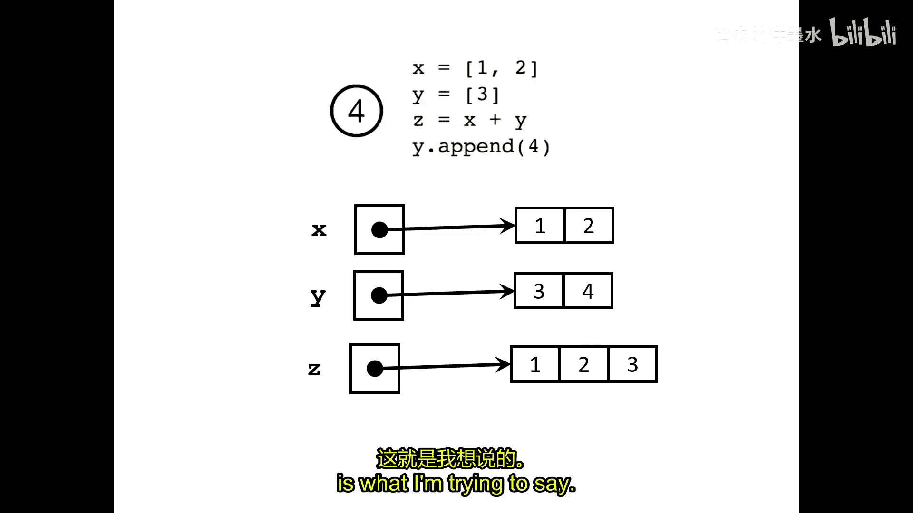

And let me pull up problems 5 and 6。 I don't think they were visible if you were just watching on the screen and hadn't gone and printed out the worksheet yet。

 So if you're not following directions， I'm helping you out here today。嗯。There we go。

 worksheet problems 5 and 6。 So check out those， try and do them。

 I'm going to go ahead and make some slides for these guys， and I'll be right back。

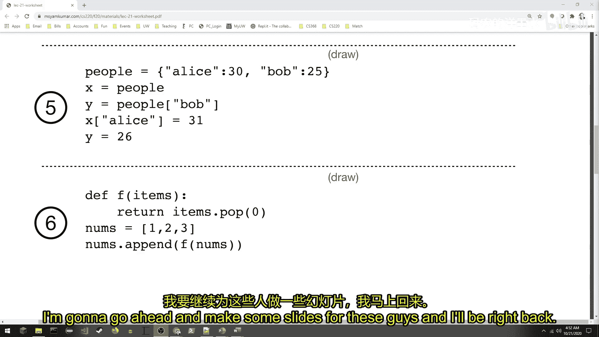

Alright， example 5。 I got this started。 The first thing is people is a dictionary with key Alice value 30 and key Bob with value 25。

 So I've got my。Dictionary here on the right side as an object variable in the global frame with people referring to that dictionary。

 The next thing we see is that we're going to add another variable。X。Let me go ahead and add。X。

 and now we need an arrow。There we go。 That arrow is going to refer to the same dictionary。

 So exile points to。This object over here。Alright， next up， Y equals people of Bob。

 So we're going to start with people。 We follow this arrow。 It's a dictionary。

 We're looking up the key Bob， and the value returned is 25。 Okay， so we grab another。

I'm going to go with the innocent lie version right here， to start with。🎼So variable Y。

 and I'm just going stick a 25。 That doesn't seem to be working。 Alright。

 we're just going to make a copy of this one。25， there we go over here。If we were going with the U。

Draw everything exactly as it is。 All four of these， Alice 30。

 Bob and 25 would have their own arrows out to the string Alice to the number 30 to the number 25 and to the string Bob。

 And then y and this cell， right。Whoops， I have the mouse on the like editing screen。 Yeah。

 so each of these， Alice would have an arrow to Alice。 this would be a dot with an arrow going to 30。

 This would be a dot going to 25。 This would be a dot with an arrow going to Bob Both the Y and this cell right here would point to the number 25 up until we change it in line the 5 up here。

Okay， so the next thing we're going to do is we're going to change Alice's age。 So x， we take x。

 we follow it to this dictionary。 We look up Alice and see that the value here is currently 30。

 We're changing this to 31。Just like that。Okay， and then y equals 26。

 So that's just going to go and take y in the version with everything rendered。

 we'd have a 25 with two arrows pointed to it。Because every time we use a number or something like curly braces or a string。

 it's creating a new object， this just gets straight up， replaced as a new object。Let me go ahead。

 let me pull this up in Python Tutor， and I can show you like the big picture with everything exploded way more complicated than I am willing to do by hand in PowerPoint and the innocent live version。

Where I'm just putting numbers for anything that's immutable works no matter what version of the model I'm thinking about。

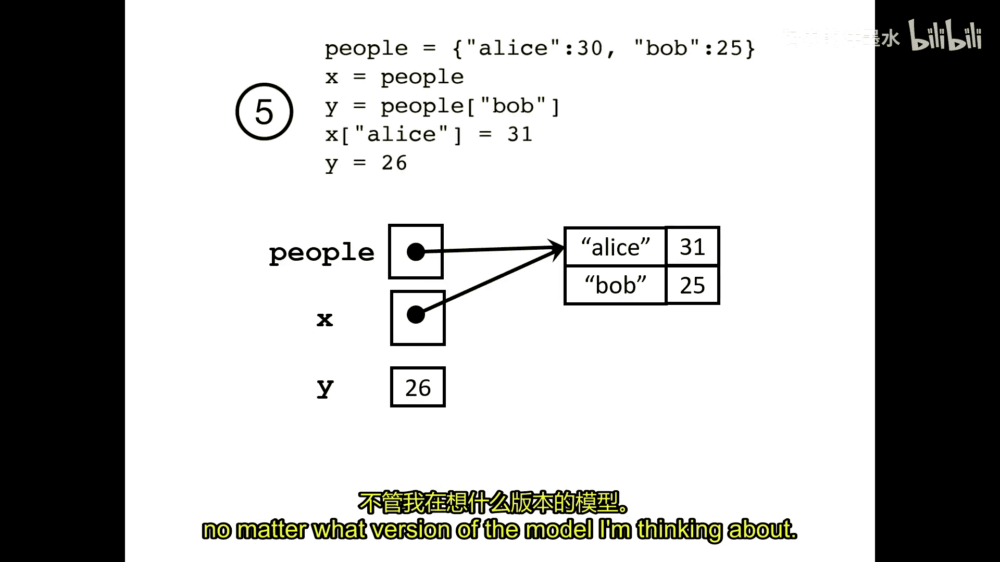

Okay， so this is the。The same code I just copied up into Python tutor。 Here we go。

 First people as that dictionary X points to the same dictionary。 Y gets the value of Bob's score。

 So 25 there。 and then Alice gets upgraded to 31， she scoress another point or as a birthday。

 I'm not sure what this dictionary is。 And then we change Y to 26。Allright。

 so this is the don't nest objects， the innocent live version。

 If we want to render all objects on the heap。Let's go ahead。 Here's the dictionary。 Now。

 I've got a dictionary with four arrows that refer to four other objects， also on the heap。

 a string Alice in integer 30， string Bobb integer 25。When X is equal to people。

 it points to the same dictionary。 Now， this is fun。 When y goes to Bob。

 we're adding another variable over here， Y is going to point to that same integer， though。

After that。We'll go ahead， and we'll change。啊。X of Alice equals 31， so she becomes 31。

 that number changed right there。 And then when we change y to 26。

 this is the same as creating a new object on the heap。

 So it's going to create a new 26 over here and draw that arrow Y so that it points at it。

There we go， a new 26 arrow points edit。

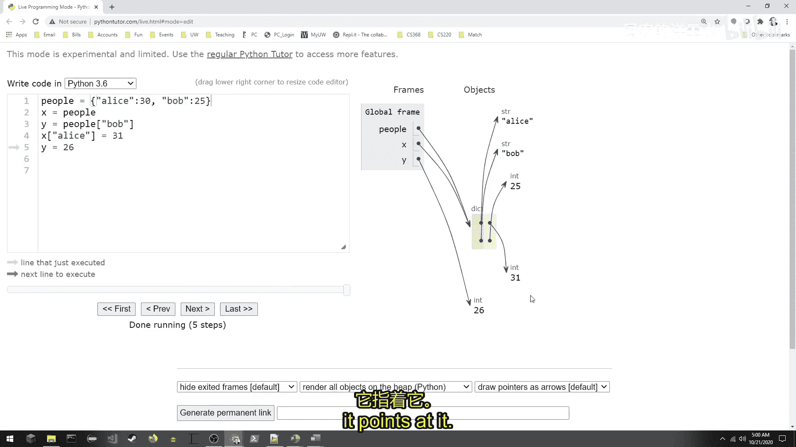

All right。 And now， number 6。Here we go。 So part of the reason I'm doing this with PowerPoint and going through all the work is。

 well， I don't have a document camera。 And I think there's really a lot of value in drawing this out with pen yourself and tracing through the steps and giving every step some thought。

 So that's why I'm doing it。 now just like pulling these up in Python Tutor and letting it do all the work for me。

 I think you guys will learn more。 So here's the idea with number 6。

 First thing we're gonna be defining a function。 So all we need to do right now is remember there's a function。

 we'll come back to that when the function called。 Next， I'm creating a list nus。

 So I've got that list here，1，2，3 variable over here in the global frame。 referring to that list。😊。

Then I'm doing something quite complicated。 So check this out。 Let's break it down into the steps。

 I'm going to read it first。 Ns dot aend F nus。 So we're going to start with the inside most parentheses。

 Python's going to evaluate this first。 So it's going to call the function F and give it the parameter nus。

 which is this list right here。So that's going to assign items。

 items will now refer to the same thing that Nms does。 So let me go ahead and。Make a copy of this。

 We have。Items。His picture is totally wrong give me sick。Ah， that's not what I wanted either。

Not what I wanted， Not what I wanted and。That's what I want。 Okay， so now items is in the。

Frame for F。 Let me go ahead draw some stack frames around these guys。Okay， there we go。

 Now I've got some stack frames。 So the top is the global where I've got nus。

 My function F has items。 All right， then there's only one line here。

 This is going to return items dot pop 0。 So this is also complicated。

 We're doing a couple things here。 First things we'll be popping element 0。

 And we'll be returning that。 So let's go ahead delete items 0。

 That's going to be the one right there。Then both of these arrows。 Okay， there we go。

 That looks better。 So probably we've popped element 0， which was the one。

 And now that's getting returned。Okay， so we popped element0。 It's gone。 I've got nus。

 and I must still both refer to this。 Now， as soon as we return， items is going to be deleted。

 that's going to just be gone。 I'll do that in a second。 But we're also going to append that。

 So this part right here。 F of nus is the number one。 We're going toend that to the end of the list。

 So let me go ahead and make that change right now real quick。We'll just pen a new cell。

It doesn't have number three。 It's got the number one， so that looks good。And then the cell。

For items completely is gone。Just like that。All right。

 I just have one more example of objects and references。

 and I wanted to bring in something that Ra used the new material from last time the record class。

So here's what we're doing from record class import record class。

 I know it's weird that they name the module the same thing as the function。 but that's how it is。

 Okay， and then we're creating a very brand new person data type using record class。 Okay， over here。

 this person in quotes is going to be the one that appears when I use type of on a particular object。

 So tell me it's a person。After I've created an object of that type。

 and these are the three attributes。 And attributes are just going to be variables that I'm going。

 they're part of my person。But I access them with the dot notation。 So demo that in a second。

 So after I've created the person type， then I can use that person to construct objects。Of that type。

 So here Im creating an object called Alice。 Alice is of type person。 and these are the attributes。

 So her name is Alice。 Capitalized score is 10 ages 30。Let me just go ahead and click through this。

 There we go。 We've created Alice。She's an object over here， name。

 score and age are the three attributes。 The next line， we're going to create another person， Bob。

 And again， Bob is his own object。 He's got his own name， his own score， his own age。

And then the third line here is going to put both of them into a team。All right。

 so even though when I read this line team equals a list with Alice and Bob。

It's not a list that contains the variables， Alice and Bob。

 What this is is a list that contains references to the objects that are referenced by Alice and Bob。

 So when we made this list， it actually followed the Alice arrow over here to figure out what it pointed to and put an arrow from the Alice from the like cell index 0 all the way up to that object。

 Sam thing for when we put Bob in position 1 or index 1 at this location in the list it followed the arrow over to from from Bob to this object and now has a reference there。

Oh that was a tongue twister for me。 I hope that was clear。Allright。

 then when we create a dictionary。 So I've got a dictionary with players。

 I've got keyword A with Alice。 So this variable Alice here is an object。

 So this is going to be a reference。 That's the end of the arrow that points to this object。

 So now I've got three ways I can get to this object right here。And same deal with B。

 I've got keyword or key B value is Bob。 So this doesn't actually have the very bo in it。 Instead。

 what it is is the reference to this object， the bo object。 So it follows the arrow。

 It knows this is the object it needs to point to and grabs an arrow， points to that。All right。

I think I did a little better job the second time with the dictionary， with tongue twisting。

 Hopefully that was clear。Al right， next up， I'm going to go copy this example into Python tutor。

 This is there were some questions at office hours about this whole idea of de duplication and is because Python is。

Kind of a little secretive about what goes on behind the scenes as far as like how it's storing the data。

 And we have little clues that we can。Figure it out。But it tries to optimize things。

 If it's got to store something and it's the same number that's somewhere else。

 it's going to just because all the numbers are immutable。

 it's going to have two references to the same number。 So let me go and copy this into Python Tutor。

 I'll be right back。

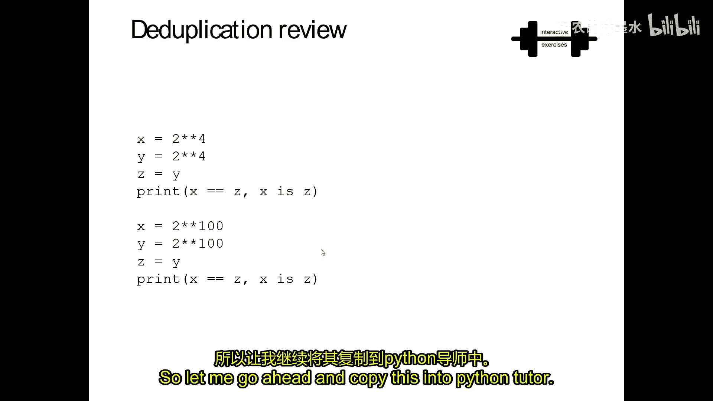

All right， so I've got two sections here。 I'm just going to walk through the first section。1，2，3。

4 clicks。 So we've got x is equal2 race to the fourth power。 That's 16。

 Y is equal to two race to the fourth power。 That's 16。Normally。

 we would expect that these would each get their own object over here in object space with the number 16。

 Pythons smart enough to recognize that it's already got us 16。

And so it's going to just use the same object and point， have two arrows point to it。

 Then when we do Z is equal to Y， that says Z refers to the same object that y does。

 So it gets another arrow。And then at the end， when we print out if we do z equals x。

 that's definitely true。 They're both 16。 Then when we ask x is z， that says。

 do the arrows point to the same object。 We would expect the answer to be no。

 but Python has done this optimization where it recognizes that these are the same number。

 and so it's going to return true。In this case， that's because the computation here wasn't supercal difficult。

 It wasn't very challenging， and Python took the extra time to figure out that theyre the same object。

To improve performance。Now， if we go ahead and rerun these。

 we'll reassign x to 2 raised to the 1 hundred0th power y to2 raised the100th power。

 So they'll be the exact same number again。Alright， so right now， there's only one number here。

 When I click through 1，2，3，4。 I've reassigned x。 x gets this ginormous number，1。

26 times 10 to the 30th power。 Why is the exact same number。 Now， the problem is。

 Python doesn't recognize。 It's too much work。 It's decided the numbers are too big。

 It's not going to compare。 It's lazy here。 It's not going to try and figure out if they're the same number。

 so it can take that shortcut。But in line 3 here， we do have Z is equal to y。

 So both of those are pointed to the same object in space。 They refer to the same piece of data。

 And then when I do this comparison， does x equal Z。 Oh， that's true。

 It's got to actually do the math。 Compare them。 finds out that theyre equal。Then if I ask x is Z。

 And just like I would expect， because I've， you know， numbers are immutable， they're created。

 This is creating a new number object。 Its shouldn't be， shouldn't be de duplicateuplicated。嗯。

Like the reverse of duplicated。And they， in fact， are separate numbers。 So this is false。

 So exact same code with one little change。 Just how big is the exponent。 In this case。

 Python decided to optimize。 And in this case， it decided not to optimize。All right。

 hope that made things a little more clear from last time。

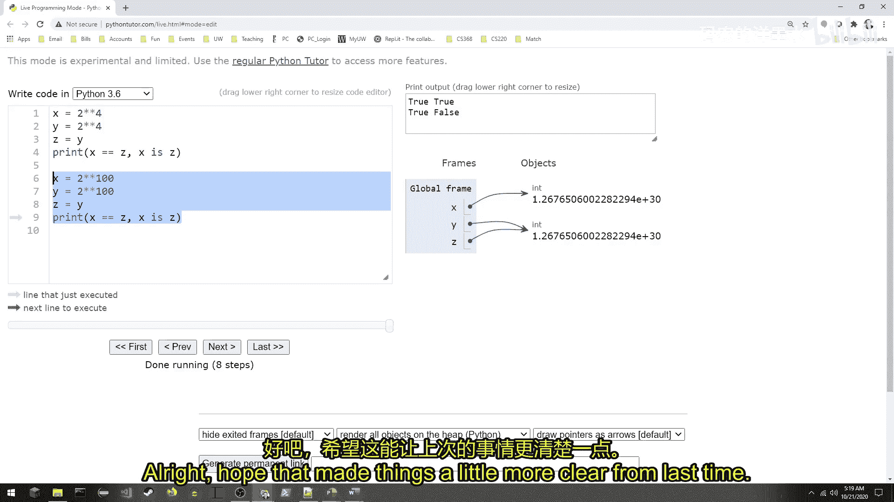

Alright， that concludes the review of objects and references。 Time for the new stuff。

 Last 20% of the lecture is about copying。 So we've got three different ways that we can copy things here。

 I've just got some code。 Let me just sort of walk through。

 I'm going to import the copy module so that I can be using these functions。

 I'm just going to create a list。 And that list has three dictionaries inside of it。

 And that's all we're gonna to be copying。Each of the dictionaries has a name and a score as keys and some data that go with that some values。

Alright， I'm going to do this in Python Tutor in just a second。

 but we've got three different versions。 Just let me talk about them real quick so。

The first is the reference copy。 This is what we've been doing all along。 Actually。

 let me just pull this up and Python Twitter。 Then I'll talk about them。

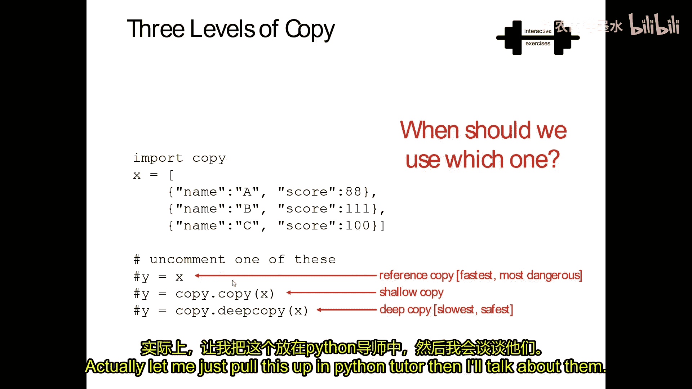

Alright， here we go。 So again， I've got a list。 X is in the name of my list。

 and it's got three dictionaries inside of it。 So when I have X， it refers to this list。

 that list has three things inside it。 those references are to three different dictionaries。

 and those dictionaries have two pieces of data Es， two keys and the associated values。

 name A score 88， name B score 111， name C score 100。 Okay， Now， when I make a copy of this。

 the first way we've been doing this， this is what we've been talking about for the last 40 minutes。

Is this version where y is equal to something。 And all this says is that y is going to refer to the same thing that X does。

 So I just draw an arrow straight from the y to the exact same object on the in the heap that X is referring to。

 This is the most dangerous。 If I make a change to Y。 It also changes X Change X changes Y。

 Theyre they're both they are the same data。Alright。

 I think we're quite familiar with this at this point。

 So let's talk about the other versions of copy。 That's the。 I'm going jump down。

 I'm going to do deep copy first。 This is the one that behaves most likely we'd expect copying to。

 I've got this data structure right here。 X。 It's got all of this stuff。

 I wish I had a better way to do this。Other than circling with the mouse。

 But a list with three dictionaries。 when I copy it。

 why now refers to a list with three dictionaries。 And those dictionaries have the exact same values。

 A 88， B，111， C 100， but they're not the same。 They're different。 I've made copies of them。

 They're different objects。 They just happen to have the same data in them。Okay。

 so this is deep copy。 No matter how many arrows I need to follow。 In this case， X。

 there's anarrow there the list。 It's got an arrow up here。 technicalnically。

 there's an arrow from here to each of the strings and the number I'm for using the。

Incent live version for the immutable objects like numbers and strings。

 But it's going go ahead and trace all of the arrows all the way down from。

The beginning to the most deepest level。 And remember， I introduce the idea of depth。

 kind of at the beginning。 depth is how many arrows do I need to follow to get to the information that I'm interested in。

 In this case， we're copying information。 So how many arrows do I need to copy or trace2 to get all the way down to copy the entire data structure。

 In this case， X has one， two arrows technically， there's a third for all of these hidden。In fact。

 let me just。Dare I do it， Re all objects。This picture is going to turn to just garbage arrows everywhere。

Yep， I don't like it， that's too complicated。Don't ask them， Okay， there we go。So anyway。

 that's the idea of my deep copy， it works exactly what we'd expect。

 it makes a copy of absolutely everything。Now， shallow copy。Is going to be this middle one。

 This one is gives you better performance， but it's only going make a copy of the topmost level。

 So x is a list。It's got a bunch of things that it refers to。 So why will also be a list。

 And I'm getting new references。 But those references point to the exact same things。

 So this is the one that gives everybody the most trouble。 It's the most confusing。

 as a begin programmer， I couldn't imagine a usage scenario where I would ever not want a deep copy。

 That's the one that made sense to me。 So next up， I'm going to go ahead and talk about places where I might use each of these。

 before I move on I just want to mention that I've imported copy。

 that's where all of these functions are。 So when I call this。

 I need to say copy and then use the dot notation to pull a function out of this module。

 So that's why it's written like this。 I've got copy is the module dot copy is the function and the parameter is X。

 The one that I expect to work the way I think it should。😊，Whoops， hold on。

 click and drag failure here。 There we go。 is deep copy。 So it's in the copy module。

 And the name of the function is deep copy。

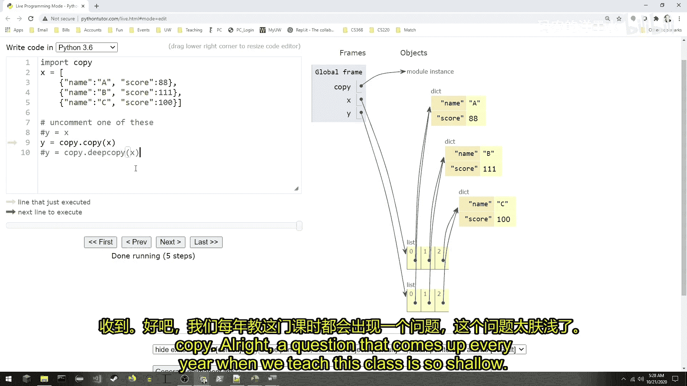

All right， A question that comes up every year when we teach this class is so shallow copy gives me one level of arrow following。

 Deep copy gives me all of the arrows。 If there's like a list inside a list inside a list inside a list。

 it goes all the way down the rabbit hole。What if I want to just copy something to like depth 2 for I can't even imagine a reason。

 but what if I wanted to do that， how would I do it。So in this case。

 I've got this example in Python Tutor， but we're going to do it in two steps。 Here's the data。

 I'm going to copy using shallow copy to get the first level。 That's the one that's already built in。

 easy to use。 And then what I'm going to do is I'm going to iterate through that data using my range for loop in shallow copy the next level for each of those pieces。

 So I'm going to index into things and copy。 So here's x of。Index 0， y of index 0。

 then x of index 1 copies into y of index 1。 So I'm just going to use a loop。

 And for every level that I want to copy， I'll need a nested loop to iterate through all of that data。

And me pull it up in Python Tutor。And。

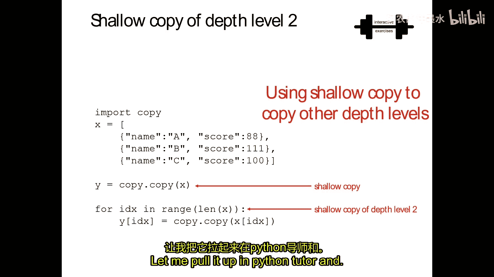

There it is right here。Okay， talk about this。 So let me just step through this。 First。

 we'll import a copy。 so it knows where to find the module and where all those functions are。

 We create this data structure。There it is。 X is a list with three dictionaries in it。

We make that initial shallow copy with y equals copy do copy。 So that's the copy module。

 the copy function， and it's a shallow copy。 So it's copying those three references to those dictionaries。

Alright， and then I'm going to use this for loop for index in range of length of x。

 So the length of x is3 index the very first time3 will be 0。

 So that's going to say that y of 0 is equal to copy copy x of 0。

 So x of 0 is going to be this dictionary right here。

 So that's what we'll be making a copy of this time and storing and the reference here。

We index0 of the y list will refer to that。 So let me just click。There it is。

 So now there's one  error from X pointing to this dictionary。And。

An arrow from the y dictionary that points to from the y list that points to the same。 It's。

 it's a different dictionary， but it happens to have the same data in it。Okay。

 if I go through when y is I'm sorry， when index is equal to1， it's going to copy the second。

Here this dictionary。Into a new memory location， make a copy of it， and this will refer to it。

And then finally， click through one more time。And with index equal to2。

 it's going to grab this dictionary， make a copy of it and reassign this reference to refer to that new dictionary。

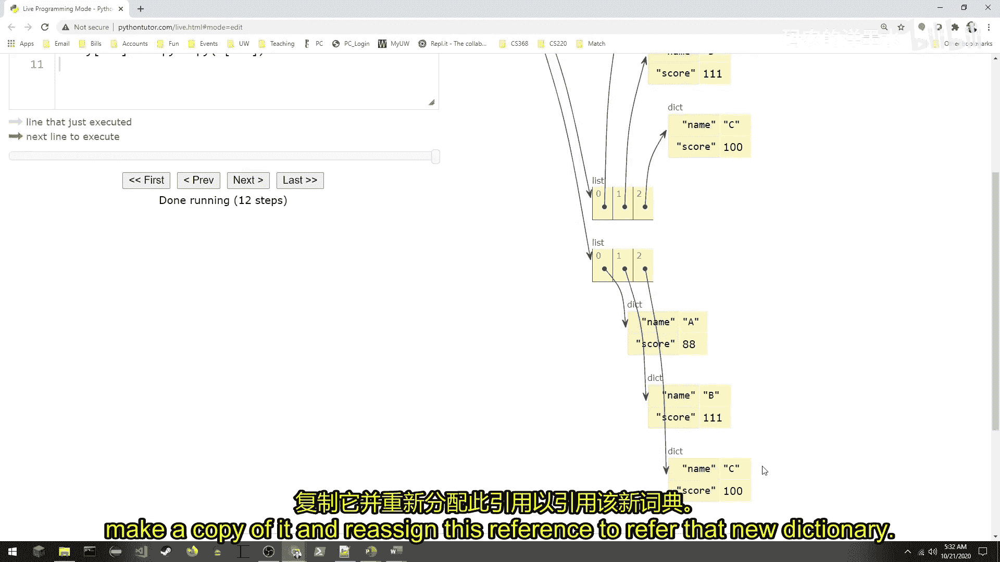

All right， but they happen' to have the same data。 That's the point of making copies。 All right。

 then depending on how we plan to use the data， there are like three different ways that we might consider copying something。

 And one of these is almost always going to be the better choice。Depending on what we're doing。

 So this is the example I've been working with with Python Tutor。 I've got my players。

 I've been calling this X a moment ago， but it's a list of three dictionaries。

 Those dictionaries have the names of the player and their score in them。

 So then visually I've got player refers to a list。

 Each entry in the list refers to a dictionary with a name and a score。Okay。

 now usage case number one here， I'm going to use a reference copy because this case I'm only interested in finding the maximum score。

 So I'm going to go through， I'm going to define a function called max score。

 This is pretty straightforward。 Let me go ahead。 I've got my players equal。

 that data structure from the first slide。Then I'm going to call max score and give it players。

 Now when I run the first line here， this is going to say that people is equal to players because I'm passing players to that parameter people。

 So this is a reference copy。 People is actually going to refer the exact same list and there's there's no risk of accidentally corrupting my data because I'm never changing it。

 The only thing I'm doing is looking at it And this structure right here is actually pretty common。

 Hopefully you guys are familiar with finding the biggest thing in a list so far。

So I'm going to just set highest equal to none。 They could be negative scores。

 So I't I don't want to start it at zero。 But for P and people， if highest is equal to none。 Yeah。

 so the first time through highest will equal to none。

 And so I'm just going go ahead and say highest is equal to P of score。

 and P is going to be the first person here。 So the score will equal 88。

 Then I'm going to go through the loop。 again， P in people that's the second dictionary。

 if highest equal to none， that's not true。 But if p is score is greater than highest。

 highest was 88 a moment ago。 it's now 111 here。 So we update highest to 111。

 And then we'll continue through the loop and return highest。 So we find out that highest is 111。

 We return that。 This function gets nuked。 We lose people。

 we lose highest and M is equal to the max score at the very end。 All right， yep。

 I've got the crossed out。All right， there was no danger of changing any of the data。

 I never did anything other than just look at it。 And so using a reference copy here is perfect。

 It's fast。 It's exactly what I need gets the job done。All right， the second usage case。

 Where might I consider using a shallow copy In that case。

 the example is gonna to be getting the median score。 So the one in the middle after I sort them。

 So again， I've got the same data structure that we'll beve been working with for like the last several examples。

 The median score is going basically what we want to do is sort these dictionaries out based on some criteria。

 the score。 and then pick out the one in the middle。 But I don't actually want to corrupt my data。

 I want to keep them in this order because in this list。 They're alphabetized by name。

 I've got A B and C。 That's how I want my players list。 But to compute the median。

 I'm going to need to go ahead and sort them。 So what I'm going to do is just create a shallow copy。

 So we pass。Players to the function。 So people now refers to the same thing。 Now。

 people is going to be reassigned right here to a copy。 So we'll grab a new list。And。

We still see that all of the references are pointed to the same places。 Now。

 C is the median player 88。100，1 at 11 is the order they'll be when we sort。

100 will be in the middle。 So just keep your eye on the ball here。

 because when we do some sort of function that sorts people。

 that's going to rearrange all of these references。Just like that。 So now the middle value。

 So here the leftmost one， the first entry goes to the smallest one。

 The middle entry refers to this player C with the middle score。 And at index 2。

 we have this third dictionary。 So now I've sorted this list。 but this has remained uncorrupted。

 I didn't make any changes at all。AndNow I can easily identify the median dictionary based on that score criteria。

 and I can return the median score。Al right， in usage case 3。

 this is where I want to store all of the data for some purpose and then continue to work with it。

 So one example might be if I'm playing a game， if I want a snapshot of all the scores at halftime。

 and then I'm going to finish the game and then I can compare player performance in the first half of the game to the second half of the game。

Alright， so that's， that's the example。 I'm going with it。 So here we have some code that will do。

Something similar。 Anyway， I'm going to start out with my player data。

 It's a list with three dictionaries。 There they are players before copy。Our players before。

 I play the second half will do this deep copy， so players before is a list。

 deep copy makes a new list for us， and it also makes new dictionaries for all of the elements it follows every single arrow and makes a new whatever the arrow points to。

For all of the references。All right， so this is players during the first half of the game。

Got all of their scores and then player0， let's see。Looks like his name's A。

Scores 10 more points and werere up to 98。 All right， check this out。

 It did not change his score at half time。 It only changed the score at the end of the game。

 So now I can go back a conducive analysis， and I can say， wow， player B had an amazing first half。

 hundred 11 points。😊，But scored zero points during the second half。 So as a coach。

 you might be interested in some sort of stats like that。Anyway。

 so the next thing it does is computes the score change and prints out 10。

That's going to do it for me today。 I feel like I've talked for quite a while。

 but a lot of that was me making slides to go along with everything and just moving PowerPoint around。

 I've been working on this for several hours。Al right， but anyway。

 what I'd like you guys to do is go do the rest of the problems on the back of that worksheet。

 If you run into any trouble， it's just extra practice。

 go ahead bring those to piazza or office hours and I'm going to wish everybody a great day。

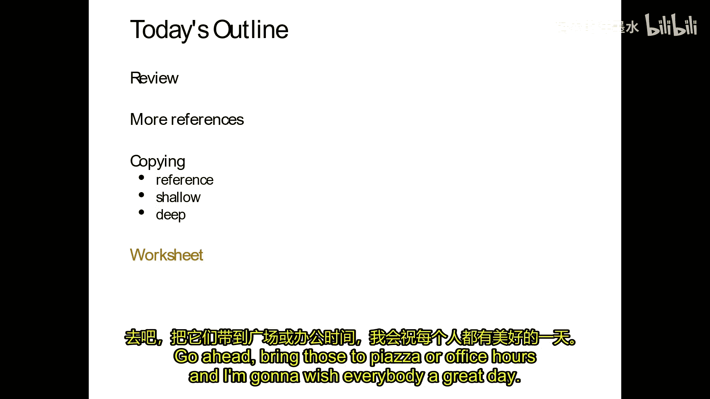