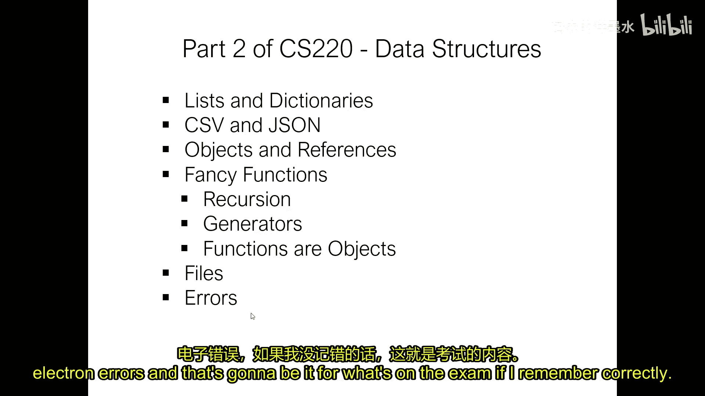
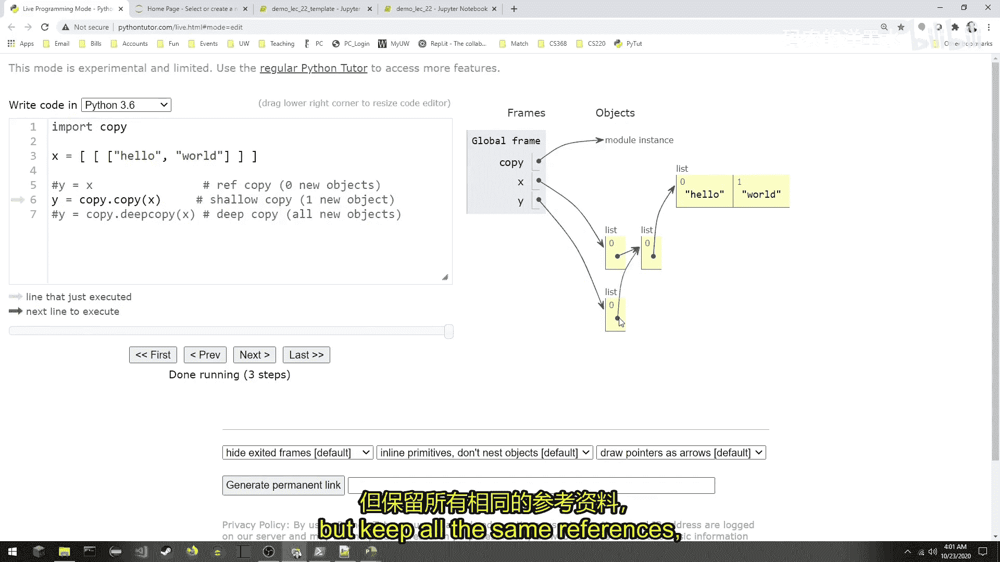
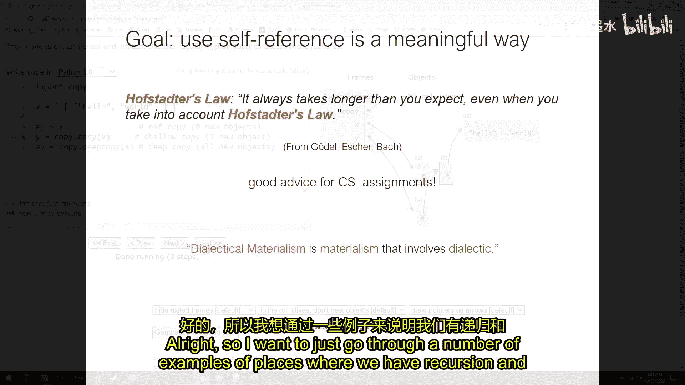
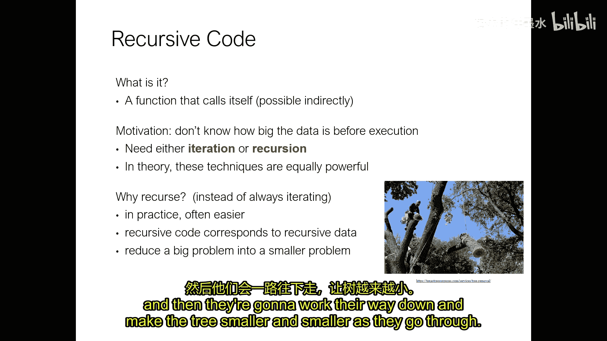
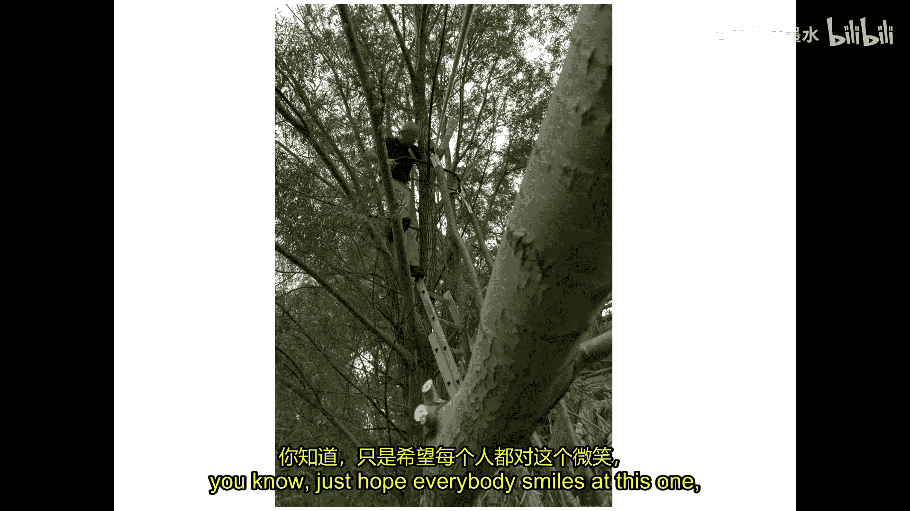
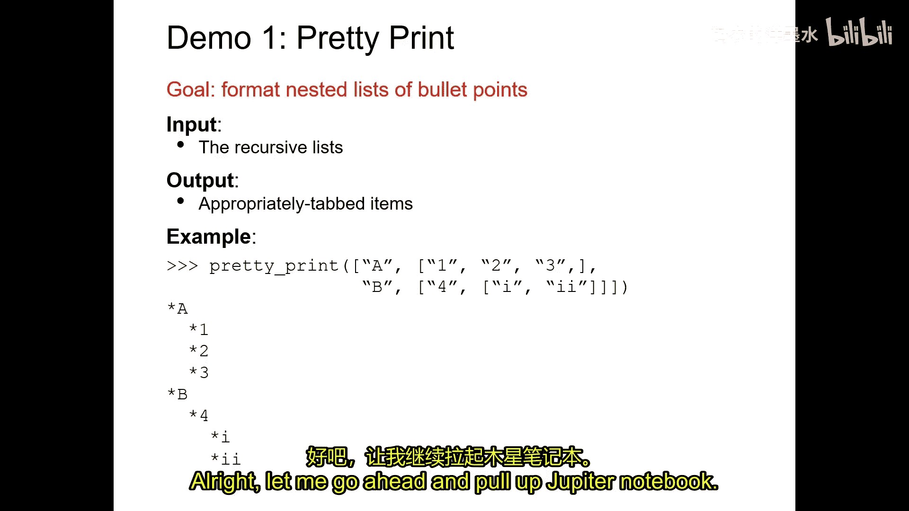
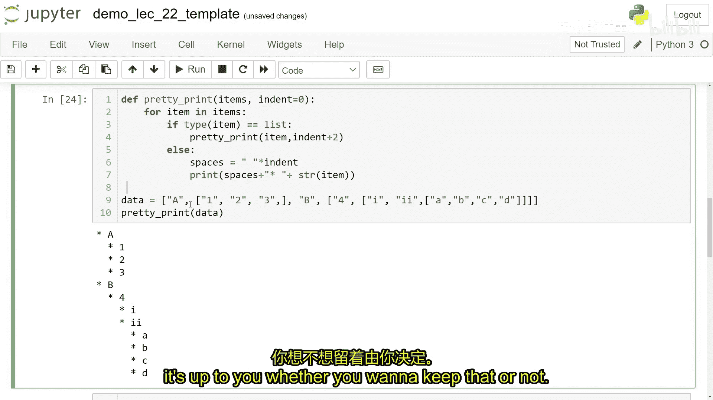
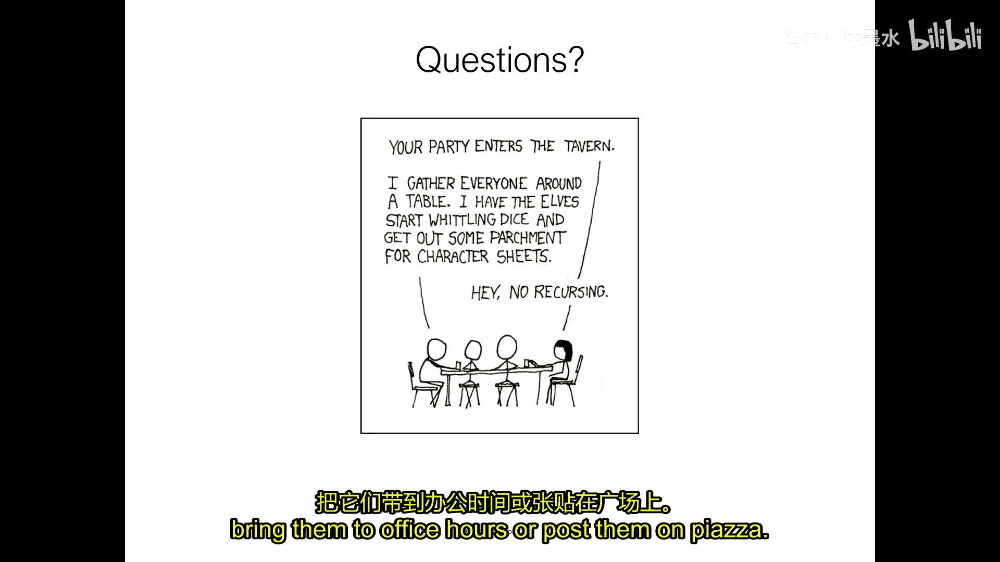

# 【全集】威斯康星大学-Python数据编程-CS220-中英字幕-1080P-p20-Lecture-17---递归--BV1VxvsBLEmv_p20-

Al right。 Ho， everyone。 Welcome back to data programming 1。 Today。

 we have an awesome lecture about recursion。 recursion is pretty simple。

 and at the same time can be really difficult。 It's just something that refers to itself。

 The title slide here today is a great example of this。

 The title slide contains an image of the title slide。

 which contains an image of the title slide all the way on down。 So basically。

 just something that refers to itself。 recursive definitions in a dictionary contain the word they're defining generally considered bad practice。

 Recursive data structures contain other data structures of the same type。

 We've already seen lists of lists in CV files。 That's what we're talking about there。

 And recursive functions。 That's the main focus of today are just functions that call themselves。😊。

Now， this can be really difficult， too。 And there are some subtle tricks that make all of this work in a meaningful way。

 And that's where the difficulties come in。 I remember learning this stuff for the very first time。

 There was this problem。 It was a little game。 And my teacher showed us a recursive algorithm that solved a very simple version of this game when they just had three pieces。

And then showed us how they could use a recursive function that based on that。Very simple version。

 a function that called itself that could solve even more complicated versions of the problem。

 So it could solve a four piece version and then a five piece version， and then a7 piece version。

 whatever。To this date， I can still remember that recursive algorithm。

 and I still cannot solve that problem without the recursive algorithm。 I don't know。

 I know it's possible， but it makes my brain hurt， and I have never figured it out。All right。

 so recursion can be a really powerful technique。WThis is why we're including in this class。

All right， as we get going today， let me just advance the slide here。 a quick review of where we are。

 We have an exam coming up in just under two weeks now， and so I want to just put things in context。

 So at the first five weeks of the course were're about programming fundamentals control flow we talked about conditional statements with the if statements。

 loops， the while loop for loop with two different kinds of for loops。

You know basic control flow and part two of the course。

 the second five weeks are about data structures。 So the first two we introduced were lists and dictionaries。

 We also had sets and tus with lists and dictionaries， These are the main most important ones。

 with these two data structures。 you can basically solve any data organization problem that uubly faced。

 All right， After that， we moved on and talked about data files。

 We talked about comma separated values， files， CSv。

 which are essentially represented as lists of lists in Python。 We also talked about Json files。

 a little more versatile。 We can basically put anything into a JSson file， including dictionaries。嗯。

Then we moved on and talked about objects and references。

 This is conceptually one of the more difficult topics。

 but understanding this is going to help you debug your code and not understanding exactly how this works you know。

 missing the fact that when I say x equals Y that x is now referring to the same thing that Y does can lead to some really subtle errors that you know may return an answer。

 but it may be the wrong answer and you know you may be changing a variable that actually changes another variable too。

 So it leads to some tricky stuff。 while worth spending some time on。

 It's going to be a major focus of our exam。Alright， after that。

 we've got three sort of specialty topics about functions。

 I'm just going to call them fancy functions。 Todays recursion。 Monday will be generators。

 and then we're going to learn on Wednesday that functions are actually objects。

 I can take a variable， and I can assign a function to it。

 It'll be an object over and Python tutor on the object side of a variable on the right。

 I can pass that to other functions。 Co stuff。😊，So after these three topics。

 these are all kind of hard。 Yeah， from objects and references all the way down to functions are objects challenging stuff。

So from there， we're gonna move into some easier stuff。 We'll have a lecture on files。

 a lecture on errors。 And that's gonna to be it for what's on the exam。 if I remember correctly。

 All right， I also forgot to mention as we get started。 There is a lecture 22 template。

 I think this is misnamed。 I think we're on lecture 21。

 but I lost count once we got above 10 ran out of fingers。 check this out。 The very first thing。

 we're gonna to do a little review of copying。 So go ahead and copy and paste this code into Python tutor。

 So we get that picture on the right side。 We'll go ahead we'll uncom each of these。

 You guys can follow along。 the rest of this is just some guidelines to help take notes straight class。

 and some examples that will develop together at the end。 All right。

 so I'm going jump over to Python tutor where I've already copyied this material。

 I have this set up in the version that renders all objects on the heap。

嗯。So here's the idea。 we're going to be reviewing copying real quick。

 So I'm importing the copy module。 I've got X is equal to a list。That contains a single list。

 That contains a single list that has two objects in it。 their strings。

 the string Ho and the string world。So when I look over here， I've got copy。

 which is this module that I've imported， so I can refer to copy。

 I can use the functions in this module It's available in the global frame。Then I've got x。

 x is a refers to a list。That's got one element。 So it has a reference to another list。

 one element and position 0。 that's referring to a list。 That list has two things in it。

 Those objects are both strings。 The first string is hello。 and the second string is world。Okay。

 I'm going to switch this back to inline primitives， don't nest objects。

 And the reason I can get away with this is because hello and world are both strings。

 and those are immutable。 And I think this is a really important concept here。

 I can get away with this。 because I can never change this object。

 So as I draw more and more data structures over here that contain reference to this hello。

 I can put them each in their own box。 If they ever do try and change it。 if they try and change it。

'll give them an error。 If they reassign it to a different reassign that。😊，嗯。

Index that element right there to a different word。

 It just is going to get a new copy of the new word。Not a copy。 It's going to get a new word。

 a new string。Allright， so this is the innocent live version。 But because these things are immutable。

 it works great。 I can just put the word right in this box。All right。

 so we're already quite familiar with the idea of making a reference copy。 This is the easy one。

 Here's the idea。I'm creating a new variable。 Y and Y is going to refer to the same thing that X does。

 So it didn't actually make any new objects。 That makes a great multiple choice question。

 How many new objects are created when this happens。

 How many new objects are created when this happens。 All right， Great multiple choice question。

 This one doesn't make any。 It's just creating another way to get to this data。

 I can change this data with either X or y I can append something to this。

 And both of these will be able to see it。 That changes visible to both of them。Okay。

 I'm going to put this back。I'm going to move down and I'm going to do the deep copy one next。

The last example， when I did last time didn't really fit on the screen very well。 It was too big。

 So this is a much better choice。 Here we have。 I'm creating a deep copy。

 That means it's going to follow all of the arrows。 All right。

 quick reminder that depth is how many arrows do I need to follow。 So right here from X， there's one。

To。And three levels of depth。 and deep copy will make copies of everything。

 It doesn't just copy this first list。Right there， it doesn't just copy the second list right there。

 It doesn't copy just the third one。There， we made a copy。

 It continues to go all the way down until absolutely everything is copied。

 We're not going to have any references connecting these two data structures。At all when we're done。

 everything will be a brand new version。Alright， so the reference copy。

 people are generally familiar with that we've been using that a bunch throughout the course。

 Deep copy is the one that just makes sense。 If you're making a copy， should copy everything。

 However， there are times when a shallow copy is the best choice。

 This is only going to copy one level deep， it's going to make exactly one new object。

 So in that object is going to be a copy of whatever is at the end of the first arrow。

 the contents of that。 if these elements in the list or elements in the dictionary or whatever refer to other things。

 they are going to refer to the same thing。 Okay， so this。

 my X list right here refers to that object， that list。So that means when I make a shallow copy。

 I've got a new list here with one element， and that element is going to refer to the very same list。

Right there。Alright， so this is probably the most confusing one。

 There are some places where this is applicable where it is usable and has some advantages over deep copy。

 Deep copy does extra work。 If I don't need to make all new copies of hellello world。

 if I want to keep the same strings， but you know I want to just like rearrange things in this list like sort it。

 but keep all the same references， then a shallow copy is most certainly appropriate。

Allright， so I want to just go through a number of examples of places where we have recursion and sort of define what's going on by way of examples。

 So here I have some definitions from the dictionary and those definitions use the term they're defining。

So the goal is to use it in a meaningful way so that you still communicate。 So， for example。

 Hf Staler's law says that it always takes longer than you expect。

 even when you take into account Hf Staler's law。So here。

 Hofstler's law is using its own term in the definition。 yet it's still meaningful。 And by the way。

 this is really great advice。 Stying for that exam coming up in two weeks will take you longer than you expect。

 P 8 came out this week will take you longer than you expect。 So heads up。

But self reference is not always used in a meaningful way from the definition from Wikipedia of circular definition。

 dialectic materialism is materialism that involves dialectic。If to be honest。

 I still don't know what this means and I looked it up， I added this to the slide last year。Yeah。

 this is meaningless。 This is garbage。 They're using the terms to define in the definition。 Yeah。

 I did put the definition in it's something from my political science or philosophy。

 The Marxist theory adopted as the official Soviet。

Off visual philosophy of the Soviet communists with the words in the right order Mike that political and historical events result from the conflict of social forces are interpretable as a series of contradictions in their solutions。

 The conflict is to believe， is believed to be caused by material needs。

This is pretty deep way beyond me。 I don't do that kind of stuff。All right。 oh， mountains and hills。

 I got this one， though。 So another example of something that's not particularly useful。

 In this case， we have a circular reference。 So self reference doesn't always happen directly。

 So in this case， a mountain is a landmas that projects conspicuously above its surrounding and is higher than a hill。

 Okay， so we go look up hill。 and hill is usually rounded nature。

 Natural elevation of land lower than a mountain。 for a computer we're in trouble because then we're going to go look up mountain。

 and mountain is going to refer to hill。 Hill refers to mountain。

 And we go around and round until we eventually the battery and the computer dies。😊，Okay。

 so as we look into the rest of this lecture， we're going to do a couple things。

 We'll continue to talk about recursive definitions and data structures focus on arbitrarily versus infinite。

 and then we'll dive into some recursive code。 All right Those are the objectives for today。

 Please go ahead and read recursion through infinite recursion in chapter 5， This is the downy book。

 And then in chapter 6， more recursion through the end。

 it's just the last little bit of that chapter。 Now they broke it up into two parts there。Okay。

 so I already introduced the idea that recursive definitions contain the term in the body of the definition。

 But this is actually really common in mathematical definitions。 And in general。

 they're done in a meaningful way。So for example， here， x is a positive even number if number one。

 x is 2， or x is equal to another positive even number plus 2。

So that means that4 will be a positive even number because it's equal to x plus 2。

6 will be a positive even number because it's equal to 4 plus 2。

 We already know that4 is in our set of positive even numbers。 and I can just keep going like this。

 I can say that， well， 6 plus 2 is 8。 So 8 must be a positive even number and 10 is a positive even number。

 It's 8 plus2。 And I can just keep doing this forever。 Now there's two things here。

 I want to point out that I have a base case where x is equal to 2 or a recursive case where I'm using some my definition here in red positive even number and making some little change to it。

All right， recursive data structures are going to be data structures that have the same kind of data structure embedded in them。

In this case， we have a。A list， see the square brackets right there， that list。Rose。

Contains three lists，1，2，3。Here we go。Can we draw this right。 Oh， yeah， Rose has is three items，1，2。

3。 There's rows。 This is the variable on the left。 This is the object on the right。

 And then each of these objects。Contain。More lists。 So this movement has a string A in it。

 and another list。 So this is going to be a reference to that other list。 The  one。

2 list here contains B， and a second list also with 3，4 and 5 in it。 You get the idea。

 So lists that contain lists that contain lists are recursive data structures。

 And we'll be using these in some of our examples later in today's lecture。Okay。

 and when you guys start looking， you're going to start to see recursive structures everywhere。

 we'll see them in nature， my other two demonstrations for today are file structures， directories。

 and file formats。Okay， so let's take a look at nature。 This is a definition of a tree。

 as written by a computer scientist。 so it's a little weird。Pub Bo work here。

 it's designed to be instructive。All right， so the term is branched and a branch is a wooden stick with an end splitting into other branches or terminating with a leaf。

So here's my first stick。 It has more sticks。 in this case， three sticks on the end of it。

 and they can either terminate with a leaf。Or they can have other branches attached to them。

 And those branches can be either terminated with a leaf or have other branches。

 So I've got two cases here。 Again， I've got my base case terminating with a leaf that's going to end the recursion process and stop whatevers happening there。

 or branches， which can have other branches。 This is going to be the recursive case where we keep getting larger and larger trees。

Okay。Yep， so that means that trees can be arbitrarily large and recursive allows for basically indefinite growth and can keep going。

 But here I want to highlight that arbitrarily is not equal to infinitely。

 There's always going to be this case where it could stop。 Where's my leaf forward。

 up right there I'm the circle that。 There's going be a case where it can stop。

 So it's not going to be infinite。There's nothing that's going stop it from adding more and more and more。

 But there will always be a case where， well， let me just put it this way in order for this to be meaningful。

 it needs to stop。 We need to be able to get to the end。 It's not going to be an infinite loop。

 we need to actually be able to solve a problem。 So these infinite I'm sorry。

 the recursive data structures， recursive functions， recursive things in nature。

 The goal is that we're trying to solve a problem。 if we're writing recursive function。

 That means we need to get to the end of the problem with a solution。

 So we're not going have an infinite loop or not going to have an infinitely deep data structure。

 We need to solve whatever problem we're working on。

 Hence that that's why we're going to focus on arbitrarily。 It can be a problem as big as we want。

But it's not going to be infinite， Ca then we'll never get to a solution。

 That's where the meaningful part of things comes in。Yep， okay， so I mentioned base case。

Base case branch， got that already。Okay， so next example。File systems。

 we've been working with folders and or directories on our computers all semester long。

 directories are， in fact， recursive data structures。

 So the definition of a directory is a collection of files and directories。

 So here I have an example from Finder。 I've got directory A containing two are the directories B and B2 and some files。

 So these files will be leaves they cannot contain anything。 Well。

 we can't contain more files or directories and directories are like the branches。

 they can contain other files and other directories。 So if we open up directory B， for example。

 can see that it contains directory C and file。 Again。

 this will be a branch and that will be kind of like leaf。Direct re C can contain other files。

 So I probably did too much here。 Keep going another file inside I keep going。

 We have direct Re Z all the way down。 that can contain even more。 you definitely did too much。

부직게 돼야요。All right， even something like file format， here we have a simplified JSON format。

I'm going to define a Json dictionary as a set of Json mappings。Okay。

Now a definition of a JSsonN mapping here we have an example over here。 we have keys and values。

 This is a JsonN dictionary。 Okay， a JSON mapping is a JsonN string。

 The key paired with a JSsonN string or JsonN number or JsonN dictionary So here we have a string here we have a number JSsonN dictionary is another possibility for the value and so here I have JsonN diict up here is JsonN diict。

Okay， so it's not a direct recursion。 It's indirect。

 I'm going through another definition of Json mappings， but it eventually it comes back around。Okay。

 okay， all right， Got a slide for this recursion is not always direct。Okay， so here under exams。

 I've added another element， another key， I have another dictionary。In fact， I can keep going。

 I can say the midterm is going to be， in fact， yet another dictionary and the final will be another dictionary。

And so， yeah， my very first dictionary。 So think about is like this。

 The dictionaries or lists are going to be like branches。 and the data they contain。

 the strings or numbers will be the leaves。Out at this point。

 we're going to start moving into recursive code。 So what is recursive code。

 It's up very straightforward。 This is just going to be a function that calls itself and potentially indirectly。

 So here I have function F， calling function F。Indirectly。

 function G calls function H and H calls function G。 So I get this this circular sort of structure F。

Or G H。 What's this look like。 We know how to call functions。

 So here I have the function definition for F Go some code。

 somewherewhere in there is going to be a function call that calls F。

 So just F with parentheses behind it。 some other code。 So this will call F。

 it's going to go back up F and round in a circle。We'll need a way to get out of that loop for this to be meaningful In G we've got some code。

 This calls H other code。 When we get to H， we've got some code。

 this is going to call G and jump back up here。 So pretty straightforward。But there are some tricks。

 but first， why do we care， What's the motivation， So some of the reasons we care is that we often don't know how big our data set is。

 We've talked about this before。 This was the primary motivation behind iteration。

 iteration and recursion are equally powerful techniques。 In theory。

 Any problem we can solved with iteration can also be solved with recursion。

 and any problem that can be solved with recursion can also be solved with iteration。

So think about this as like another way to loop through all of our data。

Now there's almost always one version that's easier and or simpler or faster or just straight up makes the code more understandable。

 one of these is going to be better， but it could be either one。All right， so and in addition。

 another way to think about this is recursion is a way that takes a gigantic big problem and turns it into a smaller problem。

 It's going to reduce the size of the problem。 So I don't know if you guys have ever watched anybody cut down a tree。

 But here's this giant tree next to a house。 And so when the Texas tree surgeons come in。

 So they're going to climb up in the tree and then cut it down in pieces。

 And they're going to see that each of these branches looks kind of like a tree。

 So they're going to take off basically a baby tree。 The branches at the top。

 And then they're going to work their way down and make the tree smaller and smaller as they go through。

There we go， I couldn't resist everybody。 This is my dad up there。 He's 73 years old。Just。

 just check out the way he' standing on that ladder，1 ft on top of the ladder。

 precariously balanced in the tree， cuttingtting a branch off the tree right next to the house。

I want to point out that the branch is falling on my son。

 who's holding the ladder while I'm taking this picture。

 So this is not a parent of the year kind of moment。 I probably shouldn't share this， but。

I've done this。 I've cut down trees。 and I think， you know， just hope everybody smiles at this one。

All right。All right， And then the next piece， if we were in class， we would do this demo。

 I'm not sure if Minina talked about it in her lecture or not。

 I'm going to totally skip this one because it's designed for like a classroom where there are people sitting there and you've got like other students around you to talk。

 If you can check out the slides if you're interested in what we do in the live classroom。

 It's not gonna work if it's just me sitting here in the basement office recording videos。

 So I'm going to go ahead and skip ahead one second。

I should also mention that the hat I'm wearing is not a black top hat。 It's a regular baseball hat。

 So I don't， I don't own a top hat， but it looks good in the picture， does it not。All right。

 as we move into the next section of this lecture， I want to talk about。

Creating recursive functions that solve a problem。 That's my goal。 I want to get there。

 And to get there， I'm going to go through an example。 And the 1 I'm going to do first is factorial。

 So factorial is mathematical function。 If you guys don't remember what it is。

 it's n factorial is just one times 2 times 3，8 times 4 times all the way up to n。

 So that's the definition of factorial。 So as I go through and try and come up with recursive function for this。

😊，I want to introduce you guys to Mike's four step system to writing recursive functions。Actually。

 I still this from Tyler。 This is Tyler's four step system， but I color coded it， so it's better。Now。

 with color。 All right， So here's the idea。 The first thing we're gonna do is write out a bunch of different examples。

 we're going to start with the really simple examples and then work our way up to bigger and bigger problems。

 just like that game I mentioned when I had the title slide up still never figured that one out。

 But anyway， So one factorial is the simplest thing we can do。 It's just gonna be one。

 And then we're done2 next simplest， we're gonna to have1 times 2。

 and then we stop there because and is equal to2，3， we got1 times 2 is times 3。

4 is one times 2 times 3 times 4。 Okay， You guys get the day。

 We're going to write down a bunch of examples。😊，Alright， then。

We're going to look for patterns that allow us to write this in terms of self reference。

 So I'm going to look for patterns。 So check this out right here。 I've got 1，2，3 times 4。 and in4。

 I've got 1 times 2 times 3 times 4。 So that means I can take this red block right here and replace it with this four factorial。

Okay， so that's what I've done here。5 factorial is now4 factorial times 5。All right。

 I'm going to look for more patterns now。Here's another one。

 So I've got one times  two times 3 in the definition of four factorial。

 and there's a one times  two times 3。 That is the definition of three factorial。

 So that means in four factorial， I can replace this much with three factorial。

 And I write right here，3 factorial times 4。Allright， And then， and keep going2 factorial times 3。

1 factorial times 1。 So after this， oh， and then one more， I don't need a pattern for one。

 This is just the base case。 It needs somewhere to start。Alright， so next up， after I have that。

 I'm going to try and convert all of these self referring examples into a single recursive definition。

 So I'm going to try and take these guys， put them into one definition。

 and this is always going to have two parts for a recursive function。First， I have the base case。

 Personal， I highly recommend writing the base case first。 That way you don't forget it。

 It's really easy to do。 because the exciting part is the recursive case。 Let's face it。

 One factorial is one。 Very simple。 right at first， Get it out of the way。 This is our。

 our base case or the leaf。 This is what's going to terminate the recursion When I get down to the end of it。

😊，Okay， then I'm going to take a look at everything else in this box。

 These are all the things that recursive。 They have a recursive definition。

 I've got factorial in the definition in every single one of these。 So in this case。

 if I have n factorial， it's equal to1 less or n-1 factorial times n。 All right。

 So I'm going to fill this in with n-1 factorial times n。 And there is， I'm done。

 this is my recursive case。 I've got my branch there to remind myself that。😊，Al right， next up。

 I'm just going to turn this into some Python code。 So the first thing。

 all of these are going to have a conditional。 It could be an if statement。

 It could be one of the loops。 They all have conditionals might have like a four loop that never runs for the base case or it runs only once。

But anyway， while loops， if statements，4 loops， they all have conditionals built into。

 we will have one of those conditiondal is 99% of the time。 most common thing you'll see。

 And all of the examples I'm going to do， will'll have an if statement。 Okay。

 so my definition of factorial。 If n is exactly equal to1。 then we're just going to return one。

 that takes care of my base case。 the leaf right there。 Otherwise， I'm going to compute P。

 that's this part right here， factorial of n -1。And then I'm in a compute。

P times n to finish up this whole line and return that this will be my branch， because it is calling。

The function。Okay， and another thing， the recursive case needs to make progress towards the base case。

 so the base case here is n equal to 1。 I have a number bigger than1。

 I need to get closer and closer and closer to one in order to make this a smaller and smaller problem so that eventually I solve it。

Alright， so let's take this code and just run through it。 And by run through it， I mean。

 have about 50 PowerPoint slides that break this down into a lot of very small steps so we can focus on the details。

Alright， so to get started， somebody is going to be calling this function factorial。 In this case。

 my example I'm going to use for。 So what I've got here in this box is just。

Each box is going represent a function in vocation。 Those are not stacked frames yet。

 We'll go through that version in a few minutes。 Just。

 I want to just trace this and keep track of what's going on。

 So I'm going to use this sort of box picture。All right。

 So when someone calls factorial with n equal 4， the first thing that's going to happen。

 as we're going to ask is n equal to1。 That would be the base case。 It is not。

 So we're going to jump down and say p is equal to factorial n -1。

 So the first thing Python's going to do is say， okay。

 we need to simplify this factorial n -1 before I can store it in P。 So I need to go get that number。

 So it's going to call factorial n -3 next。 So now I've got another box here。

 This is representing a function invocation。 So I'm kind of just going to go through the code in order of all the steps that are run。

And put boxes around which function invocation things's happening。 All right， after this。

 it's going to go back inside of the factorial n equals3 function。

 It's going to say it now is n equal to1。 The answer is no， So it's going to say， okay。

 jump down P equals factorial n -1。 It needs to simplify this。

 So I get a number that I can store in P。Or list or a string or a data structure of some type。

 In this case， it's going be a number that I can store in P。

 So I need to call factorial of n -1 again。 So n -1 will be 2。

 I'm going to call the function with nmic equal to 2。And then we'll jump back up here。

 Is any equal to one。 No， it's not。 It's still too。

 So then we're going to call factorial again before I can store it in P。With  one less。 So 2-1 is1。

 So now n is equal to1。 We jump over here。 Is n equal to 1。 Yes， finally。

 so this is going to return  one。 That's the next line of code that runs。

 We're going to store one in P。 But this is the when it returns。

 I'm no longer in this function in vocation。 I'm now in this one。 The one where n was equal to 2。

So I'm going to do this return now。 I'm going to compute n times p or 2 times 1。

 and I'm going to return 2。 Okay， that's the next line of code that runs。 When I return。

 I'm going to jump up to the next function invocation。 I'm going to store that return value。

 the 2 in the variable P here。 that's the P from this function invocation。

 When where n is equal to 3。The next line that runs is return in this case，2 times 3。

 which is 6 that 6 gets stored in p， but that's the p from this outermost factorial when n is equal to 4。

 so p is equal to 6 here。And then last thing I'm doing， I'm going to return in this case。

4 times 6 or 24。 Now goes back to whoever called this function。All right。 couple little details here。

We have a lot of variables with the same name。 So there's four different ends， three different P's。

 How does Python keep track of all this， And the answer is really simple。

 You should be able to guess this one We're going to use frames。 All right， In fact。

 I've got a lot of different function invocations。 Each one of those will get their very own frame with their very own set of variables。

 and they can be named anything we want。 In fact， the primary reason。

 for frames Like the number one reason that we have frames in programming at all is so that we can use the same variable names。

In more than one place。Alright， so let's quick take a deep dive and look at the idea of invocation state this forget the word invocation。

 that just mean I call the function， but state is going to be the set of variables that are active each in each function。

嗯。We're also going to see that I me flip back a second。

So every single one of these functions use this code right here。 The functions are sharing code。

 but they each got their own set of variables。 They each have their own n。And their own P。

 So in each box， there is exactly one and in one P。 except for this one。

 it never actually made it to the code where it defines P。 It returned too soon。

 So the innermost one never needed that P， the recursive part。Okay。

 so variables for an invocation exist inside of a frame。So here I have a frame， it's got variables。

All right， frames are stored on the stack or the call stack。

 and we'll have exactly one active frame at a time。 I got a admit here。

 I've drawn the picture upside down from the way we've seen it in Python Tutor。

 This is the way almost all programming books and。Other instructors will draw things。

 they draw things as a stack like if you have a stack of plates and you put a new plate on。

 you put it on the top， that's where the name stack comes from。Python Tutor draws it upside down。

 Part of me wishes I'd flip the colors and just made it match。

 But this is so common you're likely going to see the stack drawn this way， Other places。

 as you continue on in computer science that it's probably worth realizing that it doesn't really matter which way you draw the stack。

 It is reversed from Python tutor。So it heads up。 Allright， Anyway， it's going to work the same way。

 The frames are going to be stored in a stack。 We'll have exactly one active frame。

 Those are the variables that are going to be active at that moment。

 Everything else is going to be dormant。And that frame， yeah， that frame will be on top of the stack。

If a function calls itself， will'll have multiple frames with exactly the same name。

 one for each invocation of the function。 They can use variables with the same name。

 but those will be different variables that will be stored in different regions of the memory。Okay。

 that version I just went through with the boxes like two minutes ago。 And that one。

 I was going through the code line by line and just drawing boxes around which invocation everything belonged to。

 This is the real version with the stack diagram。 So at the very beginning。

 we're going to have the global frame And somewhere in there the current frame here is marked in red。

That frame is going to call factorial。 And in this case， we're calling factorial 3。

 So it's going to create a new frame。The code is going to jump into this factorial function。

 and will'll have n defined as 3 as the very first line of code right here。

 So the red line is the line that's about to execute。Or just executed， I guess。

 So here we have a new active frame， the one drawn and red。 First thing we do is n equal to one。No。

 it's not。 So we jump down here。 We're going to need to define P。

 So we'll be calling factorial of n -1。 So this is going to generate a new frame。

 So take this out along the bottom here， I've got time。 So right now。

 this is the invocation that's active。 We're just going to watch the clock go by。

 So we've called another function。 we add in a new frame to the top of the stack。 in this case。

 n is equal to 2 right there， it's going skip over this n equals one line。

 I need to call factorial one more time with n -1。 So as soon as I call that。

 I'm going to advance the clock。 I'm going to get a new frame for when we call factorial n equal 1。

It's going to get added to the top of the stack here。 and we'll go through this one。

 Now we finally run this n equals one， and this function is going to return  one。 So here is。

 We're returning one。 We've reached the base case， this base case。嗯。Gets us in the number one。

 and that's going to be stored in the variable P。I check this out。

 this function never actually created the variable P。

 it never reached that or returned before it got there。And this one is going to return one。

 and I'm going to put a one right there， store that in P。

 And now I have enough information that I can return from this function。 So I'll compute two times 1。

 I get2。 and that's going to get Here we go returned to is two times1 into as time progresses。

 will'll pop those red active frame off the top of the stack。 This one becomes active。

 The return value goes right here into P。Right there P is now a 2。 Alright。

 And now we have enough information that this function invocation。

 we just finished this line up here with the orange P。 It can return。

 It's going to be returning on this case， three times 2。So returning6 to the global frame。

 and then the global frame is going to do whatever it wanted to with that P with that function call of the6。

Most likely stored in a variable or printed out whatever the global frame wanted to do。Okay， next up。

 just some common bugs， Two things that go wrong with almost everybody's code at some point when they're like learning recursion。

 So number one， what happens if。What happens if we call factorial with a negative number？

So what we're going to see here is that if n equals one， it's not， it skips down。

 Then we'll do a smaller number。 negative 2。 then n with negative 2 is not equal to1。 subtract 1。

 It will never actually reach the point where it gets to1。 So we'll just keep subtracting negative 1。

 negative 2， negative 3， negative 4。 It will never reach  one。Yeah， so in that case。

 we'll have an infinite loop version that doesn't meaningfully solve any problem and never will reach the base case。

 never terminates， and this is a bug。Python tutor will stop us after about 1000 iterations。

 I believe， to be honest， it's all right， it's not。 it will terminate。 I lied there so innocent lie。

 part of the reason that this is， this will terminate is your computer has finite resources。

 And every time we call this function。 It needs a little more memory to remember what n is。

And a little bit more memory to remember what the next n is and a little bit more memory for the next N。

 It also needs to remember where to go back to。 So did storing at least two pieces of information。

 where to jump back to in the code and the variable for the parameters。

 And so that's going to slowly use up all the memory in your computer and when your computer runs out of memory。

 it will crash。😊，So infinite is bad。 and this is not like an infinite loop。

 like a loop while true that doesn't actually take any more memory every time that you go through the loop。

But this one will。Okay， now the other really common bug is what if we forget the n-1 check。

 I told you guys a moment ago， write the base case first。 Don't forget the base case。 It's so simple。

 It's not the really， you know， exciting part of the function。 It doesn't really do very much。

 It just like， if this， then return something。 write at first， so you don't forget。 All right。

 If you do forget this n equals one check。 And you call factorial 3。It's going to call factorial 2。

 then factorial 1， then factorial 0， then factorial -1。 It's never going to stop。 So 3，2，1，0-1。

 It's going to go on forever。 And again， by forever， I mean， until your computer runs out of memory。

 Every single one of these needs to remember the parameter N。

 and where to return to when we're done with the function。 All right， next step， I want to go into。

 I'm just going to do one coding demo for it today。

 that's I'm going to call this function Pre printing。

The goal of this function is going to be to take a lists of lists。

And we're going to print it out so that at the top level， you guys have seen this before。

 bulleted lists。 If I have a bulleted list with A And B， and then I have a sublist。

 I'm going to indentt those over。 I'm going to throw in some stars。 I'm going to print that out。

 If I have another list inside of that， another level of indentation。

 whatever are they called subbus。 I'm going to go ahead and print those out with one more level of indentation。

 some stars。 So we're going to tap things over。 We're going make this。 look really good。😊，All right。

 let me go ahead and pull up Jupiter notebook。 You guys can follow along with me as I go through this。

Al right， so I've got some template code to get me started here。

 So I'm following my function pretty print。 It's going to take parameter items Right now。

 it's not doing anything。And down below here， I have my data。

 So this is just a list that contains a list。 This third one here contains a third list。

 third level of depth。Then I'm just going to call pretty Pri with my data。And again。

 as you guys are writing code for your homework， I highly encourage you to write one line of code and print something out。

 In this case， I'm just gonna print out items to just see where we're at。

 control enter will run this。 and it's not going move my。😊，Focus down to the next cell。

 So I'm going to print something out after every line of code that I write。 Good strategy。

 I've seen a lot of people in office hours who bring in 30 lines of code。

With not a single print statement in there。 First thing we do is I make you put them in。

 So go ahead and just start that out for me before you come to office hours。Alright， so great。

 We printed out items。 It's printing it out as a regular list。

 But what I really want is every item on its own line。

 So I'm going to go ahead and do this a little differently。

 We're just gonna loop through the list and print out the items。 So here we'll do four item in items。

😊，Does that work for everybody。And then we'll print out not items， but item singular。 Allright。

 let's try this control， enter。That's looking good。 So the top level I've got a。

 then it's going to print out this list， then we've got B。

 Then it's going to print out this list containing that list。 So there we go。 Allright， next up。

 I'm going to go ahead and add the star here。 So let's print out a star。

 and then we'll add item to it。Oh， wait a second。 What I do， Oh， I'm trying to concatenate a string。

And a list。So right here， item， first time through is a， that's a string。

 star plus string works great。 I got that Next up， I'm trying to do star plus list that though is not going to work。

Unfortunately， print is actually really intelligent if I just switch this up to a comma。

It knows how to print each of these things on its own。 And now it's gonna to work just fine。

 There we go， perfectf。 So now I'm printing star。 It's going to add a space for me。

 That's the generic S weight comma and a space。 That's the S is equal to that。 Remember。

 I've got all that control。 I've got S and end in print statements。 Then it's printing out the item。

 So first item is the string A。 Second item is this list。😊，Third item will be B。Alright。

 Now what I really want is not printing the entire list like this。

 I want to like flatten out this list and print out all of the items in this list also。

 and then indent them over。 of course。 Now， remember a moment ago。

 I told you guys to always start with the base case。 This is the base case right here。

 I'm just printing out the top level stuff， so。I want to print a if there。

 if a is not a list or another dictionary or something。 in this case， I'm printing lists of lists。

 If it's not a list， then I just want to print it out and I'm done。 Now。

 the problem I'm running into is what if it's a list。So let me just go ahead。

 I'm going to push B to get another cell right here。 If I wanted to。

 I've got something that prints out all the items in a list。 Check this out data of two loops of one。

Here's a list， right？ So if I run this cell， yeah， it's a list。

What I can do is I can actually call pretty print。On data of one。And that's going to print out。

The sub list。 So what I really want to do is this sort of thing。 And in this case。

 up here inside of this loop right here， item is actually going to be data 1 on the second time through the list。

Item will be data  zero the first time。Second time three will be data 1。Third time3。

 it will be data 2， and the fourth time it will be data3。All right， so here's what I want to do。

You say so and again， all of my recursive functions are going to have an if statement or a conditional of some kind。

If and then what I want to know is if this is a list that I want to call pretty print。

 if it's not a list then I want to just print it out。So else we'll do that。Okay。

 so something like that if。It's a list。Pretty printed Tell。T that over print the item。Alright。

 so how do I write this if type。H don。Here we go， if it equals list。Then I believe this works。Yes。

 it does。 If you're uncertain of this。One of the things you can do is type of and then let's just give it a list。

This will be of type list。 if I can't remember exactly what this is called or I get the spelling wrong or I'm uncertain of how this works。

 All I need to do is give it the type of something， and it'll match that for me automatically。

Al right， cool。 If you guys ever need to do an experiment， this works great。

 This is a little more work for Pythons。 I'm going to go ahead and leave this as list。

 I just wanted to show you guys how you could experiment and take advantage of stuff that you've already learned from the class if you can't remember how this works。

😊，So there we go， I just ran that still working All right， next up。

We can see that we've flattened out the list。 It's got all of the depth。 Everything is covered。

 If if I were to add another list in here with lowercase a。无异议。是。第。R that， it's going to work。

 It doesn't matter how many levels of depth so it can handle something that's arbitrarily deep。

But not infinite。 computers going run out of memory。

 I've actually got a pretty good computer here at home。 It gate can handle a pretty big list。Alright。

 so what's missing now is the indentation。 So let's go ahead and add。

Something to keep track of the level of indentation because it's going to change。

The deeper in the list we go， the， the more indentation I'm going to want to see。

 So I'm going to add another variable。I'm going to call this indent。

And this is just going to be an integer。 So I'm going to call data。 Let's give it 5。And right here。

 when I print this out， I'm going to add spaces。 So it's called。Spaces equals。

 will'll give it a space times。Indent。And then right here， we'll do spaces。Plus， that star。Al right。

 so right now I've got spaces set at five when I run this。Oh， I'm doing that same thing again。

 aren't I？Missing one required positional argument。 Oh， no， where is that。

When I called Pre print up here。This one is missing indent。Okay， so indent called。

 it's going to be five right here。 When I get here， it'll still be five。 looking good。 Okay。

 please work， please work。Yes， okay。 So here it is at 5。 Let's try 10。 We should see this jump over。

 I'm going to put the mouse cursor right there。There we go， 10。20 should bounce cursor right there。

Should jump over even more，Looking good。 That indentation is working， but it's not like adaptive。

 It's， it's printing everything at 20 spaces over。 So I'm going to go ahead。And let's just。

Set this add 0 for right now。R that there everything at the top level。

 we want to be inebed zero spaces。Then as we go further and further in depth。

 what I really want to do is move it over。 So when I call pretty print for the second level of this list。

 when I want to print out like that list right there， But I really want is to do indent plus more。

 I want to increase this。 So right there， I'm just going to add a plus 2。

And let's go ahead every time I run this， I want to print something out。

 I'm going to add a new print statement。So here I'm going to be printing。Items。An indent。

I'll see we got here。That's got a lot going on。 I'm going to add one more thing here。

 At the very end， I'm going print。How about return？And up here， we'll print。Start， all right。

 let's try this。 Okay， first time through the function。 we're calling start。 Here's the entire list。

The level of indent is 0。 looking good。 So it's going to go through。 It's going to print out a。

Here we get to the point where I've got that second level of list。And。Yeah， so this is items of one。

 It's calling with an indentation level of 2。 and now it's going through and printing out that list 223。

Okay， then we're back。 It's returning。 It hit that final line right there。

 And now it's going to go through and print out the third item from that top level list。

 So we just got to B。 So it's going to print out B。

And then it's going to go through and find this monstrosity the。Next level。 So we're going to start。

 This is the subs。 whoops， s whoops， hold on。This is the sub list it's trying to print out。

 It's a second level。 So indentation of two spaces。 We print out the four， and then we hit this list。

Okay， that's this piece right here。With all of the lowercase eyes。

And this is going to be a third level。 So 0，2。 And now  four spaces of in。

 We can see it's spaced over4 looking good。 Then we get to this。

Sublist with all the lower case ABC D。 So we hit start again when this function is called when pretty print is called again。

 we go to start。 It's printing out the list。 It's going to print ABC D 6 levels of spaces。 and again。

 it's tabbed all this over。And then， we finished up the。Function call that did the ABCD。

 We finished up the function call that did the 1，2。

We returned from the function call that printed the four and returned from the function call。

 the very first one， that call right there that printed the entire list。

 So we've got four levels of return at the very end。 That last one was four levels， deep， depth 4。

Okay， I'm going do a couple things。 Now。 I know it's working。

 I'm going to get rid of all of this scaffolding printing。I don't need it anymore。

 If I can do control enter， It should print my list so that it looks really good。 I love it。

 That looks great。😊，the other thing I want to do， if you guys think back。

 we had three different kinds of parameters。 We had positional。

 We had keyword and we had default parameters。 I'm thinking that this would be a great place to use default parameters。

 So I'm going to take out that0 right there and just say indent equals 0。

 If we don't call it with anything， we don't want it to indent。😊。

Here we're going to have to increase the indent， so we will call indent well call pretty print with some indentation。

This should not change anything。 It should still work exactly the same。 I'm going to push go。

 it flickers and we can see that we're getting the exact same result。All right， guys。

 I just checked my notes， and there was one more thing that I wanted to mention here。 So over here。

 when I came across that first error， where I was trying to add with the plus a list to a string and that didn't work。

 One of the other solutions to that problem right here is to just to casting and turn the list。

Into a string by just saying string。 So that'll turn the list into a string。

 and then we can just use the addition like normal so I can change this back to a plus。

So let me go ahead and run this control enter。 We'll run that。

 notice that it removed the space between the star and my item。 If I want that space back。

 I can just put a new space in right there after the star runs this again。

 And now all the text will get shifted over with the space。Personally， I like it better。

 I think it looks better with the space。 But depending on what you guys want to do with this function。

 it's up to you。

Whether you want to keep that or not。All right， Before I go edit this video and get it put up on YouTube for you guys。

 I just want to mention， too， that almost all of our PowerPoint presentations have extra demo problems at the end that we don't have time to do。

This problem is a great practice problem。 You know。

 you've got an exam coming up in just another two weeks。

 a recursive list search and the goal here is to find out does a given number exist in a recursive structure。

 So we're going to write a function called contains and we're going to give it a number that we're going to check to see if this list somewhere contains the number three and this is going to be a list of lists of potentially lists with an arbitrary depth。

So。I'd like you guys to just take a sta at this。 If you runt under any trouble。

 bring it to office hours。 think of this as just a great practice problem。

 And my advice is to do it right now after you're done watching the lecture。

5 minutes spent studying now is probably equal to 30 minutes spent studying the night before the exam。

 So I think it's a really good use re time。 just make sure that you go through， think about。

 think about the process with the pretty print。 we needed a base case。 So if we find the three。

 then we want to return true。 Otherwise， we need to keep looking through the list。

 And if we don't find it， the very last line will we return false。

 we need to look at pretty much all the data until we find something。😊。

And I recommend you break it down into some steps。 So try and see the top level just iterate through the list。

And then if you don't find it， some of these items in your list will be other lists。

 Call your contained function again on those items。

 just like we did with pretty print and with kind of a fun joke from X K C D。 All right。

 I just want to wish everyone have a great weekend。 And if you have any questions。

 bring them to office hours or post them on Piazza。 Good luck with Project 8 and have a great day。😊。

