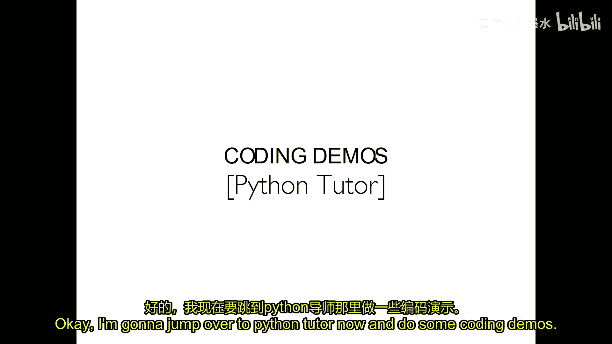
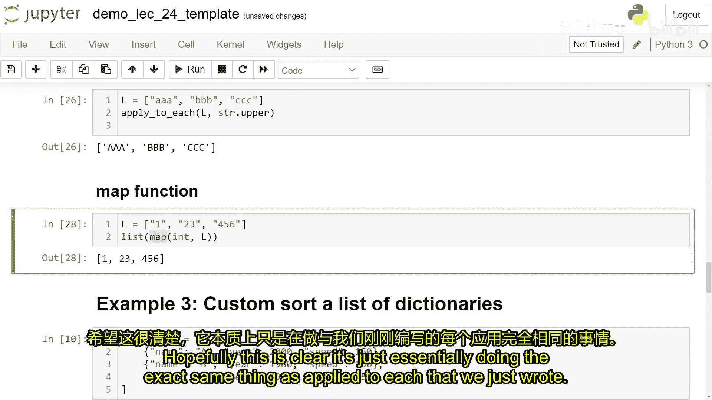
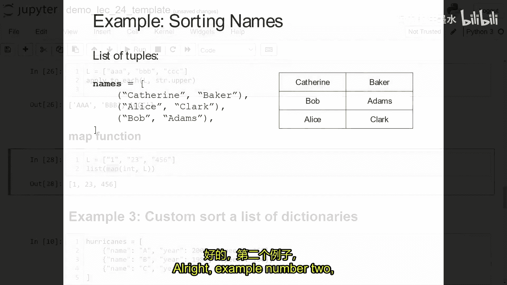
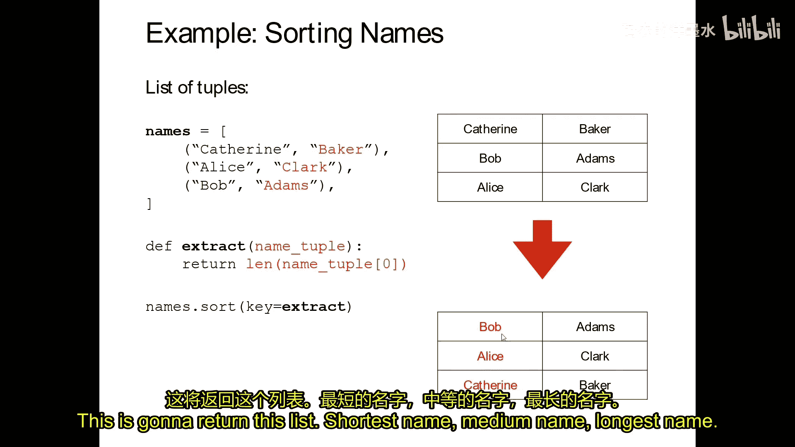
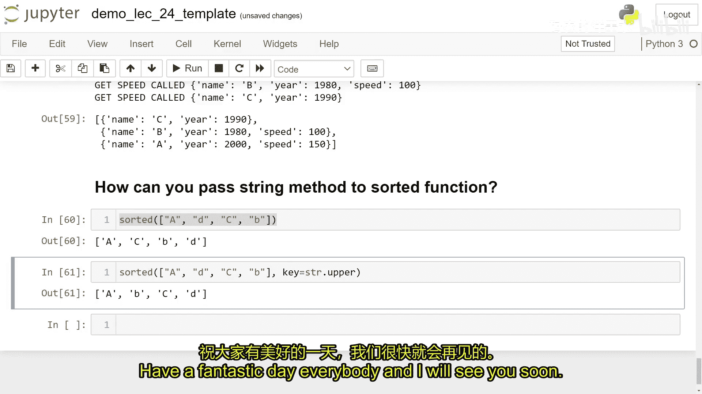

# 【全集】威斯康星大学-Python数据编程-CS220-中英字幕-1080P-p21-Lecture-18---函数引用--BV1VxvsBLEmv_p21-

Hello everyone， welcomelcome back to data programming1 Today we're going to be talking about functions as objects。

 This is our second lecture on what I'm going to call advanced functions。 There is a template。

 a Jupyter notebook template on our webpage go ahead and go download that now while I'm going through the rest of the announcements。

Next up， haven't caught anybody cheating yet， but I'm only up through P5 I've still got p6 and p7 to work through I'm going to be doing that this week。

 so if there's any sort of similarity between your work and someone else's I'm going to be emailing you if you've actually cheated and want to confess that's always best please just send me an email。

All right， Next announcement。 Our exam is scheduled for next Wednesday。 That is November 4。

And there are practice exams available on our webage。

 they're just the exams from previous years last spring。

 there's not an exam from last spring because that was about the time that they sent everyone home for COVID and we didn't have a solution at that point for how to do an online exam。

Alright we're going to make a couple of changes from exam1 first we will not be using atomic assessments they just couldn't handle the load when we have 800 people in class so we're going to be switching into the Can exam the builtin Can quiz module so you guys are familiar with that we've been using that for quizzes for the last couple of weeks the major thing that's going to be different is we're limited in what types of questions we can ask so you can expect to be mostly multiple choice questions。

All right。 So as we begin this lecture， the second in the three of advanced functions。

 I'm going to make the radical claim that functions are actually objects。

 This has a number of consequences for us。It means that variables variables hold references to objects。

That means we can have a variable that refers to a function。Further。

 parameters are just special variables that hold references to objects also。

So that means we can have a function with a parameter that has a variable that refers to another function。

Check that out。 We'll do some demonstrations of that before the end of class。

 we can also put functions into lists and dictionaries。

 and lists and dictionaries can contain references to objects and functions or objects。

And that means we can actually pass lists of function references to other functions。

 This is actually going to save us a lot of time programming。

 There's a lot of clever things we can do to add versatility to our functions。😊，Alright。

 I'm going to start out with a relatively simple example here。

 You should understand everything in this code when I'm done with this slide。 Well。

 since is like 12 slides that break it down。 But make sure that this makes sense before you move on。

 the rest of the lecture will be very confusing if it， if it doesn't make sense yet。 Okay。

 I want to point out that first， one line in this code is something radically different from everything we've seen so far。

 Take a minute。 stare at this and see if you can figure out which line is different。All right。

 In fact， it's this line right here。 G equals F。 That's the one that's radically different， Very new。

 You may have actually seen this as a bug if you forgot to write the apprenheses like right there when you're calling a function。

So let's go ahead and step through this example。 So first line。

 X is going to create a brand new object so these brackets will create a new list object。 and x。

 the variable x is going to refer to that list。 we go the second line is just going to create another variable。

 and we're going to set that equal to X。 What that means is that y is going to refer to the exact same object that X does。

Al right， after that， we're defining a function。 Now， this command。

 let's take a little more look a detailed look at it。

 This says create a brand new function object with all of the code inside。

So F should reference a brand new function， and we're going to create a variable F that refers to that function object。

After that， when we say G is equal to F。That means that G is a variable that's going to refer to whatever F refers to。

 This is the important key part。 G is a variable that refers to whatever F refers to。 Remember。

 in the previous section， F is a variable that refers to a function object。

 So both G and F are going to reference that same function object。Okay。

 and then we're going to wrap up here with Z。 Z is calling the function F。

 These two lines are very different。 So those parentheses means go run the function F。 So Z。

 I'm sorry。Function F there goes to this function object， figuress out what code to run。

 Figure out what return value to return and then assigns that return value to Z。 In this case。

 it's returning the string high。 So one way to think about this is F is when we call the function is just going to simplify something down as much as possible。

 And at the end， return whatever that is that we need to store as an object and have Z refer to。

 In this case， it's just the string high。All right。

 please note that both of these lines do exactly the same thing。

 So this line Z equals F parentheses is calling the function F。 That means z is gonna， I'm sorry。

 we're going to start on the right hand side and simplify this。

 So we're going trace the arrow from F to the function object。 Do whatever this says。

 Come up with return value and store back in Z right there。 This line does the same thing。

 It's going to look up the variable G from my list of variables。😊。

Follow that arrow to get the function object。 execute whatever code is in that function object。

 Come up with a return value and store that return value in z。

So both F and G are just names for the very same function object。 They are essentially aliases。Okay。

 so check this out。 I've got some arrows here。 So this line X creating a brand new list and this line where redefine F。

 These are very similar。 Both of these lines create brand new objects on the heap。

 They create variables on the stack with arrows that point to it。 They refer to those lines。Okay。

 these two lines， the blue ones， y equals x and G equals F are also very similar。

 both of these create brand new variables on the stack that refer to existing objects。

 so they just create an arrow over to something on the right on the object side that already exists。

Alright， check it out。 These two lines are very different。

 This first one here is creating a reference to an existing function object。

 So basically just giving us an alias for that function object。 And this line， the bottom one。

 Z equals F is very different。 This is actually calling or invoking the function。

 getting a return value from that in assigning that to Z。Okay。

 I'm going to jump over to Python Tutor now and do some coding demos。

 This is a great place to pause the video and pull that up。 if you don't already have it open。

 So I'm going to start off with some just simple examples that kind of demonstrate what's going on。

 They won't be particularly useful。 But then in the second part。

 we'll do two more examples where we can actually see where this is really applied some things that may save you some time in the future。

 All right， So first up， I'm just going to define some functions。 We'll start with the first one。

 Say， hi。😊。

And this will print。Hello there。Can't take today， little good Lord， hello there。All right。

 I remember all the quotes， I mis type that。Okay， so there we go。 my first function。 All right。

 the second one I'm going to define， say goodbye。And this one is gonna say， oops y。 it's a function。

 This one is going to print。Let's see here。Wash your hands and stay well。 There we go。 Very good。

 All now I'm just gonna to call these functions a bunch of times。 Let's do。It will do say hi twice。

Sa。Hi， again。せ？Goodbye。Again。And a third time。 Okay， there we go。 We can see it's working。

 It's doing exactly what I want it to。If this at all feels unfamiliar。

 you should go back and review this， walk through the code on your own one line at a time。

 Just make sure that you do really understand。 Okay， what I want to do next， though。

 is demonstrate this idea of functions as object。 So I'm going to just say that F is equal to say hi。

 Okay， that's creating a new object over here a new variable F。

 that's going to just refer to an existing object。 I think I said that wrong the first time。

 it refers to the function。 say hi。 And then I can call it exactly the same way。 So if I do that。

 I get the hello there。If I do it again， there's the second hello up in the output。 Allright。

 the next thing I can do is， it's a variable and variables can refer to lots of different things。

 So I can do F is now equal to say。Goodbye。And then I can call F again。Let me just copy this。

Speed it up a little bit。Plays that three times there and。Oh， whoops， I made a mistake earlier。

 Check this out。 Excel Excellent learning opportunity。 Teaching moment。

 What I've done here is I have forgotten to put in， I put in extra parentheses。 This is just habit。

 When I have a function， I do this all the time。 I put in the extra parentheses。

 I was trying to reassign F to point to the goodbye function。 Instead。

 what I've done is I've called the function。 sayy good by right up here。

 This function doesn't return anything。 There is no return statement。

 So Python automatically puts in a return。 None。 Okay， so F has been reassigned to the value。

 None right here。 And then I'm trying to call it。 There's probably an error message down here that says none type object is not callable。

 So that means I've got something that looks like this。None。

 which is just it means the absence of a return and absence of a value。 it's not a callable。

 it's not a function。 I cannot do that。So here's what I need to do。 Check this out。

 Those two parentheses are the mistake。 I need to delete those。And now check this out。

 F is now an arrow。 a reference to this function object。 the say goodbye by object。

 And then when I call it here， here and here， I'm getting the message printed out。

 So this is essentially doing the same thing I just did with function as an object a reference to a function instead of calling those functions directly。

 Now， technically， they are calling them directly。 F is just another name for those functions in alias。

All right， just one more little detail， because all these things are just variables that refer to things。

 I can actually reassign， say goodbye by。To be say hi。 Now， when I execute this line right now。

Say goodbye， refers to。I'm sorry。 Say goodbye， Ref to the say goodbye function。 Now。

 say goodbye confusingly is actually pointed to say hi。If I do F equals， say hi。

 that's going to remove this arrow from say good by。 It now points to say， hi。

 I've got three different arrows， three different variables that all refer to the same function。

And in Python， the moment there is an object over here on the right side with no arrows pointing to it。

 I can no longer get to it。 It's not nuked eventually。 It's not nuked immediately。

 It's still there in memory， but we cannot get to it。

 There is no way to get back to it that I know of。 And eventually， every so often。

 there's little timer。 Python has this garbage collection mechanism that will go through and look for all the memory that's no longer being used。

 it just keeps track of how many references。 as in how many arrows point to that。

 And if that is ever 0， It can go ahead and just remove that free of the memory and we can use that memory for something else。

 Okay， so this is just a quick little side。Some extra information and maybe a potential bug in your code。

 if you reassign something and remove all references to it， then we can't get back to it。

 So be careful of that one。Alright， next up， I want to do yet another slightly different version of this much right here。

 So I'm going to delete this。 I'm going to create a new variable。Function list。

And I'm creating a new list。 I'm going to put those functions in it， say hi。Say hi， say goodbye。

Say goodbye。And one more。Say goodbye。 So it's just a list of functions。 And remember。

 lists can contain references to objects。 So here， I've got two arrows， the point to say hi，3。

 the point to say goodbye。 And now check this out4 F in。Function list。

 I'm just going to go through my list and call those functions。 So F calling it。When I do this。

 it's going to go through the first time through the list。

 F is going to grab this very first function from the list。 say hi。

 and it calls that function right here。And that's what prints out the first hello there。

Second time through the loop， F is going to be equal to this function。

 F is a reference that points right up here。Check it out。 So right here in my loop。

 why has it pointed over there？Oh， oh， I'm sorry。 This is because I'm not walking through the code。

 This is after all the code has executed。Forgive me。 I confused myself for a second there。

 Let me actually do it this way。 We'll go back to first。We'll get caught up。Next， next， there we go。

 A Pri。 Alright， second time through this loop， F is gonna refer to。The function say hi right there。

 It's going to grab say hi from the list。Then we're going to call that function。

It's going to print out hello there next time through the list。 F is going to refer to the。

Third function， say goodbye。 When we call that function right here in this line。

 we jump up to say goodbye。 We execute that code， print out， wash your hands and stay well。

 Next line to execute grabs the next function。 That's the say goodbye the fourth item at index 0，1，2。

3 from the function list。Next line， we're going to call this function。

 so it's going to jump up into say goodbye， Red arrow moves。Print out， wash your hands again。

 Stay well by。Alright， and I'm just gonna， yeah， I think that's good enough for this demo。

 I can put functions in a list。 These create objects that refer to other functions。

 And then I can just call them in a loop。 Okay， that was version 2， next up。 version 3。

 stuff we can do。 I'm gonna just delete that。 I'm keeping my two functions。Let me do this one for。

Let's see。 I in range 2。I'm going to call say hi。Calling it。For I in range 3。Sa。Goodbye。Okay。

So this is one way to do it。 This is the without creating。

Of an alias or another variable that refers to a function。 What I'm going to do here， though。

 is instead， basically what I've got is a loop that calls a8 function a number of times。Here we are。

 We're doing the same thing。 We're calling a function a certain number of times。

 So I'm going to go ahead and actually create a function that calls a function a certain number of times。

 I'm going to call this call n times。 Okay， and I need two parameters here。

 I need the name of the function。 and I need how many times。 So。There we go something like that。Now。

 the name of the function， when I get up here， Well， the number of times is easy。

 we're just going to call that n。But the name of the function。

 I'm going to be passing in a parameter。 And remember when I pass a parameter。

 that's exactly the same thing as basically the first line of my code。 says F is equal to。

 And then whatever I call it。 In this case， I'm going to pass in， say， hi， when I do this。

 So this line right here is going to do this for me。Hi， and then。

And copy my list up here for I range。 this is not going to be say hi。

 I'm going to call F and my range is going to be N。 So basically， I just took this code right here。

 and I turned it into a function。So it's going to go for n times whatever I call it as and call the function F。

 So now I can replace this with a function call。 Alright。

 I know that went by kind of fast because I copied and pasted。Forgive me。

 I'll watch that again or stare at it， pause the video。 stare at it till it makes sense。

 Call n times。 Allright， I need the name of the function。 I'm just going to call this， say， whoops。

 say hi， that's the function I'm calling no parentheses because I'm passing in a function。

 And then I need n times。 And we call that twice。All right， I'm going to do the same thing。

I'm going to copy。All right， we'll delete that。 we'll paste the copy。 And now instead of say hi。

 I'm going to call the other function。I a lot I passing the other function to my call end times。

And I've been doing three for the second one。 Let me upgrade that。

And I can see the output is correct。 but let's go ahead and walk through this from the beginning。

So first up， creating a function object， assigning the variable。

 say hi as a reference to that object。Next， creating another variable。

 say goodbye that is referring to a function object right here that does has that code in it。Okay。

 then I'm creating a third function object。Called call n times。

 That's a variable that refers to that function object。 Okay， so I've got all that code there。

 Then I'm calling my function。 call n times。 It's passing in the function。 say hi。

 So we're adding a new stack frame right here。 This has two parameters， F and N。

 F is a reference to whatever this first parameter is here， using positional arguments。

 And that's a function。 So it's just going to refer to this function object。 And is， of course， too。

 So when we step through this for I， we now get an I while we're in the loop。 It starts out of 0。

 we're just calling the function。 I'm not indexing into anything。 So when I call the function。

 I get yet another stack frame。It's going to print out hello， the return value is none。

 which I completely ignore， I'm not doing anything with that return value。

And then I'm going to go through the next time through the loop。 I is going to become  one。

 We call the function。 We get another stack frame。There we go。 print out hello there。 After this。

 we go back eyes now 2， it's out of range。 So we exit the loop。

Returned value is none for the function， and were done with call n times。For this invocation。

 next up， the red arrow indicates the line to be called next。

 We're calling call n times with the other function。So when we jump here， we're in call n times。

 F is a variable that's past this functioning as a parameter。

So F becomes a reference to this function object。 Sa good by。And as of course， three， just as usual。

 we've been passing numbers of functions for the past several weeks。

 If that doesn't make sense go back and watch some videos from earlier in the semester。Alright。

 next up， we're going to be doing for I and range。 So I gets assigned right there。 starts out at 0。

 It's going go 0，1，2。 and then we're going to call the function。

 So we get another stack frame for say goodbye。 This doesn't have any parameters。

 It's just gonna print out。 Watch your hands and stay well。 returnturn none， which we ignore。

And then we're back in the loop。 So I is going to get upgraded to one。

 We call the function that adds a new stack frame。 We print out hello， we turn none。I becomes 2。

 we call the function。 it prints out。Yep， all print out wash your hands。Returned value is none。

 We ignore that。 I becomes3。 Okay， we're now out of range。 it stops the loop。

 This is the end of the function， So call n times has return value of none。

 which we are not doing anything with。 We're just calling the function。 We ignore the return value。

And。Programs done。Alright， now I'm going to move over into the part of the lecture where I actually do stuff that you guys might find useful。

 Some demonstrations of where functions as objects can actually save you time and make your code more efficient。

 Police writing it and of higher quality。 So here we go。 I pulled up the template。

 And I'm just gonna to be doing my work right here。 First up， check this out。

 is the first time I think we can see the clock。 Its actually says PM。

 I'm not writing this in the middle of the night。 very excited to be 12 hours ahead of schedule。

 Are you gonna to ignore the first cell。 This is just to make the screen wider。

 I'm gonna put this in full。😊，Pops， put this one in full screen mode。

I've got the Python Tutor examples here from earlier in the lecture。

 you can go check out all of these。And then example2， the actual useful stuff。

 What we'd like to do frequently， we have lists of things。 in this case， a list of strings。

We see lists of strings really commonly in several places。 First， CSV files， very common。

 Everything comes back as a as a string。 And so we may get lists of strings that we need to do some sort of manipulation on。

 and it would be good to have the power to do every item in a list and apply different functions to that item。

Every item in the list， you know， we may want to do， in this case。

 we're going to take these and turn them into integers， they come in strings in part two。

 if they were dollars， if they had a dollar sign， if we had $456。

 we're going to be removing the dollar sign and turning it into an integer。And then finally。

 we'll take some strings with letters and turn them into uppercase。 All right。

 the other place that's really common for us to get a list of strings that we may want to do something with is that cis dot org V。

This is going to be given to us from command line parameters。

 so very common those two situations we're going to have strings that we need to do something with every item in a list。

Okay， so what I'm going to do。In fact， what I would recommend that you guys do is pause the video after I'm done explaining and try and write this function on your own。

 Get as far as you can until you get stuck and then come back and watch the video。

 And maybe see the differences between your strategy and what I'm about to do。 So go ahead。

 give this a try。 If you're watching the live stream， I'm not going to pause the video。

 I'll just go through it。 if you're at home watching YouTube， Def give this a try。

 try and use this as a guided learning activity。 At this point。

 you guys have everything you need to be able to do this。😊，Alright。

 so I'm actually going to start right here。 When I apply the function， everything， I've got a list。

 I'm going to be calling， apply。To each。It's going to take。Two parameters。The object reference。

 So that's going to be L in this case from right here。And a function object。

 And it tells me I'm going to be using the int function object for thes。

So what this is going to look like is I'm going to be giving it L and int。And。

Then I'm going to go up here and take a look at blocking through this， creating the function。

 So I'm creating a function。 So de， I'm writing a function called apply to each。

This is going to take a list。 I'm going to call this list inside my function。

 I'm going to give it a new name。 I'm going to give it original values。

 So we'll justbbreviate that Or vows。 And this is going to take a function that we're going to apply to everything。

 In the first case， I'm going to be demonstrating those with。 The next case。

 I'm going to just remove dollar signs from some money。So this is going to take different functions。

 which is why I'm doing it this way。 Okay， first up， I's just。

Print out rigid and valves and make sure that this is working。Alright， next up。

 I'm actually going to copy and paste this line right up here so I can run my code and because I need something to call this function for testing。

 This is perfect example。 Let's go ahead。 We'll do control enter。And find out， I made a mistake。

E is not。 Oh， I never ran the cell。ICon enter。 Now。

 Python knows that this is a list that's available to me。Run this cell。

And we see that it's printing out my list with all of the string elements in it。

 So that looks like it's working perfect。 Okay， next thing I'm going to do is we're going to loop through all of the pieces。

 things， pieces of data in original vows， so for。 And let's just call this the for value in original vows。

Yep， and I'll just print it out print V。Let's see here control enter to run this。Yep，1，2345，6。 Now。

 when we print out something， these are still strings。

 but the print function on a string doesn't put the quotation marks in for us。So let's see here。

 I'm not following my directions。 Iize a new empty list for output。 Alright。

 so we're going to need that。 We're going to need to。

Turn these guys into integers and then add them to this list。 So to do that。

 we'll see here I need a new empty list。 How about。What do we call this。ニ？Vs， so that'll be my list。

And that's going to be an empty list， just like that。Next up， instead of printing these out。

 what I'd like to do is turn them into integers。 Okay， now， if I were to do this。

 I would say new Val。 So this is just one value。 This is going to be int。

 And then I'm going to give it V。Alright， that's what I would do if I wanted to turn this into an editorger。

 Let me just。Make sure this works。 Well let's see what we'll do。 We'll add this to new vows。

 new vows。Dot aend。New vow， singular。 There we go。 That should add this to the end of the list。

And then when we get all done， we should see that apply to each。Has created a list。We just run this。

I need to print it out， print。There we go， none。Oh， I've forgot to return your valves。

 so I created it。It's a good thing。 I tech， check that out。Return new vows。 There we go。There we go。

 And I should be able to see that it's current all of these values into integers。 So before。Actually。

 I'm just going to leave it like this。All right， Now， instead of calling the in function。

 I want this to work with lots of different kinds of functions that I can apply。

 So I'm going to be passing in int。 And instead of calling it directly right there。

 this is going to be calling whatever F is referring to。

 And that's referring to this built in Python function that turns something into an integer。

 Maybe let me just demo this real quick right here。 If I do int。 and then I give it a string。

That's going to just change this back into an integer。 We've used this a bunch of times。

 but I don't think we've ever done something quite as weird as passing it。

 assigning it to a variable and then calling it like this。Alright， let's see。

 Did I finish everything I want to do， initialize a new emptyfty list。 Check， process each item。

 That's my loop right there。 App the function passed as argument to the second parameter。Yep。

 so there's the argument， the function。Yep， and that's what I'm doing right here。え。

Oops that should be add。Get F， add the transformed item to the output list right there。

 weend it and return the output list。 return。 So looking good to me。 All right。

 I'm pretty happy with this。😊，I'm going to move on and go ahead and do the next。Allright。

 the next example is， suppose I have a list of strings that have dollar signs on them。

 So this is money。 And what I want to do at the end is turn this into just plain integers。

 So step 1 is going to be to remove all those dollar signs。

 So I'm going to run this cell control enter will run that。 it's now got a 10 here。 So I can see。

 and if I want， I can go up here and print out L again。

And I get my list exactly like below with the dollar signs。All right， in fact， wait a second。

I want to do this all in oneself。So that as you guys restart and run all， it's not messed up。Okay。

 so there I've got L。 Let me actually do this one more time。 There we go， still looking good。Now。

 what I want to do is write another function called Strip Do。

 and that's going to go and will apply to everything in the list。 So at the end of this。

 I'm going to apply。To each。And this is going to be my strip。Dollar function， just like that。

 That's how I'm going to call this。Alright， so before this will work， I need to define。

My strip dollar function。Yeah。Functions that begin with board strip are very common。 It's。

 it means that we're going to be doing something to a string to remove things from it。 Okay。

 so in this case， strip dollar needs to take a string。 I'm just gonna go ahead and call this。

 How about S。 It will be a string。And now there's a really， really easy way to do this。

 I'm going to be returning something。嗯。And that's just S is my string dot。Remove。The place。Replace。

 I'm going to replace the dollar sign。Or is it or is it ship four with nothing。 Okay。

 this should work。All right， so what it'll do。Here， let's actually print this out。And just test this。

Okay， yep， so here let me do a little， a little better job of like walking through what。 I'm do。

 I'm gonna to print out S every single time we go through this。And then。

We'll make sure we're getting dollar 1，23， is 24。 Okay， instead of returning it immediately。

 I want to make， well， I guess I don't need to do that。 I can see that it worked right here。

 printing out the entire list all at once at the end。

 I can see the dollar sign before the one was removed。 The dollar sign between the 456 was removed。

All right， then I can go ahead and。Let's say， I'm going just reassign this to L again。

So L is going to be equal to that new list。 I don't need these parentheses。

And next thing I'm going to do， I'm going to call apply to each one more time。

 And instead of strip dollar， I'm going to give this int。All right， control enter， we'll run that。

It's printing out S right here。 I need to actually write the result out。 There we go。 Now。

 it's removed all the quotation marks， and I have a list of integers instead of a list of strings。

All right， one more little detail。 Minina did this a little bit more difficult。

Using a more difficult technique than I did， she's going to check whether an input string begins with a dollar sign。

 I just said if there's a dollar sign anywhere in the string and get rid of it。

 So I'm going to upgrade this a little bit。And do it her way， Okay， so。First。

 we're going to check to see whether the input string begins with the dollar sign that's S dot。

Starts with。And then I need to give it the dollar sign。Shift for。 You never find that one。 Okay。

 if it does。This will return true。 And then I can return the rest of this string， so though instead。

Your return。And this is going to be S。 I'm going to create a brand new string by starting with element 1 and creating a slice。

 I'm going to slice the string that removes everything， but the first character。Allright。

 and then this line was the easy way。 I'm going to leave this here so you guys can come back to it。

It easy。It may not do exactly what you want， though in this case， I know that I'm where's my y。

My list， I know that the dollar sign is always first。 It doesn't have weird， like。

Something like that。 My version will remove all three of those dollar signs。

 This starts with will not。 It assumes you actually have clean formatted data。

So it depends on what you really want。 We may need more than one version of strip dollar。You know。

 we might create a function that says remove all dollar signs。In this case。

 it's just going to be removing the first one。 All right， let me just verify that this works。

That I didn't make any typos。Ill check this out。 I did make a mistake。 I have a semantic error here。

 So the code ran， but it is not doing exactly what I want。

 So check this out for it's printing out all the numbers to start with。 So this is the input data。

 So it's just printing out dollar1。 if it starts with a dollar sign。

 and only if it starts with the dollar sign， then we're going to return something。

 So returning the string。 So in this case， one without the dollar sign。

If it does not start with a dollar sign， we do nothing。And then it's going to return none。

 I think this is a great teaching moment。 So instead of doing it like this。

I need something like this else。Turn S because S does it not start with the dollar sign。 All right。

 let me run this and make sure that I'm actually getting that 23 to still be there。Alright， perfect。

 Alright， so that's now working。I'm going to go ahead and put back my apply to each。For the int。

 And now I should get a string。 I'm sorry， a list of just integers。Alright， next demonstration。

 Here's what I want to do is use more built in functions。

 But I'm going to be using the built in methods。 So if you remember。

 a method was something that's called with an object dot。 and then like。啊，不是。So if I do this。

 it's going to take all the letters in this string and move them to uppercase。

 But what I really need is something that I can call like this because I'm going to be passing the name of a function。

And this is not going to work。In fact， I get a name error， U is not defined。

So the important thing to remember is that for methods， we had two different ways to call them。

And the other one was to give it the name of the type。 In this case， this is of type string。

Dot upper。And now I can give it the string。So when I run this totally works fine。 now。 Okay。

 so this is how I call a method where I'm not actually using the object or the string as the like。

UmThing that I'm calling it on with the dot notation。Okay， so this is pretty straightforward。

 I can call my function。Apply to each。I'm going to give it this new list L， which is the A A A， B，BB。

 CC。And I'm going give it the function。So you check this out， U will not work。

I can't just give it to function upper。Yep， U is not defined。It's part of this string module。

 So I have to call it like the string upper。And now it's transformed my list to A A A。

 BBB CC in uppercase letters。Al right， next up， I just want to mention that applying something to every single item in a list is so common that Python has a built in map function that's going to let us just go ahead and do this。

Without having to write our own apply to each。It's just map。

And then I need to give it the name of the function and the list。So in this case， I can do int and L。

 that's the exact same thing as doing apply to each。

One little caveat map is actually returning something known as a generator。

 that's actually the next lecture， but the important thing to note is that generators can be used as inputs to lists。

So all I need to do is write list， map， and that will take this generator and populate the list with all of these guys。

Turned into integers。Let just go ahead and run that。 So quick demo， there's not really more to it。

 I we'll be exploring generators in the next lecture。 So I'm going to come back to it then。

Hopefully this is clear。 It's just。

Essentially， doing the exact same thing is applied to each that we just wrote。Al right。

 example number 2。 I'm going to be talking about sorting here。 And in this case。

 I have a list of tus with just names with first name， last name。 So Catherine Baker， Alice Clark。

 Bob Adams， The important thing to note that if I actually call names dot sort。

 all of these tus sorting is done based on whatever is the very first element。

 So we're going to get Alice， Bob， Catherine， it'll come out in that order。 Now。

 it's actually really common that we might want names sorted by last name first。

 So we need to be able to tell Python。 what criteria we want to use for sorting。

 we may even want to do something weird， like sorting by the length of their name。😊。

Writing a sorting function， it can be painful。 There is actually active areas of research trying to come up with more and efficient and better ways to sort things。

 It can be complicated and prone to errors， or we might just write something that's not very efficient。

 So what we'd like to do is use Python's built in sort module， sort function method。

 sort method for the list。 And but we want to be able to give it a little more information We want to be able to pass in。

Some sort of criteria to help it know what we will find important and what we want to sort by。

So the way this works is this sort method actually has a keyword parameter named key， to be honest。

 that is a very poor name， because it makes me think of dictionaries where we have key value pairs。

 That's not what this means here。 This key takes a function And in this case， I'm calling it extract。

 I'm going to be extracting from my tuple of names。 the one that I find important okay。

And what all this does is it's going to return something that's going to go into a less than。

So essentially， sort needs to say that Alice Clark is less than Bob。

 And that means it's going to put Alice Clark first in the list before it puts Bob Adams。

 So it's going to have， it's going to call this function twice this function right here。

 and it's going to put。Whatever this returns on the left side of the less than and on the right side for the other object and do that for comparison。

 So what I need to do is return the criteria that's important。 In this case。

 if I'm sorting by last name， I need to write a function that returns the last name。

 which if we didn't do this， the default value would be the first name if I left this out。

 So in this case， I'm going to be extracting the parameter from the tuult that I find important。

All right， let me walk through this a little more。 if I sort by last name。

 Bob Adams will come before Catherine Baker。Let's see here to sort by the length of it。

 I'm going to go through and do these in Jupiter notebook where I can like use much greater detail。

 But again， this is going to return whatever I want on the left side of a less than and for the other object。

 the right side。So in this case， if I'm returning the length of the first name。

 Bob has three letters。 Alice has five letters。 When it does this comparison。

 it'll decide that Bob needs to come before Alice in the sortred list。Catherine has the most letters。

 so needs to come last because Catherine is not less than anything else so。

This is going to return this list， shortest name， medium name， longest name。

Alright， so let's go through and create a custom sorting technique on a list of dictionaries。

 I'm gonna to be doing hurricanes because I wanted to have more columns so I can write more functions to sort on different things。

 So not the names， but it's the same concept。 And this will work very well for those other things。

I'm also using dictionaries which are slightly more complicated to extract things from so hopefully this will be a good example。

 So I have hurricanes。 this is a list。 it contains three dictionaries Those dictionaries have the identical keys so we have name year and speed and then I've just got I name them A B and C different years and different speeds so if we sort by name they're already sort by name that's perfect。

 if I sort by year， then I've got H B will be first Hur C next and Hur A will be third and if I sort by speed then again a。

Then whoops， sos。 This is B， then A than C。 So it'll give us a different order so we can make sure this is working。

 Allright， I'm just going to go ahead and run this cell with Shi enter。

 So now Python knows that I've got hurricanes in here。Hurricane 0， print that out。

 That looks like it's working。 Na a year 2000 speed 150。 I's make sure that Hurricane。1 is in there。

 Yep， that one is B。 Allright， now to sort things， I need to know if one hurricane is less than another。

 and then I can put them in the right order in the list。 Now， when I run this cell。

 I'm just going to do control enter， this is gonna to give me an error。And again。

 it's telling me right here at the bottom that to sort。

 I need the less than operator and less than is not supported for instances of di and dickt。

 I can't have one dictionary， less than another dictionary and give me back a truer false。All right。

 And for the same reason， I can't do this either。 I can't call sorted。

 Let me do a control enter here。 I get the exact same error because this sorted function is actually using this less than to decide if one dictionary is less than another。

Alright， so in order to fix this， we need to write that special key function that Python is going to use when they call sort or sorted to figure out what to put on the left side of the less than and what to put on the right side of the less than so that it can actually you use that comparison so here we're going to go ahead and define a get year。

 So then when I call sorted using the get year， it will sort them by year right So let's just dive in and do this。

 So I'm going do， define a function， get year just like it's telling me to。

 This is going to take a hurricane as a parameter。 So I'm just going to call this H。Okay。

 and let's just start out by printing out。Page。Alright。

 and then I'm going to call my function to test it。 So get year。 and then we'll give this。

Hurricane  zero。Just like that。 So hurricanericane0 was the first one in the list。

Let make sure this works。Hurricane， hurricanes。There we go。 was the first one in the list。

 So it's going to be Perane A year 2000 speed 150。Now， instead of just printing the whole thing out。

 what I need to do is return。What do we want to center8？Dot。Ye。😔，Oh， that's not how you do it。 Wait。

 like you're more H key look up。Okay， there we go。 And now it's returning the year 2000 right there。

 perfectf。 That's exactly what we want。 Allright， I'm going to get rid of this print H。

 I no longer need that scaffolding。 And now we can go ahead and call sorted using the get here function。

 Allright， I'm going to go ahead and do it right here。Sored。We'll be sortdining hurricanes。

 and the key is going to be my get year function。Hopefully you'll spell that correctly。

And now when I do that。What we should find out is that。I'm getting some stuff I didn't expect。

 I think when I went ahead and deleted my print statement， my scaffolding， I didn't rerun that cell。

Let's go ahead and do this again。There it is。 Okay。

 now I got rid of those extra scaffolding lines that I。I didn't tell Python to reeval my。

 what is this cell 39。 Okay， so now when I've sorted the hurricanes。

 we see that they are indeed sorted by year of 1980，1990 and 2000。

AllI just want to do one more thing。Just to kind of go through like in a little more detail how this is working。

 And I'm curious， how many times does it actually call get year， Check it out。

 We never called get year directly。 It's not here。 I never called this function。 I tested it up here。

 but inserted。The sorted function is going to be using get year。So if I put in a print statement。

Then I can actually see when it's called， so we'll go ahead and print。Get your called。

 and we'll go ahead and print out H。 So that will print out the hurricane as it's called。 All right。

 I'm just going run this So now I've updated my function here I'm testing it。 Get your called。

 seems to be working。 Now， when I call sorted， I've got two things going on here。

 The first three lines are that。嗯。Debugging statement right here。So I can see that it's called for A。

 B and C。 So it's called exactly three times， which makes sense I need to be able to extract this data for every single hurricane so I can compare and know where they go in order。

 And then after it's sorted， I can see that， we got 1980， 1990，2000， it is indeed working。Okay。

 so whoops， os， ups， typo there。Did I mess something up？Alright， next thing I'm going to do。

' go through and do a get speed function。 So again， I can do sorted to change what I'm sorting by。

 And I'm going to go ahead and start out with this one。

 My get year function does almost exactly what I want。 It's just， I need to get speed instead。😊。

So in get instead of get year， I'm going to name this。good lord。Oh man， cannot type today， get speed。

 And then I'm going to get rid of this scaffold thing。 I'm going to say， get speed。Called。

And we'll go ahead and take that out in a second。But instead of returning the。Year parameter。

 I will want return the speed parameter。So and that is right here， that's one of the keys。

So every time Python needs to sort， it needs to look up the speed。 And again。

 whatever I'm returning right here， it's going to get called for it。 So I'm comparing two hurricanes。

 They're dictionaries。 I need to put something on the left hand side of a less than。

 something on the right hand side of a less than。 And then I can decide which one goes first。

 In this case， I'm going to be sorting by speed。 So this should be enough。

 I should be able to run this cell。And then let's see， I should be able to。

 let me just test it right here with sorted。So， did。Hurricanes。And key equals get。Speed。

When run this， yep， get speed called。 It's called for all three of them。

 So Python's going to take note of their speeds， decide that 100 is less than 150。

 So Hurricane B will be first。And then 150 is less than 250。 So a will be next and then C。

 bringing up the rear with the highest speed。Al right， so one thing I'm looking at this thinking。

 maybe I don't want them listed from slowest to fastest。

 Maybe I'd actually prefer that they were listed in the reverse order。

 And Pythland provides a way to do that also。 So I'm just going make a new line here。

 We're going to call sorted again， get speed。Is our parameter that we're gonna be the criteria we're going to use to sort。

 But it has a Python has another keyword。Reverse equals。 and in this case。

 I'm just going to assign this to true。Oops。I spent too much time programming and C+ plus this weekend。

'cause I just。I've got that it's capitalized。 All I'm pretty sure。

That the keyword is actually reversed and not reversed。Yeah， in fact， this looks like it worked。

 It's now sorted in the reverse order， so the fastest hurricane is first。

Then the medium and then the slowest。 So it's just rearrange these dictionaries。

 So they're in that order。So keyword， reverse。Alright， for the next example。

 I've gone ahead and added a little mistake to my hurricane list in Hurricane C。

 someone forgot to enter the speed。 And what do we do in this case， So if I go and just try this。

 I'm gonna copy my sortded hurricanes get speed method， I'm gonna get an error。

 It's gonna say that it's a should be。The key error， because there is no speed in this。A。

Hurricane right here。Let's see here key error speed。 Y， there it is key error。

So when I tried to look up that key， not present。 So what I want to do is go ahead and fix my get speed function so that if the speed isn't there。

 it's just going to return0。 Allright， now hopefully this was kind of obscure。

 Well I think I mentioned it exactly one time。 probably three weeks ago。

 So if you guys can remember how to do that， that's amazing。 And if not。

 it might be time to review for the， we've got an exam a week from Wednesday。😊，Alright。

 so I'm just gonna go back up。 I'm gonna go to my get speed function and update this。

 So pause the video， see if you can remember how to do this and if not。

 come back and watch and get some review。Alright， so the secret is that here I'm using a key look up using the brackets。

 What I'm going to do instead is use the get method。To get。The speed。

 and this one lets me put in a default value。 So that means if speed is not present。

 if it's not one of the keys。Then it's going to return this value instead。Okay。

 so I've just updated this formula。 I need to control enter to update it。

And now I can see it already changed this because I just ran this cell。

 that changed my hurricane list， according to Python。 So now when I run this cell like this。

 when it sorts it， it's going to get a speed of 0 to be used for sorting。

 So it's going to put all of the hurricanes without a speed first。

 And then it's going to list them from smallest to greatest。😊，All right。 One final example here。

 here I have a list of characters， and a lists of strings are actually really common。

 We may have a list of names。 Some of them might be capitalized。 Some of them might be lowercase。

 Some of them might be like all caps。 Sho names。 But the idea here is that I want to sort that entire list of names so that they look good。

 So they're in alphabetical order。 If I just call the sortrdid function on a list of characters like this。

 What it's going to do is say that all of the capital letters。 A And C。

 come before all of the lowercase letters。 So it's still going to get kind of a mixed up string。

 I've got like。😊，Everything that begins with a capital letter will be sorted and first。

 and everything that begins with the lower case letter will be sorted。 And second， in fact， here。

 let me switch this round。 We'll switch this to D and B to just verify that the sort is working。

 It did， in fact， move the B in front of D。 But I still have all of the uppercase letters in front of the lower case letters。

So the idea here is we want to pass some kind of string method to sort it。

That it can call on these functions or these characters。 And remember。

 when we give sorted a key word。Here in fact， I'm going to just go ahead like this， make a new copy。

 we'll do it right here in this cell。When we give that key equals something。

This is going to be a function that returns a value that I'm going to put on the left side and right side of a less than。

 So in this case， I've got capital A less than capital D。 That's true。I'm sorry， lowercase D。

 lowercase D， less than capital C， That's false。 It's gonna switch them。 Alright。

 so that's the idea here。 Now， in order to call a string method。

 I can't just like give it the name of a string dot something。Let's go with lower。

I suppose upper would work2。 usually Jo。 They both work。

 We'll just sort them all by converse converting the letter into uppercase or lowercase。

And then using that as our。Operans for less than。Okay， now if you remember just up above， we had。

This is a string method。 So in order to get just the function of a string method。

 I need to tell it that it comes from this module。 So string dot upper。

 Now this should go ahead and sort all the strings。

 So regardless of whether they begin with a capital letter or lower case letter。

 they're going to appear in alphabetical order。Al right， hope that's clear， quick review。

 This might be useful in an upcoming project。 So just stick that in the back of your mind might be useful on an upcoming exam。

 All right， this is going to do it for me today。 Have a fantastic day， everybody。

 and I will see you soon。😊。

