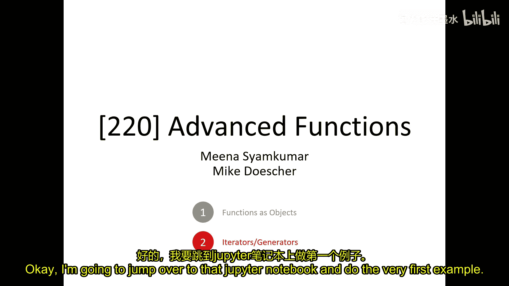
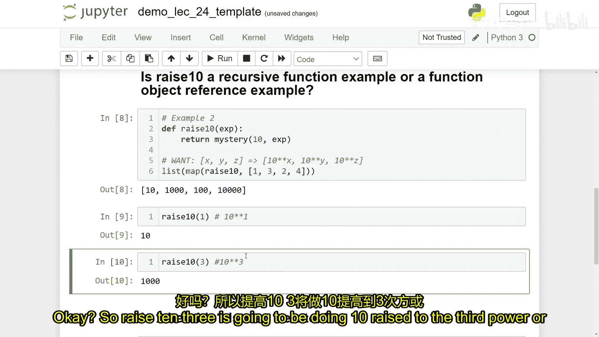
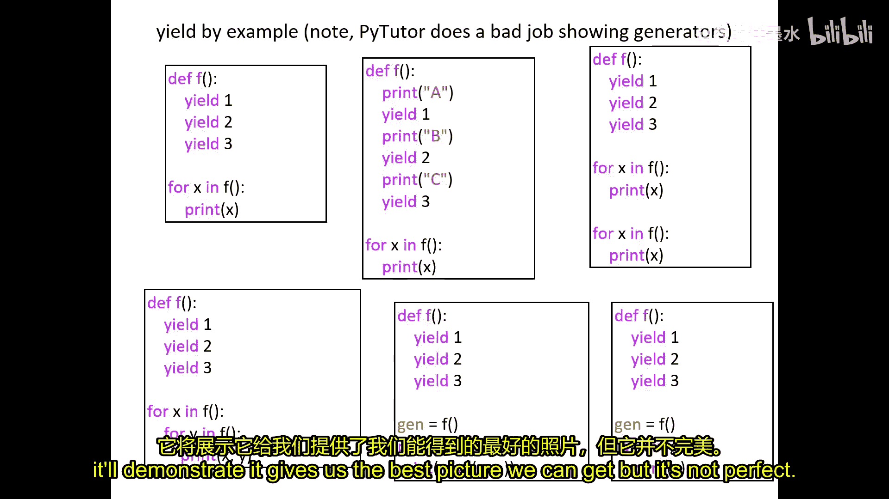
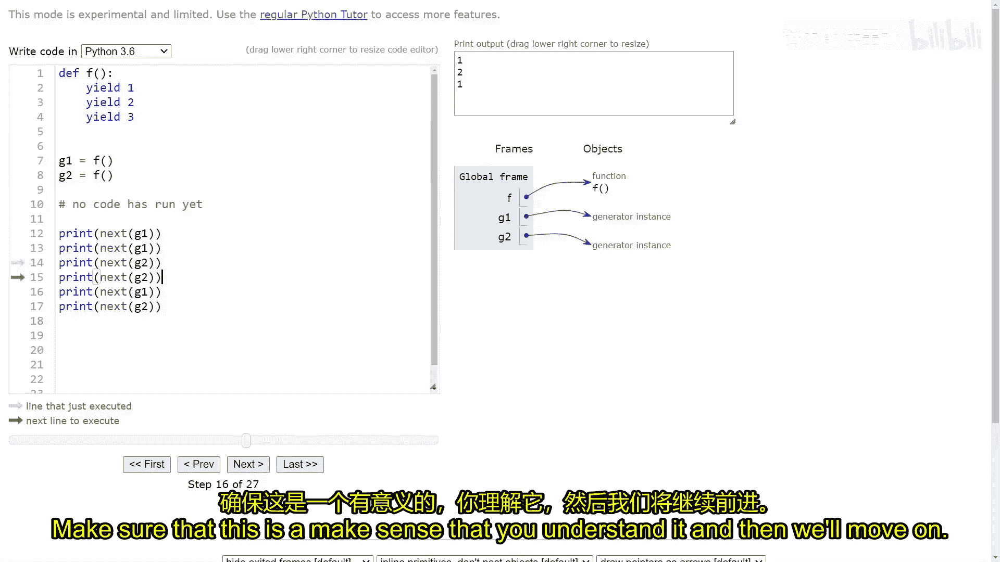
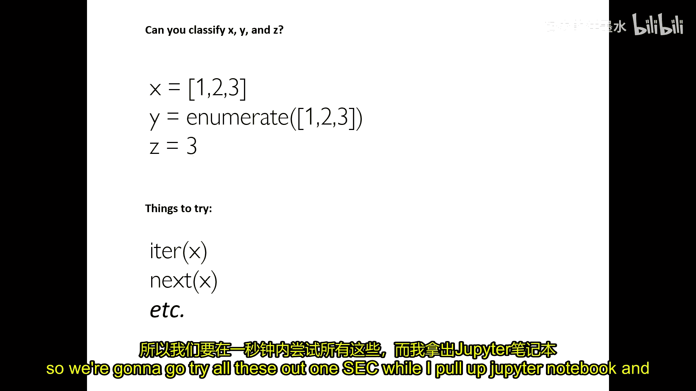
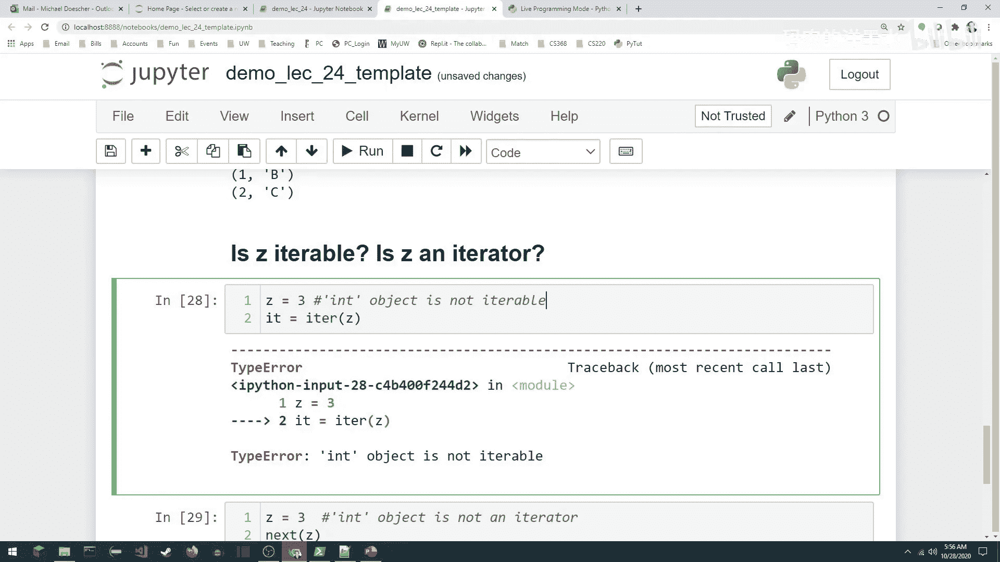

# 【全集】威斯康星大学-Python数据编程-CS220-中英字幕-1080P-p22-Lecture-19---生成器--BV1VxvsBLEmv_p22-

All right， good morning， everyone。 Welcome back to data programming 1。 All right。

 as we get started today， there is a template available on our webage to Jupyter notebook you guys can go download and use that as a guide as you take notes。

 and there are some examples in there。 I'll be pulling it up myself in just a moment。😊。

Also we'll be using Python Tutor so as I'm going through with the introduction here。

 you can go ahead and get that opened up so it's ready to go also quick reminder we have an exam scheduled for next Wednesday。

 November 4 that's one week from today assuming you're watching this video on schedule if you're watching the video later。

 it's not a week from today if you're late it'll be Wednesday there'll be an email coming soon with all the information you need about exact timing when you can take the exam。

 the format， how it's going to work very similar the last exam。Okay。

 I'm going to jump over to that Jupiter notebook and do the very first example。

 so give me one second to set that up。

All right， So over the last two lectures。 Well， there's a sequence of three lectures。

 This is the third， while we're talking about advanced functions or advanced techniques with functions。

 The first was recursion。Then we talked about functions as objects。 And today。

 we're going to be talking about generators。 But let's start out with a little review。

 I've got two functions here。 Exle 1， an example 2， Exle 1 is a function called mystery。

 That's a terrible name for function。 Do not name your functions My。 Give the meaningful names。

 And then the other one is raised 10。 One of these is an example of recursive function。

 And the other one is an example of a function object reference。

Go ahead and take a look at this code， see if you can figure out which one is which。

And then go ahead， make your guess， commit to it。 There's some little boxes there。

 I deleted them so I could put them right next to each other on this slide。

 Go ahead write down what you think the answer is。All right。

 If you said that mystery is the recursive function。 That's weird the way it's jumping around。 Okay。

 you'd be correct。 So if you remember a recursive function is just going to be a function that calls itself。

 So here's the name of my function， mystery inside of the function right here on the return line。

 I am calling the function。 mystery。All right， and the other example。

If we have a function like rays 10， a function reference is going to be created where we use the rays 10 without the parentheses。

 so we can see right here we are using rays 10 as a function object and passing it to the map function。

All right， I want to just go through a little bit more and see if we can talk a little bit about figuring out what recursive functions do。

 we did this two lectures ago where we did this in reverse。

 where we had a problem and we went through those four steps to turn a problem into a recursive Python function。

 In this case， let's take a look at this and see if we can figure out what this function really does。

And we're going to do this by just exploring a little bit。

 So let's just start out by calling the function with some really simple arguments。 So we'll do。

W whoops， mystery。And then we'll call this with mystery 2，1 and see what this does。

Allright run the cell。 I just open the notebook。 It's a fresh notebook。There we go。

 So you have to run cell in this case，2， in order to bring in the code。

 So Python knows where to find it。 And then when I ran this cell mystery 2，1。

 it went ahead and did this。Function call to run the code。 So here we're passing in2 to x 1 to y。

 And I picked one because if y is equal to 1， it's just going to return x， This is the base case。

 Remember， I'm always going to have some kind of conditional could be an if it could be a while。

 could be some other loop。 so that there is a base case that's going to end that recursion and then the recursive part。

Al right， so in this case， this is the base case。 So I'm just returning x。

 which is2 in this case and another cell。Come on。Mystery， let's try 2，2 this time。

 That way we'll go into the recursive case。 So we'll run。There we go。 I had messed with the。

Type of cell it was right there with some sort of like fumbling of the keys。Mr。

 Fmble fingers made his appearance。 Okay， so now we can see that when we call if y is equal to1。

 we'll return。 it's not。 In this case， I'm calling with y is equal to 2。

 So now we're gonna to do is we're going to turn x times mystery of x with y -1。 Well。

 this right here， this mystery X of y -1 is exactly what we just did right here。 My X was 2。

 X is still 2。 Y is 12-1 is 1。 That's kind of why it shows this is my second example。 So right here。

 we've already done。 So this is just gonna to return X， which is 2 times this piece right here。

 which is 2。 And so that's 2 times 2 is going be 4。All right， let me just do one more of these。

 Look'll at one more cell below。Mystery 2，3。Run this cell。 we get 8 this time。 And again。

 the same sort of logic follows。 So it's， if y is 1， it's not。 We skip down。 we're going to turn x。

 which is two times mystery of2。And then 3-1 is 2， which is exactly what I've got right here。 My E 2。

2， And that was 4。 So this is going to be a 2。Times 4。

Maybe I'll just write this out in a little comment right here。Returning two times。And then 2。

 and then 3-1 is that two that we had right there。 Okay。

 so that's kind of kind of what we're doing here is looking for the pattern， figuring out， you know。

 rather than actually using my brain to go and step through everything。

 I've already got the piece of information that I need right here。

 And I can see that what this function is really doing at the end。Win another cell。

Is taking X and raising it to the Y power。In Python。

 that to raise to a power is the double multiplication。

 So not every programming language has exponentiation built into it。 Python is as lucky that it does。

 So we're going to take advantage of that notation right here。 So just to verify this。

 two raised to the three should give me 8。There it is 8。All right， very good。All right。

 My second review example is an example of a function object or a reference to a function。

 So here's what I'm doing。 I've got a function here。 I'll raise 10。

 and I'm using my mystery function from up above。 So this may have been a little tricky if you thought。

oo， maybe do I have a circular reference。 Does mystery actually call race 10。

 Then we would have had recursion here also。But no， in this case， it's just gonna call mystery once。

 It happens to be recursive。 So we'll do whatever this function call us and return that。 Okay。

 so the mystery function of recursive， not the raised 10。

 but here's the where that function object comes in。 We're calling raised 10 right here。 I'm sorry。

 we are not calling race and。 we are passing the function。 So this。

When I run this code creates a function object。With a variable raised 10 that points to that object。

Okay， and I can pass that function object to other functions。 In this case。

 the map is the equivalent of the。Do this to everything in the list。

 I forget what I called it last time。Do for each。Apply to each something like that。

 I'm totally blanking on whatever I named it。 But what this is going to do is it's going to take this list of numbers and apply this function to that list of numbers。

 This is going to return a map object that we can convert to a list。

 And we'll talk a little bit more about the type of object that is this is。

That lets us just turn things into lists so at the end of the lecture today。So when we run this code。

What we see is that it's going to return a list。And what we're doing is we're applying raise 10。

First to this one。To give us that number， then to this one， to give us that。All right。

 so let me just， let's just do one of these。Prase 10。With one right there。 So raised 10。Gives us 10。

 which was the first number right here。 When we call mystery 10 with one。 Remember that mystery。

Is going do。10。Raised to the one power， or just give us 10。 When we do the second one there。

Raised 10 with a three in it。Run this cell。It did that again。 It switched to the weird mode。 Okay。

 so when that happens to you guys， switch it back to code right here， and then you can run it。

 I don't know what I fuumbled to switch them the mode on these things。Okay。

 so Ra 103 is going to be doing 10。Raised to the third power or 10 times 10 times 10， which is 1000。

O。Al right， now on to the new material。 So here's the plan for today。

 we're going to be talking about iterators and generators， mostly generators at the beginning。

 These are going to be functions that have the keyword yield in them。

 We'll talk about some vocabulary and then probably move those to next lecture。But here's the plan。

 Let's start out with just a normal function and give this some thought。

 So let's take a look at this。 We're going to define， get one digit nus。

 It's going bank a list of the number 0 through 9。 That's the goal。 rightright。

 we're going to start out by printing start， empty list。 And then we've got a while loop here。

 The most versatile of all loops for I is 0， I less than 10 numberss got of pen。

 So it's going to pen 0。 Then it's going to pen 1， then 2。

 There's our increment step all the way up to 9。After it's dependentend 9， this will be 10。

 It's no longer less than it's equal to。 so it'll jump out of the loop， and then we return that list。

Here we're just defining the function。 And then here we're using the function。

 and we're using the function in a four statement。 So I've got 4 x in。

 and then I've got my function called right here。And I'm just going to print out X。Okay。

 so the question to get us started is， how many times is the word start really printed？

Is this function called every single time we go through the loop for x， It's going to get something。

And then we do something， and then X gets updated。Or is this just called once？

And the answer is start only appears once。 when we call this function。 it returns a list。

 This list of nus right there。 And essentially， what you can imagine is this is a simplification。

 I'm taking a function call and replacing it with this list。 And I can totally do this。

 I can just give X or a for statement a list。 So for x in this list。

 So X will become the first element of the list。 Well print it out。

 Then it'll become the second element in the list。 we printed out the third element and so on。

 So start is only printed once。 Think about this as a simplification。😊，Now it's doing。Essentially。

 all of the work all at once。 So I've got my black box up here。 That's the function。

It's going to do all of this work。In stage 1， basically just preparing that list of number 0 through 9。

 And then once we've got that list， it's going to replace it right here。

 Then we do all of the work in this gray box。 So we we run get nus， get one digit nus code。

 and then we're going to loop over the results in print in stage 2 the gray box。All right。

 so's that's exactly what's going on。 This is not a generator yet。

 This is just regular Python code like we've been working with all semester so far。Alright。

 now let's take a look at this。 This one's a little different。 It's subtly different。 Here。

 we're going to be printing out prime numbers。 That's the goal。

 We're going to assume that we have access to and is prime function。

 It's on the previous a couple lectures back。 We made one of those。So let's assume that it's there。

 And this one's just going to put together a list of prime numbers and return that。 That's the goal。

 So we print out start。 We create our empty list。 while I I is 0， while true。

 we're going to just call is prime。 If it's true， if that is prime， we'll stick it on the list。

 So I'm creating a list of prime numbers。 and then we test the next one。 All right。

 when we get through that list。 that loop。 we print out end and we'll return nus。

And then we'll go ahead and use that。Gets replaced right there and we'll print out X。

 So this is gonna print out all the prime numbers。 There is a little problem right here， though。

This isn't going to work for us because we have an infinite loop right here。 Well， true。

 there is no condition that will ever get us out of this loop。

 It's just going to continue to make a longer and longer list of prime numbers， until。

My computer runs out of memory and that's not going to happen for a very long time。

 I've got a lot of memory and finding prime numbers once you get past the easy ones is not super fast。

So what I really would like to do is create a function， my get primes here。

That I can call like this same way I've been doing with other lists where I get a prime number。

 just one。 That's all I need。 And then I call my code that prints it out。

 Then we'll get the next one， and then we'll print it out， and we'll get the third one。

 We'll print that out。 And we just do this forever。 We want to function here。

 that I can sort of run a little bit。 Get some data out of it。Run a little more， get some data out。

 run a little more， get some more data out。 So let's see， I think I've got like。Capptions here。

Alright， so we got primes just long enough to get one。 Yeah。

 this is known as a lazy function as opposed to eager that would try and do all of the work like。

All functions are normal， the normal ones like this generators， we can think of them as lazy。

 They're just going to go and execute until they get to the yield statement。

 and then they they take a break。Okay， we put one number， then we resume， get the next number。

All right， so and we will stop running and resuming get crimes many times。

 but we're only going to call this function once。 that's the idea behind a generator。There we go。

 behavior code generators。好。So， and I think I I don't remember if I mentioned now。

 but here the definition of a generator's any function that contains the word yield anywhere in it。

 the yield keyword is a lot like return So a return is going to just take whatever value that is and give it back to the call of the function。

 yield is going to do the same thing。 It's going to give the value back to the call but and then it just sort of pauses execution until that function is called again。

Or it used again， I'll show you how to use that in again， bring that back in a moment。

 but this is really going to change how functions behave so。

 and we'll go through a bunch of examples to just explore this。Alright。

 there is some discussion in the Python community or in programming language community。

 if generators are even。You know， should they even be called functions because they are really so different。

 but they they look so similar。 So that decision is made by Guido Van Rossom up until recently。

 who was Python's benevolent dictator for life and the way things work when the community has a discussion about like。

 should we introduce another keyword， Should we say， instead of using de for a function definition。

 Should we call this Gen for generator creation， It does produce a generator object。

 It's very different how it works。And this is a guy who makes a decision。 So the way this works is。

He listens to all the discussion and then says， O， here's the argument for calling this generator。

 a yield stb statement hidden somewhere in the body is not enough warning that the semantics are of different。

Okay， and then an argument in defense， generators of functions。

 But with a tiny twist that they're reable。 So he， he listens to both arguments and then makes a pronouncement and says。

Yeah。Gen this function， but with a twist that they're re。 So it's up to him。

And I think you'll find that in a lot of programming languages。

 the developers are reluctant to add more keywords because it takes away from the number of variables that you can use and adding a new keyword at some point might make older code。

 not run if I use Gen as a variable at any point in older code and then they go ahead and say， oh。

 well John is now a keyword that's going to make all of my old code not work。

With a new version of Python。 So we'll always scan a function for yields when we' try to understand it。

 very important for next week on the exam。Alright， so next up。

 I want to just come up with a much simpler example than the prime number one and go through and talk about how yield works。

 And we'll come back to things that are a little more complicated。

 So I'm going to do this in Python Tutor。 one little caveat here。

 Python Tutor does not do a good job of showing generators。 In fact。

 it hides some information from us。 That's really important to understanding。

 I understand why they did it when they develop Python Tutor， but it's a good tool to learn this。

 We'll see how it works。 It'll demonstrate it。 gives us the best picture we can get。

 but it's not perfect。 So let me walk through that with you guys One second while I pull that up。

Alright， so I'm going start off by just defining a function， Def F generic function。

 This is just gonna return。1。Return two。Return  three。And then we'll call this a bunch of times。

 So print out F。Print F。Print F。And then as we go through this here。

 let's go back to the beginning to first step。 Then next we create a function object。

Give it the name C variable here。 F had that refers to that function object。

 Then we will print this stuff。 So it's going to go ahead and simplify this function call F here and then print that out。

 So if we jump into the function。 we go down。 We see that it returns one。

 This prepares the return value and then returns that to print， which prints it out。All right next。

 basically the same thing。 we simplified this。 We go back into the function。嗯。

Prepare the return value when we get to that very first return statement and print that out。

And then I'm just going to click last to get to the end。 We see that it prints out 1， three times。

 Once we hit the return statement， everything else beyond that is dead code that will never be executed。

Al right， so I just wanted to walk through this real quick as an introduction。

 and I want to update this now to put in yield to turn F from a function into a generator object。And。

Comment on the differences。So we'll yield here。Let me copy and paste this。Go back to first。 Okay。

 so here's what's going on now。So instead of creating a function object， we see when we define F now。

 it's actually giving us over here， it's telling us it's a function。

 This is a generator object at this point。 So this is one of those places where Python tutor is a little misleading generator object。

 it's classifying all those， there's lumping them into one thing， anything with depth。

 Python tutor is going to call a function。Al right， now when we print it out， it goes here。

 this function call， I'm using my little air quotes here。

 I know you can't see it if this were a real classroom， that would be great。

 is actually creating this generator object。😊，And when we go up here and print that out。

 it's actually saying generator object F add some memory address that O X。

 the hex deimmal is a clue that that's some memory address。 I suppose add is also。 But So it's。

 it's actually， we're not using this correctly to actually get out the 1，2 and 3。

 So I'm going update this right here。 Instead of printing out generator object over and over and over。

 What we're going to use is for x in F。Pntex。Okay， let's start this over first。

 create the generator object。 And now when we have a generator object， we can use that。

To get values out。 So the first time through。嗯。Right， so I just executed line 6。

 It's now creating the generator object F。And here it's going to go in。

 X is going to be whatever this function is preparing。

 So it's going to go ahead and find a return value。 It should really be yield value。

 It's not a function that returns something we yielding。

 And it's going to send this one back and put it into X。And then there is。 one is now stored in X。

 We'll print that out。There is。Up there in the output box。 Okay， then the next time through the loop。

 we'll go ahead and say， all right。 function here。 generator。

 The generator is going to just resume where it left off。 So it had just yielded one。

 So it's going to resume at the next line down。 When we get up here。

 we need the next value to store an X。 So we go back to the generator and say， all right。

 pick up where he left off。Right there on yield one， the next line execute is yield 2。

So it's going to do that， prepares a return value of two in this case， or yield value。And then。

It's going to stick that two into the variable X and we'll print that out。All right。 So over here。

 we've got the global frame。 We can still see we still have an F。 That's a generator object。

 We still have X。 We just printed that out。 We're getting the next value for x now。

 So we jump back into the frame for the generator。 We resume right after yield 2。 This is the。

Where their code may be executed is what yield 3 next prepares return value。

Goes ahead and puts that into X。Prince it out。And。Then so the next thing that happens。

 it's going to go through one more time， of course， and try and get the next value。

 which is in this case， not we've reached the end of the function or run end of the generator and so it's going to return none。

 And that's how Python tutor or Python， I'm sorry， knows that we need to exit this loop。

 we've now finished and move on with the rest of the code。

 here we're getting this message stop iteration。 I know it it looks like a big scary error message and technically it is an error message we'll be talking more about this kind of error message in the future。

 when we talk about exceptions。So this is an example of something that's coming up。

 but so you can ignore this for now， stop iteration just means we've reached the last yield in a function。

Alright， so I want to just simplify this a little bit more。

 essentially putting a generator right here。 I'm just gonna delete this is with this generator。

 the same thing as doing something like this。 we put in 1，2，3。

 And now x is gonna go grab the first value from this list。 if I just。It's already gotten。

 It's executed。 It's already printing out 1，2，3。 That's exactly what this is doing。

 except the generator is gonna go get each value one at a time。

 What this means is that I can have an arbitrarily， you know。

 and potentially infinite number of things that this can return without having to worry about the actual creation of a list that will never actually finish being made。

 You know， I can just get the first some arbitrarybitr number of items out of a list like this with the generator。

 Okay， let me put this back as the generator version。 And I want to add a couple more details here。

 print。Well print out an A。嗯。Go ahead， we'll print out。Not where I want that。AX单 one AB。C。

So this should give us a little more depth of understanding as to what's going on when we call this。

 Let let me just real quick。 hopefully this will make a little more sense。

 If the first example emple， the first walk through didn't。Alright， let me go back to the beginning。

 Let's go to first。 So I'm creating。Generator object in line 1。

 Then I'm going to loop through and grab pieces of data from the generator object。

 So X is going to get the first piece。 As we go through， this function can do all kinds of stuff。

 It doesn't just have to yield numbers。 So first thing it's going to do is print out a。

 Then we hit that yield line。 And it's going to return  one。 put it in X and line 11。

 we'll print that out。Okay， then we jump back through。

 We need to get the next X out of the generator。 So pop back in the generator over here。

 each one of these generator objects。 F is going to refer to a generator。 This is so normal function。

 we just have a bunch of code there， generator object has the same code。

 but it also needs to keep track of where did I leave off。

 So there's some extra meta information about you know what's the next line that' going to be executed。

 Not a lot of extra information， Just You know what are the values of all the local parameters and the next line to be executed。

 So essentially it's a snapshot of the stack frame。Then I can bring back。Okay， yep。

 so we just yielded one。 We're grabbling the next value of x。 So when I click next。

 it's going to go through whatever code until it hits the next yield。 in this case。

 it's going to print out B。 then it's going to hit that yield2。 prepared that as a return value。

 That return value is going to go into x。And then we'll print out X inside the loop on line 11。Cool。

 then just to be complete。 when this stopped running there， it's just paused。

 They saved the stack frame with all the local variables。The address or the next line to be executed。

 remember all that stuff。Alright， so when we go through and get the next x out of the generator to point out。

We jump down， we're going to print out C， executes whatever code。

 then hits that yield3 and comes up with a return value of3， puts that in X。 we'll print that out。

All right。 And then we've reached the end。 It returns none， and we're done。

 I am just a little curious。I haven't tried this myself yet。 What happens if we。Do this。Yeah。

 so okay， it does work。 It will print out the D， and then it gets turnedned on and will not print out anything for x。

 It's going to exit this for loop。 So it did more work after the very last call。 So this。

 this generator is examined four times。We've got ABC and D ever from the calls to the generator。

All right， I'm going to make this a little bit different of an example to demonstrate multiple generators。

All right。Just go ahead， and。Change this a little bit。

 I'm going to get rid of these extra lines that I'm printing stuff out。 I don't need those。

 And what I want to do here is actually create a second loop。 So we've got for X in F。

 And then inside of that loop， we're going to do for Y in F。And then we'll just print out X Y。Okay。

All right， so I just ran this to the very last piece and here's the complete output。

Of the entire code。 So it's going to print 1，1 for x and y， and then 1，2，1，3。

 It's giving us every single possible combination of numbers。 So what it's doing here。

 let me just go back to the very beginning and we'll walk through this。 So first， it's。

Can remember this generator code。Keep track of where f is。

 And then when we go through and do line 8 for x in F。

 it's going to go ahead and grab the first value from this generator。

 So we're jumping into the frame for F。 It's going to get a return value and it's going to return that to x。

 So now x is equal to1。Then， and this is a really， in my opinion， big flaw of Python tutor。

 It's not showing us that these are different。 So I'm creating a second generator right here。

So when I call F， that's what's creating the generator object。

 I'm getting a separate one every time I have F with parentheses following it。 Okay。

 and I'm getting a value for that。 And this is a completely separate different one。

 It's not going to go get the two。 It's getting。 there's like the first generator up here。

Is returning things for X。 I've got another one down here that's returning things for y。

 So it's going to go start from the beginning because this is a separate generator object。啊。

Heield1 and return that to Y。 And then I've got x is1。 Y is1。 It's going to print that out。 Okay。

 next time through that loop， we've got this inner loop。 we're going back to the second generator。

 the one from the 4 y in x or for y in F。It's going to go through。

 It's going to pick up right where it left off。And jump down to the yield 2。 return that。

 Let stick that value in y。And then it's going to print out one， two。

And then it's going to go through this inner loop one more time。

 It goes back to the generator says I need another value for y。Says sure， how about 3。 There it is。

 returnturn value 3 returns that to y， and then we'll print out 1，3。 Now we've finished here。

 Let me just click a couple of times because it's going to return none。

 That means weve finished this inner loop。 So now we go back the next line is getting the next。ep。

 there it is stop iteration。Big， scary message just means， okay， move on。 Next line of code。

 which happens to be back to this one。 All right， now we're going back to the first generator。

 They're all damp left。 It doesn't show that they're separate objects over here。

 It just shows the one。 So anyway。A little more confusing than it needs to be because they're they're hiding information from us。

 They're not showing us that they're separate generators。 Now。

 I've got I've got a better idea for an example that I'll show that。 We'll do that in a second。 But。

 let me just walk through a little bit more of this code。 It says。

 go back this generator generator object needs to resume。

 Go ahead and figure out the next value to return to X。 So we've already gotten the one out。

 That's where these three ones on the left column came from。 now we're going to yield 2。

So it returns a2 to x。And now it's going to run that inner code。So is equal for y in F。Goes back。

 This is a new generator object。 So it's going to go and start over at one。

 So that first one completed。 We now have another one from this next time that line 9 was called。

 And so this will give us2，1。2，2，2，3。And then3， one。3，2 and 3，3。 And then at the very end。

 we should have a stop iteration when we finish that outermost loop。Al right， and again。

 any time we're looking at something with a yield， one of the ways for these simpler problems that you guys can think about this is that this is。

 I can replace this with a list。 And if it's generator。

 there might potentially be like a loop that's going to generate prime numbers forever。

And I can just kind of in my brain， replace whatever is going on。With something looks like this。

 All right， let me get rid of those。So the code actually will come up with the matching output。

 but a generator doesn't have to stop， it can just continuously produce more and more values one at a time every time we ask for give me the next value。

 So this is another way to think about what， you know。

 just a mental model for what's going on inside of a generator。Essentially， they're。

You can think about translating that into a list。Alright， I'm going to delete this。

 I'm going to do another example here。 I'm just going to say that G is equal to F。All right。

 when I do this， yeah， this looks better。嗯。A little more simple。 Okay， so I'm defining F here。

 That's gonna be my function。 It's a generator object。

 And when I actually use the F with parentheses， this is what's creating an instance of that generator。

 And I can have more than one instance I can have。 Let's see。

 I need another letter M equals F like that。 And that will give me another instance。

 These are the separate pieces。 So this is going to use the code up there。

 The generator instance is going remember the state of wherever it left off。

 You know what's the next line。 What are the local variables。 stuff like that。

 And I can have more than one of those。 So they can this is what was happening in my double loop。

 I had more than one instance that it really was like hiding from me。

 So Python tutor is not giving that to me。 Let me go back。 I'm going delete this one。

 Keep this example simple to start with， then we will bring in more complexity。

 So I'm creating a generator instance。 And once I have that， there's a special function in Python。

 It's called next。😊，I can get the first value out of a generator using the next function。Next。

 and I need to give it the generator instance。And then we'll go ahead， say V1。

 I'm not going to print that out。 We can see right here。

 it's stored the value in the variable V1 in the global frame right here。

 So this is going to be starting。The January。All right， produces the first value。

 Then I can do V2 is equal to next。She， again。This is going to continue， so maybe resume。Okay。

There we go， Re the generator to grab the next value Okay， V3 equals。

 I think you get the idea and keep going continue to grab values using next so。Take away here。

F here is going to be the function object。 G is going to create an instance every time I use。

A generator object with parentheses following it like a function call。

 I'm creating a new instance of that generator。Okay， and then here to get values out， I'm using next。

 And that's exactly what's happening when I have for x in。Hopes I missed half something like this。

When I had something like this， this is actually the first time through。

 creates the generator instance。 And then the loop calls next for me。 That's hidden。 I to be honest。

 I don'm not sure I've ever really written next。 I'm sure I have。 I don't remember。

 because I always use these in loops。 But this is available。

 This is one of the ways that we can extract data from a generator。

And this is what happens inside of this force statement for Lo。 It's actually calling next for us。

 It's just hidden。 It's， I didn't actually have to write next to make this work。

 I didn't have to like， come up with。Variable name。To name the generator， instance。

 all that's just hidden from me。 Python takes care of all the details for me， makes my life easy。

All right， let me just add a little bit more to this。 I'm going to get rid of that loop。

I'm going to make this G1， and it will have G2。Equals。A second generator instance。And then。

And think what I want to do is just print out。And we'll print next。G1。There we go。 to print one。

 print。Next G。She one again， that should grab the second one。

Print next G2 that will start the next generator， the G2 generator。

 and go ahead and grab the first value。Next G2， that will resume it。If I spell think correctly。

Amazing how pickgy programme or programming languages are about spelling。 Okay， yeah。

 so it's gonna resume grab the second instance。 we can do print。Next G is G1。

That you've got the three。Next G2。Now should grab the other three。 Okay。

 so let me rewind a little bit。'llGo back to the first statement。Here we go。

 here's the code for the generator， remember where it is。G1 is going to create a generator instance。

And assign the variable G1 to that reference。I reference to that instance。 Okay。

 then it'll do the same thing for G2。 at this point。 let me just put a note here。

 No code has run yet。 All we've done is create some objects， but we didn't run any of this code。

So it's not until we get to right here that we actually run the code。 We jump into F。

 So it's creating a frame for F because it is now running the code。

 It's using the first generator instance。And it's going to return one， print that out。Then again。

 this is a little deceptive because we're running code for F again。 It's a stack frame F。

 But now it's using this generator instance。 So those local variables that which line did I leave off on。

Wait a second， Nope， I'm doing G1 next I'm on this line。

So this is actually the first generator instance。The G1 version。 Okay， now I'm in G2。

 I I spoke there a moment ago。 My bad。Yep， so now we're using this generator， instance。

 that says we start on line one of F， but it's still calling the stack frame over here F because that's the code that's running。

Alright， I hope that's clear。 you guys need too， we can click through this a few morepe。Go ahead。

 click through this a few more times on your own， make sure that this makes sense that you understand it。

And then， we'll move on。

Alright， so next up， I'm going to move into the next topic iters， generators。

 This one's called the scary vocabulary of iteration。 It's not really scary。

 There are just a couple of words that are very similar sounding。 iterator and iterable。

 I'm going to do my best to like not slrr my pronunciation。 And in general。

 programmers are very bad about using the right term。 We're a little sloppy about this one。

 So I'm going to give you guys some precise definitions。

 And I'm going to do my best to use the right word。 no guarantees。

 I'm one of those guys who are a little sloppy when it comes to choosing iterable and。Itterator。

Alright， so here's the idea。 We're going to start at the bottom and I'm going to build this flow chart up toward the top of the slide。

 So when we have some code like for x in and then in something and we've seen a number of things we put range here。

 we've put lists here we've put data structures， for x in something Anything that can go here is known as something that is iterable All right。

And here's a bunch of examples of things that are iterable。 sequences are iterable。

 And once I tell you that sequences are iterable and anything that's iterable can go here。

 that should tell you guys that things that a list is a sequence。 A string is a sequence。

 That means lists can go here。 Strs can go here。 tuples can go here and even range ranges are sequences。

Those can all go in the inbox for for loop Allright and now next little detail。

 something that's iterable can be converted into a list just like this。 Any one of these things。

 These are all iterable because they're sequences which are iterable I can stick in the parentheses inside the parentheses in a list constructor and create a new list based on any one of these things and this will generalize as we learn more things that are sequences that's going to be true。

 I can always turn them into lists。Alright， so hopefully by learning this sort of bigger structure。

 even though there's a lot of arrows here， you guys can now draw conclusions about things you haven't even heard of yet。

All right， other things that are iterable， dit keys， dit values， both of those things， you know。

 created these dict keys， object， diict values， object， but these are also iterable。

 that means we can stick them here and iterate over with the loop like this。

 and because they're iterable， that means we can turn them into lists。All right， and again。

 just like this， D dot keys grabs the list。And grabs the， it creates the。

The dic keys object that can be easily turned into a list by just putting this is the parameter in the list constructor right there like that。

Alright， so the next vocabulary word is iterator。 If something is iterable。

 then we can create an iterator from it。So。For example， if we have a string like ABC。

 I can create an iterator with the ITER Iter function， I'm naming it IT over here or it。

And an iterator is something that I can call next on。 So we just saw that with the generators。

 the functions that had the yield in it。 All of those are iterators because they have a next available to them。

 So are any of these things when we've applied the iter function to create an iterator。

 So that's just gonna basically give us access to a next function that will pull one thing out of a list at a time or one thing out of a string at a time or one thing out of a twople at a time。

 We can go next next next。 and just grab one piece of that data at a time。

 And processing data is what this class is all about。 So this should be useful。

 But just vocabulary words。 Iterator is what I'm creating。 That's the。😊。

an object in Python that's going to let me call next to grab the next piece of data。

 If it's iterable， like any of these things are， then I can create an iterator and then use next to grab more data from it。

All right。So let me make this a little bigger now， three more bubbles， so。

Any function that has the keyword yield in it is going to be a generator。

 if the function contains that， it's going to be a generator function。 generator functions。

 return generator objects or generator instances。And generator instances are iterators。

 so they that means we can apply next to them to get data。嗯。And use that in my code right here。

I think I've used all the words correctly and not like misspoken。 I'm trying my best。

 But just be careful。 Many people， including myself frequently。

 use generator to refer to both the generator to function。 That's the code。

 and the generator object or instance。 That's like the where we currently are going through the generator。

 You know， it's going to remember the local variables。

 It's going to remember the next line to execute。 So this is the basically the stack frame object And this is the code。

 So and I'm bad about it， I'm probably never going to get it right again。 But for now。

 generator function， generator object or instance are going to be separate。😊。

And I'm also bad about this one。 generator and iterator are basically synonyms。

 They mean pretty much the same thing If I have a generator。

 I can create an iterator a generator is an iterator。

 That's what I really right here is an iterator generator object is an iterator。

 That means that I can call next on a generator object。

 And but some people will use generator as a synonym for other types of iterators。

 like I can take a list here。 I can use its iterable。

 So I can use it I T E R on it to create an iterator。

 That's not technically the same thing as a generator。 So it's not directly a synonym。

 because it doesn't。 It's not a function with the keyword yield in it。😊，All right。

 so now some really， really formal definitions to separate iterator and iterable。Allright。

 here's the idea。 If x is iterable， then this will work。The inner。X。

 so this is going to return an iterator that goes over whatever x is。 So if x is a list。

 it's going create an iterator that will let me use next to pull out all this stuff。

 So if iter works。Then this is iterable。Okay， and now if y is an iterator， then the next will work。

 So that's really all there is to it。 If iter works， it's iterable， If next works， it's an iterator。

 formal definition。Also， note this connection here that if I have something that's iterable。

 it will return an iterator。 And now why as an iterator， Because it's just been created right there。

 So this will work。 So why is an iterator。 I know that because I just created it。

 So they're connected right there。Allright， so last example for today。

 I've just got three things here。 X is a list 1，2，3。 and the goal is to say， is this iterable。

 or is this an iterator， So we'll be going over and doing some experiments in a moment。

 This next one Y equals enumerate。 given the list 1，2，3。 Okay， so we've never seen this before。

 This is brand new for I haven't introduced it in the class anyway。

 but we now know enough to do an experiment to decide if this if y enumerate， given the list 1，2。

3 is an iterator or iterable。 So we'll go ahead， we'll do that experiment。😊，And then finally。

 we'll just test this with Z is equal to the。Deimal literal 3。

 So we're going to go try all these out Once I will I pull up Jupyter notebook and do this。

Alright， so I just went and copied that first line of code from the slides。 X is equal to the list 1。

2，3。 And now what I need to know is。If it's iterable， so the quick test for that is if I can run it。

And it does。 It creates a list iterator。 Let's go ahead and save this。 I T is equal to that。

And then we can use this。 So I is now an iterator， so we can have next I。And run that cell。

 It's going to grab the first thing。 If We do this again。It's going to grab the second one。Third one。

Okay， that's plenty。 I now know that x is iterable。

But now we can check and see if x is an iterator so we can do， we'll grab a value from it。Next。X。

 just like that。oo type error。 So apparently， it is not an iterator because next only works on iterators。

 So， in fact， that's the message。 the list object is not an iterator。 So on an exam coming up。

 you know， if there's one next week or you know， a quiz or something。If you're stumped。

 if you can't remember on your handy dandy cheat sheet， your notes， wherever you're taking them。

 jot this down。 If it's iterable， this works， we'll create an iterator if it's not。

An iterator next will fail。 This object is not an。 You can just do a quick test on the exam and double check for yourself。

 And there might be a whole lot of code。 You don't need to understand the whole thing to see that the iterator part will fail。

 Just need a quick experiment， something like this。Alright， next up。

 I'm gonna go copy the next example。 Okay， I just copy the next example。

 I wanted to make a note real quick right here and just note that lists are only。Itterable， not。

Iterators， okay， there we go。Let's try this one out。 Y equals enumerate。

We'll just run this real quick。There we go。 And now we can do both of those tests。 So first up。

 let's try。It equals hit of y。UThat looks like it worked。 Let me just try out。

 So this is really an iterator。 I created it。Yep， looks like it's working。

 It didn't crash or anything。 We'll explore a little bit more what it's doing in a second But let me go ahead and try the next experiment。

 ha ha ha。 So we'll get a value equals next。Of why。 And see if this one gives us an error message。No。

 no error message。So what is valid when we do that again，0，1。 So this is both。An iterator。And。

Iterable， interesting。 Alright， let's explore this little more。

 I'm going change the contents of my list a little bit。 I'm going change these to A， B。

And see because I can see down here that it's giving me more than one number back。And my list was 1。

2，3。 so I suspect the A is going to go right here when I run this again。Yes， okay。

 so enumerate is matching up the position of the index here with。The the value。 So it's creating。

 looks like a tu bowl。Let's sum。 let's do a couple more。 Let's do。Print， instead， print。Next Y。

 and we'll do it again。We got rid of Val， that's gone。So yeah。

 so it's index 0 is a index 1 is the letter B。 If do this one more time。Run that index2 is C。Again。

 why is both an iterator and iterable I've created so I'm using next directly on Y right here。

 and now we can also print out。I T， whoops next。系次。It looks like I ran out of value。

 so let' me get rid of some of these。' run this again。 Yep， so I can use either one。

 I can use the iterator I created with I， or I can use the just next function called directly on Y。

Yep， looks like it's working。 Okay， let me go double check what my last example was。Alright。

 Z equals 3。 I should have been able to remember that。 It's been a while， though。 at least。

 at least two minutes since I last looked at that。 Okay， so here's the idea。 is it iterable， Okay。

 so if it's iterable， then I should be able to create an iterator out using。Itterator。

 creation and it。Okay， if that works， then it's iterable。 Run that。 No， doesn't look good。

 Int object is not iterable。 Alright， so that test failed。 Let me go ahead and add another cell。

We'll get another copy whoops。Don't do that。copypy of Z right here。

 And now the next thing we want to do is test if it is an iterator。 So to do that。

 we just have to type next to Z。And does it give us an error， O Yep， end object is not an iterator。

So let me just put that comment right here。We'll put this comment。Right here。Our error message， so。

Allright， that's all I'm going to do for today。 I got a good feeling that this is pretty close to 50 minutes。

 We'll come back with files next time。 Allright， everybody。 have a great day。😊。

