# 【全集】威斯康星大学-Python数据编程-CS220-中英字幕-1080P-p23-Lecture-20---错误处理--BV1VxvsBLEmv_p23-

Al right， good morning everybody。 Welcome back to data programming1。 As we get started， go ahead。

 go to our webage and download a bunch of files into the code section。

 there is a Jupiter notebook template that you can use to take notes on。

 We're also going to be using that pizza program there。 P dot Pi。

 so go ahead and download that one we're going to be working with that throughout the entire lecture。

 It's the main main code for today。And go ahead and open that up in idle and get it ready to go we'll also be using Python Tutor just a little bit so you can go ahead and get that tool ready to go also。

And just a quick reminder， our exam is scheduled for next Wednesday， November 4th。

 there'll be an email coming soon with the exact timing that it'll be open and all the other questions you may have。

Al right， so the topic for today is error handling。

 one of the things we're going to focus on is learning how to crash more。

How many of you guys out there need help？Called writing code that crashes more often。

 Who wants their code to crash more。 There's some good reasons why we might want our code to actually crash。

 It's not the worst thing in the world。 It's actually far worse to have code that produces a reasonable looking answer that's actually wrong。

 How many times have you guys run our test out pi script to check your answers for your homework to find out that。

You know， the answer you got， it was producing a number。 It looked good。

 But then when you ran the the test op Pi， found out that it was actually the wrong answer。 Now。

 a lot of times， code will contain semantic errors。

 which produce the incorrect answer because of some other misunderstanding。 It's not a run time bug。

That's going to cause the code to crash。Suppose for a minute that after you complete your university experience。

 you go and get a job as a programmer working for an engineering company that makes brackets。

 and they're designing a brand new bracket to hold up the overhead compartments on airliners。

 And it's your job to do some simulations to decide exactly how thick the material needs to be so that it's strong enough that it doesn't break。

 Now， if your simulations come back with reasonable looking numbers and you pass them on。

 and they start manufacturing brackets， and then the overhead bins fall on people filled with luggage when they're flying。

 that'd be just terrible。 And if your program produced something reasonable but it was an incorrect answer。

 something that looked like it plausible， but was actually wrong。

 it would be so much better if your code crashed。 Instead of producing the incorrect result。

So we're going to learn how to turn semantic bugs into runtime bugs。

 which will crash using the assert statement。We're also going learn how to crash less。

 Sometimes there are perfectly reasonable things that we expect to happen that we want to be able to deal with。

 You know， there are errors。 if the user， for example， puts in some bad data。

 we want to be able to just tell them， hey， that's bad data。 try again。

 So we're gonna to learn about exceptions here。 And we've been seeing exceptions every time our code crashed。

 Those crash messages。 the trace back with you know the code crashed on line 9 with a key error called from some functioning on line 18 or something like that。

 There are circumstances under which we expect code to crash。

 And what we want to be able to do is deal with that and move on and not let it like completely ruin the program。

 We want to be able to carry on and move forward。😊。

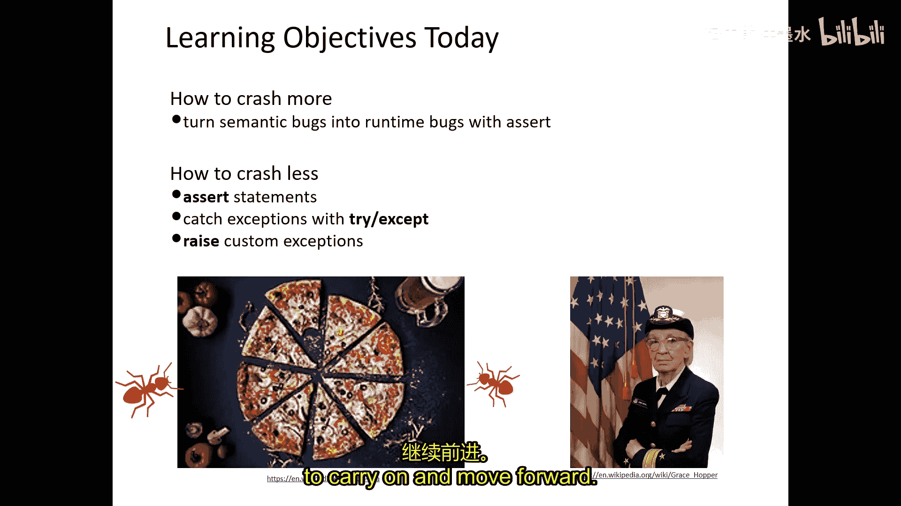

Al right， so I just want to go ahead and introduce this pizza analyzer program and talk about a little bit。

 first up， let me just go ahead and pull this up in Ile and we'll run it and we'll start playing with it that way then we'll walk through the code and take a look at all the different pieces。

Al right， so I've already downloaded all those files from。The website today。

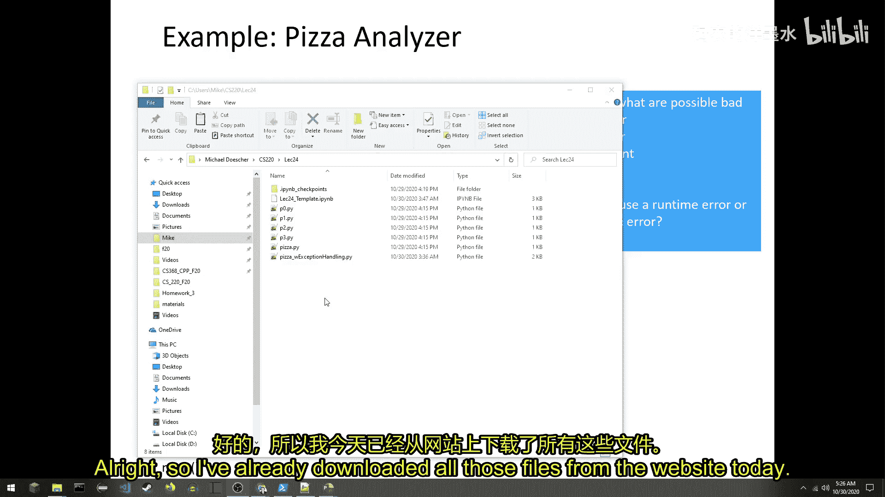

Here we are。 I'm going to go's shift right click to bring our power shell。 We've got an idle。

And this is the pizza dot pie。 There we go。

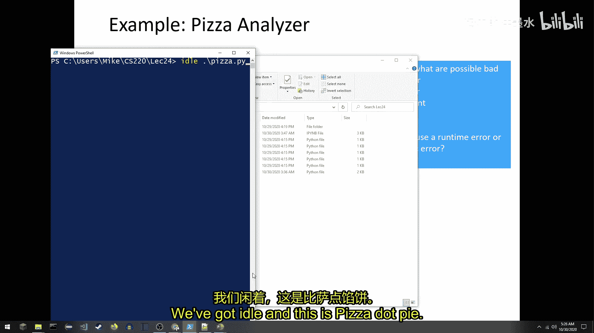

Now I'm going to just going to go ahead and run this。Right module F 5。 That's right。 I knew that。

 So the first thing this is gonna do is ask us for pizza diameter in inches and the slice count。

 So let me think diameter of pizza。What I want to do is be able to put in some data。

 some numbers so that I know that it's working。 So if I put in like a four inch diameter pizza。

I take that divided by 2 to get the radius。 So the radius is 2 pi R squared， gives me4。Times pi，4 pi。

So if we cut that into four slices， so four inch diameter cut into four slices。Is going to give me 3。

14， basically pi square inches of pizza。 So it looks like it's working。

 It's basically it asks for the size of a pizza， how many slices we're going cut it into and tells me how many square inches of pizza we get。

 Let's try something a little more reasonable。 maybe a small size pizza。10 inches in diameter。

 and cut it in six pieces we see that each slice of pizza has 13 square inches of pizza for our enjoyment。

 Okay， so I'm going to do a control C to quit that。Now let's go back to the slides。

Believe they're still open right here and just take a look at what's going on in the code。

 I like this one。 It's color coded， and I've got my questions over here。

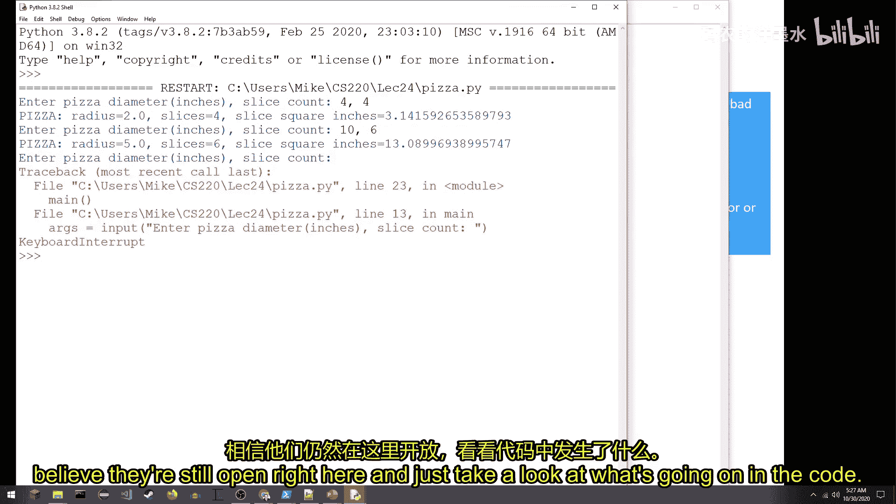

So first thing we're going to do is we see that we're going to be importing math because we use pi right there。

Then we're defining two functions， pizza size， this pizza size takes the radius and computes the size of the pizza。

 maybe a better name for this function would have been area of a circle， be a little more general。

 but it's doing the same thing it's taking the radius。

 it's using the star star operator to square that and multiplying it by pi。

Then we have the next function here， the slice size。 This takes the radius and the slice count。

I then computes the total size by calling pizza size so that it's the area of the circle and then it's going to just return total size times1 divided by slice count。

 Allright， so that's just going to basically take the total size of the pizza divide by how many slices we got and return the number of square inches of pizza per slice。

Al right， then we have this main function that's going to do all the work。

 And at the very bottom we call main。 this is a really common programming structure where I want to put all my functions up at the beginning。

In in some sort of arbitrary order， but Python needs to know where all the functions are before it runs an encode。

Okay， so here's the idea。 in the function main， we have a loop。

 it's just going to go for I and range 10。 So from 0 to 9 or it's going to run this loop 10 times。

We're going to get some input from the user， so I see here in orange， I have this block。

 and then we're going to do some pizza analysis。 So we've got two blocks here。

So the grab input is going to just use the input command。

 It's going to ask does the the user enter pizza diameter and inches and the slice count。

 We just saw that in the demo。 Then it's going to do some manipulation of that input to。

Turn it into a form that the function can use easily。 So as you remember。Every time we use import。

Actually。Quick quiz。 When we use import， what's the type of that data that we get back If I。

 you know， I typed in4 come before。What is the type of that data。And if you said string。

 you are correct。 input always returns a string。 So that means any whatever string it returns us。

 we've got to deal with it。 So the next thing we're going to do is in this line right here by the mouse pointer。

Maybe I'll， yeah， I'll put it right here on that side。 As is equal。 Yeah。

 this doesn't have line numbers。 Oh， I would really prefer line numbers。 Maybe I will switch this。No。

 the mouse part it disappears。All right， hold on hold on hold on。Pointer options。Arrow options。

Visible， okay， there we go。Yeah， so the next thing I'mre going to do is take those arguments given to us by the user。

 and we're going to call split down them。 Split is a string operator that's going to take a string and turn it into a list of items。

Divided by the delimiter given in the parameter。 So this is going to take a basically a comma separated list。

 All one string and turn to a list of strings。Next up， we're going to grab two values from that list。

 We're going to grab value 0 and value 1。 So this one。

 the strip command is going to remove all of the extra spaces。 So when I type it in。

 I typed4 comma space 4， this will get rid of any extra spaces。

It's going to go ahead then and turn the number that I entered into a floating point number。

 so if I'd done something like 4。2， a would actually record the 4。

2 and then we'll divide that by 2 go from a diameter to a radius。Okay， great。

 slices is going to be very similar。 We're just getting the second argument from that list。

 the second number。 We're going to remove any extra spaces around it and turn it into an integer。

Then pizza analysis section。Cause calling the function slice size。

 giving it that radius and the slices， storing it in size。 and then printing out a message。

 some important details about our pizza。 So as you can see here， we're actually， we've got a string。

 The string is pizza radius。 And then we're using this dot format。

 The format is another string function。 So this is a great review for the exam。

 We've got like all kinds of string functions in here。 That was from about five weeks ago。

 So if these are unfamiliar。 As you guys are studying， this is a great one to go back and review。😊。

Right， so what format does is it's going to take the curly braces and replace those curly braces with variables from the parameter list format。

 So it's going to actually take the number from the radius and replace those two brackets with it。

Our curly braces。 It's going to take slices and replace those curly braces。

 and it's going to print out the size where those curly braces are。Al right。

 So what I'd like you guys to do now， If you've download the Jupiter notebook template and are taking some notes there。

 go ahead and I mean， the question I want to answer is。

 what are things that we could put in as a user that would be bad inputs。

 The only things I haveve entered so far。 I put in 4，4 or 106。 Both of those worked just fine。

 But there are possible inputs that I could type into this code that would do bad things。

 So I want you guys to just take a minute and brainstormed some of these。

 And then jot them down in Jupyter notebook and think about， you know， why is it a bad input。

 What kind of error going to cause， Is this a runtime error， Will it crash。

 or is it a semantic error that's just going to give us the wrong answer。

 I'll go ahead and think about that stuff， And I me write back with my list in a moment。

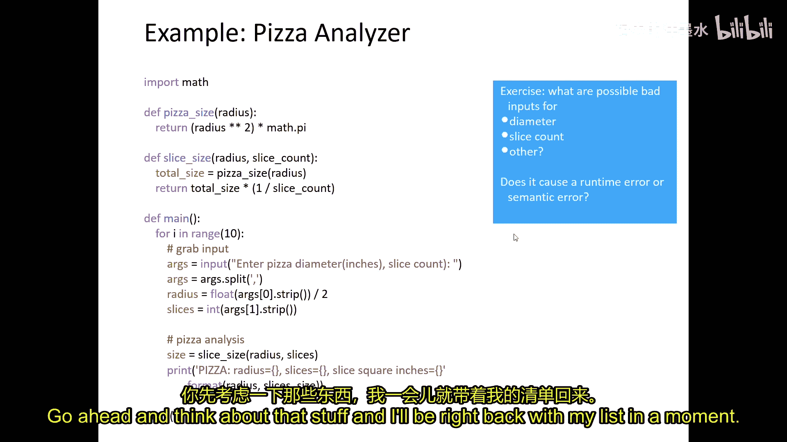

Alright， so here's some things that I came up with。

 I just popped back over to the template and figured I'd enter these here so。

If slice is equal to 0 at some point in this code。We divide by0 slices。 Yeah， right there。

 slice count。 we're dividing by that。 And if we put in a0 value and make it end up in that spot right there。

 we're going to divide by 0。 We'll get a division by 0 error。 So that is going to be a run time。

Vision by 0。Okay， some other things we could do。 We could put in stuff that are not numbers。

 So let's see。Non numerical data。 this is going give us。I type error。Itll be runtime type pair。

There we go。We could leave out the comma。Because we do need two pieces of。Data。

 we need the diameter and the slice count。 if we leave out the comma， just like type 4。

4 or something without a comma between them， that's gonna be give us another runtime error。

 Let's see what's this one called。I think it's a value error。

We'll go ahead and we'll test some of these。And just make sure I get the type right。 Let's see。

 What else could we do， We could type in a floating point number for slices。 So we have the diameter。

 So we could put in for。Inches in diameter。 and we want to cut this into 2。5 slices。So。for。

Slice count。Yeah， that's not going to work either that's I believe that's going to be a type error also。

Alright， something else we could do。 We could put in a negative number of slices， so。

What could be more sad than having negative slices of pizza？But that should actually run。

 It should produce an incorrect result。 should make a lot of sense that， he。

 as a normal human watching this， I should understand that I should not have negative pizza。 So。

 but it's still an error。 I can still put in negative input for slices。 So this will run just fine。

 but it's gonna be a semantic error。Ca it's not going to crash。 script math will be just fine。

 but produce a have a result that doesn't make any sense。Let's see what else could we do。

 we could put in a negative diameter。This one is insidious。

 It's probably the most evil of all of these right here。

 because even though I'm giving it what's clearly bad input。

 we can't have the negative diameter for the pizza。 because that value is squared。 pi R squared。

 If you take a negative number times itself， another negative number。

 it's going give you a positive number。 So this is going to return something that looks like a very reasonable answer for the size of the pizza。

 even though we have given it bad input。 So this is kind of scary。

 we would much rather have this kind of thing。Crash the code。Right， I me just throw it。

Put that semantic error right there。 And now I'm going to jump back over to the。

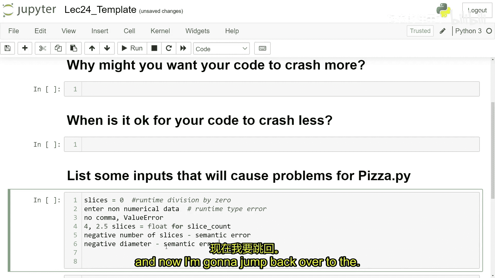

Slides， okay， so next up， Python gives us a way to cause our code to crash more。

 It's the assert statement。 It's actually very simple。 It's just the word assert。 although our case。

 followed by any Boolean expression。 We've been using Boolean expression since the beginning of the course。

 Every time we write a conditional， like an if statement， it's followed by a boolean expression。

 Every time we write a wild loop。 there's a boolean expression there that tells us when we need to exit。

This is going to force the program to crash。 So basically， we're going to。

 if use our knowledge as programmers and as humans to tell it it needs to crash from this garbage input。

 So it can turn a semantic bug， you know， things that are really hard to catch like negative pizza into a runtime error and make that much easier to debug。

So here's how this works on the inside。 If the Boolean expression in assert statement is true。

 absolutely nothing happens。If the boolean expression is false， then the code will crash。

 It's going to give us a giant air message， the trace back that we've seen from every other time our code crashes。

 and it tells us that this is an assertion error。Okay。

 just a little heads up that this does cause your code to run a tiny bit more slowly like。

Impperceptibly slower because it's got to evaluate this Boolean expression。

And it's possible to disable all assertions a lot of times programmers will use these while they're in the process of developing code。

 but then when they put out the release mode for the public。

 they'll disable all of the assertions to improve performance。

And sometimes other people will disable the assertions and so you can't count on them being there when you give away your code because other people have the power to turn them off。

Alright， so before we go ahead and go and add assertions to the pizza code。

 let's just take a look at a little bit to add just a few examples， I guess。

 So some things like this， assert x is greater than 0。 If x is actually greater than 0。

 then nothing happens。 If it's true， nothing happens。 The moment we find something is false。 You。

 if x is negative or 0， it's going to crash。Assert items not equal to none。

So this is just going to verify for us that items actually have some data that we can continue on with。

Assert age in person here we can assume that person is a dictionary complete with a bunch of different pieces of information about the person。

 age is one of those we just want to make sure that they've actually entered an age。And here we go。

 assert length of nus。 modd2 is equal to 1。 This is going to check to make sure that the length of our list。

Numbers is actually an odd number one， 3，5， so that when we divide by two。

 the remainder is actually one。Alright， so we're going to go ahead and go back to the pizza example。

 and we're going to add assertion statements so that it crashes If the diameter is less than 0 and are the slices less than or equal to 0。

 Let me pull that up real quick。

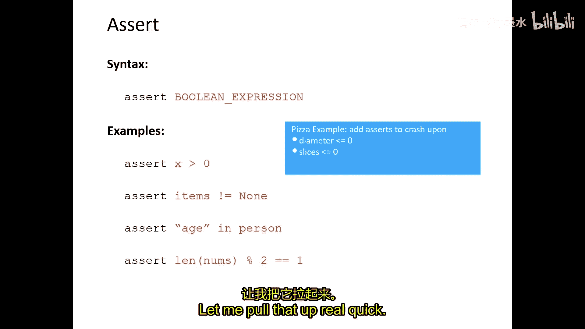

All right， so I was looking at this and I think probably the best place。

 it makes a lot of sense to put it right up here right before we use these things in slice size。

So let's go ahead and just add an assert。At radius。Is greater than 0。And then。

We'll assert that slice count。Greateaer than0。All right， let's go ahead and run this。 So that's。Save。

I have5 to run it。 Now， we're over here on the bottom。 enter pizza diameter。 So's just go with 4。

4 and make sure this still works。 That looks good to me。 Al right， Now。

 let's try adding a negative radius。 So -2。YouCan actually see the code。Oh on， let's make this big。

There we go， minus-2 and 4，5。Qu 5。 and we can see that it instantly crashed the moment I did this。

Alright， so we can see from the trace back that function main was called at line 25。

 It is function main called at line 25 inside of main， we called slice size on line 21。

 and then on line 7， there was an error。It's this assert radius greater than0 as an assertion error。

All right， let me go back and just demonstrate some of these other problems。

So first thing I'm going to do， I'm just going to put this back。

 I'm going to comment out these two assertions， and then we'll just see what type of errors we get when we do some of these other those experiments that we were thinking about at the beginning。

 So I'm going to save this。 I'm going to run this code。Bring this up。All right。

 so some of the things we were thinking about trying and cause zero。A slice count was one of them。

 So if we have a 10" pizza with zero slices， we're going to be dividing by 0。

 So that is a zero division error。Okay， I've got a giant list of all the exceptions。

 It's not actually that many at the end of the lecture。

 so I don't need to remember exactly what these are。 We can just go to the list and。

And think about them。Alright， so just restarted it。 we could also put in something like a comma a。

 And that's going to give us a value error because we can't convert from a string to a float。

 That's going to be happening in line。Right here， as soon as we're trying to convert from a string to a float。

All right， if we go back over here， run this again。I'm messing up。Okay can you run this again。

Let's see。 What were some of the other things。 Oh， we leave out the comma。 So if we just do 4，4。

This again， is going to could not convert string to a float。 So it's trying to take this string。

The entire thing and turn into a float。 It needs to be an individual float number。

In inside the string in order for this to work。Let's do a slight variation on that。

We'll just start this again。 What if we did。That we just accidentally bought the comma there。

This error doesn't pop up until we try and access argument 1。This is a list index out of range。

 so in index error。You take a look at the code real quick for that one。 So in this case。

 I've only put in one number。 I didn't give it two numbers。 And so that's fine。

 inputput is going to read one number。 It's going to return it as a string。

Split is that string function。 It's going to work just fine。 If there's one comma。

 We get two things back。 If there's two commas， we get three things back。 there are no commas。

 It's fine。 It's just going to return the one thing as a list。 The list with one item in it。

 perfectfect。 Then this line works just fine， too， because it's going to take index 0。

 The one thing in that list。 It's a string。 It's going to strip off the spaces turned into a float divided by two。

 carry on。 This is where we get to a problem because our list only has one thing in it。

 That's at index 0。 We do not have anything in index 1。

 So this is where we're getting our index error。😊，Right there。All right， next up。

Let me go ahead and do one more。 Let's smooth our pizza is negative 10 inches in diameter。

 And we cut that into six pieces。This is going to tell us that we're getting。13。

1 square inches of pizza。 That's a perfectly reasonable sounding number for the amount of pizza。

 even though I put in bad data。 So this is， this is the really deceptive one that we want to make sure we stop。

Alright， so I'm just going come back。 I'm going to put my assertion statements back in。

 and I'm going to test those three of those examples again。 So save this， run it。

Down here at the bottom， enter the pizza。 What if the diameter is negative to the big one first。

 and we cut that into six pieces。 We want this to crash。

 We don't want it to give us a perfectly reasonable 13。08 value。And again， indeed， it does。

 It crashes right there。 The trace back tells me exactly where it's coming from and the error we're getting is an assertion error because I put that in myself。

All right， next up。Let's we' to miss one more time。Let's do we that was the negative。

 Let's try the divide by 0，1。 So4 inch pizza。Cut into zero pieces。Again， this is going to crash Also。

 Now， it's not a division by0 error。 It's an assertion error。 and we can。

That's the one that we put in， we asserted that slice count was greater than zero。

 otherwise it's going to crash。I was just thinking this might not be the best way to deal with this particular error。

 And we're going to learn more about this than before the end of the lecture。

 But just having a generic assertion error， this doesn't tell us a whole lot about what's going on。

 And my guess is there's a lot of you out there who are thinking。

 why not just use an if statement that gives me a whole lot more control。

 I can actually have it print out some sort of message to let the user go back and fix it。

 And the answer is that this is just quick and dirty， E way for us to stop things from running。

 We'll learn a little bit more， before the end of the lecture about how to upgrade this to give it more power to do that。

 And I was just thinking that in this case， you know。

 that divide by a zero message that we got when I left it was probably actually more useful than just a generic assertion error。

 because it doesn't actually give us any information about what's going wrong。

 So that's coming up before the end of the lecture。

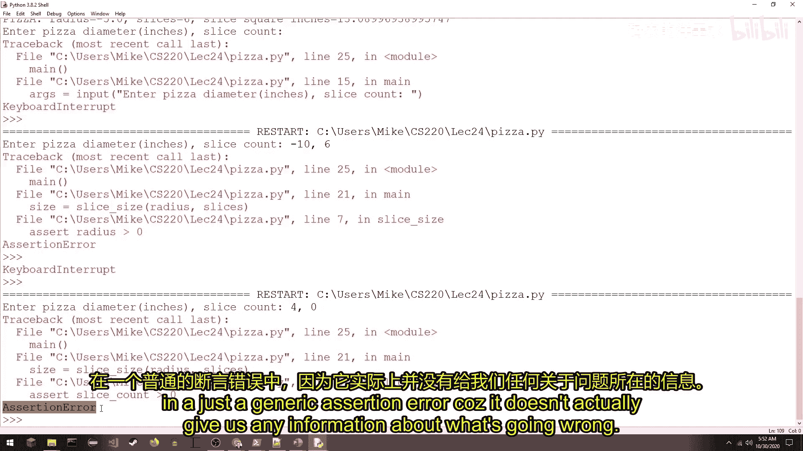

But first， I want to go on that second question that I asked at the very beginning。

 what if we want to keep going， even if there's an error， What if the user gives us some bad data。

 we want to be able to deal with it and tell them， hey， that was bad data， why don you try again。

 We can't divide by zero， can't have zero slices。So Python gives us this try except structure that lets us do exactly that。

 The syntax， suppose I have a function here called flaky function。

 that's going to have some sort of problem in it like a divide by 0。 We can use this structure try。

And then run the flaky function。 If there's any error， that pops up。 it's called an exception。

 and we can catch that and do something。 Now， any sort of error handling we want and heads up， guys。

 anytime you guys do any error handling any sort of accepting any clauses like this。

 it needs to print something out。 That's just good practice。

 If you catch an exception and don't print out anything， Then it's like hiding the bugs。

 that makes it even worse。 You're like taking existing things that would have crashed and masking it no one knows。

Okay， so a couple of just like how this works。 try and accept blocks。 These are blocks。

 it doesn't just have to be one line， but we can have an entire block， They come in pairs。

So a try is followed by some a block of code， and then if any of this stuff goes wrong。

 the code in the accept block runs。Okay， so Python' is going to try the code in the try block。

If anything is broken， if it throws an exception， if it crashes。

 that's all those are all those all mean the same thing。

 then it runs the accept block instead of crashing。

 and we catch the error and can deal with it if there is not an exception。

 then this code in the accept block never runs。 I've got just a couple of quick Python tutor demonstrations to like walk through and show you guys how this works and just a couple of little details about this。

 So I'm going to go ahead and pull these up in Python tutor。

 the code is available in those p0 P1 P2 files in the code directory。

 So if you want to just copy and paste those into Python tutor， you can grab them from right there。

 if you downloaded all the files in that directory。 one second while I pull those up myself。

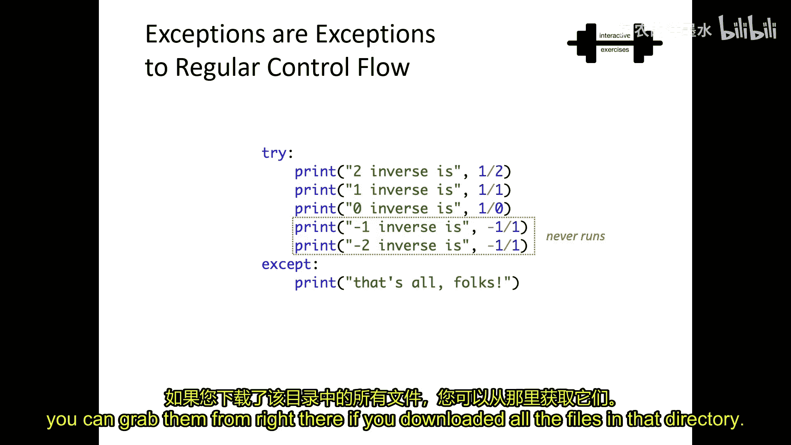

Alright， so here's the first one。 We have。This try block， and it's just going to do some。 well here。

 let's walk through it。OfRed arrows the next line to run。 So it's going to2 inverse is。

 and then one divided by 2 print out 0。51 inverse。 So is  one divided by one。

 So we're just basically taking one divided by。Each of these。1。00 inverse is one divided by 0。

 That is not going to work。 That's going to crash。 It should be a。Did into it yet。 Yep。

0 division error。 So now that it's crashed。 it's created an exception。 it's thrown an exception。

 Those are all that mean the same thing。 And that exception is going to be caught by the accept block right here。

 So it's going to instead of just crashing。 we've got this problem。 though。

 it's going to jump down to the accept block and run this code。And print out， that's all folks。

I want to highlight really， and really important here that it skipped all of the code after the error。

Okay， that's the whole point of this example is it ran all the way until it found the error。

 all of this code actually this much actually executed。This one caused a problem。

When when it crashed， it jumped down to the accept and did that。Never ran those two lines。Allright。

 cool。 that's all I want to do here。 Let me grab the next example。Alright。

 this one is the buggy example。 So up here in the line1， we're defining function buggy。

 It's going to print some stuff out。 But this is the important line right here。 line 3。

 It's going to try and divide by 0，1 divided by 0。 So this is going to crash the the program。

We've also got another function here G， this one is just a function that calls buggy and print out some stuff before and after。

 and then we have a function F， this is the one with the try except blocks and the try block is going to call G and print out some stuff before and after。

Yep， and then we're going to call F。 So let's walk through this。 First thing， we're going。

Remember where buggy G and F are。 Then we call F。 So we get a stack frame here for F F is going to go straight into that tri block。

 It's going to print out let's call G。 and then it actually calls G new stack frame for G。All right。

 then G is going to print something out and then call buggy。And then in buggy。

 we've got a brand new stack frame here。We're going to print out about to fail。

And then we cannot divide by 0。 Next， that's going to give us this zero division error。

 That's not good。 So at this point。Python is going to look first in this function and say。

 W I in and Tribllock， can anybody help me out， I've got an exception zero divisionary help anybody。

And buggy can't do it， of course。 So it's going to exit buggy immediately and then go back up to G。

So this line never prints。 There is an error message。 It goes up to G。 And in fact， we can not。

 when I click next， I believe the stack frames in Python tutor actually pop off， so。Return value。

 none。G G can't deal with it either。 There's no try except here。So。There's nothing G can do about it。

 there's nothing in this stack frame that's going to help us out。So return value none。

 it's going to return instantly without ever printing out the after buggy。

And then we were back up here。 And ha ha， hey， look， G was in a try except block。

 So now I've got this exception returned by G。And。The moment that happens。

 we're going to jump down to the accept line and print out the that d goes so well。There it is。

 and then that should be the end。Yep， there it is。Okay。

 so what I want to point out here is that Python is going to try and solve the exception as close as it can to where it happened。

 So if it's in a function， it's going to look for a try except block around。That code。

 if it doesn't find one and then it goes to the function that called it。

 If it doesn't find one there， it's going to go to the function that called that until it does find one or it exits all the way out of the global frame without ever finding something。

If that happens， then it actually crashes the code， crashes your program。

 and sends that traceback message to the console。Let me go ahead and just add in right here。Try。

And then。Except。I'll just print out word caught。That will deal with it。

And then we'll go ahead and run this again。 So this is going to take care of it right here inside of buggy。

 and it will never need to go back up。And get to this point right here。All right。

 so let me go back to first。Alright， so next， next， next。

 next gets us the definitions of those functions。 Then we'll call F。 So then we'll print out。

 let's call G。 We jump into G before buggy in G。 We call buggy。 and we're back up at the top here。

But he is about to fail。Trying to divide by 0。 it shouldn print。 that should fail。 instead。

 we're going to jump down to this， except。It's going to print out that we caught the exception。

 and then it's just going to carry on。 So it's going to actually print out this buggy oops。Okay。

 then it's going， that's the end of the function returns none。

G is going to now continue by printing out G after buggy。

 and then we finish up with F reporting that G return normally。So yeah。

 the point was that it's the closest try accept block that deals with it。

 if it's not in the immediate function， then it just starts returning all the way back up until you know。

 it finds someplace that can deal with it or it crashes。Al right， in the pizza code。

 there's really two main places where we might want to catch problems and then carry on and let the user try again。

 And the first one is entering input。 We find it was easily possible to put in bad input by like only putting in one number or by putting in some text。

 something that wasn't numbers。 So here's what I want to do here to deal with that。

 We're going to put all of this getting input code in a try block。

And we'll put it in the math too that deals with it because that's where the problems are going to。

 this is where we really saw the problems arising。Soll put an accept here。

 and we'll just print out a message for the user print。Bad input。Please try。Again。All right。

Quote and parenthey， there we go。There we go。And let's upgrade this a little bit。It's really bad。

 Try again。And we'll make those sense。That's looking good to me。 Okay。

 so what's going to happen here is we'll go through。 We get some input。 If it's bad。

 it's going to print out this bad input。 This is， this is in a loop right here。

 So they're going to get another chance。But it's going to try and run this code unless we do something to skip it。

Think hard。 How do I skip code and go to the next iteration of a loop。Quick review。

If you thought of the phrase， continue。You are absolutely right。 This is a really。

 really classic structure。 Try， accept continue being the last line of your accept block。

 We see this all the time。 This is a really common use programming pattern。And again。

 every time I ever write accept， if I have an accept block。

 I put something that prints out some information for me so that I know that I actually hit that in。

It doesn't hide the mistakes。Okay， so this is the first one。

 the other thing that can happen is not just user input problems， but like math error problems。

 we tried to deal with those up here with the asserts。But let's go ahead and just。

 if we actually find that there's a problem， the assertion is going to generate the assertion error。

 we want to catch that and deal with that also。So I'm going to go ahead and take the pizza analysis section。

We'll put this into a try block， print that out。And now in the accept block here。

 I need to print something。Bt。Analysis error。Good， that should work。

And now this is the end of the function， so I don't actually need to do anything to jump back up to the next iteration of the loop if I want to I can put continue here。

 but it completely unnecessary， this is the end of the loop。Allright。

 let's go ahead and save this and try running it。 So first thing up， enter the pizza diameter。

 I'm just going to put in a and a will give it。He come， two characters。There we go。 Bad input。

 Please try again。 I think the last time we did this， we got a type error。 Let's try 44。Again。

 bad input。 I only gave it one number。 Let's see what are some of the other things。

 let's try a negative diameter， negative4 and cut that into six pieces。Analysis air。

 so instead of crashing， it's letting us try again。What else we I？I can't think of anything。

 I'm going to scare on you guys at home， do some more experimenting。

 try some of the other bad things that you guys thought of and just do a little yeah experiment。

 try and see if you can figure out what type of air is going to cause things to crash in which direction and whether they're caught or not。

 All right， So I'm going to push control C and kill this and then move on。But there's a problem here。

 Check this out。 If I push control C。It's not actually accepting that keyboard interrupt。

 It's catching it as user input and recognizing that it's not the right format。

 And it's asking me to。Try again。 That's the exact reason here。 Let me just。

That's the exact reason I put this in a loop that only goes through 10 times because I knew this would happen。

And I don't want to have to like completely close idle and open it back up again。

So that's why this was a loop instead of a while true statement to give me that infinite loop。

That I would just， you know kill with control C because that would fail an infant a number of times then。

So my try except block right here。 This one is a little aggressive。 It's。

 it's catching too many things。 I don't want it to catch the keyboard interrupt。

 I want that one to go through and actually crash the code so I can get out of it。

 So we' about to go learn a little bit more about this try except and how to be a little more specific so we can tell it which kinds of things we want to go through。

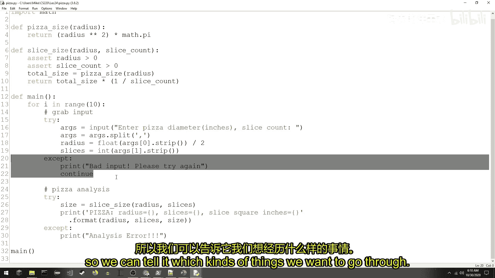

Alright， that's coming up soon。 Let me see。Right， first up。

 how old do we can we get just a little bit more information about the exception when it happens。

 What if we want to know the reason。Okay， here's the version we just had Py function。

 print error or whatever else we're going to do in this case to upgrade this a little bit。

arrow mist but it's supposed to be the red here deep。Here's what we're doing。

 instead of just writing except with a colon， we're going to say exception as E。

 So this is going to get an exception object。 and that exception object describes the problem。

 It's going to tell us what kind of error or what kind of exception happen。

 and we can print that out because this exception object E can be turned into a string that we can print。

Okay， so I want to point out that there are lots of different types of exception objects。

 This is the most general。 it catches pretty much all of them。

And can be you know exception exceptions of lots of different kinds can be assigned to this if we want to be a little more specific。

 that's coming up in a few minutes， but right now just notes that this is going to catch pretty much everything。

 this exception object is going to describe the problem and he will just print that out。

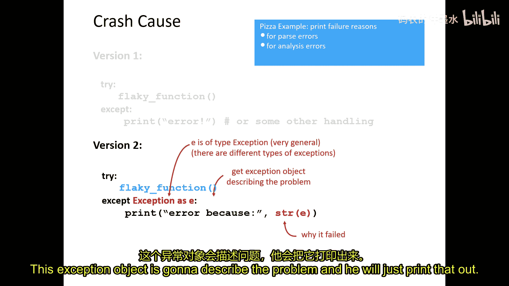

Let's go back to the pizza code and add this。Right here， perfect。 Okay， so right here。

 I you just need to add。Exception as and then I just need to give it the name of a variable。

 This is my choice。 I'm just gonna shortcut that E。 This one is the type of thing I'm catching。

 So here， like， if I wanted to create a list， I would actually use the word list。

 I'm creating an exception。 So this is the what I'm creating。So please try again。

 let's go ahead and print out the type of the exception。So， here。And then， we'll call that。

String here。And then we'll also print out。Type of air。And just have a go with that。 Alright。

 I'm gonna add。These two lines down here to my other one。Also。Just like that。

 And then I also want to upgrade。This。So that it's printing out everything all the time for any kind of exception。

Okay， I'm going save this。Run it again。All right， and now let me think。

 what were some of the kinds of errors we had。The wrong kind of。Data， I think this was a  typer。

 Let's find out。Value error。 Allright。 Yeah。 So it's could not convert string to float。

 That's a value error， okay。Enter pizza diameter so。 we get to try again。Let's see here。

Let's do minus。Three and six slices。Okay， now this is an analysis error。 the error message。 Okay。

 I just paused and stared at this for a second， because I could not figure out why there was no message there。

 it's because we didn't upgrade our own assertion。 This is an assertion error from our math section。

 And we didn't actually give it an error message yet。 So that's coming up soon。

 This one when I had the error message。 that could not convert string to float。

 was the error message。 It's a tight value error。 This one is a type assertion error。

 And that's our own fault because that's the one I added with the assert statement。 Okay。

 that was just me being， I don't know。 I don't even know if you guys knew。

 but I was being done there。 It stared at this for a long time trying to think why did it not print a message。

 We didn't add that yet。 It's coming soon。Alright， what was some of the other things we could do。

The wrong number of items。That was a。And see， list index out of range is the message。

 It is an index error。 Okay， so I feel like this is good。

 We're getting the idea that it's now giving us additional information。嗯。

But it's still going to have that problem where I can't。Oh， we did fix that。 Hol on。

 Why did that work？That's right。 Okay， so at the end of the lecture。

 I'm going to show you the hierarchy of all the different kinds of exceptions。

 Let me go to the code here。This one exception is a lower level in the hierarchy than that keyboard interrupt exception。

 So the keyboard interrupt is going to go through it。

 This is no longer going catch everything above it in the hierarchy。

 So this actually fixed our keyboard interrupt control C to kill problem。

I thought I had to do something a little more specific。 I。

 I thought exception was one of the like highest levels。I I can't remember it， it's a chart。

 I look it up every time I need one of these。So I think that's a good example。

 some motivation as to why it's actually good to be specific about the kinds of things we want to catch Except this this kind is very general。

 If we want to upgrade that to， you know， only catch certain kinds of errors。Oh now。

 let me pull up the slide。

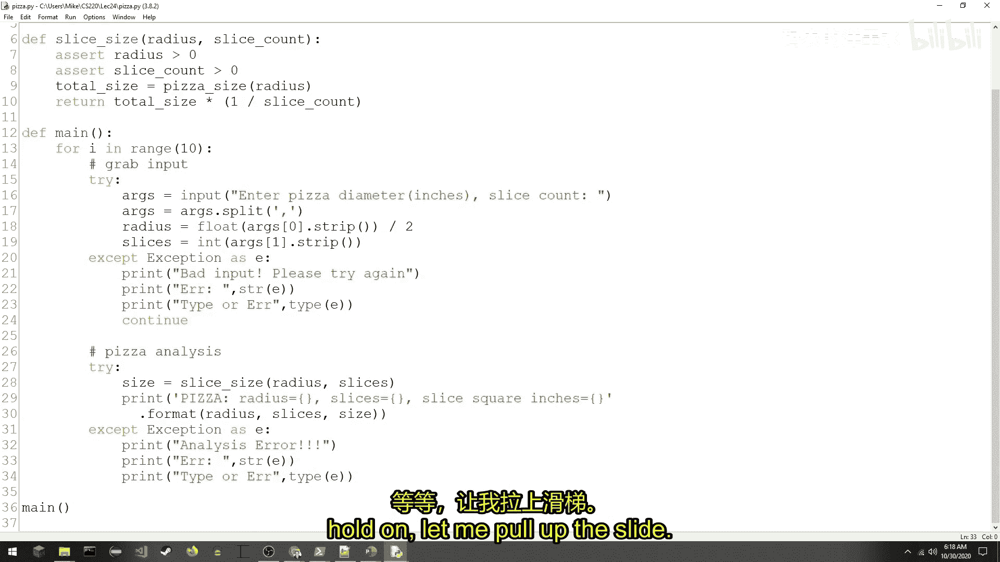

But if we only want to catch certain kind of errors， instead of just doing exception as E。

 like I've got right there， I can actually give it a little tuple of different types of exceptions that I would like to catch。

 So I can say value error index error， it's only going to catch those two things now。

 And this is good because those are the ones that I am prepared to deal with。

 And I'm going to let the user try again， if they make those mistake。

 and other mistake that comes through， we actually want the code to crash。 you know。

 if I have a mistake， like in my own code。 if I misname a variable or something。

 if that's the reason it's crashing。 I don't want to give the user the opportunity to try over and over and over again when I made a mistake and have the。

 you know， name of one of my variables wrong。 Let's go ahead and demonstrate this。

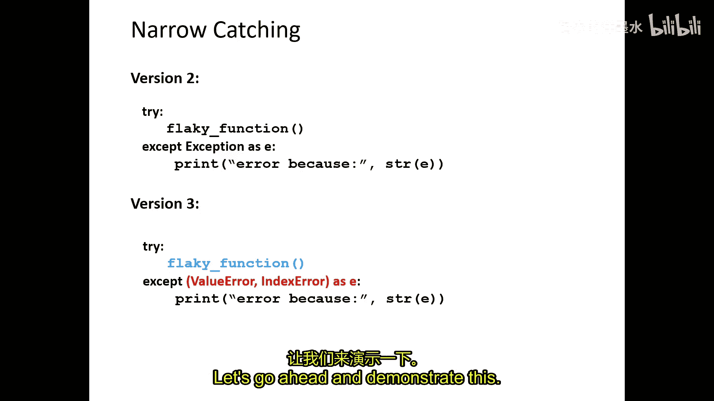

LetMe pop back over。And I'm going to go ahead and just add a mistake。Right there。

 So now Args got upgraded a little bit。 It's got some extra letters。

 Now if I save this and run this code。And put in some bad data。It's giving me an error。

 local variable as unreferenced or referenced before assignment。

 this is clearly a problem with my code， but it's going to say， okay， why don't you try again。

I don't want that kind of error to be caught。 I don't want errors in my code to be caught。

 I want errors in user data input to be caught。 So I'm going to go ahead and put this back before I forget。

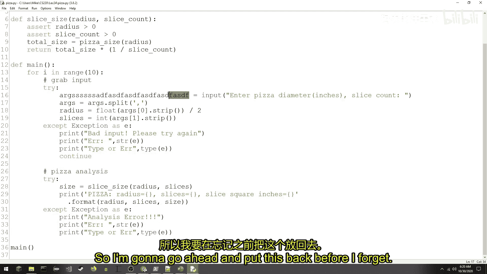

And now， what we want to do is learn how to be a little more specific。

 So here I'm going to be adding the tuple value error and index error。Am。To to the code。

 So that's only catching those kinds of things where we want to give the user the power to try again。

Yep， and。We do not want to catch name error or other like bugs in my code。

 and not the keyboard interrupt。 we want to be able to quit。 And please remember。

good a good outline is to just to be as specific as possible。

 to catch the ones that you're prepared to deal with and let everything else crash and always print something out So the user knows there was a problem。

 Basically， if we put in a try except and then don't print out anything。

 it's actually hiding potentially really bad things。All right。

 let me go ahead and do that to the P code。

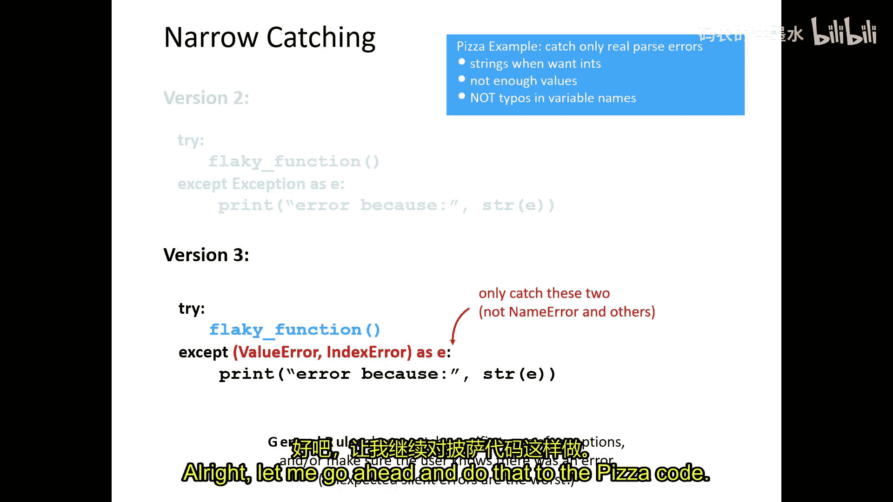

Alright， so right here， instead of exception as E， I'm going to go ahead and put in a tuple。

 So I've got the parentheses。 And then the two types that we are prepared to deal with here are。

Index error。When they put in the wrong number of arguments and。不要。

When that was the one where they typed in something that could not be converted to a float。Or in it。

Alright， so let's go ahead。 let's just test this much。 So I'm going to save。And run this。

Restarting slice counts。 So now we' put in。The wrong type of data， it's still going to catch that。

 It's catching value errors。 And if I put in the wrong number of items。

 now it's catching that index error。So this looks good to me。 We've catching very specific things。

 I fixed the  type in my code。 Let me go ahead put that back in， and demonstrate。

How do I get back there right here。 Let's go ahead， put this back in。Save this， run it。

 And now if I type in 44， what I find is that it's going to actually really crash and give me a real error message about the bug in my code。

 which is good。 I want to be able to see it crash and go fix that。Alright like this。Done。

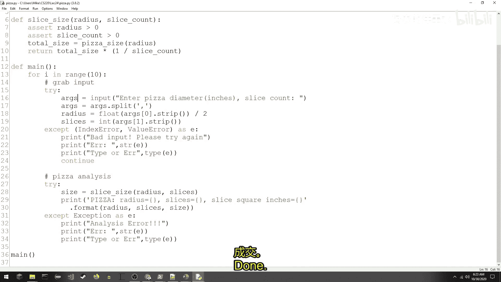

Allright， so I keep I kept hinting at this exception hierarchy。

 There's about 40 different kinds of exceptions on this chart right here。

 you can see that some of them like all right actually， it's probably really tiny。

 so just trust me if you can't read it that this one right up here at the near the very top is the exception that's a very general one that catches all of these different kinds of errors。

嗯。When we we didn't do anything， when we just had accept without， you， accept colon。

That catches absolutely everything。 And so that one catches the keyboard interrupt。

 which is actually number two here on the list right after system exit。嗯。The exception。

We used the exception as E is below that， so that was not catching the keyboard interrupt。

 so it it's almost always a good idea to be as specific as possible。 So the ones we were using。

 let me see if I can spot them index error right here for looking things up in general。

 there's like a one level up is the lookup error， which will catch both like index from a list and key errors from a dictionary。

So we want to be as specific as possible when we use these so that we're not catching things that we are not prepared to deal with。

All right。Al right， so next up， what if we want to produce a specific kind of error。

 So there was a assertion was， was great for just like crashing the code。

 That's great for while we're going through developing things If there's a mistake， we can spot it。

 or if we run into something where we are like 99% sure that this will never happen。

 we can just put it in an insert so that it will crash， should that ever happen。

 And then we can deal with it otherwise， you know， if we're pretty sure we don't ever have to deal with this corner case。

 we can now leave that part of the development till later and wait till the customers complain。

 and then we can go ahead and fix it。😊，But if it only affects， you know，1% of the customers。

 do we really want to invest a lot of development time right now or when we can just put in one line。

 crash the code and then come back later。But frequently。

 it could be really useful to put in a specific kind of error， not just the generic assert。

 So that's what I want to do now。 But a moment ago when I was talking about how， well。

 where is that error message， Why is it now printing， That's because the c is' very， very simple。

 It's not going It just crashes， It's not going to actually give me that extra information。

So in order to do that。嗯。Instead of just calling an assertion error。

 it would be more useful to get a more specific type of error。

 So to to generate any of the rest of these， to basically have our code generate an error the way we're going to do that。

Is using the command rays。 So there's a lot going on here。 Ver 1。

 This is the one we had just quick and dirty， using asert。So here's the pizza slice size function。

 just a small piece of it。 if radius was greater than or equal to 0。Then we we're good。

 we're going to continue on。 So in this version， we're going to say， okay， so if this is true。

 it continues。 what we want to know is if it's bad。 So if radius is less than or equal to 0。

Then we're going to have Python create this exception object。

 and the way we do that here is keyword raise。Tells this is where the tells Python this is where the exception happens。

 This arithmetic error is the type of the error。 So we are creating an arithmetic error object。

 So this is a constructor。 just like when we had list with parentheses。 This is the same thing。

 I'm creating an object using parentheses， died with parentheses set with parentheses。

 All of those things created lists or dictionaries or sets。

 This one just happens to be creating the type error。嗯。And then we can give it a specific message。

 So this is going to overwrite the just generic arithmetic error message with our specific arithmetic error message for this particular。

Problem。So let me jump back over to the pizza code and just add。This right here。

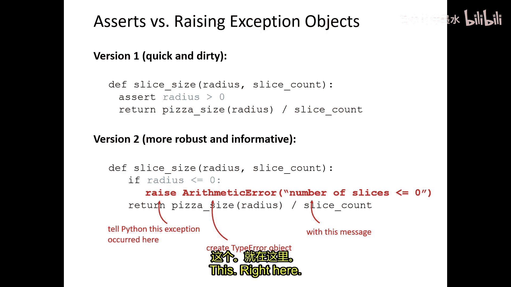

That's the wrong button。 There we go， okay。Alright， so let's see here。 where was the。Assertion。

 here we go。 Assert radius greater than 0。 Instead， what I'm going to do is change this to。没有。

Praise less than or equal to0。So I've got a conditional here。 What I want to do is raise。The arithme。

And just give it a useful。Message。Need a positive number of slices。

I think this is the only one we put in， so let's just go ahead and run this and try it out。See here。

Save， run。 Now here we go。 At the bottom， we have a 10" pizza and 0 slices。 I need a comma。

That should go ahead， give us that analysis error。Wait a second。And still reporting assertion error。

 What did I do wrong。Oh， that was dumb。 Okay， so here's， here's the problem。

 What I really wanted is this slice count less than or equal to 0。

 Then report the number of slices must be positive。 So I had radius there instead。

 Let me go ahead put this one as radius。Just so we catch everything。

 even if it's an assertion error instead of this cool arithmetic error。All right。 And， you know。

 I just， I went back and looked at the slides to see like， am I using this wrong。

 And I've made the a same mistake in the slides。 Okay， save this， run it。 let's try this again。

10" diameter pizza，0 slices。There we go， beautiful。 All right， it's great to end on a positive note。

Air message is now working。 Number slices must be positive。

 and it's now throwing the arithmetic error。All right， exactly what I want， so very restrictive。

It's only going to catch that wait，'s it's generating the exact kind of error that it's actually that I want to produce。

 not the generic sort of assertion error。And then we can we know that this is later in the code。

 we can look specifically for arithmetic errors and deal with them。

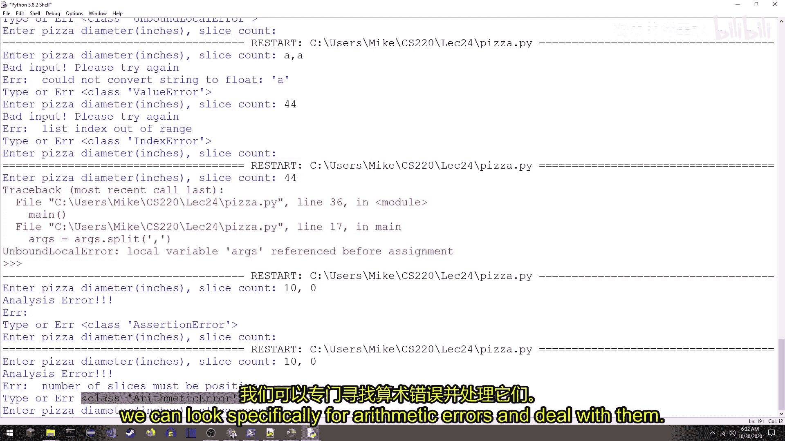

Alright， so today we learned about how to make our code crash more and how to make our code crash less。

 so to make it crash more， we were using assertions to force a crash or to raise an exception when something bad happened and this is going to give us a way to catch semantic errors and turn them into runtime errors so that it crashes。

And we can actually like learn what went wrong rather than just being given a mysterious。

 maybe correct answer。That is actually not correct。

And we learned how to crash less by dealing with the exceptions that are created when code crashes。

 we learned how to produce them with rays。 We learned how to give them useful messages。

 We learned how to use try and accept clauses to test our code if any of that code raised an exception or would have crashed we can then deal with it and we can selectively deal with certain kinds of problems。

 You know， if we know that the user input is responsible for certain kinds of things。

 we can check that if other kinds of errors， we want to make sure the code still crashes。

 So we can look for specific types of errors and deal with them。So， in general。

Make our exception checking as specific as possible and make sure you always print something out。

Al right， that way， we don't like mask， like hide extra errors。All right。

 that's going to do it for you guys。 This is the last slide。 Have a great day and talk to you soon。😊。

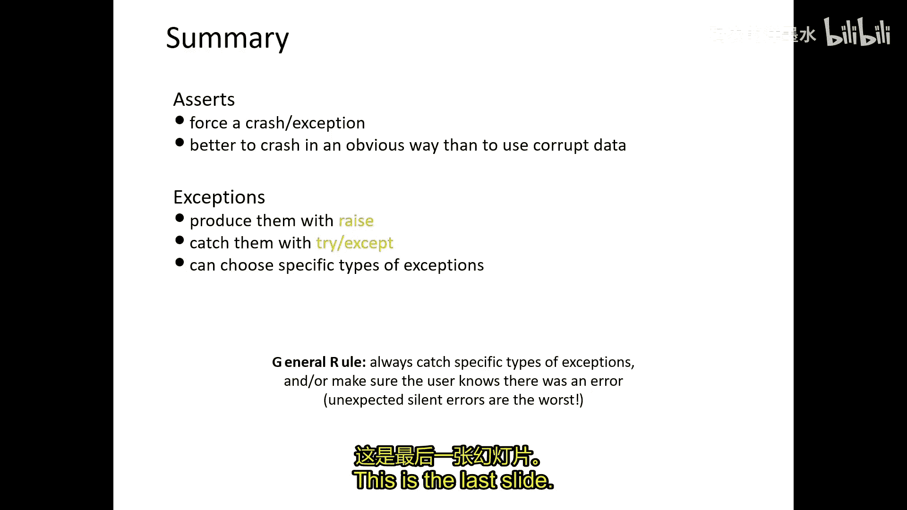