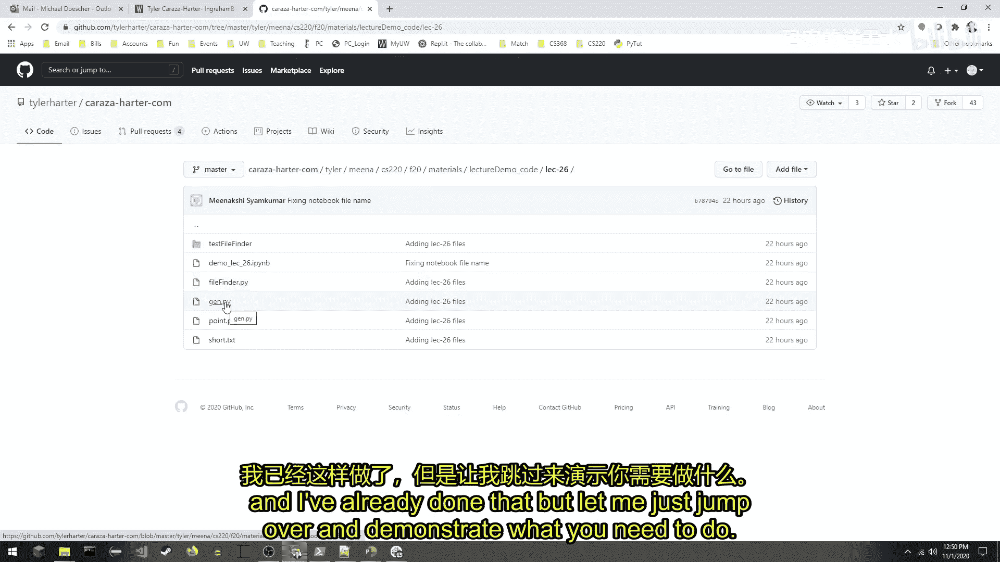
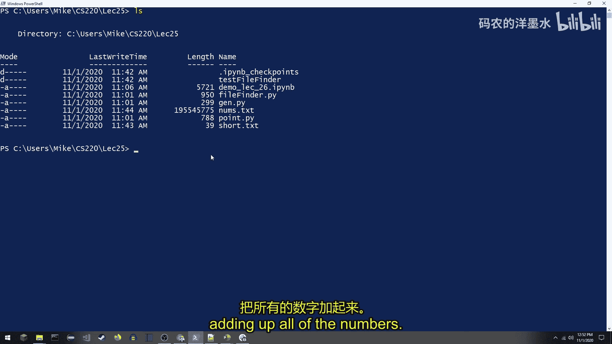
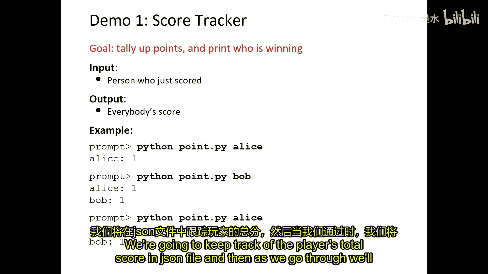
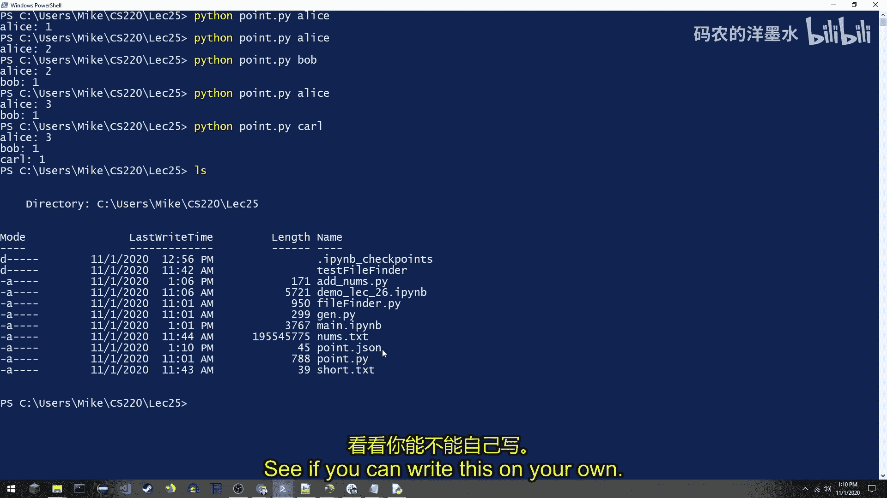
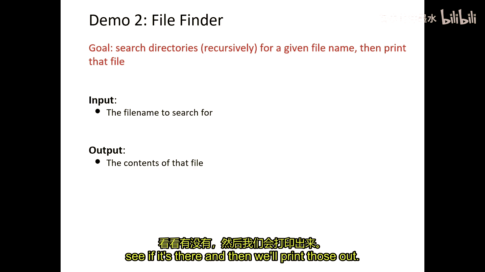
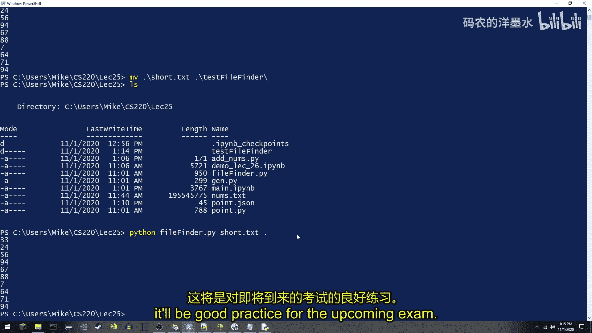
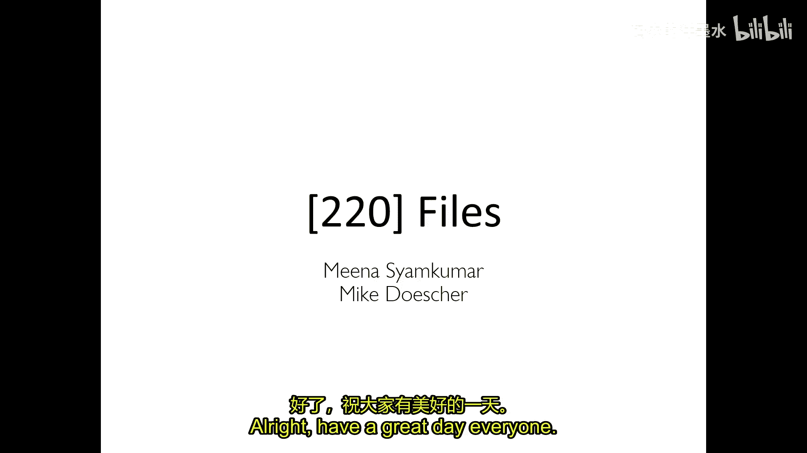

# 【全集】威斯康星大学-Python数据编程-CS220-中英字幕-1080P-p24-Lecture-21---文件--BV1VxvsBLEmv_p24-

Hello everyone， welcome back to data programming one a couple of reminders as we get started we have an exam this Wednesday that's two days from the times this lecture will be released on Monday if you're not watching it till later it's still on Wednesday as you guys get started studying for that exam I highly recommend highly recommend that you check out the practice exams that are available on the website Those are exams that have been given in this course in previous years make sure that you have a good understanding of all of the topics covered on those exams we're going to be covering the same topics on this exam。

The exam format should look very similar to the last couple of quizzes we'll be using Canvas quizzes for the exam。

 and there will be an email coming soon with the exact dates or times that the exam will be available。

Al right， there isn't a a template to take notes on this for this lecture。

 it's mostly just the PowerPoint slides I'm going to be going through。

 we'll do some demonstrations at the end the Jupiter notebook file that's there on the webage is the completed version after I've gone through and done all of the demonstrations。

 You're welcome to download that one and take a look at it Otherwise if you want to take some notes。

 just open up a blank Jupiter notebook and take some notes there as we go through。Alright。

 so today we're going to be talking about files。In advance to the next slide here。 So first up。

 stuff we're already familiar with， we can use that information to already know a bunch of things about files。

 if I tell you that file objects are a kind of iterator。Now。

 remember that an iterator is something we can call next on。

 so we already know something about file objects， it means we can call next on them and get more data out。

All right。 The next thing， we'll go back one lecture。

 We're going to see that exceptions occur a lot with files。

 So the example I've been using during most of last week's lecture and the ones we've seen a lot throughout the semester is the divide by 0 exception。

 If we're careful with writing our code， we can check， you know， we can use a short circuited。

 if statement to just check and see if the denominator is 0。 And we can get around that。

 It's almost impossible to check ahead of time with files。 If something's going to fail。 For example。

 suppose we're just trying to create a file and save some steal on our hard drive。All right。

 first up， the hard drive could run out of space。 so that's dangerous。

 So you think that easy solution is well we just need to check and see if there's enough space on the hard drive before we create the file。

The problem here is that our program isn't the only thing that's running on our computer。

 There are a bunch of other programs。 necessarily， there must be the operating system like Windows。

 And because we're not the only program that's running something。

 another program can jump in after we check to see there's enough space that other program can create a file。

 and use up that space。 And then when we try and save our file。 That space is gone。

 there's no longer enough space and it'll fail。 It's just one of those things that are unpredictable。

 It's outside of the control of our current program that we're running。

 And there really isn't a way we can avoid that ahead of time。 So instead。

 what we do with files is just wait for the exceptions to occur and deal with them when they arrive。

So the plan for today is to look at a few things。 I'll first up just basic file interaction。

 stuff like getting data in and out of files。Then we're going to learn about the OS module。

 This contains a bunch of stuff about directories， really useful for us。

 how to put together paths that will work on Windows or Mac。

 So it's portable code we're generating to stuff to list the directory stuff to see if something is a file doesn't exist。

 That kind of stuff。 useful utility functions。Then we'll be talking about file exceptions and remember these occur a lot。

 So it's just something we'll need to use， try and accept for to catch all of these problems when they happen with files。

 you just think of them as necessary when working with files and then we'll probably move a little bit into encodings and talk about how different text files are encoded into ones and zeros so the computer can understand them。

So I've already hinted that we're going to be working with file objects。

 and we get file objects by calling the open function。

 Remember that everything in Python is an object。 And the this is just a built in function。

 the open function that we can call from anywhere We don't need to import any sort of special module in order to open a file。

This function takes the file path， and that somehow tells us where the file we want to open is that parameter is going to be a string。

And this open function is going to return to value。 That value is the file object。

So we're running the code here in main dot pi。This is in the demo directory。

 So if we want to open the file filet text， this one right here。There it is。

 all we need to do is give the open function parameter that's the file path as a string。

This is an example of a relative path。 They're both in the same directory。

 All I need to do is use the file name。 I don't need to give it any more information。

 and Python can find it。 It's in the same place as main do pi。Now。

 if we copy main dot pi to another directory that also has a file named file dot text。

 a different file， it's going to open that other file dot text instead of this one。

 it's going to be relative to where main dot pi is so in the same directory as where we run main dot pi。

All right， another really common situation is that I'll have a data directory where I've got all the files I need to open。

Let me click that， So we can see in here that I've got movies。 csv in order to openmovies。 CSv。

 I need to give it the relative path to movies。 CSv。So if you remember back to actually lecture 2。

 when we talked about the terminal and the shell， we talked about directory structure。

 and so to open this， I need to give it the name of the directory I wish to open。

Followed by a separator， this is either going to be a forward slash on Linux and Mac like we have here or backslash on Windows。

Followed by the name of the file。 Allright。 So this is actually using a relative path that's only going to work on a Mac。

 This is not portable code。 And we'll talk about how to deal with this file separator When we get to that O section。

 the operating system in part 3 of the lecture。So also remember this is still a relative path。

 it's relative to where we have main do high。And。If I move Main pi to another folder that also has a data directory。

 we won't be this moviess。 CSv will' be getting another moviess。 CSv if it exists。Okay。

 also these file path may be many levels deep here inside of snapshots， I have foldering file a。

 in which case I just keep adding another separator followed by the name of the file and I want to read。

Once we've opened the file and have that file object available to us。

 we're generally going to be doing one of two things with the file object。

 So first reading data from a file means we're going to be pulling in data from a file and storing like maybe a string or some other data structure in a variable in Python that way we can interact with it in Python and then writing the file means we're going to be starting with some data in our Python program and we're going to be storing that data in a file that's going to let us use this data later if I close my program or the computer powers down that data will still be available and I can bring it back into my program when I restart it。

Also， when we're finished with files， it's important to close them to that we're just going to call the method F do close。

 Remember that objects can have methods associated with them。

 and we're going to use that dot notation to access the methods or functions associated with a particular data type。

 Now， with files， usually we can get away without closing the file and just letting the program and without any trouble。

 But this is an important thing to remember， because that's not always true。 In rare cases。

 things can go wrong。 And then we lose our data if we don't close the file。

 we're not going to go into specifics here。 but just be aware that this can happen。

The other reason it's important to close your files when you're done using them is that your computer has a limited number of files that were allowed to have open at any one time。

 So we should close them when we're done。 So far， all the examples we've done in all of the projects had maybe one or two files。

 I think we used two files with the movies do CSv and the mappings CSV project。 and that's it。

But can you imagine downloading all the pages of Wikipedia， You know。

 if you want to do some analysis， there are millions of files。

 and you can easily hit that limit if you're not careful and don't remember to close files when you're finished。

So what we're looking at here is an example of a protocol。

 So a protocol is just a set of rules that programmers have agreed to use when working with particular structure。

 In this case， files。 So here it's a list of functions that we have to call in a certain order。

 That's a protocol。 So to begin with， we have to call the open function。 in order to open a file。

 get our file object。 Then part  two of the protocol， is we use the file。

 we either read to it or write to it。 And finally， we have to close the file。

 So it's just a set of three conventions that we have to follow when working with files。

 It's not like a sandwich where we have the bread open the。Bottom bread， the clothes。

 and in the middle that got to the sandwich， the good part where we actually use the file。

 but we're required to open and close these。As we work with files。Al right， next。

 we're going to move into the two things that we can do with files and we're going to be starting with reading。

 First up， in my example here， in my main or in my demo directory， I've got main。

 this is the program that's running。 I have my file here。 This is just a text file。

 It has these three lines of text。 I promise to always close my files。And。Here we go。

 let's jump to the code。 We've got a couple of options that it comes to when reading files the simplest one is to just call the method again。

 this is a file object method called read and what this is going to do is it's going to go to this file and grab all of the data in the entire file and return that as just one string。

 So here we actually have three lines is returning it as a single string so it's going to be putting in the new line characters for us。

And。Just something to note a little trick with this。

 maybe a little gotcha is a better word once we use。

 once we call F dot read and grab all the lines of the file， it's going to return it as a string。

Then if we call this again， it's going to return nothing。 It's like it goes through。

 reads all the lines。 It's got a little pointer that keeps track of where it is。

 And when it gets to the end of the file， it leaves a little like marker there。

 And when you try and call read again， it starts at that same place。 the end of the file。

 and sees there's no more text to read。 And so returns nothing。 to get around that。

 If I want to reread the file for some reason。 What I'm going to need to do is first close the file right here。

 and then re it。 And then that resets the marker that's going go through and read the data。

 So I can call read again。 There are other ways to move that marker around。 But that's the easy way。

There are also several other versions of methods we can use to read from files。

 and these all depend on the fact that file objects are iterators。

 So please remember this horribly complicated flow chart where we were learning about iteration and iterators this was two lectures ago。

 if this is unfamiliar。 or if you have any questions about this。 go back。

 listen to that section again， stare at the slide for a while， pause the video。 All right。

 I've added file objects up here。 kind of in the middle and red it fit well。 and we've got my arrow。

 there iterators。 So that means we can do a number of things。 we've already learned about iterators。

 and all of those things we can do with iterators。 We'll still work for file objects。 now。

 means we can do things like here， we can just call next。 We can open the file。

 grab the first line of text by calling next on it， close the file when we're done。

 We can also use four loops to loop over files。 So we can say open the file。 and then4 L。😊。

Highly recommend not using the letter L as a variable。 It looks too much like the number one。

 and I didn't change it in the example。 I apologize。

 but for line in file or for line N F is a great way to do that print L and then close the file so we can iterate over them with four loops and then finally remember that iterators are iterable and anything that is iterable can be converted to a list。

 So in this case， we can do F equals open file that text to get a file object we can say get all the lines as a list and then just give that the file object。

Convert the entire file into a list all in one step。 Remember to close it when you're done。Alright。

 And just to heads up， this slide right here might be a good one to have open while you're taking the exam。

 exam is， of course， going to be open notes， Open book， open internet can't talk to anybody else。

 samee as the first exam， samee rules。 This looks like a good one to me。Allright。

 moving into writing the files Now， I'll first up， there's gonna to be some subtle differences here。

 When we open a file。 the default mode is reading。 If we want to open a file for writing。

 then we need to use this second argument that tells Python which version of the file we want a file object here that we can write to needs the character W。

 If you want to just read to a file， we can also put in the character R as a string string R for read。

 but that's the default one。 If you think back to the lecture where we talked about functions。

 We had positional parameters， we had keyword arguments and we had default arguments In this case。

 the mode is going be have the default argument R。 So you usually won't see people writing in the R。

 but if we want to write， we need the W。So let's walk through a little example here。

 So I've got my code here。 This is my main dot pi。 The first thing I see is that my file dot text already contains this text from the previous example。

 I promise to always close my files。 So when I run this line here。

 red arrow indicates the line that's about to run just like Python Tutor。 When I execute that line。

 I open a file for right。Note that my text disappears opening with W immediately erases the entire contents of your file。

 or if the file doesn't exist， it creates a new one for you。

The next thing here is we're calling the right method。 The right method takes a parameter。

 an argument， and that's just going to be a string， whatever we want to write to the file。

 And it's a method against。 So we need F dot right If you think back a moment ago。

 I was talking about read。 Reed didn't take any parameters。 but it did have a return value。

 and that was the string returned when we read the entire file here， it does have a return value。

 but it's not important。 So we're just going to ignore it。

 but the argument we're passing it is very important。 This is what we need to write to the file。

The next thing I want to stress here is that when we write hello and then space world。

 it's going to put those on the same line。 We have to put in our own end lines to the back slash n in order to get a new line and then put the exclamation marks here。

 We get so used to using print， which automatically has that default end of line character you can actually change it with the keyword end。

 If you remember back to that lecture from the beginning of the semester。And change that property。

 But by default， print is going to put a new line at the end of everything。 W will not do that。

 It's up to us to put on our own new lines。 So just to heads up about that。 And then， of course。

 it's very important to remember to close your files when we're done。All right。

 I didn't make a slide for this， but one of the most common questions at this point in the course in previous years is what if I want to open a file。

 not erase everything that's there and then just continue writing to the same file。

 if I want to add some extra data to a file。To do that， instead of just W here。

 I need to use the mode W A that stands for right with aend。 and we've talked about a pen。

 that's how you add data to lists。 Aend here is the same way we're going to add data to files。

 so we need W A。Right there， and that's the only change we'll need to make。I just want to mention。

 too。 I didn't make a slide for the patterns that people frequently use when they write code。

 but one of the common patterns is to just prepare one gigantic string with everything we plan to write to the file。

 and then just write it out。 three lines， open， write the entire giant string， and then close it。

 And we can prepare a giant string。 We've learned how to concatenate strings together。

 add more data to a string。 It's a pretty common pattern。

And the other versions that we'll see is to just write incrementally。

 We'll open the file to beginning。 We'll write to it throughout the entire usage of our program。

 then we'll close it at the very end。 There's a couple reasons we might to choose to do this。

 If a computer doesn't have enough memory to store all of our variables。

 we may write them out to a file when we're ready。 If there's a power outage or power failure of some kind。

 If we've been writing to the file throughout the use of the program。 we won't lose any of that data。

 this is the kind of thing that's used with log files also。

 in case there's a problem with our code and it crashes。

We can see how far it made it and preserve all the data we've generated up to that point。

And another reason is we may have a program that just runs for a limited time and we want to store the results as we go。

 so we'll let the as simulation run for as long as we have time available。

 then we want the results of that we can get back， even though we're not able to just let it run forever。

So next up， we're going to be moving into part two of this lecture where we're going to be talking about some really important functions from the OS module。

 just a small selection of things that are available that six functions that are going to be really important for us。

 First up， because this is the OS module be we'll have to import this with an import statement at the top of our code。

Alright， so first up the O dot lister function and some of these are going to be in the path guess submod OS do path。

 But the first one is just at that top level OS lister。

 This is essentially the same thing as doing Ls from the shell。

 It's going return a list of files in whatever directory we give it。

 All right so here I need to import OS before I can use it。

 calling OS lister requires I give it one argument。 And in this case， in this example。

 I'm giving it just the it requires a string， but my string is just the dot。

Please remember back to lecture 2 way at the beginning。

 we talked about using the terminal and the shell， and we talked about those three sort of special directory symbols。

 one of which was the dot。In this case， this just means。Go to the current directory。

 So right now I'm in directory demo。 This is main dot pi that's running When I call lister on the current directory。

 I'm going to see that it's going to return a list and it is a list of strings where each of those strings is the name of either one of the files or directories。

And it's just going to get all of them for us。If we want to go in and get all the files in one of the subdirecties of my current directory。

 I can call lister and give it the name of the the subdirecty。

 And that's going to go and look into the data directory and see here we've got two files。

 moviesvie CSv and the directory snapshots。 I misspooke。 This is the directory。

 And it's just going to return those as a list。If you remember。

 there was another one of those special。Path directory symbols， the dot dot。

 Any remember what that does？That's going to go back up and give us all of the contents of the directory one level higher than the one where we're currently in。

 so it's going to go outside of demo up one level and return all the files in that。

 and it should have the directory demo in that one。Alright， next up。

 we have the OS do maker function or method。 In this case， this is very straightforward。

 All this is going to do is in the current directory。

 it's going to make a new directory make meK Dr stands for make directory。

 So in this case in this example when I call it with test and then click it's added a new directory to my demo folder test very straightforward。

 And in this case， we don't care about the return value from this。 So we're just going to ignore it。

All these next three path exists is file and is directory or isD just ask guess no questions and these are going to return true or false So for example here OS。

 path exists given the name of a file as the parameter as a string。

 if this file exists in the current directory or whatever path we give it。

 this is going to return true。If it doesn't exist， returns false。 So if， for example。

 if we look for the file haha dot text， it is not here in the directory， this is going to be false。

The next two asks about the status of a particular file。

 basically is this a file or is it a directory is file here Haha doesn't even exist。

 it's going to return false， it's not a file。If we ask about file。t， yes， that's a file。

 not a directory， so this will return true if we call is file on data， data is a directory。

 so this is going to return false。If we call IDR on data that is a directory。

 definitely it's going to return true。All right， I saved the most important one for last O。

path do join。 This is going to take care of the problem where we're working on different operating systems。

 So if we're coming up with a path that's got a separator in it， In this case。

 we've got the forward slash， the one we use for division data forward slash movies。

 this is going to help us navigate on Mac and Linux。 But on Windows。We use the back slash， so。

Forward slash back slash， forward slash， back slash。 And so because of this little difficulty。

 the difference， it means if we use the slashes when we come up with our own paths。

 this code will not be portable。 We won't be able to take our code that we wrote on a Mac。

 Give it to our friend on a Windows machine and have it actually work for them。

 It's going to fail because these separators are different。

 So in order to do to take care of this discrepancy。Python provides this o dopath join。

 And this takes just we're just going to list all the different pieces of the path。

 It's going to look and see what kind of operating system are we currently working with and generate the string that we can use for the path of the file。

 So if this is on a Mac， it's going go ahead my Mac example。

 it's going to go ahead and create this file as a string， return it。

 we can just use store this in a variable and use this path when we open files if we then take the same code and put it on a Windows machine and run it O do path do join looks and see oh。

 it's a Windows machine use the back slash So store that as a string， use that as your file path。

And here's the real problem。 We've got 800 people in class。

 About half of you guys are on Windows machines and half of you are on Linux Winnt Mac machines。

 some Linux， not very many。So if in your project， you do something like this where you're using the string function join to take all of your directories on pieces of the path and join them together with the back slash。

 It's going to work on your home computer。 No problem。 You're going to run test app Pi。

 Everything will pass。But then you turn in your work。 We run test do pi。

 It creates these file pads with the wrong separator for the Linux test environment where we grade everything。

 and it gives you a0 because none of the tests work。So add just a heads up。

 your work will fail if you do it like this or if you write it out like this。Please， please。

 please use path dot join。 The directions are very clear。 Use path dot join。 And yet。

 the temptation is there to say， oh， it's in a data directory。

 I just write it out like I would on the shell or terminal。Am。Don't worry if you get a 0。

 Just open up your submission and see though read the message that says how to fix it and then fix the problem and resubmit it。

 We will not fix this mistake for you， but we will let you fix it and then do a regrade。

 You get a full week to go back in and replace。Whatever you did， this line。With this line。

 it's not a big deal， but just be aware that that happens to。A significant portion of the class。

 It's actually kind of a lot of work for us to let everybody know， which is why we don't fix it。

 We're going to require you to fix it so then we can rerun our automated tests。All right。

 part 3 of today's lecture file exceptions。 So we're going to find is that working with files actually leads to a lot of things that go wrong。

 things that we can't really predict a lot of the time。

 So we're going to see a lot of exceptions and we're just going to need to be able we're going to need to be aware that they happen and deal with them and some common things are like missing files。

 if we want to write to a read from file and we haven't created it yet or if someone's deleted it missing files is pretty common。

so we'll be using things to check and see if files are there。

 but also not necessarily perfect because other programs are running on the computer， we may check。

 see it's there， and then someone else will delete it。Allright。

 another issue that comes up is lacking permission。

 So if I have multiple user accounts on my computer and I create a file with one account。

 switch to another account。 You know， my son and I share a computer。 he might be playing a game。

 may save his game file， and then I try and read it。 I while I'm the administrator。

 I have permission to read everything， but he doesn't have permission to read anything on my side of the computer。

All right， another issue is running out of space。 This will just cause things to fail。

Mixing up files and directories。For example， if we call。

File object read when it's actually a directory that's not going to return the data from the file like we think it should corrupt file formats。

 If someone is writing a Json file by hand and actually accidentally makes a mistake with the brackets or something if we were to do this as a director a dictionary in Python。

 it would give us an error， it would crash same thing here。

 we're going to see that if there's a corrupt file format。

 someone's made a mistake putting together a Json。It's not going to work。

 It's going to throw an exception or raise an exception。All right。

 let's just take a look at a pretty simple example， something that comes up all the time。

 something that at first glance looks like it should work just fine。 So we'll import O。

 so we have access to all of those OS functions。OS maker。 So here's the idea。

 Here's what I want to do。 I want to create a file。 I'm going to call it out dot text。

 and I'm just gonna write the word high to that text file。

 but I want it to be in this dump directory。 So I look here。

 I see what I don't have a dump directory。 I'm going to create it here。 O maker dump。

 Then in that directory， I'm going to open my file。 Here's an example of how you use path dot join。

 So open takes while I need to give it the path first。

 and then I'll need to give it a second argument to say I'm going to be writing to it。 So that path。

 if I want it to work on Windows or Mac。 I'm going to use path dot join and let Python let this Os path module deal with。

 do I put the forward slash of the back slash between these guys。 So that's how I use that here。

 So looks like it should work great。😊，Then I'm going to write high， perfect。 That should work great。

 too。 Then I'm going to close my file。 So here I've run it once。

 first time through it creates dump for me in dump。 It's going to open up out dot text。

 It's going to write high。 It's great。 The second time through， it's going to crash。😊。

When we take a look at the error message， the trace back。

 we're going to see that we get a file exists error。In that file。

 this is not a great message because dump is technically a directory。

 but the error message says file exists dump。 And we're getting that right here on the make de line because。

Maked will fail， if it already exists。Now， while we're running some code like this。

 we don't actually really care who makes the dump directory if it's already there。

 we just want to use it。 if it's not there， then we need to make it。So to deal with this。

 anywhere we can see exceptions being generated if we run into problems。

 we really do need to use the try accept pair of statements to check and see if anything went wrong。

 In this case， when we're getting this error message file exists。

 that's totally fine is if it exists that's great。 we just don't need to create it。

 So what we're going to do instead is go and put this in a try statement。A try block。

 And then the accept we're just going to pass pass just means this block contains no code。 Now。

 Python requires something to be tabbed over some sort of statement here in order to know that。

And in order to know that we're not doing anything， pasts means don't do anything。

 It's the empty statement。Alright， we also only want to check for this specific error。

 We only want to check for the file exists error。 If we just use except colon。

 that's going to catch absolutely every single thing that could possibly go wrong and ignore it and just hide those errors。

 This is the only one we want to skip。 If something else goes wrong， we want to know about it。

All right， we'll be working a lot more with files and we'll be looking at some of these other things in the project coming up so just be aware when you need to come back here and take a look at some of the the examples with in particular OS do half join This is the big one that a lot of students make mistakes with if it happens you're going to get a zero again。

 don't stress about it， just fix the mistake and resubmit。All right。

 now the last part of the lecture before we get into some live coding examples。Live coding examples。

 we will be talking about end codingings， tongue twister there。Allright， so computers humans。

 when we read files， we like strings。 We need it to be text made of characters that we understand。

 computers， on the other hand， are binary。 They need ones and zeros。

 So when we take our human readable file with all the， you know， A A through Z characters。

 And the computer is gonna to store this， it needs to translate that or encode each one of those letters into ones and zeros。

 So here I just have an example of an encoding and something that can go wrong when we used two different encodings。

 So real quick。😊，Go ahead， take the word Uulele。Use the encoding on the left to figure out exactly what Python would do with all these numbers with with this table to encode ukulele。

 For example， if I have the letter you， I'm going to find you in the chart over here。

 and Python is going to write to the file 1，0，1，0，1。All right。

 go ahead and do this for the entire word ukulele， figure out the entire code。

And then come back if this is the thing I use to encode。

 and then I move to another system or another program is going to read it in。

 and it uses a different encoding， use this code to translate it back。So go ahead pause the video。

 give this a try。 It's kind of a fun exercise doesn't take that long to do。

And then I'll be right back。All right。 So on' back。 Hopefully。

 this example drives home the very important point that once we've encoded a file with a certain kind of encoding。

 we need to use the same encoding to read back or we get problems。 So check us out。

 If we were to do this up here， I've got the word ukulele encoded。 And when I bring it back。

 So the U here was 1，0，1，0，1。 when I find that in the chart over here。1，0，1，0。

1 is actually the letter L。 So I'm going to get an L here。 And then k， let's see。 K was encoded as 0。

1，0，1，1。And let's see。 there it is 0，1，0，1，1。 That's going to translate oh。 So in the end， L， O， L。

 because the U is still the same。 When I find the L over here，1，1，1，1，1。

That doesn't even appear in this chart。 So what do we decode that is？Who knows？

 And this is another case here with the E E is 5 zeros over here。 E is again，5 zeros。

 So this one actually works。 We get some of the letters that。Yeah。

 so we're going to see one of three things here。 The E is a great example of the encoding actually working。

 It's a lot of them are actually quite similar。 So we'll see that we get some letters that are not changed。

嗯。This is another example of the second thing that can go wrong。

 We get letters that are switched for other letters， so we start misspelling things。

And the third disastrous thing that can happen is we get something that's encoded that is not in the decoding thing at all。

 the decoding。Well， encoding。Uncoding 2 doesn't have anything that matches the letter L。

 so we don't really know what to do and it's going to crash on us。Alright， on Mac and Linux。

 the default encoding is almost certainly going to be something called UTF 8。 And in fact， our file。

 our open method， the one that can be called from anywhere that creates a file object can take a keyword parameter called encoding where we can tell it what kind of encoding we wish to use and the default on Mac and Linux is UTF 8。

 So when we write a word out and。This one actually happens to include a special character。

When we go back， save this as a text file， send it over to the Windows computer and open this back up。

 Windows generally is tending toward using UTF 8 also as the like most common version。

 but they actually have many， many different encodings that they use。

 So if we happen to read this one back in using the encoding Cp1，2，52。

 what we're gonna to see is it translates this word into this one with a weird and messed up character here the plus or minus symbol and it gets the B a and0 correctly。

 So the special character it totally mangleles。 So the takeaway message here is that if you start to see weird character printed out by your program it's a good time to go back and just check and see if this encoding problem could be the potential source of。

The weird characters。All right， time for some live coding demos the files you guys need if you want to follow along and do this are available on the code directory。

 Let me jump over there and talk a little bit about them。Al right。

 so here we are week 10 files and directories I see Minna has already beat me。

 she always does and I'm actually recording it's 12， 49 pm。 This is afternoon。

 that's not even like the middle of the night when I usually get to this or if I get up early。

Alright， enough of that。 under the code director， we've got a number of files available。 Okay。

 this gen dot pi file just creates two files， a short dot text and a nus dot text。

 This is gonna be just a file that contains a lot of numbers。

 We're going to use that with the demo code here。 We're going read in the list of numbers and add them up。

These other files point file finder are for the other demos that you guys can work through on your own and test file finder is just filled with a bunch of files that file finder。

 that's for this file finder example。 So go ahead and download those if you wish。

 Now in order to follow along with the example I'm about to do。 you'll need to run Gen dot pi。

 And I've already done that， but let me just jump over and demonstrate what you need to do。

Okay， so I pulled up Powerhell here on a Windows machine。 I use terminal if you're on a Mac。

 I'm going to type LS， and this is going to tell me the files I've got here in this directory。

 Gen dot pi is just a Python program that's going to create short dot text and nust text。Alright。

 N dot text is an absolutely enormous file。 It does take a while to generate。

 Let's see if we've got 1，2，3，4，5，6。 So that's 195 MBby。 So it's a large file。 Just be patient。

 Its it'll take a few minutes。😊，Alright， so next thing I want to do is I'm going to crew jump up and read this。

 Oh， this is the demo lecture 26。 This is actually lecture 25， I think。

 but this is the Python notebook that has all of the complete solutions to everything。

 So I'm gonna go create a new notebook and then walk through reading this file and adding up all of the numbers。

 So let me go ahead and open Jupyter notebook。

Alright， so I've got Jupiter notebookpe open， but then I wanted to show you guys what's really in nus dot text。

 And I looked around for a little while for a way to like quickly open it up。 It's a big file。

 and it took a while， but notepad handled it with no problem。 But here's the idea。

 It just contains a bunch of random numbers between 0 and 100。

 It actually contains 50 million numbers。Oh， what is this， Alright， let me try it again。

 So I did not predict that trying to open nubs dot text in this。

In Jupiter notebook would cause it to crash like that。 I did try it， And then it took forever。

 And I just moved on to open it with Noteepad。 Allright， so here's what we're going to do。

 We're going open up a new Python 3 notebook。And we're going to write a program to just read in those numbers and add them。

 add them up。 Allright， so first thing， I'm going to need to use that O module。

 So we're going to import it first。Import S piece of cake。 We' run that cell。

 And I'm going to put all my imports up at the very top in that first cell。 Next thing。

 let's just take a look at some of these functions and explore what they do。 O S lister。

I'm gonna to give it the current directory like that。 and just see what's here。 Alright。

 so I've got the completed version post lecture。 This is what you guys can go download and see what I'm about to create。

 F finder was for that other demo。 I'll come back to that。

 Gen dot pi was the one that we'll use to create nus do text right here。

Points for the other demo short is just a short list of numbers we can use to test things more quickly。

Yeah， and untitled， that's this one right here。 Let's give this a new name。Maine。Perfect。Actually。

 let's call it Yeah， that's fine。All right， next thing I want to do is go ahead and create a function that's going to add together all those numbers。

So I'm going to call this add nus。I'm not going to give it any parameters。 And first up。

 let's just go ahead， open the file。 We'll print something out and make sure that it's really opening。

 So we're going to create a file object with open。And it needs a string， nus dot text。Okay。

 so the file is open when we're all done。After I close when I write code I like to put my open and close。

 these are the important parts of the protocol， just I write them both at the same time and then move the cursor back up and put in the code in the middle that I want。

Alright， so let's just print off something。 We'll do F dot。No what we'll do next。 F。

 So next is a built in function。 It's not a method for F。 Now。

 This is going to work with anything that's an iterator。 I'm going to go ahead and just call this。

Had numbs and verify that we're getting a number。 Do I still have not pad open。I closed it。

 I was going to just check and make sure the first number is 98。

 Let me go ahead and open that buck up。Alright， Yes， indeed。 The first number is， in fact，98。

 If you guys are running this at home， you're likely going to find that you're getting something different。

Let's go take a look at that Gen dot P real quick。So what we're seeing here is that it's going to create short dot text。

And nus dot text。 All right， nus dot text is going to generate 150 million random numbers。

 And we're just calling a function random int。 So because of that。

 the numbers that you get will probably not be the same as the numbers I'm getting。

 Just a heads up that it might not be 98。Okay， so at this point， were opening the file。

 we printed out a number， and then we're closing the file。

 So what I really want to do is go through the entire file and add up all the numbers。

So for my first attempt， I'm going to take advantage of the fact that this is iterable。

 F is iterable。 and turn this into a list。 So let's just call this。Numbs equals list。F。

 so this is how I create a list from an iterable object。 And once I get that， I can just do。Here。

 we can just return。Some of nus， just like that。 And then。Let's go ahead and run this。All right。

 I'm going to pause the recording， oh， I don't need to。Let's see here， we've got some problems。

First up memory error。Didn't expect that one。Let's see what happened。

 This is when I tried to turn my list。And nus。Alright。

 so I suspect that this is a limitation to me trying to create a list with 50 million items in Jupyter Note。

 I don't really think this should be a problem。 I'm going to jump over and copy this into idle and just try running this exact code again。

One second looks like I need to。I didn't quite get it all。Import O S。 Now that should be everything。

 Allright， let me save this。And we'll run it real quick。 So they print out 98。 It's working。

 and I'm just waiting for it to read all of those numbers。Alright。

 And now this is thearrow I was really expecting。 So unsupported operaan types for plus int and string。

 So please remember that when I'm reading something in， it's giving me a list of strings。

 Everything here is going to be a string。 So let's take a look at this， right。😊，Here， next。

 this was printing out a string。 This is creating a list of strings。In fact， if I were to just print。

Let's see let's do a quick slice of the string， so nus。We'll just grab the first five elements。

Print those out。Save， run。W this takes a really long time before I found out that there was a problem。

I wonder if there's a better way to do that。Now， check this out。 Okay， so we got a bunch of strings。

83 with a new line，63 with a new line。 No wonder we can't add these together。

Plus equals doesn't work like that。Oh， and which plus equals is gonna be what's going on inside the sum here。

 Similarlyly， what we're doing is we're getting a total。Equals 0。 And then。Instead of this。

 let's do this way for X A and nus。Total plus equals x。

 So this is what's going on on the inside of sum。 It just does that for us in。3 letters。

 instead of two lines。There are three lines。This is actually a really easy fix。

I just put in right here。And now when I run it， it's going to work great。 So save， run。

But it's still taking a really long time。Allright， I've got a decent computer。

 so they're printed out the string。It's going to turn all these into integers now， add them together。

Slowly。Oh， I forgot to print it out。 curses。 And right there we go。 I fixed it。 Now。

 this is taking a long time。 I don't want to make you guys wait。

 I'm going to go ahead and upgrade this and come up with a slightly better version。

 a version that would have told us we had a problem right away。

 So this is a pretty simple upgrade instead of turning everything into a list and doing this all at once。

m going just take advantage of the fact that file objects are iderable。

 And that means I can just go straight here and put the F。😊，Into this loop right here。

 So now this is going to use the next function。4 is going to call it for us。

 And it's going to go and grab one number at a time。 And if I were to accidentally leave this out。

 I'll put it back in a second。 It's going to give me that air message right away。 So save this。

 run it。And instantly， I get the error message。 It tells me right away that I've made a mistake。

 and I can't use plus equals on total， which is an int。

 And the first number string 98 with new line character。

 So I can know instantly that I've made a mistake。 I can go back here and I can put an int。

Right there like that。And now I can run this and。This should again take quite a while。No。

 maybe not as long because I'm not turning into a list first。 I'm just using the data directly。

And then it's going to print out the total。In。Doesn't not good。 One second。 What do I do wrong。

 Alright， that was dumb。 Alright， so I've computed the total。Right there。

 And then I took out my return statement so。Return total。 Al right。 I'm really curious。

 I want to know how much this actually adds up to。 I'm going to run it one more time。 final time。

 guys。Answer in 5，4，3。To1。Allright， I only got the timing right because of the magic of video editing。

 I was totally wrong。 It took a few seconds， but we see a huge number there。

 It is 50 million numbers between 0 and 100。 so we should be getting expectation value about 50 times 50 million。

 which is 250 million。 So that's looking like it's about right。😊，All right。

 Before I sign off for today， we have two other practice demonstrations。

 Most of our PowerPoint slides have extra practice problems at the end。

 things you guys can go look at we've got some files in the direct code directory that you can use things just for extra practice。

 and I highly encourage you guys to go through these just as a quick review we've got an exam on Wednesday。

 these are things that are gonna be good to know。 All right so this first one the code in the code directory is actually the complete answer。

 you can check your work when you're done and you can experiment with it and try it out to just see what it should really look like。

 your goal is to write a program where we're gonna to be calling point do pi and giving it the name of the player who scored a point。

 and then we're gonna to give that player one point。

 we're going keep track of the player total score and Json file。

 And then as we go through we'll run this a couple of times we'll give Bob a point。

 we'll give Alice a point。 So check this out。 So Python。

Point do pi。Alice。Gives Alice one point。 and it's going to print out the total for all the people playing the game。

 So if we give Alice a second point。And then maybe Bob scores。And then Alice again。And then。Carro。

All right， there we go。 And what we see when we do LS is that it's creating this point do Json file。

 I highly recommend you guys go through， try this out， see if you can write this on your own。

 It's great practice。 Great review。😊。

The other program here， file Finder， this is actually very similar to something we'll be doing in an upcoming project but file finder is just going to search directories and going recursively so you can use list directory or lister to get in the list of everything in a directory you can go through that list and we're going to search for particular file if we find that file we just print it out so we'll open the file we'll print everything to the screen and then we'll close the file if it's not in the current directory then we'll go through all of the directories there and one at a time we'll call file finder on those directories So it goes into those directories。

Takes a look at them， see if it's there， and then we'll print those out。 Allright。

 let me just demo this real quick。

Here we go， so LS， it's right here filefiner。t pi， it takes two arguments。And one second。Findder pi。

 The first one is the name of the file we're searching for。 So let's real quick。

 search for short and we'll print it out。And the directory we're going to give it is the current directory。

 It happens to be right here。 We'll begin our search right there。 So I push enter。

 it finds it right away and prints out the contents of the file。 Now。

 I've also got this test file finder in here， and you can use that to explore your program。

 So I'm just going to move。Short into。Test file finder。 So it's now one level deep in this。

 you guys can open that up on on your own and explore。 So now if I list。

 I see that short is no longer present。And so now I'm going to do the。

Python file Finder do pi and look for short dot text。And we can see it still finds it。

 even though it's no longer in the current directory。 It's searching all of these subdirecties。

 So this is another great practice exercise， great for the upcoming project。

 And if you can get through this， itll be good practice for the upcoming exam。

Alright so that's gonna to do it for me good luck on the exam if you guys have any questions please come to my Q&A session immediately after I'm done live streaming lecture a live stream will begin at 8 amm and then on Wednesday there will be no lecture but I'll be available during regular class time from 850 until people are done asking questions。

Go ahead， My recommendation is to go look at those practice tests and see if you run into any questions about the practice exams and bring those with you to the Q& A sessions。

 Allright， have a great day， everyone。

