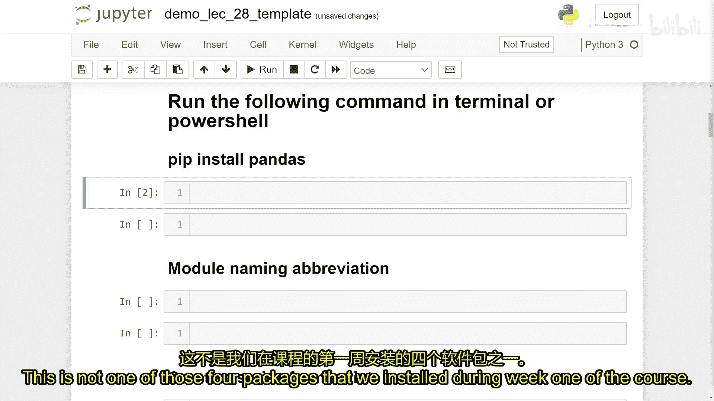
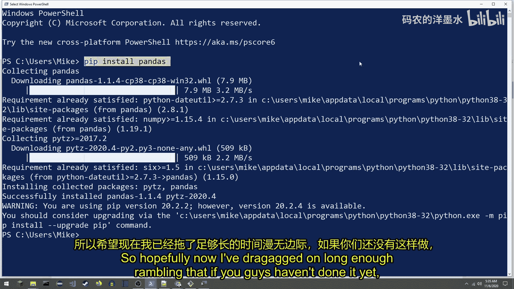
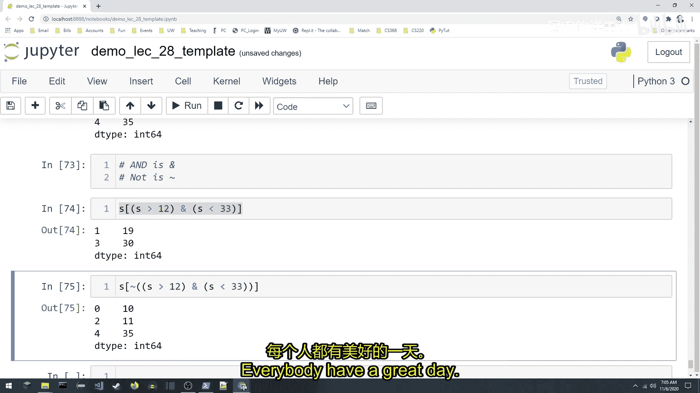

# 【全集】威斯康星大学-Python数据编程-CS220-中英字幕-1080P-p25-Lecture-22---Pandas-1-1--BV1VxvsBLEmv_p25-

Al right， hello， everyone。 Wele back to data programming 1。

 I don't really have any big announcements for today。 We just wrapped up midterm 2。

 and we're now going to be moving into the third section of the course。 Alright。

 so let's get started。 go to our web page。 Download the under the code section。

 There's a Jupiter notebook template。 We're going to be spending the entire time today in that notebook。

 The slide that's up on the screen right now is the only slide for this lecture in a PowerPoint format。

 Everything else is just going to be Jupiter。😊，But I do want to start off with a little bit of like review where we are in the course。

 So the first five weeks of the course were're all about control flow。

 we learned that statements are executed sequentially， one after the other。

 each line executed only once we talked about conditional statements that let us jump over blocks of code we talked about iteration that lets us repeat code and we talked about functions which lets us pull out pieces of code that we can like jump to and then jump back from that you know serve a purpose。

Then in the next five weeks， the middle part of the course， the part we just wrapped up。

 we talked a lot about data structures。 We focused on lists and dictionaries and then some other variations on those。

 And with those lists and dictionaries， we can pretty much do anything。We want to with Python。Now。

 moving into this third section of the course， this is really going to be focused on the data programming and the data science side of things。

So even though the exam is done， all of that stuff that we've learned during the first 10 weeks of the course。

 these next pieces use that material in general， the topics we're covering don't build on each other。

 Obviously， we've got pandas 1 and then pandas 2， but that's really going to be largely independent from databases 1 and databases 2 and web 1 and Web2 and Web 3。

 they're independent。 They don't really like you're not required to understand pandas to understand the web material。

 but you will need everything from the first 10 weeks for each of these topics。

 So even though the exam is done， make sure you put in the time to make sure that you retain that information。

 Don't forget it。And also any introductory CSs course that you take is going to go over all of those same topics。

 It's really only this last third is that's of the course that's going to be deviating from what you'd see in a more traditional computer science introduction。

 So if you go ahead and continue with computer science and take one of those other courses。

 knowledge of these topics， even if you're switching to C plus+ or to Java is going to carry over。

A lot of what we're going to be looking at during the next five weeks is things that we already know how to do in Python。

 but easier ways to do them using these packages like pandas or databases or something like that。

 just easier ways to accomplish the same task。So today's topic is a module called Pandas。

 The accent is actually on the second day， so it's not pandas like the panda bear pandaas。

But I'm going to pronounce it wrong the whole time， forgive me it' just。It's in my notes。

 I'm reading it， it looks like it should be the bear name， In fact。

 that's actually where it was named for。Alright， anyway。

 Pans is a tool for working with tabular data to like tables。

 just like we get with a spreadsheet like Excel。 That's what I have open here。

 But it's gonna be maybe a better way to work with this data so far in Python。

 we've been using lists of lists to talk about tabular data。 we've been importing from CVs。嗯。

And that's great。 but it's， it can be a little cumbersome。

 And Pas provides us with a lot of tools to work with tabular data。

 That's a big step up from list of lists。 And in fact， so here I've got Excel open。

 I just wanted to like point out a couple of features of Excel。😊。

That we'd love to retain and build on。 First， Excel is a really， it's a programming language。

 But what we've got here is tabular data。 And all of the cells here， also the code。

 So just take this out， for example。 Supp I have a number here in cell C 5。 we'll go with 5。

 And then in D 5， I've got another number 7。 Okay， those are so like variables。 they hold a number。

 And then if I have some code， for example， over here in F 5， I can write some code。

 I can say this is C 5 times D 5。 and just get those two cells， it's color coded them for me。

 push enter。 It's going do that computation。😊，And now if I wanted to。

 I could actually make this a little more meaningful。Instead of having， like， a variable name， like。

You know， C 5， that doesn't really tell me very much。

 I could name at length and just put this in a table。Yeah we go with。And then area。

 But now what I'm doing is I'm taking cells， which are themselves variables and using them to remind myself what these other variables stand for。

And if I actually want to see the code and check it out and decide if I've made a mistake or not。

 I have to click on all of these cells to figure out what's going on。 look， here's some code。

So Excel， it's very powerful。 I'm a huge fan。 I really love Excel。

 I use it all the time for many different things。😊。

But what I hope you guys will find by the end of the semester after you've some experience with this is that pandas provides potentially a better way to work with this kind of data。

 because we can do this in Jupyter notebook book。 We can put it the code in。

 We can actually see all of the code。 Then we can have it print out the results as a table。

 and then we can go back， add more code and just walk through the development of how we solve a particular problem。

😊，All right， so I've jumped back over。 I've pulled up the Jupiter notebook template for this lecture up here in cell 1。

 I've just got some formatting commands that make this wider。 I didn't actually execute this yet。

 And then this first cell here is just mark up that's got some important information about pandas that you know。

 this is what I would put on a PowerPoint slide。 But it's here instead because I want everything to all be in one place and kind of keep this streamlined for you guys as you take notes。

 And if I say something you can actually go in to my slide right here and add to it as you will going through the lecture and taking notes。

Alright， so first up， pandas is it's going introduce two brand new data types。 Well， here。

 it's for working with tabular data and it's。An alternative to Excel that should have been capitalized。

Get it next year you。 Okay， so pandas is going to introduce two new data types。

 The first is called a series。 Theyre， they're really cool。

 It's basically a hybrid between a Python dictionary and a Python list。 So as you can imagine。

 because it's a hybrid of dictionary and list。 it's basically。

 it's gonna have keys and indices at the same time。

 just like dictionaries have keys and lists have indices。

 But we're gonna find is that they've renamed them。

 And the only thing that's really hard about this is the really horrible vocabulary。

 They've chosen to name things。 So I'm going to do my best to like。😊。

Use the right word and then mention what the equivalent is for a Python dictionary。

 or whatever or list。So in pandas， pandas index would be the same thing as a dictionary key。

And in pandas， we're also going to see that we get both the dictionary key and we get a list index because it's this hybrid data structure。

 So the index from like a Python list in pandas is actually known as the integer position。

So we just have we have two things， two ways we can look up information。 We have the index。

And we have the integer position。 And again， the index is just like a dictionary key。

 and the integer position is what we would call index from a list。

So we're using index twice in different ways it's going to be confusing。

 I'm going to try and do my absolute best to use the exact right vocabulary and at the same time mention the Python equivalent as we go through this。

And I think， you know， it would be great if I could just rename all of the vocabulary to something that really makes sense。

 but Padas has been out there for a long time and a lot of people are familiar with it and they're going to be using the correct language if you get a job or are they required to use pandas。

They expect you to use the right words when you're talking about it。

 So I'm going to stick with the vocabulary that's a little more confusing because it's important you guys learning。

All right， so some of the like an overview of some of the features that we're going to cover today when we talk about series first。

 the panda series support this really super powerful information looking up technique not just like you know when we have a list。

 we could slice it and extract pieces of it， but it supports really complicated expressions within the like slicing style lookup mechanism。

 So when we extract information。 we're going to use the brackets square brackets to look things up。

 we're can actually put equations in their expressions that resolve to something and use that to like sort out our data and get exactly what we want。

 It also supports elementwise operation。 This is going to be really great for the those of you guys who are math people who are familiar with vector math and this is also great for people who really hate writing loops。

😊，Because element wise operation gives us ways to do something to every single piece of data in a series all at the same time。

And I'll do some demonstrations of that。 It's a lot like vector math。

 very different from what we see with lists。All right， and then finally， Ban indexing。Heres a。

Perhaps a more powerful technique that lets us create a brand new list that contains only items that meet certain conditions。

So with a list of dictionary， we would use brackets for index and slicing with series。

 we can extract the exact values we want with complicated rules using very short。

 readable code that makes it easy to see what's going on as opposed to try and read a loop and figure out what's really happening。

And then next lecture， because we're looking at tabular data series is just like a lister dictionary and hybrid。

 we'll actually be getting to the table part of things。

 And a table in pandas is known as a data frame。 It's just， it's built from a series。Essential。

 each column of a table is a series。And we'll be getting to that next lecture。

Because pandas is not a built in module in Python。 We're gonna have to go ahead and install it。

 So go to the terminal or Powerhell and go ahead and enter Pip install pandas at the prompt。

 and'll go ahead and install that for you。 This is not one of those four packages that we install during week one of the course。

 So you youll have to go ahead and do it now if you've not already done it。

 I had not done it on this particular computer。 So I just pulled up Powerhell typed in Pip install pandas。

 It took about 30 seconds。 So hopefully now I've dragged on long enough rambling that if you guys haven't done it yet。

 you've pulled up Powerhell and it's already underway or terminal。 It's already underway。

Al right， once we've got it installed， what we can do is go ahead and。

Bringing it into Jupyter notebook with import。Pands， I just going to do control enter to run that。

 And now I've got pandas available。 so I can go ahead and create these data objects。

 data structures from pandas。Like a series and we'll run that cell。So here we can see it's working。

 I needed to type both the name in the module pandas and the data here， data type series。

 and now I can verify that it's working。It can be a lot of work to type pandas every single time Pada st series every single time I want to make a brand new series。

 So often times what people will do is they'll abbreviate it。And to do that。

 we just import pandas and then we can use that keyword as and the abbreviation that is most common is PDd。

 So once I have that and you'll see this on stack overflow anywhere you go to get help。 In fact。

 a lot of times people will not even show this line as part of the demonstration code。

 they'll just be using things like PDd that series。

And assume that you know that it's coming from Pans。 And that's what that means。Allright， and again。

 you can see this is networking。 It's giving us the exact same information about the series as when we use the full name of the module。

 it's just an abbreviation。Now that we've got pandas imported。

 let's go ahead and make a series from a dictionary as our next example。 Allright， so first up。

A quick review will create a dictionary。 So we'll just say D is equal to。

 I'm going to use the curly braces。 This will give me an empty dictionary。

Now what I'm going to do is create key value pairs。And we'll go ahead put three of them in。

 My keys are going to be strings。My values will be numbers。

 So I'm going to go ahead and write some strings，1。2。3， all right， and then for the values。

 we'll go with7。Not an extra space there， eight。And 9， that should match what Me is doing。

 That's the plan。 Alright， let's go ahead and just print this out。 We'll run this cell。

 make sure I didn't make any mistakes。 And here we go。 This is a Python dictionary。Allright。

 we can do something very similar with the panda series。

 So we'll just call it S for series equals P D dot series。 Note that series is capitalized。

 This is a constructor for a series。 So it's going to get， it's basically a function。

 So we're going to be giving it parentheses。 And now I'm just going to put this exact same dictionary。

Right here。Inside those parentheses。 So this will be my initialization values。Alright。

 I'll go ahead and put S there。 So Jupyter notebook will print out the contents。 We'll run this cell。

Adjust the screen a little bit。 And now we can see that we're still getting the same kind of looking thing。

 I've got my keys over here on the left。I've got my values here on the right。

Python is going to print out their dictionaries by default as a like horizontal row。

 Pandaice is going to make it look a little more like a nice table。

A couple things I should also point out here， so this。Last item。

 the D type stands for data type and the data type here is in 64。

 So a lot of programming languages out there will limit how big of an integer you can use。

 2 billion is really common limitation。 Python is one of the few languages that does not put a restriction on how large integers can be。

 can have an integer of any size with Python。 But what's going on inside of pandas is that it's going to be switching to a different programming language that's going to be a little faster。

 more optimized than Python to do things very quickly。

 And so it's telling us that we've switched all these numbers to use integers with 64 bits which is great。

 I've got a 64 B computer that should still happen very quickly。

Without having to worry about any loss of。A screen keeps flickering weird。

 Apoise if that's bugging anybody。Anyway， so it's just telling us that inside of pandas。

 we've switched to this other type of data。To store these numbers。

 they're not being stored as Python integers， they're being stored as C integers with 64 bits。

Alright， so let's take a little more closer look。 So I mentioned that we have both the index。

 which is the same as a dictionary key。 So this is my pandas index， those 1，2，3。

 I also have an integer position。 and that's hidden。

 It doesn't display those integer positions here when I'm looking at the data table。

 but this first row of the series is going to be integer position 0。

The next row of the2 and8 would be integer position 1， the3 and9。

 That's going to be an integer position2， but it doesn't show us that when we just display the series。

 it's going to just just print the keys。 So let me just take a second and write down some notes here。

So integer position， index。And value。 Just make a little chart here。 So I'd enter your position。Go0。

 We have index。One， and the value here is oops 7。InAnother come integer position one。

 we have two with a value of eight。And at integer position 2， we have。3。We get that lineup good。And9。

 And then that last row， we have D type。In 64。 And again。

 that's just reminding us that it's actually being stored as a C variable， C data type。

 that's using 64 B to store the integer。 And that's going to limit the maximum size of the number that we can store there。

All right， now because series have both an index and an integer position。

 we can use either one of those to get access to our data。 I've got my little chart here。

 So let's quick review when we have a dictionary， a Python dictionary to access something。

 we're just going to use the square brackets to access the data， and I just need to give it the key。

 so。Extracting El entry with entry 1。That's deceptive。 And And with a key1， it's going just return 7。

 the value that's stored there。 All right， we can do something very similar with the panda series。

 except we're going to need the a command L OC for location。And now I'm going to give it the same。

 in this case， index。So index is the word we're using for a series。

 It's the equivalent to a key in dictionary。So that's great。

 We were just able to look up the value with key。I'm sorry， with index 1， gave us the value 7。

We're can do the same thing here with。2。That's going to go ahead and look up index2 and return8 when I run it。

There we go。Alright， we can also access values using their integer position。 So quick review。

 Here's my table。 These were the index indices。And the injuredposition are just going to start at zero and increase 0。

1，2，3。For all of the elements in the series。 So just and to use the integer position。

 the commander is going to be eye location or I lock。 So let's a quick demo。Ilockable grab element0。

Exece that。 It's7。 So here again， row0 or entry0 in the series gives us the value 7。All right。

 I'll check this out。Location one。R that， we get the eight。

Up here in the data table or in the series into Duposition 1 has the value 8。

We can also do negative indexing， just like we could with a Python list so。We can do minus1。

We'll run that cell real quick。 find out that it's 9。 And， of course。

 the last item would be the negative one。 So that would be that row right there。 We get the 9。

And with default， there's also a shortcut we can do。 I can completely leave out the I lock。

Or the lock。And pandas will do its absolute best to figure out which one we really mean。

So in this case， I'm going to use the。Index。And on this code。

 it's going to go ahead and just without me telling it， I'm using the index by the location command。

 It figures out that this is a location。Im an index。Okay， same thing。 If it's unambiguous。

 I can also go and grab。The rooms not 90。嗯。Integer position 0 using this sort of data。 So， but I。

 and I didn't need to put in the eye lock right there because pandas was able to figure it out。

 So it does its absolute best to figure things out without us having the to worry about specifying exactly which type of indexing we're using。

I'm going to mention right here before I move on to that if there is any ambiguity and that's going to happen if I use an integer。

As one of my index values。 So instead of like the text 1，2， and 3， if I actually use a number here。

 anytime I use a number， then there's ambiguity between， oh gosh。

 am I trying to look this up by index or by integer position。

 Python will assume or pandas will assume that we're using an index。

 So if I use like an integer 2 or something in this list， it's by default。

 going grab the the two from the index row， not the two from the integer position row。 So if we want。

Um， it's great to be very clear about which type of indexing we're using so that we don't run into any sort of trouble there。

All right， with lists， we were able to access multiple values and create a new list by slicing the list。

 Padas gives us something even more powerful。 We can still create slices。

But check this out if I have Now let me just quick review。 So my list S has this data in it。

But one of the things I can do is I can just index into the list。And inside these brackets。

 I'm going to give it another list， and I'm going to grab element 0 and element 2。Okay。

 so that's going to return seven and9 when I run this。There we go，7。 and in fact。

 let me do this real quick print。 when we're on the cell， then we can see the list。

 we are creating a brand new list， and it's grabbing integer positions。0。And two。

 so just the7 and the9。 It it's returning a brand new panda series when I do something like this right there。

 I think that looks pretty good。All right， I've got another option， too。

 Let me go ahead and just to do this。 We can also index。By putting in a。List of indexes。Yeah。

 so here we'll go。 we've grab one and2。 This is going to create a brand new panda series with rows 1 and 2。

 So just the7 and 8 there。嗯。Indexing by with a list of options。 So up here。

 we were indexing with just one key or one integer position。

 We can actually give it a list and pull out multiple values。

Without like if we were to do this with the list and slicing。

 we would be getting a contiguous block of elements from the list。

 we weren't able to likely polls in them and to pull something like this off to do this with a Python list structure we'd need a loop that goes through everything we'd create a new list。

 an empty list and then fill it in with new values for the things that we wanted to add to the list。

Until we actually created a new data structure here。

We're doing it in one just essentially data structure lookup。

We're also able to create panda series from lists， so quick review if we have just a list of numbers。

And suppose， for example， we put in， there's my empty list。 I'm gonna to add some numbers to it，100。

200300。Let me quick run this cell。And then do you。Nonethelessless。

 just to see what this looks like in Python。 So there's my Python list。Next up after that。

 we'll create a panda series from that。 So I'm going to do Pd dot series。And then in the parentheses。

 I'm going to just pass in this list， and I'm just going to copy and paste the actual code。

 the numbers right here。 so it's pretty clear what's going on。All right。

 and then we'll go ahead and print that out。And let me throw in。

We'll print this one out and we'll just let Jupyter notebook take care of printing that。

 So now here we go， I've got my Python version of the list。

 and then the Pada series that's been created from the same data as in that list。

So here we can see that what it's got here， these are the indexes。Not the integer positions。

 The integer positions。 they don't tell us what they are。 They're hidden。

 We can just see by what Ro they're in。 But these are the indexes。

 That's the same as like the dictionary key。So， and what it's doing is it's taking the index from the list。

 So this is at position 0。 This is at position 1 and just using those indexes as the series index also。

So this is one of those examples where if I'm indexing without telling it whether it's the。

Index or intertegerduposition。 And there could be some ambiguity here。

Because I'm using actual integers as my index values。Alright， I just want to be really clear here。

 Let me go ahead and grab。This。Text right here。And just do the same thing for this list。

 Just write out what we really got。 So here， we don't have an index。Websites 0 with text。

 they're going to be 0，1 and 2。Move that over and then the values here， we have 100。200， and。

300 And the reason that I paused and wanted to go back and copy this is I want to be very clear that there is an integer position and an index。

This index comes from the indexing into the Python list that we use when we created this。

And the integerposition just happens to be which an element in the Python series they are。

They happen to be the same values。But they're actually。Different。

 even though they have the same values， One is an integerposition， one is an index。

And I can use either one of those to access the data in the table。 So if I have。As location of one。

That's going to give me the 200。I can also do。As integer position。

Roots lost character there on that one。 Also，arrow， let me do this print。

We'll go ahead and just print out both of these。So they're both there。

 and we can see that we're getting the same data to 200 out， whether I'm accessing with。

 in this case， the top one here is the index and the bottom one is the integer position。Like that。

Just thought of one more thing that I want to add while I'm comparing the location and eye location or indexing integer position up above。

 I mentioned that it's possible to use the negative indexing。 like my example was index position -1。

 I did that with I location。 And then I talked a little bit。

 like the next thing I talked about was how I can leave out these location and i location and just use brackets and Panace is smart enough to figure it out。

 That's not true with negative indexing。 So right here， I've got this data structure is this series。

 So as Nomi just printed out so we can see what it looks like。Like on the screen。

 if I go ahead and try and use a negative index， this is going to give me an error。

 It's not going to go ahead and find the last thing。-1 is not in range。 It can't。

 It's just not smart enough to work with the negative indexing， unless。

I go ahead and use the eye location。So I have to be very specific when I'm using negative indexing。

So if you're only， go ahead and say。let me think of a good comment。

 I'll type it up and then I'll be right back。Yeah， here we go。 Alright。

 avoid negative indices unless you are specifically using IO。 Actually。

 that sounds good than what I wrote here。There we go， It won't work if you don't have that， you know。

 if you just use the default let pandaice figure it out whether I'm an index or an integer position。

 it's going to fail。So at this point， we've talked about creating Pada series from dictionaries。

 We've talked about creating panda series from lists。

 We've talked about grabbing values from those data structures with the indexing。

 and we had two different kinds of indexing。嗯。Using the index and with the integerposition。

 And we have also talked about grabbing data like more than one piece of data at a time using a list of indices。

 at this point， I strongly recommend that you guys just pause the video and go try some of these on your own。

 create your own list of data and then try and access some of these things just so you get some experience。

 use the information in your brain， you'll remember it better and then come back。Alright， next up。

 I want to talk a little bit about slicing。 We're going to quick review how slicing works with lists and then talk about the subtle differences between slicing with a list and slicing with a series。

So if we have a letter list and I'm just going make a quick list there it's empty。

 Noll put some letters in there。SoThere we go。 We've got the。All the syntax。 I'll just put in A， B。

 C and D。 Okay， well run that。Printted out。 There we go。 Now we have a Python list with those things。

 We'll go ahead Also， I'm just going to do this right up at the top of this demo section right here。

We'll do letters as a series。And that's going to be PDd dot。Series。Letter list。And then。

We print that one out。 and there we go。 So we can see the， again， the。

 the panda series is going to print this vertically。

 It's going go ahead and use the indexes for this。 exactly as the indexes from the list。

 There are also hidden integer positions that it's not showing us。Okay， so quick review。

 If I want to slice the Python list。 So I'm looking up here at this one from cell 33 to slice something like that。

 if we could just do。Whether。List。And then let's say， let's grab elements 2 to the end。

 So that's going to start with 0，1，2。 It's going to start with the C and go all the way to the end。

Let me just do that。There we go， we get C and D。 let's capture this in a variable。

I've sliced letter list equal to that。And then we'll go ahead。Priinnt this out。

Just so we can see it so everything is on the screen。 Okay， we're seeing that we get the C and the D。

Then if I want to， I can go ahead and index into this list。 This is gonna to be a position 0。

 This is at position 1。 It is a Python list。 Nothing has changed since the first 10 weeks of the semester。

 So I can just go ahead and grab helmet 0， for example， that should be position 0。

And I should get to C。Very good， so very straightforward quick review， that's how it works in Python。

Now， let's go take a look at what's going on in pandas。 So we have a series。And we take a slice。

Slicing。Quick review， my。Paandnda's data series。Looks like this。 It's got A， B，C and D。

 I can slice it doing the exact same thing more or less。So， I have sliced。Letters equal。

 and then letters is the name of it。The panda series right there。S letters。

 and I'll go ahead and grab。To to to the end。And this is going to be using the keys by default。

 I'm sorry， the index， which is like a di it's these guys right here。 The index indices。

 So it's going to start with2。 It's going to grab 3。And。Continue on。 So let me go ahead。

 We'll grab that slice。Make sure all the variables are the same names， yep， and to print it out。

Alright， so we can see we've got the C and the D。 The values are great。 We've got the correct rows。

 There is one subtle difference here， though。😊，And that's the index。Retained the same index value。

 So here we have index 2 was C。 Here， index 2 was a C。 When we had the list version， though。

 to get the C out。When I created a new list， this index was switched to0。 This one was one。

 So subtle difference right there。 All right， let me just do real quick。 Let's pull out that seat。So。

 we have sliced。Weters。And that's going to be in index 2， I get the C。Now check this out。If I do。

I location。Soた。No， I didn't。 I missed it。 Dot I location。 This is going to go ahead and get the C。

 It， It does。 It does rener all of the integer positions。

 So this is now the first element on the series or at element 0。So to grab this 1。

 I need to use the position 0。 So when we created the slice， it retained the indexes。

 but renumbered the integer positions。 That's that's what I'm trying to say。啊。Retains。Inindexes。

 those are Python keys， like from the dictionary。But。Re numbersers。In your positions。

 Those are our list。Indices。Let me make that all fit on the screen。 You know what？

I never ran that very top cell that adjust the width。There we go。 So there's my comment。

 So let's go ahead。 I'm gonna go ahead and。Go ahead and add in just a comment。

 copy and paste that from above， get some changes made。

Of what's really going on when we look at the entire series right here。 So this is integerposition 0。

 I've got index to the value is C。So just like that。 And then the next item we've got。

This is going be integer position。One， because it's this will be 0。 This is one index 3。

 That's the equivalent of the key with the value D。And these are capitalized。Let me get that fixed。

All right， yeah， that looks good to me now。Alright， and one thing that we can't do。

 I'm going to go ahead。 I'm going to take this。Okay here before we do that， let's。Quicker review。

 this is going to print out just the S。Wop sent not what I wanted。 I wanted just this。

 I want sliced letters。Okay， slice letters， this is what it looks like when I use the eye location。

 if we print that out。That was getting the first row or the first element of the series。

 which was the value C。 if I take out that I and try and just use the location。

 that's going to try and look in this list here with two and three。嗯。For a 0。

 And it's not going to be able to find it。 This should give us a value error because 0 is not in。

 that's a long error message。Not in。two or three， it doesn't have it there。Alright， cool。

 So that's slicing with what did I call itre using integer positions。

 We can also slice using the index values。 Let me go ahead and grab the simple the one I' located with a dictionary。

😊，Yeah， right here， this one。Go ahead and make a new copy of this。

I'm going to put that right up here， slicing the series using the index。 There we go， okay。

Then we'll just print it out。 make sure we got the way I think we do。 There we go。 Okay。

 so there is a panda series where we've got index values with actual names， text words。

So one the things we can do now is we can slice this。And we'll just give it。2。Through the end。

So this is going to do is it' going to go through my index values。

 find the two and go all the way to the end。right I need to move on。

 or I'm going to run out of time and not be able to finish recording this before I need to live stream the video。

 All right， Yeah， I got up early。 It's one of those mornings for me。Alright， so next up。

 I want to talk about element wise operations for a little bit。

 This is one of the really cool features of panda series。 So real quick recap of how lists work。😊。

List review if I have list of numbers。And we'll do  one， two， three， four， there we go four numbers。

And we'll just run that real quick。There we go。 There's my list。

 If I were to do something like nus times 3， that's not going to go ahead and multiply each of these by three。

 which kind of is like what most people expect。 People familiar with vector math would expect that I'm going have 3。

6，9，12。 That's not what happens。 Instead， what it does is it's taking the entire list and then concatenating multiple copies of it。

 So I have now one really long list with it went from four items to now 12 items，1，3，4，1，3，4，1，3，4。

 So this is how lists are going work。If we have a panda series， so let's do it this some series nus。

Equals we'll do the other panda series。And then we'll create a list and we'll just do those same numbers。

1，2， three， oh， three is good enough。All right， and then I need to print this out。

 show you what it looks like。So it'll just take advantage of Jupiter notebook， There we go。

 as timess  one，2，3。Now， pandas is going to do this differently。

 It's changed the way the multiplication operator works so that it。

I can take something like my Pada series， multiply that by three。타틀한 거。And instead of being 1，2，3。

 now it's taken the three and gone through in each element multiplied by 3。 So now 3，6，9。

So pretty straightforward， I think we can do the same thing with。Addition。

As number plus 3 is going to go ahead and say， al right， I started with 1，2，3。 I'm going add 3 to it。

4，5，6。And this is probably a good place to note that I never actually reassigned this。

 Snos did not get changed。 Instead， this produced a brand new series and printed that out。

 But then I didn't save it in a variable。 So it's just lost。 So this is a brand new series here。

So when I flung back to S nus， it stayed。Using those values， those values were retained。

 And then when I did the plus 3， I get a brand new series again。 I'm not saving it as anything。

 So it's just there。And then I'm。Los it one， because I didn't save it as a variable。 All right。

 let's just do like a couple more。 So if we do。S numberss divided by3。 There we go。

 That takes my series divided by 3。 I can't do this with the list version。 So here's my list。

 We've got nus。That's not defined。For now as it's going to give me an error。 I can do the plus 3。

 right？ Oh， no， that one does work out list。 and int。 I can't contaminatnate just the multiplication。

 right。I mean， just make sure I'm not making mistakes。 Yep， so those other functions。

 the multiplication of the division， they're not defined for Python lists， but。For the series。

 for panace series， they are available， they are defined。Okay。

 so that was a demonstration of the series operations with scalrs。 So a scalar is just one number。

 I'm going to have some sort of operator or and then a scalar opera， just a single number。

 not a list。 Here we go。series。Operator， this case， addition scar is just one value。 In this case。

 when I have a scalar， this gets applied to every single item in the list。

rightThe other way we can do element wise operations。

 and I'm going to go ahead and copy this and make a new comment where this piece starts is series that operate on series。

Eleement wise。 So let me just put that comment right there。And first， we'll do the， yeah。

The list review。So发 helpful啊。List 1 is equal to 1，2，3。And then list 2 equals 4，5，6。

 I can go ahead and just do list 1 plus list 2。And this is going to concatenate the two lists together。

Al if I do something very similar with Pada series， we can have。Seerries 1 equals。And it whoops。

I'm just going to go ahead and copy and paste these same values。Right here。

And then we'll create panda series 2。 We'll give it these values right here， the 4，5，6。Like that。

 And then we'll go ahead to S1 plus S2。What this is going to do is it's going to do element wise operations。

 So in this case， it's going to take the very first element。

 the one here in the very first element of my second series， the four。

 And because I'm doing addition， it's going to add those two together。 So 1 plus 4 is 5。And then，2。

Plus 5。Gives me 7。And 3 plus 6 is equal to 9。 So it's just going to find the corresponding element at the same position and add them together and produce a brand new series。

Just like this produced a brand new list。But this one only has three values。

 It didn't just concatenate them together。So check this out， this is also defined for multiplication。

So I can do S1 times S2 and this is just going to do the multiplication say1 times 4。

 Let me run this。And two times 5。 So one times 4 is 4，2 times 5 is 10。3 times 6 is 18。

 So it's just going to line up the corresponding elements from the same position and multiply them together。

 produce a new series with the exact same number of elements where we've done some math。 All right。

 I reserve some cells for you guys。 you can try out some other things， you can try division。

 You can try exponentiation。 One thing that I want a demo before I'm done though。

Is some of the relational operators。 So I save themselves for you guys。 But check this one out。

 Suppose I have S1 less than S2。 What is this going to do。Let me go ahead and just run this。Oh。

 and now I don't have everything on the same screen。 All right here， S one。I see。

 I'm going to borrow yourselves， guys。 So what this is going to do is it's going to say take the first one。

 One is that less than4。 It's applying this operator。 The result is true。

 So it's going to put that in a new series。 Then it's going to say， okay。

 now compare the things in the second position。 or at index 1 at index 1 here we have the  five。

2 less than 5。 That's true。 So this is actually creating a series with a different data type Boolean values。

going to be extremely useful， later on。Alright， next up。

 what if we have two series that don't have the same size， Let me go ahead and grab。This。

Block right here where I'm declaring my series。 I'm gonna go ahead put those in。

 And then I'm just gonna to take one of the values out。

 So now I have a series with three values and a series with two values。 And then if I。

 if I have those together， I'll just do S1 plus S 2。 that was the straightforward， simpleimple 1。

 We're going to go through， and it works great for 1 plus 4。 is 5。

 I see there's a subtle difference here。 This is 5。0。 It's float 64 is the type。 Now。

 When up here when I did this before， I had int 64。 and my 5 was not a 5。0。😊，Okay。

 it also works great for the 2 plus5。 So if there's a corresponding， know partner。

 that does the operation。Now， when we have three plus nothing。

 there's not a way that we do plus nothing。 So what this is representing NA A N stands for not in number。

嗯。It just is， it's like the equivalent of none for numbers。 It means that this number doesn't exist。

 And the reason we had to switch this to float 64 is because not a number is a member of Fat 64。

 We can represent that， but we can't represent not a number as an integer。

 And so pandaice is going to try and do everything it can to streamline the data types so that everything is in the same type。

And that's why they've switched everything to floats to sort of maintain that。Alright。

 now that that's all necessary， Pandas can certainly handle different data types all in one series。

 Let me go ahead and just type something in real quick。Let's just。Yeah I don't need to save it。

 We'll just type it in and we'll print one，1 shot。Pandnda series。Print these， we'll give it a list。

 we'll put in our character we'll put in。The name we'll give it a boolean。 We'll put in one。

 So that's an integer afloat。Then we'll put in how on to list。1，2，3。

How about I wonder do you think a dictionary will work？I bet it does。

 We'll stick a dictionary in here， too。 So there's an empty dictionary。 We'll do a。Alice。B。When。Bob。

 yeah right， let's give this try。 See what we get。And indeed， it works。 So I've got a character。

 a string， Boolean， integer， float， a list and a dictionary all in one series。Check this out。

 So while before we were getting in 64 is the data type or float 64。

 if it was math or the Boolean one was type fool， this is just object。

 that's pan this way of just keeping track that we've got multiple different data types。

 they're just going to use the it's a generic word for a data type。 All right， So next up。

 if we did want that behavior like we saw with lists where if I did a list plus another list。

 it just concatenated all the elements。 and I got a longer list。 If we do want to merge to series。

 That's not an uncommon operation。 either we might want to do this at some point。

 So let me think here。 I've already got an S1。That's a pandas series right there， I've got an S2。

 that's the one with the four and the five。 if I do S1 plus S2。That's when we did element wise math。

Okay， but what I， what I want to do is create one longer series here。 So in order to pull that off。

 I'm going to do a sequels。 It's a special function in pandas。Called conca， short for concatenation。

 It's a function There we go。 I've got the parentheses。

 And this is going to take a list of things we wish to merge together。 So in this case， S 1 and S 2。

So I've got the square brackets because it requires a list。Quick note right there。

And then we'll go ahead。 We create this。 I'll print it out right there。

 And now we have the first three elements。 Those are from S1。 The last two elements are from S 2。

And everything， all the values are now there。 Now， check this out。 This is fascinating to me。

 The index values are retained。 So when we had， me just do it right here。 S1 had index values 0，1，2。

 and that's where those 0，1，2 comes from over there。

 And S 2 has index values 0 and 1 and those are retained。

 So now I have multiple pieces of data with the same index value。

 They are going to get different integer position。 so I can differentiate them that way。Al right。

 I need just a little more space。 Let me make one more cell。 Now'll check this out。

 My S has two keys at index 0。 So let me go ahead and use the， I'm， I'm sorry， not not keys index。

So we'll do L OC to make sure we're very clear。 and I'm getting。The index 0， When I do that。

 it's going through and extract all of the values that have index 0。

 And there's more than one in this case， the one in the four。 So it's grabbed that one。And that one。

All right， so far， in all of those earlier examples， the ones I just finished doing。

 we were just lining things up based on their inte position。

 things at inter position 0 were paired with things in integer position 0 in the other list。

And that was also true because the integer positions were the same as the index values because of the way web was creating everything using lists。

 Now， if I create them with dictionaries， I can make this a little more complicated。

Let me just give you a quick example。So I've got， I'm creating series， I'll be using a dictionary。

My keys will be。Letters and the values will be numbers。比。How about 20。 Oh， I forgot the a。So yep。

 I'm， I'm so used to putting in all the syntax and then go back filling in my letters。

 I just overlooked one。 There we go。m creating a dictionary， key， A， value 10， key B， value 20。

 That'll be S 1 for this example。😊，Then I'm going to create a second one。So he's two。

 and I'm just going to switch to A and the B。And then let me see here。 we'll just。

 we'll make this one and 2。 That'll be a little easier。哎， and then。Print S1。Print S to。

 let's make sure they look good。Yeah， so here's S1。Ws太波。S 1。As2。There we go。

That's not clear'cause it al right， allright al right。

I was hoping it would format and look really good。Forgotten I did that， okay， so。

S1 has a with 10 and B with 20。 And this one has B with one and a with 2。 So now。

 if I were to do something like S1 plus S2， this is going to do addition， right？

 But now is it going to take the first row。Now， the injured position is say 10 plus1。

 or is it going to match up the a with the a and give me a new series with a as equal to 12 is the question。

What's a race set go。And it does， in fact， match up the two A's。 So it's going to say a is 10。

 Find the a in this row or in I'm sorry， this series， it's a 2。 We get 12。 Find the B here。

 It's a 20。 Find the same index in the second series。 That's a one。 Add them together。 We get 21。

 So the the rule here is that pandas will prioritize the index value over the integer position。

All right， this is known as index alignment。好。You can't spell this morning。 Allright。

 index alignment。All right， I saved one more cell so you guys can do your own experiment and just try something out here。

 take that cell， try something。Alright， I'm going to move on。

 I'm going to talk about how to insert values into a series。 Let's just grab this series right here。

We'll start us off like that。We'll print it out。I'm going to go ahead， actually。Print。As 1。

There we go。 A is 10， B is 20。 Now if I want to add another piece of data to this， if I have S1。

 I can just go ahead and index with my new key value。

 We'll go ahead and add C and just say that's equal to 30。And then we'll go ahead print。

That's one again。And now I've got A And B here。 That was the first time I did it。

 That's this first print。 And then I've added C。 And now I have A B and C in the series。

 So it's just gone ahead and added one more thing。Okay， this next technique is extremely powerful。

 Suppose I have a series pans。Let's like make a new one real quick。I'll give a whoops。 I meant list。

 So I'm got an empty list here。 I'm gonna fill it in with the 10，2，3 and 15。

 So I match what Me is doing。 Alright， I'm just gonna run this。

 I'll go ahead and print this out because it's Jupynter notebook。 Now。

 the goal here is what if I want to create a list that only contains the numbers in this case。

 greater than 8。One of the tools I can use is known as this Boolean indexing。 In this case。

 to make this work， what I'm going to do is create a panda series。I go。

 I went ahead and named it B because it's going to be Boolean。 I'll show you in a second。

It's going to be a list。 And I can go here。 I can say， okay，10 is greater than 8。

 So I'm going to give this a true。2 is not greater than 8。 So that'll be false。

3 is not greater than 8。False and 15， of course， is bigger， so we get true。Okay。

 once I've created this， let me just go ahead。Priinnt that out。 This is a normal series。

 just like the ones I've been creating the whole time。 There's nothing special。

 It's just got booyan values， instead of numbers。But one of the cool things I can do with it is that I can use this to extract values from S。

So here S。Of B。 So basically， what I'm doing is essentially creating like a slice。

I want to slice out the 10 and the 15。 and I'm going to do that by selecting these with true and false values。

 So instead， other words slice there， I'm just going to put in a B。

This is going to go through and say， okay， the first one，10 true， keep it 2 false， dump it。

What was the next one，3， false， dump it，15， true， keep it。 and it's going to keep the 10 and the 15。

 So an extremely powerful technique。Now I had to type these in by hand。

But I really don't have to do that。 It's， it's far more powerful than that。

 All I really need to do is go ahead and use the element wise relational operator。

 I can actually write S greater than 8。Because that's what I care about。

This will return the same Boolean series I just created right here。 True， Falsewell is true。

 all in span of typing three characters rather than like having to type it all in manually。So， again。

 this is just element wise。 It's going to go through and apply this greater than 8 to each one of these。

 So it is 10 greater than 8。 Yes， so it's going to return true。

 Add that to the new series is two greater than that。 No， it's false。

 puts that one in the new series。 It's going to go through and do all four values。

There's no reason I can't just store this。 I can say B is equal to 8 and then print out B like that。

 I get the same thing。And， in fact， so up here， this。

 this is how I would use it if I'd store it in B。 I don't even need to store it。 I can just say S。

 I need something here for my slice。What I really want is if the individual values in S are greater than 8。

 this will automatically create that Boolean series for me。

It looks a little weird because I've got S in there twice。But。

When you think about these work from the inside out。 So the first thing I'm doing S greater than 8。

 this is creating a Boolean series。The next thing I'm doing is using that Boolean series to extract values from the same data structure I used to make it from S。

Allright， I feel like my video is going to be a little long。

 So I'm going go ahead and just suggest that you guys come up with your own experiments。

 see if you can take this and extract values that are know。

 choose something other than greater than 8。 You know。

 something maybe the square of the value is less than 20， for example。Play around。

 make up your own example。Alright， another really powerful technique that's available to panda data。

 And a lot of times we'll have data tables that have headers or have like row labels that are text。

 So we might want to be able to manipulate that somehow。

 So I want to talk about element wide string operations。 In this case， I'm just going to take。😊。

A series of words， in this case。We got a list。Some of them will be uppercase。

 some of them will be lowercase。They need to be actual strings。 so we cut the pots in。So Apple boy。

 cat dog， similar uppercase， similar lower case。 Let's。

 let's talk about turning all of these into uppercase words to start with。Alright。

 let me just see here， so words。Go ahead and run this cell。 There they are。 That's my panda series。

They're all strings and it's going to call those data type object。

So wouldn't it be great if I could just do this where it start upper？And have that work。

 Unfortunately， this doesn't work。 Upper is a string function。

 and it's trying to be called on a panda series。 So those are incompatible。

 Let me go ahead and comment this out。And just make a note。Does work。啊。Upper is a string function。

 I'm go and run that to get rid of the error message。 What I can do， though。

 is I can take the name of my series。And I can see it I'm going to call a string function。

From from the string module， call upper on every single element。

 So that's what this is doing from the string module call the function upper on every single element。

 And if I run this。Then I find that it goes through and converts all of those strings to uppercase。

Next up， let's kind of combine those ideas。 So we just turned something in uppercase。

 and we just learned about Boolean series。 Let's use those together。 and let's do get。哦。

Grab all the uppercase words from the series。 So first thing we're going to need to do is basically。

 we're going to take words。 And what we'd love to do is just。

Slice it and just slice out all those uppercase words。To do that。

 what I really need here is some sort of Boolean series。

So I need to go ahead and create a Boolean series where I know the the words are either that I need a true or false where for each word。

 I can test and see。Like in this case， the Apple is uppercase。Is boy uppercase。

 So this seems to be true or false。 So what I can do here， I can go ahead and say words。

And that's going to go through each of the words。 I need a relational operator to say， is it。

Uppercase。And then I would love to be able to do words dot upper。 But that's not how you call this。

 I need to tell it It's from the string module。S the R dot upper。So now here's what I'm doing。

 This is a relational operator equals just like less than is。

 I'm going to go through element wise and take each word one at a time and compare this word。

Happens to be uppercase Apple with this word。 If they're both the same。

 that means that the original one was uppercase， it'll be true。

Then I'm going to take the next word element wise。 So this is lower case Boy。

 It's going to compare to the upper case Boy。 say they're not the same。 It's going to give me false。

 So let me go ahead and just。Yeah， we'll just do this one。

So this is going to create that balloonolet series， true false， true false。That's awesome。

 I'm going to store this in B。And then， I'm going to call。Words given that Boolean series。

And that's going to select out just the words that our uppercase。All right， In fact。

 now that I've got this working， there's absolutely no reason that I can't do this all in one line。

 So here I'm going to be extracting something from words。

 What I'm going to be extracting is a Boolean series where。I'm giving the words here。

 I'm just going to copy my series， creation code。From right there into the box right there。Right。

 so now， there's a lot going on， but all in one line。I'm extracting Apple and cat。

So this is a element wise relational operator。That's comparing each element。

 each word to the uppercase word。And if it's already uppercase， then it'll be true。All right。

 So all in one line。Alright， for my next example， I just tested this and copied and pasted this line。

 I already had it。 Here we go。 So what I want to do now is take an example where I'm creating a panda series。

 This one's from a list of just numbers and extract all of those odd numbers from the list。

 Soll run this cell again。😊，Let's see。 I need to go ahead and print out the list。

 You guys can see it。 So I've got 10，1911，30 and 35。 I'm just going to return the 1911 and 35。

 What I want to do is take advantage of as many of these built in automated know Boolean series features as I can。

 So let's go ahead we'll take series。 Remember to try and figure out if something as oddtter even we would use the modulus function。

 So we'll do S modd 2。 And that's going give us 0，1，1，0，1。Okay， so those are numbers。

 it's not a Boolean series yet。 so I'm going to go ahead。 I'm just going to keep this。

So that you guys can see it when you're doing your own work。 And I'm going to ask。

 is that series equal to， let's see， odd numbers。Are equal to one。 So like the。That one there're 19。

Means that that remainder is going to be one。 So I'm going to say， is it equal to one。

 Now I have a Boolean series。Alright， I'm going to go ahead and just store this in B be short for Boolean series。

 print it out again。 So looking good。Next thing， I'm just going to take S of B。

And that it now extracts just those odd numbers from the list。In fact。

 I've got one more cell right here。 I don't even need to store it in a balloonan series。

 I can go ahead and just put all of this in one line right here。

So S modd 2 is going to do that element wise computation， return a series。

Then I'm going to do element wise。E equal to see if it's equal to  one。

 This is going to turn into a Boolean series。 Yeah， I think I misspoke a second ago。

 This is going to give me integer 0 or 1。And then I'm going to use this as sort of the advanced slicing。

The Boolean slice to get just the odd numbers。Alright， guys。

 one final example I want to talk about using the and or and not operators。

 So real quick remember this series I was just using up here for my odd even numbers。

 I'm going to go ahead and use the same series， and then I'm going to try and see if I can get out numbers that are less than 12 or greater than 33。

So I've got a couple of those like 35 here， 10 is less than 12。Yeah， it's 10 and 35， right？Okay。

 so it kind of makes sense that I could do something like advanced slicing。

 we'll just say S less than 12 or S greater than 33。

The problem is that the writers of Pandas were able to hijack lots of these operators from Python。

 the addition， subtraction， division， multiplication， and rewrite how they work for pandas。

It turns out that or is one of the operators that Python does not let you hijack and change to do something different。

 So what the authors of pandas did is they went ahead and said， okay。

 we'll just steal a different operator。And instead of or。

 the pandas version of or is that vertical pipe。 It's the above shift backslash character。

This almost works。 There's a problem here， too， in that the vertical pipe means something in Python。

 and that operator has an extremely high precedence。 So what it's trying to do is say， 12 pipe S。

 It's trying to do this middle piece。When what I really want to do is do these。Evaluations。

 I want to create a Boolean series here。With the relational operator。

Use the element wise operation here to create another Boolean series and then use the or operator on those Boolean values。

 So if I put these into parentheses。Then this is all great。So I did this in a couple steps。

 So let me make some comments for you guys。Doesn't work。pas。News。The verical pipe instead。

And use parentheses。For。Presidents。Alright， cool。 I think that'll do it for or。

 I just need to mention a couple other things。Yeah， I'm out of time。

 so and is actually going to be the ampers cent。And。Not is the Tilda in pandas， so。

Let me do a real quick example here。 So this is grabbing things that are out of the range。

 Let's go ahead and switch this to the ampersand。And then we'll grab the numbers that are bigger than 12 and less than 33。

So that'llll actually be something there。And that's going to grab two more numbers from the list。

And then let's do one example with not。Okay what I'm to do here is I'm going to go ahead put in the knot。

 Then I'm going to grab everything inside of my brackets here and put that into parentheses。

 So let's should just flip this around。 This one gave me the 19 and 30 by taking knot that should flip all of the trues to falses and falses to trues and give me everything that's not in the 19 or 30 lits。

 the other half of the list。Alright， so that's gonna to do it for this lecture。 guys。

 I'm gonna go do some editing， get this put together。

 get it rendered and throw this up on YouTube for you guys。 Everybody。 Have a great day。

 I hope you found this valuable。😊。

And enjoy。