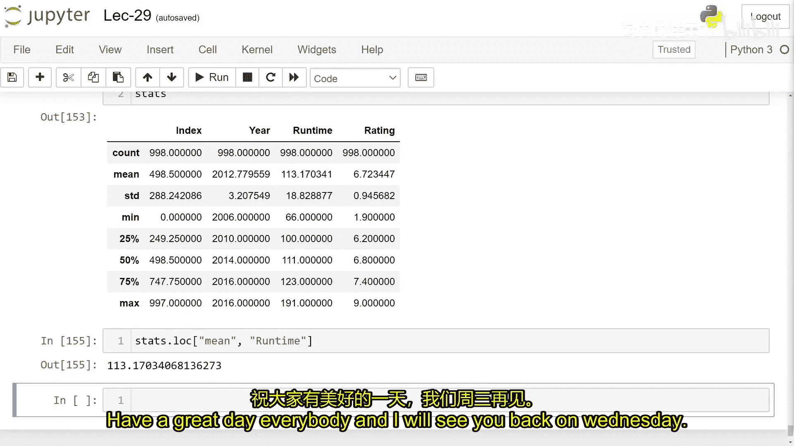

# 【全集】威斯康星大学-Python数据编程-CS220-中英字幕-1080P-p26-Lecture-22---Pandas-1-2--BV1VxvsBLEmv_p26-

Welcome back to data programming1 Today we have our second lecture on Padas this is the first of a four topic sequence special topics as part of the data science section of this course。

 we're going to be talking about pandas we'll be talking about the web and web scraping we'll be looking at databases and wrapping up with plotting。

Al right， as we get started， please go to the web page。 There is a worksheet there。

 We're gonna begin with some of the problems on the worksheet。 There's also in the code directory。

 the template for this lecture and some CSV files that we'll be using at this point。

 there is no template I'm going to be creating it as we go through as I do the lecture and then I'll just go ahead and delete all of my work。

 So what you guys see during the lecture will be a little different than the template that is the final product。

So go ahead， download those files， put them in a directory。

 get Jupynter notebook open so you can follow along and a quick review as we get started。

 So remember， pandas is a really powerful tool for working with tabular data。

 tables of data like you'd see seen in a CSV file or a spreadsheet like Excel。

Pice introduces two brand new data types that give us a lot of flexibility in how we deal with this type of data。

 The first is this series。 It's a hybrid between a list and a dictionary。

 It's going to have both indexes which work like dictionary keys and it's going to have integer positions which work like list indexes。

 It's going to give us the power to do elementwise operations， like you'd see with vector math。

 It's also going to be able to use that really powerful Boolean series to select certain pieces of the data。

Alright， we're going to do a quick review of that at the beginning。

 Well then I want to do a little bit more to review data alignment and just clear some things up。

 and then we'll dive into the new data frame， which is Pada's second data structure that they introduce。

 used to represent tables of data。 You can think of it as the columns of the table or actual panda series。

 So we'll get to that in about 10 minutes。

Alright， so here we're looking at the worksheet that's available from our code directory。

The first three questions I' work with series review。 I'm gonna to go ahead and do number3。

 Just this is the one that reviews Boolean series， which I find to be a very powerful technique and well worth investing some time to learn。

 then on page2， we have questions about data frames。 So after today's lecture。

 definitely take some time you should go through and you should do all of the problems in this worksheet。

 not just the one I'm gonna to do for the class demo。 All right。

 I'm going to go ahead and copy these over into the template so that you guys have them and you can take notes in the Jupiter notebook template as we go through the lecture。

Alright， so this series of questions is just asking us what is going to be the result of this operation So in line one of this cell right here I'm declaring a series it's got the numbers generated from a list minus-11。

 200191 and 4 then I'm just going to ask a series of questions about this。

And produce what the answer is gonna be。 And I want you guys to think about this and make a prediction。

 I'm not even gonna run these。 I'm going to leave that up to you guys。

 And I'm just going to put here in comments what this is going to produce。 In fact。

 the way I want you to use this is pause the video and try this one out。

 make a prediction as to what you think is going to happen and then come back。 and here's the answer。

 Okay， so what's gonna happen is we're going to create a series that's got -1，1，2191 and 4 in it。

 It's got those values。 And then we're gonna ask this question。 This is a relational operator。

 It's going to say is V less than 0。 This is gonna happen element wise。

 So it's going go through and take a look at this one right here。 and return the value true。

Then it's going to go who I ahead and take a look at this one。 One is not less than 0。

 So that's going to be false。200 is greater than 0。So that would also be false， 191 less than  zero。

 also false。And finally，4 lesson 0， false。 Okay， so it's a relational operator that's going to produce a boolean result。

 So here we're going to have because we're creating the series from a list。

 it's going to use those indices to come up with the indexes and they'll be the same values as the integer positions。

So。There we go。 So we're going to have those keys or O not keys。

 There would be a keys in dictionary indexes over here on the left。 and we'll also have D type。

And this should be bo。 I'm going to leave that off for the rest of these。 Most likely。 Al right。

 There we go。 That's number one。 His next question is basically， I got two steps to it。

 I'm going to go through， and I'm going to multiply v times v。

 That's how much higher precedence than the equals operator。

 And then I'm going to see if any of those numbers that we generate our equal to 1。

 So I think we just walk through this in steps。 So first up is -1 times -1。 That's going to equal 1。

 Then1 times 1 is equal to 1。 I'm not going to type all out every time。200 times 200 is 40。Thous0。

Check this out， 191 times 191 is。We run that。 So that number。 So a big number，36，4，8，1。

And then  four times 4， I got this one，16。 Okay， now that's the first part right here。

 So now that I've generated a new series with those numbers。

 I'm going to go through element wise and decide if they're equal to one。

 So this first one right there is equal to one。 So that'll be true。Second one is exactly one true。

40000。Is not equal to one。So false。Again， that 36，000 is not equal to one。Neither is 16。Okay。

 then this will be a position zero or index0。Index 1， index 2， index 3。Index4， make it look good。

 De type。不。Number 3， I'll go ahead， pause the video again， do this one。

 Just write the answer out right here， and then come back to watch the solution。Okay。

 in this problem， I'm going to start with the inside of all of the brackets。

 And that's just this piece right here。 This is going to generate a boolean series by asking if these are greater than 100。

 And then we're using so inside the brackets。 We're using this to access the series and use that Boolean selection to make a decision about what to keep。

 And this is going to produce a new series with just a subset of the elements。 Okay。

 so here's how this is going to work。 First up as V greater than 100。 is -1 greater than 100。

Now want to be false is one greater than 100， no。Fals， 200 greater than 100。Yes。True，191。

 also greater than 100。And 4。So that'll be false。Alright。

 the next thing we're going to do is go ahead and use this as a。

Selection mechanism to select just pieces of。The V series。 So let me go ahead at position 0。

 V has value -1。At position 1， V has one。Make it look good add position2 value is 200。Formaning。

 I'm trying to make this look good for you guys。 Al right， at3， we've got 191。And at position4。

 we have the number four。Okay， so now I'm going to go through it。

 and I'm just going to delete all of the rows that have false in them because they will not be retained in the final answer。

 So those two have false。 We're not going to keep them。 These two will also be false。In this case。

 I don't need the truths anymore。That's not part of the answer。This is my answer right here。

 I've got。Go ahead， put in index。And value。And D type。I's going to be likely in 64。Alright， cool。

 Hope that made sense。Important thing to remember is the index is actually retained。

 It's like the key from a dictionary。 It's retained when we do this selection。All right， next up。

 go ahead， pause the video， make a prediction about what this one's going to look like。

And then come back for the answer， which I am doing right now。 Okay， so first up。

 we're going to look at the inside most of all the brackets and start with this。 All right。

 this is an expression， and we've got the left hand side of the equals over here。

 We'll evaluate that one。 Then we'll see if it's equal to0。

 and then finally we'll use that that'll give us a boolean series as a mechanism to select pieces from the series。

Okay， so first up。The V mod 2， All right， in that case， this is our sort of odd even test。

 So now basically， it produces the remainder。 So  -1 divided by 2 as a remainder of one。Okay。

 and then one， well， divide by two has a remainder of one。And again， okay。

 I'm going to stop operating that。 So 200 is an even number。 When we divide by 2。

 the remainder is going to be 0，191， and odd number will have a remainder of 1 and 4 will have a remainder of 0。

Let me shorten these up again。Okay， so that's what we're looking at for those values after we do。

You just this part of it。Al right， next up， I need to make a decision about whether these are equal to 0。

 So in this case， that's going to be false。Falults。Z is equal to 0 true。False。And。是。Al right， cool。

 So then from here， I'm going to use those true and false values generated by that expression to select pieces from V。

Okay， and now here I've got integer or no， indexes 0。1。2，3，4。 and the values here are -1。1。200。1，91。

And for。Okay， and then again， I'm just going to delete the rows that have faults in them。

So those will not be retained。Whoops， almost missed。 That'll not be retained。 And these are the two。

 even numbers from this list，204， those are the rows that' will be retained。

 And this was just me doing some work。 So I'm going go ahead and delete those。

Make this line up a little better， so it looks good De type。As guessed it， int 64。All right， next up。

 pause the video， go try this one out on your own and then come back for the answer in three， two。

 one， go。Okay， so we're going to start with the innermost expression here。

 This one actually has two innermost expressions that I need to look at。

 So I'm going evaluate in V greater than 0。And V less than 100。

These are both going to give us Boolean values， true and false。

 and then I'm going to use the and operator。 And if they're both true。

 we retain it if either of them are false or both are false。

 we will exclude that line when we do this Boolean selection here。Okay， so first up。

 I'm going to do the V greater than0。 I just put that in a column right here。

 So negative one greater than 0。False， one greater than 0 true 200 through basically all the positive numbers。

 191。And。4 here just。I'm just point my numbers into， I remember what they are。200。191。

I'm going to need the when I generate the final answer anyway， so there we go。

And that was v greater than0。So next up， I need to do V less than 100。Al right。

 so is negative  one less than 100。 Yes， it is。What about one。Yes， it is。200， no， it's not false。191。

 no， false and4。 Yes， it is。Okay， so these are the numbers。H hold on。

 So the next thing I need to do is use this。And percent， this is the pandas and。 Remember。

 they weren't able to just use the word。 and they couldn't overwrite that one。

 So they chose a different operator and overwrote that。 And made this one have the and functionality。

 We got all these extra parentheses in here because this has a really high precedence。

 And we need to make sure that these operations happen first。

 So quick review of what's going on there。 All right， in order for and。

 this entire expression to be true。 Both of these guys have to be true。

 So false and true is actually。False， true and true。Wops。Oh dear type of false。Fox。嗯。

And this is the both。Let me just write it like this。 just do the Android that。 Okay。

 and now this is the final answer for like， which pieces am I going to use for selection。

 I'm going retain the rows that have true。 Let me go and put in my。Indices right now。

Before I go ahead and start deleting stuff。And then I messed up all of my formatting。Put that back。

 Okay， there we go。 So that looks really good to me。 So I know I'm gonna go through and just to。

Not perfect yet。Allright， delete the rows that have false in them so we will not keep that one。

 We will not keep those two。And there it is final answer。 this should be。The numbers between。嗯。

0ero and 100 exclusive。Alright， cool。 And now this is all the work I did to get there。

 I'm going to go ahead and just delete that so that I have my final answer over here on the right。😊。

No longer need that。And this will have D type。In 64。If everything went well。Alright， so next up。

 I just want to go over on on one example with data alignment and talk about one of the little gotdgechas that may arise and how to deal with that。

 Alright， so I'm just going create some series X is equal to series the parentheses。

 I'm going to create this from a dictionary。A is， let's go ahead and make that 10。

 We've got key B is 100。 And use the key there because I'm creating a dictionary inside of the series command。

We'll go ahead and create S1 equals。 I'm just going copy and paste this because I want it to have the same keys。

 I'm just gonna to give a different numbers。 Let's go with。2hu。And three， there we go。 as2。

We'll also make that a series what I'm going to do here is I'm going to switch this。B and a。

 So the alignment is different。 And let's see B was 3 and a was 2。 There it is， okay。

Wops accidentally deleted that。Alright， so next up， I'm going to go ahead and run this and。Oh right。

 right， right。 Okay， soscape push aid at a cell above。 I never imported pandas。

We'll go ahead and do that now。So there we go， we'll get that one。And then I'm also gonna need。

 let's do it this way。 a shortcut。 I don't wantna have to type the whole thing。 And I also。

 I don't want to have to type P at all。 If I'm just creating a series or data frame。

 those are so common。 So I'm gonna use the other kind of import。To。Import both， grab the series。

 and then for the second part of the lecture。Data frame， All right， so we'll run that。

We'll spell it right next time。Oh good Lordd。Weice they next to each other in the keyboard， okay。

There we go。 So then just to verify， I've got X here。 That's my series。Ofve got。Indexes A and B。

 because I created from a dictionary and S2。Allright， so make this a little bigger。 There we go。

 Now they all fit on the screen。 Looking good。 Now， when I talk about data alignment。

 what I'm gonna to be doing is some sort of operation like x times S1， that's gonna。

 we would totally expect this to work。 Everything is lined up already。

 We've got a in integer position 0。 It's got a 10， a in integer position 0 here。

 So we expect that this is going create a series with what 20 and 300。😊，Okay， great， 20 and 300。

When I do an arithmetic operation within groups， S2 with things that are。Not lined up。

 So in this case， S 2 has B in integer position 0。 It's still going to work。

 It's going to prioritize the index and it's going to line up the a right there and that a right there。

 So I should get the exact same answer here。And it does。 That works great。 Okay。

 the problem I run into is when we start using relational operators。

 So this is an update this used to work。 I could have said x less than S1。That's what man。

 I twice in a row， I' mistyped that one， okay。Yeah。

 so this this will work as long as everything is already aligned for me。 So here I've got X。

With a in position。0， a within position0。So if we run this， it works great if I do。

This without aligning the data first。 And then I run this cell。 It's going to give me an error。

 And here's the key part of this can only compare identically labeled series objects。 This is new。

 They are The first thing they have to do if they're going to compare series with different。

In indexes is sort both lists so that they can line them up and that sorting takes time。

And so they've removed that in order to improve performance。

 the idea being that if you're going to be doing a lot of less than operations or a lot of relational operations。

 particularly you know seeing it something equal， extracting pieces of data from a data frame。

 they want you to sort the data ahead of time， store it and only do that part at once。

Then you can make your comparison， I'm just going to comment this out。

And copy and paste this error message。So that we can remind ourselves what's going on here。Alright。

 run're on that cell to get rid of all the errors。 So essentially。

 what we want to do is something like。X is less than S2， and then we'll sort by index。And now。

This will work because I've gone ahead and taken care of this sorting so that now all of the indices are aligned for us。

Alright panice is built in a number of functions so that I can perform on series。

 so this is a method， a series method and so I'm here I'm using less than so the function method for less than So this is another way to do it without bothering to align the data I can go ahead and just call the less than method This is going to work。

 it's going to produce the dancer and this takes care of that alignment for me when I use this function。

Alright， there's what we got。6 really common abbreviations。

 So let me just go ahead and I'm going to put them all in right here。So we got less than。

Greater than。Less than or equal。Greater than or equal， not equal。一国。Let me go。

 I'm going to pause the video and put in comments for these。 Okay。

 so there's all of the abbreviations。 Here's a demonstration of how they're used。

 It's actually printing out this last one right here。 They're not equal to each other。 Alright。

 let me go ahead and make a little comment right here。 So this is the series。Methods。服务了。

Relational operators， these are just built in things in the series。

To go ahead and perform those operations。 This is make it markdown。 run that cell。 There we go。

 That's how you add comments。 let me， let me add another one。 demo that for real。 Okay。

 so here this was my， I'm going to push escape。 I'm going add a cell above with a。

 I'm going to write my code here。 This is a markeddown。 the the 1 sign means this is like header1。

 And so what I'm going to do here is this is my data alignment。Section。

So this this code will be there in the template。 Let's see now and push M to switch this to Markdown。

Alternatively， I can go up here in the code and make it marked down like that。

 And when I run this cell， I's going to go ahead and put that in header mode。

I go ahead and edit this。嗯。Tur this back into code。 just heads up。 I add more hashtags。

 that's going to change it from two， from header 1 to header2 to header 3。

 So it's going to change the size。 put that back in mark down by pushing M and run that cell。

 So now it's tinier。Alright， so the next section of the lecture is going to be about data frames。

And move into this second data type。That pans introduces。 All right， So to demonstrate this。

 I'm going to be creating data frames a bunch of different ways。

 So let me just do the first one here。I'm going to create it from series。

 Let me go ahead and copy and paste this from my notes。Let me see if I've got it typed correctly。

All right， so here I'm creating a list。Turning that into a series。Another list。

 so this is just going to represent some players and their scores or maybe some students。No。

 let's just call this name。Some students in their scores， players in their scores。

 something like that。 When I run this cell。Let's make sure this worked。I'm not printing anything yet。

 so well do column one。We'll spell it right， column one。 There we go。 there's all the names。

Home 2 that worked also Now to create a data frame keyword data。Com data frame， it's a function。

So and then I'm going to be creating this from a dictionary of lists。

 So the dictionary is going to require that I give them keys。

 These are going to turn into the column headers。So we'll have name。Data， column 1， and then。Score。

Column 2。I don't know that extra comma， but it's just fine。There we go。 So like I said。

 the keys from this dictionary， and there's no reason I can't spread this out and make it look good using more whitespace has some extra rows。

 I kind of prefer that。 I think it looks pretty good。Makes it easy to read what we're doing。

So anyway， like I said， the key from my dictionary used to create this gives me the column name。

 and here's the data in that column， Alice Bob Cindy Dan。

 and same deal with score that's going to become the header for this table。

the column label and the data from column 2 is stored right here。Okay。

 when I'm making this using this technique， using a dictionary of lists。

 it doesn't actually know what to name these。The rows。

 So it's just going with the indexes created by creating the series from a list。 So here's the idea。

 I created it from a list。And so that's where those integer the indexes come from。Alright。

 so next up， we've actually got four different ways that we can go ahead and create data frames。

 wait me let me put in some some notes here。 I just wrote data frame from dictionary lists。

 But I think if they all appear on the same on the screen at the same time。

 we can kind of see a better pattern。 Let me grab that right now。 Okay， here we go。

 These are the possibilities。 I can use any combination of dictionaries and lists。

 So dictionary of lists， a list of lists， a dictionary of dictionaries or a list of dictionaries。

 And then later on the end of the lecture。 I'm going to do CV file example。

 but I'm not gonna demonstrate that here with these combinations。 Okay， so next up。

 I'm going to add a cell below and go ahead and demonstrate this。

 I'm just going be copying some code from up here。😊，And we'll go ahead and update this。

 because right here。I actually have a list。 Let me just go ahead and grab that list。And。😔。

Replace this series with that list。 Sam thing for column 2。

 I'm going to be creating very similar looking data to tables。Using all these techniques。

So this is a dictionary of lists because I'd run that， make sure I didn't make any mistakes。

 and this should look identical to the one from the dictionary of series。Second technique。

 I can also use。See a B for below at a new cell。A list of lists。 So in this case。

 this is creating a dictionary。 I'm going to get rid of that。 with the bracket in。

And get rid of this dictionary closing bracket。And now lists， a list don't have keys。

 so I'm going to remove those。And create a very similar looking data frame here。Okay。

 so in this case。Is that really how I want to do this？I think now， this is how I want to do。

 I want to look very similar。 Okay， so here's version 1， where I've just used the list from above。

 Let me go ahead and。Add a new cell。 And I'm going to change this a little bit。

 So instead of using this list of lists and go ahead delete that， I'm going to use。Grab that。

 on that。So that line table looks the same as before。Okay， in this case。

 we'll have a list that has Alice。And her score。Once you got four points。And then we'll have Bob。

We've got five points。Cindy。Hopes a missed。With six points。And then。With seven points， all right。

When I run this， I get a， yeah， there， it looks much closer to what I had up here。 So in this case。

 when I'm using a list of lists， it's kind of like reading a CSV pop。

 I have all of the data from each row in its own list。Alright， so this case。

 Alice four points becomes Alice in four points。 note here that we no longer have the column names。

 So it's just going to go ahead and put in the integer position as the index for those columns。

 So 011。 I'll talk about how to change those in moment when I'm done demonstrating all of these techniques for creating data frames。

 we'll talk about upgrading them。 Allright， and again。

 these indexes here come from the integer position because I'm still using lists。 Okay， next up。

 a dictionary of dictionaries。So to start with， let me find the one that contains a dictionary of lists。

We'll just go ahead and add a cell below。Paste that right here。 And now。

 instead of this list of names， I need a dictionary and。Dictionaries have keys。

 So let's go ahead and。Put in a key for all of their names。So we'll have AB。

These are just going to be the ros。C and。自。And I'm going to do the same thing for this list。

 I'm going to upgrade this to a dictionary。Doing very similar。 So I need keys for all of my values。

Let's go ahead and copy and paste these in the right spots。I'm going run this。

 we've now created another data frame。 It's got the same data in it。

 I'm back to having column headers。 and now I've got row labels。

 I could put anything I wanted in there。 ABCD seemed like a good choice for this example。Alright。

 and then finally， a list of dictionaries。 So I'm going to copy that。

We'll go ahead and add a cell below。Paste the code in。 and now I'm creating list。

 So I'm going to switch those brackets right there。And automatically put in that for me。 Thank you。

And then I just need to create a list of dictionaries。

 So I'm just going to delete the keys because this is no longer a dictionary。

 So list of dictionaries。I'm gonna re do this。 So I copy the wrong one。 Time out， time out， time out。

 Okay， I'm gonna leave this in here。 I guess I don't have an example where I can copy and paste。

 Let me go ahead and just type this in。I'm going to need one dictionary per row。So that it。

 it doesn't come outsideways like that。 Okay， so in this case， I'm going to have。

A dictionary for each row and the label here is going to be the column header。

So this is going to be name。And Alice is going to get a score。Oops， accidentally hit enter。Score。

oteAnd she had four points。 That's going to be the end of this first dictionary。Something like that。

Let me just go ahead and see what this looks like without the rest of the data。Yep。

 so name Alice Go4。 I'm going to go ahead and put in the other four dictionaries。

For the other players。And this， this actually go really fast。 copypy， paste， copy， paste。Copy。Paste。

 score， four，5，6。hoops。Oops。There we go。 Okay， so now we've created a。

A data frame from a list of dictionaries。 When we do that。

 we no longer have these row labels Instead， we've given the data and told it exactly which column to put all of the data in。

Al right， next up， let's talk about labeling。The rows and columns。And。Mark down run that。

The best example for this is gonna be this list here created from a or this data frame created from a list of lists because the labels were automatically generated from the。

Just integer sequence。 Okay， so I'm going to paste that one here。 go ahead and run this。

 So just to see that what's going on。 And now data frames take an additional keyword index。

 So this first piece is the list。 There's a keyword parameter or keyword argument index。

 And this is just going to take a list。Where I can label the rows。 So in this case， we'll go with A。

 B， C。And D， okay， that's the first part。 If we run this cell。 I've now replaced the 1，2，3 or 0，1，2。

3 with the letters AB，C D。 There's another keyword argument that I can add。Columns。

Have these over so that' lined up。 And this is also going to take a list。

 and this is going to be the column headers。 So here we have。Name and score。

There we go perfect to name and score。Alright， so I want to start the data lookup section next with just a quick review of。

How series work。 So let me see。 Let me grab a good example。I don't think I have a good example。

 I'm just going copy。Names here。AndGo back down。 So here we're done。

 I'm going to create a panda series。Using a dictionary。I've got the four names here。

 so these are going to be my keys。And we'll give the people。The players' scores。Alright。

 when we run this， we get a series with the keys。 I'm sorry， not keys。

 the index and the values as their score。 So to look things up， quick review， we can use。

 I need to store this in a variable。 Let's call it scores。

And we've got several options so we could use the location and give it。Wt square brackets。

 Give it a key， like we can look up Bob score like that。Iters， what did I name it？Oh。

 I never ran this cell again。There we go。There we go。 Okay， and just get the five like that。

 We can also do integer position。And go ahead and grab。

Let's go ahead and print this out so we can see what's going on too。There we go。

 There's the list series。We can also use the integer position and grab whoever's at position one。

 run that or even。The last position with minus1 and get their score。Alright。

 and the third way that we could access data from the series was by not using location or allocation location and just letting pandas figure it out so we could ask for Cindy score。

And it's going to go through the list。 It's going to first go through all of the indexes and see if that choice is one of the indexes。

 Then it's going to go through all of the integer positions if it's not available。 So for one Grson。

 another way to do that is scores。I just need the integer to。

 and that's going to go ahead and get her score as well。 She's in 012 position2 of that series。

Alright， for data frames， we're going to have the same three options。

 location into yourposition location and just straight up。Let it figure out what to do。

 So let'm go ahead and grab data frame。 We'll go ahead and use this one。So that we can print it out。

 it's got nice， nice looking。I'm going to call this D F so that it's short， easy to type。

I'Go ahead there we go， and then we'll just print it out so we can see it。Alright， so yeah。

 this is the list of this where I've labeled the columns and。Rose。Okay， so I've got three choices。

 again， I've got my data frame dot location， put something there， data frame dot I location。

And just Df without any， well if I just the bracket access。Okay。

 now the writers of pandas had really a bunch of choices as to how these are going to produce data。

 And it turns out the location， they've decided this is going to extract a row。

 So I need a row index right here as my parameter or argument。

 Let me just put that as a comment instead， give it a row index。 So in this case。

 my row indexes are A B， C or D。 So let's go ahead and grab row A。I'm going to put this in its own。

 I'm going to do these in their own。 So let me move these down a little bit。ll run this one。

And this is going to produce a series， so this should look like a series where I've got a atalis in the first position score in the second position。

 These are the indexes of that series。 It's giving me D type data type as object because I'm mixing strings and integers。

 it's smart enough， it'll figure out what's going on， but because I've got multiple types of data。

 it's going to default to the generic object。Okay。And then let's see。

 I also had Next one was D F I location。 This is also going to return a row。

 So I need to give it a row。Integer position。 So in this case， let's go ahead and grab row 2。

 That should be Cindy's row。And again， it's producing a series。 So we've got the index。

Cindy index score gives us a 6。 and again， object。 Okay。

 and the last one was just using the square bracket to access the data。

 This one is going to require a column。Index。So in this case， let's go with。LetSee。

 lets just remind myself， I capitalize it， its name。

 So we're going to put that column name right there。Run this。

 And this is going return a column of data。 So again， the authors of Panists had a choice。

 How do we make this work， And they decided that the one that requires the least amount of typing should be the one that I want to use the most。

 And when you're using， think about how you guys use spreadsheets。 I use mine to keep budgets。

 I use it for gradebook， the thing that I do most often is take a column of data。

And like add up how much money I've spent or find the average score and exam。 those sorts of things。

 So the most common application in for at least how I use things is to grab an entire column and then perform some sort of operation on it。

 So I could grab score。 I think I made it singular。And then I can。

 call any one of these series methods like Max。 That's a series method。

And that's going to return the max score 7。 Dan got that。 I can find the mean。

Or the average average is 5。5， sum is another choice。Yep， add up all the scores。All right。

 so those first couple methods where I only gave it one argument。

Gve us an entire row or an entire column back because we're now dealing with tables。

 which are two dimensional data structures。 If I want to get a specific value out or I want to change a value。

 I need to give it both indexes。 So just a quick reminder。Here's my data frame。

 Suppose I wanted to get Bob's score out of here。 I need to give it two items。 So data frame。

 use the let's do the。Location version， so we'll get Rob B。And we'll get the score。On that。

 it's going to return that five right there， I can use the same method to update。

Let's go ahead and give Dan in R D。10 more points。And then we'll print out Df。There we go。

 so now Dan has 17 points doing really well， maybe did the extra credit assignment。

We can do the same thing with the I location to C DF dot i location。 just give it。

Two things like how about the row， about the last row and。Column 0， that's going to be。 so last row。

 column 0 is going to be down。Indeed， produced Dan。All right， next up， slicing。

Just like we can slice lists， we can also slice。Data frames。So let me go ahead grab a new cell。

 new header。 So as you can imagine， when we slice the list。

 we're getting a subset from the middle of a list， same thing with series。

 When we slice a data table， we're getting a section。

 It's a 2D rectangular section of that data frame。So let me just。Quick reminder。

 here's what the data frame is。 Let's grab the middle two rows。Alright。

 And so this is the way it's going to work of data frame dot I location。

 give it the square brackets for data access。 And then I'm need to a row。Indices and column。Indices。

 Okay， so that's how this can work。 So let's grab。Let's see here， let's do rows。1。To two。

This is inclusive， inclusive， exclusive。 So I need one to three。 and then let's grab all columns。

 So that's just the colon。And that's going to produce Bob and Cindy grabbing the middle of the table。

Alright， little heads up kind of a gotcha。 I can do the same thing with location。

And I can grab between rows B。嗯。And row C。We'll grab or row indices and column ministry will grab all the columns。

 But this one， when I use location and give it indices， is inclusive and inclusive。

 This is the only place I know of when we're slicing lists。 I'm sorry， series。And data frames。

Where we switch from being inclusive on the first term and exclusive on the second one。

 But it does happen to work like this。 And I'm not sure why the authors of Mans chose to do it this way。

Because it is different。 something else we can do。 We can use a slice to modify a whole bunch of data all at the same time。

 So I'm going to go ahead and give。Everyone，100 more points。 So they'll be very happy。

 So in this case， we're going to use， let's go eye location。Do grab。

All of the rows will give everybody， and scores are in position 1。 We'll just do plus equals on this。

 Give everybody 100 points。And so， this will be。All rows。Score column。

And then I need to print out the data frame again after I run that。Oh， and I ran it twice。

Cause I ran it and then I put the print in there。 So now everyone has an extra 200 points because I did that twice。

Okay let me go back。And reintroduce Gf， where did I assign it？Now right here。

 I'll run this cell again。Now everyone's back to their 45，6，7。And then we'll go ahead。

 We'll give Dan 10 more points。So he's got 17， and then we'll run this cell exactly once this time。

There we go。 Now it's exactly what I intended。 I needed to start over。

So this is a little different when I slice a Python list， it's going to create an entirely new list。

 It's that's not going to give me the power to go ahead and change things using this kind of arithmetic。

Data frames work differently， it's not creating a brand new data frame object。

 it's just referencing a piece of the larger data frame and so I can go ahead and use operators to change it so a little different from what we expect from Python in that way also。

And one other final way that I'm going to introduce slicing of data frames is using。

A list of indices。 So here。We'll grab the data frame， what we use。Oops， I missed。

 keep hitting enter when I don't intend to。So I'm going to give it a list for rows。

 and we'll just grab all the columns。 So we'll grab call a row Bob。 wait， he's in row B。

And we'll grab road D。Anyone run this？Location。I do that a lot， okay。

Ca I keep talking about positions that's the language I use when I talk about where something is in a list。

 but the command is location。Can't get that one straight in my head。 Allright， So yeah。

 this is a very powerful technique for slicing into a data structure like a data frame。

 I can just give it a list of which rows I want or which columns I want and create a。

A subset of that data doesn't have to be that rectangular block。

 I can choose exactly which rows I want。Okay， next up， Boooleing indexing。Okay， so quick reminder。

 if I have a series like S， I think I still have a series named S not defined find。

 What did I name S1。There we go。 I've got a series S1。 Actually。

 all of my examples from the beginning of this lecture， those problems from the worksheet。

 we're working with Boolean indexing on series。 So we can give a series， a Boolean series。

 and that'll pull out。😊，Get all values。That line up。With true in the series。

And let's see true is capitalized in Python， there we go， and I'm going to leave this as a comment。

We can do very similar things。 A quick reminder。 if I use square brackets right here and just give it。

 you know， a variable， this is going to。Get all rows， Collins columns。Columns， don't misspeak。

 Mike that line up with。Index x。Okay。I'm going to do something very similar here。

D of a Boolean series。He's actually going to do row selection， get all rows。

That line up with true so I can give this a series。Filled with true and false values。

 And this is just going to create a subset of the table of the data frame with just the line。

 with just rows that。Have true in them。 Okay， let me go ahead do an example。

 So there's my data frame。 So let's go ahead and give this a balloon series。 So that's series。

 And I'm gonna create my series from a list of true false values。 So let's grab。First， row。False。

 true。F， just stick some things in there。Nope made a little mistake here。

 I'm going to create my Boolean series so that it has the same row indices as we have up here。

That way I I can do the alignment。 So I'm gonna。Upgrade this to a dictionary version。What like this。

 And then I need to give it key。 So we have row a。有B。Well see。And R D， all right。

Unexpected end of wait。 whatever what time on。 oops， I've lost the last bracket。

 So data access with the balloon requires those square brackets。

 I just deleted the last one my mistake。There we go。 Okay， finally， horrible disasters， typos。

 But I think showing you guys the error message and that I make mistakes is probably valuable too。

 so you can figure out what went wrong with you make the same mistake。 Okay。

 so let me actually print out what this series looks like。So I'm creating the series right there。

And so now I can see that I've got true false， true false lined up with indexes ABC D。

 So pandas is gonna go and say， okay， what's it， row A， do I want to keep this row or not true。

 Keep it。 It's gonna look at index B， false dump road， Bob row B， don't need it and so on。

So like I was saying， this is a really powerful technique if I want to do create this series automatically to decide something based on like here let's do this。

Get all rows with score。Greater than or equal。106 so we'll grab， we'll conclude Cindy。And Dan。

In this example， Alright， So here's how I'm going to do this。

 I'm going to go ahead and just extract the score column。 And that's gonna be data frame。

And then I want the score column。 Let me just check and see that that gets me what I want。

 It's capitalized。Okay， there we go， I've extracted all the scores。

And then what I can do is I can just let me go ahead and。Using new cell here。

 I can say greater than or equal to 106。That's going to go through and create this false false true true。

 the Boolean series that I need。 I'm going to go ahead and store this in a variable。

 Let's call this B。Short for Boolean， and then I can use this to access。The data frame。

 and just grab those rows。I forget to run the cell okay。

There we go for players that have scores greater than 106。Okay。

 so that was just a quick example of how to do this。 Next up。

 I want to go ahead and do something more complicated and something more real。

 something we might actually see in a project or real life example。

 So I'm going to go ahead and download the go ahead and download the movie CSV from the code directory once I。

 let me show you what I've got here。😊，Alright， so in the code directory， I've got these files。

 This isn't what I'm to the IMDB movie database。 You may have seen these somewhere else in the past。

And then I've also got， here's the worksheet where those questions where this is for some of the questions。

That we'll deal with later on。 This are main is my notes。 I use， I keep my my lecture notes。

 things I'm going to use for like preparing this presentation in Jupyter notebook。

 And this is the current version of the file I'm working on。 So here Let's let me switch back。

As you can see， I named this lecture 29。 There were a bunch of comments in my last YouTube video about where what happened to the like so I named the last one。

 lecturec 28 and I skipped 26 and 25。 So those were for the exam days。

 This is actually the 29th day of the course。 And I didn't you know create a video for the exams。

 I just kept numbering sequentially And so after the exam the first exam。

 I've been off by exactly one number from what Mea is doing And from what we did previous years and it's just really bothering me that all of my numbers don't line up。

 So when we had the second exam， I was then off by two numbers。 So I'm just gonna update this。

 We're gonna just keep going from lecture like actually numbering from which lecture in the course it is so that everything lines up and my lectures have the same numbers as Menas do。

Creating a data frame from a CSV file is very， very simple。So very， very simple。

 All I need to do is go ahead and。Capenice read。CSV， and then I'll go ahead and take a path。

As the argument， make this a comment。And the name of the file is IMDB。 It's in this same directory。

And all I needed to do was type in the first two characters I am。

 and then it automatically filled in the rest when I push tab so I can tab complete that。

 go ahead and run this， and I can see that I've got 998 rows of movie data with nine columns。

 It's gonna print out the first four and the last， well， first five and the last five。

 I can just see what's going on here。Alright， to start exploring this data a little bit。

 I'm going to go ahead and save this in a variable over run that cell again。

 and then we can print it out。Al right， check this out。 We've done a couple of weird things here。

 It's gone ahead and read the index values from the file。 So here。

 let me just show you what's going on there。In the movie data。Here's the CSP version。

 I've got all of the rows labeled with an index。 I don't know that I really want that because Pans is going to take care of that automatically for me。

Let's go ahead and take a look at this。 And when I read it in。

 it went ahead and added all of these indexes。 So I've got it in there now twice based on the fact that it's。

 it's generated from a list of lists。 It's just reading in a list of lists。 And when we did that。

 it's gone ahead and added these。Extra indexes based on the position， integer position of the。

The list of lists。 Okay， it's also， it's smart enough to know that this is a header row。

 It's grabbed that。All right， so let me。Go ahead and show you guys how to fix this here。 Let me。

 Let me demonstrate where this problem comes from and check this out。

 So one of the other things I can do is I can。Call the command to CSV。

And then I can give it the name of the data frame。Hold on， Hol on Data frame to CSV。

 the name of the file I want to save it as as the as the argument。 Let's call this。

We'll just call it a dot text。 that should work。 I'm go ahead and run this cell。

 And now when I go back over to this directory， I can see I've got a dot text。

And this one now has two indexes it saved it again。 Let's go ahead。And just have some fun here。

 I'm going to go ahead， and。Read it again。 Go ahead and read。A do text。

And I'm just going to run this cell a bunch of times。 I'm just going to push control enter。Oops。

 I'm made a mistake， let me fix that。It's actually， here's the typo。 It's data frame equals。

Handis read CSV。 So if I just go ahead and run this cell in one。Two， three， four。

 you can actually see this incrementing over here， and now let's go take a look at A dot text。

There it is。 We've now added a whole bunch of extra indices。 So this is undesirable。 Clearly。

 I'm going。I want to fix this。 I don't want this to happen。 So let's see， let's go back to the code。

All right， I'm gonna。아。Little label right there。 Wed index， gottcha。 All right。

 I don't want to run this cell again。Actually， I don't care。 It's creating A that text。

 But what I really want to do is use this part right here the。The original file。

 IM DB movie database。 Okay， so now let's go ahead and fix this problem。

 I want to get rid of the index column and we'll just retain the rest of this。

 And then we'll just write out that much。 So to do that， I need a slice。

 So I can say data frame is equal to data frame。 And then we'll grab a slice。

 I want all the rows except I want all the rows。 And I want all of the columns except the first one。

 So that's gonna be from column 1 to the end。 Let's just see what this looks like。

 Now make sure I didn't make a mistake。I forgot the。Location， there we go。 Okay。

 let's print this out and just verify that I now have removed that index column。 Okay， perfect。 Now。

 when I go ahead and save this， let me just copy my code， the2 CSV。We'll go ahead。

 We'll put this back in A just for demonstration purposes。

 I don't want to actually overwrite the data。 I want you guys to be able to go through this example with the same indexing problem。

 So I'll def this to a， But I can give this the key word。Variable I believe it's called index。

The goals false， let me see if this works。Oops。Falox。Okay， yeah， that worked。 So now I can go back。

 Let's read a out text again and just verify that those。All the index values are gone。 Yep， okay。

 so there's no blank column here。 None of these rows begin with a 0，1，2。 So we've。

 we've successfully removed that extra indexing。Alright。

 so just a heads up that weird gotcha from reading and writing CSvs。 Alright。

 let me head back over to my code。 Alright， then this is how you fix it。

 Just the two CSV takes a keyword parameter， keyword argument index。

 And we just want to set that to false。 Then it won't write out the the indexes from the data frame。

Alright， there's some really valuable tools for starting to explore these larger data sets。

 The first  one I want to talk about is head。 Head is just going to go ahead and grab the first five rows of the data。

 so I don't need to。 It' it's making a slice for me。I can also give head。

And a number and just get the first two rows or the first however many rows I want。

 I could grab 10 whoops or 190 and print those out。 I'm gonna leave this as a small number。

 So when we scroll through the data or the Jupyter notebook， it's not taking up hundreds of lines。

 So this' just kind of give me an idea of what's going on with my data。 I can also use。

Lets wait know。 I want tail。 Ta is the the last couple rows。Of the data。

 So this will be the last five rows of my data。 I And again， this will also take a number argument。

 So I could say grab the last three rows。And just just a way to just， you know。

 P can see what the data looks like。 Alright， the next thing I want to point out is that when pandas reads in a CSV。

 I can let's go ahead grab column year。Does lipss， is it capitalized？Capitalized。Capitalized year。

 It's gone ahead and recognized that， hey， all of these things are numbers and converted them to integers for me。

 So when you read a CSVN in regular python， everything is a string。

 and we needed to do an extra step to convert all of those back to integers。

And I would say 99% of the time if I'm reading a CSV that got numbers in it。

 I really do want those to be integers or floating point numbers。

 like check it out the ratings here or all floating point numbers revenue floating point numbers the one situation I've run into in the past where I didn't want that is student ID numbers because when you put in like a tang ID number Python or pandas will decide that I really want that to be displayed in scientific notation and ID numbers and scientific notation just don't look the way I want them to so little extra work to convert those back to strings but not a big deal。

Alright， at this point， we can start to see the value of。

Although the ability to extract a column and perform some math on it a function without having to write a loop to go through like for example。

 at the beginning of the course， if we had a data table like this and we wanted to figure out the average rating。

 we would have gone through looped through all the pieces of data。

 added all those numbers together and then divide by the number of things in the list So but pandas makes this really easy。

 I'm just going to go ahead and grab the rating row。Ill just peek at that。There we go。

 got just the ratings， let just call me now that。And that's going to go ahead and return the average rating。

 If we want to find the maximum runtime， the longest moving list。I believe it's。I call it runtime。

Doc Max。The longest movie is 191 minutes。So a lot of those things that we learned early in the semester when we studied loops。

 those early projects。Are made very simple， just one line of code to do a lot of things in with data frames。

Alright， now I want to go through and just do a more complicated example。

 something to really demonstrate the power of pandaice and using data frames。

 So I'm going to go ahead and do something that would have been a very challenging problem during the the movie project。

 So as my example， I'm going to find the highest rated movie that had an above average runtime。

 So first we would have needed to compute the average runtime。

 Then we would have gone through and selected all of those movies。

 Then we would have gone through and found the highest rating。

 and then we'd have gone through one more time to compile a list of all movies that had exactly equal to that rating。

 something like that。 there's lots of ways to approach that problem。

 but that fourstep process would have taken like maybe 100 lines of code if we broke it down into steps。

 So it was easy to read here I'm going to do it I'm going break it down into lots of steps。

 and then I'll just show you how to composite those steps。

 I think it's very valuable to be able to make your code as readable as possible。

So the first thing I want to do is find the average runtime。So to do that very simple data frame。

We grab the runtime。Coaln， and then I'm going to call mean on it。むらね。What are wrong。的 mean。Okay。

 find out the average runtime。 All of the movies is 113 minutes。 Okay， perfect。

 Now what I want to know is all of the movies that have a greater than average runtime。

 So let's go ahead and create a boolean series。😊，A love the know true false values。

 so we can use that to select which movies have above average runtime。Okay， now to do that。

 all we need to do is grab all the runtime。There we go and find out which ones are greater than this number right here。

 I've got some options。 I could store this number in a variable and then just use that number。

 so we could say。Average runtime is equal to that。Then print out。E drunktime， I。

 I really prefer this method。I'm going go ahead and run this。I forgot to run this cell。 Yeah。

 run this one。R this one。 There we go。 And now we've got a bunch of true and false values。

 Let's go ahead， take a look at the first five and just make sure that this makes sense。

So runtime 121， that's bigger than 113， I should get it true。124 bigger than 113，117 bigger，10。

8 less than 123。 Okay， so it looks like this is working。I'm going to comment this out。

So that it's not taking them lots of space。Okay， now I've created a Boolean series here。

 I'm going to go ahead and just store this as B go ahead and run that cell so it staheches it until I print it out。

Let'll just print out some of it。There we go， the first five values。Next up。

 now that I've got this Boolean series， I can use this to extract all of the long movies the ones greater than the average runtime from the data frame。

 So data frame of B is all I need to do to grab that。 So let's just take a look。 Movie 1，0，1，2。

 We should skip 3。 looks like it's working。So I'm going to just go ahead and stash this in。

Long movies。Because they have above average runtime。

And then we'll go ahead and we'll just leave something printed out。

And we'll just use head again to shorten up。 We'll just get three movies to remind myself that I'm including。

 Let's do 4 or 5。 Let's do 4。 That way I can see I've skipped  one。 That works。 Okay， so next up。

 I've got all the long movies。To do this， maybe in just one line。

 I want to demonstrate this composing idea。 I could have long movies。Equals。

 and now I had a Boolean series here。 My Boolean series was this stuff right here。

 I can go ahead and actually just put this in。My selection process right there。

 and I also used average runtime right here。 I stashed that in a variable。

 There's no reason that I can't just go ahead and copy and paste the code that gave me average runtime。

And then run this。 I should get the same thing again。

Wescribe the first five print those out and we see that we've skipped a movie3， a movie5。

 just like before。Allright， personally， I find this kind of code to be challenging to read。

 I'm actually pretty good at this。 So it's not that bad。 If you guys。

 when you're doing the next project， the one using pandas write code like this and it's not working。

 please， please， please go ahead， break this down into lots of little steps。

 If you come to office hours and you've got a composite statement。 and it's not working。

 I'm gonna make you delete it and go through it step by step。 Allright， so good practice。 you know。

 when I did this， I wrote one line， I printed it out one line printed it out one line printed out。

 even though I've got all the things in one line here。 it's possible to do that。 Don't。Alright。

 I'm not actually done with the problem yet。 I was looking for the highest rated movie that's long。

 So， oh， for now， I'm just gonna be working with my long movies list。So long movies。

spellpell it correctly。 What I want to do next is find the highest rated movie from this list。

 So I'm going to go ahead and grab the rating column。And。There we go。Just call Max on it。

This should tell me that the longest movie。Or above average has the the highest rated movie has a 9。

0 from this subset of my total list of movies。 Okay， great，'s perfect。

 Let's go ahead and stash this in a variable。Highest rate equals that。P it out。 Allright。

 And then from here， all I need to do is find which movies had that rating。

 and we'll create a subset data frame that's only got those movies in it。 So to do that。

 when I'm selecting things， if I'm selecting a subset of the rows， I need a Boolean series， so。

Create Bulling series to。Select the movies。With rating equal to。I， it's reading。

 I'm gonna go and put the extra equals。 so it doesn't look like。 So it looks like code。 Al right。

 to do that， I've got long movies。I have the rating column。

And I just want to know which ones are equal to。Highest rating。Do that。Man。

 I'm having trouble typing today。Long moves。 Allright， There we go。

 it looks like we got a lot of falses here。 And that's， that's true。

 Very few movies will equal the highest rating。 So that kind of makes sense to me。

 I'm gonna go ahead stash this in a variable。 And I'll just do print out a couple of them。Alright。

 and then I'm going to use this。H。Bulolean series that I just created to extract the answer from long moviesbies。

Spell it right this time。 We'll grab only the movies that have exactly equal the longest movie。

Good Lord， I cannot type today worth。All right， there we go。

So what we find is that the highest rated。Long movie is actually where did my title go。

Found the problem。 So when I was going through talking about removing that index and the weird errors we were getting。

 I。Ran this line multiple times where I'd selected all but the first column to remove that index。

 And when I did that， I lost the the title column to remove the index。

 then remove the title because I ran this more than once。Okay， so let's get this fixed。

 I'm going to go get a fresh copy。Of the movie database。I'm just going to add a cell below this one。

Instead of a dot text。I really want the。This one， all right， we'll run that cell。

 We'll run that cell。Yeah， all of these other columns were just fine。It the long movies。Yup。

 titles are back now。 Okay， perfect。 I'm just gonna keep running the cells to redo all of that work。

 There we go。 Okay， Ti is there。 And again， I didn't remove that index this time So I just loaded a fresh copy。

 All right， so highest rated movie with an above average runtime。 The dark night。

 That was a great movie。 I've watched that a bunch of times now with my son。

 He really enjoys superheroes。😊，Alright， okay。 so last topic。 this wraps up this problem。

 The last topic is just getting a bunch of composite stats about our data。

 And there's a very simple function。Describe that I can call on a data frame and this is going to just return a data frame where it's taken all of the numerical columns。

 In this case， we have index year runtime and rating so。Index， obviously， that's worthless。

 year runtime rating and revenue revenueue must have some things like millions or。Because it's。

Not giving me like an average revenue。 might probably have some like string issues there。 Okay。

 but anyway， once we have this， we can see that like the average year that the movies are from in the in the data set 2012。

 average runtime again，113。 If I want to extract some data from this。

I can go ahead and just store this。In a variable， we'll run that again， so we've got stats。Go ahead。

 print it out。And then this is a data frame， so I can just grab stats。 I can index into this。 I need。

 for example， a column。Wait， row first， then a column， so mean。Runtime。Man， I did it again。

 I need the dot location。There we go。 And now I get the mean runtime。

 So the things we've got here count mean are the average standard deviation， the minimum。

 the maximum， and these are the quartiles。 if you're a stats person。

 you'll find that useful or meaningful。This is going to do it for today， have a great day everybody。

 and I will see you back on Wednesday。

