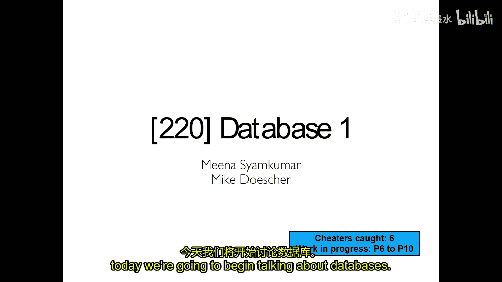
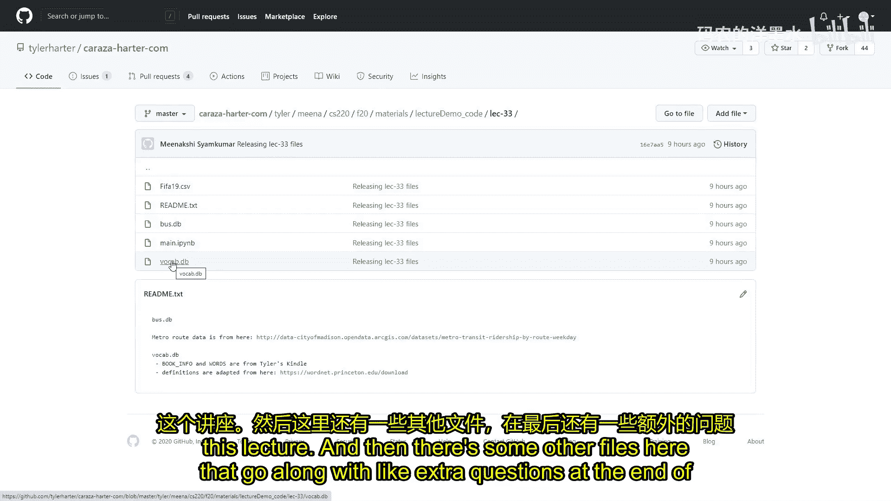
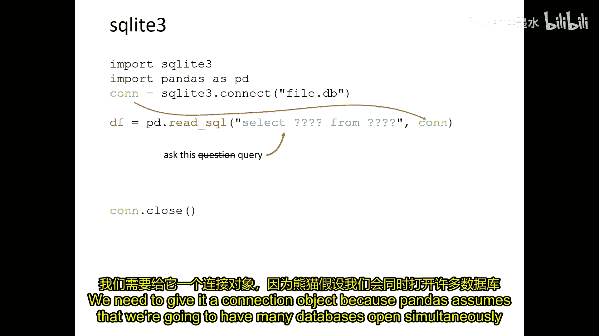
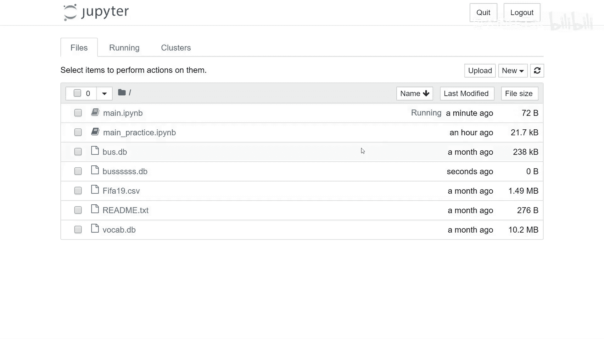
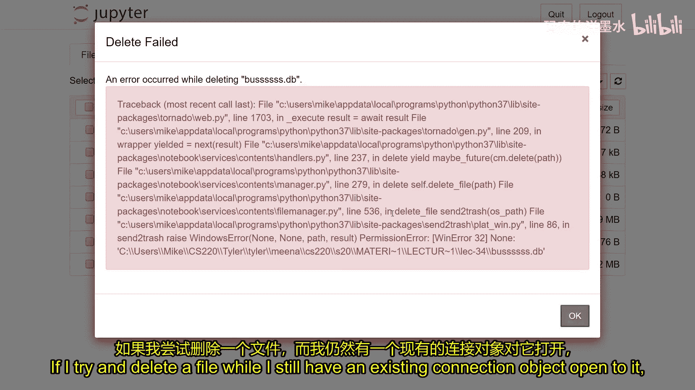
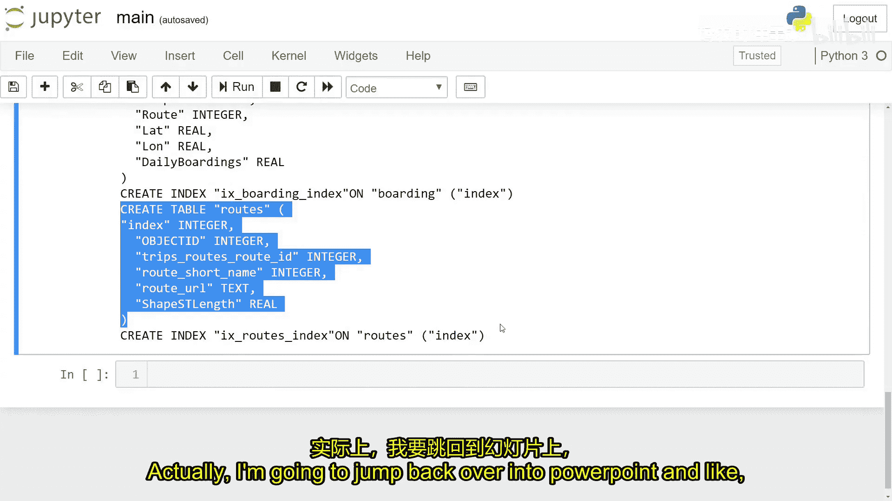
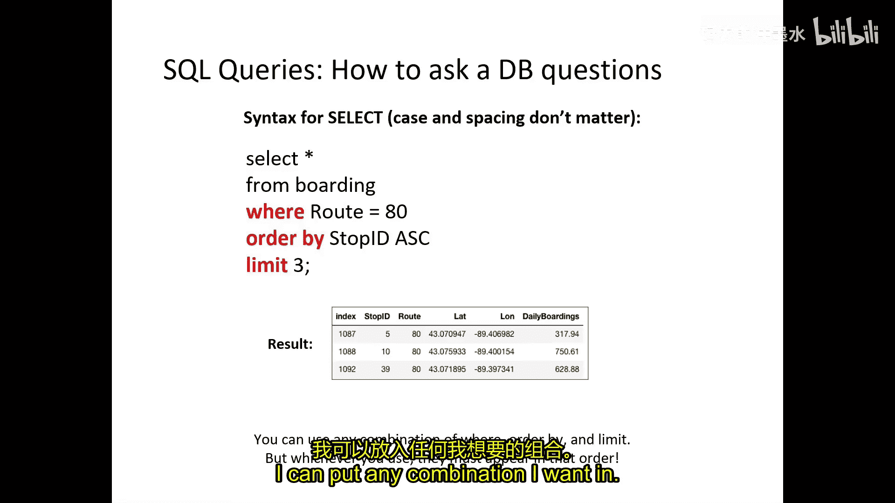
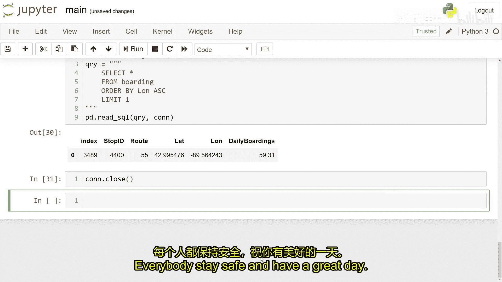

# 【全集】威斯康星大学-Python数据编程-CS220-中英字幕-1080P-p27-Lecture-23---数据库1-1--BV1VxvsBLEmv_p27-

Good morning， everyone。 Welcome back to data programming1。

 Today we're going to begin talking about databases。 As we get started。

 I go ahead and jump over to our web page。

Let's see right here， Data1， there's a code directory。

If I click that today we're going to be working with this bus。db。

 it's a database file for all of the examples main。

ipy and B is the file that I will be releasing to go along with this lecture and then there's some other files here that go along with like extra questions at the end of the PowerPoint slides for this lecture。

All right。So far， we've been spending a lot of time on Python code。

 and it's my hope that you guys take a lot away and can program Python for your other classes for your future career。

 That'd be awesome。 But there are going to be a set of you who use databases in your future career in your job。

 In fact， these next three lectures about databases might be the most important thing you take away from this class。

 In fact， one of the students last year。 who took this course。

 actually got a summer internship because she was able to know some things about SQL queries and databases。

😊，So databases are just large data structures where we're going to hold information in comparison to CSV。

Filile， we get one table， and it's a simple table。 Dataases are going to have many tables with a lot of structure。

 We're going to learn a couple things in this course。 Numb one， how to get data out of a table。

 and we'll be using pandas for that。 we'll be looking at how to take large data tables with lots of information。

 large databases and narrow them down to just one small table with the answer we want。

 And then in lecture 2 on databases， databases 2， we're going to learn how to summarize the data。 So。

 for example， if I have just a。A database with how fast hurricanes go。

 It doesn't actually have the average database。 I can't just the average speed of a hurricane。

 I can't just pull that out。 Soll， we'll be learning how to summarize the data。

 how to aggregate things and come up with more advanced answers to questions。Okay。

There are some things that we're not going to get to in this lecture。 First， schema design。

 that's what tables do we put into a database， what columns and how are those tables and columns related to each other If I've got two tables with the same column。

I should be able to connect those rows together。We're not going to look at data that change with time and things are updated。

 We're also not going to look at how to add a row or remove a row or change the table the database。

Third， we're not going to look at concurrency。 That would be two programs trying to change the data at the same time。

 If you can imagine two programs trying to write to a CSP at the same time。

 you can get a jumble of things as one rights and then the other rights than the first rights in the second rights and just a mess。

 databases deal with that with ease。 No problem at all。

 We're going to talk a little bit about performance。

 Why a database might be a better choice than a CSP file。And finally。

 one of the topics I would absolutely love to do would be join that's merging tables together。

 love to do this， but we're just not going to have time。Okay， so just for today。

 we're going to be taking a look at a couple things。

 We'll be looking at the how data is organized in a database。 you know， there're more than one table。

 what's it look like， how do we extract columns， What are the types associated with that data。

 We'll be comparing them to JSO and CSV files。And then second part of this will'll be looking at how to extract data from a database。

 So， and the keywords there are going to be select where limits or by from。

And those are the whatll we learning about。 We're going to be using the SQL light 3 module。

 Don't worry， this comes with Python。 It's already integrated。

And nothing to do there to go get a new module， and we'll be using pandas as our way to extract all of that information from the database。

Okay， so let's talk about the comparison between CSV and database files。 So on the left here。

 I have a CSV file。 note， it's one table and may or may not have a header we've seen in both ways。

 It's easy to read a text file。 You can just open them up in any text editor。 Take a look at them。

There are Python modules for importing CSP files and working with them。

A SQL database may have many tables and please notice that each table。

 for example capital capital here has a title Ps has a title CSV files don't necessarily have a title you might have a file name。

 but that'd be it and SQL all of the tables are named so we can tell it which table we want to look at。

Second， everything。 all of those tables have column headers。 Every column is named。

 so we can tell it which column we want on CSP。 that's again， optional。 Some of them have it。

 Some of them don't。 We've seen both examples of both。 All right。 columns are always named。Second。

Wait， third。CP files， everything is a string and sometimes that was a little challenging to work with。

 you had to convert the data and there was no guarantee that you know the population here。

 it's a string， but it could contain a number， it could contain words。

 it could be 1 million written now with letters everything is a string and when we use pandas。

 pandas was pretty good about trying to figure out what the columns contained and converting it for us。

 but that wasn't perfect。 For example， if you have a column like student Is， theyre 10 digit numbers。

 pandas might decide that we want that as a floating point number and display it to us in scientific notation。

Not necessarily the best thing。All right， in a SQL database， we can have。Several different types。

 we can have integers， text， whatever but。嗯。All of the data in any particular column must be the same type。

 We have to tell it what type it's going to be before we put any data in and we can't change it。

 we can't mix it up like you could with CSV or JSsonN file。 So in this column right here。

 for example， area of the state， this is a number。 we are not allowed to put text here。

 and these types are strictly enforced。Al right， Now this slide I've already talked about CSVs。

're all strings， databases， types are enforced。 I just want to compare to JSson a little bit。

 So in a JSson， we can we have types。 we can have， you know value being a string。10 is an integer 3。

14 is a float。 but there are some issues here too。 Check it out in line2 right here。

 I don't have an entry for B or C。 They're different or the missing。 And in the next row down。

 I've got A is V2。 That's a string。 B is 9。 That's an integer， but C is not a float like it is here。

 It's now a boolean value。 So I don't even have to maintain the same type。

 Datas will not let me do that。Al right， next， I'd like to talk about why you might choose to use a debate database over a CSV or JSsonN file。

 What are the advantages。 So first， you can imagine that multiple programs I've got program1。

 and program 2 may want to share a data file。 If they're reading from the file， it's no problem。

 Program 1 can read from it。 program 2 can read from it， they can both have it open at the same time。

 same deal with the database。 However， the problem comes in when we want to write to the file。

 I think I mentioned this a moment ago， but if program1 wants to write something at the same time。

 program2 is writing we might get a little bit from program1 a little bit from program 2。

 then a little bit from program1， etc cetera。 and we're going to get garbage。

Databases deal with this seamlessly， it's no problem。

 they have a mechanism to keep track of who's writing and what to do。Okay， next up。

Writing queries or asking questions about the data is much easier with the database。

 we can pretty much do anything in Python that we can do with the database。

 But to write code for this is a lot more complicated。

 It's a lot of work to write code to figure out which actor appeared in the most movies。

 That was one of the problems from the most recent problem set。And you guys did it。

 there was no problem。But answering those very same kinds of questions with the database is significantly easier。

 It's just one line。And we'll be okay。 so the key there is we're going to need to learn a new language。

 SQL structured query language in order to formulate those questions in the right way so that the database actually provides us with a meaningful answer。

Okay， and second。Wait fourth。 I was up late last night。 Four performance。

 So I'm not gonna talk a lot about performance， but databases a lot of times will be far superior to retrieving an answer compared to using Python to write code to go through。

 So just as an example， a little game here。 So I've got some data here in a table。

 And I haven't actually shown you the data。 I've just got question marks here for right now。

 And I'm going to ask two questions。 How many people are age 23 or younger。

 And then the second question is how many people scored 23 or less on the exam。 Okay。

 so I'm gonna click。To the next slide， what I'd like you guys to do， Applause for a second。

 Go get your cell phone。 It's got a timer on it。 I want you to answer the first question。

 How many people are age 23 or younger。Ready， set。Go。Okay， excellent。

 Hopefully you guys actually took the time to do that with me。 Jot that down somewhere。

 And now I'm gonna ask the same question。 but for column 2。

 how many people have scored 23 or less readyy， set go。

So what I would expect that you guys would find， and it doesn't always work out this way。

But is that the score column， if you recognize that all of those numbers already sorted。

 was much faster to figure out how many people scored 23 or less。 The age column。

 everything was all mixed up。 took longer。 So the question is。

 why answer is pretty simple to answer the question about age。

 You had to look at every single number。 I had to check out the 26， the 22， bh， bh， blah，22。

28 all the way down to the bottom。 in order to answer that question。

When I recognized that the scores were sorted。I could stop as soon as I got tallest here。

 He's got a 23。 Everyone else has a number bigger than 23。 So it takes， you know。

 approximately one third the time to figure out the score after I recognize it sorted。Okay。

 so databases have the advantage that they can actually keep multiple copies of the same data。

 some sorted in different ways。 And this organization is called indexing。

 I wish we had time to go into that a little bit for now。

 we're just going to take advantage of it and know that it's there behind the scenes， but。

For performance， databases do a lot of stuff on the inside that is just completely hidden from us。

 And the database will then choose which form keeping the data in to best answer the question as quickly as possible。

Okay， those were some of the advantages of choosing a database。

 why we might want to use one Now let's talk about why we might not want to use a database。

 why would we choose something simpler databases are complicated and it's often overkill if we only have 100 items in our CSV table both of them will perform blindingly fast。

 nanoseconds and we can't tell the difference。And for many situations， JSON files。

 CSVs are simpler and just straight up easier to use。

 It depends on the kind of question we're asking， and it depends on how big our data set is really large dataset sets。

 we're going to want to take advantage of the performance from databases。

But we may not need that extra complexity。All right， next up。

 I'd like to introduce you guys to some common SQL databases。All right， the first up。

 we have Microsoft's SQl server and Oracle。 Both of these are products that you would buy。

 They're very expensive， full featured， very powerful。 The next two my SQl and Postgre SQl。

 are both free。 They're open source。 very popular also And finally。

 SQl light is the one we'll be using in this course。 Also full featured very popular。 You know。

 the guy who wrote this actually regrets naming it SQl light。

 It makes it sound like it's not complete like it's missing features。 It's not。

 The advantage of SQl light over all of these others is that the license is very permissive。

 We can take the code for this。 We can modify it。 we can turn into a product and then we can sell it。

 It comes bundled with Python and it's available。 many， many， many places。

 Every Android device has it。 iPhone has it。 Maxs have it Windows 10 all the way down to Dropbox。

 It's available in billions of different products。😊。

It's easy to use and install it straight up comes with Python。 It's in the public domain。

 we can change it。Billions of deployments。Next， let's take a look at the data set that we'll be using for today's examples。

 This is the Madison Bu data from their website。Madison actually keeps a lot of data available free to the public for us to use。

 but anything that's not really private， in fact， they have a database for every single tree in Madison that they maintain。

Anyway， this is a database that shows all the places where you can get on the bus。

 how many people get on the bus at each one of these stops and。The routes that they dig。Al right。

 let's take a look at the。At the actual data there。In our database， there's gonna to be two tables。

 The first one is the routes table。 It shows all of the different route Ids， the short route name。

 that's the one that actually appears on the sign。 the URL for that bus。

 And then some extra information。 The second table that we'll have is the one that actually has the daily boardings。

 So in this case， we've got latitude and longitude of all of the stops， the actual stop I D。

 what route they belong to。Again， latitude and longitude， and this is the important part。

 how many people get on each stop per day， and this is an average 1。03 people， you know。

 people coming into their numbers， but it's averaged over 12 days。

So the next question that we want to ask is how can we get stuff out of this database。

 How can we answer meaningful questions？So we're going to be using some new modules for this quick review some of the modules we've used this semester so far。

 we've used math。 We used collections。 that's where we got named Tbal from JsonN and CSV to load files。

 This was the module where we able to get RrgV to use command line operations。

 We talked about OS briefly。 we used that for。The path and to find out if file exists。

 things like that， copies where we found a copy and deep copy record class was the modifiable versions of Ts。

 we used requests when we are looking at HTML beautiful soup coming up soon。

We talked about pandas tools for working with tabular data， and the new one today will be SQL L 3。

 and this is going to allow us to directly access the SQL databases。

 comes with Python and integrates with pandas。Okay， so three ways we can use that。

 I have my table in my database here in red。 I've got two tables in there。

 I can access these tables using the SQLite 3 tool directly。 It comes available on a Mac。

 if you want it on Windows， you have to download it。We can also use it directly with Python。

 so I've got the Python SQL I 3 module here goes directly to our code。It also interfaces with pandas。

 so I can take my route table， use SQL L3 module to load it， import it into pandas。

 And that's going to give me a data frame。 And I thought this would be a great way to review using pandas。

 It's very powerful。 And I only want to teach one of these ways。

 Youll learn the same amount about how to use SQL databases， regardless of which method I choose。

 So this one just seemed like a good idea。😊，Okay， so the very first thing we're going to need to do when we start talking about this is import sQL light 3。

 So we'll just put the import light in。And then we're going to need to connect to a database file。

 This is the equivalent of reading a file with the SSV file， or。

Json or any text file willll need to open the file for reading。

 and the command for that is SQL I3 connect。 And this is going to return a connection object that we can use to extract the information from。

And we'll need to give it the file name if it's not in the directory。

 make sure you use OS path join to get the path that's going to be system independent The other thing I'd like you guys to notice is if we were opening a file。

 we would have to put in the W to write for the file。

 we'd leave it out if we just wanted to read the file database SQLite3 databases and take care of that for us。

 it's just going to automatically determine whether the file exists。 if it doesn't exist。

 it's going to create it if it does exist。 It's going to create that connection to it。

 and it knows whether we want to read or write to it。

 It's not going to just wipe out the entire contents of our file if we accidentally include the W。

In fact， they won't let us put the W in。Okay， yes， when we opened the file。

 we would get a file object that we could read from， we could get data from。 This is a very similar。

 we're going to get a connection object。 It's pretty much the exact same thing for databases as we saw for files。

And because we opened files， we also needed to close them。

 We'll need to do this exact same thing for connection objects When we're done with it。

 we need to close it。Alright， once we have a connection object。

 we want to be able to ask questions about the data。 So in this case， we'll be using pandas。

 So PDd is the common abbreviation for pandas built into pandas。 We have a read S Q O function。

 This is going to take our query。 the question we want to ask where we're going to be selecting information。

And which connection object we need to give it a connection object。

 Because pandas assumes that we're going to have many databases open simultaneously and it've got my bus dot Db file。

 This is the one I'll be accessing for my demos。 There's some other files here。 Poab do Db。

 for example。 The other examples at the end of the slides ask questions about this that would make great practice。

 Speaking of practice。 You can see here， I did practice my lecture。

 So hopefully this will go smoothly。 What I'm going to do is I'm going to open a new Python 3 Note。

 We'll get that named。😊。

Main。And then I'm going to post put a copy in my。Full screen text so that I can actually use the entire screen。

 Alright， now to them。And in order to get started， we're going to need a couple things。 First up。

 we're going need to。Import。S by 3。And we'll be using pandas to access that as PD， very good。

Get those loaded。 Things looking good。Alright， so next up。

 we'll be creating that connection object to the database。 So that's con。Sigilite 3。t connect。

And then I need to give it the name of that data file， to database。 It's in the same directory。

 so I don't need to do anything fancy with join。And we can take a look at this。

Oh it returns a connection object。 tells me it's from sQel I 3。

 and it gives me the memory address where it's stored。 just real quick。

 I did mention that if the data is not there， if the file is not there。For example。

 if I miss spellll Min， everybody see the typo， if I miss spellll the name of my file。

And then I try and run this。 It will go ahead and it will recreate create a brand new file。

 me see here。And go back over here。 See in my directory， I now have bus at Db。

I don't actually want that， so check this out。

If I try and delete a file while I still have an existing connection object open to it。

 it won't let me do that。 It gives me an error。 So let me pop back over。

嗯。Close the object， Oops， typey  O。Run that。 Now， I believe it let me pop back over here and delete this。

Yeah， no problem， okay。Let me pop back into。Jupiter notebook， I'm going to open this one more time。

 Let's take a look at what's inside this empty connection object， our empty database object。

 So before I close it。The command to start looking at database， I'm going to pandas。Ben SQL。M。

Then I need to ask a question and I need to tell it。Where to go look for the answer for that。

 So that's going to be the general form of all of these statements for the rest of the lecture。

 once I have a connection open。The query here is a string。 So I've got that in string。

So let me just go ahead and make a copy of this。And turn this one into a comment so that it's there for review。

 And when you guys open the notebook after class and try to figure out what I was doing。Okay。

 I name my connection object K， so that'll be easy。Next up， the very first query。

 and this is just one that you guys should memorize。It will be select star。

 Star means I'm getting everything。From。SQL light master。

 So this will read everything from that connection object。And in this case。

 I have my broken connection right here。Because I， it's not broken。 It's just to a file that's empty。

 It just created a new file。Normally， that would show me a list of all the tables。

So let me actually go back。We'll run that cell and do it the right way。So first up。

 what I'd really want to do is assert that the path the file actually exists and take care of all of those little trouble。

 right from the beginning。 I did an lecture on error handling a few lectures backs。

 this is a great review。 So what I'm going to be doing is the path to my file is actually pretty simple。

Plus IGB here， let me spell it。Incorrectly， but different this time so that I can show that the assertion actually works。

So we'll give this a try now， creating a new file I'm going that it exists。

 It doesn't oh wait a second。I need to import O S。 So check out the error message name O S is not defined find。

Scroll back up to the top。 It's good to put all of your imports at the very top。So added that。

 ran that cell again。 Let's try this one more time。Okay， yes。 now we have an assertion error。

 that file does not exist。2、 so。Let's put it back to the row one， assert that it exists。

 and now I want to open that connection。I'm going to type every single line over and over again。

 I know that slows things down。 But I believe if you guys are doing this。

 just building that muscle memory helps you remember better what needs to go in each of these lines。

 So I'm going to create that connection object and then print it out again。And again。

 I have a sQL connection at a different memory location。Okay， so next up。

 I want to do the same thing to just take a look at everything in there。I'm going to use my read SQL。

 I need that query here。There we go from SQL Let master。We cannot now run this。

 And then it's gonna to tell me information about the database as a whole。 S Ql。

 I read SQL from pandas。 It's creating a pandas data frame。

 So I hope this is recognizable from the pandas lecture。 It's got a number of things here。

 So the type here。 the type column is telling me what type。 Each of these objects are。

 The important ones are going to be these tables。 It also has some indexes that will be not be talking about This is for performance。

 how things are sorted。 Each of these gets a name。 So the name of the table is boarding。

 And the name of the route table is routes。 Those are going to be the important things where we look things up from。

 And then this part over here is the code that was used to create all of these tables and indices。

 So let's take a look at those in a little more depth。 So let's see First up。

I'm going to just save this into a data frame so that I can access this table a little more easily。

So。I'll do that and print it out。 There it is a second copy of the table。

 And then let's just take a look at that S Q L column。

 So hopefully everyone remembers how to access columns from a data frame。 I can just do it like that。

あん。Actually， hold on one second。 Let me print out each of these lines independently so we can see everything without those dot dot dot。

 So to do that for something。I guess this is really the code that was used to create the data table or the database。

 So let's call this code in。This sequence。IOops， we got my colon， would like to print the code。

 Let's see what that gives us。 Alright， excellent。 Okay， so this very first piece right here。啊。

He's going to tell us。Now we're creating a table。 It's called boarding。 It's got these features。

The second thing we are creating an index from the boarding table。

The third thing we have here is the second table。 Actually。

 I'm going to jump back over into PowerPoint and like highlight some of these things。

Okay， so here we are looking at the code that was used to create this database。

 And we have two tables here。 See we have two in red there， create table， create table。

 And here's the title of those tables。 So we're creating table with。One called boarding。

 and one called routes。The next thing I'd like you guys to notice is that we have all of these column headers in the next thing during quotes。

 so the boarding table is going to have columns for index， stop I D， route， latitude。

 longitude and daily boardings and。Dregan exist within the parentheses。Here and finally。

 we'll close that up with a semicolon。And next， every single one of these columns has a type that the data must be。

 And this is strictly enforced。 So the index column must be an integer。 Stop by the and route。

 also integers。 Latin lawn are going to be reels。 So please notice a couple things。 In Python。

 we would call an integer and int。And。The real numbers we would call floating point numbers。

 every single programming language is going to use a slightly different variation to talk about numbers。

 talk about types the primitives that are available。

 and so these are just the ones that are used with SQL。Allright， next up。

 how do we actually get information out of a database？

 So this is the idea is that we're going to be narrowing down a large collection of data to just the piece that we want。

 So a database for my example here has three different tables。

 And if I want to access just table 3 and get some information out of that one。

 the keyword I'm going to use is from。 And that's going to let me tell which table I want to get the information from。

Okay， the next thing I can do is select columns from that table。

 I don't need every piece of information there。 I just might want the the stop and the number of people to get on。

 I don't。 I might not care about the latitude and longitude of that stop。

 So this is going to be a way that I can select columns。

 So select is the keyword when I get columns out。And then I can further narrow this down。

 Suppose I only want。Stops along routeute 80。 so I can go ahead and use the keyword where to give it a like it's like a test。

 an expression， Boolean expression that says keep these rows dumpt the rest。

 And this is going to create an even smaller table。

 I'm going to get rid of all of these rows that don't match whatever my criteria are from the where function。

Next up， and the next keyword is limit。 I can say， well， I don't need all the rows。

 I just want to look at a sample of it。 You know， only show me the first three。

 That's what fits on the screen。 Or perhaps I've sorted them。 and I want to find out who， you know。

 what actor made the most money so I can sort them descending by salary。

 And then I can limit it to one。 that'll give me the maximum。So at this point， this is my selection。

 I've narrowed it down to a table that has these four cells by choosing a table。

 by choosing columns and by choosing rows， using these functions。Okay。

 so the syntax for formulating an SQL query is very specific。

 These words must come in the right order。 But please notice that case and spacing don't actually matter。

 So the keyword is going be select。 this is the one that's going to let me choose columns from。

 and this is the one that's going to let me choose the table to be honest。

 I firmly believe this is backwards。 I would much rather see from come first。

 because I'm picking a table first。 And then I want to select columns。

 but that's not the order that the designers of SQL shows。 This was a human decision。

 And I don't think it was for the best。 Other database querying languages out there do have this reversed。

 So。But this just is how it works in SQL。 And then also notice that SQL queries end in a semicolon。

 If you're officially using a SQL light， you'll need to put that in。

 Padas does it before it's automatically。 So to be honest。

 I'm pretty bad about remembering to add the semicolon。 So Pada takes care of it for me。 it works。

 And I don't even need to know that it's。Not present。 Okay。

 so another thing we can do just to organize this a little better。

 SQL doesn't care about extra spaces， just the words， and they can be uppercase， lowercase。

 So I can actually put my query and spread it out over multiple lines just to make it look good as I'm writing it a little easier to read。

 So I'll be doing that in a second。And then finally， we've got selected from those are mandatory。

 I need to tell it what I want to get。 Then there's a bunch of optional stuff that I can put in。

Alright， so rewind a second。 Let me tell you a little bit more。

 from is going to require the name of a table。So for example。

 if I want to know how many people are getting on the bus。

 I'm going to be selecting from the table boarding。

And then I need to tell it which columns I want to get。 So star will get me every single column。

 It'll give me the whole table。 So here's the resulting data frame produced by pandas。With index。

 stop I D， latitude， longitude route number of people that got on。 Now。

 if I really only care about daily boardings， I can just put that in。

 if I want to know which route they belong to， I can just make a list of things that I care about。

 and it'll create a new data frame for me with these columns。A right next up。

 how do we select particular rows。 So select star gives me all of the columns in the table from the boarding table。

 So if I want to ask a specific question， I want to narrow down the number of rows。

 The keyword there's where。 And now this is going to look a lot like a boolean expression。

 I need to say where route。And that's the name of a column is equal to some condition less than greater than in this case。

 I'm selecting Route 80。 Check this out。 So an interesting thing about SQL is that they only use one equal sign for the equality test that operator that decides if two things are the same But note that in Jupyter notebook I was playing around with this a little bit。

 the double equals does indeed work， I don't know if pandas is correcting that for me。

 or if the newest version of SQL light also just accepts double equals。

 but I didn't have any trouble with that。So feel free to continue to use the equal sign like we would use in Python for this。

Okay， next up， this is the new one。I have the power to sort my data。🤧。

To make it a little more useful。 So the keyword to sort the data is order by。

 and then I need to give it the name of a column that I want to sort by。 I've got two options。

 I can as descending。 This would mean the largest number is going to come first。

 or I could sort ascending。 This is the default version。

 and the keyword to force it to be ascending is A C。And finally。

 to limit the number of rows that this is going to show me is a keyword is just limit。

 and then I need to follow that with a number to tell me how many rows I want to get and it's only going to show me the top well。

 three in this case rows or the top end， if I put in a different number。Alright。

 so those are the three optional keywords that I can add They're in red where order by limit。

 and please notice that they must come in this order。 In fact。

 select from where or limit must come in that order。 The order is very specific。

 but I can use any combination if I don't need to know if I don't need to limit the rows。

 I can leave off the where route equals 80 and still just order by the stop and then chop it down to a limit of 3。

 I can put any combination I want in。

Al right， just a quick review， I have opened a connection to the database， my bus dot database。

 and then I took a look at the overall summary of the everything in the database。

 giving me the table names and some information about how they're created that's going to tell me what columns are present and that's just this select star from SQLite master is just memorize that one。

Okay， and then I messed on a little bit and looked at what tables are present。

So now suppose I want to actually dive a little deeper and get some data out of this So that I'm going to use pandas。

 and there's a read SQl function that's going to take my query string and where I want to get the data from。

 So in order， I'm required to put in select。And I need to give it something。 In this case。

 I want to look at all the rows。And I'm going to look at the routes table。

So let's take a look at this。 So this is pulling up that table。 I see that I've got。Ids， route Ids。

 the short name， This is the one on the sign URL for that bus， some other information。Okay。

 this is kind of a lot of information。 so I could。Oh， hold on a second。

 This is actually a pandas data frame。So I can use pandas functions for data frames like head to limit the number of entries so。

 you know， now it's nice and fits and doesn't have1 thousand entries in it。The other thing I can do。

Actually， wait before I move on， let's take a look at the other data table。

So I want to that one was called。40。I believe boarding the G from the connection object。

 Let's see if I got that right。 Yeah， so this table is going to have the stop I Ds。

 what route they belong to latitude， longitude and how many people got on the bus at those stops。

So next up， I want to talk a little bit about how to ask questions。For example。

 how many people get on the bus。 Let me shorten this up。

 So the other way I can shorten up how much is here。Let's literally lament it to five rows。Oops。

There we go。 Okay， so now it fits on the screen。 It's nice。 two ways to do that。All right。

 so what I'd like to do is ask the question how many people get on a bus every day in Madison？🤧。

So for that， I'm going to need a couple things。So first up。

 let's go ahead and just get all of the the daily boardings for every stop。

 and we'll just add those up to figure out how many people get on a bus。 So to do that。We will。

Select， and I want the daily boardings column。Daily boardings。 And then I want。This table the。

Boarding table。 And then I need to tell its from this connection object。 Let's take a look at that。

 Okay， in fact， one more little detail right here， let's do。

So I told you a moment ago that I can take my query and divide it up over many lines to do that in Python。

 I need to use the triple quotes there。So there， now I can keep these query items a little bit separate。

 They've got to go in this order。 So firm is going to tell me which table select will give me the columns。

 and then I can just put in my string。Which is stored in the variable query。 There we go。 Okay。

 so this is giving me back a pandas data frame。 So for the next thing that I'd like to do is actually be able to add up those numbers。

 So if you remember， I can take a pandas data frame and turn it into a series by selecting just one column。

 So let's go ahead and do that。So to do that。I'm going to go ahead and let's see what we call this。

 We're getting a series。Yeah we'll call it bus riders equals。

This part is going to give us a data frame。In fact， let's do it this way。

 I'll call it data frame equals that。Then we'll be extracting the column。With quotes。Whoops。

 earlier here，typo。Daily boardings。Take a look at this。Yep， there we go。 So now it's a series。And。

Now， I can call some on that series and figure out how many people ride the bus every day in Madison。

55000。 all right， Hol on a second。I just wanted to see if that actually made sense。

 so I pulled up the population of Madison and did a quick search。

 found out the population of Madison is almost a quarter million people， so 55。

000 would be about 20% of that。I think that sounds reasonable。

 It's probably a lot less than that now that we are experiencing a global pandemic and everyone is quarantined。

But。All right， so next up。Aan， switch back over here。 So I think that number makes sense。All right。

 let's ask a different question now。 Let's say that。We are headed west。

 and I want to know which bus should I take to go as far west as possible。Just as a side note。

 this is the。Smallest longitude。Question， okay， so I'm going to create a new query and。

I'm going to use triple quotes so I can keep this organized。 I'm going to need a select。

I'm going to eat from。 Those are mandatory。 And then at the end of the day， I'll be calling pandas。

To read。SQL， I'm going to ask it my query and from connection。Okay。

 so what are some of these things that I want to do， I want to select。

 let's take a look at everything from onboarding。Alright， so that's going to give me everything。 Oh。

 the column I want to take is actually longitude， so。Let's order by longitude。Then， that's L O N。

Do that。 So the default is ascending， and I want the smallest one anyway。

 I'm going to throw this in to remind ourselves that I can sort by descending or ascending。

And then I want which bus I should take， which one。And when I say which one。

I'm actually going to limit it to one row。 And this is going to tell me that I want to take routeute 55 going west to get as far west as possible。

 It's going to have these latitude and longitude coordinates。And again， hold on one second。

 Let's go look up where this is。Alright， so I copied those。

 I jumped over into Google Maps and pasted them into the search box。

 and that should show us exactly where the westernmost route stop is right there。epic。

 that makes a lot of sense。 Alright， so it's definitely in Madison。 Looks like this is working Also。

 it's on the west side。So。Let me pop back over here。And。Oh， oh， oh， hold on。

 This is the end of the lecture。But I do not believe I close my connection。

 I'm going to just wrap up closing my connection。 I probably should have written that line second right immediately after opening the connection。

 Al， if you guys have any questions， post them on piazza。 Everybody stay safe and have a great day。😊。

