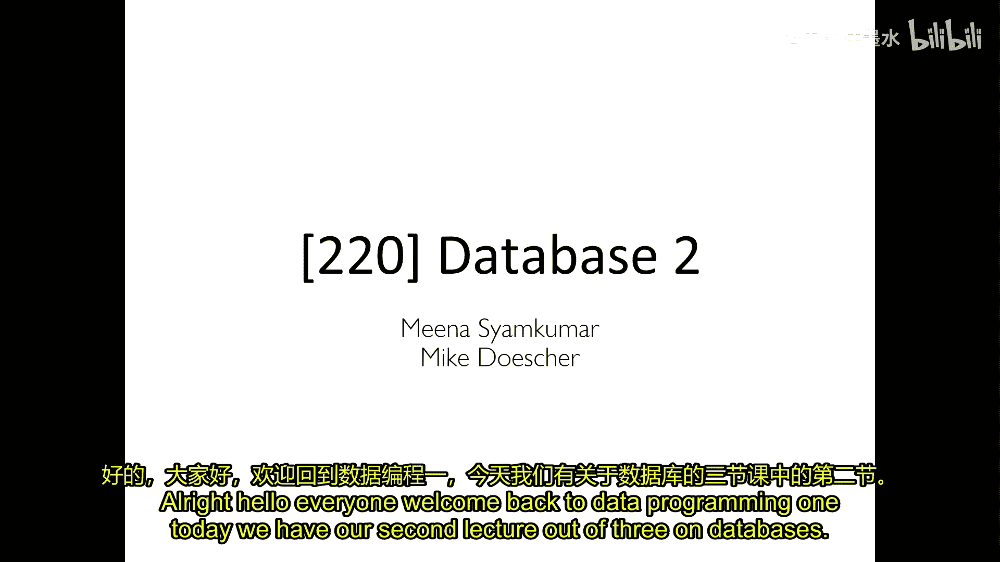
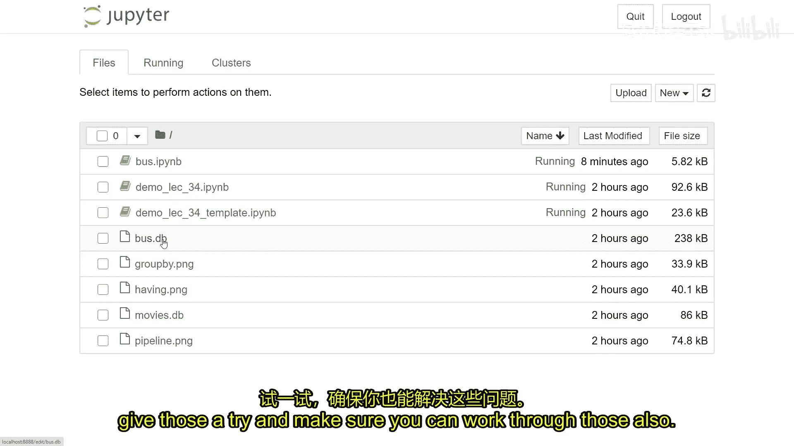
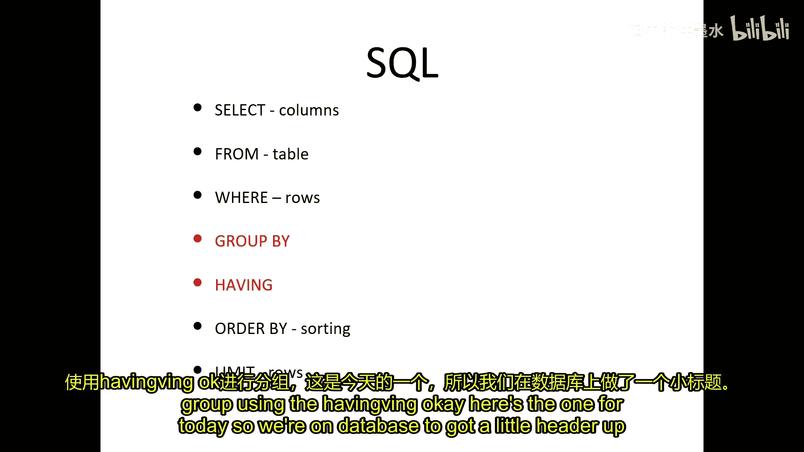
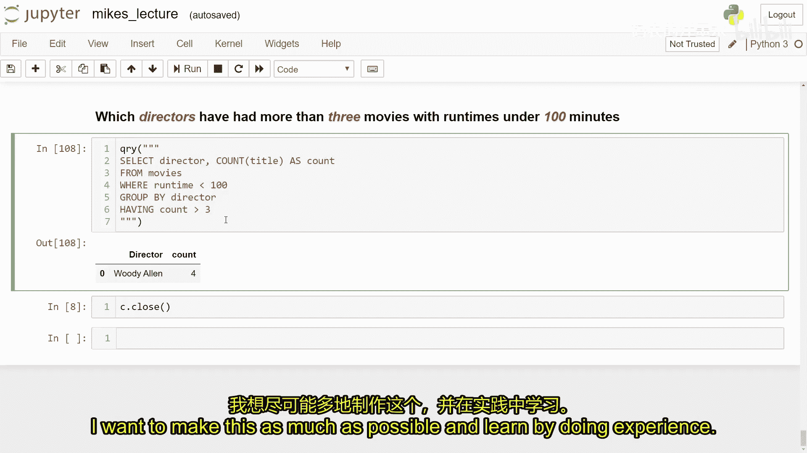

# 【全集】威斯康星大学-Python数据编程-CS220-中英字幕-1080P-p28-Lecture-23---数据库1-2--BV1VxvsBLEmv_p28-

All right， Ho， everyone。 Welcom back to data programming 1。 Today。

 we have our second lecture out of three on databases。

Let me go ahead and pull up the code directory。 So as you guys got get started。

 today's lecture is designed to be a guided learning activity。

 It's not designed to be something you can just kick back and watch。

 So go ahead go download all these files。 You're gonna need the template。

 This is the one you'll fill in the way you should use this is you should watch a little bit of the video pauseuse the video at the right time。

 and you'll know when that is because it's right before I do the problem and try and do this yourself。

 If it's a new topic I'm introducing， go ahead and watch the first example。

 then for the second example， pause it and try and do this yourself。 All right， the answers。

 I believe these are from Mina's lecture are up here。

 So it's not gonna match the video exactly but they they're all the same problems。

 a slight variation on the solution。 the way she wrote it。

 You're going need the image files group by having and pipeline in there for this to render all the images So you can follow along。

 The database that we're gonna be looking。😊，For these practice problems during the lecture is the movies database。

 you'll need that one。 And you know， at the end of every lecture。

 we always have extra practice problems。 That's what this bus notebook is。

And the bus database here ask some extra problems about these。To give you more practice。

 so definitely go ahead and after the lecture， give those a try and make sure you can work through those also。

All right， I've got a ranch just a little bit。 Forgive me。

 I just need to like vent a little steam here。 I got up yesterday。

 this Thursday morning and I got started on my email around 10 AM。 I had some other things early on。

 and I didn't actually get caught up。With the last email until 7 PM。 Now。

 I had office hours in there。 I had some other meetings。

 There was some T A selection stuff for the spring。

But I spent the vast majority of my day going through my email。

 and a lot of those emails were about debugging Python code。

 And many of them began with the sentence。 I went to the T A and the T A couldn't figure this out。

 Now， I've been to office hours。 And I'm not surprised based on what I'm seeing from a lot of the the code that's coming in people asking questions。

 So in order to， and my guess is the T A couldntfi out in the time they had available。 the long。

 the lines are are long。 The waits are long。 I know that everybody walks in frustrated。

 But here are some tips that I would like to share with you guys before you come and meet with me in office hours。

 I'd like to see this stuff happen first。If you're working on question 19。

When you come to office when we first get started， copy the question right at the top of this for me。

 because I don't remember Q19 is。 I know you've been working on it for six hours and have the thing memorized。

 but I don't remember what it is。 I also don't know which project you're asking for help on。

 if you just start out with a Q 19 doesn't work。 I don't understand。 So I'm looking at like。

 usually about 30 lines of code that don't tell me which project this is or which question it is。

 go ahead and copy that right there and remind me。 We've designed the handouts。

 you can just like copy and paste the whole question line。

 It's even got the pound sign and the queue and the number。Do that for me。 All right。

 The next thing I notice is I'm usually looking at about 30 lines of code and not one of those lines of code is a print statement where you've actually tried to like print something out just in the middle。

 I think early on in the semester， the problems are short enough。

 They're simple enough that you can just write a bunch of lines of code and solve it all at once。

 without having to break it down into simple pieces。

 So the goal here is we're going to be tracing through your code。 So start at the beginning。

And just every other line or every time you do something significant。 or even minor。

 every time you do something minor， print out the variables。

 print out which line just executed in particular， this is a problem in the try， accept clause。

 If you just have a try， put some code there， something fails， there's an accept。

 and you put in pass or continue。 you have just hid all of the problems。 And not even told yourself。

 And if you're getting， you know， I see a lot of empty lists because someone has an accept clause that doesn't print anything。

 and just never bothers to do the real， you know， the code that they want to have executed。

 So don't if you're debugging do not put a pass or a continue or something that's going to skip or just an accept clause without a print statement。

 If your code doesn't work。 If you're debugging all accept clause must have a print statement in them。

 So you know that it goes there。Alright， so next up。Usually， when you guys come to my office hours。

 I really do enjoy the like the process of finding the mistake you made。

 but that's not really doing you a lot of favors as an instructor。

 So I'm trying to get away from that habit that I've got。

 And I think a lot of us have that on on the team。 So what I want you guys to do instead is be able to tell me the strategy that you're using to solve this problem。

 So these the last couple problems in these like last couple problem sets of the year。

 they're longer。 And you need to break it down into some steps。

 I would like to see your strategy in the comments section。 So just put a comment。

 And then tell me what the the goal of these next couple lines of code is for。😊。

And one of the things that I'm noticing too is that the problem may not be in the current cell。

 So put a comment in， then call the function that's going to go somewhere else in your code and usually like much earlier。

 some of these things like we're reading in files。 So the code that reads in a file might be at the very beginning of your notebook。

 And on question 19， you're like pages and pages of a code down。

So it can be hard to trace through this， especially if you have multiple versions of different functions。

 You know， you wrote something， it didn't work， but you didn't delete it。

 and then you wrote another version and it kind of worked for a different problem and you're trying to use that again。

 but then you see you didn't even need a change。 so you made a third copy of it。

 it can be really hard to show me exactly what the code is doing。

 If you've got multiple versions of functions。That have small changes。 So I'm going to say simplify。

 delete things you don't need。 if you have an extra function that you've copied and pasted and changed it a little bit。

Make sure there's only one function。 If you're writing some code， you know。

 you've got 30 lines of code for question 19 and you've like。

 some of them are experimental and you decide you don't need them later before you come to office hours。

 get rid of those。 because if I'm trying to find a bug in your code。

 I've got to read all the lines that， you know are not the problem get rid of those for me。

 And now some strategies for just writing things。Run your code every time you make a change and print something out。

 you can see that whatever change you made did something。 just were at one line at a time。

And if you need to go ahead and start over， it can often be much faster for these problems to just scrap it。

Go ahead， outline your brand new strategy that you're going to try， put them in comments。

 and then fill in all those pieces。Rather than trying to track down a mistake somewhere in your code。

All right， end of rent。 I apologize。 Wanting to get that out there， I think。

What I'm seeing is that I'm just， it takes me 40 minutes to solve like a question like number 19。

 if there's a bug， it's a longer question， we get a lot of like people。

 students who call functions earlier and usually the problem is in an earlier function。

It can just be really hard to find it in a meaningful， you know， in enough time。 So。

 and I know I've like run out of time helping people and told them to just put your name back in the queue。

 if you can't find it。 Here's some strategy for solving the problem。

 But I just want to get this out here。 And hopefully this will make your office style experience a little more productive。

All right， on to the rest of the lecture。Allright， so today we're going to be continuing with SQL please remember just a quick review as we get started that we're going to be using pandas。

 So I've got Pd here and the command to access SQL light through pandas is read SQL。

 and then that requires two things。 a question or a query。

 a SQL query and then the connection object。 So we've got four things here that are essential for narrowing down a data table to extract a piece or a subset of that information。

 just want to quick review what they are and then we'll go do some examples where we use these。

First up， the important one is from。 That's what's going to happen first。

 even though it's ordered second when we have to put it in。

 that was a design decision made a long time ago by people。

 and I'm not sure it's the best to put it in second position。 But anyway。

 so this is from is going to tell us which table we are grabbing data from in a database that has more than one table。

All right， next， we're going to be selecting columns。

 so the select is going to narrow the table down by to a subset of the columns。Third。

 where is going to take a boolean condition。 You know， it's going to ask a question。

 And for each of the rows， it'll be either true or false。

 And for all of the rows where that question is true， we're going to retain those。

 and we're going to eliminate all of the rows for which that question is false。And finally。

 the limit option is going to take another parameter， a number。

 And that's just going to say only give me， you know， limit 3 is going to give me three rows。

 Limit 10 is going to give me 10 rows。 So I'm not overwhelmed with data。

 if I just want to take a look at things。Okay， we also， so these are the narrowing down。 Yeah。

 select those columns from choose the table where and limit， narrow down the rows。 Allright。

 we also have a fifth option order by， and this is going to be the one that takes care of sorting for us。

 and there are two versions of that we can sort by ascending order where numbers go smallest to largest or descending where they go from largest to smallest。

And today， we're going to be adding two new functions Group by and heaven Group by is essentially what we saw with bucket tie。

 where we're going to take our data table and break it into smaller data tables。

Where all of the rows have something in common， we'll be grouping the rows and then we can do some sort of aggregate statistics on we can sum part of the data or for each think about it like buckets。

 so if I have a group of buckets， I can take each bucket and I can comm the sum of the data in there in each of the buckets。

And then finally， having is the new way we're going to be using that to filter out particular groups so we can select I guess narrow down by group using the having。

 Okay， here's the one for today So we're on database too got a little header up at the top we just let me just walk through this a little bit give you an overview of what's going on。

 So I've got my import functions。 I've got my change the way the display looks。

 You can ignore that we'll be connecting to SQLite database。

 we'll be reading it in and just looking at SQLite masterster and then。

I've just got a bunch of questions here。 So， for example， some review questions。

 what movie in the database has the highest rating， what director has the shortest movie。

 The kind of things we did with the hurricane project and the movie projects。

And then we'll be taking a look at these new functions， the sum average count minmax。

 things that will take a column of data and give us a summary back， some aggregate data。

 things like counting the movies， count of directors， adding up the total revenue。

And then we'll take a look at grouping。 So we'll come up with this is the bucketized version of things。

 You know， per year。 So we'll bucket by year。 What is the total revenue。

 How many movies by each director， So we'll bucket by the directors and do some of those。 All right。

 But that's kind of the idea。 So let me start at the top here。

 I'm gonna run this first cell to import sQelite 3 and pandas。Alright， this。

Sell right here does two things。 It's going to change all of my styling。To red， In fact。

 you can see that down here at the bottom where I've got which movie has the highest rating。

 Just a little flair。 I got this from Tyler。 I think he was mostly just showing off。

 but I really like it。 So I'm going to keep that。 And the second part is the use the extra width。

 Use the full screen。 Just for the video， it looks better。 You guys can see more of what's going on。

😊，Okay， and then this next piece here， we will connect to the movies that D。

 and that's going to return a sQL like connection object at that memory address。 Allright。

 very good so far after that。The first thing we should always do when looking at a new database is just memorize this。

 select everything from SQelite master。 This is just going to give us a summary of all of the tables。

 It requires that connection object。 And we can see that this database has exactly one table。

 Here's the table。 Its name is movies。 tableable name is movies。

 And here's the function that was used to create it。 So let's take a look at what's in that function。

 So I'm going to use pandas to call SQelite read。 I'm going to select star。

 That's select all of the columns for movies。 That's going to return pandas data frame and we'll use had 15 to just take a look at the first 15 rows of that。

😊，And we'll see what we get here。 I'm going to make this a little bigger。Sorry about that。

 I should have done that right away。 I realize that some of you guys are trying to watch this on mobile devices。

 and if you can't read it。 that's no good。 All right， So here's the data frame。

 I've got a bunch of movies， titles， Guardians of the galaxies the first one。 I've got directors。

 the year they were produced in the runtime rating and how much money they made their revenue。

 So it's it's a lot like the movie database we use for the project。 This database is much simpler。

 though None of the movies have more than one director。 They all have exactly one director。

 and we didn't worry about， you know， keeping track of multiple actors or any of that kind of stuff。

 So it's simpler than the one we were looking at before。Alright。

 now I'm going to do one thing to make our lives a whole lot simpler today。

 So today is all about using SQL and to。Run a SQL query。 This is the command I need。

 I need to use pandas to read from SQL。 and then I'll give it that query string。

 and I need a connection。 And then I'm just gonna return some results since every single， I mean。

 to be honest， there's almost 1000 movies in this database。

 And I don't want to have to deal with a table that's got 1000 things in it。

 So I'm just going to straight up， take the data frame and call ahead on it and cap it using this query function。

 So the query is gonna take my SQL command and how many I want to return。 So let me just demo that。

 So I'm going to just use query function。 oops。Whoops， I just forgot to run the cell。

So run that cell。 Now， query is defined。 I can run this。

 And now it's just gonna do the same thing except using the function。

 It's going return all the columns。 It's calling this。 This is my。String here that I'mop。

The query string for SQL command is the one I'm using here。And I'm using the default value。

 So it's only giving me the first 10 rows of the database。 All right， that's all that's doing。

All right， so to quick some review some words， some quick review now。

 I'm just going to go through and as sort of an exercise。

 this would be a great place I'm going to do this first one right here。

 pause the video and then see if you can go do it yourself and then come back and watch the video and you know if you need to see me do the first one there's a bunch of review questions here。

 you guys should use this as an interactive learning tool go do this yourself you'll learn more by doing。

😊，Alright， so first up， let's take a look at this。 This is just a real cell right here in Jupynter notebook under cell。

 I have different cell types。 I can either use code。 That's what we've been using so far。

 But it also lets me use markdown。 So let me just， oh， this is markdown。

 Let me switch it back to code so we can see what that looks like。😊，So this is just。

 it's a lot like HTML。 It's a way to format text so that it looks good。 These pound signs right here。

 tell me what size I want the text to be。 And the stars here are the emphasis。

 So that's what's changing the color。 So， in fact， if I just want to change some of these。

 if I want to use fewer stars。We'll run that。 We'll turn this back into。Markdown。

 we can see it gets much bigger and is sort of the header style。Let me put that back。

I just thought that was kind of interesting in case you guys want to see that。

 or if you want to ever use this to decorate your notebooks， you know。

 if you want to turn in something that looks gorgeous， feel free to do that。All right。

 so C I will put that back in mark down。2。All right， so here we go Next up。

 I've got a cell selected I'm in edit mode。No， what's I forget what that's called。 anyway。

 to push B in this mode， that adds a new cell below that。

 pushing A will give me a new cell above the 1 I have selected。

 So I had the which movies highest rating selected。 I push B。 I've got a new cell。

 When I click on and it turns green。 That's the one that's called edit mode。

I got to figure out what that other one's called。 It'll come to me。Okay。

 so now what I'm going to do is I'm just going to write a SQL query that answers the question which movie has the highest rating。

 So to do that， I'm going to use my query function。Need parentheses。 I'm going to give it a string。

 I'm using triple quotes so I can space this out and make it look good。

And every sQL query requires at least two things to select and from。

 So it looks like I'm selecting which movie has the highest rating。

 So I want to select the movie column。 And the movies are under title。

 So I'm going to select title from。I've only got one table。 It's called movies。

 So that should give me just the titles。Now， I also want to do， I want the highest rated movie。

 So I'm going to order by。Rating。And's see what that looks like。Okay， great。 So now I've got movies。

I don't recognize any of those。 I think something highly rated would be。Something I would recognize。

 Let me take a look， Yeah， it's actually。Also， include the rating。Oh， I screwed up。

 I hadd hold on the guys。 Look at this。 So I've actually ordered them。 They're ordered 1。92。7。

 It's increasing。 But the highest rate movie would actually mean that I need to。

Order them descending。 All right， there we go， okay。Yeah， there we go。 Dark Knight。

 I saw that inception。 Those were good。 Allright， so that would make sense now。So， yeah。

Let's take a look at the next one， so pause the movie。Pause the video。

 go try this one on your own and see if you can verify which director made the shortest movie and。

Now I'm going to do it。 So I'm going to push be to get a new cell， click it。

 It turns green we're in edit mode。I'm going to ask a SQL query， using my function。

So which director made the shortest movie？I'm going to be selecting。The director。

There's only one database table， that's movies， and I want to know who made this shortest movie。

So I'm going to order by。 I believe it was called run time。 Yes， run time。Let's see here。

 order my runtime。And then。Let me put this up here， too。Just to make sure that I'm not screwing。

 Okay， here we go。 So now I've got the director Yep。

 made the shortest movie looks like 66 minutes with Cloud Bars。 And now I only need one of those。

 which director。So I'm going to limit to one。Typo there。 There we go。 You know what。

 This one only ask for one，2， Which movie the highest rating， yeah。Limmon one。

 hopefully you guys caught that at home， Dark night。Perfect。Alright， more the same here。

 Let's add a new sell。 which director made the highest revenue movie， so。

I'm going to be writing SQL query。 I'm going to be selecting。Obviously， the director。From movies。

Put those back。All right， now highest revenues I want order by。And I believe it was called revenue。

Let me just check that， yep。That didn't give me an error， let's actually break those out too。

So now I've got two columns there。 that's definitely not highest order by。Descending。All right。

 there we go。 So looks like A J J Abrams。 He's famous。 I bet he made some really good。

 expensive movies。Yep， revenue that's in million。 so 936 million， I wonder。The title of that is。

makes sense。 The force awakens。All right， so highest， I also want to do one more thing。

Just limit to one to just get me that top movie。Alright。Next to。

Which movie we had the highest revenues in 2016。 So this is very similar to this one。 In fact。

 I'm just going to copy and paste this here。 And now， instead of selecting the director。

I actually want the title of that movie。And I also want to restrict my search to just 2016。

 So right up from here。I need to add where year。Equals。2016。 Okay。

 so that's going to remove all the rows that are not from 2016。 In fact。

 let me put the year up here just to make sure I'm going to take out the limit just to make sure that everything I get is from 2016。

 looking good。 I'm going to put that back because I only want one。And。Yep， highest revenue。

Ordering by revenue its descending。T looks good to me。All right。 Oh， very similar question。

 Which three movies， in fact， I could just copy this。 I can add a new cell， paste this。 I limit 3。

Donone。Al right， Which three movies had the highest。 Oh， this is a good question。 I love this stuff。

 This is just fun。 I hope you guys like this format。 Okay。

 which three movies had the highest rating to revenue ratios。

 And we're going to use the new function here as to help solve this。😊，Alright。

 so there isn't a rating to revenue ratio in our table。 In fact， if we。

Just remember what the columns are。 So we'll select all the columns from。From movies。

 have a look at that。 There isn't a rating to revenue ratio column。 We need one more。

 So instead of what we're going to do is create our own。Let's see。 Ive a couple things here。 First。

 I actually want which three movies。 So I want the title。

And then what I want to sort by to get the highest is actually rating。Dried by revenue。Okay。

 so that will create a brand new column that does that math。 It's going to take the ratings。

Divide by the revenue。And then when I put in as， I can name that something else。

 I'm going to call that。Raio。So it'll add a new column there called ratio。

 And then I can sort by that。 So let's see here order。Bye。Raceio。

But it would be good instead of dividing by 0 to。So those descending。 There we go。

 And now I only really care about the top 3， so。We limit to three movies。All right， yeah。

So just to quick summarize， I am able to do math on these columns to create a new composite column rating divide by revenue in this case。

 I can rename that column using as in this case， I may a naming it ratio。

 and I can use that new column to do things like order by or select。With where。So， and in this case。

So I don't know。 rating to revenue。 I suppose if I were a Netflix or something looking at what movies are really good out there that didn't make a lot of money that I might be able to get cheap。

 I might take a look at those。 I haven't actually seen any of them。

 So I don't know if they're any good。Alright， so next up， take a look at aggregateque。

 So this is where I'm going to take a column of data and try and summarize it somehow。 For example。

 counting the movies or finding the best new min or max of something。 So let's take a look at this。

So if I want to just see all of the movies。Query。I'm going to select title。From movies。

That should give me everything。All of the titles。 Now， what I really want is just how many are there。

 In fact， if I scroll， Nope， doesn't show me。What I really need to do is count how many titles there are so I can actually just use the count function。

 It's built into SL and put around a particular title。

 And that's going to tell me how many titles are present。 So this is going to tell me there are 998。

 I knew it was almost 1000 titles in the database In fact， if I just want to count rows。

 I can use the star there to count all of the rows。So pretty simple， not that much to it。Alright。

 this next one's um。Little one extra Hol on keeps one more little bit level of challenge。 Okay。

 how many directors are there。 If I try the same thing， it makes sense， right。

 I should be able select。Directors。From。Movies， take a look。I spelled some tractor。

I get a list of all the directors。 Okay， now， if I want to count those。Just like that。

 I still get 998。 The problem here is that some of those directors produced four or six movies。

 and they're being counted many times。 So to count and remove all those duplicates。

 what I need to do is count distinct。hold on is。I can spell。 I so can spell。 Okay。

 count distinct directors。 that's gonna not count any duplicates。

 And 643 is much closer to what's really going on。 Most of the directors in the list。

 we've only got 1000 movies。 Most of them there only produced one movie。Alright， so next up。

 the total revenue of all the movies。 So in this case。What I want to do is take a look at。Revenue。

From movies， let's take a look at this。 So here's the first 9。Movies in the database。

 And the function I want to use here is I want to sum the revenue。

 that's going to take this entire column。Add them all together。Sun， yeah。

 and then I'm gonna get a tan。Let's try that again。

 sum the revenue and then put it return it as a data frame with exactly one row。 And in this case。

 these are in millions。 So we've got $72 billion。 That's about right。

 for 1000 movies that are some of。The best movies out there。Okay。

 so some is a function we just put it around the column we want to add up and returns this aggregate data。

 the total value。All right， next up， let's take a look at doing an average。

So I don' know what an average is。 That's where I add up all the values。

 and I divideide by how many there are。 That's one way to do it。

 SQL also comes with the built in function。 I'm gonna I'm going to do both of these。 So first up。

 I'm gonna use my query function。We're going select。In this case， let's see average rating。

 So I want， let's take a look at rating， start with。There they all are。 lots of ratings。 Okay。

 and now I'm going to do the sum。Of the ratings。That's a big number。 Okay。

 now I de't divide by how many there are。 Now， there's 998 movies。

 but I don't want to hard code that。 I can instead divide by the count。Of all the rows。Okay。

 so that's going to tell me that the average is 6。72 for average rating of movies。

It sounds pretty reasonable to me。Alright， so I'm going to add， I'm going to click over here on in。

 that makes it blue for whatever mode this is called。Add another cell。

And we'll do this the other way now。So， select。Now， in this case。Reading。For movies。

 I'm going to use the other function average。Hiss A V G in SQL。

 I'm going to mistype that several times。 I'm the write A V E and then not spot it。

 You guys can laugh at me at home。 but I got it right the first try。Allright， in this case。

 it's going to take the rating column， Comp the average of them。

 It's just built in averages so frequently used when you're looking at statistics and data that they just have this abbreviated to three letters。

 and we got the same number 6。723 so。Looking like it's working。 Okay， so let's do the next one。

 What is the average revenue and average run time of all of the movies。Alright。

So let's get a new cell here。 There's no reason we can't do two averages in one table。

 so let's take a look at that。Query。I'm going to select。Let's see revenue。And runtime。And。From。

Movies。skip that。 Allright。 Now， what I really want is not just the table with everything。

 I want the average。I'm going to spell at AVG again， get that correct and。A VG average runtime。

All right， this is going to create a new data frame for us in Pandas with exactly two entries， one。

 the average revenue and the average runtime。No reason we can't just continue to add things。Okay。

 so next up， let's make this a little more complicated。 The Aver run time for a James gun movie。

 Okay， so first thing I want to do is basically remove all the rows where James Gun was not the director。

 So let's start with that query。你け了。Print out the title and the director。And then， we'll take a。

Required from a movie line。 And we'll do where。Director。Equals James Gun。

And I'm pretty sure I need to put James gunn in quotes。Let's take a look at that。

 How many movies has he done。Garden's a Gal slither super。 So we got three here。

 And now we're going to be looking for the average run time。For these movies。

 So I've just removed all of the movies where he was not involved and。Let's see here。

 I actually want to select the runtime。And take the average of that。Very good，104 minutes。All right。

The average revenue for a Ridley Scott movie。 Okay， this question is very similar。And a new cell。

So let's take a look again。We'll select， we need a director。And we're looking at revenue。And。

Cause I'm curious。 We'll see which movies Ridley Scott has done that in the database。From whoops。

 movies。 And now what I want to do is remove all the movies that were not done by Ridley Scott。

Dictor equals。Really Scott， okay。There we go。 It Looks like Ridley has done eight movies that made it into the database。

 Very good。 Alright， and they've got revenues somewhere between looks like 7 and 228 million。

So next up， what I really want to do is take the average of the revenue。

Of these movies and find out that the average is 89。That would be million。Okay， cool。

 how many movies were there in 2016？So here I'm going to select。 let's see。 I would really like。

Let's actually just print out all the movies that were from 2019。2016。From movies。Where here。

Equals 2016， allright。So a bunch of movies， let's print out the year two。

Just to make sure they're all， yep， looks like 2016。 looks like we actually have 10 of them。

 So let's just make sure if I were to。Count。Those rows。Oh wait， wait， I'm an idiot。

 I'm using my function that limits it to 10 rows。Certainly。

 there are more than that in the movie set with with almost 1000 movies。 Okay， in fact，296， let me。

 let me put this back for a second。We go title。And here。And then remember。

 my query function had that。嗯。诶。Head function that limits the data frame to 10 rows。In fact。

 if I were to put in up to 1000 rows， we're going to limit it。 In fact， we do get 296 okay。

That was just me being dumb for a moment。 So instead。We want count star。There we go。All right。

 excellent。Let's see what percentage of the total revenue came from the highest revenue movie。

 Inter okay。So I'm going to add a new cell。ううん。And。Let's see。 what's the best way to do this。

 I'm going select from movies。 What I really want here is the。

 Let's see percentage of the total revenue。 Let's get the total revenue first。

 So that's gonna be the sum。Of revenue。Okay。There we go，72 billion。 We've done that one before。

 And now the highest revenue movie is going to be the max。So there we go， max revenue。

That was from Star Wars episode 7 Fours awakekens。 Interesting。 Okay。

 so whatever we want to do now is the percentcent is going to be max divided by total。

So some of revenue。And to make this percent。Time whoops， just 100。 There we go。

 So it looks like a force awakens。Was 1。29% of the revenue of all almost 1000 movies。All right。

 interesting。 Okay， What percent of the total revenue came from the highest revenue movie in 2016。

 So this is very similar， except now we want to do one more step。

 and that's only look at the data from 2016。 So to do that。

 we need to remove a bunch of rows or narrow down to a bunch of rows。

 And we're going to do that with the wear function。

So I'm just going to copy and paste the 1 I just used to get the percentage of the total revenue from previous question。

 And instead， I need to add one more little detail。Where year equals20。1，6。ok。So。I wonder what the。

Wonder what movie that is。All on one sec。 I'm curious。

So what I want to find is the max revenue from 2016。And grab the title。 Oh Rogue one。

 I'm a huge Star Warers fan。 That was a good movie。Alright， so that's it for the quick review。

 Next up， I want to talk about。Bucketizing， and that's going to be the group by style queries so。

So maybe the best way to look at this is to just real quick start with an example and then we'll talk about how it works。

 So what is the total revenue per each year if we were doing this in Python we would use our bucket I function。

 we'd create a dictionary where the key was a year and then we would put the revenue in the value and just go through all of the data and add to the value for each year in our buckets so SQL provides a way to do this for us so。

And it looks like this。 So I'm going using my query to get a SQL function。 I'm going to select。

From movies。 and what I really want is the year， I'm selecting per year。And I'm going to group by。Y。

 so this is going to go through and take each of the year and make their own table。

 It's going to sort all of the data into they essentially their own table。

 I'm going to be selecting year， and then I'm going to be printing out the total revenue。

 So that's going to be sum。Of。Revenue。Take a look at that。 So in this case。

 here's all of the years 2006，2007， all the way up to 2015。Oh， that's right。

 I'm only planting out 10 of them。Let's take a look at all of them。

So we'll limit to something bigger。There we go， all the way up to 2016。And then total revenue。

 this is gonna be in millions again。 So $3 billion，$11 billion。 All right， excellent。

 if we' were to do one more thing， if I have a group by。And I would just throw in something else。

 it's just going to choose a random one of the titles from this bucket or from this， you know。

 subd table that we've just created。The prestige。 that was an excellent movie， too。 Al right。

 I'm getting off on tangents。 All right， I'm going take this out。 Don't ever do this。

 Once you've bucketized， only include aggregate data。Something else， anytime I use the word group by。

 that should be one of the things I'm selecting。Whatever is here goes here。

Everything else gets some sort of aggregate aggregate function， some max， whatever。

 something where it's going to be analyzing the entire bucket of data。

 because this is the basically the key for the bucket， and this is the value。

 And we only get one thing here。Okay， so let's take a look at some more examples of this just。

To learn by doing okay， pause the video， go see if you guys can figure out this one and then come right back and I will do it。

Alright， how many movies were by each director， So in this case。

 I'm going to bucketize by the director so。Query。嗯s。looks like。

Where buy each director every time and each each or per means I want to group by something， so。

Im want to group by director。Then up here， I always need it from。To tell her which table it's from。

 So I've selected director。And。I want to know how many movies there are。 so I'm going to count。

How many movies they've made。Okay， and this is gonna give me the first 10。

 It might be interesting to see who made the most。 So we can also do this。Order by。Okay， let's。

 let's do it this way。 So I introduced the as function a moment ago。 So I'm gonna say count as。

I just call it count。And I'm curious who made the most。So descending。 Ridley Scott made 8。 Okay。

 I don't know。 Maybe this count is confusingcause I'm using the word。 Let's call it。Movie count。

I can order by that composite data。 Alright， let's do the next one。

 What is the average rating for each director。 Check this out。

 I've got the words for each right there。 That is a clear sign that I want to go ahead and use a group by。

 So query function。Select。From movies。And I want to group by。How I get here。Grouping by director。

 Okay， so if I'm grouping by director， then I want to print out data for each director。

So I'll put director here also and what I really like to print out is this group I is going to take my data divide it up into lots of tables and each of those tables I'm going to take a look at one at a time and compute the average rating。

A G， not A E， A G。Average reading。All right， so for hit。Of the directors here。

 I've got an average rating。Yeah， okay good。 What is the average run time for each director。

 Oh this is so similar。 I'm just gonna put it up right here。Average。Runtime。

 we'll get those in there too。All right， so I've just answered this question， average runtime。

Right up here in this second component from the select。Okay。

 how many unique directors created a movie in each year。Alright， so it looks like in this case。

 I'm going to be bucketizing by year because I've got an each year。Quary。Select。From。Goodbye。Year。

 okay， now I want to know per year。How many unique directors there are， So I'm going to account。

The directors。And its column name is just director from。Movies。All right， did something wrong。

Alright， Go a mistake。 Oh， here it is。 right here。 I forgot the comma Select year and then the next comm over should be the count。

 So this is gonna say that I've got。In this case， I'm not actually countning directors yet。

W was countning Rose。And it's just director non directors。 Okay， interesting。Co that has。

Director count。 There we go。 Now I've got the column labeled better。 So that says in 2006。

 there were 44 directors。 Now， this is not actually unique directors yet。

 because if a director produced more than one movie in 2006， he's going to be in there twice。

To get unique directors， I need to add keyword distinct。All right。

It looks like all of the directors who produced movies in 2006 were only producing one movie。

 All right， anyway， so there we go。 We've used group by year and count of the directors。Okay。

 so those are some pretty simple examples just to introduce the topic of grouping。

 So when we want to start doing things that are a little more complicated。

 remember that SQL requires all of these features， keywords to be in a particular order and group I needs to slide in right between the where and order by So we'll be selecting columns from a table。

 we're going to limit the rows。And then after we've selected some rows。

 we can then group by those rows。 And then finally， once we have the groups。

 this order by will then be arranging the groups in order。

 and we can limit to a certain number of groups。Alright。

 so let's take a look at a couple more more complicated examples that bring in some of these ideas。

 So what is the。Okay， let's do this one。 Which directors have had the largest number of movies earning over $100 million。

 Okay， so looks like we'll be grouping by directors。So let's start with that。Select。From。Bye。

Directors， okay， and now we want to know how many movies they've had。 So'll be selecting。Directors。

 and in least all of these categories， we're going to be wanting to count。

How many movies they have that's just。Co of titles？Alright， and。

 but with restriction that they need to have earned more than $100 million。 So before。

I ever group them， I want to go through my data and use the where function。

And give it a Boolean value that says where revenue。Is greater than。Greater than 100。

 And these already millions。And now let's see， I have a typo somewhere。Director。Director， okay。

 there we go。 So thiss can go through it。 And This is gonna tell us which directors have basically counted them。

 moviesvie earning more than $100 million。Let's change that up a little bit。

 So that that's actually it's all I did was relaed the column。 Alright， and then no my。

 what I want to do is order them so I can get the。The largest number of movies。 So let's do that。

 Ands after we've grouped them， then we're going to go ahead and sort those groups， so。Order by。

Count。And I went another the largest movie。 So descending。

 So this is going to tell me that David has six movies。 JJ has got five。

 Zach has four movies that have earned over $100 million。All right， very good。

Which three of the directors have the greatest average rating。Okay， which three of the directors。

 So this means I'm going to be grouping by director。

 and then I'm going to compute an average rating for all the movies by each director。Swept。From。

Order by。Wops， this is Ru group group by。So this will make。

 so Group I is going to take all of the movies， sort them into groups of directors。

So we can print out the director。 And what I want is the average rating。 So average rating。

And I'm going to relabel that new column as。嗯。Aver dreaming。From movies， let's run this。

 So this is going to take all of the directors。 That is their average rating。

 I to know which three have the greatest。 So next up， we're going to be order by。

And let's see we'll order by the new column average rating。

Make them descending so that we can see them。 So this will be the first three right here。

 So to grab just the first three。We're going to limit to three。Alright， so Nataash Tuwari。

 Christopher Noland and。Yeah， let's see。Which three directors of the greatest average rating。

 Which three directors have the greatest average rating。Goodbye。 Okay。

 why is that question maybe not the best one to ask？ So this is a higher level question here。

 Just what kinds of questions do we want to ask about our data and。Perhaps。I guess。Let's sum。

 let's do one more thing here。 So I'm printing out the average rating。 Let's print out the movie。

 How many movies there are in each that each director produced。 So in this case。

 I want to count all of those movies。And。We'll add them to the table also。

 So we can see here is that Natasha only produced one movie， one really good movie。

 got a very high rating。 But Christopher Nolan has produced five movies with an average of 8。68。

So I think there's perhaps a strong argument that made me attach， just got really lucky。

 And Christopher Nolan is a much better director。 I actually looked him up and attached actually has produced many movies as very highly rated。

 And just only happens to have one movie in this data set。 There's only 1000。 But anyway。

 So those are some interesting questions。😊，We're going to need to think about as we consider our data。

Okay， so just a little bit here about the order in which all of these steps are performed internally by SQL。

 So the very first thing that happens。And I'm going to make this all fit on the screen。

All on one sec， there we go。So this is this， this image right here is about。

No what order these things happen So SQL requires us to put them in a particular order。

 And when we ask the the query。 But then what really happens on the inside。

 the first thing is it actually selects which table with the from command。

 It's the second line in a query。 But it's the first thing that happens。

 What this is going to do is select which table。The next step is actually where。

 So it goes through all of the rows in the table and eliminates some of them。 So in this case。

 I've got a little X here and here， and it narrows down the number of rows。Following that。

It goes ahead and does the grouping。 So group I happens after where。

 And now I've got them sorted into all the little different color bins。

And then any of the aggregating functions some average maximum occur and take each of these groups and reduce them down into one new row in the result table。

After that， and we'll be talking about this in the very next section here。

 having is a way that we can filter out groups just the way same way that where filters out rows。

 having is going to filter out groups so we've removed this light blue group here and this is what's left。

After that， order by will take these remaining groups and sort them by whatever criteria we wish。

 And in this case， we've got the blue on the top gray and then yellow。And then finally， after that。

 limit is the last thing that happens and。That's going to say in this case。

 limit 2 is going to remove that bottom one and only return the top two results just to show us a subset of the data。

Al right， So that's the order that things are really happening on the inside of SQL。

 There's one thing I left out here。 That's the very first thing we put in which columns are used。

 And that actually happens the very last thing。 It could happen before or after limit。

 I'm not entirely sure。 But if you think about it。 Perhaps we want to order by one of the columns and then not actually display it in the results table。

 So it's important that we don't actually select columns until after we have ordered by them。

Doesn't matter whether we chop off the columns before or after limit。 So。

 but select is one of the very last things。 It's the very first thing we need to put in for a SQL query。

 the last thing to happen。Okay， now I'm going to do a little bit more where we select particular groups。

 group by and have and go together。 In fact， having comes right behind group by in order。

 First thing， we're going to group them， and then we're going to give some criteria to decide which groups to retain。

Alright， so I've got two more questions here that demo this。

And let me make this big enough that we can see everything again。All right。

 for the folks at home on mobile devices。I hope you can read that。

 Which directors have had more than five movies since 2014。

M structures have had more than five movies that have been since 2014。 grammar。

 I'll get that fixed later， Okay， so。We make this cell active。

 We're going to write a SQL query that asks the question about directors。

 So we'll be bucketizing by directors。Select。From。Group by。Group by director。

 And what I want to do now is。我事。嗯。All right， so I need to get rid of。Since 2014。

 so we're going to need a where。Year。Is greater than 2000。And 14。I'm going to be selecting。Director。

 so anytime I'm grouping by something， I want to select that for one of the rows。

 I'm going to be in my output and then。I need more than five movies。 So Let's just do。

Before we restrict ourselves， let's just print out how many movies they have， so we'll do count。

And then we'll just do all the titles。We' count。 Let'll see what this gives us。 All right。

 I have typo somewhere count。Turtle front。 I forgot the table。Movies， yes， there we go。 Okay。

 so it's gonna go through。 This is gonna say that Adam Leon has one movie that was created since 2014。

Al right， what I really want is more than five movies。 So I have count here。

I'm just going to relabel that column。As count。 And then I've got group by director。 After group by。

 I can use。Having。To now take my aggregate statistic， this count。Coun greater than five。

And the answer is 0。 No directors have had that。 All right， so。I suppose if you think about it。

 the data set doesn't actually。Go very long。 Let's let's read。

 Let's change the question a little bit。Now， we'll just。Yeah， sell。

 sell type code since how about 2010， Has anybody known it since 2010。No。Alright。

 let's say since 2010 is actually greater than equal to 2000 and nobody。嗯。All right。

 Who's Chris More than three movies。 There we go。 Okay， perfect。Alright。 Who more than。

3 movies since 2010。 Alright， Yeah， that's a better question。 So， so I'll type， put that back。

All right， yeah。Poorly were to question， Sorry about that， guys， so should have gotten that fixed。

Sooner， O， so here's what I've done。 I would need to know which director I've had more than three movies since 2010。

 So I'm selecting， I'm grouping my director。I'm creating a new column where I'm counting how many titles are in the list。

And then I'm going to be having， and this is going to select groups。

 It's going to eliminate all groups who do not have a movie count greater than three。

And then the rest of this idea also require that they have been since 2010。

 so I decided that's greater than or equal to。 So it's going to remove all the movies that were from years prior to that。

All right。 looking good。Okay， I to strongly suspect this is going to have the same problem。

 more than five movies。With run times under 100 minutes。 So Gr a new cellque。

 let's find out Bens as the answer is 0。 we'll get the。 we'll write a better question in a second。

 So first， directors with more than five movies。 So let's just。Group by directors。From movies。

 and we also need more than five movies with run times under 100 minutes so。

Looks like where I'm going to need a where。And a having。So for the wear。

 that's going to be run times under 100 minutes， so。One time less than 100。

And let's just take a look and see if。Director's， man， I cannot get that right， can I。I did it twice。

Director， okay， now there's another look Got the comma there。There we go， Okay。

 so here's the list of directors。Where the run time is less than 100。So anybody。

In this list has produced at least one movie。So next up， let's actually grab the count。

Of the number of movies with run times under 100 minutes per director。 Okay。

 so that's going to be count。We' count how many titles they have。

 and it looks like a lot of guys have one movie。So then， the last thing。Having count。

Oh I need to relabel this this new column。As。Cot。Have count。Greater than 5。And again， nobody， Okay。

 let's revise that question count greater than 3。 There we go。 Just one real quick。

 We'll put this back into code。We'll make that3。Put it back to markdown， and run it。There we go。Okay。

 so it looks like。We have。One director。With more than three movies with run time under 100 minutes。

 When I did this， I broke it down into three steps。 I grouped by the directors。

Then I needed to eliminate all the movies that were longer than 100 minutes。

 I did that with thee weare。And then finally， the having。

 it's going to count all the movies and remove all of the directors。

 all of those buckets or all of those groups that didn't have enough movies in them。Okay。

 so that's it for today。 There's a bus do a notebook that has a number of。

 I think there's only seven questions in there。 something it's not very many。

 that asks questions about the bus database。 I strongly encourage you guys to just stop the video。

 go and see if you can do all of those。 I've posted the answers。

 They're in the directory with all of the code。 And let me know what you think about this style where I'm doing a problem。

 You have the opportunity to pause a video。 Try it yourself。

 I want to make this as much as possible learn by doing experience。So let me know what you think。

And have a great day。