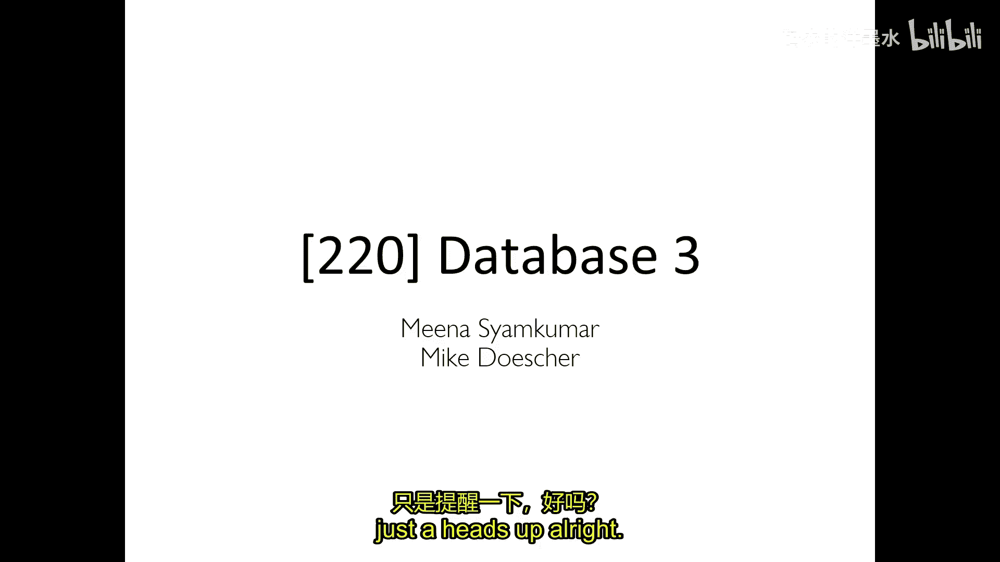
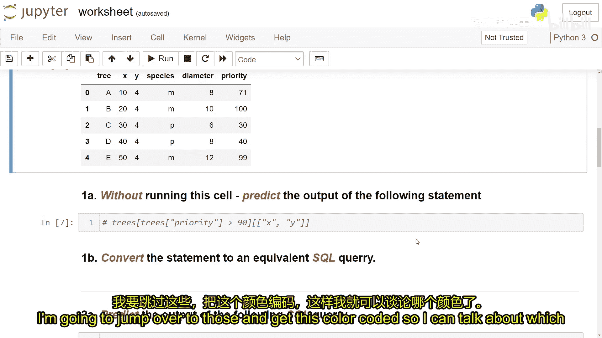
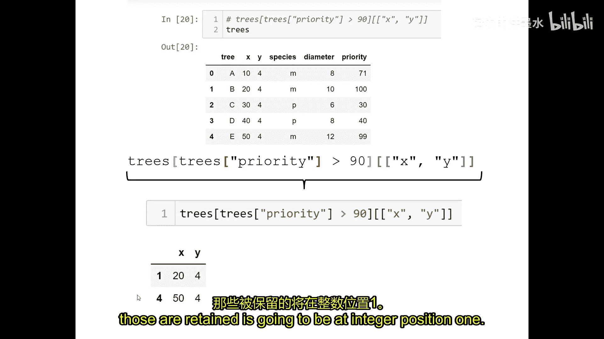
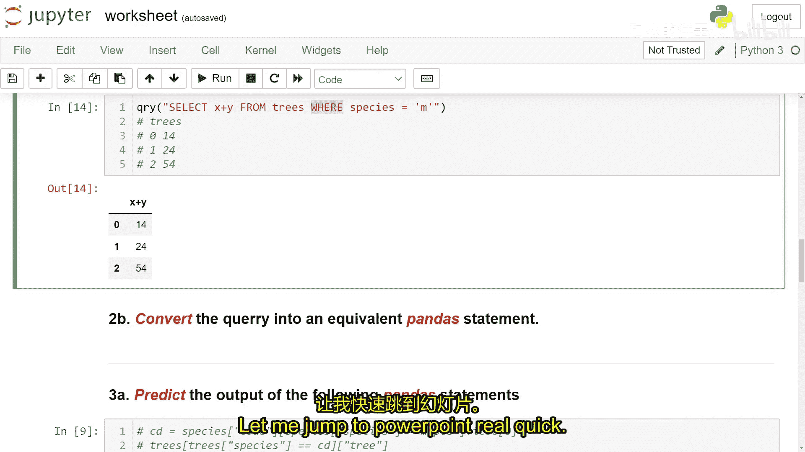
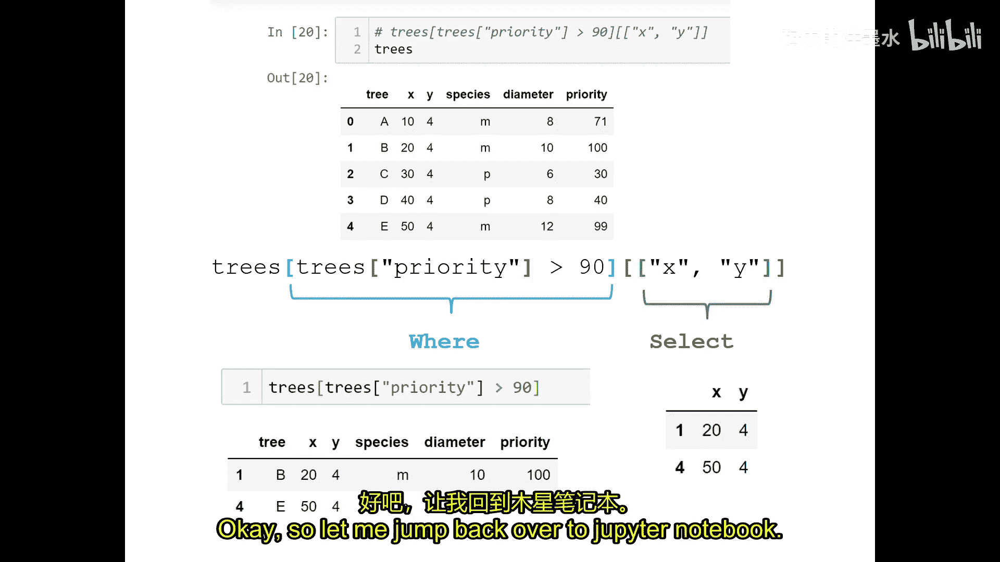
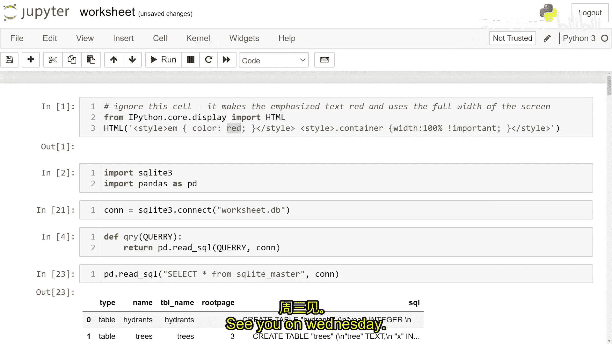

# 【全集】威斯康星大学-Python数据编程-CS220-中英字幕-1080P-p29-Lecture-23---数据库1-3--BV1VxvsBLEmv_p29-

Good morning everybody， welcome back to Data programming One Today we have our third and final lecture on databases and today what we're really going to be looking at。

 we're only going to learn one new technique。But what we're going to be learning is the connection between SQL and pandas and how learning something in Padas makes learning something about databases easier。

 learning something about SQL will make learning how to do the same thing in pandas easier。

A couple of just announcement kind of things reminders about the course first late days may not be used on the last project。

Second， regrade requests need to be received within one week of the release date of the grades in the last week Meno I have gotten five requests to make exceptions to that to regrade like very early projects in the semester。

 We just don't have the manpower to do that。 I would love to help you guys out it's important to me that you learned as much as possible。

 but if we said to everybody go back do anything you want again and we'll grade it， we can't do it。

 So I've had to deny all of those requests。 I apologize to those students that I can't help you。

 but we just do not have enough people to to regrade everything。 So that's why we have that policy。

Al right， next up， it's Thanksgiving week so everybody have a great Thanksgiving Heads up our entire team is taking Thursday。

 Friday， Saturday and Sunday off， we're not going to be answering emails。

 we're not going to be manning piazza， there is no office hours and just a heads up。😊，All right。

 and today we have， let me pop over to the web page real quick a one sec。

Alright， here we are week 13， Can you believe it's week 13 already， database is  three。

So let's see what we got here。 First all we're going to do today is go through a worksheet。

 This is gonna to be one of those as much as I can make it a guided learning exercise。

 I'm gonna have a problem。 I want you guys to pause the video， try and do it。

 you know everything you need to to do these with one new technique and I'll bring that up when it comes And in fact。

 that new technique is basically the SQL version of bucket tie feel free to just write the bucket tie function and go back and grab it from your homework and bring that in and do it using that technique。

Anyway， the works you've got two different versions， the Pf version actually looks really clean。

 The Microsoft Word document when I loaded it on Windows。

 the graphics are like overlaying the text a little bit， but apparently looks really good on Mac。

 So apologize if your're Windows user grabbed the Pf version。 Me a beat me again。

 It is actually 230 in the morning as I'm recording this。

 I gotta admit having the little guy here playing video games in the background is extremely distracting。

 And I just have trouble getting the recording of the quality that I want while he's playing games in the background。

All right， and then in this code directory， once I only grab that。Here we are in the code directory。

 we have three files， two notebooks。 the worksheet。 This is gonna be right here。 this one。

 the list of those questions on the worksheet put into a high techch know Jupyter notebook format and this is the one I'm gonna be going through and filling in。

 It lets us run the code。 Let's just try things out and we can format the question so they look really good。

 I've also got all the answers here。 I believe this is the answers from Mea's worksheet。

 I'm going to have more or less the same thing to look very similar at the very end。

 but we're just going to leave Mina's answers up right here so you can see her version as well。

 And then you'll also need this database file。 We're looking at SQL statements reading Im try to extract data from a database so you'll need that one also。

All right， let's just go ahead and dive into this and get started。All right， And again。

 here's the worksheet。 the best way to learn computer science is by doing It is so much more efficient to actually do this yourself。

 to struggle with it， to get it wrong。 and then come back and watch the video， see the answer。

 then it is to just watch a lecture。 You know， if you're sitting there with your phone and your roommates play an Xbox。

 you're not going to get very much out of this。 go sit down to the real computer。

 pauseuse the video at the right time and try these on your own。

 so much more value out of doing that。 All right， let me just give you a quick walkthrough。

 I'm gonna scroll down to the first question。 and then I'll come back to the top。 More or less。

 all of these questions， run the same way。 There's two versions。 It says without running this cell。

 Pre what this is going do。😊，Okay， this is a panda statement。

 and then it's going to say convert that statement to an equivalent S SQL query。

And then the next one is the reverse of that。 Here's a SQL query。

 predict what it does and then convert it to a panda statement。 Allright。

 they're all kind of like that。Alright， so let's rewind a second and take a look at the structure of this part。

 Okay， so the very first top sell is again。Reformat the screen so that it all fits on the screen and looks good。

 This lets us get the red color in our questions。 All right。

 And then we're going to be using databases。 So we're going to be looking at SQL and panists。

 So we're going to import both of those。We're going to create a connection to the worksheet。

db without in the directory you'll have downloaded that。And then here in cell 4。

 we're going to be looking at this is just a function query that's going to make it easier to focus on just the SQL statements。

 we're going to give it the query that's going to be the SQL statement and it's going to take care of the fact that we're actually reading it through pandas using the read SQL statement and it needs that connection object So from this point on I can totally forget about all of that like little machinery behind the scene stuff and just focus on writing the SQL statement。

Alright， sounds good， right， Okay， I'll let me run those cells and then we'll come back and we'll start exploring what this data looks like。

 Give me a sec。All right， when I ahead did that。 So the very first thing we should do anytime we're working with a database is to do the select star to get all of the data from SQLite master。

 All right， and I went ahead and wrote this one out without using the query。

 but this could have easily been done using that query statement function。All right。

 what we see here is that this database actually has only three tables in it。

 These three tables are from the city of Madison。 Madison keeps data about absolutely everything。

 The first one is about where all the fire hydrants are located and I'll pull these up in just a second。

 What color they are where they are stuff like that。

 database of all the trees that are many by Madison And again。

 then another subt about the species code of the trees。y let's just take a look at these。

 Let's start with hydrants。 I'm going copy and paste hydrants right here。 We'll run that cell。

We can see that this table only has what six rows in it， year installed， what color they are。

 what model they are， whether they're publicly or privately owned a code to identify them and whether they're currently in use or not。

 Okay， so it's just obviously there are more than six fire hydrdants in Madison。

 This is just enough data to give us some to work with。

 to answer questions about and not be overwhelming and like fill up the entire worksheet with like lines and lines of output。

Alright， let's take a look at this treess data。第一步。I learn that cell。 All right， here we go。

 So here we have some encodings a little bit。 We've got five trees in this database。 So again。

 it's just a subset。 that Madison has lots of trees that are maintained by the city。

 we've got the index because this is when I when I do a query like this to select everything from trees it's going to return a pandas data frame So these are the indexes。

 I've got names for the trees and I've only got six trees whoops five trees So've just given them letters to shorten this up a little bit。

 We've got X and Y coordinates And again， this is in city blocks based from some center point。

What species they are and this is just a code that's identified in the species table how big they are And again some trees are more important to Madison than other trees。

 they might be in key locations or they might just be really old trees or of historic value for some reason and so they have a priority about maintaining them。

 whether they need trimming more often or perhaps they're in the way of power lines or whether they are important to be maintained for whatever reason。

All right。Next up， the species。It is very simple table。 All it has is the species code。 and again。

 this is a data frame， so it's giving us the indexes。

 but the species code and what species that corresponds to。

 So Emma is going to be a maple tree and P is going to stand for a pine tree。Alright， guys。

 at this point， I'm going to start going through problem1 here。

 I'm gonna encourage you to just pause the video， give this a try on your own。 If you get it。

 if it all makes sense to you， you know， you can always go back and check your work。

 you can just delete that， run this cell， see what you get and see if it matches your prediction。

 I highly encourage you guys to just take some space， write down what you think this will produce。

 You'll learn more and you can check your work。 And then if you'd like to， you can come back。

 watch the video。 and I'm going to go through the step by step。

 break it down and try and you know bring in a lot of review ideas and bring in some more general concepts to explain what's going on here。

😊，Alright， so I'm going to start going through this right now。 pause video。

 give it a try and then come right back。 Okay， now when I look at this statement。

 I can see I'm working with the trees table。 Let me go ahead and pull trees back up。

 So we've got it right here to refer to。There we go。

 And then the next thing I see is a whole lot of brackets。 Now。

 my goal here is to explain what's going on and make this as educational as possible。

 So I made some PowerPoint slides。 I'm going to jump over to those and get this color coded。

 so I can talk about which bracket does which thing。

Ass they all mean more something different。Al right， here we go。 So I copied the statement。

 I've got my data table， and then I've got the pandas command here。 So first thing。

 when you read statementss with lots of brackets like this， we'll go ahead read them left to right。

And then for each pair of brackets。 So here's the first bracket I come to。 this blue 1。

 it closes right there。 So I'm going to take a look at this chunk first。Then I've got a purple one。

 closing purple one there， I'm going to read that second。Now。

 when I read inside of a pair of brackets like this， I'm going to actually read them inside out。

 So the very first thing I'm going to look at is red， then blue， and then green， then purple。

 So that's the order I'm going to take a look at these things in。 Very important。 Left to right。

 inside out。Alright， so if I start with the very most inside one， this red one。

 this is trees followed by brackets。 So that means I'm going to be using these brackets to access something from trees。

 I'm extracting data from the tree data frame。 Okay， and what I'm extracting here。

 when there is no dot I OC or just L O C。 If I just give it the straight up brackets。

 it's going to be looking at a column。 And in fact。

 I've got a really big clue right here because what I'm accessing is the priority column。

 and there is only one word priority right here。So let me click， this is going to give me。A series。

 I'm getting just the column out， so I hear I have my indices copied from right there。

 and I've got all of the data from that column， 71，100 on so on。Allright。

 so the next thing I'm going to do here。Is figure out， look at everything inside the blue statement。

 So this part gives me a series。 And now I'm going to use the greater than operator。

 Is this greater than 90。 And this is going to give me an element wise comparison to 90 and then return true or false One row at a time based on whether the number is bigger than 90。

 So it's giving me a Boolean series back。 Let me just go ahead and。Yep， I'm doing this much。

 I made these slides a year ago， and I'm trying to remember what comes next。

 So I'm a little on the clicking。 This is gonna give me a yeah Boolean series， so。Let's see here。

 The first point was 71。 That is less than 90。 So it's false。100 is greater than 90。

 So that one's going to be true。30，40 are false，99， greater than 90s true。Okay。

 so this much right here is giving me a Boolean series。

 and I'm using that inside the blue brackets to access trees again。 Now， this tree is again。

 going to be the very full data frame， all the rows， all the columns。😊。

And what this is going to do is just extract some of the rows。So if I click through。

 I find out that the rows that have a true in them。 That would be row 1 and row 4 are retained。

 and the others are removed。 So this is selecting rows。Okay。

 so once I've got all of this blue stuff completed， I've selected some rows。

 I'm going to go ahead and take a look at the right half。

 So the purple one means that I'm going to be accessing stuff because I'm using brackets following a data frame。

 This much right here in blue is a data frame。 I'm going to be accessing data from this resulting data frame。

Al right， and what I'm going to be using， in fact， is a list。

 So these green brackets are creating a list。So the red one here was accessing something from trees。

 The blue one was accessing data with a Boolean series， also from the original trees。

 This means I'm accessing the purple one means I'm accessing data from that resulting data table after I'd selected rows。

 The green is completely different。 Green is creating a list。

 We learned how to do this week 5 of the semester。 So like 8 weeks ago。 We're just creating a list。

 When we access a data frame with a list， that's kind of the fancy slicing that pandas lets us do。

 it's going to be selecting the columns X and Y。 Oh， yeah。

 And we can see that if we do type of this inside， you know， the green brackets。 it does， in fact。

 return list。😊，Okay， so I'm accessing from a data frame using a list， fancy slicing。

And that's going to just extract rows X and y from， let me go back a second from this table。

 So I'll still retain the indices one and4， and I'll get just the columns X and y。There they are。

 So that should be my final answer。 I'm just a quick reminder。

 I'm also going to have integer positions for these。

 So this first row here will be at ingerger position 0。 and the row here with index 4。

 those are retained。 is going to be at integer position 1。

Alright， this may be overkill at this point。 But as you're walking through these things。

 I kind of want to give you the idea of what you might be typing in as you do the work for this problem。

 So I obviously just did it in PowerPoint。 You have the answer。

 So if I were approaching this problem like on an exam。

 I'd have a sheet of paper out and take a look at this。 So trees of priority is。

 the very first thing I want to take a look at。 And so that's going extract this column right here from the data。

 So I'll be getting 711。Wop hold on。Thank you may up。71。130。40 and 99。All right。

 I'm going to go ahead and put in the indices， too。So that I remember where I'm at。Okay。

 when I start deleting rows， Alright， the very next thing I'm going to do is ask whether these rows are greater than 90 or not。

 So 71 is not。That's going to give me false1100 is true。False。False and 99 is greater than true。

And this is creating a Boolean series。 Again， these relational operators are all done elementement wise。

 So one number at a time。Once I have this Boolean series， that's the result of this much。

 everything inside those brackets。 I'm going to be using the Boolean series to extract rows from the data frame trees。

 So again， this is accessing a column。 this is accessing rows。So again。

 two pair of brackets used in different ways。 So basically。

 I'm to just go ahead and delete all of the rows with falses in them。Make this look good。 Now。

 there we go。 And when I do that， I， what I， I'm gonna retain is the entire row。

 So this is gonna not just be true， but I'm going have row 1。 It's going to have B。

The 24 M10 and 100。And row4， that's E50。4 m1299， I'm going to pause for a second。

 put in my heading and space this out so it looks good one second。Alright， there we go。

 Hope that looks good。 It's easy to read。 So that's the result of this much stuff。

 The entire left half。 The next thing I'm going doing is taking this data frame。

 This whole thing is a data frame and accessing a part of that data。

 And the part I'm going be accessing is the list。 So fancy slicing that just retains the X and Y columns。

 So here's what it looks like。 I no longer care about tree。Get rid of those。 slideide that back over。

 I no longer care about species， diameter or priority。

 I'm not selecting those so I can get rid of all of those。

 And this is what my resulting answer is going to look like。

 I'll just have the X and Y columns for those rows。All right， let me go ahead， comment this。

That's right。In notebook， it's control slash to comment， messed that up a second ago。Okay。

 and then if I run this cell， this is the answer I get。Inicess 1 and 4 at X and Y columns。All right。

 I'm going to go ahead and put this back。And again， control slash to uncomment。 There we go。 Alright。

 next up， I'm going to pause and get a timestamp and then go ahead and do the very next statement。

 part 1 B。Alright， so1 B， we're going to convert this statement right up here from Pro 1 a into the equivalent SQL query。

 So I'm going to click on it。 it's in blue command mode。

 I'm going to push B to get another cell below it with this one in code mode。 So I can type here。

 Allright， I'm going to be writing a SQL query。 I'm going to use my query function This function just takes one string。

So there we go a string。嗯。And I need， it's going to be a sQL command。

 So I need certain like key words。 There are two that are absolutely mandatory。First one is select。

 Second one is from。Always need those guys。 And they come in a certain order。

 They must be in the right order。 So select will come first， followed by from from is the easy 1。

 I need the name of the table。Trees， or was it singular。 Was it。

 I'm going to go back up and take a look。 It's right here， trees， it is plural。 Okay。

 so that's the table I want from the data base。 And what I want to do is select which columns I want。

 And here I want columns X and Y。There we go。 I also want to restrict this to just certain rows。

 and so to restrict something to rows， that's the keyword where。

And the rows that I want are rows where the priority is greater than 90。So priority greater than 90。

 All right， next up， I'm gonna to run this and make sure that I actually have the right answer。 Okay。

 it selected the right columns。 It selected the correct rows。 I've got 24，54 However。

 it has renumbered them when it created the new data frame from the SQL command It created the data and then put it into a brand new data frame。

 And so the indices got renumbered。I'm not going to go ahead and talk about how to manually renumber the things within a SQL query I'm going to just move on that's beyond what we're doing in this course I'm just going to accept this as the correct answer for this question。

Sequel is so much easier than pans。 I love it。 Sequel is my favorite。

 I would choose this over pan is given the choice any day of the week。😊，Yeah， it took me away。 What。

 maybe 20 seconds to go through， type this and explain it。 It made sense。 It's easy。

 These words are very clear compared to this stuff and that stuff。 All right。

 but I think understanding panness makes it easy to translate into SQL and the other way around， too。

 So let's go ahead and do an example the other way around next。 let me pause a video。

 grab a timest so I can put it in a description one second。All right， number 2， a go ahead。

 I got my time stamp。 pauseuse the video yourself。 Go ahead and give this a try。

 predict what the tables going to look like。 then come back。

 check your work and then watch the video for the in depth explanation with like bonus material。Okay。

 so I can see this is a SQL query。 the two mandatory pieces select and from are right there。

 And I should note that in my other examples， I've been putting each of these on their own line。

 I think that's， you know， it makes it really clear to see。

 but there's no reason we can't just put everything all in one line like this。Okay。

 so the important part， start with trees。 That's the table we're extracting。

 I'm just going to go ahead and grab that so I can refer to it while I'm going ahead and thinking about this。

Alright， I'm going to be selecting actually， I'm creating a new column。

 This is an aggregate column made by summing the X column and the Y column。

And I'm also going to be limiting myself to certain rows， just the rows where species is equal to M。

 So I'm going to be grabbing， in this case， tree A， tree B and tree E。

 So let me go ahead and write this out。Let's see so。This one。

 tree M or tree A with a species M1 plus 4 is 14。And then B is also a maple， so 20 plus4 is 24。

 and we' treat E in at index 4， also maple， so that's 50 plus 4 is 54。Alright。

 when I draw out this table， the SQL version is going to be creating a brand new data frame with this data。

 and it's going to reindex everything。 So I'll get index 0， index 1 and index 2。

If I do the same thing in pandas， it's going to retain the 0，1 and 4 in the end。 again。

 we're not going to go into how to make that change in this course。

 It's beyond what we're going to do。Al right， let me go ahead， comment this out。 see control slash。

 Don't screw it up。 I don't need the trees for my answer。

 And I'm going to go ahead and run the cell and just make sure that that's what I'm really getting。

Yep， okay，1424，54， it's re indexed them。 So 0，1 and 2。 this is looking good to me。 Alright。

 so I'm going to pause， get a new time stampamp and go ahead and check out questiontion 2 B。

All right， I set。 So question 2 B is going be converting this SQL query that we just did into a into pandas。

 Allright， this is hard guys， go ahead pause the video。

 give this a try on your own good luck and then I highly recommend coming back and watching this section of the video anyway because I'm going to jump over into PowerPoint and walk through which parts like here I've got a select。

 I've got a from I've got a where how I can take each of these pieces of a SQL statement and how how that corresponds to the bracket notation in pandas let me jump to PowerPoint real quick。

All right， here we are。 So as I was going through this statement from Proble1。

 I've already completed this one， I talked about it in depth。

 I thought this would be a great example。 This left half。

 the entire part of this was grabbing just one of the columns doing an element wise comparison to get a Boolean series and then selecting rows。

Okay， now the selection of rows， it corresponds to the where statement in SQL。 All right。

 so I'm going to be doing the same thing in problem 2 B， where I'm going to be extracting some rows。

 And those are just the rows where the tree was equal to species M。

 And then the second part of that is I need to select some of the columns。 And to select columns。

 we were accessing that new data frame and giving it the columns that I wanted to extract。

 here I extracted the column priority here I'm extracting the columns X and Y with the list notation sort of advanced slicing。

 So this is sort of the structure we're going to be working with。

 I've got where first inside the brackets with a Boolean series。Okay。

 both of those things need to be there。 and then I'm selecting columns for the select part of thing。

And the from is the trees part over here。 Which table I'm looking at。 Okay。

 so let me jump back over to Juter notebook。 Here we go。

Go ahead and convert this into pandas。 Allright， Be for a new cell below。

 Click there to get back to code mode。All right， here we go。 first。

 I'm going to do the where part of this。So I'm going to be， well here。

 let's just take a look at the table。 There we go。Alright。

 I want to select just the rows where trees are equal to M。 So I'm going to go ahead and grab。

Just that column。 that's going to be。Column species。 Let me go ahead and run this。There we go。

 Now I've got just the column。 I need to turn this into a Boolean series， element wise。

 bunch of true and false statements。 so I can use that to extract the columns。

 So I'm going to say if that's equal to M， then I want to retain it。

Let's try that again with the double equal， there we go。oh dear。

 I just went ahead and changed all my data。 Time on。 Let me rerun this from the beginning。Allright。

 so I closed the connection I went back up， I reopened it after some thought I didn't need to do that。

 all I needed to do was reread the trees by querying select star from trees。

 That's all I needed to do to reload that table Now when I run this again there we go。

 The first statement was just the equal。 that's the assignment operator。

 I was rewriting the data in the table that is not what I wanted to do。Okay， so now the equal equal。

 that's going to give me Booleing statement and test for equivalence。 And there we go。 So the data。

Let me just。Yeah， where do I have the table There it is。 Yeah， row 0，1 and 4 should be true。

2 and 3 should be false。There is 0，1 and 4。2 and 3 are falses。 Okay， so once I have this。

 I've got my Boolean series， I'm going to use this to access the data， data access from column trees。

Whoops from table trees， access these rows。Alright， so I added trees。 I added some brackets。

 Im to run this。 I'm now extracting row 0，1 and 4。 Allright， this is looking good to me。😊，Al right。

 once I have this， this much like everything I've written so far is a brand new data frame。

 What I want to do is grab two columns from this。 So one at a time first I'm going to get column X and to do that that's really simple all I need to do is add more brackets and tell it I want column X and the default the version that pandas writers decided was that if I just give it brackets and don't put in location or I location is going to give me a column。

 So let's go ahead and run that。You can see I get the 102050。 That is that column perfect。

 It's exactly what I want。 Allright， now I also need column Y。This was asking for x plus y。

 So whoops， to do that， I basically need to copy everything I've got here to get that second column。

 and I'm going to add to it。 This addition is going to be element wise edition。

 So I'm going to be taking the 10 plus the I guess it had a4 in the table。ep。

 10 plus 4 and then 20 plus 4 and 50 plus 4。 Where was I。Alright。

 I'm bouncing all around in one more detail。 I don't want column X。 I want column Y right here。

 Alright， let move around this。There we go。 So 1424，54。All right， and again， there is one difference。

 this is retained the indices because Padas never created a brand new data frame。

 and we also didn't retain that well。SQL actually created a brand new header for this column because that's what select will do for us。

 It's going to redo the columns。 The formatting of data frames I talked about a little bit when we were creating them。

 I'm not going to do more here。 I think extracting the data is the important part of when I want to get out of this exercise。

 So I'll say that for the future。Alright， guys， Pro 3， a。 Again。

 this is a predict the output of a panda statement。 And I've got， well this is complicated。

 This is a hard one。 And again， the pandas ones are generally much more difficult than the。

SQL statements。 so go ahead， pause the video， give this a try on your own when you get stumped。

 come back for a hint， and then after that， try again and then I walk through this。All right。

 so go give this a try。And if you're ready for your hint， here's the hint。

 I'm going to break this down into there's actually five parts of this。 So the first part。

 I'm going to be storing the result in variable C D。 Here's the first piece of that。

Then here's the oops， don't move it。 Just there we go。 Here's the second piece of that。

 but not quite that much that much is the second piece And this one。

 I see the double equals right there。 that's going to give me a Boolean series。

Here's the third piece。 We're going to be extracting some data from the results of whatever that is。

The fourth piece right here is going to be the inside of the leftmost bracket。 Again。

 we're getting the Boolean series out of that。And then the fifth piece will be extracting something from that result。

All right， so there's your hint， Go five sections。 see if you can figure out some of those。

 maybe not all of them， and then come back for the explanation。In 3，2，1。Okay， so first up。

 I'm going to go ahead and pull up the species table。And just go ahead and run that。

 So I've got something to look at。 So this is the very first part of this。 Again。

 I'm going to do these left to right。And then inside to outside， when I've got like nested brackets。

 Okay， so the first thing I'm going to be extracting something from the species table。

 and this is going to be the code column。Alright， so what this is going to look like is I'm going to have。

A new series。 So with row 0 and1， the code is going to be M and P。 Alright。

 so that's this much right here。Okay， so I've got a series now andda series from that。

 I'm going to be using brackets to extract something from that。Okay， that extraction。

 I'm going to take a look at the inside。 now。 I see the double equals。

 This is going to give me a Boolean series。 so I'm going to be extracting rows。嗯。

And the rows that I'm going to extract here， I'm going to take a look at species maple。 So， again。

 we're going inside outside first。 But the species is going to be。

Let me go ahead and just write it over here a little bit because they're in the same rows。

 I'll have maple。And pine。And what I'm to do is create a Boolean series by asking if these are actually equal to the word maple。

 so this one will be whoops。Through excellent push control equal enter。

 so it ran that with all the garbage in there。And this one will be false。Alright。

 now when I use that to access that original table， just the 0 M1 P， it's just going to retain the。

R zero。Alright， from there。I also don't need that。 This is all that's left at this point。

And from this much or this series， I'm going to be grabbing the data at integer position 0。

 So that's going to be row 0 here。 The data is just the letter M。 So I'm getting。Just the letter M。

And then I'm scoring that in the variable C D。Alright， let me go ahead。 I'm done with this。

I'm going to go ahead and just keep those here for reference control slash to comment that I'm going to run and make sure that I've got this correct and didn't make any dumb mistakes。

I'm going to run it。Oh， I need to print out C。There we go。 CD DE now stores the character M。

 So perfect， this is looking good to me。All right， now part2。Let's take a look at this， again。

 I'm going to read this。Left to right。 And then whoops， the outside brackets goats there。

 left to right， This one first。 then that one。 And when I look at this one first。

 I'm going to go from inside to outside。 So the inside most one is it's got a double equal。

 This has given me a Boolean series。Hoop I I didn't quite get all of it。 There we go。 Double equal。

 Give me a Boolean series。 Now， at the left side of this， I need trees of species。So。Again。

 I'm going to go ahead and just bring up my tree statement。Tes data frame。

 So I can take a look at this。 And this is going to extract the column species from this。

 So when I do that， I'm going to get M， MP， P and M。Okay， so that's this much。

 And now I'm going to ask them if they're equal to C D And C D is just the letter M。

So here this one is M。 that'll be true。Also， have true。False。Fse。True， okay， one more little detail。

 I'm gonna go ahead and add in the 0。1。To。Three and four to keep track of which row things are。

 So these are pandas， so those will be retained。嗯。So that's this much right here。

 that's giving me the Boolean series。 And now from trees。

 I'm going to retain only the rows where this is true。 So here。

 let me just go ahead and copy the entire row from the data frame。 I keep this one。 That one's true。

I keep row 1。That one is true。And like he wrote four。That one is true also。

And these guys are not retained， we'll get rid of them。Okay， so all of this stuff over here。

 the entire left half gives me a new data frame with those pieces of data。Alright。

 the next thing I'm going to do is extract one of the columns from that。

 And what I want is the tree column。 So that's going to be the one that contains A， B， and E。

 I didn't copy the header， but that's the tree column。 So I no longer will keep。

Any of the rest of that data to the right， the X， Y， species， diameter and priority。

And I'm going to go ahead and make this look a little get rid of the arrows。

I don't think they show up very well， they're kind of like gray。嗯。So this is what I'm expecting。

So let me go ahead and。Comment this much out。And put this back in and see if。How close I am。Ha ha ha。

 I checked that out。 No mistakes。 A， B， And E， exactly like I predicted。

 and it retained those indices。All right， part 3 B， convert the statements into SQL。

 There's a couple little tricks you guys are going to need to be aware of。

 Well as you tackle this one， the first little trick is that when we use sQL statements。

 they're always going to be giving us back data frames。

 And so we will need to do some hand tricks to extract like。Just the character M。

 So it's going to be a data frame。 We'll go ahead and use the data access functions from pandas to grab the letter M。

And the other little trick that we're going to need is that it's expecting a character right here for this variable Cd。

 So it'll need to be in quotes。 So I'll show you how I tackle that。 You've got choices。

 There's more than one way to do it。 I'm going to tell you guys to pause the video， give us a try。

 see how far you can get and then come back and watch' the solution。 Allright， you guys do that。

 I'm going to go grab Mountain do and be right back。

And that probably only took one second with the magic of video editing。 But I'm back。

 I'm going to copy these lines and just make some room for them down here。So I have new copy。Alright。

 so those are my， this is what I'm going to try and do。 And I'm going to do it in two steps again。

 just like we did here so that it matches。 I'm going to be creating a sQL query。

 So I'm going to use my query function。And again， this is going to give me a data framework。

And so I'll need to extract。 we'll go ahead do this。 The piece of the data frame， just that letter M。

Okay， when I take a look at this first before we get this far。

I'm going to go ahead and pull up species。We're extracting stuff。

 And I want to be able to take a look at it。 Alright， so what we want is。What do we want？

We want to a hero every time we do a  query， we need select。From。

 and we're going to be distracting one of the rows。Okay， the table is easy。

We want to extract from species， we'll be selecting the road Co。The column code。

So let's go ahead and put that in right here。And what we're extracting the where here is going to be if species column is equal to maple where。

Their species equals。没补。Alright， let's go ahead and。

Let me take these back off and just check my work。So far， all right， this is what we got。Alright。

 and again， I'm going to get some errors here。 I'm just going to go ahead and put in。Spies equals。

20 quotes。 There we go。 Okay， put in all the air messages that I get， all the common mistakes。

 Let me go ahead and put this back so I can talk about what and went wrong。 Exec failed on sequL。

 No such column maple。 And again， it's expecting text here in my query。

 So I needed to go ahead and put the maple in quotes。

Because that's going to be an element of column species。 And it needs that for the comparison。

 So that was the mistake I made。Let me see if there， yeah， no such column maple following exception。

 Let me see if there's like a clue that would give me。The idea that it was。Read query。Oh。

 here it is quote right there。 That might be my clue。That I needed。Oh， no。

 that's just a quote because it's copying this code。

I was hoping there would be like a clue that I forgot to put it in quotes in that error message。

 I don't see one though。All right， but anyway， so that's a common mistake， I make it all the time。

Alright， so the next thing I need to do， here's my query。 Let me put that back。I need to extract。

 so the second part of this is just position  zero。Of this， this is a data frame。

 So what I need to do is turn it into a series first。 So I'm going to extract out the code column。

And again， I'll need to put that in quotes to get me just the column so that I'll become a series at this point。

And then， I want position。0。And that will give me just the character。

 So here's part of the trick right here。 This much gets me a data frame。

This much turns it into a series so I can extract just the data at position zero。All right。

 so there we go， I'm going to store this in C。And then we'll print out CD。

 just make sure it's still working， looking good。Allright， so for the second part of this。

 I'm going to be extracting stuff from trees。 Let me go ahead pull up the trees table。

 So we have something to look at right there。Alright， and what I'm going to be extracting is。

The names of the trees that have this。Letter code right there。Oops。Ive got it。 all copied right here。

 This letter code right here。 So just the name， the column tree。 So that's my select。

 Here's my where。Allright， so anyway， this is going to be a query。Query。

 I'm going to use this function。We'll go ahead give it。And we always need select。We need from。

 we need where。And inside select here will be。 well， here， it's too fun。

 We're grabbing stuff from trees。 We are selecting the column tree。

 So that'll be in the names of trees。 And the where this is a little tricky。

 What I want is where species。Equals， and in this case。

 I'm going to go ahead and just throw and quote。 And this is what I want。 And again。

 I'm going to be going back and putting in the C D here to make it exactly match。

But if I put in this quote M right there， I get the right answer。Again。

 it's going ren these because I'm creating a brand new data frame。 Padas will retain those indices。

 But I'm going to ignore that。 Call this good enough for this lecture。 Al right， now， the trick is。

 I can't just put in C D right here。 It's gonna give me an error saying there's no such。Yeah。

 no no such column C D。 What I really need is the name of that column。 Allright。

 Spec is the name in the column， but I need to get the text in here for C D。 Now。

 a couple of tricks I can do。 I need quotes around it。

And I'm going to use my personal favorite is the format function。

And then because this is all a string。From here up to here， it's a string function。

 I call a method format on it and give it the variable to be inserted in between those brackets right there。

So in fact， let me just copy and paste。This much of it。We'll comment this out。Briefly。

 we'll go ahead and run this and this should return a string。

With a bunch of extra new lines in there。 But it actually has this character inside of the quotes。

 That's exactly what I need。 the temptation。Is to do this here me let me get rid of that。

Let me put my comments away。And again， the temptation is to do。Something like。Yeah。

 here we'll end the quotes。And then we'll put it in plus CDd。And then we'll get rid of that。

So this much will be a string from here to here。 And then I can just， you know。

 concatenate using string concatenation C。 The problem with that is it's the equivalent of putting in the letter M without the quotes。

 I do with some choices。 I can put a single quote right here。Just one of them， though。

 And then I could catate another single quote right there。 So this is another way to do this。

 That's going to give me the right answer。And again， with the string format。

 this is my preferred method。 I， I love this。 I'm just gonna to give it those single quotes with the character in the middle。

 It's a string function。😊，We did this in week four of the class。

C D and then get rid of the rest of that。And that parenthees will end my query function。So。

There we go。 Yeah， this is a hard one。 It's confusing because of that extra little string part right there。

Good review format。And the other part that's confusing or in tricky。 It's not just straight up up。

 SQLqueries give us a data frame to get that just character Emma。

 like we had from the pandas version。 I need to actually do some pandas data extraction on the data frame。

All right， let's go ahead and move on。Alright， guys， question 4 a Go ahead。 It's another sequel 1。

 This one's not too bad。 I'll go ahead， pause the video， give this one a try on your own。

 And I'm going to go ahead and walk through my solution in 3，2，1， start。Okay， so here's the deal。

 We're going to be， I'm go ahead and just break this down a little more。

 selecting species from trees。Ordered by。Priority descending。Let me just make this look like。

My other statements。All right， so this is what we're going to be doing in the end。Here's the deal。

 Let's go ahead and pull up trees。 So we have something to look at。

 and let's put this back as comments。 So I'm just looking at trees and not getting error messages。

Al right， so I can see I'm selecting the column species， so MMPPM。

But I'm going to be ordering by priority。 So 71 I need to sort by this one descending。

 So I'm going to go ahead and put together。The sortrded version of the table。

 So I'm going to get 100 first。And then the species is M。

 So I'm copying a little more information than I would normally get if I are just extracting something。

 So 99 is also M71 is an M， then 40 is a P and 30 is a P also。So there we go ordered by descending。

But I'm only selecting species。 So I don't actually want these columns right here。

 So I'm going to go ahead and delete the priority now that I've got it sorted。

And I'm just going to go ahead and yep， just delete these。And again。

 because it's producing a data frame， I's going to go ahead and number these columns。

And it's creating a new data frame。So we'll be getting renumbed column speeding at zero。

It's going to look something。Wait， I made a mistake。 Let me selecting species。

 Let me go ahead and put that word in right there。There go。 Get something that looks like this。

 I let's check my work。Let's put this back and go ahead and run it。So there we go，0，1，2，3。

4 MM M MP PP。 All right， Little tangent looks like Madison is prioritizing their maple trees over their pine trees。

 to me， this really isn't all that surprising。 Pine trees grow so much faster than maple trees do that if something happens if it gets a disease or something it's easier to chop it down and plant a new one。

 Within a couple years， it'll be back to full size。 Male trees， on the other hand。

 grow very slowly and to replace one takes a lot longer。

 So I can see where they might prioritize keeping those guys alive。😊，All right， next up。

 converting that query to pandas。Alright， so in 4 B。

 we're going to be converting that query code to pandas。

 This particular question isn't that challenging compared to the ones I just did。

 I'm going to go ahead and copy and paste this right Heops。There we go。

 here's where we have something to look at。And we'll comment that out。The trick here。

 we're sorting things。Alright， I don't recall talking about sorting pandas data frames during that lecture。

 So let me just go ahead and walk through how to get extra information about pandas。

 And here's all I'm going to search for is sort pandas data frame。

 See how my choices are data framed out sort values。 That's looks promising。And this is， in fact。

 what we need。 I'm going to be giving it a data frame。 This is a method。

 So I'm using the dot notation。 The method is called sort values。

 And then I've got all kinds of different things I can put in here to help。

 I can tell it how I want things sorted。 I need to give it a by。

 So this is going to be which column I need to sort by。 That's mandatory。

And then the rest of these things have default values。

 The thing that I'm going to need is the keyword ascending equals false in this case。

 because we want to sort in descending order。 Alright， And then we've got all kinds of other like。

Little tricks。 How do we， how do we actually do the sort， What kind of sorting method do we want。

 Now whether we want to do it in place or use extra memory。 I'm not gonna go into any of those。

 Let me jump back over to the data to the Jupyter notebook。Al right， so at this point， go ahead。

 pull that up on your own， pause the video， give this one a try。

 and then I'll be right back to do my solution of this。Alright。

 so we're going to be extracting some data from a pandas data frame。 So here's the idea。

 the table we're looking at。These trees， let's go ahead and pull that up。

We need to sort this order by priority， so。The keyword， that function or method was sort。Values。

And I need to give that which column I'm going to be sorting by。So we'll go ahead do priority。

 When I run it now， I can see that it is sorting in ascending order。Alright。

 and I looked up the help there。 The keyword I need。Ascending default value was true。

To switch the order， I need to give it the new value false。There we go。

 now I've sorted the data frame in the reverse order， highest to lowest。

And now I don't want the entire data frame。 I just want the， I'm selecting species。

So what I'm going to do is extract the column to do that。 We give it square brackets。And tell it。

 We want the species column。Let's go ahead and run that。 So there we go， MMMMPP。And again。

 it's going to retain the keys。 it's not actually creating a new data frame like the queer SQL does。

 but I'm not going to worry about that for this worksheet。Alright， so this one is much simpler。

 Let's go ahead and do the next one。Alright， starting in problem 5， A Now。 Okay。

 here we're looking at another query problem。 I like these sQL is easier than pandas， in my opinion。

 Alright， so here's the deal。 we're selecting tree and priority。

 So two columns from the data table trees。 I'm going to start with that。So there we go。

 That's what my data table looks like。 I'll be selecting the tree column。

 the ABC D and priority 71100。 Allright， but the trick here is that we'll be ordering them by priority in descending order。

And we're going to limit that to just one row。 So as I go through this。

 I me go ahead and order by priority。 So we'll get this row first。Then the next one will be this one。

 whoops， that's way too much， way too much。That one。And I could put the rest of these in。 In fact。

 you guys can do that if you'd like， but we're limiting to just one row。

 and so we'll be keeping that top row right there。And we're only going to be keeping two columns from this。

 We'll be selecting tree and priority。 So let me go ahead and say。This first one right here。

 whoops B is trees。那个呢。We'll get rid of all of this stuff。And we have priority。Okay， at this point。

 this is going to be。Index 0。Alright， just like that because the query is going to reinex everything when it creates it。

 So that is this much right here。It's that query。Alright， the next thing we're going to do is。

Turn this into a list。So when I do this query， it's getting a data frame。Al right。 Hol on。 Whoa。

 slowed down a second。 I tricked myself and didn't highlight the right brackets。

 So this mu is inside of the list creation。Alright， so let me rewind a second。

 this much creates a brand new data frame using the SQL query from that data frame。

 I'm going to be grabbing row。 So this is integerposition 0。 the row at inposition 0。

 There is only one row。 That's this row right here。😊，Now that's going to create a panda series。

And because panda series are iterable， I can put them in the list constructor and generate a list from this。

 So at the end of the day， I'm going to be getting character B。And the number 100 in my pandas。

 in my Python list。Okay， let me go ahead and just double check this。

 I'm going to go ahead and comment that。llGo ahead and uncomment this one and run the cell。

 And indeed， we get a pandas list with character B and the number 100。All right， guys。

 converting this statement into pandas is's also pretty straightforward。 Go ahead， give this a try。

 Remember we'll need to sort using the function is called sort values。'll scroll up right here。

 and look like that。 We'll need that again。Alright， go ahead， pause the video。

 give this a try and answer incoming in 3，2，1， go。All right， first up。

 I'm going to be extracting thing and data from the tree table。

So let me go ahead and just take a look at trees。There we go。 We' got that。 Now。

 I also want to sort this order by priority。 So the command for that is sort values， sort。Values。

 and that requires at least one thing。 Priity is mandatory。

I need to tell it which column I want to sort by。When I run this code。

 it's going to sort in ascending order by default。 So we want to go ahead and reverse that keyword。

Mis sendingending。Equals。False， now'll let you reverse the order。Alright。

 so then I want to limit one。 the command to do that is exactly the same as we used up here in fact。

This much， the query gave us a data frame and then to extract something from the data frame。

 we're just going to use integer position。 So that was actually already a pandas command。

 So integer position command I square brackets to get0。

And now this is going to return a panda series。Alright。

 the next thing I want to do is extract just some of these pieces of data to do that。

 I can extract data from a series using square brackets。And a list。 So this is that fancy slicing。

 So I've got double brackets here。 The first set is extracting。 The second set is creating a list。

 and the pieces that I want are the name of the tree。And the priority。Let me go ahead and run that。

 there we go。 we've reduced that series to just those two things。And then finally。

 the final answer was actually a list。 This is a Python command。

 So it's going to be exactly the same as the first one up there。

 Just the list constructor add the two parentheses。And away we go， there we go。

I want to point out there's another way we could have approached this problem。

 So let me go ahead and start with the sortded。Priority list。 So let's go ahead put that right there。

And sorted by priority， I could have extracted the columns first。 And again。

 to extract data columns from a data frame， I'm going to use square brackets。

 I'm going to give it a list with the names of those。

 I'm just going copy and paste the two columns that I want， right from there。Okay。

 that's going to reduce this table to just tree in priority。And now from there。

I could put in eye location， grab row zero。And that's going to give me a panda series with B and 100 in it。

And I can turn that into a list。Okay， so I have options here。 if you did it this way， that's great。

 If you did it that way， all I had to do was just reverse the order of whether I'm selecting my columns or by rows first。

All right。Let me go ahead， grab a timestamp， and we'll do problem six。Alright。

 another sequel question， Gu。 I like this one。 This one's pretty straightforward， too。 I'll go ahead。

 pause the video， give this a try。 Here's a little hint。 Let's actually。😊。

Make this a little easier to read by putting the entire select on one line。

Handy tire from its own mind。 There we go。 We can see there's only two things going on。There we go。

 Go ahead， give this a try and then come back for the answer in 3，2，1。 go。

 Al So I'm going to start with trees right here。 We're taking a look at the trees tad table。

And what we're doing is we're going to be selecting。 And again， this is an aggregation。

 we're going to be using count。 So it's going to go ahead and take this data and do some math on it。

 In in this case， just counting。 And that's going to relabel the new column as C1。

And then we're going to do another aggregation， counting distinct species and labeling that column as C 2。

 So me go ahead。 I've got two new columns， C 1 and C 2。Tops。C1 and C2。

And then count species is going to be looking at just the species column right here。

 and all it does is it's going to go ahead and count how many entries there are。 So there's one，2，3。

4，5。So that's going to get the number five right there。

And then the second column is counting distinct species。 So that's going to ignore any duplicates。

 So it's going to say。M we got one， ignore that we already have an M。P， that's a second one。 So two。

 ignore that one we already have a P。 ignorere that one。 we already have an M。

 So we have two distinct species， just M and P。All right， this creates a new data frame。

 so this will be row0 of the new data frame。And we'll slide those columns over。All right。

 let me go ahead and well comment my prediction。Uncomment the code， and we'll go ahead and run this。

And。Yep， check that out，5 and 2 row0 relabeled columns。Alright， so to do this problem in pandas。

 this is where I'd like to introduce。Wops， sops， oops， there we go。Like stop it。

 This is where I'd like to introduce the the value counts function。 the new。

 the new material for today。 This is a lot like the bucketize。 And in fact。

 you could do this same problem， Pre the output the counting with a， in fact。

 this is the one that will require the bucketized version。

 A panis provides a value counts that does pretty much the same thing。

 So let me go ahead and a new cell。 and we'll just demo this new feature。Right here。

 So if I create a pandas series。Right there， I'm going to be giving it a list to initialize it and we'll just put in some characters。

1，2，3，4，5。 we'll go with six characters。So we'll have the letter， A，B，C， A B， A， something like that。

 Okay， there we go。 So this will give me a pan this series。Just like that。

 I'm going to go ahead and store this in a variable。 So I store that in X。嗯。All right。

 and then we'll just print out X like that cool。Next thing we'll do is call x dut value counts。

Just like that。Okay， and what this does is it's going to create a brand new panda series。

It's going to give the index values， the actual data from my original series。So that's the index。

 and the value of that series is going to be the number of occurrences of each of these pieces of data from the original series。

 So a appears three times1。To。3， B appears twice。 There's1，2， and C only appears once。 So I get 3，2。

1。Alright， I'm going to grab one more cell。 This is what I'm trying to do。

 I'm going to be counting the number of species， counting the distinct species and putting them in a new data frame。

 Allright， so let me go a new cell。 I'm going to be doing this in a number of steps。So first。

 we're looking at the trees table。I'm going to be counting individual species。

 So this is going to be。 let me go ahead and extract the species column。Just like the S。Species。

So that'll be just like that。 And now this is。Aendd data frame to be a series。

 So what I can do from there is just grab the length of this。And that's going to give me five。

 that's going to go ahead and count up all of the the essentially values in the list or series and return that。

All right， now to get the number of distinct species， I'm going to do something similar。

 We'll start with trees。We'll be grabbing the species column。Just like that。

 And then this is a series。 we'll be calling value counts on this。That's a method。

 so I need the parentheses and the dot。And that's going to give me a brand new series。

 where the indices。Are the data from the original series。

And the values are the number of occurrences。 Now， I don't want this。

 What I want to know is how many rows there are or how many data items are in here。

 So'll be calling length。On this。And getting the number two。Okay， now if we look back up here。

 the final answer was actually a data frame。 So we'll be creating a brand new data frame。

So they hold on， pandas。Data frame。 All right， well this is a constructor， so I'm giving apprenheses。

Now， I have tons of options for how I create data frames。 When I go back up here。

 I can see that this one has just a default indexed rows， but I have given the columns names。

 So I'm going to go ahead and use the list。Of dictionaries option。 And there's only one row。

 So I only need one dictionary， but I could made a dictionary of dictionaries， a list of lists。

 and then given it headers。Let's see a dictionary of lists。 or there's a fourth list of lists。

 I think I said that one。 There's a fourth option。 I don't remember what I already said， though。Okay。

 so this， the dictionary entry is going to have two columns， so it's going to have C1 and C2。Alright。

 now these need to be dictionary entries。 So they are key in value pairs。

 So let's see the key here is C1。 and the value is going to be this stuff right here。

 The number of entries in the column。 So that's going to be5 in the end。

 but it's that code that gets me there。Okay， for the C2 column。

 I'm going to need this code right here。All right， one final thing。

 the labels of the columns are strings， so I need to put those in quotation marks。Just like that。

 I think this， I got a good feeling about it。 Let's go ahead and run it。Oh， there we go。

 Look like it worked。 All right， excellent。All right， guys， last one。 Okay， go ahead。

 pause the video， give this a try and then come back for my solution and explanation。Alright。

 as I start this problem， first thing I'm going to do， I see I've got a SQL query。

I'm going to go ahead and rearrange this a little bit。 So I've got my select from and group by。Who。

 an order by。All on their own line。All right， so something I like that。 that looks good to me。Okay。

 next thing I'm going to do。 I'm just going to take a look at this。 I'll be using table trees。

 I'm going to start with that。 We'll go ahead and bring that up so we can take a look at it while we work on this problem。

I'm going to be creating a new data frame because pretty much all these queries return data frames。

 it's going to have looks like three columns species。Count， which is going to be this aggregate data。

And then size， which is this aggregate data。 And the other thing I want to just focus on right away。

 I've got a group by right here。So I'm going to be going through and grouping by all the different species。

 So my rows will be M and P。And then I'll be counting the species。And averaging the size。

 So essentially， when I have a group by this is going to create two separate independent tables。

 It's going to do this analysis on it， whoops。This analysis and that analysis on each individual table and then compile the results in the file table。

 So you can think about it。 This as happening in a number of steps。 Okay， so as I go through this。

Let me think about it like this。 So I'm going to be creating a new table。With。All of the M rows。

And here's the last one like this。Hopes I missed。Let me bring that trees back up。

We'll comment this so that it doesn't crash。Just a quick typo there。 Sorry about that。 Alright。

 then the other table we're getting is going have the two P rows。 So I'll get that one。And。

That one oops， Oops too much。I'm going too fast here。 Okay， so I'll get those two things。 Now。

 when I do this， what I'm going to be doing with each of these tables is counting。

 So this will be table species a。Oops， Os， Oops， M， What do you need， Mike？And table species P。

I'm going to count them， so the count is one， two， three rows。

And I'm going to look at the average diameter， so I've got8 plus 10 plus 12 is an average well。

 the total is 30。Divide by three is going to give me an average of 10。Here， this table has two rows。

And 6 plus8 is 14 divided by  two is an average of。Just7。Alright， there we go。

 So there's me showing all my work。 This group vi is gonna give me two separate tables。嗯。

And then I do my analysis per table。 And at the end of the day。

 this is all getting turned into a brand new data frame。

It's going to have column label species count。And size。Species is going to be M。3，10。And。PE。2 and 7。

All right， and these all get new indices， so we'll have zero and one。Alright。K of like that。

All right， I'm going to go ahead and comment all this workout。

And my answer prediction will bring the query back and we'll run this and see if I'm close。All right。

 only difference is that it did this average and turns it into a floating point number。

 I'm not surprised about that。 We have to divide by the number of rows when we do this calculation。

 so。All right， this is looking good to me。Allright， so this is gonna wrap it up for me。

 I do have one more question here。 This question is actually very challenging。

 I'm gonna leave this out there。 I'm not going to do it。

 I'm not going to ever put anything this challenging on an exam。

 You can do it with everything we've learned in this class。 So I say， go for it。

 Give it your best shot。 Think about how you might do it。 You've got the answer。

 You should be able to come up with something in pandas that gives you。This data frame right there。

All right， so when you get it right， you'll know because it'll look exactly like that one。Alright。

 next up there's also a number of additional exercises here。

 These are all questions from the hydrants table。 again。

 this is just practice on your own you'll know when you get the right I mean。

 I don't even really feel like I need to provide answers because you'll know when you get the right answer because you can delete the comment and run it。

嗯。And just to note，minina and I took very different approaches to this lecture。

 She's using the P D F version of the worksheet。 She's writing it out by hand。

 going through with her cool tablet。 I don't have one of those。

 I'm just doing this in Jupiter notebook， Do my best shot。

 And you guys do not want to see my handwriting。 I've got a bit of a tremor。 And it's nasty。

 My evaluations in past years。 have said never hand write anything again。 So I'm doing my best。嗯。

She also went ahead and broke this into three pieces。

 and she did all of the additional exercises in one of hers。

 So if you do want to see a walk through of these， if you're looking for even more， go for it。

 go ahead and check all these out。 And in her lecture， she also only did， I believe。

 Part A of all the questions。 She didn't do any of the part B's， the extra conversion。 So again。

 we took very different approaches。 If you want to go check out her videos。 I do recommend it。

 I think she's got a great style。 And really adds a lot to the class。😊，Yeah。

 I think I'm gonna wrap this up here。 Okay， if you guys have any， oh， I also forgot。

 go ahead and add close your connection when you're done。 Yeah。

 if you guys have any comments on this video or if you enjoyed it。

 wouldd like to see something different in the future。

 go ahead put a comment in the YouTube comment box or you can use our feedback form online。

 if you want to remain anonymous。 Alright， have a great day， everybody。😊，See you on Wednesday。

