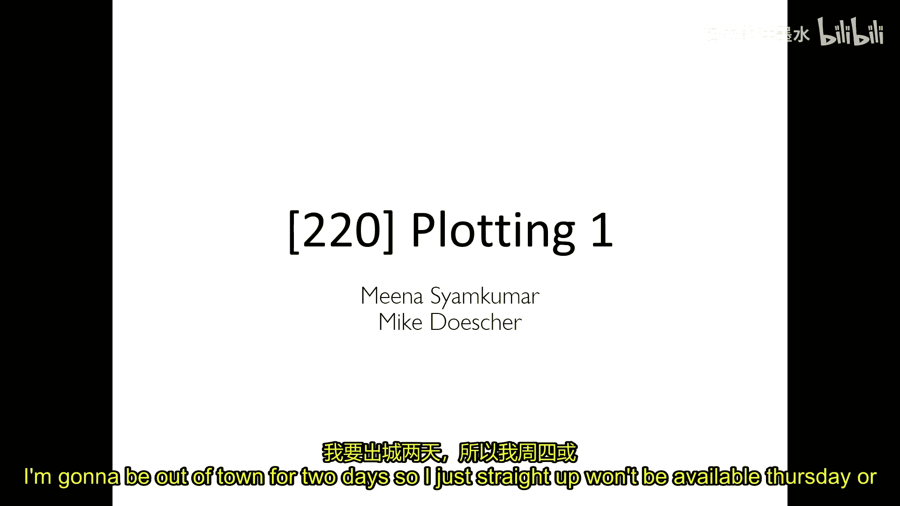
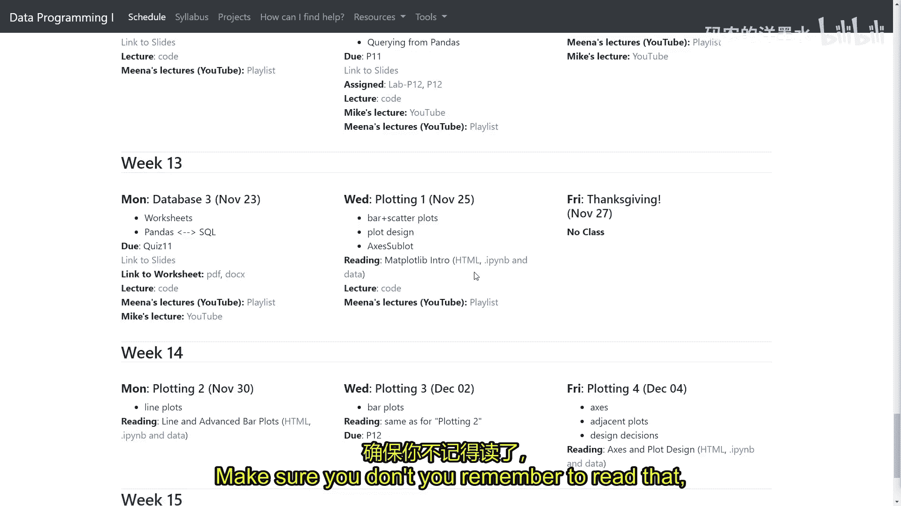
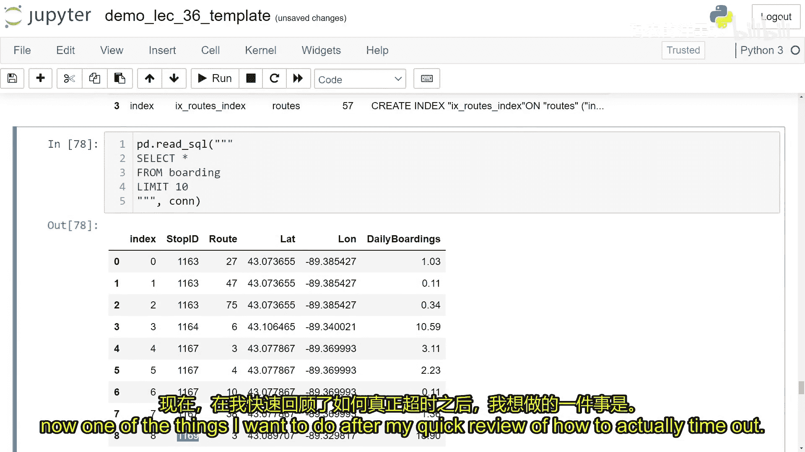
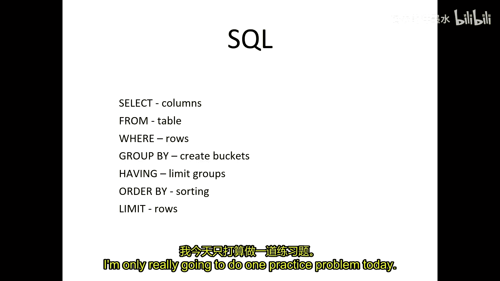
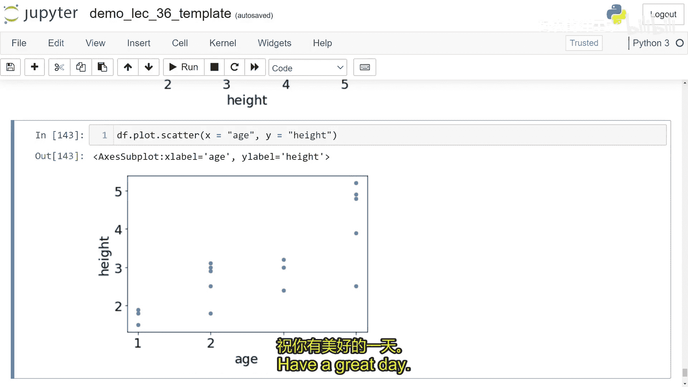

# 【全集】威斯康星大学-Python数据编程-CS220-中英字幕-1080P-p30-Lecture-24---绘图1-1--BV1VxvsBLEmv_p30-

Alright， hello everyone。 Welcome back to data programming1。 Today。

 we're going to begin talking about plotting。 So while I'm doing my intro， please go to our web page。

 there's a Jupiter notebook template there， and we'll also need the trees dot text as well as the final version of all these lecture notes that I developed during the lecture。

 I'll go ahead go downloads as we get started。 And now for the welcome， first happy Thanksgiving。

 enjoy the four day break。 feel free to work on anything you want。 of course， But we。😊。

And all of the staff for this class are going to be taking Thanksgiving off for four days in a row there will be no office hours。

 no lab， I'm not going to reply to most emails， we'll see how important it is and I'm going to be out of town for two days so I hope just straight up won't be available Thursday or Friday。

I also want to just point out one thing here。 The reading assignment that goes along with plotty1 Here we are Wednesday。

 November 25 was created by Tyler and Mina。 Tyler is the instructor before me who taught this course。

 We've got two versions here。 There's an HTMLl version。 I don't know if you know this。

 but you can publish Jupiter notebooks in HTMLl format。

 So this is just the reading done in a Jupyter notebook。 We also have the Jupiter notebook version。

 So Minina and Tyler went ahead and actually wrote something to go along with this lecture。

 And anytime we spend the time to write our own material We think it's very important。

 So anyway go ahead the reading is right there。 make sure you don't you remember to read that。

 Don't skip it。

All right， we decided to include plotting is one of those four major topics from the last third of the class。

 the data science part of this。 I don't know if you guys know this I put it in my introductory lecture。

 but before I started working in computer science， I studied chemistry I have my PhD in chemistry I earned that at the University of South Carolina After that。

 I went and did top secret chemical research at the United States naval research laboratory and during my course my career as a chemist I have made。

Thousands of plots and you know we'll collect scientific data but the best way to communicate that data to other people and to look for trends to see what's going on is by plotting the data。

 graphing it creating an image that communicate what's going on and to be honest。

 figuring out what's the best plot， how to best display the data。

 how to do any sort of mathematical manipulation to show a trend like a log or something that's the hard part it really is trying to figure out what plot will best communicate the message or best uncover a trend or demonstrate a scientific law and of course every field has their own reason that we might want to make a plot depending on whether you're in economics or engineering or any of the physical sciences but figuring out what kind of plot is hard and to be honest。

 I spend some time in the beginning of the year talking about becoming bilingual in my experience was very few chemists to actually studied any computer。

Science at all。You know， we used specialty programs。

 specialty software to create all of our plots for all of those papers that we wrote and all of the communication that we did。

 but being able to actually go through， use a Jupyter notebook to get exactly what we want to learn these little techniques that I'm going to demonstrate today can be very valuable。

 So the idea is we want to be able to bring techniques from computer science and apply them to other fields。

's that's the goal of data science。😊，All right， but today we're going to be covering the mechanics of generating plots in Python。

 We're going to be using a number of tools。Yeah we're going to cover pie charts， bar graphs。

 and we' begin introducing scatter plots。Alright， Panice uses a special module called Matplot Lib to create plots This library it's designed to look a lot like MatTlab if you're familiar with that MatTlab。

 we actually offer a course in the computer science department not about programming in MALb but the idea is that's a matrix manipulation and has a lot of features for creating graphs it's full featured programming language。

All right。Anyway， we're going to be using pandaice。To interface with Matplotlib。

 we could use it directly。 but pandas has a lot of methods that are just tied in with a series and data frame objects that we've already learned that make this substantially easier。

 So we'll be using Matplotlib directly to tweak our plots。

 And it's just going to feel pretty natural because they did a really seamless job of blending these all together。

 All right， to the notebook。😊。

Alright， so as we get started today， we're going to need a number of modules that we'll import first。

 we'll need pandas because we'll be using pandas to do a lot of our data manipulation。

 we'll need and that's going to what's going to interface with the matplot Lib for us。

 So we'll be needing the data frame and series objects。

 we're also going to continue using our bus route data。 So we'll need a SQLite 3。 And of course。

 we're going to need matplotlib today。 So one second I'm going to go and just type that in and。

Be right back。 Alright， there we go。 I've got those imported。

 Go ahead and make sure you pause video importm those on your own。And so your notebooks up to date。

 at the next thing we're gonna do， I'm gonna create just a very simple pie plot， a pie chart。

 So and we can create pie plot from a number of things。

 We're gonna to be using a pandas series in this case。 First up， Go ahead， quick review。

 I'm gonna to make a series with 5 million，3 million and 2 million。 Go ahead just quick review。

 pause the video。 go ahead and make your own series。 and then come right back。

 and I'll show you how I do it。😊，Alright， remember。

 I'm back that we can make series using lists or dictionary。 I'm just gonna。

 I'm because I'm creating a very simple series。 I'm just gonna create it。From a list。

 So I need a constructor right there。 that's going to create a series。

 And I'm going to give it a list with 5 million。3 million。And 2 million。All right。

 run that cell and take a look。There we go。 Pada series。 Here are my indexes。

 And remember when I create from a list， the indexes will be the same as the integer position。

5 million3 million2 million looking pretty good。Alright， next up。

 we're going to go ahead and create a pie chart。 The basic idea for all of these using pandas to connect to map plot Lib to create a plot is to basically here。

 let me just put down the pattern or the template。We have a series name that's the name of the variable dot plot。

 That's the name of the function we'll be calling from pandas out map plot Lib。

And then we're going to need。The name of the plot function。In this case， a pi bar。

 horizontal bars H bar or scatter。 So I go ahead and S is the name of my series variable right there。

So I'm going to be calling dot plot。And then the plot function for a high graph is just pi。

 Al'll see what this looks like。Here we go。 Alright， let's go ahead and take a look at this。

 First up the， obviously， we see our pie chart right here。

 It also prints out in the outbox the type of this object。 This is an axes subplot。

 That's what the name of this object creates when we call this。 Allright。

 it tells us the y label is not。Allright， now let's this plot is garbage。 This is really terrible。

 The labels are all wrong。 They're just numbers。 They're not really very meaningful。 There's no。

 it gives us a sense of the relative scale， but there's no numbers here。

 I have no idea that this blue wedge represents 5 million。Some things。Allright。

 it's actually really difficult to read these index labels。 They're tiny。

 I know it doesn't really look that way。 I have my font size blown up huge to create the YouTube videos that way。

 even if you guys are trying to watch this on a mobile device that hopefully it's big enough。

 No one's complained recently that the font is too small。 In fact。

 I had a friend come over for the first time。 And I just gave her the tour of my house and got down to the office and I had my last video recording open。

 I just left it all open when I was done。And she said， my God， are you really that blind？But no。

 it's just for the video recording。 but these are actually really tiny。

 So we're going to go ahead and fix that。 Also， this nonen here is not very meaningful。

And there's absolutely no indication of what we're plotting。 Allright。

 So let's go ahead and try and fix some of these things。Alright， so let's start with the font size。

 First， mappl Lib gives us a whole bunch of parameters we can set。

Let's go ahead and just pull those up there in a variable called Rrc parametersms。

And we need to grab that from the plot library go ahead and。And Miss Spll Mat plot Lib。There we go。

 Okay， so it's basically， if you look at this， me scroll down a little bit。

There's a lot of them here。 All kinds of different variables we can set。 This is going to work all。

 just like a more or less like a dictionary where there's a function call to set all of these things。

 Okay， like I said， there's a lot of them。 The one we want is font size。So see font dot。

Size right there。 So we can see the default value it's set to 10 right now。

 Let's go ahead and set that to 18。Make it big enough that everything gets larger。 Okay。

 so I'm going to leave that line right there。Ma plot Lib， RC。Pms。

 and then because it's accessed just like a dictionary。

 I can just go ahead and give it that was font to its size。Brackt equals。 We'll make it bigger。

 Alright， we'll run that。And then we'll run this again。

 And we can see the font size kits substantially larger， almost double。

 That's exactly what we're looking for。I would encourage you guys to go ahead and just pick one more thing from that list and try and change it a little bit。

 Just manipulate one of those things。 So I changed the font size。

 maybe change the exact font and just do an experiment on your own。Alright。

 the next thing I want to do is go ahead and add data labels。 I don't want these indexes。

 I don't want 0，1，2。 I want it to actually be meaningful to do that。

 Please remember that I can create series from dictionaries also where I can give my impandda series。

 whatever indexes I want。 They're like keys in a dictionary。

 I'm going to go ahead and name these numbers， please。Fire and schools。

 We'll just pretend we talking about city data spending for this example。

 just so I have some examples to give it。 This is a great place to pause the video and go ahead and recreate that series S with those labels。

 police， fire and schools。 And then go ahead and plot it again。

 So do both of those right here in this cell。 It's a great review If you were paying attention during the pandas This should be no problem。

😊，Allright， I'm back。 let's go ahead and do this to create a series from a dictionary。We need series。

 It's a construct， and this takes a dictionary。 So dictionary is going to be with brackets。

 Are any keys and values。Ks。And。And typos， keys and values。And keys。And values。 Okay。

 so what did I say， please。I want fire。And。Wait， I want schools to be the3 million。

Let's face it schools are expensive， and then we'll have 5 million。3 million。And too main。All right。

 there we go。So go ahead and let's print that out， make sure I didn't screw up。Perfect， okay。

Looking good。 So now I can see that I've relabeled everything。

 Let's go ahead and plot this plot dot pi。 It's all there is to it。 And here we go。

 Now I have relabeled these。If， if you went ahead and changed the font from a serph to a sand serph。

 I believe the default is sand serif。 So go ahead and add serph that'll add the little decorative pieces to the letters。

 This one has no little flare to it。 These are just。Regular letters。Alright， next up。

 let's take care of this nun and actually give the graph a meaningful label。 right here。

 we can see why label equals none。That's a little reminder to me that the wildable is done。

 so we can go ahead and just change that right here。

When the in the plot creation constructor function。 So we can say the Y label is。

Let's just call this city spending。 I'm going run this cell again。

 And I can see now it's change the none to city spending。

 It's not the greatest position because it's really close to schools。 In fact， if this were。

Annual city spending， it's actually going to right over the top of it。 And again， in that RC。

 let's see where is RC parameterss， there was a lot of things we can change to manipulate exactly where everything is。

 the positioning tons and tons of options for controlling how the plot looks。

I'm not going to fix that here。Mostly because this creating a pie chart is not the most meaningful way to display this data。

 I have no idea how much money is actually spent on police。

 All I can really see is that it's more than is spent on schools。

 which is more than is spent on the fire department。So let's go ahead and switch this to a bar plot。

 I would say that 90。To be honest， art， I've never made a part chart in all of chemistry during my 20 years as a chemist。

 not one pie chart。 On the other hand， I've made， well， theyre almost all scatter plots to be honest。

 but I've made a few bar plots。 So let's go ahead and learn how to do that here。Alright。

 this is actually very simple command S dot plot， just like for the pie chart and the scatter plot。

 this is how we're going to connect through pandas because this is a pandas series to map plot Lib。

And then I want to create a bar graph。 Very simple。 I just need the name of the plot function。

 and we are away。 Okay， so now we have a bar graph。

 We're still got the the dictionary version of the series。

 So these are already nicely labeled for me。 And now I can see that I'm actually getting 5。

 Now it would be times 10 to the 6。 So that's a little awkward。 a little hard to read。

 It doesn't really tell me this is in millions。 I can do better。

We can also see that this is returning an object of typey A subplot。 In fact。

 let me go ahead and real quick just demo this if I do type。

OfAnd then give it this command right here that creates the photograph run this。

 I can see that it's creating a map plot lib object。Type axes。

 and this is the subtype subplots known as an axes subplot。 So there is a lot going on here。

 Mapl Lib is huge。 It's got hundreds of submods that do all kinds of amazing things。So。

 but this is what we're working with right now。And now that I know that this is a tough type axes subplot。

 I'm going to go ahead and give this plot a name。 We just call it axes or A X， I guess subplot。

 And now this a X is this plot object。 if I' on this， it should still。We can do this。

Create this Axy subplot。 We don't need it to print out the type anymore。 I can comment that out。

 I'm gonna go ahead and leave it for you guys。 It doesn't do anything because it。

 it just got skipped over。 It creates the type。 And then Juer notebook ignores it。Okay。

 now using this Ax subplot object， there's all different kinds of parameter or commands。

 I guess methods that go along with an AxI subplot just like I had series and I could extract data with location LOC。

 those are all methods， a bunch of string methods we talked about early in the semester string format。

 for example， there's tons of methods that go along with an Ax subplot let me just go ahead and introduce just a few of them。

So， for example。We can set the wire label。Well spellll it correctly， maybe。

this is going to be dollars。Right now， go ahead and run this and now I can see that I've changed the label there to dollars。

We can give this a title。Set。You may have guessed at title， this is going to be city spending。

There we go， it's now added city spending to the top of this。

I just scroll down and reminded myself that I actually had a separate section to talk about the X axis Y axis and title。

 Let me copy and paste these things so they're in the right spot。 So when I put this online later。

 everything looks matches what's in the template once。All right， there we go。

 got everything in the right spot。So the next thing we want to do is fix the y axis values。

 So this one times 10 of the 6， there 1 E6 tells us that we're actually in millions。 It's right here。

And then they kind of looks like at first glance， the police are getting $5。

 If you don't spot the little times 10 to the 6 right here。 It's not even kinda in the right spot。

 They put it on top。 Alright， we need to fix this。 I'm gonna go ahead and grab everything from this cell real quick。

 and。Let's get it fixed now。Hold on one second。 I I to put it right here。 a little instructive time。

 If you remember， we can actually create a brand new Padaice series by doing this element wise operations on it。

 So in this case， I'm going to divide by 1 million。

 And so 5 million divided by a million should give me 5。

 and then 3 million divided by a million should give me three and go ahead and just run this cell。

 This creates a brand new pandaice series。And from a panda series， I can， excuse me。

 createate a bar graph。 I'm just going to go ahead and do that right here。 So in this case。

 I will need parentheses because the order of operations。 the plot is actually a much higher。

 or that the dot operator is higher precedent。 And so it'll try and take 1 million and plot that。

 And that's not going to work。 We need a series here。 It'll do S divided by。1 million。

 we'll go ahead and grab that。And now it's removed that one he 6。 But now we really are down to $5。

 So what I want to do is just let my audience know。That this is。Dollars in millions。

 And this is pretty easy to read。 I have。$5 million right here，3 million。 This is much more clear。

All right， we can do even better。 So please， schools and fire。

 I kind of feel like I should tip my head to the left to read them。 So obviously。

 these three words are not that complicated。 There's not that much going on。 I mean。

 fire only has four letters， but they can be a little difficult to read。

 So I'm going to go ahead and update the figure with these labels rotated at 45 degrees。

I suppose another way to do this would be to just rotate the entire graph so that the police。

 schools and fire are horizontal up here， so we'll actually do both ways。Alright。

 so in order to change these ax these labels， let me just go ahead and copy and paste this stuff。

 so it prints the graph again。I'm going to add one more line。 And here， let me just real quick。

 that line is going to be whoops， X dot set。X tick。Labels。

 and I'm going to walk through this in a couple of steps。 So these are the X axis ticks。

 These are the labels。Let's see let's go ahead and if I just run this。

 it's going to give me an error that's going to give me some useful information。

 It says that set tick labels requires one positional argument called labels。 So it's positional。

 So that means I can just put it in the front。 And what I really need here is a list of all the words that I want to use from my labels。

 police fire and school。 I want to actually extract that from my series。

 So I'm just going to go ahead and create a list and I'm going extract it from the series And those labels were actually the indices。

😊，And remember， we had index is one of the commands we could use a method。

 or I guess it's a data element。In a series， so I do that。 There's the text。That it returns。

 I'm going to go ahead and add this to the graph and just do this right here。

 This should not have changed anything。 I should not have broken anything。

 All I did was put in the exact same labels that were already there by default。

But this X tick labels also has a number of other things I could do to them。

Rotation equals 45 is one of them。 This is a keyword parameter rotation。

 so I can go ahead and do that。And now I can see that I've rotated all of those labels。

I feel like this is a good time to go ahead and like demo。

 How do I get more information about these functions， How do I even see what's available？

 And for that， I'm going to go over to Google real quick。😊，Alright。

 I'm just going to do a quick search for matplot Lib。 Let's go ahead and run that。

 And then the very first thing here that comes up is the matplotlib do org where I can get the documentation。

Alright， so let's pull this up。 What I really want is the。There's all kinds of stuff here， tutorials。

Documentation， I'm going to go with the documentation。And I've got several things here， user's guide。

 just some tutorials， the what's new， how to install it。The API。

API stands for application programming interface。 So these are all basically all of the commands that I can give Mapllib in order to make it do whatever I want。

 So this is the one that I want right now。 So API overview from here。

 I can see that theres an what am I looking for more or less。

 this is complicated mapplotlib has an absolute ton of stuff that goes along with it。 And fact。

 here contains the following sub modules。 there's got to be， I don't know。

 anything think 60 of them here in that list。Alright。

 so the one that I want to go to to talk about these X tick labels， we'll use that as an example。

Okay， right。 This is actually really difficult to navigate because there are so many。

 But here's some little secrets to get you started。 We have created an axes subplot。

 I stress that a little bit ago， because this is the thing that I want to click to go get help about this particular feature of map plot Li。

 So I'm going to click axes。It's tiny。 I hope you guys can read that on when this is up on YouTube。

 Alright， then there's a ton of stuff here about axes。

But all the parameters that I can set right here， I'm going to scroll down are X tick labels right there。

And if you guys so for this course， we're gonna go over just a couple of things， a couple features。

 but I want to give you the idea that this is extremely powerful and that when you're out there creating data for other classes or for like projects of some kind of in the real world when you get a job and you're trying to create the perfect plot for your boss。

 It's worth taking a few minutes and exploring that going through some of these tutorials。

 If this is part of your job and learning how to control this。

 how to become a master of this particular tool。 I remember the beginning I talked about learning the tools and becoming good with them。

 if this is something you're using in your job， it's worth the investment of time to learn how to use it。

 But for this course， I just want to give you the flavor， I want you to learn some specific commands。

 Ext labels is one of them。 All right， So here's the idea。 Ext labels requires a list of strings。

 that was the error message we got It's called labels。 And so I generated a list from。On the series。

Alright， that's the label text I've got some other things that are optional I could use dictionary to control the appearance and this is a lot of font stuff Minr is another keyword parameter that lets me set the minor tick labels instead of the major ones more useful for something like a scatter plot where I've got big labels and then tick between them。

List of text is the labels。 And here we go。 The key word arguments are basically text properties。

 So if I click this one， this is going to bring up an entirely。

 yet another huge list of all the things that I can set to control。How these X take labels look。

 All right。 And the one that I chose here was rotation。 So rotation just takes a number float。

 and how many degrees that I'm going to rotate that text pie。

 So I hope I've given you guys the flavor that there is a lot of control that we have over everything。

 here's another one that I'm going to use in a little while visible turns on or off whether I can see something。

 So and this requires a boolean value， true or false。 All right。

 I I'm going to go ahead and jump back over to Jupiter。

 I feel like I've done what I want to hear from， you know， There's a lot going on。

 And this is where you go get help。😊，Al right， so we're back here in Jupiter notebook。

 Go my graph with the rotated labels。 Here we go。Again， X tick labels are mandatory。

 We have to put in a list of what the labels are to use it。 And I grabbed those。

From the series using the index parameter。 And again。

 this is where I put in my keyword argument that controlled the rotation。

 tons and tons of options there for things that I can put in about how to control the exact way these X tick labels look。

 And I had to give that a floating point number in this case。 I just gave it 45。

To rotate these by 45。 And again， it is floating point。 so I could do。45。

5 and give it a tiny bit more rotation， they both work。Okay， next up， Oh。

 how to change the font inside the figure。 I already did this。

 I got excited about fixing that pie chart。 Let me go copy that， put it right here for you guys。

 once I go be back。😊，Alright， there we go。 Got that copied Now。

 when you're looking at the final version of the template， everything will be in the right spot。

 Sorry， I just got excited。 Okay， next up， check out。 this is actually kind of a small figure。

 I have everything zoomed in so much so the font size is visible on YouTube。

 But what if we want to actually control how big the the figure size is。

 So I'm going to go ahead and do that right here， in my experience。

 when I created all those graphs for chemistry。😊，A lot of the papers we wrote。

 they were sort journals that required very strict control over the column width that they were almost always published with two columns。

 I had to set the figure width to an exact amount。 That other software we use。

 that was tricky to use。 to be honest， I never really took the time to learn how to use that tool。

 was frustrated by this kind of stuff。 Matpl Lib makes this very easy。 Let me go ahead。

 I'm just gonna copy and paste everything we got right here。How to change the figure size。

 I'm going to go ahead and leave this off。 We'll keep it as simple as possible for the example。

 but I do want the labels。Alright， and the bar plot actually takes a。

Keyword argument called Fig size。That。Requires a tuple in order to pull this off。

 and the tuple is the x dimension and y dimension in inches。Alright。

 so created a tuple with the parentheses。 I've given it an x and y dimension。 go ahead and run this。

 And now I can see that I've shrunk the x dimension down and expanded the actually。

 I think that looks like it's about the same。And set the Y dimension2 about the same。 Alright。

 so I've got a lot of control over how this looks next up， to be honest。

 I think this might be even better if we make the this horizontal。Alright。

 creating a horizontal bar graph or bar chart is very easy。 I'm going to go up and grab this。

 My commands that create the bar graph。 This is the original one。

 The command to turn this into a horizontal bar graph is bar H。 So quick review。

 Remember that I'm creating a series here。 using my original series in millions。

 Its element wise division。 So I'm getting a brand new series。😊，The command。

 the method that I want to call on this series is plot。

 and then I need to give that another method of which kind of plot I want to make if you missed it。

 if you weren't paying attention for those about 1。2 seconds that I typed this。

 the new plot command is bar H。And it takes all the same arguments。

 Let me just go ahead and run this。And now I have a horizontal bar graph。

Theum the labels are now wrong。 So let me go ahead and fix that。 This is not the Y label anymore。

 I want an X label。And。We'll go ahead and add a Y label and call this。 how do you feel about。

Department。There we go， city spending by department。

It does look a little weird the way the the graph is still really skinny。 It didn't switch that。

 I'm going to go ahead and switch these back around。Run this again。 I like that so much better。

 I think that looks really good。Another feature that I'd like you guys to learn about is how to change the colors of things。

 A lot of times in chemistry。 they publish all these journals。 It's very expensive to use colors。

 So they'll want to publish everything in grayscale。 let me go ahead， copy this tab。

 the commands that create the bar graph。 Let's see。 how can I simplify this。 let's get rid of that。

 We'll just shrink it down a bit。 We've got figures。 Okay， Here we go。If you。Color， yeah。

 that's the word。 You may have guessed that already。

 The parameter keyword keyword argument that I need to give it is color。

 And this just has a number of options here。 I can give it a string。 like red， for example。

 And that's gonna change everything to red。Let's see here。We've got blue， I can shorten these up to。

 I could just use the letter R。Blue is going to be B。 There we go。

 That's a slightly different blue than we have up here。

I kind of like this bold one better to get black， that's the keyword K because we've already used blue。

嗯。And then I'm going to go ahead and leave that real quick。Never， ever。

 ever do W unless you change the background color， because white does not show up on a white background。

 Do have another cell。 I got one more。Let me just。Addd a little comment。No。No， don't do that。

 but it is an option。 You could do that。 color can also take a number。So for example。

 I can give it 0。5。Run that。 oops， oops， oops， Alright， it needs to be a string。 Let's see here。

 me show you the active message invalid RGBA argument，0。5。嗯。

Or does it telling me I need to be a string。Okay， I don't see it。 needs to be a string。

 Let's go ahead and。That was a long error message。 There we go。 So 0。5 will'll put this into gray。

Kind of like that maybe a little darker，0。6。0ero point， I think I'm going the wrong way。Yeah。

 that's later， okay。0。4。 Alright， I like that。 So we just give this a string as。

And it's going to go ahead and take care of converting that for us。And changing the color。All right。

 just a couple of other things that we can do， for example， how to mark grid lines。 again。

 we could go get some help， but the command to add grid lines is just grid。 It's a method。

 so I need the parentheses。Grig grid， try that again。 And to be honest， I really don't like this。

 I think anything where we're using ink that's not associated with data really needs to go。

 I don't like the way the grid lines look there not helpful。

 They add extra visual clutter that makes this difficult。 So I'm gonna go ahead and do a no， no， no。

 don't do that to me。 minimize how much we want。 And in fact。

 if we take a look at this version right here， we have a line right here and a line right here that are not contributing to the data。

 let's go ahead and remove those。Okay， and again here I've got a little hint。

 my graph object do spines is going to give me a list of all here。Let me just grab this。

 We'll go ahead and just experiment with this。If we just call it a dot spines。

 it's going to give me a dictionary。 In this case， an ordered dictionary with all the things I can change Left。

 right， bottom top。 So let's go ahead and。Get rid of the。The top and right。 So that's X。Spines。

 in this case， I want to access the top one。And one of the things that one of those functions was visibility。

In that case， there's a built in method already available， set visibility。Said visible， P I S。

 I visible。It might be visibility。 I think it's this one though。Set top So if I can spell set V， I。

 S， I， B， L。There we go。 Okay， so that's going to remove the top 1。

 I want to do this again with the right one。 I'll get rid of that。And there we go。All right。

 one other thing that I。Really don't like about this graph is there's no five right there。

 I'm going to leave that as an exercise for you guys to go back and see if you can navigate that the help menu to figure out exactly how do I change the numbers that appear on the X axis。

Good luck with Oan。Alright， I want to take a little break from how to add more features to decor graphs to make them look good and talk a little bit about what's going on behind the scenes and capturing subplots。

 So again， all of these things are Axes subplots as part of matplot Lib and they're being graphed on the screen right here。

 and I've been capturing these in variable AX。Now， one of the things I want to do is go ahead。

 I'm going to import another module to help make what I want to do next a little easier importm there's a module a pie plot that makes working with plots easier and the thing that I want to do is suppose I'm formatting all of my plots to be to go into some sort of professional publication with columns that are exactly for。

inches wide。 and they reject my paper。 And then I need to go and。

 I'm gonna publish in a different journal。 make some tweaks。

 Maybe the first journal was not a little appropriate spot。

 but they require column widths that are 3。8。 Okay， I'm going to go up and import Ply plot Li。

 I'm going do this at the very top。 So let me just scroll up and 1，2，3，4，5，6，7，8。9，10，1。

 I've made a lot of plots in this graph。 This would be a real pain to have to go back and change my entire notebook。

Letm me go ahead and import pie plot as PLT。 And again， PLT is just as common as pandas。

 this abbreviation P D and PLT。 If you go to look for help， they will not include this line。

 but they will have PLT with the with the methods go with that module and just assume that you know that PLT is。

ha怕。And I forgot to copy the whole line。 It's actually。Oh， wait， no， the line isn't correct。

 Hows exactly from。 No， hold on。 hold on。 What am I doing from。Mad plot lid。Import pie plot as PLT。

 there we go， okay。Let me scroll back down to where I was working and introduce the idea of just。

 let's create a function that controls a lot of these basic things every time I create。Apart。

So here's what this is going to look like。 So first up， I'm going to use P plot to create a subplot。

The command method is just sublos。 Let's go ahead and do this。 And this creates a tuple。

 It's going to return a tuple with two things。 The first one is just。

 it's basically going to be a blank canvas that I can draw on。

 And that's going to be known as the figure。And then the other thing it's going to return is a subplot。

 in this case， so like just a generic blank plot。That has no data in it yet。

 So we'll go ahead and we'll be adding data to that。

 And this axes subplot is where we're going to be graphing our thing。

 But because we're creating a figure， this is going to let us do a lot of different things with this canvas。

 And the one that I'm going to demo in future lectures and it would be in the last project is putting more than one plot on the same canvas we can have things that are side by side for comparison。

Alright， so like I said， I was going to be creating a function that I will use to create all of my plots that's going to go ahead and set all of the required parameters。

 exactly the way I want them。 So all I need to do is tweak one function and rerun my notebook。

 and that'll change the appearance of all of the plots created with that so I can easily change the width。

 I can add those spines back if I want。 And I'm going to call it get X ay subplot。😊。

We'll give it some parameters because we're going to want to have some control over these things。

I'm just going to use for my example the。Idea that I'm creating this for a professional journal where I'm going to hard code the width so that it fits on the exact column of that page。

 But I'm gonna have control over the height for these things。 You know。

 I might have a column of text。 I need to make the plot shorter or I might have some extra space to fill in so that it looks really good。

 I'm going give myself some control over the height。 Allright。

 So I need a cooling because I'm creating function。 And now I'm gonna。😊，Ct and paste some stuff。

 Hol on。 I want one of these。Alright， this is gonna give me， this is gonna return a tuple。

 So I'm going go ahead and capture that in。Return vow。 Yeah， let's do that。Right now。

 I'm going to rela that to something better in just a second。 Pel T subplots。

 And this will take fig size。That requires a。2봉。Fig size equals。Tubple。 and then I need the width。

 So I'm going to hardcode the width to4。And we'll give it a height。 And of course。

 I'm going to put in a default value for that height right there of three in case I don't want to like just。

Quick and dirty。 Okay， next up， I want to copy some other things。 the spine stuff。Once I've got my。

Axy subplot。I don't have an ax Sot yet Timeout。 Allright， this return value actually is a tuple。

 and that's going to contain the fig value and the ax subplot right here。

 I can see that it's a tuple right there。So I've got some choices here I can。Here。

 I'm gonna leave it return Val。 We'll go through this in some steps。 Now， return value is is。A tubal。

 So I can go I and extract data from the tubbo。 I'll figure equals return v of 0 and x。

 this is the part I care about is return vow of one。All right。

 let me go ahead and just do this real quick。Okay X。Make sure I don't have any errors。 Okay， yeah。

 it's given me a blank。Figure with。The spines removed。 looks like it's working。

 It looks like it's about the right size，4 by 3， so。Alright。

 but I do want to introduce one more concept real quick。 I'm going to leave this right here。 Alright。

 and then I'm going to do something that's really bad。

 I'm going to make another copy of this same function， right here。Re redefining the same function。

 But I want to introduce the idea of tubal unpacking。 So right now， this return value。

 I never came up with a better name for this。 It's a tubple。

 but I can go ahead and say that I'm going extract the data directly from it， so。

Let's see here it's makes this look good。Yep， and grab the figure and the axis。

 And that will just automatically assign each of the corresponding parts of that tu bowl to each of these variables。

 So there we go figure。And。Vi your and A subplot。All right， next up。

 let's go ahead and I'm going to grab another cell below this。

And actually call this function and start giving it some data。 Okay。

 so I'm going to create a new ax subplot get X whoops。Extra letter there。

I'll go ahead make it skinny or I'm sorry， Yeah， short。And then we'll go ahead and create。

 I'm going to do the exact same bar graph I've been making up here the whole time。

So let me go ahead and grab。These lines， right here。Okay， so now here we go。

 I'm saying my axy subplot。And I want to get rid of this part right here。

 Here's where I'm the actual subplot creation。 And now I already have an existing axes subplot。

 So I want to just go ahead and use the keyword a。 That very common。Equals x。

 So this is the keyword parameter that I can use for the bar graph to say。

 don't plot it in a brand new cell。 A brand new axie subplot。

 Go ahead and use an existing axie subplot。 And I named it X。

So my function get Ax generates a figure that a canvas I can draw in， and it generates a blank。

 actually subplot。 I've captured that。I don't think I ever returned it， hold on。Return。Ax。

 there we go。 Oh， my bad。Bad， bad， bad。All right， I'll get this all fixed。 all right。

 so you that one。Then we'll go over here We'll run that。 make sure it's working。 Okay， realwind。

 Mike， start over。 This function creates a figure and an a subplot。 That's a blank 1。

 I'm capturing the ax subplot and returning it and storing it in this variable ax。

This much right here is creating a brand new axy subplot。 And before I had this as ax equals。

That's taking a variable and giving it this subb， but it's going to be in a different figure if I do it that way。

What I want to do instead is tell it to draw in this axy subplot right there。

 So that axe corresponds to this one。And this is the keyword parameter。

Where I'm going to be sending that keyword argument。

 where I'm going to be sending the plot to drawing。

 I know this is confusing because I'm using A X so much。

 But when you go get help if you go to stack overflow and read about this stuff。

 this is how people do it。 They're going call these axy subplots just like this。

 So I wanted to like demonstrate the confusing part of this for you guys。Alright， next up。

 I copied and past it， and I never took out my fig size。 The ax subplot。

 The get ae already takes care of that fig size stuff for me。 So if I run this。

 that's all still retained。 If I make this taller， let's make it 4。5。

 I can see that it's already taken care of by my generation of the axy subplot。

 and I like the way that looks。 I'm putting it back。But just a quick experiment。 So， in fact。

 I would encourage you guys to pause and try experimenting with some of these things。

 change some of these parameters and just see， you know， maybe move some of these things around。

 maybe put the set title up here in the function。😊，If all of your data has the same title。

 that's perfect， it chances all right， doesn't that would maybe not be a best move。

 but it could be that you put a set title。Up here into your function。And just do something like this。

Rememberumber to set the title。Run that。 That's going give me my blank version。

 And then when I run this here。I've already set the title， but if I had comment that out。

It's going to remind me that I want to do that。So quick tips for making better graphs。All right。

 I'm going to move on to part two of this lecture。 This one is just straight up going to be a very long lecture。

 I think the plotting' is important。 I want you guys to know how to get help。

 You are gonna make graphs in all so many other classes that you take And when you get a real job that it it's worth spending the time today to learn some of this stuff and going through it。

AlrightSo next up， I want to talk about connecting to database， a SQLite database。

 getting out the data and making graphs from that。 So Im want to introduce that idea。 And again。

 we're going to be using all kinds of modules all merged together。

 They're designed to work together seamlessly。 You won't really even be able to tell which module you're working with。

So one of the files in that directory was the bus DB file that we were working with last time。

 So I'm going to open it up。We'll be creating a connection object。The command is sQL light 3 connect。

 And all I need to do is give it a path。 plus do Db。 Okay， if I run this， this works。

 but this is not the ideal way to do this。 because if I mis type the file name。

 it's going to go ahead and create a brand new database。 So a better way to do this。Whatops path。

Equals。Bus do Db。 So I'm gonna go ahead and make sure that this path really exists。

 And I only want to tag this one time。 that's the bad way。 Com that out。

 So I want to verify that this， this is there。 So stop path do exists。

We'll give it the pass and this will check for me。Quick and dirty。

 I'm just going to throw this and do an insert so it crashes if it's not there。

And hold on right here， I'm using OS。Right there， let me go ahead and import that time out。

Jump up to the top， and we'll do it right here。Import O S done。 I'll run that， so。And back down。

There we go。 Okay， so now this will crash if I screwed up typeping the name or I forgot to put the database in the right directory。

 if you forget to download it， that can be very deceptive。

 This is going to not work if you forgot to download it and if you do it this way。

 it'll create a new blank file and then none of these other things will work。Okay。

 now that Ive verified that it's there， I'm going to create a new connection object using my path。

 I only want to type that file name once。It reduces the chance that there'll be errors。Okay， awesome。

I now have connection to my path。 I want to remember to close that at the very end。In fact。

 let's go ahead and scroll down。Where is the。Yep， down right here。

 this is the bottom of this section。So we'll close it right there。All right， that way。

 when I run the entire notebook， I don't have open dangling files。

 connections available right where was I？Okay， let's go ahead and just review what's in this database。

 So if you remember the very first thing we always do when we have a new database。

 or we're reviewing one from last time command， it's a pandas command that we'll be using to connect to the SQLite3 database read S QL。

I can just do this in one line， select。Everything from。

And that special thing that we just have to memorize is SQel at master。

And this requires a connection object。 Last time I just made a query function that I used to do all this stuff。

 I'm going just break it down and trying to remind myself。

 use the commands directly rather than that function。Alright， yeah。

 So this is telling me it's data from the city about bus routes。

 So I've got boarding table and the table is the 1 I care about a boarding table and another table with routes and then some things to help make the database efficient that we're not going to talk about this time。

Alright， so next up， let's go ahead and just quick review what's in though， I guess the routes table。

 That's what I want to work with today。So。Let's see， here。Let's go ahead， break this down， select。

And from those the ones I care about。This requires the connection object。

 So I'm going to start writing these so they look like in this sort of structure。Select。Let's see。

Do I say routes， I think I'm meant boarding。And。Will select。Next spot， select all the columns from。

Boarding。Don get that right， porting， yep。let's just take a look what this looks like。U。3972 rows。

 Oh， it's not quite look at that much。Limit。There we go。 Let's give us the first 10 in this case。

 stops with how many people boarded the bus at any given time。 Okay， at any particular stop。

 So I can see like here， this is the biggest number around here。 I've got 19， well，18。

9 average people who board on route 3。At stop 1169。Alright。

 now one of the things I want to do after my quick review of how to。Actually， time out。

I made a quick， I grabbed that slide from the two two lectures ago with all the SQL commands because they go in this particular specific order。

 So I'm going to upload these slides with the lecture so you can like just get a quick review。

 you'll have it right there available。 So as we go through these I'm only really going to do one practice problem today。

 I can just remind myself what order they go in。

Alright， so now I want to ask a meaningful question and get some some practice using this stuff。

 I want to ask what are the top routes and check this out Like right here， I've got route 27，47，75。

 These are all different routes。 But I have lots and lots of stops with people getting on different routes。

 So the routes have more than one stop。 So we're going to do is just add up all the people who get on lots of different stops at a particular four particular route。

um。So what I want you guys to do， pause the video and go ahead and write a SQL query that's going to create a data table。

 a data frame that summarizes how many people get on at each route。At all the stops。 Alright。

 and then I'll have my answer in 3，2，1。Okay， here we go。 So we're creating a pandas data frame。

By reading data from a SQL database。S you all。This is my basic structure。 What I need。 So we'll need。

Select and from Those are mandatory。 and now what I want to do is group these by routes。

 So the command for that was group。喂e。Alright， now I'm creating top routes。

 and I'm going to add up all the people。 So I'm creating an aggregation per route。

 So if I group by routes。Let me just check。 It was， in fact， Yep capitalized route。

 This is going create its own independent table internally for each route。

 And it's going to have all the different stops on that particular route。 So when I do that。

 anytime I'm grouping by， I want to select。Oops， hello。I want to select route。

And use that as one of the columns of the like aggregate table at the end。 This is from boardings。

And the other thing I want to do is add up all of the， let's see what I call daily boardings。

 grab that。 So to do that， I want to create a brand new column of this data table。

Some of the data boardings， we'll just add them all up。

 This is where I'm aggregating the data for the new final table。 So group by creates lots of tables。

 I'm going to add up to daily boardings from each of these individual tables。

 the per route and put them in my new table。 And I'm just going to call this。

 oops as let's call it daily。Boarding。Okay。Might simplify that in a minute becauseuse daily boarding is long。

 All right， let's go ahead and just run this cell， figure out where I've made my mistakes。Alright。

 I see one right here。 I forgot the comma。Is that it okay， that was it。All right， so here we go。

 I've got all of the different routes。And there's， there's a lot of them。

 I've added up all the numbers。And so， let's see here。It might be more useful if we。

 let's go ahead and capture this in a data frame。Wops equals。

And let's see what else do we want to do here， let's sum。This is kind of a lot right here。

Just grab the first five。There we go。 And now let's go ahead and sort these right here inside of SQL。

 So to do that。I need the order by command， and it comes after group by。Border by。

 And then let's see I call this daily boardings。And let's see。 there we go。

That's going to give the you from lowest to greatest。

 So I want this descending because that my question is， what are the top routes。There we go。

 It looks like routeute 80 with almost 10000 people per day riding。It seems like a lot of people。

 but I'm not a bus rider， so I'm not sure where routeute 80 goes。

 maybe some of you guys can put in the comments where it's going。All right， next up。

 what I want to do is actually create a plot from this。So creating a plot requires a series。

 so I'm going to go ahead make a brand new series here。

 and I'm going to do that by extracting pause the video， see if you guys can remember this。はい。

But to extract something from a data frame， a column， I'll。

I just use the brackets to access and I need to give it the name of the column that I want。

And then that's here。Inval， and art what I do wrong， whoops。Enter S。 there we go。

 This is going to give me a series with all of the columns。And right over here。

 I actually didn't put all the columns。 I put the head in。As I created my data frame。

 let's move that down。Cause I'm not getting everything right here。 So we'll run this again。

That's now just printing the first five。This is giving me everything。 Okay， there we go。

 We've got it all。 It's sorted。 This is gonna be awesome。

 Next thing I want to do is create a plot from this。😊，Ploot and go ahead and make a bar graph。

Amazing。Almost what I want。 I can see I've got the biggest one just over 10，000。

But I absolutely cannot not read any of this。Alright， let's too much data。

 Let's just break it down to the top five routes。 Eas way to do that。还。Well， here we go。

 let's put this back。From that。Rund that Now we've only got five things。

 But what I want to do is quick review how to do this in SQL。 Once I let me put this back。 so it。

We've got all the data。 I'm doing this because I'm going want to go ahead。And。

Look at just the top five。 But then I want to see everything else to all in one column。

 We're gonna aggregate at that。 So we're going to do a bunch of manipulations。

 That's why I still want all of my data。 I don't want to lose anything yet。 Okay。

 so the next thing I'm going to do， let's filter down to the top five routes。

 but using SQL instead of。Paan hiss head。All right， to do that quick review， I'm going to go grab。

My data frame creation from the SQL。 don't need that anymore。 We'll just print out D F directly。

 So if you remember， SQL also has a way to limit。How much data we get in this case。

 I'm just gonna take a look at the top 5 using SQL。 All I need to do is add this limit command。

 Very simple。 I love SQL。 All let's go ahead and take a look at this。 There we go。

 The top 5 routeute 80 route 2 miles the way down to route 3。😊，Al right。

 let's go ahead and plot this right here。 So S equals data frame。

We'll access the data from square brackets， access the data frame of square brackets。

 I need to give what column I want。So let me just go ahead and copy and paste that right there。

 If you just mash in some text， whatever， just smash your left hand down while your mouse is moving up to the right one。

 it's easier to target and copy paste。Al right， so there we go。

 I've got my series and now we'll do Sdot plot。We'll give a bar graph， and。There we go， top five。

All right， wait a second。Now， route 0 is the top route。 That's not right。 There is no route 0。 right。

 The reason we're getting these 0，1，2，3，4 is because it's actually using the data frame row index。嗯。

That should say series row index， the series index as the。The of the label。 Okay。

 so we're going to go ahead and fix that pretty easy to do。 In fact。

 there's a little hint right here。 So I'm going to go ahead and create a brand new data frame。

 I'm going to name it the same thing。Se index。And I want to use the route column as my index。

Let's go ahead and write this and print it out。Okay， I figured this one out。

 So the key error that I got when I ran this cell was none of route are in the columns。

So let's go ahead and real quick， comment this out， and I'll show you what I did to get this。

 Okay so。I don't have route here。 This is my index。I have copied the numbers over。

So here's what happened。 Let me go ahead and run this cell again， where I recreate my data frame。

 And I can see it right there。 There is route。 It's in the table。 No problem。 Got data boardings。

 And this is the index that I want to replace with these numbers。Because when I created that series。

 it copied over those numbers。 All right， so what happened is I ran it twice and didn catch that I was doing that。

 So the first thing that happens when I run it the very first time。I'm creating this route。

It does copy this over into the index。 Check out the difference here。 This one has the index。

This one has a route column。This one just has the。Rad column as the index。 Okay。

 and then I've got my daily boarding still。 if I run this again。

This table doesn't have a route column。 This is the index label d。

 And so that's where I get this error。And I none are in the route。 it was there man。

 it took me forever to figure out， but you might run into that if you run that cell twice。

So let me go ahead and。Run these last few cells a couple times doing this one only once。 Okay。

 net a new cell below this for my plotting。 stop plot dot bar。Oops， hold on， getting ahead of myself。

 I need to grab the series。 S is equal to the data frame。 And I just want that column。

When I call it daily boardings。There we go。Now what did I do Time up。Oh， here is B seedss。

There we go。 So now I can see I've got the route numbers that's gorgeous and all of the the ridership on those routes。

Al right， next up， This doesn't like you mean the complete picture。

 I don't know how many routes there are。 What's the total ridership。

 How how well does this represent， you know these top five routes。

 how do they compare it to everything else， So the next thing I'm going to do is I'm going to go ahead and add an other bar to represent those routes。

 We'll just tack it on the end。 We'll see how many you know all the routes that don't have very large usage。

 How do they add up and compare to these top five routes。Alright。

 so first thing I need to do is I need to go get the rest of the routes up here in my SQL query。

 I have this limit 5。 I'm just going to go and copy this and paste it down below so I don't mess up any of the other cells。

 but I'm going to get rid of that limit 5。 Okay， so now I've got all of the data run that cell。

 all the data。 I don't want to print it all up。I want my notebook to be concise and short so I can scroll easily。

All right。I've also got those indexes back。 Let me go ahead and copy and paste。This part， right here。

M。Right there。 So we'll set the route index。 And then I also want to grab。This one。

And we'll just print out that call the series。At the end of the day。Print out the series。 Okay。

 and that's everything。So we'll shorten that up。 There we go。

 And maybe I'll just add a few extra to remind myself that this isn't just the top five anymore。

 This is the entire list。 Okay， great。 and we'll go ahead and plot that S dot palat dot par。

And we go， oh， we're plotting everything again。 But we do have the right labels。 Okay。

 I can see the first one's 80 right there。 So I'm going to do。Some slicing of this series。

In order to go ahead and here we'll call this create S1 is equal to S。 I want to slice。

 We'll grab the first five rows here。And we'll go ahead and tack that out and make sure it looks good。

 There we go。 Then I'm going to create S 2 for everything else。

As is going to equal 5 to the other end。like a look at that。 one。

 That should be lots of stuff that doesn't have Ro 80 in it。 doesn't start like that。 Okay。

 next thing I want to do is。We'll go ahead and just call this other。

 we're going to call this sum method on this。And print that out and see that the total ridership of all the other routes adds up to 29。

000。Alright， next thing I'm going to do。 I've got S1 is the slice。 It's still series。

 I'm going to go ahead and add the other column to that。 So to do that， S1， other。

It's just going to equal。Other。 now let's print out S1 again and see what that looks like。

 There we go。 So I've got my original5 top routes， and then I've added another column other with that total number。

 And now this is what I want to plot。 So we'll go ahead S。1 dot plot dot bar。Remember everything。

And there we go。 So I've got my route numbers。 They're labeled routes。 I've got the ridership。

 and I've got my other column to show that these top five routes add up to slightly less than the like the ridership of all the other routes。

Alright， let's see anything else we want to do here。 Let's go ahead。

We'll go ahead and call our function to get the A get A。

So that that's going to give me my default sizes。We'll go ahead and run that。

Got to remember to set the title。 So let's see here。This is in， like。1000。

 I don't want to have to remember numbers that big。 So S1 dot divided by 1000。

 that'll be element wise。Create a plot。A bar plot。 let's see。And we want to give。

The keyword acts right there。There we go。 So it's going in the right spot。 There we go。

 That looks pretty good。 Now， I want to label things。And let's make it black too， so let's see here。

Color equals K doesn't really matter what order those go in。 Yep， now we've got black。

And I need to set the the labels for all these things。 So we'll do a dot set。

I divided by 1 thousand0， so I need to let everybody know that。This is going to be riders。Todayday。

天哪。Thousands。All right， let's take a look at that and， let's see thousands that。

They will spell everything， right？There we go， riders per day in thousands looking good。 All right。

 What else do I want to do， I need to set the title。Set。Title。Let's call this bus。

How about top routes？There we go。 All right， Anything else I want to do。Alright。

 I think that wraps up this example。 I think it's looking pretty good。 Alright， alright。

 that wraps up that example。 I me go ahead and close the connection right there。

 And then the next thing I want to do is introduce scatter plots。 we talked about pie charts。

 We talked about bar graphs。 And the next one is scatter plots。

 There's the trees dot text file over on the code that you can download。

 I'm just gonna go ahead pull that up real quick。😊，Here we go。 the code directory。

 We've got trees do text。 This is actually short。 It's just a list of dictionaries with some information about trees。

 Alright， let me just I'm gonna copy and paste that over。Just like this。 So trees is now that。

Go ahead， run that cell。AlrightNext thing I want to do is turn this into a data frame。

 So data frame is equal to。I can just use the data frame constructor and one of the things that data frames can be constructed from is a list of dictionaries or a list of lists or dictionary of dictionaries。

 I got lots of choices。But in this case， I'm just going to go ahead and put in a list of dictionaries。

And all thatll give me a data frame。 let's take a look at it。Alright。

 so this is a bunch of information about some trees。

 This is completely artificial made up data to demonstrate scatter plot creation。In this case。

 I've got the age of some trees。I've got their height and the diameter。

 so this could be some scientific data collected by an untree nursery or you know maybe a paper company。

 something where they grow a lot of trees。Alright， next thing I want to do is go ahead and create a scatter plot from this data。

 So let's see here。And I don't want to list the whole thing。

 So I'm going to shorten this up real quick。 Alright， next thing to create a scatter plot。

 It's just the name of the。Object I'm creating from。 in this case。

 I'm going to be using a data frame instead of a series。啊。Creeword plot and the type of plot we want。

Allright， I'm going to use the error message here。 This is a pretty common technique and something you might run into。

 Sc requires two positional arguments， X and Y。Okay， let's go ahead and add in x equals。

And this requires the name of the。Typepo again。The name of the column I want to grab。 Okay。

 let's just do age。Well about。系。Versus then y。Equals diameter。

I'm going to guess that this sort correlates the taller the tree， probably the bigger around it is。

 let's go ahead and take a look。All right， there we go， that makes sense。The tall tree。

 the bigger around it is。 Let's go ahead。 let's make another one。 Its kind of fun。

 So I'm going copy this。And then add a new cell below。Paste that in。 Okay， now。

 when you make scientific graphs almost always along the X axis。

 what we'd like to do is put the dependent variable and。

The dependent one is the one that I was in control of。

 And a good way to figure out if you're trying to like， which one is it is ask yourself。

 did I control this。 And if the answer is no， it's not the dependent variable。 So， for example。

 in my table here， I've got age heightened diameter。 So did I control the height。 No。

 I have absolutely nothing to do with all tall the trees grow。 did I control the diameter。 No。

 if I'm a nursery， I plant some trees， the only thing I really had control over is when I planted the tree。

 and then height and diameter were determined by whatever， you know。

 the conditions the plant grew in。 So what I really want is for the X value to be that dependent variable。

And so I'll put the age here。 and the older the tree， I can see the larger of the diameter。

And we'll go ahead， do this， the older the tree， the taller they get。Al right。

 that's gonna wrap up this lecture for me。 I apologize it's probably much too long。

 I can't tell long I'm doing my recording。 I'll go do some editing and I want everyone to have a great Thanksgiving。

 I'll be back on Monday checking my probably hundreds of emails that will accumulate over break。

 but you guys enjoy your break。 I'm gonna enjoy the mine。 Have a great day。😊。

