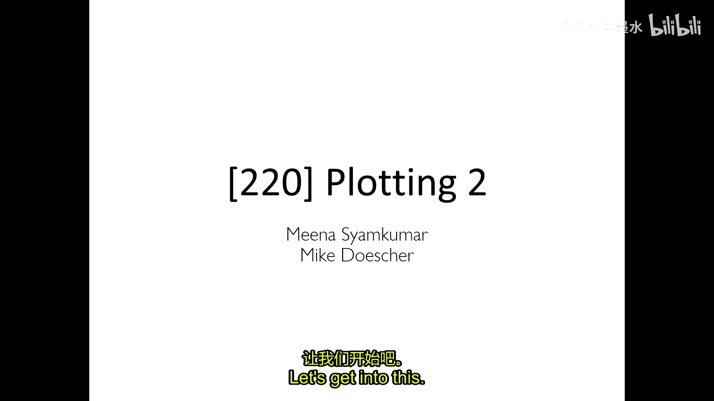
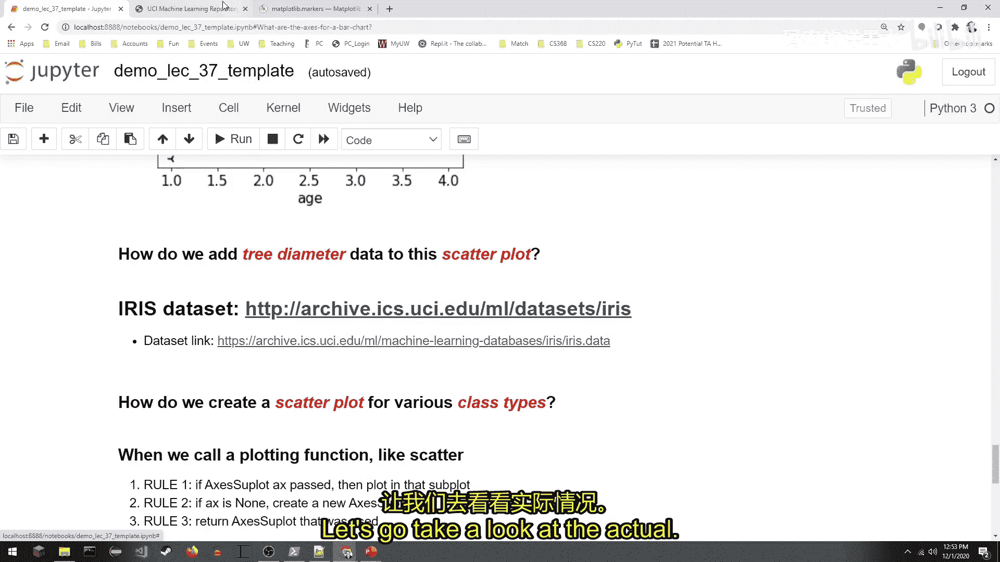
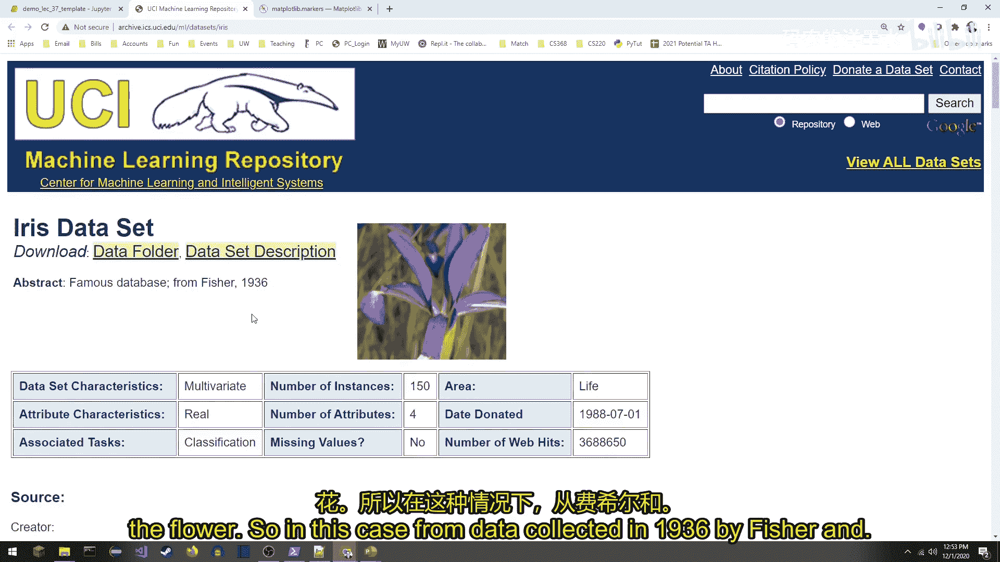
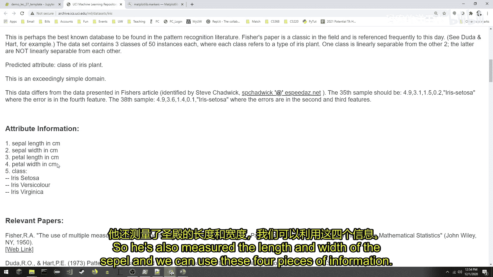
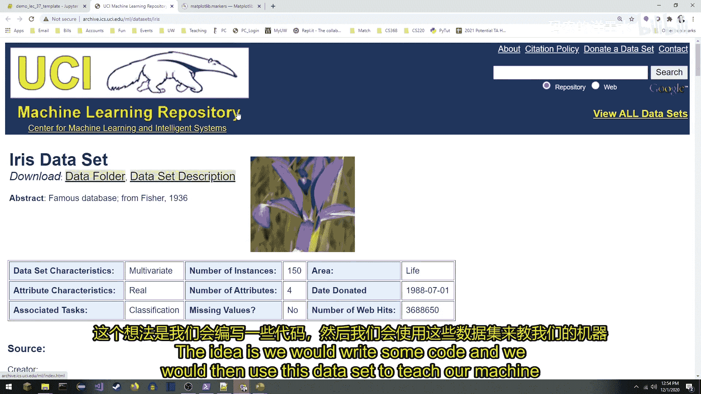
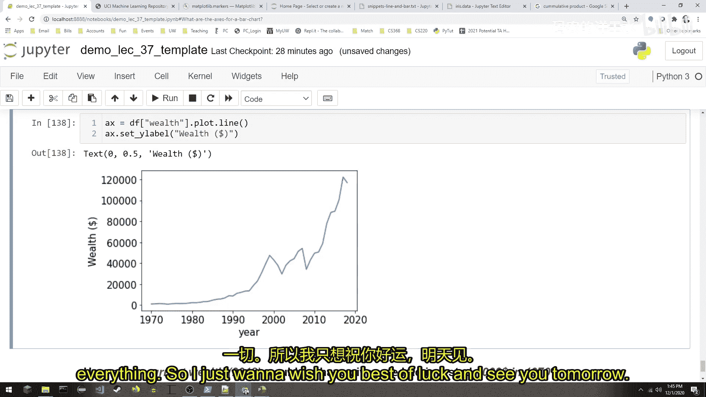

# 【全集】威斯康星大学-Python数据编程-CS220-中英字幕-1080P-p31-Lecture-24---绘图1-2--BV1VxvsBLEmv_p31-

Hello everyone Welcome back to data programming 1。 as we get started here。 First。

 I just want to say thank you for your patience。 While I've been recovering。

 I'm feeling pretty good right now。 So I'm going to go ahead and do some recording。

 let's get into this。 Today's lecture is plotting too。

 I'm going to go over here to the code directory。😊。

That's not good。Not good。All right， it seems to be working now。Fileles we' need。

 we have the template notebook。 go ahead download down one。

 I'm going to be going through this and filling it in。 Thank you very much。

 Demina for putting this together for us。 We've got a great team。 Okay。

 this is the final version of her lecture。 Min's going to look very similar to this at the end。😊。

And then also we're going to be using the let's see the trees that we started with last time。

 the SP 500 snippets， line and bar graph， line andbar that text， the iris files。

And that should be it， the rest of those are things we chose not to put in this lecture。All right。

 I've pulled up that template notebook。 Again， the first cell is just make the display look good。

 The second cell on the interest of streamlining the lecture。

 making it go as efficiently as possible。 we've already provided all the imports they'll be using。

 And there's a number of them today。 First up is pandas。 Remember。

 we're going to be using pandas to connect two mattepllib to be making all of the cool plots we're making。

 And we're going to be plotting two different kinds of data series data。

 which is going to give us a one dimensional plot like a piegraph or bar graph And later on the lecture we'll see line graphs。

 And that data frames will give us the two dimensional data。 and we're using scatter plots for that。

 The majority of today's lecture is going to focus on just adding details to scatter plots。😊。

I don't think I'm using SQL today。Let me get back to you on that one anyway。

 next up Maplot Lib this is the important library that we'll be using to make all of the plots。

 but we will be connecting through it through pandas and then using Maplotlib directly or through high plot to manipulate those graphs and it's pretty seamless you won't really even be able to tell which one you're using at the time and then of course we've just gone ahead and changed the font size on the graph so they look good for YouTube。

All right， quick review as we get started。 let me go ahead and now to sell below this one。

 How do you plot just a simple bar graph， This was the first thing we did last time。

 pretty straightforward。 We're going be connecting through pandas to mat plot Lib to make the chart。

 Ogra， A our chart。So we need the basically， we need to create a series。

And then we're going to call the name of the series， so。Seerries name。 It's a method。

 So I'm going to use the dot here。 So my series name is the variable。

 and then I'm just going to call plot。 and then I need to tell what kind of plot I want to make。

 That's going to be a bar graph。 And then I'm put all the parameters I want to control the way it looks inside those parentheses。

To create just the basic bar plot， that's all there really is to it。All right， we move down。I mean。

 this this one。 this one right there。 add a new cell below by pushing B。 All right， quicker review。

 What are the axes for a bar chart。 So we're going to have an X axis。And Y axis。

Let me just I'm going to put these in comments in case I run the whole notebook。Later。

 and it won't give me errors， okay。Go ahead， fill that in and tell me what you think the X axis is and the y axis。

 go ahead， this is a great place to commit， write something down。 if you get it wrong。

 you'll learn more than anything on， just I think it's like this or if you just wait for me to just tell you what it is。

Okay， all right， ready。 So for the y axis， that's going to be where we put the actual data。

 So This is going to be the values in the series。And the x axis， the way that comes from。

 this is just going to be the indices or indexes。From the series。Allright， next up。

 I want to go back to that scatter plot example with the trees from last time。

 So we've gone ahead and provided copied and pasted some cells from last lecture。

 So you've got the information already here。 So this is the trees data frame。

 We're creating it from a list of dictionaries。 So when we just take a look at this。

 we can see that we've got some information。 This is arbitrary made up data just for the purpose of like learning about scatter plots。

 Anyway， we've got the age of trees and then their heights and their diameter。All right。

 once we have a data frame in order to plot a data frame。

 again it's just like the series bar graph example I just did， we just need the name of the variable。

 the method that we're going to call from Panice is just plot。

That's going to connect to map plot Lib。 We need to tell it what kind of graph we're making。

 This case， the scatter plot。 And this is where it's a little different because I'm plotting one variable on the X axis and another variable on the y axis。

 not just like。There isn't only there's only one choice for the series。 If I had two columns here。

 I could flip them around。 So I do need to tell that plotlib which column to plot on the X axis and which're one to plot on the y axis。

 So in this case， I'm plotting age versus height。 when we left off last time we decided this was probably the best because age is the dependent variable。

 And we're used to seeing that on the X axis。U and then we've plotted height here and we can see there's a correlation older the trees。

 the taller they are makes a lot of sense。We actually have a lot of aspects about the plot that are under our control。

 and maybe we can include some extra information。 This。

 our data set actually has a third column here， diameter。

 Maybe there's another way we can include even more information into this plot。

I want to be a little careful how we do that， but there are a number of things we can control about how the scatter plot looks that will enable us to communicate even better and give people a sense of this data。

So first up， the very first two things that are under our control， the X axis in the y axis。

 these are special。 The first up， they're mandatory to make a scatter plot。

 have to have both of those。 But second， they are are of the things on this list， color。

 size and shape are the only ones that give us like visible numbers across the here's the x axis in the y axis。

 So if I want to know how tall the feet， the trees is after four years。 these trees are 5 feet。😊。

And I can see those numbers， four years， five feet。If I actually try and use like color。

To communicate diameter somehow， there's no like scale that tells me I can just look at one of the points。

 check out the color and say， that means it's I don't know，1。4 feet in diameter。

Or that's probably an inches。 right。 So my choice here， color， size。Shape。

 those are the three we're going to be going through today。So first up。

 let's go ahead and talk about color。 I'm going to go ahead。

 select that cell push be to add a new cell below it。 And I'm just gonna。

 I want to retain all these graphs。 So when you guys look at the final version of the template。

 you've got like everything there you can see。 Okay， so I'm going to copy and paste this。

 We'll go ahead run this cell， This is the original graph。 to change the color。

 It's actually very simple keyword color。啊。And then I just need to give it the name of a color。

 It's got to be one of the built in choices。 I can go to maps thought load colors and get the entire list。

 So here's red， blue。R that， we can also abbreviate these things。 Col can be abbreviated as C。

 blue can be abbreviated as just B， red is R。Remember that B is blue， so for black。

 which also starts with the letter B， we' be using K。We can also use numbers here 0。

5 to indicate gray scale and check this out so I take a look at my data here。

 if I want to include information about that diameter。

 these are already numbers so I can extract this column and actually provide Matt plotly with a series to plot with different color intensities okay。

So let me go ahead。And do that instead here。 we'll be providing it with a series。

 We're going to get it from a data frame to do that。 I need the name of the data frame。

 brackets to extract it， and the column I want is diameter。And I think that was lower case。 Indeed。

 it was。Okay， so now when I run this。It's going to use gray scale to indicate the diameter of the trees。

So in this case， so what it's doing is automatically scaling for us so that the smallest diameter is going to be pure white and the largest diameter is going to be pure black Okay so we can see like right here this is the largest tree four years old。

 it's the darkest black and actually there's a pure white tree right here。

 Check it out in the age column with one year。There's actually three dots。

 There's one right down there and plotting things in pure white is generally bad on the white background。

 This is not going to be good。 No one can see that The point we just essentially lost one。嗯。

Let me think what else are gonna。 There's， there's a number of disadvantages to using color to represent things。

 We almost always will need a legend to explain what's going on that the darker it is the。

The larger the diameter， it's hard for a human to say， okay， just looking at this black dot。

 How big around is the tree， or what is the diameter of the tree， Is it， you know，1" or 10 inches。

 you just， I can't know。 And how much bigger is this compared to this。 Is this like half the size。

 So it's really hard for humans to differentiate like a 50% cent gray versus， you know，100% black。

In addition， a significant portion of the population is actually color brine。

 and we need to be sensitive to that because there are people who really can't tell the difference between two colors。

And finally， there's really think about it， how many points are here，12，3，4，5，6，7，8，9， 1011。

 14 or 15 points。How many different actual colors of gray can you differentiate？

Can you tell the difference between these three。Compared to those。

So humans can really only see about three to four shades of black where we can actually say。

This one is different from that one。 Those look the same to me。 I can't tell which one is darker。

Which tree is bigger。All right， I've done a couple things here。

 I went back and just added the original color red， the diameter one。

 And next I want to fix this pure white problem。 we can deal with that。

 we don't we obviously never want to lose one of our data points because we're plotting something in grayscale。

 So Malalib provides us a value min。 So the minimum value for the data set。

 it's going to just artificially include this when it does the scaling。

 So if I look up here at my data。 in this subset the smallest diameter is 0。8。

 This is what it's using to get the pure white color。

 Instead what I want to do is include another value， maybe 0。5 or something like that。

And then this will actually have some color to it and we'll be able to see it。So anyway。

 I I'm just gonna to experiment a little bit。 D in， let's go ahead and put in a minus2 here。

There we go now I can see this point appears。 I still have the full gray scale。

 maybe -1 is a better choice。Okay， now this is absolute。

 I'm I'm basically hard coding this and ignoring the fact that my trees all have some diameter。

 So a better way to do this。Would be to grab this series。 So this is the data frame the entire table。

 I'm getting the diameter column out as a series。We'll come min on this。R that。 It works。 Okay。

 so this is now setting the minimum value to what it is defaulting to What I want to do is take away a little bit more。

So that the minimum value that it's going to use for the scaling is less than that。There we go。

 now we can see that lower left hand point does appear。

So this is a great way to deal with that problem and it's a common problem anytime you're using gray skill to communicate extra information。

 you're going to have this issue。 so this is the solution to fix that。Alright， so next up。

 let's go ahead and learn how to change the size of the points in a plot。 Again。

 I selected the cell B to add a cell below this one。And I'm gonna paste in my original scatter plots。

 Go ahead and run that。 Remember this one。 Okay， to change the size。

 there's another keyword argument。 It's just S。 And then I can give it a size。 Alright。

 so size 1 is gonna be extremely tiny points。 Let's go ahead and make that bigger everyone gone。

 YouTube can see it。😊，So 25， there we go。 They're bigger。 there's 75。

There we go now they're getting enormous。 Now， if we want to use the size of the points to communicate more information about our trees。

 we can do so to do that。 we need to give size or hear the S keyword a series。

 I'm going to be grabbing the series from my data frame to extract a column and generate that series。

 I use the brackets。 and I need to tell which column。Diameter， al right， let me run this。And again。

 the diameter of the trees， they're all， you know， between like half an inch and 2 inches。

 So these are going to give us some very small points。

 I'm just going to go ahead and scale that right here by multiplying that by 25。 And again。

 this is going to be a series。That much。 this is an element wise multiplication。

 So every single number is just going to be multiplied by 25。 And now we can see that。You know。

 that tree right there is the largest over here， this one is the smallest tree。

 and the size of these dots are actually communicating additional information。

For the diameter of trees， this is actually probably one of the better applications for using size of points。

 People are easily tricked by using diameter。 So if I have some data。

And I'm plotting it as a two dimensional， you know， a circle or square or something like that。

 if I double my data point， I have something that's like if I'm talking about money。

 if I have $100 or $200， and I use the size of the points to represent that difference。

The height of the points doubles and the width the point doubles。

 And so I'm actually using four times as much ink to print that spot。

 even though I've only doubled the amount of money， it takes four times as much ink。

 And so it can be extremely deceptive for humans and studies on perception and， you know。

 this sort of。Test problem indicate that people， you know。

 given a bunch of different circles and asked， you know， okay， told this one is worth $100。

 how much is this one worth， generally picked about $300 instead of 200 to 400。

 they're tricked easily。 So you have to be a little careful using size of points。 But for trees。

 I think this really does give people an idea of the diameter trees。

 If you were to cut down the tree and compare all of these side by side。

 This is what they would look like。 And so it really does do a pretty good job for trees of communicating the data。

All right， I went ahead and added those other commands that I had originally added and then kept modifying。

 So you guys have a record of what I've done as you're going through and looking at the final version of this。

 I do want to do one more little thing。 I'm going to go ahead and change the color using that diameter feature and put them both in。

In general， this is considered bad practice。Add had a comma and put those in to use more than one of my ways to communicate information to communicate the same information。

 All right， let me see if I copied it correctly。 Yeah， so check this out。

 So now I have the largest tree represented by diameter and color。

 And if you were to give this graph to people and ask them about it。 they're going to say， wow。

 check it out。 the lighter colors are smaller and the darker colors and they're going to see correlation that is basically an artificial。

 It's not， I mean， of course， they are exactly correlated。 the bigger the tree is darker。

 bigger the tree， the larger the point because I did that you know the way I mean in my graph。

 So this is not good practice because it can trick people into seeing correlations that we don't intend in the data。

 the diameter is exactly correlated with diameter。 So of course， it should look like that。Alright。

 I'm gonna， I'm going to go ahead and comment this one out because it's bad and leave the good one。

Not that I want time off， I'll time off。 Let me fix that。There I go fixed。 This is the good one。

Alright， next up。 I really like this one。 This one's just fun for me。 Okay。

 how to change the shapes of the points。 I'm gonna add a cell below。

 I'm gonna paste in the original scatter plot。😊，There we go。

 This is what we're starting with Next up to change the shape the shape of the the points。

 It's the keyword is marker。 I just had to look this up a moment ago。 And then I。

 I've got a ton of choices for different marker styles。 So just some examples of like。啊。

Though down pointing triangles。 hold on。 This is for YouTube size equals。

 Make these big color equals black。 Now they'll show it better。 There we go。

 Downward pointing triangles。 I've got tons of options。 I could do squares with the S。There we go。

 Got them square at the。Stars with the asterisk symbol。Al right， let me。

 let me pull up the entire list one sec。Alright， so I just went over to the documentation for the map plot lid markers。

 So I've got the period for just a regular point comma for just a single pixel circles。

 triangles the。Chicken feet， I guess。All different kinds of choices here。

 I want to try out some of these 1，2，3，4。 let's do， let's do number two。 Al right， anyway。

 you've got lots of choices。Capital D， lowercase D for diamonds。 Here's some of the arrows I did。

Yeah， let me go try out the chicken feet。All right， back over here on the other window， let's see。

Chicken feet was number 2。 Actually it's number 1，2，3， and 4。 So we can just。

That looks the same to me。I guess they're a little different。

Anyway I'm going to go ahead and leave that right here。

So just a couple of thoughts on changing the shape for some data like this。

If I were to try and use the shape of the points to communicate more information about something like the diameter。

 for example。For that kind of data， I mean that's continuous data。

 I've got floating point numbers that are all different assigning them each a different marker。

 the marker doesn't really communicate anything about the diameter unless I include like a giant legend。

Maybe I could like break it into some categories， you know。

 I could have small medium and large trees， but then those categories are sort of I would have to decide them maybe maybe a little artificial and perhaps may not communicate what you know。

 could easily be done using the diameter of points， for example， in this case so。

Be careful when you're choosing different markers， it can be a little deceptive。To。

Arbitrarily just choose categories or to use a different marker for everything。 So while it's fun。

 And like I changed all of them just to give the the graph a little more fl here。

 I think it's perfectly appropriate to use the same marker for everything。

 but to use it to communicate extra information can be really difficult。😊，All right。

 I just scrolled down， read the next thing I'm supposed to talk about。

 it says how do we add tree diameter to this scatter plot？That's what I've been doing the whole time。

 Check it out。 I was doing that right here。And right here， with color and size。Yep。

 Mina broke this out into two sections。 She did how to change the color and then how to change the color based on the actual data from diameter。

 So she did in two ways。 Alright， I got all mine combined into one。 All right。

 the next thing I want to do is I want to go take a look at some real data So you can actually just download the data from right here by clicking the data set link or。

Let's go take a look at the actual。

Some information about this data set。 So this is from the UCI machine learning repository。

 it's just a collection of data about irisees the flower。 So in this case。

 swarm data collected in 1936 by Fisher。

And。It's pretty simple。 What we've got here is some information about the here in this case。

 what kind of iris it is and some information about the petals。

 So we've got the petal length and petal width of the iris and of which different species it is。

 a sepel is when you have of the bulb of the flower that still surrounded in like the green leaves before it。

 you know blossoms into a beautiful flower Those green leaves aren't called the sepel So he's also measured the length and width of the sepel。

 And we can use these four pieces of information。 The idea this is the machine learning repository。

 The idea is we would write some code and we would then use this data set to teach our machine learning algorithm。

 to identify which species of flower is。 And then I can go take any other species of iris。

 I can measure those four things width length of the petal and sepel feed that in。

 and it's going tell me which。😊。

Of these three kinds of irisees it is。Alright， so let me go ahead and pull that data into。 Alright。

 grabbing the data。 Let's see here at a cell below。 I'm gonna use pandaice to read。It's a CSV file。

And I need to give it the name of the file。 that's right here， Irisdot data。 So Iris dot data。

 I downloaded it。 It's in the directory if you were to do this。

And then I'll go ahead and store this in a data frame。And there from dot。Just take a look at this。

Explore the data clip。 Oh， this is not what I want。 Allright， Hol on a second。 So to CSV。Al right。

 so here's my Jupyter notebook directory， that homeage。 If I go to Irist data， pull this up。

I can see that it's a CSV file， but doesn't have a header。

 So I've got a bunch of information about the sattoafa flowers， the versa color irisees and the verb。

Geneica， I think。Flowers， but it doesn't have headers。 Okay， I can get those by going back here。

 I can see that they are seepple length， seepple width， pedal length， pedal width and class。

 So let's head back over to the notebook。 I need to upgrade this。Just a little bit。All right。

 so when I read in the CSV and create that。I can give it the names of my columns。 So names equal。

 this just takes a list。 And let's see what were those things。 They were。Supple， first。Length widths。

 pedal next， length width。 Allright， S length。Sle with。Hello。Wk。And pedal。With。And then。Class。

 all right。There we go， though， this is looking good。 All right， so length， width， length width。

 seps and petals and classes。Alright， next up， what I'd like to do is just go through with some examples of basically manipulating the data。

 which is create some plots。 And because this is sort of a machine learning classification example where I've got data about different kinds of plants。

 And I want to be able to。Give it， you know。New measurements for a plant that I haven't identified and figured out what class it is。

 I'm going try and come up with scatter plot for each of the different class types。 so I can sort of。

Compare them。Class by class。 Okay， so to do that， let's first figure out how many classes we have。 I。

 I know the answer。 It's three because I was just looking at their。Right here。

 the three classes are right there。 But let's go ahead and do that using。Paands。

So to get the classes， I've got my data frame， I can extract the classes。

By just looking at this column， Okay， this is going to give me a series with all 150 entries。Alright。

 And once I have that， I can go ahead and just put those into a set just like， oh。

 I could put a series into a list。 I can put anything iterable into a list or a set， and。

The key thing here is that sets only retain unique values。 So when I put these into a set。

 now I only get the three unique varieties of flowers。 So I'm going to go ahead and。

Store this in a variable。Go ahead， grab that。Print it out again。

Because this is what I'm going to be plotting in a moment。Okay。

 this next thing I want to do is let's go ahead and just grab the data for this first one。

 the Iis sattosa。 So to do that， I've got a data frame。

 What I'm going to do is use that cool index slicing with the Boolean series。

 So here I'm going to need a boolean series。 so。😊，My Boolean series is。

I'm going to just ask if the class。Series is exactly equal to。Iirris。Satoa。

Only only before I do this step， let's make sure that works。

Need print out B should get a whole bunch of shoes and falses。 excellent。

 And the beginning should be true because that was the first one。

 the end this should be false because that was a different type of flower。 Okay， so next thing。

 D F of B。Is going to give me just the Iisittoa data。And scroll down。

 That's the only thing that's there looking good。 Okay， so from here。

 what I want to do is I now have this table。I'm just going to go and plot this。

 So this much right here。Is that data frame。 Let's just go ahead， plot。We'll make a scatter plot。

 and let's see we need an x。And a why。 So let's go ahead and do pal width versus。Like。

I think I call it the full word pal。Let me see， oh yeah， right there are pedal length， pedal width。

And go ahead and make a graph of that。So there we go。Alright。

 now I'm going to upgrade this because I want to plot all of these。

 I'm going to go ahead and leave that。 We'll make a new cell below。 paste this in here。

just like that。And then， let's go with。I'll put this in a loop。That way。

 if I go ahead and add more flowers to the。Data set later。

 we will still be able to use the same code。In this case， I'm just going to grab the variety。

Of which kind of flower it is from classes。And we'll go ahead and replace that right there to extract the different classes。

 and I'll go ahead and plot these。My。Type a wing。 Okay， all right， here we go。

 Now we've got the Ctosa or those classes。The you are。The versa color in the Virginiaa。

 So Ctosa data。And the other two。 Allright， So this isn't great yet。

 It kind of looks like the data fill up the entire graph。 This one fills out the entire graph。

 This one， But the key here is that the numbers along the scales are actually different。 So this one。

 you have quite long flowers from 3 to 5。 This variety has from 1 to1。8。

 So very short fl flower petals。 and this one kind of overlaps in the。😊。

Pedal length width the first one。 But we can see the width。1。4 to 2。4 is kind of overlapping。

 but a little bit different which why machine learning can take advantage of all four of those axes。

So this is not a great way to do this。 Let's go ahead and upgrade this just a little bit to make this a little more clear。

 which is which。Alright， so to do that， my goal here is to put all the different flowers on the same graph。

 And we're going to color code them and give them different symbols so that it's really。

 really clear that they're different。 So I'm going to start with this code。

 I'm going to add a new cell。😊，Below this， we'll paste this in。

 So here I'm still making three separate graphs。 What I want to do is add all the data to the same graph。

 so。Ploot area。 we'll start off with。 So remember last time we were talking about how all of these things are are axes subplots。

 and they go inside。 I think I called it a canvas last time。

 That's not the name the matpl lib uses it's a figure。

 And I can have multiple subplots inside a figure。 So what I'm going to do is when I do this scatter。

 I can give it which plot I want to go in。 So I'm going to go ahead and start with。

A blank plot in this case， none， I'm going to call this plot area because that's the area that I'm going to be plotting all my points in。

And I can go ahead and upgrade this with x equals plot area。Now， when I do this， I should have。

A typo， one sec。Yep， I do have a typo。 I forgot that the scatter plot function returns in the plot area。

And so what I want to do is actually store that in the variable plot area。

 So every time it goes through loop， it continues to add to this。

 So it's creating a new one each time here。There we go。

 Now we can see we've got all of the points in one graph。 So let me walk through this。

 First thing I'm doing。 I'm creating a blank plot area。

 just gonna give it the variable none that says no data。

 the first time through the loop when I created the scatter plot and give it plot area。

 If the keyword X as given none。 It's going to go ahead and create a new plot。

 and it's going to return that。 Okay， so I never actually reassigned plot area。

 So it was none each time。 And so it was going through and creating a brand new plot area。

 So I wanted to do was continue to add to that plot area that I had created the first time。

 So I needed to store the returned plot in the variable plot area。

 and then the second time through the loop when I did the second flower in my classes。

 I'm going go ahead and use the original plot created by the first time through the loop and recording that and then same deal for the third time。

 I've got my second version of the graph。 I'm going go ahead and add to that second。

And that returns a new one， and this is what I'm plotting now。Okay， I've got all the points here。

 but I can see that at this point they are all blue dots。

 So let's go ahead and add some color and some markers to upgrade this。 First up。

 Im to go ahead just use。I don't know。 what are your favorite colors。

 How about I need a list of color choices。Let's go with red， green and blue。Oopsタ boat。

Red green blue。 And then we'll， yeah， we'll add this one first。 Then we'll come back and add markers。

 Okay， so what I want to do one more step here， I'm gonna say that color。Is going to be equal to。

 And then each time through the loop， I want to grab one of these things from the list。 Alright。

 so to do that， I can just use。Colors。8。And that should go ahead and grab one of the pieces。

 sort of the first one， I think otherwise it'll go in the reverse order。Y。

 it'll grab one of the colors from the list。 So we'll have red， green and blue。 Allright。

 let me go ahead and run this so。There we go。 So red， green and blue。 perfectf。 Now。

 I'm going to do this。 I hope that made sense if this did not make sense。 I'm just assigning a color。

 and I'm grabbing one from this list。 And each time through this loop。

 it's going to create basically a new set of data and add those points to the figure。😊，Alright。

 and then the second time through， it's going to grab the second color。And at the end of this。

 if I were to print out my colors list， it would be an empty list， all three would have been removed。

I'm going to use the same technique for markers。We'll just call those markers。

 and this is going to be a list also。Alright， I really love the little chicken feet。

 So we'll use those。 I like the asterisks， and we'll use。😊，How about triangles。

And then for the markers， let me go ahead and。I can put this on different lines， so long as the。

It's between parentheses。Yep， so we're right there on markers。

I believe it's just marker equals marker。We grabbed。First thing here， let me just run this。s worker。

 oh， comma。There we go。 So now I can see I've got my stars。

 I've got my chicken feet and my triangles。 I'm gonna make this a little bigger。 So size is。

 it's not actually size。 This does not work。 It's just S。 Let's go ahead and make those。50。

That's a little better，75。There we go。 I like that。

 So now we can see that we have some tightly grouped categories。

 So if I measure the width and length of the petals。

 obviously the if it's whatever the green one was red， green， the middle one。

 Is that the versa color。 It's pretty easy to identify the class。

 If it's over on this side or this side， it's going to be the red or blue version。

 If it's in the middle here， I'm probably going to need to use those other pieces of data。

 So this is just petals， I'm going to go ahead and need to look at the ss to figure out which variety it is。

All right， so get this。 This was just， I made a silly mistake right here。 I forgot the plot area。

 and I was using a plot area in none every time I called this right thereca it was never updating If I had scrolled down。

 Mina actually put the little rules here in the note book to remind me to not mess up。 Anyway。

 here it is rule 1。 If we give it。An actual， you know， X keyword argument。

 Then it's going to use that subplot。 If we give it none in that， it creates a new one。

 And here's the part I forgot。Oops， oops， oops。It returns the new one that's got the data in it。

 Otherwise， it's none， and。I create a new one every single time。 So that's the blunder I made。

 I'm just sort of laughing at myself'cause I didn't scroll down and read our own notes。😊，Alright。

 so next up line plots。 I've got two versions of this that I want to do。

 So the first one will be making from a just a series。

 A second version will be looking at some temperature data and make it from a data frame。 Okay。

 let me add a new cell here。 And so I need a series。 So S is gonna be equal。 Nope， no， nope， nope。

 actually typemic。I just delete more than I want Yeah， S equals panda series。

And we'll go ahead and make the series from a list and we'll skip it 0，1，3，2，4。There we go。

 And now we'll go。We'll print it out， there we go， Pada series。Oh。

 this might be confusing because the indexes are very close to the actual data。 Hol on。

It upgrade will make them bigger numbers。We run the seigant There we go。

 I think this will work better。 And then we'll go ahead and just plot this。Let's start up。

 we take a look at the bar graph version。Just like that， I've got my indexes down here。

 my data based on those values。 Now I want to talk about line graphs next。Kword is just line。

 And now it's going to just plot those points and connect them up。 Now。

 some of the interesting things about this are， I don't really have like X data here。

 This is just the order of the points come in。 They're just going to be indexes。If I want。

 I can actually change those indexes by upgrading the series。 I'm going to do one more thing。

 I'm going to print。As right there。 So I see the data， the indexes and the graph。 Okay。

 now I'm going to upgrade this with。By assigning different index values over here。 So， again。

 we need a list。And we go with 0，1，2。Three， four， that's exactly。Typepo，0，1，2，3，4。Rather equals。

There we go。 That's what I have have here。 What if I go ahead and make this。Let's go 23 and 24。

So there we go， I see 23 and 24。Now， on the graph， what it's done is it's now expanded this range。

 I've got the first three points right here，0，1 and 2， and then 23 and 24 over here。

 So it's gone ahead， it knows that I want these particular points plotted at those indexes。

And it's actually just going to plot them in this order。 So to go plot 0，0， put down a point。

 Then it'll plot 1，100， plo down a point。 Then it'll do。1，100 plopped on a point。

To 300 pp on a point。 Then it's going to go to 23。 What this means that if I can mess this up a little bit。

 we'll go ahead and put the like a really small number at the end。

 It's going zigzag all over the graph。 Alright， that's probably not what I want， so。

In order to fix that， what I can do is call sorted index on my series。 So S is going to equal S。

So index。That'll upgrade。 So now I can see that I've moved my points around so the indexes are sorted。

 It drags along the values with those indexes。And now I've got a brand new plot with all the points plotted in the right order。

All right。 I think that's about all I want to do for this series version。 Hopefully that was useful。

 Just very similar to bar graph， but we're connecting the points can help show like trends changing in time。

 If we're like， we can see the slope of things， the slope of the line。

You see a sharp spike in the line compared to like a bar graph version。Which is just can I like。

 give me indexes without like showing that horizontals。Space。

Telling me that the slope is actually very different between 2 and 23， compared to one to2。Alright。

 I'm going to leave this as a line for the final version。 Alright， next up。

 I'm going to go down and grab the temperature data set。The appeared is it's in snippets。

 line and bar textex， they I'll just open this up。This is just a whole bunch of different data that we've used for。

Different demonstrations。 I'm just going grab the high and low temperatures and copy and paste that into my notebook。

So we'll grab a new cell， we'll paste it right there。And then， we'll do。Rn that cell。

And we'll print out Do。So what we can see here is that it's creatingding a data frame from a dictionary。

And those dictionaries contain lists。 Okay， so from there。

 we've got the high temperatures and the low temperatures。

 This is just average average temperature for the month in Fahrenheit for all the months。

 beginning with， of course， January 0， December at 11。

Not the greatest there we'll go ahead and get that fixed so that we're actually plotting with January and。

If February and actually， like use real labels。 Okay， so let me go ahead， grab a new cell。

 And I just like to plot this。 D F dot plot。Let's go ahead and make a line graph line。

And now I need to give it an actual series。To do this， this is one way。 So and。I'll go ahead。

You're hold on a second。Quick review。 It's a data frame to extract a series from it。

 I'm just going to give it the name of which column I want and plot the high temperature。

Then we'll make a line graph of this。 There we go A subplot， of course， in month， summer， June， July。

 August， we're going to see really high average temperatures in winter。

 It gets very cold here in Madison。 So obviously， January here at 0。Is not the best access。

 we need to get that fixed。Al right， Padas is actually really smart， too。

 Let me grab a new cell below this one。It can just plot a data frame directly。

 and that's going to plot each of the columns。As a line on their own， well here， let me show you。

Pt top line。Yep， it's going to plot each of the columns as their own line， gives it a legend。

They're in different colors， it actually is very smart， it looks really good。Let's go ahead and。

Add some labels to this。 So to do that。 I'm gonna get the A subplot that gets returned by this function here。

 And we can use that then to call methods set。X label。Pex label is going to be the month。

Let's go ahead to have that， make sure that worked， there we go a month。

And then we need the Y label is going to be temperature。In this case， in Fahrenheit。

And I forgot to change that to why， there we go。Looking good。Alright， next up。

 I want to go ahead and fix this 0 through 11 problem to do that。 what I want to do is re。

 these are known as ticks。 In this case， they are the X ticks because they're on the X axis。

 And these are the X tick labels。 That's what they're called。 So in order to change the host。

 I can just do。Actually， let's just take a look at them， so we will get X ticks。

I don't think there's a space there。We'll just get x 6 and print those out。

 We can see that this is an array。 And this is where those points are。 on itss 2，0，2，4，6，8，10 and 12。

 And it didn't put the the last one。 And those are the actual。嗯。Ends of the graph。Okay。

 so what I'm going to do is I'm going to actually just change this。

 I'm going to give it my own array。 and so we will。

I'm going to leavea that there so you guys can remember。 So we'll change that G to an S to set ticks。

 And this just takes a list。 I can see right here， a list。So I'm going to go ahead and give it one。

 two， three。不不是。And now every time I do this， I can see it's printing out the list because that's the last thing here。

 If I want to don't， if I want to skip printing that out， I can just put none。

 and now it will skip printing out that list。 So actually settics returns a list。Al right， perfect。

 Now we've got 1，2，3，4。 That's not exactly what I want。 It doesn't line up with my data very well。

 looks like I still need the0。There now they start at the right place。 Okay。

 but I want to do is add enough ticks that I get all of the months。And I want to change the labels。

 So remember， these are the ticks， the little， little mark there。

 These are the X tick labels so we can。Call the plot。 we want to set these are ex tick。Labels。

 I don't。 I think there's just the one underscore。 And then we can give this a list also to change those labels from the default 0。

1，3，4。To。January。February， let's just what that does。AndI don't have enough yet。March。April。

 let's see，1，2，3，4， let's just do like this Does that work。There we go， January February March。

 April。Alright， I'm going to go ahead。 I'm gonna to do a couple things。

 I need a tick for every month。 So I'm going to go ahead and upgrade this right here。

 There's a way to get easily all the numbers between 0 and 11。 And that's just range。12。

Let me just make sure that looks good without the labels。 Okay， alright。

 I'm gonna pause the video recording。 Go type in January for March， April May all the way。

 and I'll be our back。Alright， I got all those typed in。

 So this is going to give me all 12 ticks that I need。 and I've got 12 labels now。

 So I can see that I've got January， February March， April。 That's looking pretty good to me。

 I can see the the low temperature and the high temperature。😊。

It might be better to plot the high temperature in like red and the low temperature in blue。

 because we associate temperature on that sort of blue scale。 I'm going to skip that。

 The other thing I I want to get fixed is these are all kind of smashed in together。

 They're really close。 So if you guys remember that we can rotate the labels。

 We did this as an example in the last。Lecture， and I'm going to put that up。

 I'm rotating the X tick labels。 So right here， the keyword was actually rotation。

And this just takes a number in degrees and let's dooo by 45 degrees and see what that looks like。

I kinda like that。 They're still kind of horizontal。 It's not too bad to read。 Let's try 90。Now。

 there's definitely some space between them。 That's not bad either。 I think my preference was for 45。

Felt like that separated him。I like it。 I'm going to go ahead and leave it right here。Check this out。

 Okay， next thing we're gonna do is convert this to Celsius。 kind of a surprise。

 But this is great reveal。 Let's go ahead and do this to do any sort of mathematics on a data frame。

 So let's just take a look。 There's my data。 Got all the numbers here。 I can just multiply these by。

 let's double everything。 So high temperature in January was 26。

 So's gonna change all the numbers element wise。 So to convert data frame to Celsius。

 All I need to do is。😊，Do some， you know， mathematical manipulation on the entire data frame all at once。

 It's going to happen element wise。 Okay， so the formula to convert from Fahrenhe to Celsius。

 So freezing point in Fahrenheit is 32 degrees。 freezing point in Celsius is 0。

 So I'm going to take away 32 from the Fahrenheit。And then the freezing temperatures will line up okay。

The now I need to do some scaling， because the。Boiling point is 212 in Fahrenheit。

 So I'm going to multiply this by， let's see，212。 take away 32。

 because that's the reduced shifted boiling point。 And then I need to multiply that by。Dried by 100。

 Yeah， because the boiling point in Celsius is 100。 All right。

 I think that I think I'm switching my divide and multiply its see we get。一样。The high temperature。

 No way was that 90 Celsius。 So I've got a mistake here。 I need to divide by the temperature f。

 So I'm going from Fahrenheit to Celsius。 I want to divide by the Fahrenheit temperatures。

 multiply by Celsius。Get some horrible typos going on。 Let's get that fixed。Okay。

 that kind of makes sense。 So high temperature here， Let's take a look at。Month 5。

 is that original data， High temperature was 78 degrees。 That's the nice。

 comfortable room temperature。 That's about 25 degrees Celsius。 I like it。 I think that worked。Okay。

 so I'm just going to restore this in a new data frame。 I'm going to just call this C。

And then we'll go ahead， and I'm going to plot this exactly the same way I did over here。

Except instead of Df， I'm going to plot C。And there we go， temperature and Celsius。Now。

 if I wanted to add one more detail， I suppose I wanted to just put the freezing temperature in。

 I can go ahead and just add one more piece of information to my table here。

So we'll add a brand new column。Let's call this freezing。Here one sec， let me just comment this out。

That way， we can see that we're getting a new table freezing point in Celsius is 0。

 and now let's go ahead and print out。Data frame。 So it's added an entirely new column called it freezing。

 and now it's assigned value 0 to every single entry in the table。Allright， looks pretty good。

 Let's go ahead and turn back on the plotting。あ。And run this。

 And now I can see that it added a third line because when pandaice is plotting beta frames。

 it's going to give us one line per column。 I'm just put the freezing point across here。

 This might actually be more useful for the Fahrenheit version for people who are not familiar with the idea that water freezes at 32 degrees Frenit。

Alright， one final example。 So this is gonna to be some stock market data downloaded from Wikipedia。

 We downloaded the data table a couple years ago， and we've just been like using the same one so we don't spam Wikipedia with download requests as everybody goes through the lecture。

 Here's the idea。The table goes from something like 1970 through 2018， we didn't get the updated one。

But if we had $1000 in 1970 and invested that money。

 how much would we currently have And we're going to be investing in the S&P 500。

 I am not an economist or a finance kind of guy。 I have people that do this for me。

 So I'm not really sure what's going on， but I can explain the data table。

 So first thing we want to do， let's go ahead and grab the data。If I go over here to my homeage。

 I can see it's this file right here。 S P 500 dot CSV。 So I'm going to go ahead and just import that。

 Let's see here。 we'll grab a cell below。 We're gonna put the Pgy dot。No空 no。PD dot read CSPD。

And I need the name S P E 500。 CSV。啊。Run that。 yep， okay， so this is going to give us the year。

And the return。 So what this is going to do， that return value is if I had $1000 invested after 1970 at the end of 1970。

 I would have $1040。10。Then if I had $1000 invested in。1971， at the end of the year。

 I would have $114310。 Allright， so that's how this return works。

 But because this is what I really need is the community。嗯。Community I can't speak。

The community of or Mike， added that out。Alright， guys， I apologize。

This is the word I'm trying to say。Comulative product。Al right。

 But I'm not going say that whatever again。 I can't pronounce that one。 You know。

 there are just some words that just don't work for people。 that one's， that one's mine。All right。

Comulative product。Alright， I'm going to do a couple things here as we go through this example。

 I'm going to store this value in a data frame。 We'll print out some of it right here。

 just the beginning。 There we go。 Let's grab a new cell。And then from here。

 what I want to do is add another column that's going to keep track of my wealth。

 so I'm going to start with $1，000 in there。And we'll just。Do some math。 Okay， so first thing。

 I want to add a new column to my data frame。To that's really easy。 We'll just say total。 give that。

Starting value 0， just make sure it works。And print out some values。 I should now have a new column。

 Now， I don't want to just plug 0 in here。 What I really want to do is compute that commmulative。

Commulative product。 Alright， alright， And that's actually pretty simple。

 What I want to do here is just grab the return column。So this is the entire data frame。

 I'm grabbing this column right here， and I want to say， okay。After 1970， this should be 1。04。

 After 1971， it should be this number times this number。After 1972。

 I want the product of those three。 So to get that？It's just a functioning cue broad。There we go。

 So 1。04， the product of those， the product of those3， the product of those。

1974 was not a good year for the stock market。 That's the energy crisis。嗯。Okay， so from here。

To grab a new cell。 We can see that。 What I'd like to do next is。Actually， start with $1000。Al right。

 to do that， I've got my new cell right here。 I'm going to add another column。

 and let's just call that about wealth。I'm going to start us off with 1000。

And just make sure that that added a column correctly。 one line of time incremental programming here。

 So there we go。 Now， I don't want to have 100 review。 What I want to have is this。Number right here。

 the kme product times my wealth。 That's going to tell me how much money I really have。

 So to do that， I'm going to say times。 And this is going to be just extracting a series from my data frame。

And that series is from the total column。There we go， so there we go after one year， I'd have $140。

10 after two years， $1188。94。All right， this is looking pretty good to me。So next thing。

 let's go ahead and guide make a graph of this。 Let me grab a new cell and just go with data frame dot plot。

Yep data it frame dot plot dot line。I see what this looks like。 All。

 This is gonna give me all four lines。 I don't really want that。

 I just want to look at the wealth column。 So to do that， I'm gonna take the data frame right here。

And I'm going to extract just the column for wealth。Like that。 And that's what I want to plot。

 So this will give me a series。 Let me just move this up here。Get rid of that。

thatNow I should just have the one column。I think it was Co and red， wow， $120，000。

I got to take a look at this whole table time on one second。0 all the way up through。2018100000。

 That's a lot of money。 Oh， Only I'd been alive in 1970 with1000 to sink into this。 Al， Alright。

 focus， Mike， focus。U。Let's go back to the line graph。 There's some issues here。 First， it doesn't。

 It looks like this should be 0 through year what，48。 That's no good。 I got to fix that。

 We want to have its say，1970 through。2018。 So to do that。

 all I need to do is my help me actually pull the data frame back up。 We'll just put up。

The beginning of it。So there we go。 What we want to do is use the year instead of these indexes。

 So we'll go with data frame dot set。Index， and we want to give this the column year。

And that's going to create a new data frame。 So I just want to save it in data frame。There we go。

 Now I've got my year as the index。 remember， don't run this cell again。

Because it'll try and set the index to year。 And we've lost that year column。

 It's not using that as the index。 So instead， I'm going to go ahead and make。

 I think I'm pretty good here。 I think one more change that I might make is to add。

 Let me just move these things out of this cell。 Don't mess with that one。 Add a new cell。

Go ahead plot her down here。I don't need that anymore。 All I want to do is plot。

 What I want to do is add the fact that this is money in dollars over here。

 So this returns in axes subplot tells me that right there。Okay， and then from my Ax subpl。

 I want to do a dot set。 This will be the Y label。And this is my wealth column。

And the units are in dollars。That looks good。 Let's try that。Wealth and dollars looking pretty good。

All right， guys， this is going to do it for me today。 I hope you guys all are staying healthy and。

Keeping caught up with everything I know the last week of the semester can be really brutal and then you've got finals with projects and everything。

 so I just want to wish you best of luck and see you tomorrow。

