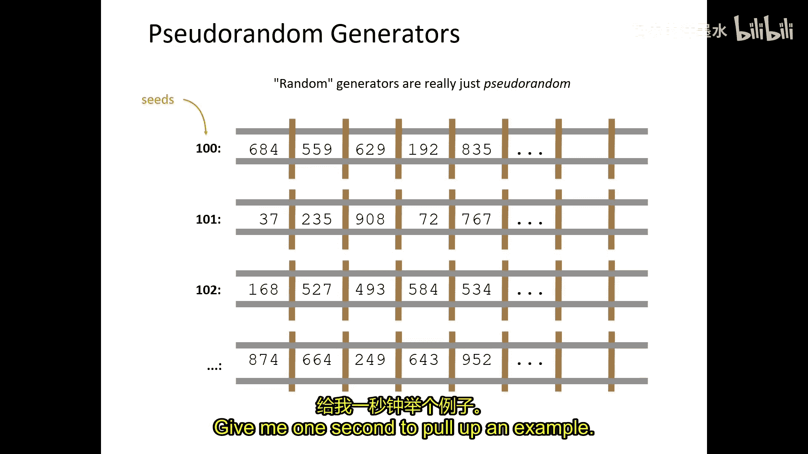
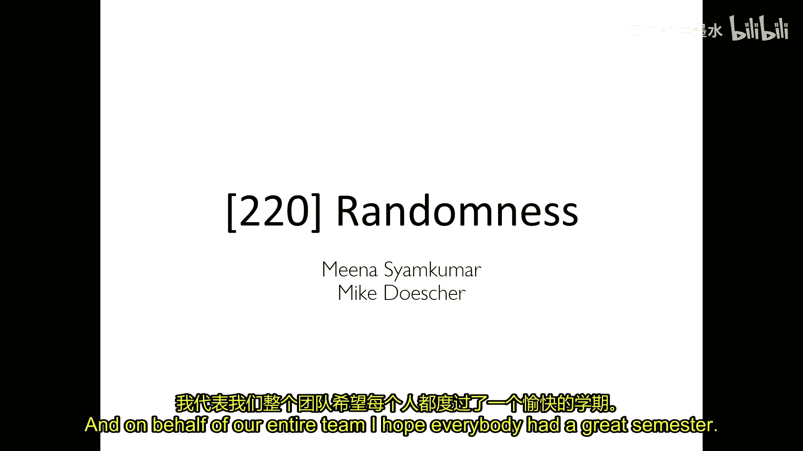

# 【全集】威斯康星大学-Python数据编程-CS220-中英字幕-1080P-p32-Lecture-25---数据编程--BV1VxvsBLEmv_p32-

Hello， everyone， welcomel back to data programming1 Today we have our final lecture of the semester that we do something a little fun here。

 we're going to talk about randomness。 As we get started， I've got some announcements。

 and while I'm going through my announcements， go ahead。

 head over to the web page and download the Jupiter notebook template that goes along with today's material。

 there is a template version that's to be filled in by you guys as we go through it and my final version is already there。

😊，All right yeah， so the announcements first with regards to the projects P13 is due on Wednesday It's the last day of the semester we're not allowed to accept homework after that date。

 It's reserved for finals and studying so we cannot let you guys use late days and on the other side of that not only is it against the rules we also actually need to get the grading done so we can give you grades and make sure that all mistakes are taken care of So late days may not be used In fact。

 everything must be turned in。We're also not accepting resubmissions for all the rest of the projects you've had a week to make any corrections you want。

 send them back in， request a regrade， we're not able to do that in this one for the same reasons。U。

Al right， next up， a peer mentor。 There is Mina is going to be teaching the same course 220 again in the spring semester I'm moving on。

 I'm going to be teaching 354， so different course。

 but Mina will be looking for to hire more peer mentors So I believe she's looking for students who got a beer better are interested in that actually you know working and mentoring other students in this course So she's going to be sending an interest form soon。

 if you're interested look for that from her and go ahead and apply interviews to be happening very soon。

 I believe。If you really enjoyed this course， it's the first course in the data science sequence。

 the next course you would take is CS320 data programming too it's going to continue on with Python。

 If you really liked the computer science aspect of things and wanted to explore a little bit more or are considering changing to computer science the intro sequence there for computer science deals with programming Java it's 200。

 300，400。 if you felt the computer science， the programming part was very smooth for you。

 you might consider jumping straight into 300。 if you want to start from the beginning。

 that would be 200 check with your advisor around that one。All right。

 some changes to office hours because the semester is coming to a close。

 the last day that our TAs will be holding like real official office hours on the schedule is Wednesday。

 December 9th after that we're going to scale back dramatically there aren't going to be new projects。

Inform about instructor office hours， it is coming soon， I haven't figured out what I'm doing yet。

Next up， with regard to the final exam， just some advice on preparing for this as you're reviewing。

 I highly recommend taking a look at the the sample exams on the web page。With that in mind。

 it's going to be the same style as the last exam， multiple choice。

 you're allowed to use pretty much everything except talking to other people， so open internet。

 open material from the course， what I recommend doing is going through the slide decks。

It's a limited time you only get two hour period。So。it's enough time you can do like some searching。

 but you don't want have to search for anything。 Go through the slide decks。

 A lot of them have like 70 slides。 Go find the the key slides and build your own slide deck of the key really important summary slides that have everything you need。

 and maybe even do this like on a headwritten note sheet， you know。

Taking the time to write something out like that， you actually learn quite a bit preparing your own note sheet。

Make sure you understand everything you did wrong on the other exams。

 things that went astray for your projects。 Make sure that all of it's really， really solid。

 We are going to be having live review sessions on Wednesday instead of a lecture。 It's optional。

Cannot speak today optional My anticipation is that you guys will take a look at the practice exams and bring questions from those practice exams I'll be sending you an email with the exact time planning to do that at but you're welcome to come to any session you can go to Me's or mine。

Alright and a quick reminder the final exam is going to be open beginning 6 PM on December 14 and ends at 11。

59 PM on December 15。 So that's a 30 hour window。 You can take it any time in that 30 hour window。

It covers the entire course， it covers all topics。 It's open material from the course。

 open interpreter， you can write Python code。 you may not post a piazza or chgg or Discord or any other like call up another human on the phone。

 You may not talk to other people during the exam。Let's see what else All right。I think that's it。

Let's see here。 Oh oh no，'s not course evaluations。 Yeah， please， we greatly value your feedback。

 please take some time and go ahead and fill out the course evaluation and bring a smile to our faces。

 I know what I really want to know is what can I do better。

 What are some of the things from this course that worked well for you guys。

 What have you seen other people do， other instructors do with the virtual learning that's working really well that like white people to steal。

 I'm not actually taking any of these other people's courses I'm just working on one。

 and I've getting you know my own just just me here。

 So if you guys have feedback from like something you've seen that worked well from other people I'd love to hear about it。

😊，Allright， alright， enough for that。 Let's go ahead， jump in and take a look at the go ahead。

 pull up the worksheet。 alright。So let's get started talking about randomness with a little example here。

 So one of these sequences of coins was generated randomly using Python。

 and the other one was handpicked。 I didn't actually handp it myself。 Someone else did。

 So I got to actually go through and try and figure out which one was generated by hand and which one was generated randomly myself。

 And I'll talk to you guys through my thought process。

Up of the top I've got all of my imports that I'll need for today's save you guys some time we'll be using pandas we'll be using nu pie The new random stuff here will be looking at the choice function and we'll be using some pandas to do some analysis making some plots and then let me run this real quick。

We will also be using some cool Jupiter notebook style worksheet stuff。 Okay， so here's my example。

 I've got two sequences of coins。 One of these was hand picked to try and trick us。

 And the other one was generated randomly using Python's choice function。

 So we just need to decide which one is the one that was randomly generated and which one was hand picked。

 So pause the video。 stare at these for a minute and make a decision and then write your guess in this cell right here。

😊，All right， do that now。All right， welcomele back， guys。

 I guess number two was the one that was randomly generated。

 So I had a couple things I was thinking about when I was looking at these coins。 first up。

 if you look at this， the top sequence has 1，2，3，4，5，6，7，8，9，10，11 heads out of 16 coins。 Now。

 the expectation value， we'd expect that exactly half of them would be heads。

 if it were flipped enough times。 So the expectation value is be 8。 So this is exceeding that。

 The other thing I noticed that really jumped out at me was we've got as we go along right here。

 starting here 1，2，3，4，5，6，7 heads in a row。 flipping 7 heads in a row， it seems kind of unlikely。

 So my guess was that this was the one that was handpic。😊，Turns out it wasn't。

 This was the one that was randomly generated in。In Python。

 and this is the one that was hand pickedked to it almost。

 I don't know if you might want to think about as looking too perfect。 It's actually got 1，2，3，4，5，6。

7，8 heads。Not more than two in a row at any point。 It's exactly hitting that expectation value。

 but this is the one that was handpicked。 number one was the one that was randomly generated。

 So I got this wrong。 I guess number two was random and it was not So we're going to be looking at a couple things。

 How likely is it to get 7 heads in a row if we flip 16 coins And how likely is it we'll get 11 out of 16 that are heads。

So those are the last two things in lecture， we've got to talk about how to actually use Python to get some random numbers first。

 So I'm going to head back over to PowerPoint and introduce those new functions and then we'll start going through the rest of the worksheet。

All right， period right back after I flip back to PowerPoint。

I'd like to start off by recommending a couple of books for your summer reading。

 First up on the list is thinking fast and slow。 This book is a mashup of statistics and psychology and addresses how people misinterpret chance and sequences of random events and draw the wrong conclusion based on。

Human nature and their interpretation of things， and particular statistics。Next up。

The signal in the noise by Nate Silver Nateates over statistics genius had a boring job in insurance and decided to do only things that actually interested him。

 He made a ton of money playing online poker， where he took advantage of his knowledge of statistics。

 He did some analysis of baseball players to identify underrated players。

 also with a lot of monetary value in it。 and then moved on to predicting elections and is the founder of the famous website 538。

 It's named that because there are 538 people in the Electoral college。And this particular book。

 The Sign and the noiseise is about people， what kinds of things people are good at predicting and what kinds of things people are not good at predicting。

All right， next up on my list， we did talk about plotting during this course。

 and as long as I'm recommending books for the summer。

 I got to recommend the visual display of quantitative information。

 This is a great book about how to make your plots more effective and better communicate what you're trying to what point you're trying to get across Finally on my list statistics done wrong came highly recommended。

 I haven't read this one myself。 apparentlypparently it's a really deep dive into statistics and deals with a lot of the same issues these other you know we'll be discussinging today with bias and significance and chance。

😊，So why do we care about randomness， I got three reasons here on on this particular slide。

 First one， games。 We've all been told to go home。 We're getting a lot of extra family time。

 and a lot of us are using that time to play board games。 And almost all those board games have dice。

If we were trying to play games that didn't have randomness if you think about a computer game。

 we could play them once and then figure out what the pattern is that the computer is using and then we can play again and always beat the game。

Second one on the list， security， almost all computer security involves some sort of secret like a password。

 something that's hard to guess。 It turns out that humans are very bad at picking passwords that are not hard to guess。

 and it's so much better to go with a randomly chosen secret or randomly chosen password。And finally。

 the major focus for our this course data programming in general and what we're doing today is going to be simulation。

 we're going to be simulating， flipping those coins lots of times try and decide whether things are likely or not and we're going to do this with the goal of trying to predict the likely outcomes of possible scenarios and it'll explore lots of different options。

To that， we'll be looking at the Python's choice module。

 So Python comes with a built in random module。 That's it's a limited， but pretty good for。

 pretty good for quick and easy tests。The nuy module also has a random module。

 which is contains a powerful collection of functions。

 I recommend you guys check out the documentation for the nuumppy。

Random module and see all the different things it can do today。

 we're only gonna be looking at one thing。 just the choice。 That's probably all we have time for。

 There are a number of slides in this slide deck， which will be available for download which also go into plotting histograms which are a great way to visualize these random results。

 but I'm going to leave that to you guys to flip through the slides on your own and try some of those examples out。

😊，Alright， so， all right， I'm back in Jupyter notebook。 So first up。

 random selection from a list using choice。 Let me grab a new cell here。

 It's really simple to do this。 I'm just gonna call the command choice。

When don't I click the cell correctly。See Jo。 This is gonna take a list of things。 So I'll have。

Option one。Option 2。How many options I want。嗯。So in this case， just to demo this。

 I'm going to leave this here as I comment， so you guys have notes of how to use this。

 And then for my example， I need a list， so I'm going to use the square brackets and we'll select from one of three objects about a rock。

Piece of paper or a scissors。All right， and then if I run this。

It's going to choose one of these from the list。 If I run the cell again。 chose paper a second time。

 Next time I chose scissors running again and again。 And again。

 it's just going to continue to choose one of these from the cell。 By the way。

 that's control entered to run the same cell without moving down to the next one。

Shi enterer will run the cell and move it down like that。Okay， now。

 so pretty straightforward using choice。 We also have some options that we can use in this choice block that make it a lot of other things possible。

 So I'm me go grab another cell。I'm going to copy and paste this line。

And talk about some of these other features。 So the first parameter is a list of things to choose from。

And then the next parameter keyword parameter is size。 and I can say size 5。

And this is going to let me choose five different things。

 and it's going to return them as a nuy array。Let me demo that real quick。

I'm get a new cell for that。So I'm going to take this command and we'll just print out the type of it。

And just again， just doing some experimenting。 Now we can use this nupy array just like we can of list。

 In fact， one of the things you can do with a list is make a series out of it。 So I can say series。

And then， I can put my。Command to generate a nuie array。

From the choice right there in the series when I run this， I now get a series。 So I have index。

 this is the boring list version 1 where I'm just using the index as the same as the positional integer。

 So and then my values here are just randomly selected。

 If I run this cell a bunch of times using control enter。

 it's going to give me a different random list of or series of objects from that list。Alright。

 let me just move this cell down。 It's actually supposed to be under the random series block there。

 Some other things I can do with this。Numbie array。 So let me grab this sequence again。Choice。

 there we go。 That should give me an array and nu array。 I'm going to stick this in a variable。

I call it a。For array， I can access that。Only there's run us again。Print it out。There we go。

Grab another cell so I can access the elements of this rid， just like I can any other list。

 it's almost everything is identical So a list。 So if I want to grab the second item thatll be at index 1。

 that should be the rock。There it is the rock， if I want to grab the paper， that's at 012。Paper。

 okay， so using score brackets， I can access elements from the nuumpy array just like a list。

All right， next up， multidimensional random series。Let me grab a new cell。So， I'm going to take。

This right here， this size parameter right here also accepts a tuple。 So right now。

 I'm just giving it an integer just a5。 But I can also give it a tuple。 Remember。

 we define tus using parentheses。 And in this case， it's going to have two numbers。

 The first one will represent the row。 And the second one will， represent how many columns we have。

So rows and columns。I'm going to put this in a comment because I've。

Don't have rows and columns defined。But then we'll go ahead and we'll do this with。

Let's say we make five rows。And two columns。And this is going to return a multidimensional nu high array。

 If we stick this into a variable， I'm going to call it array。A for array unless this will print。

Print that out。I just print it like this。And I can grab another cell。

 We can access this the same way we can with a list of lists。 In fact， if you look at it carefully。

 we've got square brackets and then items of square brackets。

 So essentially it's a well exactly like a list of lists。 And so if I want to grab a particular item。

 I'm going to grab。 Let's see how about this rock right here。 That's in row 0，1，2。Element 01。

 so that should be the rock。 That's that rock right there。And then just a reminder。

 I'm going to put some more comments in here。That when I have this row and column， sizes。

 rows and columns， me just copy this。So that I can add a little comment。

So I get a little comment right underneath it this。Rose is gonna be。

Think about it as the going down direction。And。Columns are going to be how many things go across。

Alright， so we've got some little arrows。 That's the not the letter V。 That's a down arrow。

 And this is an arrow to the right so。When I put the five in here， I get 5 rows，1，2，3，4 5。

2 items in the list going across。We can also use this choice function of the nuumpy array that results from a choice function to create a pandas data frame。

 So let me grab one more cell。 please remember that when we create a data frame。

This can take a list of lists。Which is essentially what we're generating。Let see， where was that。Oh。

 I stuck it into a series right up here。 we are generating a list of lists。 Nope， right here。

 This is what I'm looking at。 list of lists。And。We can do the same thing because this is essentially a list of lists。

 We can stick that in a data frame and create a panda data frame。 So let me grab。The command。

 the choice function there。I'll stick that directly in my data frame creation。And run this。

 And now we've got a gorgeous looking pandaace table that we can do more analysis with。

We'll use data frames more in a few moments when we start doing some more in- depthepth simulation style analysis。

 One of the things that I want to talk about next， though， is exploring bias。

 This is this a fair function。 take a look at this data frame we just created。

 We're just choosing five rows with two selections each。 I it fair。 It looks like we've got1，2，3，4。

5 instances of paper， But if we count the number of scissors， there's only two scissors，3 rocks。

 So question we want to address next is is this fair。

 And maybe a better way to look at the data would be to actually plot it。

 So I'm going to go ahead and do that now， I'm gonna grab a new cell。

I'm going to copy this command that created the data frame。 Start with that。

 I'm going to stick this in a series。So we can make a bar graph from it。

And I don't want a multidimensional。's let's just do 15 of these that， you know。

 if it were actually fair， we would reasonably expect that we'd pick rock five times paper five times scissors five times。

 Let me make sure I didn't screw up。So there we go。

 we've got a number of This one looks like it's got a lot of rocks in it，1，2，3，4，5，6，7，8。

 I was expecting  five。Alright， well， anyway， so once I have a series to actually take this and do all the count for us automatically。

 the command is value counts。 So I'm going to actually stash this in a variable S。

 and then I'm going to say that value counts Vc is equal to S dot。Value counts。

 And just remember what this looks like。 We'll go ahead， print out Vc。

This is going to create a new panice series， but now the index is going to be the items from my list and the value is going to be the number of times they appear in the list。

 Now when I ran the cell again， it completely read this， In fact。

 if I just keep to running the cell over and over， it's going to give us a new pandaice series every time。

And。And then recompute the value counts。So what I'd like to do next actually。

 is create a bar plot from this D。Value counts plot。And bar。

And now we can actually look at this victorly and see that where it looks like we're getting seven of the rock and。

Looks 4 and 4 of the scissors in paper。 I that out 15。 Yeah， that that's 15。

 If you just do this couple times。 just sort of make some observations about what's going on。

First thing I can see is that it's always in decreasing order left to right。

 And that's because pandas goes ahead and sorts the data for us when it does the value counts。

 it's going to give us the largest value first down to the smallest。

 So here we can see we've got eight scissors on the left。 If I run this a couple more times。

 Now there's more rocks， non rocks this time。 So that's the leftmost one。 for like comparison。

 that seems alone。 not quite ideal。 It's not exactly what I'd like。

 So let's sort these guys by item instead。 I'm just gonna copy this。I'm going to grab a new cell。啊So。

Guys who are following along at home can come back to this later。 So to do that。

I'm going to call a sort index on this。 So right here， I was using VC to print it out。

 I'm going to say V C equals VC dot。Sowordt by index。There we go， and we'll keep the plot there。

So this is now going to store things for us。And it's going to do it alphabetically。

 So I've got pe for paper R for rocks。 As for scissors。 Yep， they're an alphabetical order。

 I can do this a bunch of times also。 And they stay paper rock， scissors， paper rock， scissors。

 And we can see that the bars move up and down there're no longer in sortid order。

 So this might make it a little easier for direct comparisons as I go through。

 I'm still trying to figure out， is this， I this biased or not。

 And I'm looking like I'm getting things that are all over the place。嗯。And not thinking about it。

 to be honest， I would really prefer that the order be rock paper scissors， you know。

 like the traditional game。 So just one more quick thing。

 This is more of a review item than anything else。 I'm gonna go grab another cell。Here we go。

 We'll put that same code in there。 But now， instead of sorting with the sort index。

Please remember that I can access any series using the square brackets。

 and I can put a number of things inside these square brackets。

 And one of the things I can put in is I can just write rock。For example。We'll do that。

When I run this cell。I'm not printing it。 Hol on， Hol on。There we go。 When I print that。

 it's going to give me the value。 I can also put in a list of things that I want to get out。

 So in that case， I need a new list。So I'm going to add some more square brackets。So the outside。

 the green ones there right now are telling me to access data from the list。

The black runs are telling me that I want to get which columns I want。

 and I can put them in the exact same order that I've got right here。

 So I'm just going copy and paste my rock paper scissors。Inside that list。And now， when I run this。

 it should give me basically grab the rock paper scissors。

 keep them in this order and tell me how many times each of them appeared。

 So if I run this a number of times， it should stay rock paper， scissors， rock paper scissors。

 It should always be in that same order。 no matter how many of these are here。

So next up I'm going to go ahead and put my bar plot back。

And now we can see that rock paper scissors。 I know you guys can't see it when I'm touching the screen and pointing at it。

 But trust me， I'm pointing at the rock。 It always is going to stay there on the left。

No matter how many there are， paper is going to be in the middle， I love it。Okay。

 it still looks like there might be some a little bit of， maybe。

Paper comes in more often than the rest of these， I can't tell。 it seems to be。

A little bit deceptive。I'll check this out。I actually plan to do that and forgot to move these down。

 Let me do that right now。 So Ill put this cell in the sorted by rock paper scissors。

 I'll put this cell sorted by item。 So when you guys come back and look at the lecture notes up here。

 I've got my lecture version， There's a worksheet version for you guys。

 So both of them will be available。 You can see the exact work I did。 That'll be in the right spot。

Okay， so。It looks like the next question I want to ask since it's the same question is is this really fair and how can we address this。

 and maybe one way to do this would be to look at a much larger sample size so that any of this like little random distribution that we're seeing。

 you know the perturbations， it's not exactly the same every single time will sort of get averaged out。

So let me just go back and do maybe not 15 trials， but about computers are really powerful。

 How about a million。 So that's 1，2，3，4，5，6，0s。Let me make a graph of this。You know， in fact。

1 million isn't exactly divisible Y 3， Let's go with 3 million。We'll do that。 And indeed。

 computers are powerful。 I did that blazingly fast。

 And we can see we're getting numbers that are all really close to a million。

 and this is slightly over。 those are slightly under the bars are almost the same height。

Let me just run this a couple times。Or did do wrong。Colonel had died。 Oh no。Alright。

We start running all。All right， so maybe3 million is pushing the limit for what Jupyter notebook could handle。

 So I'm going to move on。Do have a pretty nice computer here。Okay， so next up last。

Is I can control the probability of selection。 So I'm actually going go back。

 I'm going grab this again， get a new cell right here。Put that in here。 Maybe let's not do 3 million。

 but we'll drop that down to， maybe。300000 That should be。Easily doable for my computer。And then， my。

Choice function right here that's up through that parenthey right there can also take another parameter。

 P。And this is going to be a list of probabilities。

 So suppose I want rock to appear 2070% of the time paper to be 20% of the time and scissors 10。

 These need to add up to one。Oh wait。70，20 and 10 add up to 100。 I want 。7。2 and 。1。

 Now they add up to 1 that throw0s and 2。Yeah， that's looking really good。

 So then when I do this analysis， what I'll find out is that I I actually have control over the probability。

 So I can say that rock is going to appear far more often than paper and scissors。

 I can change these around。 I could make the rock probability 10 and the scissors probability 70。

 They just need to add up to to 1。 If I mess that up。

 It gives me an error message saying probabilities do not sum to 1。😊。

I put that back for the folks at home following along and these numbers match up exactly。

 So this rock is the position  zero。The 10% is at position 0， paper 20。 And finally， in this section。

See， there's a shortcut。 If we want to do a random selection from a list of integers。

 So I'm grabbing another cell。And let me just do， just gonna copy this much。

And then I'm going to get rid of this much。And I'll just do a much shorter sequence。

And then if I wanted a list of integers， I could go， you know，1，2，3。workre computer scientist。

 we'll start with0，0，1，2，3， and then I could。I'll fix my mistake。 Mr。 In parenthey。

 there I get a sequence randomly selected from the 0，1，2，32，3，2，2，1。 If I run this a couple times。

 Eventually， I'll see a 0 in there。There we go， but there's a shortcut for this because choosing a list of integers is so common。

啊。That I can just stick in a number right here。 And that's going to choose in I'm between 0 and 5。

 So things that are less than 6。 So I should never see a 6， no matter how many times I do this。

 but I will get to the 0。Okay， so just quick note on that shortcut， we'll use that in a little bit。

Next up， I'm going to pop back over to PowerPoint and talk about bugs。

 One of my favorite topics is how to not write code with bugs。 And as you guys know。

 I write code with bugs all the time。 I frequently make mistakes。

 So we want to talk a little bit about how to avoid doing that。

 those life lessons that come with many， many failures。 All right， Be it back。

 So I want to start this section about bugs with a deceptive example of a bug that sneaks into people's code all the time。

So here I've got。This particular line of code is just creating a series with it's going to randomly select numbers between 0 and 9。

 I'm just gonna to grab 5 of them。 works perfectly fine。 There's nothing wrong with that line。

 And then I'm just gonna to create a plot of these。 So the sequence that I generated is 6，7，7，3，1。

 I'm plotting that 6，7，7，3，1。With line plot next thing I'm going to do is compute the percent difference。

 So just empty list， quick loop through all of them。

 I'm to start with one instead of looking at element 0。 So this first thing。

 S of I right there in my list will be the 7。 I'm going to divide by S of I-1， the 6。

 So 7 dividedva by 6 is about 02， I guess。1。2。 we'll take away。

 We'll subtract one so we can see the actual percent change multiply by 100 to get a percent。

 That'll be my difference。 We'll just stick that in the list and we'll get all of the So there's 5 points here。

 We'll get four in the list。 And I'm just going to graph those。 So series percents。

 This will create a series using this list。 And then I'm going to bank a line plot。

So 7 divided by 6 take away 1 times 10。 It's about a 20% change a little bit less。

 Then the next two numbers were 7 and 7。 That's a 0% change。 And then I went from 7 to 3。

 So let's decrease。 So we'll see a negative percent change in。 let's see。If it were three and a half。

 there'd be a 50% change， it's a little bit less than that。Or a little bit bigger。

 So I'm seeing like about negative 60% change。 And then 3 to1 is a 66% change。 All right。

 now this code runs and it did produce this plot right here。 But there's a subtle little tiny。

 niggling bug that may or may not occur。 I want you guys to pause the video。

 stare at this and see if you can spot something that might cause this to have a problem。

 Do that now。Allright， so the problem we're going to run into is if I run this series。

 this first line creating the series a number of times。

 eventually I'm going to generate a sequence that has a zero in it。And then if there's a0。

This will run through the first first time。 It's going to take one divided by 9， get a value。

 And then it's going to try and take。0 divided by one。 No problem there。

 And it's going to take 8 divided by 0。 and not even Python is powerful enough to divide by 0。

 So this is going to give us an error。That's the bug。 Okay。

 so there's two different kinds of bugs in the world。 They're not all equal。 We have scary bugs。

 and these would be in the， no lots of different kinds of scary bugs。

 But this one is in the non deterministic category。

 That means it sometimes happens and sometimes doesn't。 I've got this code。

 We'll run it a couple times。 We'll actually watch the error happen in live version in just a moment。

So I found a picture of a scary book。 or Tyler actually found this。

Badass bugs that you should have nightmares about。 I just love that。

 I don't know if you guys can read it。 If you're on mobile。 That's the link。

 freaky looking insect there。 Okay， so nondeterministic bugs are scary。 They're really hard to spot。

 And in fact， if youre writing code that generates airplane wings and you ship it out to your customer。

 And there's some randomness in there that you using in your algorithm。

 Sometimes they may come up with a random error that's going to divide by 0。

 and their code is going crash for them。 And then they'll send you a bug report。

 And as the programmer， it's your job to figure out what went wrong。

 But if it works perfectly find on your end every single time you try it。

 it's really hard to spot those things。 So nice bugs would be things that are reproducible。

 so that when the customer sends in their bug report， you can figure out what's going on。

 actually watch the program crash。😊，So there's other kinds of scary bugs too some of them are system related。

 in fact， in P9 where we were printing out the up list of files from directories in previous years。

 we didn't have you sort them in reverse order， and it depends on what system the order they come out in so students who are running the code on Linux。

Actually think about it this way。 some of the students were running code on Windows and that produces the file list in a certain order。

 and then we were grad in using Linux based systems。

 And that's going to produce the answer in a different order。

 The list of file names in a different order。 and that was causing problems for students。

 So we fixed that this year by just requiring everybody to enter the files in reverse order so that everything was sorted and。

We didn't run into that this year， hopefully， and randomness generally does lead to scary bugs when we start to see those kinds of things。

 Some things we can do to avoid seeing bugs。 if we have a really large data set。

 maybe we can go and chop down and just use like 1% of the bug。

 that makes it easier to trace the code， if we're not trying to scroll through a list of thousands of data points to try and figure out which one caused the problem。

 if I have a really small data set that reproduces the bug。

 much easier to trace the code and spot where it's coming from。

And we have a way to turn semantic errors into runtime errors so that they don't sneak through。

 So if we already know something about the problem， we can use an assertion。

 I was supposed to ask you guys to remember what it was called。 It's an assert。

To put in what we know， we， we know we can't divide by 0。 So any time I'm divided by a variable。

 I should stick in an assert and just make sure that it's not a0。 That way。

 it's going to crash and give me a meaningful error message when I see this happening。

And one of the ways that we can reduce this non deterterministic bug is called seeding。

 And that's going to allow us to turn the randomness into something that's deterministic。

 So let me just talk about that for a little bit。 The random number generators that we see in programming languages are technically pseudoran generators。

 They are trying to generate a sequence of numbers that look random。And。

The way this does it is you can imagine a train going along tracks where each of the railroad ties has a number on it。

 And we're just going to be reading those numbers off。

 The the idea is that no matter where I start on the track， no matter how far I go。

 no matter how many numbers I look at， it should look like those numbers came from rolling dice。

They were just generated by chance。 If I would look at enough of them。

 I should see a distribution that matches the expectation value for really large sets。

 And every time I run my code， it's basically choosing from a different set of tracks。

 So one time it might choose this first track， I'm going to get 6，84 than 5，59。Yep。

 actually using this code right here， making。Choices between 0 and 999， choosing three numbers。

 I'm going to get those。The next time I run it， it might choose a different set of tracks and run down。

 and then I'll see 37，235，908。So there's a way to， for us to remove that random number。

 randomness from it and get the same sequence every single time。 That's known as seeding。

 We're gonna random number generators basically take two inputs， they take the seed value。

 and they take either the previous number。 So or they'll take the number of integers it's already generated something along those lines。

 What we can do is we can put in our own seed value。

 and then it's always going to give us the same set of numbers。

 the same railroad tracks as we go along。 In fact， I'm absolutely certain that almost everyone in the class has seen seeding before give me one second to pull up an example。

 So my fans of Minecraft out there， if you were to go into Minecraft and create a new world。

 So if I pop up in single player mode， there's other games that I play， I do love Minecraft。

 particularly the  tecttopium mod， I can go to create new world。😊。

And this is my seed example。 under more world options， I can put in my very own seed for the world。

So we'll put in what is5，6，7。 If you guys want to plan this world and I want to plan the world。

 We're both playing on the same world。 It can see the random number generator。

 So we'll just create a new world。You're going to get a Mincraft world with the exact same geography that I'm playing with because it's going to use the same sequence of random numbers as it's。

Creating the world。All right， let's just give that a second to pull up。 So if you look around。

 looks like we're starting in a plains biome。 Go the book because this has the  tectacttopium mod installed。

 You guys get a chance。 I really love that one。啊啊。I almost forgot。 So first up。

 I copied that same code from the lecture slide with the change over time。

 I just wanted to demo this and show that occasionally it's going to crash。

 So this is a great example。 It's going to draw four numbers and so， I did five in my example。

 So it's going to draw in this case， four numbers。 And I see that I get20。

 So on the second time through， it's going to try and divide by 0。

 And I'm going to get a runtime warning， divide by 0 encountered。😊，But sometimes it's gonna work。

 Let me just run this couple times。 There we go。 This time， it worked great。 I got 9，1，3。

 So change from 9 to 1 is quite significant， almost 100%。😊，Then one to three is。Tling。

 So we're looking at well。Yip3-1 is 2 times 100。 so about 200% larger。 Anyway。

 sometimes it works and sometimes it's going to crash。Very deceptive， non deterministic bugs are bad。

Okay， next up， how does seeing really work in Python。 This case， it's coming from the nupy module。

 random。Part of that package， the function is seed。And I can just give it any number I want。

 So about 220。 When I run this code， I've now seeed the random number generator。

 it's going to take track 220。So if I run choice numbers between 0 and 999 inclusive。

 we'll just grab three of them for the purpose of this example。And there we go， we get three numbers。

 if I were， let me grab another cell。Be for cell below。 if I run this again。但。

I'm going to get the next three numbers。 So 8，83，7，32，15， and the next three are 1，81，25，14。 Now。

 I can reset that and start over at the beginning of the tracks by again， running。

This random seed function， we'll start it over at 220。We'll grab another cell。When I run this again。

 the choice function， I should now again see that I've started over at the beginning of the track。

 I get 883， 73215。Let me go ahead and just。Paste that in。 We'll grab the first six numbers this time。

 again， 883，5，30 to 15。 And then I see the next three numbers are， in fact，1，81，20 and 5，14。

 So seatding the random number generator is very powerful。 Great way to avoid bugs。🎼And frequently。

 what we'll see is that people use。Sorry， that was my phone。

What we do is see people will seed the random number generally with the time and then print out that in some sort of log message so that if the program crashes。

 they can send in the log message and the programmer can go back on their bug report and try and reproduce it using the exact same seed number that whoever was playing the game or designing the airplane weighing used。

 So if I want to seed with time I'm just going to grab the number of seconds since 1970。

 We'll need to import the time module。 What time。 And then the command。It comes from the time module。

The commander get the time is just time。And this is going to produce the number of seconds since January 1。

1970 at midnight。 That's when computer science officially began the beginning of the world for us。

So what I'm going to do is because the seed needs to be an inte I just want this much of it。

 So I'm going to take， I'm going to store this in a variable。 we'll call it now。

And we'll cast this to an int time to time。It's function。And we'll print out now。So。There it is。

 it's now an integer。 and now what I can do is I can seede the random number generator and believe I have this function right。

 can we just copy it？And we will pass that now。So random number generator now seated with。That seed。

 when I run choice， I'm going to get some numbers。 But I really want to do is。

Write this out to my log， seating with。That number， I store this。

 This is going to be in my bug report。 Now I can go back and try and figure out what went horribly wrong with my code。

 It possible if I'm choosing three numbers out of 1000。

 Then it's going to be quite rare that I actually get 0 and end up dividing by 0。

 So it's important to know exactly what seed was used so that I can see what kind of air message is produced。

So this is going to lead us into a discussion of significance。

 and this is basically if I've got a sequence of noisy data， if there's some randomness in my data。

 does a particular set of data support drawing a particular conclusion And for my example here。

 I'm going to go back to flipping coin。 Oh oh yeah， just for fun。A little comment from Dilbert。

 if you guys on our own mobile device and can't read this， I'm going read it out。

 and if you can read it， then I'm sorry for wasting your time see。

We have Dobert talking to a little monster here。 Little demon says over here。

 we have a random number generator。 And then in the center panel。

 it's just another creature saying 9，9，9，9，9，9。And Doberts asking， are you sure that's random。

And the guy giving the tour says that's the problem with randomness。 You can never really be sure。

 And that's true。 So what we want to be able to do is take data that's got some noise in it and decide if we can actually draw a meaningful conclusion from that so。

Suppose I have a friend。 Come over。 Actually， I can't do that。 Everybody is forced to stay at home。

 So I've got my friend on zoom， and they're going be flipping coins。

 And we're going be wagering money on this， so。He's claiming this is a fair coin。

 and he flip it 100 times， and it comes out 51 times its heads and 49 times its tails。Now。

 can I say that this coin is biased in some ways， my friend cheating using this particular coin。

 Basically， we're trying to decide if this data supports the conclusion that the coin is。

 is biased and a statistician would say this is I that conclusion statistically significant。嗯。

Probably not。 probably， probably not cheating， Probably legit coin there。 Now， if we do it again。

 he pulls out a second coin and flips it 100 times。 if I see 5 heads in 95 tails。

 if I'm going to call shenanigans on this one。 I believe yeah。

 that sounds like there's a there's a good chance that this coin is biased。

 And it's possible for this result to happen。 But the odds then it happens are quite slim。

Now I want to take a little bit different perspective。 What if it's 55 versus 45。

 Do I call shenanigans in that place， So what we're going to be looking at is that in the next example。

 I'm going to jump back to Jupiter and see。 how often does this really happen that I'm off by 5 or off by 10。

 What if it's， What if my friend flips it 100 million times。 And I see that 55 million times。

 I get heads in 45 million his tails。 Do I want to call shenanigans in that case， for the 55 and 45。

 I probably don't for the 55 million and 45 million。 Abute。Yeah， no and yes。 Okay， So one of the。

 the things I can look at for to make that decision。

 if I see a large difference or a sw in a very small sample， that's， you know。

 pretty good evidence that there's some bias there。And if I see even a small difference。

 something that's perfectly reasonable for a small data set， when I have a really large sample。

 that's also really good evidence that things are biased。 In fact。

 this is how casinos make all of their money。They're looking at millions and millions of transactions with even just a small bias so that it's hard to tell。

Okay， so what we're going to do， I'm jump back over to Jupiter and try and see if we can decide whether 60 heads and 40 tale of it 100 coined flips is representative。

 You know， how often does this happen if I see this。

 Is this a good enough example to count to call shenanigans on my friend。

 So we'll be flipping it 100 times We'll count how many times we come up with heads and we'll repeat this 10000 times And just see how often this happens。

All right， so is it weird that we have 60 heads in 40 tails。 So basically。

 the question I'm going to ask is， how often are we more than 10% or more than 10 away from the expectation value。

 So in this case。I want to write a basically on one to select 100 times。So choice。

 I'm going to want to either get heads or tails。 I'm just going to abbreviate those heads。Whoops。Ts。

And then， I w to choose。Size is equal to Now what I want to do is I want to do this lots and lots and lots of time。

 So I'm gonna let the rows equal How many times I want to have， how many times I， how many trials。

 I guess so。We'll have trials。 and then the columns is going to be how many times I flip the coin。

 So call that flips and。Just to make sure I'm not hard coding this so I can tweak the number of trials。

 What I'm going to have is trials is equal to 10000。And flips。It's equal to。100。

Now this is actually really big。 I want to print the data table and take a look at it。

 So let's start out with three flips per row and maybe 10 rows。 Let's start with that。Okay。

 see what that looks like。 So I'm getting here it is。 This is a nuy array。 So an array of arrays。

 And so I got tails， heads， tails， tails， heads， tails， heads， heads， tails。 Okay。

 so let's look going out。 looking like it's working。So let's go ahead and put that in a data frame。

 So I'll store this as。Data frame equals， and then I can just write。Data frame and stick this。

Chance our choice function inside of that。 it'll generate the list of lists。

 and that gets turned into a data frame。 And then I'd like to print that out。

 So forgot forgot that line。 So there we go。Beautiful looking data table。 Now。

 it's actually a little bit easier to count how many times I see tails and how many times I see heads。

If I abbreviate heads is1 and tails is 0， because then I can just add them all up。

 So let me grab another cell， make a copy of that。 And I'm going to switch this from heads is equal to  one。

 Tas is equal to 0。 and then I can add them up。 So make sure this is working。There we go。

 It's a list of lists So I'm looking at， you know， numerical integer indices。Then I can go ahead and。

Let me grab a new cell。 We'll copy this again。 Just take the sum of these。 So to do that。

 I'm going to take my data frame。Call some on it。 And this is going to add up all of the。嗯。5，6，3。

 That's more than 3。 Oh， I know what this is doing。

 This is adding up the number of heads we see in the column。 So in this case。

 I didn't actually print out my data frame。 Let me do that。 Then we can see what's。

It didn't print it either。Print data frame。 I'm gonna make sure this is really what it's doing。 Okay。

 so first column here has 1，2，3 heads。 So column 0，3 heads。 Okay， so what I really want to do。

 the default is to add up the columns。 I want to add up the rows。

 So to switch that the sum function takes a keyword parameter equal to axis。

 and the first column is going be rows。 The second one is gonna to be columns。

 I want to switch this from axis 0 to axis 1。And add these guys up。 So now I've got 0，0。

1 has an occurrence of one head， 0，1，1 has two。 Okay， that looks like what I want。

So next up I'm going to go back。 and what I'd like to do is now use the big numbers。

 So instead of 10 trials， I'd like 10000 trials。 instead of  three flips， we want 100 flips。

 And let's just take a look at this real quick。So I'm printing out my entire data frame。

 It's abbreviating it so I can see all of the flips up to。99，0 to 99。

 And then I can see that in row0， I had 48 heads。 row 1。 I had 56 heads， row 2 equals 47 heads。

 So I'm looking for ones that are less than 40 or greater than 60。

 Looks like I didn't get any in this first run。 Let me run this cell again。

And see just how often there it is， there's a 61， so it does occur。Now， I'm going to go ahead and。

Grab another cell。 What I'd like to do is just count those。 And I've got 10000 here。

 So what I'm looking for is。Whathy don't I name that。I didn't give it a name yet。 Okay。

 so let me take this sum and we'll name it。Counts。There we go， counts as as equal to that。

Let me run this a little bit and make sure that I actually have。I no longer printing note。

Sorry for all the mistakes。 I know that slows things down。 So there we go。

 Do we have any less than 40 grid and 60。There we go。 There's a 39 in there。

 So if I look at counts less than or equal。To。40， for example。

 this is going to return a Boolean series and I'm going to see I get true for this 39 right there。

If I look at counts。Greater than or equal to 60。none of these were the ones that are showing here。

 none of them are greater than 60。Now， what I want to do is actually add those up。 So if I take。

And use this Boolean series to select just these rows。 That'll give me a new series。

 And then I can use the length of that series to get the count。 So I'm going to be using。Counts。

We'll be extracting with the axis。Brackets。Let's do accounts less than or equal to 40 to start off with。

 this is going to create a Boolean series。 I'm using it to select things。So in this case。

 I'm looking at only things that are less than 40， less than or equal to。

And what I really want to do is get the length of that。 So we'll just， we'll give this a name。

These are the extremes， and we'll get length of extremes。We'll run this。

 and it turns out that 266 out of the 10，000 that ran had less than or equal to 40 heads in the list。

Alright， now I care about greater than or equal to 60。 also。 So what we want to have is or。

Cos greater than or equal to 60。 now， if you remember。

When we were looking at pandas or was one of the operators they couldn't override。

 So they overrode the vertical bar there， the pipe instead。

 and that vertical bar is a real python operator。 It has really high precedentnce。

 So I'm going to need to stick these in parentheses also so that these happen first。

 So I want to create those two Boolean series and then use the or operator to merge them together。

 And finally use that。So it looks like in this example。

 I'm getting 539 trials that have less than 40 or greater than 60。嗯。Now。

 to compute the percentage of that， I need to do one more little thing， take the length。

Of the extremes。 and I want to divide by how many trials I I did， Os so。

I believeve I called that trials。 that'll give me a percent as soon as I multiply by 100。

So it's looking at in this example， getting less than or equal to 40 or greater than equal to 60 happens 5。

39% of the time。 If I rerun the entire notebook， I should see that I get something close to that again。

There we go 5。32。More or less。 so it is likely that we'll see this， you know， one in 20 more or less。

So next up， for you guys at home， what I'd like you to do is go back to that opening example。

 the one where I had the 16 coins I flipped them， and I asked you guys to decide which one you thought was real and which one was fake。

Go ahead and take what we just did here and see if you can apply this to figuring out how often can we see 11 or more heads。

 So pause the video， work through that。 And when we come back， I'll play the video。

 I'm going to go through the example and show you how to do it。So once I bear back， Okay。

 so to take a look at this problem。 Let me grab a cell to do the work in。 first thing I'm going do。

Flips is actually equal to 16 now。Trials will go with 10000 again。

 just to make sure we have a large enough sample that we can see how often this happens。

 We'll create a new data frame。Where we're giving this。Choice。Now。

 the choice is going to take one for heads， zero for tails。It takes another parameter size。

 and that's going to equal my number of， we'll give it a tuple。 So the number of trials。

For the number of rows and the number of flips that we use in that case 16。Then， let me think。

We'll do the sum of the rows。 So I want counts as equal to my data frame。Some。

 and I want x equal to one。And then the result that I get。Is going to be equal to。In this case。

 here's where I want to go ahead and access counts。opsSre brackets。

 because I want to create a Boolean series to extract only the trials that have 11 or more heads。

So to do that， I want counts。Greater than or equal to 11。Heads。Yeah， that looks good to me。And then。

Let's see length of result will be how many of those trials actually have more than 11 and。

If I buy trial of 10000 and turned into a percent。 let's see what this looks like。All right。

 so interesting。 It looks like when I do 10000 trials。

 flipping coin 16 times approximatelyimate 10 per cent of the time will be getting 11 or more heads。

 So it's not unreasonable that。The data shown in my very first image there is legit。Okay， next up。

 what I'd like you guys to do is try and answer the question。

 How often do we see 7 heads in a row When I flip 16 coins。 All right， I'm gonna to pause the video。

 I want you guys to do the same。 See if you can work through that。

 and then I will show you my solution。 There's actually a ton of ways to do this particular problem。

 So my solution is only one way。 Okay， so my approach to this problem。

 Let grab a new cell and walk through this。And what I want to find is how many times I see 7 or。

More heads in row。 We'll start off counting with 0， and I'm going to do。10，000 trials。

 but just start us off what I really want to do。Is。CHO Joce。I'm gonna call me the choice function。

 I'm gonna give it either。Heads。Or tails。And we'll do。16 flips。And I lost the comma。There we go。

 So here's my sequence of flips。 Now do we get7 or more heads in a row， Nope， not in this one。

 What about now，1，2，3，4，5，6， almost， So what I want to do is a way to detect if I see 7 or more heads in a row in the list。

 So I'm going to do is I'm just going to join these together into one word。 So the keyword for that。

 it's a string function。Call join， I'm going to give it the empty string。

 and when I join those together， I'm now going to get a sequence of letters that look like that。

So we'll stick that in a string。 So S is the variable name。 And then we'll do。And see if we can find。

4，5，6，7， heads in a row。When I do this， this fine function is either going to return negative one if that's not present。

 so letm me print。we can just make sure this is working。 So -1， it's not there，-1。us1， oops。

 control enter。I'm just going to click this till we get a non minus1 answer。Im might。

 hope there we go。 in 8。 So this is going to tell us the very first character or the very first index where we see 7 hs in a row。

 So 0，1，2，3，4，5，6，7，8。 There it is。Now I've got 7 heads in a row。

 So I'm gonna do is do this 10000 times。 So I'm going to put this in a loop for I in range。Trials。So。

 and then this will be in the list。 I don't need to print it out every single time。Find。

So what I want to do is if。This is。Not equal to -1。Then。Forgot to that。 For that。 What I wanna do。

7 or。More equals。Plus， equals one。There we go。 So this will increment 7 or more my variable every single time I find seven heads in a row。

Alright， and then。Very nice thing。Seven or more divided by how many trials we do。

Times 100 to turn that into a percent。All right， we'll run this real quick。So it looks like 4。12。

 Let me run this couple times and just have a look 4。194。32。 So about 4。

2% of the time we'll actually see that we get 7 or more heads in a row full bank 16 coins。Alright。

 guys， that's gonna do it for me for today。 I hope everybody had a really great semester。

 you learned a lot of stuff and really feel like you got your your money's worth out of this course。

 and the time you invested in it。 I know for me， this was there were a lot of pieces that didn't go exactly the way I want with my health problems。

 And I'm so grateful to have Minna as a partner who is able to like just say just send the student to watch my lecture。

 So Minna， thank you。 And on behalf of our entire team。 I hope everybody had a great semester。 And。😊。

Anyway， yeah。

Have a great day。