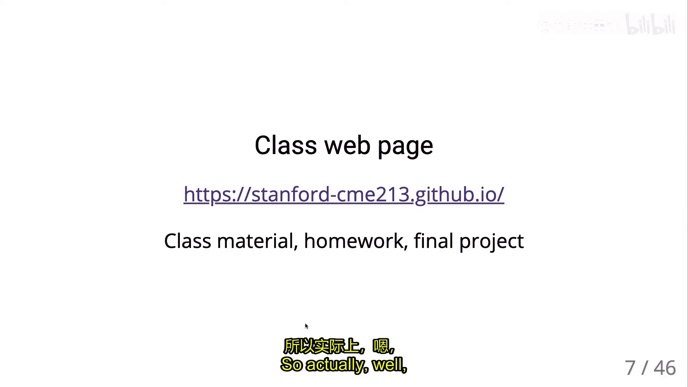
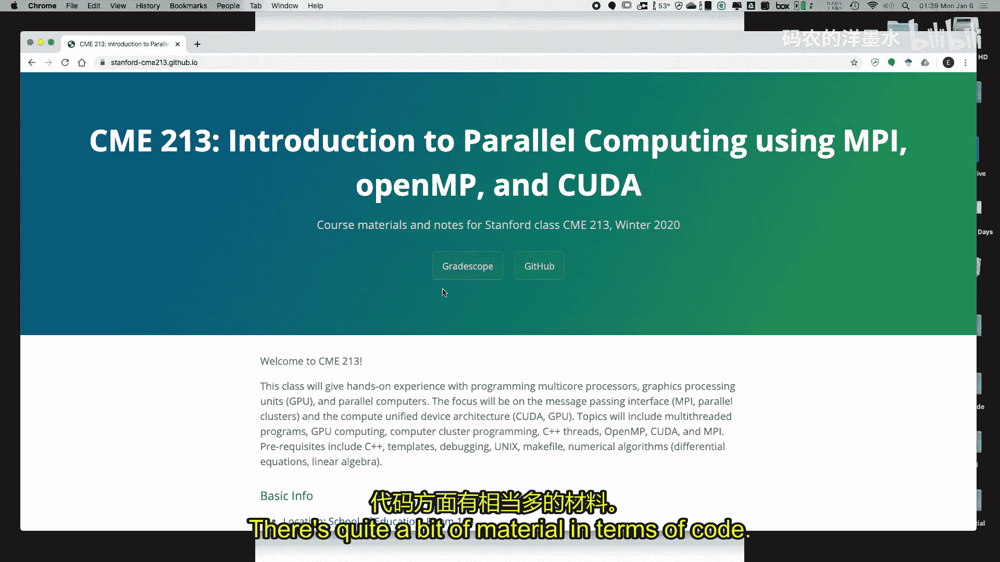
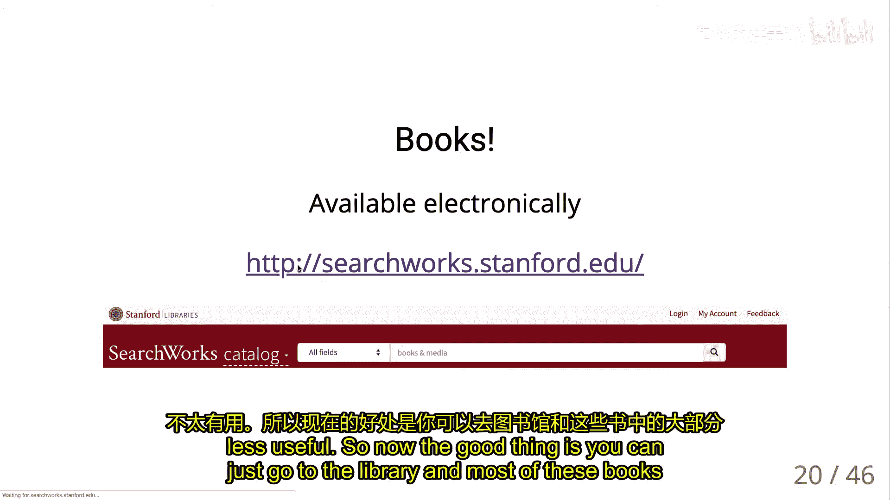
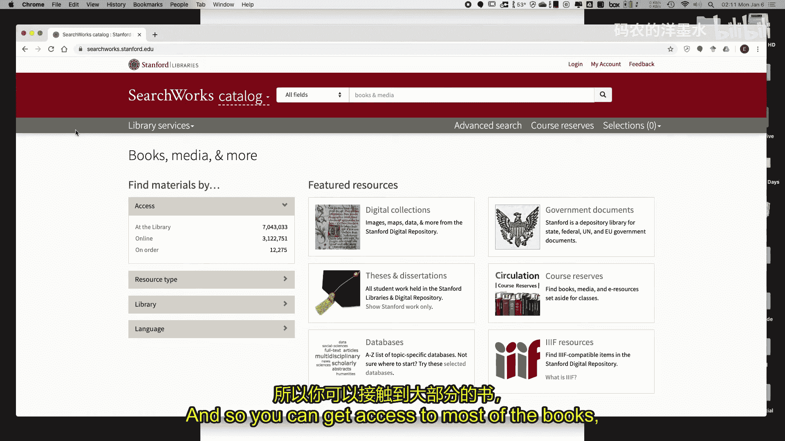
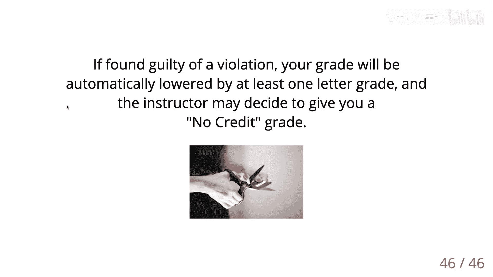

# 【全集】斯坦福大学-并行计算导论-CME213-中英字幕-1080P-p01-Lecture-1---导论--BV1f8ijBYEjR_p1-

那个那个。Okay， so let's start with class。So make sure you everybody has a handout。すれば。

Com read the coffee。Okay， so welcome to CME 213， so it's crossed with MEE339。

 so introduction to Pe and Kiing。So very are。So I'll be teaching this discuss this quarter。All right。

So mostly today will just be an introduction to the class won't so we'll sort of really be starting the material on Wednesday。

Okay， so I introduced myself， sorry Gar， I a professor in mechanical engineering。

 also so affiliated with the IME， so I teach several classes。And advise PhD students in ICME。

I do research。In numerical numerical Line algebra so you just discuss semi through two。

 so many of you have probably taken it， numerical Line algebra， this is one of my areas of research。

 also do some research in parallel computingut so actually last year this quarter I'll have one of my students present some of his projects in parallel computingut with some of the more recent advances in that area。

嗯。And theres also I also teaching the class on machine learning next quarter。

So it's also one of the areas of research， how to apply methods from machine learning to computationalational engineering。

Amerop PD problems， inverse modeling， and dequification and so on。Okay。

 so yeah basically just so the areas my students are working in， so we'll have some guest lectures。

 so I'll invite some of my students to also。On the topic of Kudas who had program GPUs。

 we'll have guest lectures from NviDdia engineers。So halfway。Around mid February。

 so it's always a very interesting lectures。So let's start with the teaching assistant。

So we have William who was also a teaching assistant last year。

 so sort of very familiar with the class now， so I think this picture here is sort of getting ready for office hours and receiving students with questions。

So do you want to say a few words， so is Eric excited？O and Jen will call me whatever you want。

 a second year massive student in MEmy but just interest in robotics robotic manipulation。

 but also just distributed。佢就是有关。Remly for another。All right， thanks。

 so we have two cheese for discuss class。😊，So second TA is King Wei Yang。

 who took this class and did very well last spring， and so I invited him to be a T for this quarter。

Hi everyone， I'm Kenway， I'm also a second year masters student in mechanicalchan Engineing。

 so this has our lastsp and I'm proud to be all the fun and I look forward to working with you all。

Hope you guys last。OkayThanks。Okay。So just shorting from the class。

 So we have So here here's another class at the same time。Okay， so we have three slots。

In the week Monday Wednesday Friday。So these are actually the sort of longer slots。

 one hour and 20 minutes， so I really only need like two of these slots every week。

 so I have some meetings often on Monday， so most of the lectures will be on Wednesday and Friday。

So unless you you told otherwise there is no lecture on Monday except for。

 so Monday what might be used just as a makeup or have to travel or if we need some extra lesson。

 then we'll use Monday， but most of the time it will be just Wednesday and Friday in this classroom here。

Okay so this week is a little different， we have the lecture on Monday and Wednesday so Fridays sort of free and so we're going to be using that extra time slot for sort of an optional refresher。

So William will be teaching that。Well， this quarter， I amm changing the content a little bit。

So I'm shortening a little bit the QUDA part and expanding the NPI and adding this extra lecture at the end on some more like research topics in parallel computing。

 so in particular usually we teach thrust for QUDA programming so this is out of the。

So we won't be covering that。This year， so as a result your first relies a lot intent template into advanced C++ so because we flew first out。

 the C++ is sort of recentlyly basic， we won't cover as many advanced topics or we won't require as many advanced topics in C++ as in previous years。

 so really for C++ you need to the basics on classes， you memory new free and so on。

 operator overloading maybe a little bit， but really some visual basic stuff。

 but so in case you've forgotten some of your C++ it's going to be a refresher。

 actually pretty advanced。So it's C++ for this class and really other classes。

 it's more advanced when we actually need for this quarter but it so always good of course to know C++。

 so it will be this Friday， so just in this room since it's available at 130 and William will be teaching that。

 so it's going to be covering some of the topics we need for the class and then extra stuff that you should know about if you're interested in scientific computing and which obviously relies quite a bit on C++。

Okay， so the class web page so yeah a couple of changes so actually well that's not this is the same we did last year we have this。

GitHub page。All right， which is so this is essentially where we're going to be putting all the material for the class。

 and there's quite a bit of material in terms of code， so there's the lecture notes。

And you know some information like office hours and so on， there's a lot of reading material。

 like all the homework material， the code you download to do the homework and so on will be on this web page。

So there's probably more than in your typical class。All right， so that is that。Okay。And okay， right。

 so Walder materialll will be there。So office hours。

 the office hours are also indicated on this page。So。Most of the homeworks will be due on Friday。

 so we're going to have the office hours slightly before， some days before。

 so there's going to be two office hours Wednesday and Thursday in the evening，7 to 9 pm。

 so it' is going to be led by William and Kingway and Ma hours or Thursday morning at 9M。

So I have meeting at 11 a so I need to wrap up around 1045 here so my office is so actually my office is in room 125。

 so room 120 is a nearby conference room。And then， so。For the tea office hours。

 we're looking for a room probably long on the third floor， so we'll confirm once we have that。Okay。

 so the main， so aside from this web page where we upload most of the material。

 I'm going to use Can as a form， so usually I use Piazza。

 but I don't know I just wanted to kind of try something a little different so a lot of classes use Canva。

 so we're going to be using Canva， but it's mostly for discussion for announcement maybe for the grades at the end。

 but it's mostly the discussion discussion side of Canva。The synyabus is there。

So I think you should be automatically registered on Canvas。

so you're going to have a you know different view here， but okay you're probably familiar with this。

 so I sort of hid most of the sections that are not relevant for us so mostly the discussion and announcement will be the relevant stuff to look at here。

Okay， right， and so for so in terms of the。Degrading homework and so on。

you knowComput and programming class so you have to write codes， CP+ files and so on。

 so the homework submission and there's typically some answers you need to write in a PDF you can generate the PDF however you want that that's some written answers so there's always a whole bunch of files you have to submit which makes the process know a little copy kit it。

 so the way the things are set up is what you do is you go to your cardinnal。

Account or you love on Car the centerford at EDU， so your home directory provided by Stanford。

 you copy of your files。Over there， and then you run a script which essentially makes a copy of your files and makes those files available to us for grain。

 okay so we get it。of electronic copy of these files， so in some sense。

 so that is the actual submission。Get， you submit your homework， all the files。This PDF and so on。

 Carno and run the district。Okay so you'll have the instructions in the first homework。

 so as a result on gradecope， you don't actually uploadhold anything but still we're going to use gradecope because it has a very nice setup for grading based on Google grids and so on that we can adjust and also it's very convenient for regrades。

 is narrow in the grading， then this sort of support and gradecope for that we can add for regrade。

you knowMake your point and then the chase can review that， give you back the point and so on。

 so the whole workflow is sort of simplified in this way and then obviously tracks all the grades and whatnot so GrScope will be using essentially just to assign grades for the regrade and so on and there is a separate process for submission。

And also， Facebook is nice to track deadlines and so on forth。For submissions， so about the deadline。

 the script that you run on Carnal。It is sort of the official submission。

 so that the script enforces the deadline， okay， since there's no submission on grid Scpe。

 we're going to indicate a deadline on grid scopepe， but it's。

We're not actually using gradeco for the deadline， you have to rely on the submission on Carnal for that。

Okay， so it's sort of a little bit more complicated process。

 but you know for a computing programming class of it's easier that way。

So if you want to get support， so online discussion form so you can ask questions on the forum and then other students。

 the TA or myself will try to help you as soon as we can。So this is your first port to ask questions。

いろ。IfSomething goes wrong with the Ts or whatever you have something to discuss with me directly。

 then you can just email me Darve@tentford。edu and for additional questions， comments or concerns。

Okay， so you know。Well， 99% of students behave very nicely on the form， but it's only this1%。

That creates this problem so I have to pause this so you make sure know it's a public forum and it's read by old studentss in the class。

So if you say something that's not entirely nice to other students or to the TAs。

 or perhaps even myself， you it's being read by everybody and it's really not pleasant。

 obviously especially had some issues in the past with students venting frustration about the TAs which was unfounded in my view。

 but when you make it public。It transformed this into a little private discussion to this huge thing that everybody knows about and so。

Make sure you keep in mind this is a form read by everybody。

 and so just be careful what you post there。Okay， so the class is pretty straightforward。

Well the program is mostly based on learning how to program power processors and power machines。

 so it's secret programming。How quickly you go through the homework so it depends on your skills that you debugging and might correct code so if you're sort of you know you've done quite a bit of code development。

 it should be pretty straightforward， you know if your CP+ is a bit rusty and you have much practice in debug and so on it will take a little bit longer。

 but overall the workload should。Should be pretty reasonable for this class。

 so we've going to have five homeworks， so we have 10 weeks in the quarter。Buffee every other week。

Maybe every week or best every other week， we'll have a homework。And then there's a final project。

 which is sort of。Bigger bigger homework if you wish it's very。

You know we give you a lot of instructions for the found project so you don't get to pick your own found project。

 you know we're giving it to you or it's really like your homework。

 but it's slightly bigger in scope and so on and there's a little bit more。

Independence in what needs to be done， the file product will take approximately maybe the last three weeks of the class will actually overlap with the last homework。

 the last homework on an API， so it's a little overlap at the end so it gets a little bit easier towards the end。

 but aside aside that it's it's pretty straightforward and the five homeworks is 65% of the grade。

It felt like is 35%。So。Yeah， so of course。So again， piece an advice。

 it depends how familiar you are with school development， programming and so on。

 but you know obviously。I that your。ve very good or very systematic about it。

 you know sometimes debugging can take a while， so I definitely recommend starting things in advance and not doing things at the last minute because if you're stuck on the bug you know。

It's unclear how long it take you to overcome it if you do this efficiently ahead of time you could come to office hours you have and help but if you're like at 2M you know the day before the day prior then you know you could get stuck there so just make sure that you know you start this ahead of time and you make sure that there's no like blood creep up at the last minute and kind of。

You know， ruin your your schedule here。Okay。So the final project so final project is really an exercise in applying some of the concepts govern class。

 so the goal is to。Well so to implement a D neural network， I mean not that deep two layers， I think。

 so it's just doing the MNSwritten digits。So basically， you know the。

So I suppose most of you are familiar with deep networks。

 so the input of the network is one of these images。

 so it's really just a little square like this is provided as input as a vector of pixels that can write pixels provides input to the network。

 and then the output is a label indicating which digit has been drawn written on on the image。

 so you're going implement a neural network to do this。But again。

 this is not an exercise in machine learning， in fact。

 the method we use for this is now the recommended one。

 you're going to implement this with fully connected。What do you connected theirs？

in of the traditionalvol convolution layers， and so when you have fully connected theres。

 the bulk of the operation are matrix matrix products， and this will be implemented on the GPU。

So you can be applying some of the methods we're going to teach you about。

 to write GPU code and implementing a matrix matrix product as sort of one of the blocks。

 but you have to implement the entire chain， but most of the work is really that step。

And that many methods。Have optimizing big good performance for your matrix， matrix sparks。

It' in the third project。The other operations have pretty straightforward on top of that。

There's going to be some API programming， so it can be running on multiple nodes。

 multiple processes and multiple GPUs and sort of coordinating the calculation。

And you're going to be kind of exploring two different ways of using MPI to do this with different performances。

 different performance， so yeah， so it brings together KudDa and MPI。

 so Kuda we're going to be covering towards the middle of the quarter so you'll have plenty of coverage there MPI we're covering this towards the end。

 but I've shrunk the Quda part。In the corner Lo beds， so the NPI comes a little bit earlier。

 and so I have a bit more time to cover that than also there's going to be the NPI homework。

But there's a little bit of a crunch towards the end of the quarter because you're kind of learning MPI and having to sort of apply kind of immediately as part of the final project。

 but hopefully everything works out。あ不れ不す。So it's a little tricky to teach and do the project at the same time。

 but hopefully this works out。So you're going to be running on four GPUs is basically what needs to be done for the project。

 so this is what the neural network looks like， so the input again is a bunch of images。

So basically a group of pixels， you have full connected layers so basically it's a full dense matrix multiplication followed by non nonlinearer activation function and then the output is so we do a soft map so the output is basically 10 numbers that's all positive sum up to one。

 so basically these are probaities and so you think the largest of these numbers and essentially for example let's say p6 is the largest number then the interpretation is at six is the input input image this is the very classical so as a machine learning exercise is not very terribly interesting but we're going to be focusing on the QudDa and MPI implementation。

Okay， so just as a sort of you know。Pretty sure a lot of you have。

You are familiar with neural network and so on。And I played around a little bit with this。

 but so this is showing you。AS example of a neural network。

 so the idea of neural network is sort of based on support vector machine。

 so how to classify objects by subdividing the space in essentially hyper surfacefaces。

 but it uses multiple。Multiple neurons and a series of layers to essentially come up with separation surfaces that can be essentially arbitrarily complicated to hear more separate maybe the blue nodes from the。

The yellow nodes and so you have so these are features that are given an input。

 okay this is showing that you have fully connected layerss。

 these inputs are completely connected to all the four neurons。

 then you apply a non nonlinear function。So here it's shown up on the top here it's 10H function then again you know some more fnulated layers not a 10H and then you combine the final output to get your classification so you can do some more。

 for example this one so this one is traditionally。

A very complicated test case because in the previous formula know the separation surface was fairly straightforward forward。

 it was just this nice sort of bullit surface， it was pretty straightforward here it's much more complicated to trying to basically have the no natural predictive blue around this region here and then level predicting the orange。

This region here， the reason why this is a difficult test case is because if you just look at what a single neuron can do。

A single neuron can essentially draw a hyperplane or here a line and then distinguish what's essentially on the left and on the right so it would of course do very badly if you had a single neuron。

 it would do extremely badly here， but by using multiple neurons you can improve quite a bit。

The prediction that's how you know with deep neural networks and so on， you can have very， very。

Amazing and very， very accurate， accurate results。 So this problem is more difficult。

 So you need to play around a bit。You know， maybe add additional features and so on。

To improve the prediction anyway you can stay around with that is actually kind of interesting and you see how it's running a gradient based method。

 how it's trying to sort of focus the orange just around these regions and try to focus we do here but。

It's difficult， does me if you set up the premise correctly？It ends up working usually well。

So here it gets very confused about this region， right its neither。New York orange here， anyway。

 it's very interesting to see how。So it's a very complex optimization method。

 depends very much on the initialization point， so as you can see you're very far from the Google optimum for the optimization problem here and you can get stuck in local MyA for quite a while。

 but there is a stochastic component to it。This to get point to it that。

Allows it to improve converence。So anyway， so you can clear around with that。

 it's actually kind of fun。I don't know if I can make it。A little bit better。But， anyways。

You want to spend too much time on that。But you need to either make the neural network deeper or add more units to improve the prediction。

 yeah it's it's already' doing quite a bit better here。That actually can interesting to see how。

You know， difficultiff， it is for the optimizer。To get a good， a good， good result here。

And you can see that the two plots here， so the training and testing。

 the training basically is the training is information used to optimize the network。

 and the testing is basically information that the network hasn't seen and that you're using to see how well you're doing on sort of new data if you as a predictor so it's here。

Could be pretty a little bit more reasonable anyways，So you can play with play around with that。

 It's， it's actually quite。Quite interesting。Okay。All right， so I just want to briefly mention。

 so I won't talk too much about this， but it was one of the big success stories in the media。

 the computer that sort this Al go， which is basically a series of D networks。あ。

And a well known algorithm in machine learning called reinforcement learning。

And so a program was developed to play the game of Go， which is a very， very complex game。

 where so trick here when you play go is it's not possible to enumerate all possible combinations。

今收订了一个呃。The owner of 200 different moves possible at each round。

So if you want to enumerate a possible moves it's possible。

 so use the D networks to sort of guide you through what are the moves that have a high chance of winning。

 so this combination of tree， so the eneration and're estimating how good the moves are likely to win by combining these two ideas they were able to do this program it's based on D networks。

 and D networks with convolution theres very， very good at picking up patterns in the input that patterns of motif。

 so actually for the game of KoI was superb fit because you can the neural network is very good at recognizing the pattern stones in local areas and then putting these patterns together to recognize more global strategies and so it was basically。

ItEn up being way better than human players。And they sort even sort of discovered， in some sense。

 new moves that were sort of unheard of before。And。Right。

 and so the other thing that's kind of amazing shows you the power also of computers is that during the technique of reinforcement learning。

 theres a strategy in which。Essentially you have a certain strategy to play and then by exploring doing a tree search you can sort of essentially improve from your play so you can sort of create a better version of yourself by just sort of exploring the tree of all possible moves and then once you discover this sort of slightly better version of your playta then you can learn this a neural network how to produce a playta and then just keep iterating so essentially you sort of playing against yourself which is kind of weird a little bit actually for humans it would be equivalent to。

It's sort of a very interesting idea you be go to just staring at the board and saying， oh。

 I think the move is this one。But then you start playing you know like four or five moves ahead。

 you know kind exploring where this idea leads to， and then you discover that maybe some slightly related idea is actually better and then you know in this process you actually learn something to start from the first。

certain level of knowledge and there' is a way to kind of improve that and so the computer because it's very fast and so is able to sort of play millions of games very。

 very quickly and so it can acquire a huge experience in playinggo much faster than a human player。

And so in no time at all， the computer is sort of able to learn centuries of go playing and beat best players in the world。

 so this is， for example， the hardware that we used to play this game of Goo。

This is so the final project would be a smaller version of this Its only four GPUs。

 but its sort of the same idea fundamentally， So it started actually with。

distributedist computing so essentially you have many。

 many processes that are processors that are connected to GPUs with some fast network and so on。

 and then progressively they Google and but also NVdia design processors that are now specialized for。

For deep learning， so essentially youre specialized for a dense linear algebra on small matrices where they can do like matrix matrix multiplication at C size 16 by 16 very。

 very fast， so its a combination of gel purpose units and very fast matrix multiplication units。

So the TPU is purely optimized for just machine learning。

 so sort of very bad at gel purpose computing where it's very， very limited， but N VDF， for example。

 the newer，Processors， the both and so on， they have two components on the process and we look at that。

 one of them which is sort of job purpose， sort of many core computing can do of arbitrary operations。

 but then there are a few units that are specialized for matrix that linear algebra。

 matrix matrix multiplication and so on and this was designed specifically for deep learning so that you can take care of the matrix multiplication that you have at each layer in deep neural network。

So we'll look a little bit at this when covering NVDA GPUs。

 and so you can see that so here the TPUs are very very efficient and also they sort of improved the algorithm quite a bit and so they were able to bring it down to just four GPUs。

alphapha goes zero is the mid version of the program so it's sort of a very general program to play board games and other even。

Computer games， so they sort of jawized the。Inial algorithm to make it applicable to a broader range of props。

But of course， the only reason we're interested in this is to be able to serve people better ads so that we can improve revenues by like 2%。

All right。呵。😊，Okay， so computer access。So computer access is always very very， very tricky。

 there's a ton of computers on this campus， but there's approximately zero available for teaching。

 at least computers that have GPU processors so you can actually use。The various clusters。

 the ph cluster and so on， various clusters on campus。

 or even your own computer for some of the first few homeworks because it just requires like a standard processor。

 but as soon as we move into GPU computing so the could part towards the middle of the quarter and of course at the final project that need access to GPUs I need to have pretty access essentially the same hardware and so on。

 same characteristics， so we're going to be using Google Cloud for this。It's actually very。

 very expensive。But as a grant so it's almost $150 per student。

 believe it or not just to run your homework， but okay they're giving us this grant。

 so the way this works is essentially so actually if you want you can already go to Google Cloud and then stop into that。

😊，You're going to get charged， so if you use just the regular。

Multical processor it's actually pretty cheap， but as soon as you go into one GPU in multiple GPUs。

 then definitely the gel goes up quite a bit。So we'll give you coupons that essentially you can just redeem and gets added to your account and can use that amount of money to $50 and then we'll get renewed and apply this to your。

Due to your。需说点。呃。So there is of course the whole process said this stuff and so on。

 it's a little bit complicated but we have all the instructions laid out。

 so essentially just go through that， it will take you five or 10 minutes。

 so you have to set up in the cloud， there's some stuff you have to install on your computer as well。

So there's in terms of using the GPUs， so if you ask if you go on the cloud by default。

 you can only access nodes that like multiprocessor。

 like a regular multiple processors so regular processor if you wish so you need to make a special request you get GPUs。

 you get access to nodes that have GPUs so we sure do that that takes a couple of。

A day may need to get it， I。Coup hours so you just。

Just be aware of that but again this is really only needed for the middle of the quarter so once we start heading out the coupons。

 just go through the entire process， make sure you get access to these GPUs。

 and then you should be good to go but just make sure that make sure that you have a couple of days ahead of time to just set everything up it's not like instantaneous。

So just keep this in mind。嗯。Okay， and the other thing to keep in mind。

Is that based on the experience last year， this is the second year we're doing that。

 initially the homework are multiple processors， so again。

 these are standard nodes on the cloud doesn't cost a whole lot。

Then you go into Kuta or you just use one GPU so that ramps up the cost a little bit。

 but it's really when we get to the final project we you start using four GPUs and do more cranking and is break codes that with empty loops and crazy stuff like that so the bill goes up so make sure that there's no way for us to monitor your credits like how far you want so make sure you monitor that especially at the end of the quarter so probably you have be forgotten about it and time you down。

If you get to the， make sure you monitor your units so that you can request more coupons， but again。

 it takes a couple of days to get that and so on， so just make sure you pay attention to that and you place your request soon as so we'll send you some marrs and then you can get another $50 and so on so this is just something to keep in mind and pay attention to。

啊。So the scripts that we give you are already set up correctly and so on。

 I think they ought to shut down and whatnot， but just make sure that you don't leave the note up。

You know over the weekend， because even if you just log in and do nothing。

 just it's charging you as if you work hitting machine full time。

 so you know just have to be a little careful with this， but I think the script。

We' shut down the machine if you don't do anything， so principle that should be good。

 but just pay attention to this billing and how how are you're consuming your。Your your coupon。

You know。Okay。So in terms of books， so books for。Pel computing are for in general for computer science and not very helpful because they tend to go obolete very。

 very quickly。 So there are two topics open MP and MP that have been around for a long time are heavily used And so the books there I would say more mature because it's topic that has been around for longer and so people have spent more effort to investing in high quality textbooks So I would say there the reading is more useful in terms of Q things change very fast and so on。

 So there are a couple of。Re good books out there， but books for Ca programming are typically less useful。

So now the good thing is you can。

Just a good library and most of these books with a bad thing about computer science books。

 but the good thing is the books are available online electronically through search works。

 essentially you just titled the book there and then typically there's a link you have to read it online which is not super convenient but it's definitely feasible and so you can get access to most of the books you in this way。

So I just want to sort of quickly go over that。To watch my tongue a little bit。So okay。

 so I'm going to start with John per competing books in the sense that we just talked about basically multi core MPI。

 so going to be some open MP。AI theP fair to essentially most of the topics。

Except probably GPU computing， but different aspects。

 so that I generate books put for introduction and they cover you know sort of all the core topics and maybe even like theoretical。

Discussions of parallel computing。So this one is a very good book。It's very rigorous。

 its very good coverage， so this is one of the books I like the most for General Powell programming。

 and there's some linear algebra。Application， this one is also a very famous very famous book。

 it's very extensive， lots of applications so it's much longer to read so this is sort of a deeper dive。

 less focus than the previous one， it's more kind of a longer read， but it's quite a bit thicker。

 but it has a lot of applications， it covers network apologies so a lot of topics here。Okay。

 and then so another book here by Peter Pacheco， so lot of examples。

 a little bit less the article than the previous one。

 the previous one is very complete it's sort of a reference， so it has you know for example。

 complexity estimates， runtime estimates， different discussions。

 you know very complete so this one is if you want a shorter book is probably a better a better option。

Okay， now second category of books are the books that focus on North corere programming。

 so just a sort of a heads up of what's coming up， so in terms of parallel computing。

You have two main sort of directions， first one is basically para computing at the level of you could say a single computer。

So this could mean a single processor with multiple cores。

 or it could be multiple processors that are installed on the same motherboard。

 so it looks like just one sort of computer and with access to what's called shared memories to all the core can read and write to the same memory。

So this whole shared memory， parallel programming， and so basically this is the baseline of parallel computing。

 it means you just take the computer and you're going to run computer on your laptop or your desktop computer and you're going to be running a coding Bra on this one machine so when you want to stop Bra computing。

 this is the most the first step if you wish because you can just take essentially any machine and use it in Bra with this multi programming so this going be the first part of this quarter and so these are some of the books that focus on this multi programming and the main tool in scientific computing is open it because it really simplifies writing scientific codes。

 it's not that good for sort of general multiple programming。Like the more CS stuff， but， you know。

 in scientific computing。At some level for sharedd memory， it's very straightforward。

 most of the parallel happens through full loops。Okay the for loops that are executed in perll and so OpenM has very good support or makes it very simple to run for loops in perL。

 so this is typically what's used in。For scientific computing。

 for engineering or science applications。Right。So then you have this book here。

 the art of Multiproster programming， a little bit more advanced than the previous one。All right。

 and then。So opening in peace is we'll talk about this here in this corner。

 but it has gone through many， many revisions。Now it tries to accommodate accelerators。

 so basically by this they meant another person with a GPU。

Sort of a more abstract or general version of that so we just call this an accelerator and there's tasking and so on so the number of features in the OpenMP that have been developed in the last five。

  ten0 years。Be part of standard and progressively they're being part of Openmp compilers that sort of allow you to write code that can run。

 for example， multicore， but also on GPU processors。

 so this book covers some of these more recent developments in OpenM。Okay， so finally Kuda books。

 so these are probably the least sort of interesting ones because Kuda evolve very very quickly。

 so even to this class its well in this I just cover really the basics of Kuda so at some level that doesn't really change a whole lot。

 but know every whatever two years or three years， they have a a new architecture and regeneration of N media processors and there's a lot of features and so on the things change。

 so it evolves very very quickly。So in fact， when this class was started。I it was。

5 to seven years ago， NVDdia was really the only player in this market of John purpose GP computing or using GP processors for scientific computing。

 so everything was focused on KudDa， so nowadays MDD is starting to become also player in this area。

 so we're not going to cover AMD yet is not not this year， but things are certainly。

You they're less NVDdia centric right now， so there are a couple of in particular high performance supercomputers that are now based on N Acccelerators。

 instead of traditionally withVdia， but now ND also has has been used for very large the Ra large supercomputers used by the DOE Las。

 Department of Energy Lab in the US and all the countries。

So things change quite a bit and so therefore how you program this processor is constantly evolving and so there' are certain things like open ECC that try to be a little bit like Open MP try to be independent of the hardware so that you can learn one thing and run on many different processors。

 but here we're going to focus on put after frame media focusing on the，Some of the basic aspects。

 a result， you know these textbooks are I would say less less relevant。

 so this is the one I would recommend you know I kind of look at the content you know it's pretty good coverage so if you wanted to look at one book。

 probably this one。So this one has been around for a long time， actually this is a third edition。

 and this is also associated with a class that taught at UYUC， University of B Champaign。

 so a lot of experience and so on behind this book， so it's also well known。

And then you know you have the Quda handbook， which has， you know。

 so this is a lot of technical details， example on memory。

 different types of memory and so on and CPU and how to match the CPU and GPU memory。

 so I'm not going to cover a whole lot of that so you have a lot of technical details on that streaming also something that my dimension by the doing the NVA lectures but not no time to cover this in class and this is。

More advanced topics， so details on the KDa compiler， so these are more advanced concepts。

 but if you want to go deeper in Ka computing this can be useful。嗯。Okay， and then this book here。

 so this one is so looking at it， it has an extensive section on optimization。

 optimization with Ka is very， very complicated。呃。A bit one of the reasons actually why I shortened。

The cu of bit。Because at some level， it is very difficult to write。

Optimize Quda code and who has the time？You know if you're kind of in engineering and so on。

 you're developing simulation code and so on， well maybe your advisor wants to run GPUs and you're going to do your best to have the code ground on the GPU but you cannot spend a ton of time doing this implementation maybe next round you're going to try different numerical method。

 different approach and you have to revise your code and so on， the changing。

 so this is really a challenge of QudDA is that writing up a good code is actually very。

 very difficult takes a lot of time。So this is definitely a big。

A big sort of barrier of entry in particular。The processes change。

 which array on different and video processors， typically the optimization are slightly different。

So you have to tune your code a little bit for the browser you're running on so it makes it quite way so here there's a couple of chapters on how to optimize your code and with these caveats。

 some tips for debugging， how to detect memory leaks and so on so some useful tips and information。

 if you want to really be serious about this GPU programming。Okay， but you know。

 at the end of the day， Nvidia is the one that。you know is most motivated to you know make this accessible to people。

 so the information they provide is actually you know， the one I use to prepare this class。

 it's you consolidated， it's written so their documentation is actually pretty well written。

There's typically you know early sections that well there's always in an introduction section that's kind of fairly readable。

 and then there are a bunch of sections that are sort of more introductory know written that's going to be easy to read and then towards the end you have more reference。

Mach its not something you're supposed to be just reading like that。

 but it can be very useful to figure out some more to answer some more technical advanced advanced questions there's actually it's probably the best thing to look at so these are the two so I'm going to be uploading so right now I think on the web page we had the documents from last year so I'll see there is something new but it was just last spring so it's not that all but maybe there's some newer document I will upload but you can found those on the web as well。

So you have basically， this is the journal documentation。So installation guide and so on。

 So here you have the these different programming guides I was talking about。

 the best practice guide and so on。 So these， for example， the different。The different。

You know types of GPUs， so Maxwell， Pascal， so from the oldest， Maxwell， Pascal， Volta and Turing。

So you have the compativity guide and tuning guide。

 so compativity because there's certain features that are supported on certain process， not others。

 and then the tuning guide， how to optimize your code you can see on all all these platforms and the PTX this is the information on the compiler。

So if you want to go sort of deeper deeper into that。

And then the other and then you have this is slightly different， this here is the sort of education。

 so it contains you know some general you know information like video tutorials and so on。

But also some teaching resources， so some training materials。

 these programs on on some online classes， so there's a lot of stuff you can use either for discuss class or even later on that is always sort of up to date here。

So there's a lot of stuff to see here， so I recommend going through that probably more useful actually than reading the books so this is actually the document I'm referring to to prepare this class。

Okay， and then at the end of the quarter， we'll talk about NPI。

 which is basically so NPI is the other method to the first one I talk about is openM sharedd memory computing。

 so how do you essentially a processor that has multiple cores or maybe give a couple of processors around the same board that just looks like basically a whole bunch。

Of course that you can use with shared memory， they can all read and write to the same memory。

 but then if you want to scale to really bigger machine thousands of cores and so on。

 this model doesn't work。1 thousand core that is essentially read and bright to the same memory。

 because it just making everything consistent and sort of managing all these accesses。

 reading and writing that are sort of happening at the same time is just way too complicated。

So the way to go about it is to you know。Use distributed memory so distributeding memory is a different content。

 so it's basically now you have separate computers， so each computer is a bunch of course。

that can be write to the same memory so basically a shared memory node or think of them are just a regular computer and then these computers are connected with a very fast network and now if you want you know if for example node zero does some calculation calculate some numbers and if node1 wants access to this。

This result， the way this happened is you need exchange messages。

It's actually node zero is to send a message to node1。

 and node1 need to receive a message from node zero right so you issue commands on node0 and node1 where he says send this data。

 receive the data and so on， but this is done explicitly by the programmer so this is done for MPI so basically to command。

 send and receive more less， send the data to this node there and then receive the data from that node and so it makes the programming of course a lot more complicated but now when you do calculation if you're missing some data you need to know which node has this data and you need to make this request and then you need to wait for the data to of the network and so on so it's a lot more complicated。

But the advantage is the reason behind this is that now essentially you're free to scale to almost arbitrarily large machines。

 so network can become very， very complicated， but okay that's the vendor to make it work so actually this is a mind。

Bing your pro， efficiently route data between a lot of nodes。

 but there's a technology to do that and for you it doesn't matter you know this network is sort of completely transparent and just say it's sent to this node。

 you see from that node， it could be a very complicated process but for you this is completely sort of invisible。

So MPI is the way to do that， at least in scientific computing， so NPI is something that。

Was really designed for scientific computing？Nowadays， it's also being used in certain。

Could science applications。But， you know， in computer science， you have a lot of。呃。

You have a lot of other mapred techniques and so on that other ways of programming and just remembering machines。

 but even in computer science it's time to use API for applications it's a very high performance interface sort of very low level so you define a few primitives that can be highly optimized by the vendor and then you build your code on top of that so you get really high performance code this way so this is especially very useful for machines that so our design for high performance will be a very。

 very fast net。If you job computing， actually it's a very sort of distributed loose network with a high latency maybe low bandwidth width instead slow。

But if you go to you know。A high performance stress， Department of Energy or even here at Stanford。

 then you can have a very fast network， for example inCinniB or Vite network， with very。

 very low latency， very high bandwidth， and then NPI has provide excellent support for that to give UDX。

A performance， you can really exchange data extremely fast。

 and this is very important because the computing goes super fast。

 right the computing typically the browser goes can crunch number extremely fast。

 So sometimes you we the very fast network to sort of keep up with that。Okay。

 so this is the old so actually this one is a pretty good book， but you know。Yeah。

 with some sort of medieval， I'm not sure this is good。Thement terms medieval guys with the MP。

 But regardless。 So it's a good reference， but you know。

 so it's not data it was not written the middle age， but still was written probably 20 years ago now。

15 years ago。 NI itself has not changed a whole lot。 actually， it is a very technology。 I mean。

 of course， the vendors and the actual N libraries you know， Ive changed a lot。

 But the language itself， like how you write NI programs has not changed sometimes。

 So it's still quite quite valid。 But then you have more。

Recent preferences so this one is very complete okay this is written by some of the experts in MPI。

 G and so on， and there is a dense MPI with some more recent features of MPI that have introduced introduced more recently to get a little bit more performance in some sort of corner cases。

Okay， so I'm going to wrap up in a little bit now， okay， so basically this is what I talked about。

 so essentially you have these three topics in this graph。So multi corere processors。

 and so I'm going to start with。So the focus really is going to be on openmp okay。

 Open MP is sort of the workforce for scientific thing is's actually very straightforward to use so really if you have a。

Already sequential code with open and beam， really make it run fair。

we no times we can run on your desktop or laptop in parallel very quickly with OpenNP so this is definitely something you should know about and try to use immediately。

 but before covering OpenNP I want to cover P threads and C++ threads。

 this is not actually very useful percentage computing but this is just to teach you the basic concepts and what's happening under the hood so to openN sort of automate everything everything sort of looks very easy but what exactly is going on and sort to understand what's going on。

I'm going to start with the sort of global level concept of threads and how threats can work together。

 and then you'll see how this builds to open it。The second part of the quarter will be KUudDa。

 and then the last part will be this distributed memory computing computer clusters with NPI。Okay。

 so I'm now going to focus a whole lot on numerical algorithms。

 but obviously I need to kind of illustrate how these concepts or the features in the language。

 how you would use them in practice， so there's going to be a couple of algorithms like sort。

Shown here， so basically in algebra or pe primitive like scan， for example， or reduction。You know。

 are sort of classical parallel calculations， and we can look at how they can be implemented with these different sort of languages and different types of hardware。

So there's there's a lot of topics。That you on parallel computing that we're now going to cover。

 so for example， parallel computer architecture。So in particular。

 you have picture of the pro network。诶我。When we're talking about， you to some extent。

The architecture of Nvidia processors， but even for example， for multiple processors。

 not really a whole lot about the architecture， The reason is that。For scientific computing。

typically the codes can be quite big and they change rapidly。

 and it's not really super feasible to really optimize your parallel code for a specific architecture。

So you have to rely on some of high level ideas like generic rule of thumb。

 like generic concept or generic model of what the computer looks like。

And how it behaves and trying to do some optimizations around that。

 but going deep in the architecture typically does not make all our sense because your code is going to run the variety of platforms and so on。

 and it's going be very difficult to optimize for each platform。So in particular for MPI， you。

 like I mentioned， if you go to student memory。You know，Of course， the network。

 the type of network you have is simply critical， I mean essentially the vendor is trying to give you the best。

Performance， essentially what that means is that if you take any two node on the network。You know。

 the bandwidth like how fast？They think communicate should be roughly constant and this is the ideal network anybody can communicate with LLs at the same speed。

 but in practice it's not true right so nodes will communicate faster because they're right next to each other whereas other nodes do you have to do a lot of hops go through switches and so on and it's a lot longer。

But typically this is very difficult to design your program around that， so although this is there。

 it's very again difficult to count for that is why your copy architecture is this。

That's strong and then you have design patterns programming models but I would say that this is more kind of a CS thing that's more relevant for CS applications than the patterns in scientific computing are actually a little easier。

And so there's a class actually that can focus on that and then so yeah and then there's parallel numerical algorithm which is another class where you really look so parallel numerical algorithm。

 actually you can teach parallel numerical algorithm completely dependent of any language or any you any hardware or anything where this is sort of a。

much more theoretical or topic actually， where you assume a certain type of machine。

 certain characteristics and then you discuss how you would do individual algorithm。

 the performance you will get and so on， this can be done actually completely independent of any real implementation or programming。

So a bunch of classes that are related to this class here， CMV32。

 CMV342 is the one I was talking about， super methods。

So bioeth emerge analysis basically going over various para algorithms that are relevant for scientific computing。

 and then you have the CS class， CS149 talks about the hardware， so this is more lower level stuff。

 para programming models， much broader than what is covered in this class。

 but with more of a focus on CS applications。Okay， and then there is E class parallel processor beyond multi core processing。

So this is more exotic hardware and so on， so this is for a more electrical engineering class。

 but can be interesting if you're interested in new architectures。Okay。So and just wrapping up here。

 so prerequisites， no prerequisites。啊我哋说嚟 the sizeそ bit。

I know that students tend to ignore prerequisites。figured。Well， okay， fine， of course it's up true。

But the reality is if you don't have the prerequisites， the class is just way hotter。

It's a lot more frustrating。So if you want to have a good experience in this class and not you suffer too much。

It's good to have the prerequisite， if you don't have the prerequisites。

 I definitely recommend taking， you know， well， for example， CME 2112 12。

 okay you should have taken those classes or at least have a level comparable with those classes。

 otherwise you'll just have to it's going to be like learning three classes in one quarter or something。

It can be very very difficult， so make sure you have the prequisites。

 honestly if you don't have the prequisites， you know take CME2 11 to 12 and maybe come back next year to take 213。

It's nothing really all that super complicated， but it's just that if you've never seen it or never worked with it。

 then you just end up sort of wasting or spending a lot of time doing relatively simple stuff simply because you just don't know how to do it。

😡，So first， essentially two things， first one is just basic knowledge of Uni。So SSH。

 you can to transfer to log on machine， example plug on the cloud or transfer data， for example。

 mentioned transferring data on the current computer so you can use SCP and to log in SSH and so on。

 you need to know how to use compilers， different options， very model on compilers。

 what they mean and so on， and how to use them， the optimization flags and de flags and so on and so forth。

 how to link libraries。You how to。Join do Os and link them to create an executable all that stuff。

 so we're going to be giving you make files。So again， if you don't know what a min file is， honestly。

 you talking do not satisfy the prejudices are discussed。

So probably most times you don't make files but there might be a few dont make files。

 then you should really becon， is this the right classroom。

 of course during make fileile is not that difficult maybe to take a couple days。

 but if you don't make files， there's not a bunch of stuff， don't do that problems to discuss。Okay。

 so it's sort of a warning faculty。So anyway， so make file is basically a file that contains all the rules。

That need to be followed in order to joint or executable， all the dependencies and so on。

 all the steps that have to be taken to joint executable you can run。

 and all the homework will be using make files so to save your time and sort of facilitate combining and so on。

Then get。Actually get it's not going to be used a whole lot。I think this quarter。Okay， so I mean。

 we I'm using it for the。For the web page， but aside from that， that's okay。

So mention your CN press+ again press+ actually。This is not。In some sense， the most important thing。

If you're a very experienced programmer， but you've never done since C does。

 actually you might define the this task because you if you're familiar with all the concepts of programming and so on。

 you can pick it up， I mean this task is not going to be heavy on the C stuff。

We to cover I move the thrust homework， so that was sort of the bulk of the advancedma stuff。

 so these are some of the things that you should know about that will be in the Brexit homework。

hich we're going to release in a couple of days， but actually these are a little bit more advanced that when it's really needed for the class。

 so not to be worried too much here， that is the key thing。Okay， that is the key thing。

 okay experience。In programming and by this。It means。呃。

You should have suffered a lot to de buggging previously。Okay。

 you need to have experience in debugging code and essentially。Well。

 the I guess the little known fact about debugging is that。There are techniques to develop your code。

there's a process for debugging your code， which has to do with testing。

 when you write your pieces of code， you should be able to test that。

You should be able to know how to test small chunks of code， like a function and so on。

 make sure it's correct。And debugging is really a process， okay。

 and so what this is saying is if you are familiar with this process。

Maybe you've learned it the class or maybe you've learned it the hard way through just experience。

 but if you have this process of I have a code that doesn't work。

 but I know what I have some steps I can follow。that would progressively lead to narrowing down where the bug might be and finally finding it。

 if you have this process， then you can debug your code relatively quickly。Okay。

If you don't have a process and know like you write， you say， oh， I'm going to do my homework。

 then you start writing line one just go right wherever。

You reach like 500 and then you start to compile。You do， okay， that process will never converge。

 you might take weeks。To fix your code， simply because you're not following。know a process right。

 you just sort of like you're randomly searching for the browser then you can really take forever to do things。

So if you've done this before then essentially you've learned how to write correct code and givebu code and you're sort of familiar with this process and the end result is you're going to be able to go for your homework very quickly this reasonably quickly and it will be effectively painless if you've never done that very little experience in that。

 then it will take forever and it will be extremely frustrating and you're going to be pulling your so that is a bigrequisite for this class。

 some experience writing。Nonre code and you know parallel code can be。Quickly， confusing。

 and so this is a key thing in this class。

