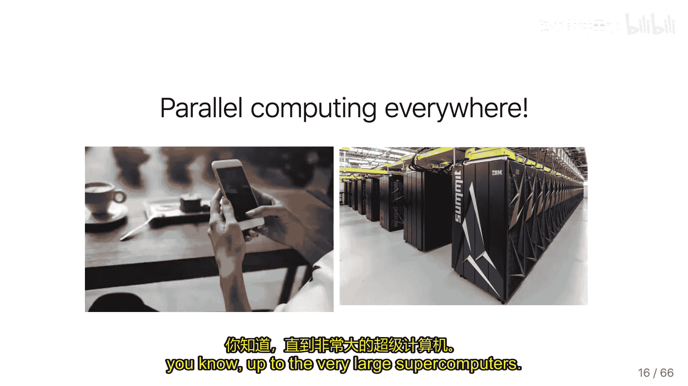
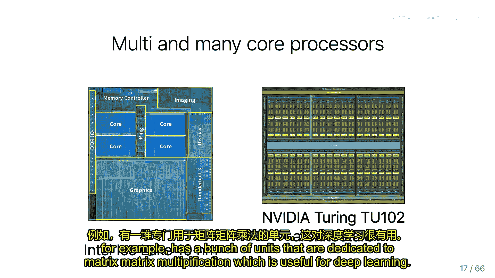
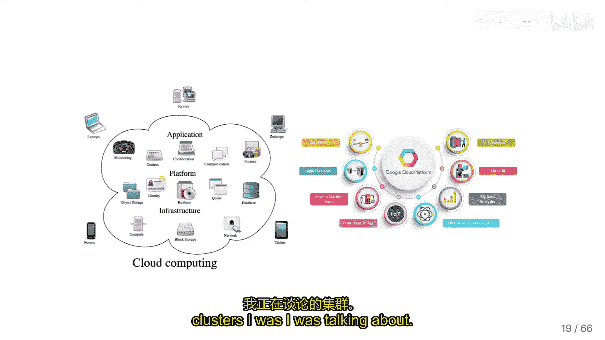
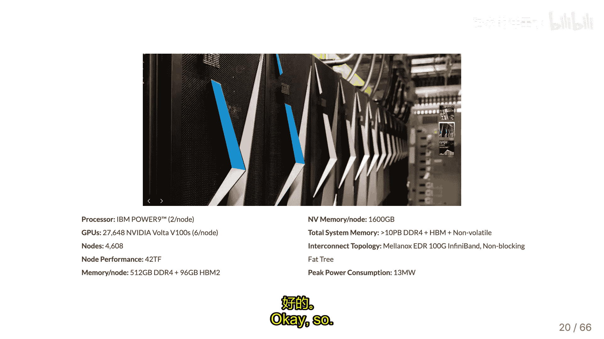
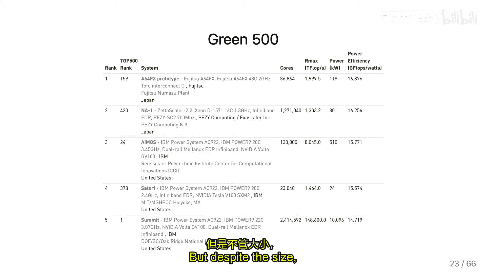
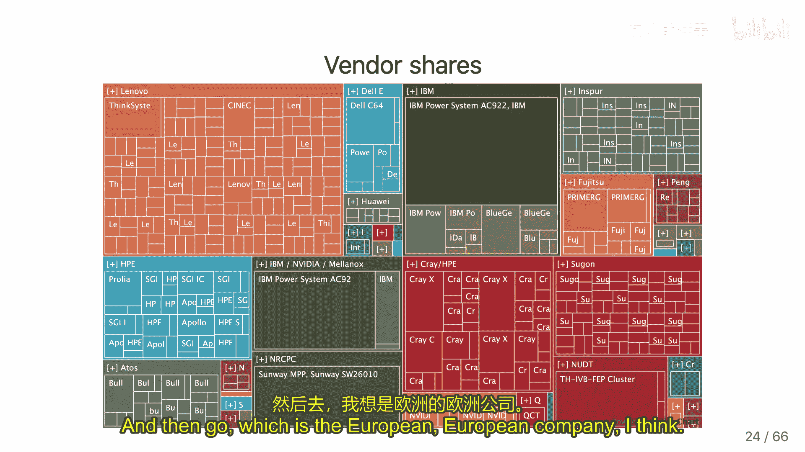
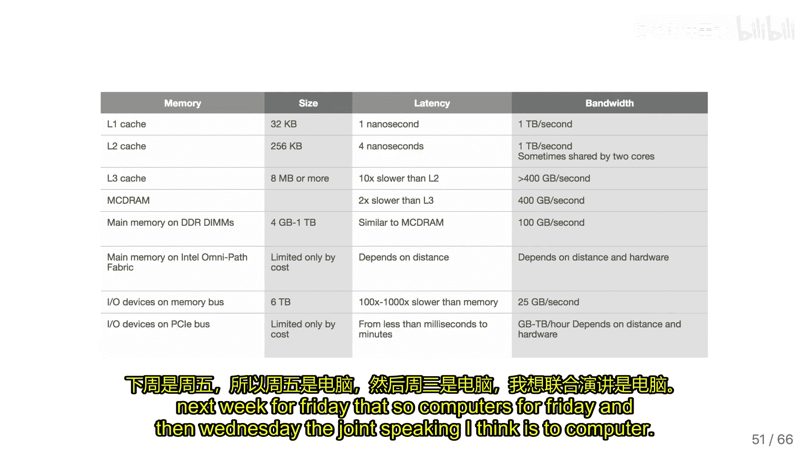

# 【全集】斯坦福大学-并行计算导论-CME213-中英字幕-1080P-p02-Lecture-2---并行计算--BV1f8ijBYEjR_p2-

Okay， so let's start the class。 So hopefully everything is set up now。All right。

 so second lecture in CME 213。All right， so we published homework one。

You get the files by going to the Gitthub class webpage， okay？And。

So we don't really have to use gradecope at this point。But we set up the homework on Grcope so。

 you know you can track the the deadline on Gr scope and you know， make sure you submit。

Ahead of time， but okay so you know it's prerequisite homework sort of covering you know basics of C++ like kind of a refresher。

So you know， GPS+ derived classes。Like polymorphism when you call a function， on。

The base class are derived class。It has a different behavior。So the socal standard library。

 the standard template library which provides a lot of functionalities that are very useful for C+ programming and also covers some aspects of testing so as I mentioned know when you write code。

 you want to learn some good practices， you know write small chunks of code。

 then you should be able to test that you know this code is behaving properly。

 like try different inputs， look at the outputs you can investigate and verify it's working correctly and then once you have this working。

 then you can sort of move on to the next small snippets of code。Okay， so。So to submit the homework。

 okay so we went through that it's actually separate from Grcope。

 so actually what we recommend for this homework is well to large extent you can run on your own computer。

 it's pretty center just see bus。嗯。But we'll be sort of testing your file。On rice。

 so maybe at some point you just want to copy your files over to R and bring them there coupon runs。

YouGo to make sure it's correct。嗯。So the script needs to be run from the Carinnal machine。

I think to honest， I'm mistaken， Rice and Cardiwall's basically the same directory， right？Right。

 so there's no actually copying between R and Carnal right right so it's a shared file system so the files you have in rise are essentially full on carnal。

 but if you're on your laptop and obviously you need to copy them Carnal。ThisC， though。

 you have to run this on Carinal just to make sure that it's sort of the same。

Bf installation has on rice。So you run this Python script， so the instructions are in the homework。

 and then this copies the files over。To the staff。Instructors with the class and then can use that for grading。

All right， so any questions on this， deadline is Friday。Okay。So today。

 sort of short introduction on parallel computing， so a little bit of background on parallel computing general discussion。

 and then we'll finish with sort of well， I'll discuss a little bit the basic sharedd memory。

 parallel Comp， you know what they look like and so on， and then at the end。

 I'll talk a little bit about C++ threads。And I have a little exercise although we kind of may run out of time for that。

 so we'll see， but if you brought your computer， then you'll get five minutes to do a little bit of an exercise programming exercise at the end of the lecture。

So John is speaking， you know。If you can bring your laptop to class， you know。

 I mean we won't have exercise every lecture， but you know every now and then。

 especially once the Google cloud is sort of set up， then you can just connect to your。

Google Cloud virtual machine you and kind of do the homework there or the exercise。

 so good idea to have bring your laptop to class。Okay， so， so you know。

It used to be that running sequential codes was sort of sufficient for those purposes。

But essentially， as soon as you go to any type of nontri computing， you know。

 once you start crunching in a lot of numbers， then essentially intoarel。So Winbarrow is a pretty。

Complex process， so fortunately using Open MP you know and if you have like a CC plus plus code。

 it's pretty straightforward， but you know there is definitely a big jump in complexity。

 but as soon as you do some non-trivial calculation， this is basically a requirement。

So just a little bit of a sort of historical background on this。So。You know。

Programming parallel processors is very complicated。

 it's a pretty obvious way to run very large calculation and if you look at whatever Amazon。

 Google obviously they have to go perll but for the average user it's a little bit less obvious and for example you could say well you know。

If you have four processors， you can do your calculation at certain speed。

 but if you have a single processor that's four times faster， you would achieve the same objective。

 so for many purposes it feels that having just a sequential codes that simply runs on a faster processor is the way to go and so for many years that was the logic because obviously programming sequential is much simpler than parallel so nobody wanted to write parallel codes so the vendors were simply cranking out faster processors and it would be was happy and。

And then so there was this Gordon Moore law that number of transistors should double and essentially the clock speed was pretty much increasing at the same rate。

 and so you could do more calculation faster and faster， and so there was no need to go back。

But this came you know to an end。 So now it's actually some time ago， maybe you can see in 200s or。

Somewhere along those lines 2005， so you know， almost 10， 15 years ago。

 so you have various plots and various ways to show this。So there's basically a number of physical。

Limitations， okay， so for example， if you look at this plot。So in black。

 you have another course on a processor in red the power consumed by。

Your processor here is the frequency at which your processor is operating。

 and here you have the single thread performance and the transistors number of transistors at the top。

So you can read a number of things。On this do， so first of all。

 for example looking at the number of core， everything was sequential at 2005 and so actually if you wanted to do I mean。

 file computing goes back a while， but if you wanted to do parallel computing in the Google days，嗯。

I was bored here。I was alivelyqua at that time。And know I did do that。

 so when you wanted to do parallel computing， you know you basically had to run on multiple computers right there was no such thing as running。

In parallel on a single processor， that was kind of a contradiction there was only one core on each processor。

Okay。And okay， so that means that the process was actually rather complicated。

That was this increase performance， so to some extent。

 you unless you werere a hardcore scientist really into computing and so on。

You know people really didn't care too much。But then you so essentially you had the frequency increase and you would。

 you know， I remember in that time when you were buying a processor。

 you know they had all these fancy names， but at the end of the day you would just look at the frequency and that was essentially how good your processor is。

And then at some point there5 frequency stalled and so the single threat performance you know。

Kept increasing in the increase。You knowYou didnt do the slopes here。

 but you know definitely there was a fast increase here and then the slower increase here。

 so the performance is a combination of two things right this combination of the frequency essentially how fast you know basically to some extent every operation on the processor it goes happens during a cycle like things are synchronized because otherwise it would be just crazy to match the processor so everything is on this clock with the cycle you know given by the frequency。

So if you increase frequency， it's like just going faster。

Okay and so this is one reason why you get more performance。

 but also you if you have more transistors， you can do more things。

 you can do a lot more optimizations and so even if a frequency is flat。

 it's still possible to get improvements in performance but this is a lot harder so here for example if you look at the weight of improvement and single threat performance it goes down quite a bit。

 but if you look at transistors， you it keeps going up actually following this more as low more or less。

It goes way faster than the single Fed performance here they sort of a little bit proud。

 but definitely over there they diverge。And of course divergence is because simply you're cranking more and more cores。

 okay and so now it's， well， you know these might be very high end processors， but you know。

Any person nowadays may have four cores， but it can go up to six or even 12。

And then there are some more exotic processors which really a lot， and then of course。

 and if you look at GPUs， so some multiplxy GPUs， they really have even more cores。啊。

So this is how you can get performance， basically unable to increase frequency。

 unable to some extent to increase single effect performance。

 so now you have to rely on the parallel at the level of the processor itself。And so。

So essentially this gave rise to two types of parallel computing， the sharedd memory。

 which is basically using many cores on a processor。

sort of to simplify the discussion and distributed， which means well。

 putting computers together with a fast network， which is sort of what was happening in those years to you know。

To crack more and more flos。Okay。And。So essentially the reason why the frequency stop increasing is for essentially physical reasons。

So I don't know all the details of the physics and so on。

 but essentially to go faster you have to make things smaller。Prooughly the idea。

 you can pack more transistors and you die， but also you can just make things faster。

 but there's a limit to how small wires can be。Okay， so maybe nowadays。

 technology might be 10 nanoimeter。Wwhichch you maybe even 10 years ago would seem impossible。

 but know even if you keep pushing me impossible， you know if you're down to less than one atom。

 you know definitely there's something wrong with your computer there's definitely limit to how small you you can be so for example。

 for transistor you have power leakage that is you need to be on off but you're very very small you different on and off。

Be smaller， like there's current。Is going through even when you're supposedly off。Okay。

 and then the last two points are sort of critical。

For sort of different reasons that it is power consumption， so first of all。

 the processor gets really hot。Okay， and there's a lot of。Strategies nowadays to mitigate this。

 but basically as you make things smaller and you want to run faster things get hot and the dye is just a certain volume okay it's pretty flab。

 certain volume and even if you blow cold air and so on top of it。

 know make the core of the dye really cannot cool all that fast it's really just diffusion there's just a limit to how much heat you can drive inside the dye and so that puts a stringent limit on。

On your frequency and how fast you can go， and then moreover， so this is like if an issue。

 but when you build a supercomputer，Well， you know you can just keep adding cores to your computer。

 you if you're Google or the government with unlimited taxpayer money it can just keep tracking this course。

 but it does take more and more power， it's not that easy to bring a lot of electricity into a small building and costs just tremendous amount of money。

 so actually for the large supercomputing facilities。

 the power consumption and simply just like the amount of electricity you have to feed it into the computer becomes a really big big issue。

 and in many cases， it's more efficient for example。

 have 10 cores somewhat slow then say you two or four that are really fast because to get this extra 10% faster。

 you may need like twice the amount of energy or something like this。Okay， and then finally。

 and so this is also a very important thing。That you will come back to this over and over again。

 this question of memory。Which is that。Again， it sort of has to do with the physics of things and so on。

 but if you want to just， if you think about computing you performing operations on variables，Well。

 that can be made extremely fast because essentially you can be your tiny on your tiny transistor。

 you have a little bit of memory with your registers。

 we can store your variables and you feed this into a pipeline like bunch your transition form and do the calculation and then you output the result in some other register。

 everything is super local， and you can really optimize this and more importantly you can multiply these computing units。

You know a lot， and so really fl is very easy， but memory access is very challenging okay because if you think about memory。

 okay well， you know realistically you may need to know age 16。

 32 gigabyte of memory or more on each node so that's just you know a lot of data。So as a result。

 this data sort of needs to be far from where the computing is happening and by this I mean there's a lot of wires and they have a certain distance and this distance maybe just a couple of centimeters and then electronic to travel that distance it's a lot and there's a lot of logic and so on and needs to go with that。

And so the memory access time is actually- so this is also a very sequential process very often。

 and you can make a memory parallel， but also that is very difficult。So memory access time is also。

A big problem。Improving the speed of memory is something that there are very strict restrictions on what you can do there。

So the flos you can multiply the memory you can also sort of multiply by putting more and more wires in parallelil so anyways。

 so in both cases the solution is to just do more stuff at the same time concurrently so you go parallelil so of course for hardware and vendors that's relatively simple。

 you also to speak， you just multiply the number of course put more wires for the memory and so on。

 but for the programmer you know this is significantly more complicated because we all as humans think sequentially it's very hard to think。

You know， in parallel， I mean we can think about independent things happening at the same time。

 but as soon as we start saying， well， actually， these things are happening at the same time。

 but there are certain dependencies between them， then it becomes a lot more a lot more difficult。

Okay。So， and so again， you know， a little bit of preview of what's coming up ahead。

So you basically have two types of multi corere processors， you have a sort of regular like intel。

You know， or Andy， you know。Processors with multiple cores， so typically know like I said。

 you have four or six cores and。You know this is for the sort of general purpose applications。

 so you have to be able to do anything from running web browser。

Your document processing to doing maybe scientific computing if you're into that。

 so you're going to design you know relatively few course， but very advanced， okay very fast。

 lots of optimization， huge cache， so you general purpose， lots of you know you're being very clever。

W don't know if these guys ever， by the way， you can be very fast。Alright。

 and then at the other sort of end。You know。Is GPUs or accelerators。

 there's been many variant on that。And for these applications， we're saying， well， okay。

 I really just want to do a large number of matrix matrix multiplications or simple arithmetic and I just have。

Billion of those sort of simple operations to do barrel。

So I don't know this complexity of cache and very clever hardware。

 what I want is just a lot of units to do additions， multiplications， and so on。

so this is a different design， you have all these not so clever cores。

 but like the ends you really have thousands and thousands of them so you can carry very heavy workload。

 but each unit is super super basic and though for a certain type of calculation， for example。

 linear algebra or very regular operations or like deep learning。

Actually this is a good fit because you have relatively well structured well understood regular operations。

 but you just have to do that super fast， so you have many cores， very simple。

 but because you have so many， then you can do you can crank a lot of operations and this is a model for GPU computing。

Okay， so this is sort of a little bit of a preview of what's coming up this quarter。

 so you know there's a lot of。There's a lot of these。plloots online and so on。

 so you can look it up so for example， this is again coming back to have just a couple more plot on this on。

 so actually this is a different type of plot with just looking at Intel， microprocessors。

 but it's basically the same same thing we' seen with frequency here， this is the power。

 these are the cores at the top you have the transistor on the right you have the GPUs， NVDdia GPUs。

And so pretty much same thing， okay。The frequency is about you know spaed the number of transistors。

 so I need to look at the units here， so it's kind of comparable。

 but it's you know while it's on the log scales， it's actually you know really quite a bit more and then the。

The number of crossing units is significantly larger， so it's almost in recent GPUs。

 it's more like well it depends how you can， but it's only in the thousands of cores or threads that can run concurrently so there very basic threats。

 but you really have a very， very large number of them。

Okay and then another look at a different piece of data here which is so this is something very important when doing computation and this is this memory wall。

 and so this has to do with essentially so it's not too bad because obviously vendors are trying to mitigate this。

 but it has to do with the discrepancy between how fast the memory is versus how fast the computing is。

 so you can make the memory parallel， you can make the memory parallel it's not that simple but roughly speaking you can even if you have basically slow wires。

 if you put more of them， you can improve the bandwidth to memory， it's not super simple。

But it's still possible so we can mitigate this issue， but for example。

 know so here you have the memory bandwidth is are these yellow guys and then the computing。

 let's say this is the well we get the vector and skill of performance。

 so let's just look at the vector here on top。So this is a peak performance as well here。

 peak memory bandwidth。Both increasing， although the peak performance。

 which is basically just doing flops without memory access to some extent。

 it goes faster than the memory， and so the quantity that's more interesting to look at is are these gray symbols。

继需要。Stend over there。Ex was。But you guys can see this box？

I don't have my guesses so I can't see anything。So to this moment。So anyway。

 it's just the trend really so these guys here。These circles。

So this is a very important one called the compute memory ratio。

 and so basically this is looking at you know， let's say you read a word from memory。Essentially。

 so let's say you just keep reading words for memory at the highest bandwidth as fast as you can。

 well pretty much how many operations， a floating point operation can you do with this word before the next one comes in okay so it's basically going to bounce where you're doing enough flops。

That the way at which you're doing flops or the time it takes to do these flops is equal to the time it takes to do memory transfers。

Okay the reason why this is important is let's say that you're doing a calculation。

Okay so you have this ratio well you want to know are you limited by how fast you're reading from memory or how fast you're doing flos okay so if you have more memory than this ratio that essentially the computing units are going to be idle because you can be faster and you're just waiting on the memory bandwidth so now it doesn't matter how fast the computing is you just need to look at your memory and vice versa if you're computing is the one that dominates。

 then it doesn't matter how fast your memory is， you need to optimize your flos which is not that easy but most applications you actually limited by memory okay so the computing units are actually idle。

Again， that's something that is very。Maybe not intuitive because when you look at the calculation with you naturally think well how many operations am I doing。

 and then you can compare algorithms based on oh I'm doing more phs over here。

 doing less flos over there， but actually in many cases what matters is just how many data。

 how much data you're reading from memory because that is what sort of determines。

The speed of your calculationc okay like how fast essentially the reps are sort of super fast compared to the weeks and so this compute to memory ratio is a gigga ops per second and so this is basically how many ops you have to do per word read from memory and so it keeps essentially going up you know so again vendors are trying to mitigate this because essentially the highest number is。

Just the harder it is to write applications or in practice。

 it means that there are fewer and fewer applications that can really reach peak performance。

 like most applications at some point become just dominated by memory transfers and three minutes into the idol and you can have wasted wasted more knowledge。

AndSo if you look at the GPU， you know， the number is actually pretty。Pretty high。

 so this number of frame operation per essentially word read from memory or per。Gek your bite。

 So you have to， yeah。Multiply by four actually you get the actual number so this is a floors four bytes so but you're in the you're typically in the 10 to 40 range。

 so it's actually lot operations per word breadth memory， for example。

 if you just do a matrix vector multiply，呃。With the spa matrix or dense matrix。

 essentially you're winning an entry for memory， then doing the multiplications and just moving on。

 so you're doing very， very few flops。P word grant for memory。

 so it actually you completely limited by essentially how long it takes to read the matrix entries for memory to your registers and that's pretty much it Okay everything else kind of trivial Okay。

 the flops are actually kind of trivial So for example， when looking at the。Oh。

 there was somebody who was asking me here。About what's so complicated about matrix matrix multi that this is the final project。

Well， here is what's complicated if you're not paying attention to this memory business when you do a a matrix matrix multimplication。

You're going to be that's end tube， you know。Operations。

 and if you're not careful and you're doing8 cube breeds， at just a peak bandwidth。

 then this is going to be extremely strong。And so the question is。

 how can you beder your algorithm so that you reduce？The amount of data transfers。

so this is not trivial， but to some extent， so obviously the minimum is n squared which need to be your matrix entries at least once。

 but n square cube is a huge jump， so if you build your algorithm then it can be sort of very close to n square。

 in fact， if you do if you reorgan your matrix matrix modification correctly。

 you become limited by computation rather than memory transfers but you've got a beat that ratio here。

Okay， so there's a very nice thesis that was where I got some of these plots from and love discussions。

 so you're welcome to kind look at this。

Okay， so now your panel computing is nowadays sort of everywhere。

 so it's present in your smartphones and so on， up to the very large supercomputers。

So like I said， you know it's present in many forms。

 So on the left you have the Intel you know ice Lake。

10 nanometer architecture and you know kind of a representation of the。Of one of their processorors。

 so it's a four course again。You know， relatively to be big cores very， very fast。

 relatively high frequency and lots of logic， lots of memory， lots of cash。

A huge memory controller and so on so lots of optimizations and here you have the Nviia touring architecture and so you actually cannot even see that。

 but each little thing here is actually 32，Veryty well。

not sure exactly number but it's on the order of 32 cores so I' count here but it's definitely the thousands of course。

 but each core is super super simple， so that's why you can occupy very little di space and it's very little memory so optimizing code for this machine is very very complicated but if you get get use all the core then your golden and you can go very fast and also this processor for example。

 has a bunch of units that are dedicated to matrix matrix multiplication which is useful for a deep learning。

Okay， and then you move on to different types of architectures， so if you want to go more pal。

So this is the type of machine that you know scientists。Thenend to use。

So it looks like a mess but it's actually very high end hardware well the point of this is two things first of all you have a lot of processors and each to come with our motherboard memory and so on so first of all you have a design that's very very compact compared to regular desktop computer everything is compressed in tiny tiny volume so that you can pack up know a ton of these boards。

 you know racks I'm sorry a ton of these boards inside each one of these racks and then you just keep going with these racks。

So very， very compact， very high density means that deco cooling is also very。

 very difficult so you basically you need to blow air around this。

 so typically there is some type of enclosure and so on so that you can push air from one end and then draw air from the other end and so on and have a huge flow this typically it's cold water chill so meaning that there's some sort of。

Something that looks like your radiator where you have the hot air going through。

 and then there's some pipes with some cold water to cool the whole thing and then you have cool water coming out that you can redirect back to the computer and so on。

 so it's a very complicated system。So there's that and then you have all these wires and basically all these wires and a bunch of switches andn of stuff is basically the network so it's basically how you can connect all these nodes together so they can exchange data very very fast to gain scientific computing。

 it's a fact of life that a lot of data needs to be exchanged it's not as if each node can do its calculation for in a couple minutes without sending any data to anybody else typically every second there's gigabyte of data that needs to be exchanged so you need a very fast network and so there's very expensive hardware and software to do that with high bandwidth and very very low latency。

Okay， and then you have other types of design so in this class you're going use this Google Cloud platform。

 which is a different type of design so in this design in cloud computing。

Everything is virtual so you get access to sort of a machine that has some generic characteristics and when you log on this machine。

 it may look like it has n number of cores， this amount of memory and so on。

 but there's saying how this is actually realized in hardware。

 for example you may request a node with 24 cores and these core may be on actually different computers but it's made to look like just one machine with 24 cores so it's a virtual machine and you have an interface that's sort of it's going to interact in a way that can be quite different from how it's realized in hardware。

And then you have the ability to start these node， to shut down these node。

 to copy arbitrary fast and install arbitrary operating systems。

 you can have multiple users running on the same hardware but they don't see each other okay for security reasons and so on so sort of isolated and also the network can be very different well。

Typically when you are given a group of nodes they're typically in the same server。

 but they could actually be in different servers， that could be on the other side of the planet with a network that may。

 I mean it's not optimized for a very fast network basically so here this is more like typically a database access or this sort of thing where。

launchch a query to computer， then there's some reading from a hard drive， do a bit of calculation。

 returns the result， that's the typical sort of a scenario。

 so it's quite different from scientific computing。But it serves a lot of the applications。

 but nowadays， cloud computing is pretty advanced， so you can actually have clusters with very fast interconnect similar to the previous clusters I was talking about。

Okay and then at the very end， you have the sort of top 500 supercomputers。

Which basically have two purpose。The main purpose is just to impress the guy next door that you have more money and better technology than number one in the world。

That's basically what it end， the second is to do some scientific calculation and the dumber。

 the bigger， the better。anyway， so it's a race to who the biggest computer and you can find some sort of calculation that' semi useful after you buy this computer so the biggest。

 I mean it's mostly actually for the US it's mostly the nuclear weapons。😊，ませ。Nuclear weapons。

And though you have applications like for example， microdynamics。

Or weather prediction that pretty much can consume arbitrary amount of。of computing market。

 you can run for month on very large systems， it can pretty much consume any type of whatever however big your computer is。

 you can crank your calculation。So this is the。So this is a summit supercomputer。

 actually the name is missing， so it's a summit supercomputer， so it has some idea power9 processors。

 so it relies heavily on GPUs， so it has 27，000 NVdia GPUs of the Volta V100s。

 which is basically the sort of。Fastest NviDdia at this point， it has six GPUs per node， okay？

So this is actually a very strict requirement， it means that you probably get more flops from the GPUs than from the regular CPU nodes so you better use the GPUs otherwise you can wasting a big chunk of the machine and using GPUs is very complicated into a lot of code of grade and so on and so how you use efficiently these voltage is actually quite quite dramatic pretty difficult so you have 5。

000 nodes you know 42 tar flop per node。So the top is。Did they see that this。Yeah。So memory per node。

 just 500 gigabytes。Of node。So you have 100 petabyte of memory of the total system。

 so the interconnect， so this is the network that's been used to connect all the nodes together。

 so it's infin event， menon not infin event technology。

 so it's basically a very high end interconnect。And tick power consumption， 13 megawatts， okay。

 so this is definitely gigantic。A gigantic number。So you need a very special facility to just power this thing。

Putting plugging into the power network， the power grid， that's not sufficient。Okay， so。

Okay so just some more statistics， it's kind of fun to do this every year and see how things change。

So this is a top number five right now。So summit is the one I was just talking about with this Nvidia Vta。

 B100 processors， two medium cores。Yeah and so on。Next one is Sira。

Vulra is essentially sent up a the media processor。诶可。Just a different location， Lawrence Livermore。

 the other ones at broker Riage， and then you have China number three with the。The sunway。

Typeite computer。Right， and so actually the top， these other。The three and four are from China。

 so this was a special subway processor， this one is Intel Zion。Processor。

And the last one is fromtra， which is actually a Dell computer。With Z processor。

That's University of Texas。And then there's another actually this year that was a new。

A new sort of list on this sub cabinet list。Wwhich sort of reflects the trends of this time。

 which is is power consumption because one of the main limitations going to， for example。

 existscale is simply that you well。Of course you can increase the power and so on。

 but it becomes extremely expensive， so the main limitation is how to reduce the power consumption of these big machines that produce more flops。

For fewer watts， so here for example， you have the power efficiency。

 which is the number of gigga fls you can do per watts。And so you can see that actually it's very。

 very different computers from the previous list， well， obviously on the top five。

 sumit is actually right here， so it's actually doing pretty well at 14， he give up from what。

Next one here is United States， the United States， so two different computers。

 actually this one is 24， this one is 373， so its actually quite low in the list。

And then the first two actually are very nice computers from Japan。

 the first one is a Fujitsu computer。And the other one is some other。

Company and so they actually while the first one is that is 160 on the list， so it's pretty high。

 the second one is much lower， it's much more machine， but they're very。

 very efficient in terms of the number of gigga drops for what。That they they consume。

But you can see that， for example， the power of this guy is 10 megawatts。Okay， whereas for example。

 this one is 94 kilowatts and this one is  80 kilowats， so this is a huge。You， huge。

Difference in size， but despite the size you know summit was they were able to really optimize this。

Okay， and so you have also different this and another plot showing the vendors。

 some of the main vendors for this technology， so you have Lenovo right here， Huawei， Dell， IBM。

Different types of IBM here， you have very specialized vendors， you have Cray N ViDdia。

The sunway is here， this is IBM， you we started on a couple of machines like SGI type machine。

And then Bo， which is the European company， I think。

Right right。And then finally， last plot is you know the share sorry it's respond on the screen to fit this。

This diagram here， but this is showing the share of every country。

 so this is here you have the United States， so here you have China and then the next one over，Okay。

Next one over is。We on this screen， anyways。But the dominant players anyway are United States and China obviously China is growing extremely fast。

 and this was 2010， so this was exactly 10 years ago now， so it was very， very small at that time。

 and now it dominates was almost a third。Of all。Gigafls， you it basically matches the United States。

 since 37%， China is 32。Friends is 4% over。Somewhere。Japan， 6%， the black guy over there。

And then the white。The font is white and white。So there's definitely used to be dominate by this。

 but now it's much more sort of distributed across a different place。Curly。

 like big countries like Russia and so on or not。Are not present， of course。In some sense。

 Europe is sort of bigger if you were to merge over the European countries because something will be bigger。

 but。Yeah，Roche at the top is very small。Sort of Mago of the top。Okay， so if you go to top500。org。

 you can get more info on this。Okay， so I want to know give you a little bit of a flavor of what power computing is all about and then just give you this introduction and this little exercise to do if time allows。

So main thing is。Pil programs look very different from sequential programs。あ。

And so this kind in two ways， first of all， the algorithm itself may be very different。

 a lot more complicated， so as you break down the algorithm。

Then of course the actual implementation will be different， so that depends if use Open P。

 NPI and so on， so you have a good idea you have to do OpenCL， Open ACC and so on。

 you have to use different languages。And so different in many ways， but also in many instances。

 you may even need to redesign the algorithm completely， for example， in scientific computing。

 this is very interesting， but as you scale to logic problemss， sometimes certain methods。

 calculations themselves become quite slow， for example fast rate transform is very hard to scale。

whereasas the fast multiple method， which in principle has a lot more fluxs is much more efficient in tail。

 so there's one thing which is a f and then it skill to bigger and bigger prompts。

 some of the techniques like FFT that are sort of extremely fl efficient but they require lot of data exchange can become extremely slow and so you have to move from one one out to the next。

So for example， in the research of one of my students。Leop pull on this historicalco matrices。

 one of the steps is the right QR factorization， and turns out that if you do a QR factorization。

 this is a well known problem but QR is relatively to be easy to paralyze。

 to do develop operations and distributed calculation is very efficient。

But when you do rank your factorization， you need to do column pivot。

 okay every step you need to ask well， what is the next column I should compute with okay basically until you chosen that column。

you know proceed with calculation it's a very very sequential process and so that doesn't run well on power machines。

 now he's scratching his head to improve the algorithm and well we haven't really found any good solution except you know basically trying to shrink。

You know how much re you are we're doing in the algorithm， even if we're doing more flops。

example standard QR or other techniques that are easier brands。

we'm trying to shrink the part that essentially is the boneneck in peril。

 and that may mean actually increasing the flops if there are more peril。

So this is sort of a you know。Sm my interesting but you。Of course。

 when you do more in sequential calculation， this is what things look like。You know， you do one that。

 when you're done next step and so on， and everything is just you know step by step like this。

 it's very easy to think about。In parallel this is more what things look like。

 so actually this is something that I'll talk about at the end of the quarter。

 while that's not exactly what a parallel code looks like it basically the reason why aar code doesn't look like this。

 it' is impossible for humans to think in those terms。So。John is speaking abstract fashion。

 this is what apparel program looks like， so what this is showing is each square is a little bit of calculation okay it's some sort of basic unit of calculation that you declare is's going to be run sequentially so one core is going to run one of these boxes here。

 but then each box requires some input data， so it may be provided by the user file and so or in the time。

 but typically it's a result of some other calculation that was done previously。

then the outgoing arrows are basically data that's produced by this calculation and that is required by some other box somewhere。

 so you have all these basic groups of calculations and with incoming arrows。

 that's data they need and outgoing arrows， this is the data they're producing。

 and basically be consumed by somebody else。And so this is called taskbased parallel computing。

 so everything is broken down and task with these dependencies。

 and you have special frameworks and languages that allow you to write your code in this fashion and essentially then the library or whatever the system you're using is going to look at all the tasks or the dependencies and then figure out a way to optimal or as best possible schedule this in parallel on the computer。

 going to start。Maybe from the left here， you know and then as soon as computation is finished。

 releases some data then you can start some other turn and so on and there's a system to manage this so in practice of course this is very hard to think about and this is why you know we have this special parallel taskbased environments to help to do that so what we're going to see is something it looks a little bit like this but much。

 much simplified but they also therefore less efficient。Okay。

 so we're going look at sort of NPI or U MP， which are sort of simpler version of this。

And as a result they are less efficient， and so that's why this going to the task based and making things completely as synchronous is sort of more the state of the art in parallel computing。

So let's look at this this problem，'s。let's assume that there is some calculation。

 some expensive calculation that takes many flops， and then we get this result X。

 and we want to sum up all these results。So I could have put I as argument that compute that value but better to call this function。

 you know do some operationion and do the additions So let's see that we have P cores we want to use P cores to do this calculation。

Okay， so going back here， the basic problem is you have plus equal， so when you do plus equal。

 it's assuming seemingly very simple， but you。You knowGra the current value， add something to it。

 and then right back to me the new values。So in principle。

 this is this sequential process like grab the value， why are you doing the operation？

Nobody else can change the variable and once you're done writing。

 then somebody else can grab it its operation and we keep going。So if you think nightively。

 this is a completely sequential process。And you you cannot paralyze this。

 so obviously this is not the case that can be paralyzed。

 but it's not entirely straightforward how to do it。Okay。

 so you want to split the work amongst the different cores。So here is the basic strategy。Okay。

 so the basic strategy is to say， well， okay。It is true that when you do this plus equal。

 this is inherently sequential operation， there's no behind that。

But what I'm going to do is I'm going to have each each of my core or computing units just sum up a chunk。

 a chunk of the data。 So let me write up on the。On this board here。Viual a。we see what's going on？

So basically， you can imagine the input simply as a box。Okay。

 where I say this is i equals zero and this is the n of your array。

 and so these are all the x values， I mean there's no array， but this is just sort of a。

When you think about this。So you're going to split。Your inputs like this。But came to chunks。

Sa four chunks here。And then you're going to have a core。Then grab a chunk here。And do the addition。

 so essentially using the fact that the addition you know is。Asciative。Or even commutative。

 that is you can do this edition here。😡，You can do this edition here， here and here independently。

And then bring all these results together。And do one file edition and you have the result。Okay。

 so when you to add a whole bunch of numbers， you can definitely break that down in groups。

Do the addition in each group and then once you have all the partial results， do a final edition。

So this is what's happening here。😡，So all the cores are going to sum up B numbers。

 so it's a little bit of a simplified setup I'm assuming that I can split the input into chunks of size exactly B。

Okay so each process is going to sum up a chunk of size B。

 so R is my F number so it's each worker and this also very common sort of way to proceed in scientific computing that each core is a assign number so you sort of know which supposed to be doing in this calculation like where you're at so in this case here R is simply the block number like which chunk you're supposed to be summing up。

So then my first I and my last I is basically the beginning and end index from the chunk that you're supposed to be working on and then okay you just go start from the first index and here do your calculation and sum so now my sum。

Is each。Co。It own copy of my son， okay， this is not the final result I'm after， just partial sums。😔。

That happened for each chunk here， and now I need to take all these sums。And do a final。

 final edition。So everybody fall so far？So basically this is how you do it。Right。

 so so each core has computed to partial sum。 and now you've got to take all these partial sums and send them together。

 So for example， if you have four cores。And that was four。

Partial sum four numbers that need to be added added together。

 so the numbers you end up with is basically equal to the number of computing units。

And they need to be added up together。So he just。so again， adding up these numbers together。

 again this is non sequential operation， how should you do that。

 well the easiest is to just say well one of the cores which you' going to called the master， okay？

Invention in ground Kiing is going to grab all these numbers。

Just add them together and produce the final result， so you're going to see core is zero。

 for example， with this arbitrary membraneing。It's going to grab all these values。

 so maybe it has shown my son，' going to grab my son from all the other cores。Okay。

 so three additional values。Some all these guys together and do the plus So now this is a sequential process right everybody needs to send core0 its value and then core0 needs to add up so the cost is basically proportional to the number of courses of course the time it takes to send the data and the time it takes to add。

 but it's proportional to the running time is proportional to the number of cores。

So this is what this may look like。So there may be style file computing。

 so actually this is the style that we're really going to cover at the end of the quarter。Okay。

 with API， okay with send message， and so the way the code is written here is you can see how immediately this becomes a lot more complicated。

the idea is you want to write one piece of code。And you don't make a difference like everybody's running the same code。

 okay it's not as if。For each core like core number， I。

 you're going to create special programs just for core number I。It may be possible。

 but it sounds very complicated to this is not how people do it。

What you do is you have one program that every runs。Because everybody's running the same program。

 but each core does something different because it has a different core ID so at some point in your code。

 you have to say， well if your core zero or ifs your core one。

 then do this or do that and so on and so forth and is how everybody does something that's kind of useful。

Okay， so here in this code， you know everybody's doing this。

And so depending on whether you core zero。Or you're somebody else？

Then you've got to do something different Okay， so the core zero essentially is going to be waiting for anybody else to send that data over。

And then once everybody has send the data， then coursese0 is going to do the sum。

 all the other guys are simply going to do a send so here for example。

 this is what happens on the student memory where you need to send the data across the network so you need an actual explicit instruction like send and receive and so on for this data exchange so you install an openmp which is about simple。

 send memory so we can read and write to the same memory so there's no send and received。

 but conceptual it's still very very close to this model。Okay， so all the work are threats。

 they're done competing my son。And they're going to send this result two process zero。

 so this is just pseudocode， right， this is not an actual working code。

 but this is just to kind of illustrate the ideas。And then the master thread is then going to loop over all the other dyes。

Waiting for Co one to send its data， okay once it has the data。

 then goes waiting for core2 to send the data and then core3 to send the data itself。

 so it's just looping over all the other cores。Waiting for everybody to send the data。

 so the data is coming from core RO。And then you store the result here。

 and then you add the partial result to sun， and so at the end of the loop， sun has the final sum。

So you can see immediately just by staring a this code that the running time of this is proportional to the number of course that you have。

啊。Okay。So now。You know， if you think about this algorithm。And you're trying to figure out。You know。

What the performance of this is or how well this is going to work。😔，How would you allies？

How would you analyze this code， like how would you model like the performance or the running time of this code？

Okay， so the way to think about that is to look at， well， what are the flops， What am I。

 what am I trying to do here， Okay， I'm trying to， let's go back。I'm trying to run this function。

And then I'm trying to do an addition。Okay， so you can calculate how long it takes to do an addition。

And how long it takes to run this function。In case hopefully there's like a lot of drop in here。

 so he's going to take a second amount of time。Okay， you divide the stand by P。

That is the optimal we can do， you cannot be faster than it。Once you reach that number。

 then everything is sort of perfect。So if you look at how this code is written。Then okay。

 first you run through that and that in some sense is the minimum amount of time because everybody's just running completely in parallel compute and doing the addition Okay。

 so once you're done here， this is sort of the absolute minimum you can do okay， and then the next。

Peace here。Is basically sort of the overhead， you could say， of running it barrel。this is extra work。

 to send data across network。And you have to do this final edition sequentially。

 so the time you spend here is sort of the overhead of running aircraft， okay it part's inicient。

So now as you look at this。呃。Well。You know， how can you determine whether this is going to be efficient or not。

 like of the key？Sort of parameters。Yeah， well， you want to see that。The serial part isn't taking。

Right， exactly。And doing what's that further。It depends how long it takes to do this compute text value。

O。And。Essentially。Right， the point I'm getting at is。Time it takes to run this depend on this。

Times the size of the chunk。对。And the time it takes to run this depends on the number of courts。Okay。

 and so you see that there's something that。Eventually this thing has to break as you increase the number of cores。

 why is that because as you increase the number of cores。Well， that part here just increases like P。

But then the chunk size is basically n。Divided by P， so it becomes small and smaller。Okay。

And even if compute x value is very expensive。The set receive is typically superstar。Okay。

 so it means that you need a very， very big chunks。

 either that or you need to compute next value that really has a lot of fluxs。

And so these are important tradeoffs to understand the performance of this output。Okay。

 so this is number one， but as you increase the number of cores and the limit of p or n。

 then typically this is going to be very inefficient。

 to the performance improvement will sort of go down。All right。That seems okay。But there are many。

 for example， if you go to a GPU。There are many cases where in fact。

 this compute x values completely be trivial， for example。

 let's say developing the outnoromer as a vector。you got the L vector， so you're just summing up。

You know， for example， x I square。OkaySo the compute takes value would be take X， take to the square。

 and then you have to do the sun， so it's actually going to be traditional， there's a how many shops。

Now P the number of course， could be gigantic， it could be in the thousands。And so let's say。

 for example， you take a vector of size 10，000。And you have 1 thousand courts。

Now each course is going to do1 trucks。Whereas。This worker's hero is going to have to do a thousand ss。

So actually， although if you're good on paper。Theres a big problem with this plus equalq。

I mean this does not of course happen in all cases， this is the case， for example， for GPUs。

 but in many other calculations。The chunk size might be gigantic and so this may be a very reasonable approach okay for example on GPUs that typically is not going to work because you just have too many threads that are computing super fast and if you just send to thread zero that it will take forever。

Just add those numbers okay the first part of the y ocean will go super fast and this one will dig forever。

Okay， so this is something that， well， I've shrunk the class。

So you I we could talk about this algorithmwe， maybe not so much this year。

Thank guys in the talk about this。So you probably you will hear about this later。

 but the way to correctly do that is， well， first of all， there is always a limit it。

So this second phase whether the master is adding all the numbers， so in the current implementation。

 the running time is P， so that's very bad。Okay， the best we can do is love people。

So it means that if you keep pushing things， if you keep increasing peak， again。

 it becomes inefficient， but lock P， you know that。A lot better than P。

 so typically it will be sufficient for most efficacy。And so the way this works is that， well。

 essentially you have P numbers to add and you're going to be using every step as many processes as possible to do this submission。

 so when you start， you're going to take essentially each ch is going to add just two numbers。

So if you start with P numbers and p cores and each two numbers， half of the cores are id。

 but there's nothing to do there。So this is essentially the first stage。

Where each core adds just two numbers， and then the cores like from  eight to 15 are just either。

then the next stage， again， each core takes two numbers at them。

 so now you can divide number of courses by two and so on， so you have fewer and fewer cores。

And you can see that in this algorithm， actually what matters。

It's not the number of what you're doing。because in fact， you a lot of the cores are idle。

 so if you had more phps， no problem doing more flops， what matters is a socalled number of passes。

 know so because of the dependencies， you cannot start this step until you're done with this step before。

And so the number of passeses here that you're doing is lo the， okay so in lo the passes。

 you're going to be able to compute your results。So hence the running time is the cost of compute text value and adding up all the chunks here。

 so this is a completely parallel phase and then plus log p times and essentially the cost of doing this edition。

 so lock P GDPP is quite reasonable and that will go quite fast。But so you see that。

 so this is a very classical and important algorithm in GPU computing because you have a very。

 very large number of course and they all compute like super fast。

 so you need this type of strategy and many similar strategies to get good performance on a GPU。

So this shows you how you know。This can be quite quite complicated and so if you go to linearalogical forms like a factorization or matrix matrix authentic or QR and so on you know。

It' going on for three years and people are still printing out papers on this topic because it's just such a rich and complicated。

有 question。Okay。So， basically。The class。 So here， we're not going to look too much at your algorithm。

Just bit of course the languages can reflect the reality of the hardware and sort of the Bnecks that you have in most calculations。

 so we're just going to look at algorithms as just illustrations so discrete difficulties and Bnecks that may appear in the calculation。

 but the focus really is on learning the parallel languages in that sense it's where to be straightforward。

 actually the most difficult part would be the part on GPU computing because there will talk really about performance。

 how to optimize your algorithm understanding the algorithm and the hardware and changing the algorithm so that it better matches the hardware so this would be the more difficult part of part of the class。

Okay， so I guess my demo。Yeah we definitely be postponed to next lecture so I'm just going to talk about first sharedd memory processor this is going to be essentially the first maybe third of oh actually well third of this quarter then moving to G2 computing which actually falls into shed memory so maybe that and then the end of the quarter will be distributed memory computing so shed memory so I talked about this。

And so this is the simplechst。picture。To have a shape of every computer。

 these are the simplest to program。So very。So。Not that simple， but the simplest。

So you assume so basically here is the model so the hardware could be a lot more complicated。

 but at least the mental model is relatively simple。

 so you have a number of processors actually so it can be processors of corears， same thing。

And then there's a shared physical memory。And I shared， we mean that you know every。

Process can simply read and write to memory， the usual C+ code and so on。

 allocating memory and access memory and so on。And so it's shared。

 so everybody can read and write to the same memory and to large extension of the performance of accessing any memory location is roughly constant。

呃。And so now， of course， in practice。The course always separate from the memory。

The physics are separate， so in between there some sort of interconnects。

And so depending here on what this network looks like， so this network is just on the motherboard。

 but it's still network。Okay just sitting on the the mother works and inside your computer and send your laptop and you'll put it up。

呃。But so there's a network and so depending on the structure of this network。

 you may get slightly different things。So is the basic so this is the simplest again shared memory。

 so here you assume that so again you have the processors， so they all had their own cache。

 okay so typically the cache， we look later on in example of architecture。

 so they can be either completely local to a core or maybe they can be shared by a few cores and so on so a different ways of doing this。

 but typically it's something quite local， very， very close to computing units。

be floating point units， and because it's close， it's also small， it's very fast。

 but it's very small， okay， closer who you are， the smaller you have to be。

 but you're also very very fast because of the physical distance is just very small。Okay。

 and then you have memory。So here in this model you assume that memory is a separate thing okay and in between there is an interconnection network。

 so here in this model essentially each time a processor makes a request to memory。

It goes to this network and it sort of doesn't matter where the data actually is in this memory。

 okay the read and write time is roughly the same so everything is sort of flat。

 you can read and write anywhere in memory with about the same speed。Okay。

 so this is the simplest sort of of model。 So now in practice， especially if you go to sort of hide。

Scientific clusters and so on， where you really have。a lot of sockets。

 each socket has a processor and there's a lot of memory。

 so everything becomes even more distributed， actually have many memory games and so on。

 different places。呃。And so it's very， very hard。To。To get essentially the high performance。

To any point in memory， okay， you just need too many wires basically， it's very， very difficult。

So basically just a bomb。locality， you need to be you' fast if you're close to memory。

 but not everybody can be close to memory， it's what taught。Housing is expensive or not。タわね。So。

All right， so that's why the guys like me， they have to commute。F。All right， so Numa means that。

There is some part of that memory that's going to be close。To a processor。

And then other parts of the memory that are farther away。

So this is much trickier because as a programmer。You know，When you write shared memory。

 it looks like this is just one big memory I mean you don't know where things are。

And so we'll talk a little bit about that later on， maybe。this gets more complicated。

 but what matters is that in terms of performance， you will see big differences that may actually be hard to explain because depending on where the data is。

 if it goes the parameter to run very fast， if the processor starts exist in memory that's farther away than the performance will dip significantly so it makes writing programs a lot more difficult interpreting performance a lot more difficult。

Okay， so just I'm going to finish around that。 So it's called Numa non uniform。Memory access。Okay。

 this is kind of what what you know this looks like now。 So now this looks like， well。

 it's sort of close to the previous diagram， but what this means is that basically， you know。

 as a core。You know， it's like， okay， this is some famous professor at Stanford。Okay， it's home。

Its close to its in。 Okay， so it's own home and so on。Okay， so this is me， also work at Stanford。

But lives different grade。So this name is professor。Ws to come and have dinner at my house。

Gir trouble。And so it means that each core is sort of designed with special access。

You know a memory that's very close。But you希望 get access some of the memory。

There's a different route for a network。Okay， so it's much store。So again。

 this can be arbitraryrbitrarily complicated。So this is just sort of mental model。

 and so I'll not talk too much about that。It's complicated and again。

 the focus is more on learning languages， but this has a huge impact on performance and interpreting performance。

Of multipleult programs。It means that also Japanese performance and optimizing your code is very difficult because of all this complexity here。

So curious， for example， so I just want to finish this topic before wrapping up。So here is。

 for example， the schematic of essentially the topology of a processor。Buldozers， it's an MD。

series of so it's actually multiple process， so here on the left you have one socket。

 here on the right， you have another socket， okay。And this is a processor here。

 okay this processor has actually eight cores， so each one of these boxeses here is one core。Okay。

 so let's say these two cores， so they each have you know L1 data， they share L1 instruction。

 they share L2， and that is eight guys。Shared L3 cash。Okay right across here。

And then here you have the memory。Of this new menu， Okay， so it's 8 gig in this case。

 number is very small。 It's 8 gig。 So it means that。

 you know this guy accesses his data extremely fast。A little bit slower。

It will bit slower and even slower and so this is sort of one box that was highly optimized okay。

 but now know they want to pack more computing on this computers of what they did on the motherboard。

 they have four of these guys together okay and you with some network connecting them so now you know if there is a variable that is stored here。

Needs to be accessed by this core。 then this has to go over the network。 Okay。

 it's going to be much slower。Okay， so there is a step of of effect here。So this is， for example。

 showing you just very briefly。You know they a GPQ socket。

 you a bunch of memory slots over the place that you try to be close。

 but you can see that not everybody can be close to all the sockets， you PCI Express。就是 just。

Time to kind of wrap up。Okay， so I just want to maybe just all right just finish with these last two slides。

 so this is just sort of again， I'm not going to go too much into that。

 but this is just giving you this idea that you have the different levels of cash with registers。

 the fastest the1 two three， and essentially you know the further down you are。

 the more states you have， but the slower the farther where you are。

 so the slower the longer it takes to get the data。And so here you have another table。

 but I'm going to keep that with just some numbers these are the size for the L1 cache， 32 kilobytes。

 L2 cache 256， the main memory， four gigabytes， and so on them， we have I and hot drives。

 six terabytes。Then you have the latency， So agencyt see the time it takes you just get one piece of data because there's sort of a warmer time so to speak。

 right if you request data， it doesn't come immediately， there's a latency。

 It's sort of minimum time to send type of data and bandwidth is a different concept。

 bandwidth is if you。Wequest a lot of data then the sort of work time is relevant。

 so things starts coming in and then once you repeat peak peak transfer rates。

What is the rate of transfer， this is the bandwidth okay so this is when you're fully utilizing your wires so you're done with this sort of war up time。

 you've reached the peak transfer rate， and so this is the bandwidth。

 and so L1 for example one terabyte per second so it's huge but it has to match the compute rate of the processor。

 and then the alpha catch is for example40 gigabyte。The main memory is 100 gigabytes。

And then the hard drives may be 25 gigabytes per second， which is actually quite high。Okay。

 so I guess I stop here。So Friday we'll have the CT does refresh。That's is Friday。

And then so we skip Monday next week， and then Wednesday I'll continue lecture so if you can bring you more computer。

For Wednesday next week。Well， she obviously used the need for a Friday idea guess right？あ。For Friday。

 they need that computers。So yeah， you can bring your computers for Friday and then Wednesday the joint speaking。

 I think it's good to have your computer so that I can just do exercise and thought on fabulous。

選挙ですね。

