# 【全集】斯坦福大学-并行计算导论-CME213-中英字幕-1080P-p03-Lecture-3---C++-线程--BV1f8ijBYEjR_p3-

Okay， so now it's recording。 Okay， so basically， so number of course。

 they all share this physical memory。嗯。And so when you program this computer。

 it's very straightforward， there's just one big memory and it's just a question of which memory location are you reading and writing to。

And。So this is what the machine looks like， but in reality， the memory。

 there's some complicated hardware that you know。I used to store information and so on in particular。

 there has to be a network that connects this memory to the computing units that see the register files and this network has a certain degree of complexity that you need to take into account when optimizing code for for shared memory machines so this is we looked at two different types of situation so this is a sort of simplest where all processor that their own local cache and so on。

 you have memory signal on the side and there's a network that connects memory to the processors and essentially the memory looks flat so anywhere you're reading and writing you have about the same same performance and then we saw that there is amobilistic version this Numa architecture where a non-uniform memory access where certain processors have nearby memory that has a high。

认为。And then if you want to access other parts of the memory。

 you have to go to the network so there's a penalty and so depending on which memory location memory address you're accessing in memory。

 the bandwidth may look different right at the sort of local space where it's faster and mode space where it's slower but for the programmer so we won't go into the details of the programmer there's no different。

 the program you write is exactly the same but in terms of interpreting the results。

 the performance and in terms of implementations that allow you to care of that。

 but it's because it' something that you can see when you start benchmarking your code。

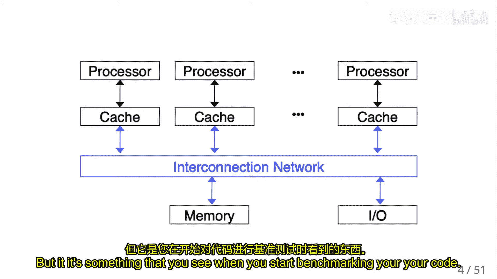

So I mentioned that the memory was quite complicated， for example。

 this is a ND compose server where you have each square here is a different nu node。In some sense。

 the slower network， here is， for example， the memory8 gigabyte for this node。

 so here you assume fast access。But then this whole hierarchy of memory， for example。

 this core has a very fast bandwidth to this L1 cache and then somewhat slower to this L2。

 which is shared with the other core， and then L3 is actually shared across all cores on this processor that's the largest8 gigabyte and sorry8 megaytes and then you have  eight gigabyte for the memory right here。

So all right， so this is a Numa sort of example architecture， and I gave you just finished。

 I think it finished just with that。

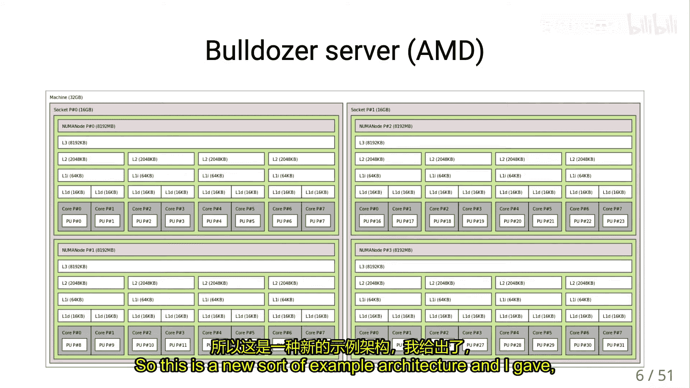

Just gave you kind of an outline of the different types of memory and essentially the closer you are to the register file。

 the smaller in size， but the shorter the latency and the higher the better so the latency。

 the time it takes to basically access。One bite， whether the first bite in memories of is sort of a warm of time。

And the bandwidth is when you start transferring second miles data and you sort of reach the peak rate。

 then what you're observing is now the bandwidth， so depending on whether you do a lot of random reads to reach to random memory locations。

 then you would be dominated by latency， but if you access just contiguous memory。

 starting on some address and then reading a lot of bytes after that。

 then what you're going to be seeing is more the bandwidth。Okay可以。All right。

 but so let's get into the how you would program a multi processor， so the basic organization。

the multicho processor is into process and thread。Okay， so the process is basically the basic unit。

 if you wish， so every time you start a program。What you're starting is a single process。

 I mean it can be a little bit more complicated， but roughly speaking。

 just starting a single process， so each one process is a program in execution and so it has a certain amount of information that goes around with the executable so that the operating system can execute the program practice。

Then， there is a second。Second concept which is going to be key for us， which is thread， Okay。

 so thread is。Its slightlylight different from process basically thread is， well。

 it's basically you know a concept。That arose because of multiplepo processing。

 so essentially you want to run one program， but let's say you have four cores。

So you want to make use of these four core， so at some level you want to run four programs。

But a program or process is a fairly heavyweight object。

 it requires a lot of extraneous data and so on and there certain costs to maintaining the status of a program or process。

So then they came up with an idea of a thread which essentially is similar to a process much much more lightweight so that you can start a program and then launch for example。

 large number of threads and the idea is youre can try to minimize the overhead of the thread you then to be as lightweight as possible and a lot of the information is already in the main process。

 so that's why。You can build this concept of lightweight thread。A lightweight process。

And so a thread， you know， here， this is sort of just a。Opputing system viewpoint of this。

But in terms of the programmer， typically the way we think about a thread is as follows。

 so you're going to have a function in your program， so just a regular C++ function。

 and basically what you're going to say is you're going to declare a C++ object thread that simply is going to run this function。

Okay it's a little bit different from perhaps a regular function。

 I mean it could just be one piece of calculation you want to do。

 that will just go ahead and run the function， but typically will look a little different。

 they typically this function may have mess out with a wild true or something like it keeps sort of going and has a long life and may look at easier any work to do and so on and look at various data structures to see what's happening with the rest of the calculation and tries to figure out what to do。

So it may look a little bit different from a regular function。

 but it's a C plus bus function and just runs and that's how essentially you build the thread。Okay。

 so so basically each process， you know the idea of now process and thread is a bit hierarchical。

 so you have one process which is essentially the program associated with the program you're running。

 and then each process has the ability to create and destroy these independent control flows which are these threads。

 when you write to C++ code， you going to be able to create threads and destroy threads and then the out grid system is going to create and destroy the corresponding resources。

Right。And so basically， you know this is。How this is going to look like from the sort of programmer standpoint。

 so if you look at a multifered program。Essentially you're going to identify a number of functions that are going to be run by the threads and so when you write your program。

 you define these functions and then you define these thread objects and you tell for each thread you declare what the function that this thread is supposed to be running。

 now when the object then the program executes， the object is treated so the thread lives。

But the execution is sort of managed by the operating system。

 so essentially you know that at some point the function associated with the thread is going to be run。

 but there's no control， there's no direct control over that okay you sort of hand this over to the operating system but at some point is going to be run and the idea is that each one of these threads can run concurrently or independently let's say the main thread or the other threads。

 so for example， if you have the four core， you' going have the main thread which perhaps reside in one core。

 and then if you create three threads then they're each going to occupy the other course on the processor and so typically the number of threads you create might be equal to the number of course you have on your machine。

Okay。So now， I mentioned this previously， but just going back over that again。

 so when you run a program， you have this process， now this process has the ability to allocate memory。

 and then we then't run through this memory， and so correspondingly the threads are able to access whatever memory is has been allocated by the process。

Okay， so there's a common other space that all threads can be right from。And。

And so the way essentially threads can exchange data， I mean。

 they don't actually explicitly exchange data， the way this works is a thread would write to certain never location。

 and then later on other threads can read from that never location。

 this is how a thread can do some computation， produce the numbers that are been consumed by other threads for their own calculations。

So once I go into the examples， this will become a little bit clearer， but essentially。

 this is an important concept。That will be so will I think with Cy test thread。

 it's fairly obvious what's going on here， but when going to open MP。

 this would be a little bit more。A little bit less clear。

 so this is something that I need to point out that you need to distinguish the circle called shared memory。

 pilot memory， of course。All this is part of the memory allocated by the process。

 but logically it's partition in this way so essentially each thread。Is again， going to run function。

So inside that function， you may have you know local variables Okay。

 so it's just like any kind of function， you know， you have a local variable。

 you know that's al that's。Iocated when the function starts and so on。

 and the variables in that function are not accessible。By other threads， okay。

 it's just local to whatever thread is running that function。Okay。In contrast。

 variables that have been allocated by the main program， by the main thread。So all these hybrids。

Can be made accessible to all threads， Okay， so we have to distinguish sort of the local workspace。

That a thread is using and can read and write and there's no conflict with any other thread from memory locations that say we're allocated with a new or a vector and so on by the main thread。

 and those memory locations can be accessed by any thread。

 and then you have to be careful if everybody' is reading then this is fine。

 but if some thread are reading to memory location and other threads are writing。

 then you need to be careful to coordinate this correctly。Okay。

 so let's just go through some examples and hopefully this will become clear as we go。

So first of all， in terms of the implementation， there are many options so I'm mostly going to focus on C++ threads。

So it's equal plus press 11。So it's just the thread library， or STD thread。Okay， then you have。

P threads， which is what I was really teaching until recently。

 which is the more classical way of using threads， but then P threads。

 and mean you can use P thread and CNC+ us and you know most of the codes out there use P threads for sort of。

Thetorical reasons because it's been around for a long time， so this can be used in CncC++。

 but it really follows the sort of C paradigm。 It doesn't support it's obviously usable in C and as a result it doesn't support any of the sort of long features。

In CP best whereas the CP+1s， support object oriented。New concept and so on and so forth level。

So this year I'm sort of abandoning a little bit P friends， it' still around。

 but we trying to focus on just the C++ France。And then you have Java threads， you know。

 python threads， silk。Which is a project that Intel acquired some time ago and it's part of the Intel Library in Julia。

 they have a kind of different。ASystem was remote call， but it creates a thread。And then at the end。

 you have an open piece so this is what I'm going to cover on Friday， which uses。Ths。

So it could be your CP posterial P threads that depend on the implementation， but the open NP P。

 the threads are sort of implicit， like you don't explicitly manipulate threads。Instead。

 you write directives that you know。And the compile essentially takes care of actually a writing program to create and destroy thread and so。

So we're're going to start with CP+ threads just to get the basic concepts across， but in practice。

 what you would do is just openly， but just to sort of get a sense of what threads are because it's sort of fundamental to multiple programming and just going to go over C+ threads today。

Okay， so essentially I'm going to do an exercise， you know。

 I think it's hopefully a little bit better than just me talking。So you can open this file。

 see press press threads， for this you can just go so this is basically on the GitHub page。

 so I just click here。The， of course it's not the link。嗯。なほど。So if you go to the GiHub page。

It's going to be a little difficult for me to show you where it is。But。You're going to find it there。

Where is it？Here。So， you can。Yeah， you can go to the。The class webage， lecture3 code。

And you find this， it's also under the GitHub code and so on。Okay， and then so this is a solution。

Well， that your。Right a couple minutes before the class started。

 I copied the solution over the exercise， so that was。That didn't work out。But all right。

 so there is a solution， you know， but know， let's start with。Just。呃。

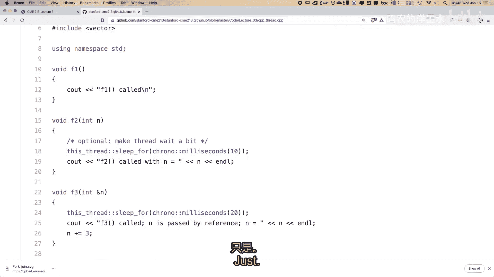

So the file without solution， obviously， and so theres makeC files， so the make file is very generic。

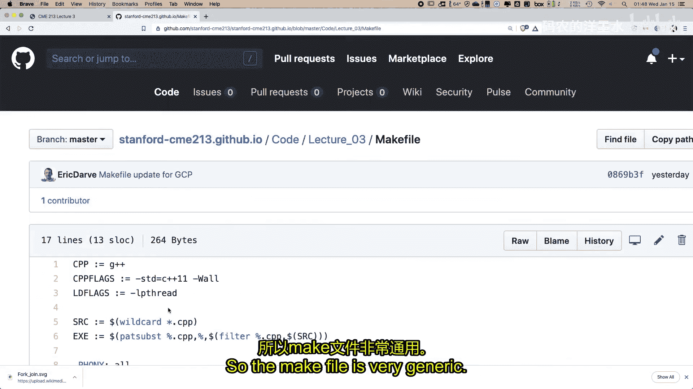

So essentially just make。 it's going to make all the。All the executables。

 so basically just begin to compile the CPP files and create corresponding executables。

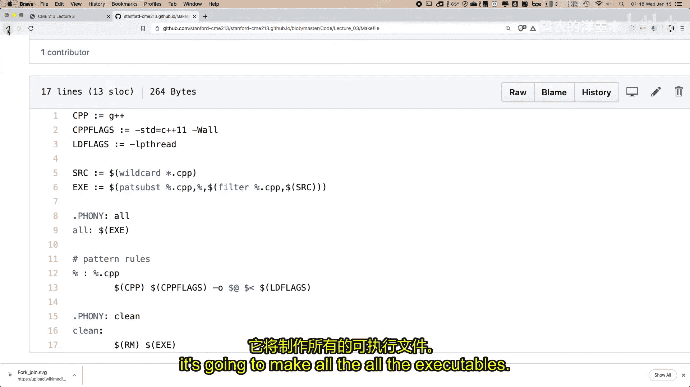

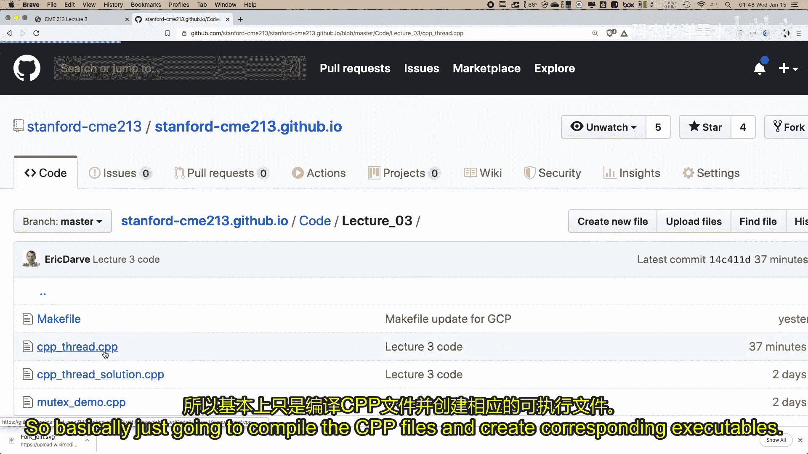

Okay， and all right， so I'll give you a couple minutes。To do that， you can。

Whether this's on the computer， obviously this is。Hofully， this works for you。And that's easiest。

 otherwise， you can use cardinal or rice and so on， but then got to cook you over that。So。

 get up Maybe we help you just let us know。 Yeah， we can help out。So hopefully we can pass， you know。

 sometimes， well， the make file is pretty straightforward， but you know。

 there always little different。 For example， the in the make file added this。

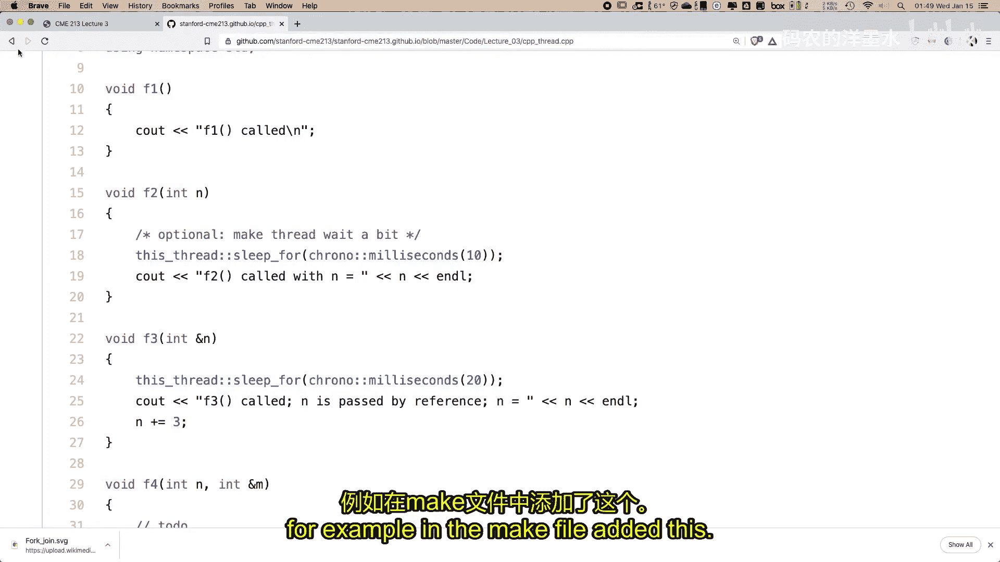

P thread。有的有。Right this one here， which is sort of semi optionalional。

 it kind depends on what your compiler is doing。But。So。

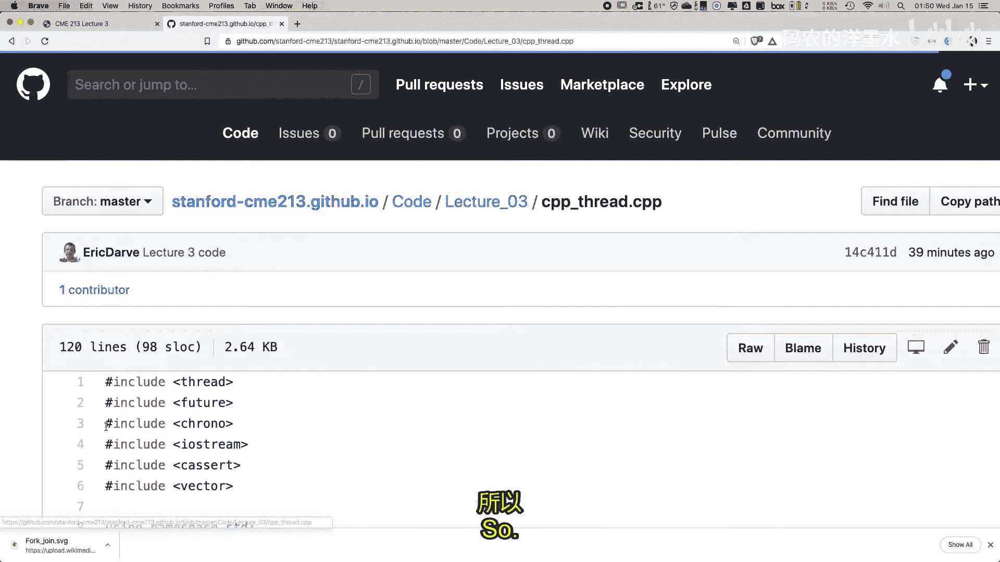

So I'm going to go over， you know， so there are actually two types of examples。

 there is the thread and then the promised future， also something new this year I'm teaching。

 but let's start with the first part of the exercise。So essentially the code down with some examples。

 if you wish。So you can just start with the examples， you know， I made it's really easy。

 it's not like to you know once you have the think of buying。It should be faced with。 So essentially。

 you just use the examples to， you know。Do the answer。

 but I think it's always good to just write a little bit your own code So for example。

 let's look at what this means thread T1 F1。Okay， so thread is so it's SD thread plus plus 11 thread okay so this is the name of the variable and F1。

 so essentially what this is saying is right you can have one thread so one mean execution running on one core and this will program if you wish or thread is going to be responsible for just executing F1。

 which is the function above okay you can scroll up。Function doesn't take any arguments。

 so it basically is just going to print this out， why it's going to use its own special core to print this out。

So， this is F1。So you have a bunch of other examples， essentially that built on that。Okay， F1。

 So basically here， this is function does not require any arguments。

 So you can just say the name of the function and they're good to go。You know。

Obviously that your function may have some arguments and the way this works。

 the syntax works is you start by giving the name of the function。

 and then you simply append all the arguments。Okay。So this is good。

 all right so you can have so this is actually a big advantage over peak fs and Pfs。

 it was much more limited than PS does you have all good。Thiss nice citiesties in terms of syntax。

 so here you can depend however many variables you want。

 the number of variables here need to simply match the type and number of variables in your function and it willll just call this function with these argument。

So。So there are a couple of subtleties in this。So one thing is you know when。

The thread is going to run the function at some arbitrary time。😡。

so presumably when you set up the thread， it's going to record what is the function you want to run。

 so that's basically your memory address， of that function。

 but then it's going to copy all the arguments typically by value。

to save the state because it runs at some later time。

 so we can't make sense that it's going to copy the arguments by value， okay？

And so you have a couple of things that are a little weird。

But that has to do with the fact that it's running asynchronously and so on and the way things are done behind the scenes。

 so the details don't really matter and to be honest because we understand the details anyway。

 but for example， T3 okay is going to run the function F3。We can should go up。Function F3。

 there's a reference。Okay， so here little bit the prediction here because I said this could be copied by value。

 there is a reference， so when you insist on having a reference。

 then you need to add a ref okay need this is the syntax to use if you just say K。

 don't remember exactly what happens， but thiss basically valid。So when you have references。

 you know， make sure that。You put a rep here。So this is a special thing that's moved different from。

You know， just quite a regular function。Okay， and so， you know， al。

 so this is basically how you create a thread。 And so again， you know。

The thread is going to be created， it's going to run this function at time at some later time that the user cannot control。

 and then it to fastK as a reference so you can modify like this thread and this function can modify k and this modification would be visible from the main program。

It's the usual reference date。Okay， and then。For example。

 so here these functions are all quite simple。But for example， here a modified K。😡，Okay。

 so typically， you know you want to know well， was the calculation done or not。

 okay at some point in the program presumably the result of this calculation is required，ing。

 and so you want to know， well is it fed done with the calculation or not？Okay。

 so there's so calledled synchronization point or blocking point。And this is join， okay， so join。

 basically this is going to wait。So the main threat is going to stop here and wait until T3 is done executing this function。

Okay， and then when you have the join， then all resources that were allocated to that thread are basically destroyed like everything is sort of finished。

And the main thread is going to block here， once T3 returns from N3。

 then main threat can continue all resources allocated。

For T3 are freed and everything continues Okay so basically creative thread and then do a joint。Okay。

So you can verify that that assert should pass。So basically， you guys were able to run the program。

So did' it work？Okay， so it doesn't work this is good This is supposed to write the code to make it work but the first search should work Okay。

 so this one J should be equal to 10 So now here is the program so you know first exercise is kind of pretty straightforward essentially you're going to implement。

T4 and run function F4， okay， so you go up here， so you basically copy。Okay。

 so here I was a little maybe ambitious。TheyTll you what to do here， so basically。

I probably deleted too many lines semester thatster didn't do it any Okay。

 so here what you have to do is basically simply just add up M and N together and put the result in M。

😊，Okay， so M should contain the new result。 So if you go here。So M is 5。Okay and。M is 5。

So what need to go well。So I guess n was 10。Should in been removed。

 And so the final result should be。It okay well， okay， so that， okay， that code is correct， so。Well。

 I just look at the solution set。

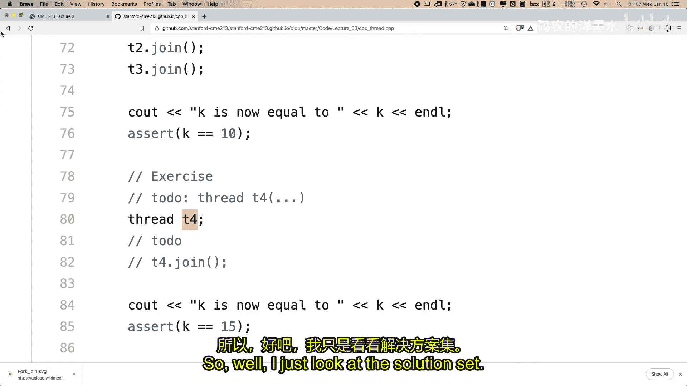

No， I don't you remember exactly what's。

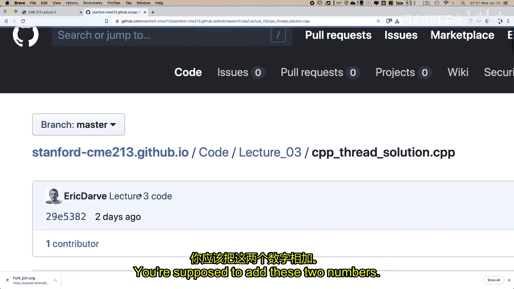

So you're supposed to add these two numbers。to just press equal by what are the arguments？Oh。

 it's oh yeah， you have to add， oh yeah， okay， because the of the variables are different。

 but you have to add n in K。The S M and K。Okay and so basically M was 5 k is 10 at that point。

 so you should get 15 at the endote。So add M and K， so I'll let you do that。

 I'm going to pretend that we haven't seen that。Okay， so it's adding M and K。

So basically it's more or as what was done here。Except that the two arguments are going to be M and K and K you pass as records。

 and now when you run your code， you should definitely pass。This the 15。Okay， and is there a way。

 I don't think I can edit well all。I'll modify the。This guy from code。

They would have been easier to I also rename these variables M and K we can matches。Well， yeah。

 it doesn't match the argument。So just sum up M andK we can get。M is5 case is 10。

 and then you body here。So you have to use the RFK again。So is it working？

Thank you can I see what you。So yeah， you should un the T4 join， though。In the sense that。Well。

 of course the calculation is very fast， so presumably by the time you're right here。

 the function is run， but you know there is。A little uncertainty here。

 so typically before querying the value of k， you want to uncomment the before4 joint just to make sure that。

你讲 with。I mean， you could just leave it uncommented and see if you can get like a non deterministic effect right。

Yeah， if， for example， if in the function S4， you want to add a weight。Then， you know。

 that would be too bad。Because it would weight， just you put the weight before updating。

variable boque， and then the main threadread will run ahead and go here。

 but you know motions not done。So you can do around with buzzness。Okay，Any else is done？佢都。

What you guys are doing。This is just1 breath case， so let me just show you the solution now。

So you can move on so any question about this？那我们这边是。So let's just look quickly at the solution。

So basically is just adding。I0。M and n， So it's n plus equal N。Okay， so that one is fine。

 And then this is the main part here。 So basically just call So M and ref K。 So of course， the。

The trick here was to include the ref。Make sure you have the joint because you want to make sure that F is up to date and then you know you should pass the assert。

 so you're going to fill on the。On the promised future。Second exercise。Okay。

 any question or should they continue？If you can watch that。W。

 so the number of threads that you can launch is basically determined by the operating system。

 so this can be a very large number。So because there are many。You know。

 there are many threads that often just wait for user input。know， for example， I don't know， I mean。

 I'm just going to make up an example， but the tabs you know in your browser， maybe threads。

But if you're not watching the tab or you're in some other application。

 essentially there's nothing to be done there， so the F is just sleeping。So if you look， for example。

 all the processes and then all the threads on your computer。

 you have way more than the number of course， but like 199。9 they're just sleepingy。Okay。

 so you can declare a lot of threads。But typically if you have four cores。

 you it doesn't make sense to declare more than four threads that are actually doing anything。

 if it in if computing， let's say' crunching numbers。

 then the one number of threads to match the number of cores。

So you have on some process there this concept of hyperthreading。

Which means that the operating system is optimized to run two threads per course。

 so then you can have twice the number of course， basically each qua can more run two threads。

 more less at the same time。So hyperthtic， but yeah。

 basically that's right number of threads is more as number of course， you know。

 especially scientific computing where you just。告诉的。

I don't exactly understand how threads work in a sense that why are we using threats instead of just executing。

What is theOkay all right， so a very good point。Well。

 obviously here I'm not doing anything very interesting。

 but the key property of threads is they can all run concurrently。Okay， so for example。

 here I say thread， you know T1 through T4， okay， they can each run on different chs。Okay。

 whereas if you write。Program without further as you say called these assumptions。

Then that can only happen on a single core。 There is no way to run a multiple courses。

So the process or the threads are。mananaageged by the operating system and it's very common for threads to move between cores。

 if a core becomes very busy， the operating system may move the thread between different cores。

 but this is different from being able to use multiple cores at the same time。Okay so here。

 let's say that these T1 through T4 were actually doing non trivial amount of work。

Let's say if we're running for a second， then you'd be able to use four cores for a second。

Whereas without that， you'd have just one core。For a second。

So this is the key thing and so the main thing to remember。Is sort of related to that。

When you exit the main thread。Well the main program， if you wish， was executing line 79。

And let's say it goes to line 80。Okay， when it reaches line 80。😡。

There is no guarantee that this function has been executed， right， it's a deferred execution。

there are other syntax and C plus plus where it's kind of more explicit what's going on。

 but here I'm just going to limit myself to this。But you do not know when F4 is executed， right。

 and typically you cannot expect。That when you reach this line， that is at the beginning。

 that it's done already because you have to set up the thread， you and so on get it started。

 And then even when the thread is live， you know， it doesn't necessarily run。

Because you know all the course might be busy anyway your consistent tries to balance the workload。

 so threads are constantly allowed to run for a little while， then they stop。

 then they're allowed again to run， I mean it's very you know。

Kind of unpredictable and somewhat chaotic。 So you know， the point is。

 you really do not know when this is。Okay， so that's why you have to check。You know。

 SD for a computer or not。So is it scary yet because this is the key point？

It's not a sequential mode of execution。Okay join so actually the join in some sense is really for the main thread。

 the program and so what happens is the main thread is going to block and block so this is alsoten nuclear block simply means that the main thread is going to stop。

At light A A until something happens。Okay， so when it stopped。

 it typically doesn't consume any resources， it's just like waiting。

And way it's waiting for that threat to be done with this function to basically return from this function。

Okay， so if T4 is in the middle of executing this function。

 then80 will stop here and it will not proceed 81 until。Return from F4 and then it goes to 81。

 so it's how you can synchronize and it's how you can make sure that you know you're done with F4 is because otherwise you could be。

Not started or could be in the middle。And then TPT， that doesn't make any sense， right？very。

How we computed and so on。So this is very important to remember this joint。

I need to wait for the result to be。how expensive is it to grid？It's quite expensive。

It's quite expensive。Well， I haven'vet dined it。在佢家之里诶。It's quite expensive。

So the body of the thread， you know the function。Well，Just to give a number， maybe meise second。

But so that's actually a nontrial amount of work。So。But typically。

 you create a small number of threads。OkayAnd that's what I'm saying。That's why in many cases。

The programming model is。You create a thread。And then there is a mechanism to give it work to do。😡。

ok。So that the thread is sort of created， all the resources are allocate。

 and then you just keep giving it work， and then the thread sort of looks at the work and kind of execute。

So this could be done in different ways， but for example。

 there might be just a queue of things to do the thread at regular intervals。

 pull this queue and does what's in there。So this allows you to， you know。

 if you have large amount of。You know， large lists。Of work to do， but each work is small。

Then you can amortize creating the thread， it would be a bad idea to create a thread every time you have to do a little piece of calculation because the overhead would be too much。

Okay。Yeah， and so we'll see that in GPU computing， it's the opposite， the third extreme light。

 it's a very different design。So in Quta， there's basically no cost to creating thread because threads are。

Managed very differently here this is a completely general thing right just its own thread of execution can run arbitrary functions so to have states to see like what are the status of its variables。

 it is to know where like in the function at4 like which instructionss at so there's a whole bunch of stuff that to manage you can figure out you know。

 for example。Yeah， it's kind of complicated。When you run。The Fred。Well。

 the variables need to be in registers， then you execute your instruction。

You write back your results of register and so on when the operating system says， well。

Time for another threat to run to save the state like the register somehow to be safe somewhere and then somebody else comes in the space so there's quite a bit of maintenance around that and as a result reading the thread and to imagine these resources there's some overhead there。

Okay， so let's continue here。Go back to the thinging here。嗯。Right， so constructor。

 so we talk about reference argument， the join。Okay， we did this this resolution。Okay。

 so this is a new thing that I'm covering this year because， you know， it's not P threads。

 it's something specific to Z plus threads。It's not going to be immediately useful for you in the homework and so on。

 but this is one of a very important concept， so I'm just going to briefly kind of cover it and it's specific to C++ 11。

And so the question is how can you return values from a synchronous assumption。

 so it's basically the same discussion as the joint。

The fundamental difficulty is that you're running functions。

We I think are systems to run these functions， to allocate these thread and run these functions。

But this happens at any time right you don't know when the function starts。

 where it is and whether it's ended and so on， and so in terms of coordination。

 this presents some challenges。So of course， one simple mechanism is just to weight that you're done't with the function。

And then once you return with the function， then you for sure that over line have been executed and presumably all the variables are in their final state。

 but that's not terribly flexible。Because there might be this is where the function just keeps going and it will be doing all the things。

 but the variables you add are actually up to date so just waiting for a function to return is not necessarily a very flexible mechanism。

And so essentially。C++ provides a mechanism so that you can allocate resources to store certain values。

And then there is a mechanism for the main thread。To create these values。

 to see whether these values have been computed or not。

 so imagine you have a fair burning a function， at some point you capture a value of x。

 and has a value for x。So you want to be able to store this value somewhere。

 and then the main thread that's running the main program should have the ability to query well is has Xs been updated。

 can I use the value now？And this happened sort of independent of what the F is actually doing it prefer to be continuing executing all the things。

 but you already have access to X so this is the mechanism that's what essentially the problem that promise and future are you know addressing。

Okay so promise in future and this is something that has been used you know this is in Z thread that in many parallel computing computing languages。

 frameworks， libraries and so on， they use similar concepts okay so you will see the words promise and future quite often I mean sometimes it's a slightly different meaning。

 but it all comes from the S threads， so in that sense it's sort of useful to have this background。

So again， promise essentially it going to hold a value to be returned。

 so it's going to be some space where essentially the thread can write a value， okay？

And then it's safe for future So you see， for example， the promise。See， the difficulty is， well。

 you do need some space to store the variable because the thread may start executing the function。

Save that value， but then it may finish the function in return， Okay。

 And so unless you have some space to store the value then。value is gone memory free。

 so you need some space to store this value that exists sort of independent of whether know the set standard is in the middle or is finished so this is the first thing and then the second thing as well in a way to query whether this calculation has been done or not like is the value of x available what's the value。

So this future is used to that。Okay， so this is the second example。

 in C++ thread lets so I'm going to go through so again it's the same sort of thing so you have this example and then the thing to do is right here T5。

I'm sorry， this one right here。That's the solution。Show the other one。Okay。By the way，s just copy。

 So it's it's words。 So let's look at the main first and then I'll go to okay。So。Okay。

 so basically it looks very much like the previous situation， we just had we good it Fred。

 it's going to run this function。And then what I want the fed to do so again。

 this is a very simple example， so it's a very simple case， you just want to take a vector。

 compute the sun of all the entries in the vector， but use you know。

Promise and future to retrieve the result。 Of course you don't that you need to do that。

 you could also save the result in some global variable you were using RA。But like I said。

 future and promise is a more flexible way to do this， so I'll come back to that right。

 so here we're going to use future inform。So here's the vector， 988。

This is a vector you want to set up all the entries in that vector 89 here you declare promise okay so promise is you think of it as a storage space。

 okay this is a space where you're going to store the value of your calculation and this is going to be set at some point inside this function。

Okay， and。And， associated to that， you have a future， okay， so it's a made promise to get future。

So what the future is used for is the main program。Okay， is able to query。Teachture。Okay， and。

 for example， right here， result of accumulated future so if you go to the end of the line。Okay。

 it says， you know accumulate future get。Does here because again。

 everything happens as synchronously， so you really don't know what's going on in the thread and the function。

So what this's going to do is， again， this is blocking， so the thread is going to wait。而9。

It's actually something has been stored in this variable。Okay。

 so you' going to wait until something has been stored in this variable and as soon as something so using set value。

 okay so the value is going to be set here， and as soon as set value is called and boom。

 this is going to return with the result。So you see how this is better than just waiting for the thread to join or the function to accumulate to return is essentially this is going to work as soon as accumulate promise is set。

Okay， so you don't need to wait for the end of the function。So it's a much more flexible mechanism。

 okay， so you see promise to store the value。And then future to kind of query and recover。

 so here again blocking until accumulate promise called set value。

 and then here you get back this set value。Okay，So move， you know， well。

 I don't want to spend too much time on that， but this is the standard C plus plus 11。Move functions。

 which basically means that。It's。Well with's basically some sort of of reference。

 we need to create an object using the resources in a accumulate promise so it's just a more efficient way of you know。

Passing this is an argument， essentially。Okay， and， so。So this is the okay to do。

 So the accumulation you just have you just have this accumulated promise。

 So you know because of the move and so on， it's basically essentially passed by by reference Well。

 it's a copy， but it's。Doesn't involve copying resources。

In case it's a very efficient way to copy things， so to speak， So you have accumulate promise。

Okay then here you see set value， so when you say set value， then the future is able to。

 you know when you see future get， then it's able to return。The value stored right here。

 so you see it's a very gel mechanism， you can sit promise for arbitrary objects。Okay。

 here you can put anything， so you get a copypy constructor。And so on。

 so you can put anything you want since this is also very powerful。

 you can of course use as many promises as you want and set them at different points。

In your function， and so on。Okay， so this is where you store the result and then you notify the future。

 so then the future associated with this promise， then the future it has a get， will be able to say。

 okay， well， the variable has been the int has been set and it will just return the value of this int。

And so。So this is basically what's happening here， accumulate future get。So again。

 remember how this starts， you declare a promise of type int because you're going to store an int。

AndThen you have a future， well this will be the same type。

 and then here you associate the future to the relevant problems it's a very flexible mechanism to set variables in these synchronous functions and to have the main program retrieve these values Okay so this is a very important。

Sort of a process here。Okay so so the exercise is basically just to do same thing。

 but you going to take this vector， you want to implement a max function。

 you want to take the maximum so you just repeat the same same thing but with max so you're going to declare a promise。

I've typed int， so you just go up here and say Pro in， just copy paste。

Then you associate the future with the promise。So it's a promised of future？Get future。

Then you have to write the function T6 which calculate the max。

 So it's basically you know vector2 begin， vector2 n and so on。

 So here you have to call it get max and say move know max promise。so here。

 while the way I wrote the code here is a little bit different。

 you have to say Max future does get here， you get the results in the newprint。

 and I wanted to have the insert here。Use the assert here to make sure that you have the right。

Right results。 so this is again the maximum， so the maximum is supposed to be just five。

And so you do this by writing function getmax here with the beginning of vector and of the vector。

And then you store， we set value， know， similar to this， you store。The result in medicine。

Did you few to do that？So let me know if you have questions。Well haven't did you call send value？

So if you call cent more than once。That's probably。That' what be bug。Yeah， I mean。

 I haven't read carefully at the documentation edition， but that sounds like the bug deal。Yeah。

 I mean， theres some stuff， for example。If you associate。You know。Multiple futures。

With the same promise。I think itそうするば。The future shared。And then it's just regular future。

 which I'm showing here because you know， that would not make any sense， right because when you see。

futureture get value that it gets the value， but after that it assumes that you're done。

 so it will release the resources and so on， used to store the promise and so on so somebody else squares the future again。

Unspecified behavior。Great stuff。Yeah， so if there's actually language called rust。

Ws very interesting。Which protects against a lot of these memory and concurrency errors。

And so it fixes without these problems with C press because you can see that it's not trivial to write for code you can easily make。

Small errors。You know。With this。Okay， so any。Don with that it's alert and just copy paste。

You have it。所 it does the诶。你 search。还有人是这。Yeah。そい youです。Okay， great。自咩。瑞克。咩可。So， here。定位。Right。

 James。So， but then until feel。Which is a big drama great for you。上总。What the movie does。Is。Okay， so。

Using move， does it design so it use。the same day。Yeah yeah yeah， so what move does is basically。

Okay。As against me this I mean there's this copy right you have some stuff here。

 you have some stuff here just copy memory， okay getting bump there you have the reference。

In which basically you have two different names。It's actually simple。Its same memory。

 it's actually the same memory。Sowhere in between。What it does is you have an object。That， you know。

I' to resources。Okay， now。I he here a lot of this stuff？Try values， sort of compete。走关。

The first object you sort of don't care about it after。使佢想去专咩。You know， you know。

 so of power like a temporary variable that shows up in the CO， then believe after。

So what so the program forces you to copy because that's the same time。Here of it。

first you can copy but in。You don't care about this thing what's happening is。You have two objects。

But the memory I'll get for this one。呃。Its sort of freed or this object no longer refers to that memory and the other object of uses that memory so he uses the resources of the first object for the first object。

So afraid up' in the vector。What this just that one vector。

So that one has memory located so the vector to the pointer in V2 would point to the1 V1。

 the V one will be set to no。RightSo you didn't actually talk anything。

But you still have three different objects。But there was no working。😔，こてんですけ。Yeah movie。

 but basically it tries to avoid the cost of copying in cases where the program requires a copy。

But you don't want to pay the cost because essentially the first object you don't care about wrong。

 so the resource students fail does make sense to a good。So here if you remove the move。

 I don't know， it's in my bud because you'd have two promises。We had two promises。

That are sort of identical。I'm not sure that's the actual bug or， it's kind dangerous。 I mean。

 the movie is what you want to do here because the first one actually will guard。

Then in the function。Just use that。That means that after this threat is。

We can't define other future and use the same promise the you can the object you can't it。

 you can the object for。And enjoying speaking， unless you have future shared。

 it doesn't accept there multiple futures in the same composition anymore。

Because the idea is the promise sets the value and then the future gets it。

 and that's very much it anything else is sort of about。Okay。我 you게。

Sometimes the worst doesn it it great。So I would stick know through the recommended test。But okay。

 let me think about this， I mean， I think in the code I wrote it should work， though it must work。嗯。

It must work。Yes。But there's probably cases where， you know， there would be problemss with with that。

 So I would recommend sticking to the。To this we programming。Yeah， C++ is very， very complicated。You。

 and sometimes there are things that are unclear too difficult to resolve。Okay， so anyway。

 so all right' done with that， so let's move on。Right。

 so where is the points of promise and future so basically flexibility？The point is， you don't need。

Join to be able to access。The result of a calculation where essentially as soon as the value you need is computed。

 potentially it's accessible， you can put it in the promise and the future will get it。

 even if the fair is still doing some competition。So when you write more complicated programs。

 you know， this is definitely the mechanism that you want。O。

So you can read documentationation for further example this on。These pages are， you know。

 pretty reasonable to read。 So it has will show you a lot of other， you know， functions。 And。

 you know， there's a lot of， you know， a lot of additional stuff in C plus best thread。Okay。

So let's wrap up with the second concept。So F coordination。So you know。收。You know。

 multif programming is。You know has some difficulties。

 so for example we saw you know what's happening with this joint， you know maybe you query variable。

 but it's not a data yet， so you get some undefined value。But there are other situations where。

So yeah， so basically the basic， that's the basic problem。 you know。

 when you start having multiple threads that runs currency at the same time with different things。呃。

For example， certain events may need to be synchronized， for example。

 if thread one computes a certain value that is required by thread2。

Then F one needs to be finished before F2 starts， so there is a coorronination or point of so called synchronization。

 like an event needs to happen after the're using the variable needs to happen after computing the variable。

Okay， so I'm just going to give you this example of you know， here just。

Basically a basic calculation， but you in this fictitious context of a bank company。

You want to perform bank transactions and you want to allow deposits。Okay， so。

So the client deposit money and the amount gets credited。

But the difficulty is that you may have multiple operations happening at the same time。

 so by the way， this is， for example， in cryptocurrency。That's one of the big problems。

Of cryptocurrency， for example， if you have1 in Bitcoin。You know， you could。

In issueu an order of give your dollar to personal aid。

And then some dynasty give one dollar to person B。OkaySo how you make sure that essentially you're not giving your dollar to multiple persons at the same time。

 which means creating free money and so in a system that's completely completely distributed。

 it's actually very hard。ToEn the of Riquao。Checks。

 so fortunately in Bitcoin is' quite complicated and they use you know。呃呃。

All this blockchain and so on to make sure that this doesn't happen in other systems。

 so for us it's going to be a little simpler or quite a bit simpler。

 but the idea is basically the same。So let's follow this。So okay。

 so the idea is you're get this client that makes， you know， different deposits。

 and this is happening at the same time。 Okay， that's pretty classic。InIn finance， know in banking。

 So the step there's basically three steps。 you ask， well， what's the current balance？Then you ask。

 well， what's the amount you want to deposit？😡，Then you update the balance and then you write the new balance to some know hard drive or whatever that maintains your account and so the two threads are doing that。

So when they start， they both ask， you what's the current downs？And they both get 1000。

 essentially that is the problem。 Okay， so this guy， 1000， you know， ended up with 1100。

This guy starts at 1000 at 300 ends up with 1300。 And so basically now you have inconsistent amounts。

One is the 1100， the other one is a 1300 correct result obviously is 1400 and so everything is wrong after that。

 so here in this example this one writes first and this one also overrites okay。

So what's happening is， you know， when Fred zero is working。

 essentially third one cannot access your account and vice versa。Okay。

 so and so this is a very common problem when accessing shared resources each time we do。

Read the right or right to read。 Okay， so basically you're reading some value， making some changes。

And then somebody else also wants to access the resource to read and changes。

 then this has to happen one after the other， in any order。But not at the same time。

 okay could be3 zero than one or one then zero， but not at the same time。Okay， so here。

 essentially the operation is sort of a plus equal， it's a real a。Then right。

 but you can have arbitrary operations， for example， list。

Maybe adding an element to a list or it could be deleting an element to a list， okay in both cases。

 you cannot have multiple thread doing that at the same time， Okay。

 it will leave the memory in a consistent state I mean it may by chance work when you exactly what you're doing。

 but you cannot guarantee that it will work。是 now。Having said that。

 if all the threads are simply reading。This is fine， it's like in the list。Linnk list。

If everybody's just reading the linkedist， no problem。

 the problem is when you start essentially reading and modifying， in fact in the list。

 just modifying is really wouldn't work。Okay， so this is a very famous problem。

It's called the race condition。 It shows up in many， many places。 So I mentioned， for example， rust。

 which is a language that's kind of designed to avoid these types of prompts and essentially runs an interesting language such that the compiler。

 actually， the program does not compile if there is a race condition。

So name is such that you try to compile the programs just。Bank depositing。

 then actually would not even come up。 We complain that some air until we fix the risk condition。

 know， the program fails。 So unfortunately， in C plus press， it's not that。Strict。

 so you can actually definitely write programs that have these risk conditions and basically are incorrect。

So the race condition is basically read， right or write read， okay， if ever is doing a read。

 this is fine。If every doing or right is。A little bit weirder。

 but see my final point example is if you have a vector that the memory is already allocate and so and you have threads writing at different locations in the vector。

 then this is all fun。So as long as you're reading， writing and so on， this is fine， but for example。

 if a thread writes let's index zero and another a thread reads，At in that zero。

 then there is a race condition， right， the we needs to happen after the right。

 and they don need just a race condition， so it can't happen at the same time。

 but even the order needs to be in a certain way。And then。

So the right is the case that they described， update the value and then somebody else reads the read write is sent。

 the right is going to change the value， so if you must know the value before the update。

 then again there's certain ordering that needs to happen。So there's actually two separate concepts。

 right， there's the fact that you cannot access a shared resource at the same time， for example。

 a linked list then I'll show in a second。You can access a shared resource at the same time。

 and also you have these ordering prompts。But both bombs are sort of solved。

With this concept of muttex， so again， this is a very。So个 no level。To 뭐。

It doesn't itself solve the problem to the programmer to make sure the code is correct。

 So this just gives you a tool。Essential it gives this new text is's a very simple construct。

 It's sort of the minimal。Concept。If you wish that you need。

In order to be able to resolve these types of problems， so it provides you with a minimum tool。

 but it's up to you to kind of write the correct program。

 use the tool so that the code becomes probably correct。

Okay so it's very easy to have incorrect codes， even if you use muttexes and so on。

 so muttex means mutual exclusion， so basically it's going to allow you to have pieces of code。

s that no two threads can execute the same lines at the same time。

 so we will be executing any order but only one thread at a time。So for example。

 if you want to make changes to linked list， this is what you want to do。Okay， you are going to。

Lg the mutex。Make your changes to the linked list and then unlock the new text okay。

 and only the part between Loin or not only one thread can do that。

 so it prevents multiple threads from making changes to a linked list at the same time。Okay， so。

So let's see how I'm doing for time， I'm going to try to finish that。So for example。

 this is a case of on the to do list， so thread zero closes the lock。

And so basically what's happening is mutex is in true state。Can be locked or can be unlock。

If a thread locks the mutex。Then first of all， nobody else can knock from text。AndMoreover。

 only thread zero is authorized to unlock the muttex。

 so essentially there might be a situation where you have a amount of code that says muttex lock。

You may have multiple threads sort of wing at this line trying to log the mutex。

 so you guarantee that only one thread is going to be able to get the mutex and lock it。

Then that friend sort of owns the lock。So whatever code happens after is sort of protected because it comes after locking the new text。

once you're done， then it will open the lock， only3 zero can open the lock。

 and then whoever was waiting on this lock can then grab it。Log the mutex and then execute the code。

 so I'm going to again give you an example。And。Okay， so in the interest of time。

 I'll just jump through the example。Okay， so this is the other piece of code。

 you can actually open it， it's mutex， demo， it's not an exercise， but。

You just have to read the code， but it's difficult to show you the code on the screen so it' kind of easier if you look at it。

So this is the sort of scenario though， so it's restaurants where there's sort of two phases。

One is going you have this one guy。Who's going to collect？All the orders。

 so it's sort of on the phone if you wish。Getch all the orders。Prepas all the pizza。

 It's not a entirely realistic scenario。A more advanced one， but I'm running off time to do that。

 but here you're assuming you're baking all the pizza for the day。In the morning。Okay。

 and then after that， you have a bunch。呃。Delivery guys。

 you have multiple friends that can do the delivery。

so what they're going to do is essentially going to go through the list of orders。

And they're all going to grab one of these orders， deliver it。

 and then come back to the list to see whether there's more stuff to do and just keep going as long as the list is not it。

So this this part is sort the sequential and this part goes parallel。

 and the problem is you here you' reading from the list。And popping almond out of the list。

 So it needs to be protected by a mixex。 So let's see what how this works。 And then essentially。嗯。

This will so this is my slides here， but let me just。Kind of go here。

Easier to just go through the code here。So this is last example， so you can just open it up。

So you know just going through the main real quick， so basically the insert new order。

So without going into really too many details， the way this works is simply you have a queue of strings。

 Okay， so just a queue of strings where each string is a pizza delivery。

king of characterss and deliver pizza to so on so， so just a cu of string。

And so this is a global task queue， okay？And so you're going to start by just to insert your order。

 basically， just add new strings into that cube。Push stuff into that queue。 So you know。

 just go down and you can see， you know， you just， so this is first entry in the queue。

 second entry in the queue， and then you just process a bunch of orders。

 So pizza delivery to customer。 blah， blah， blah。 Okay， this is this is the next order。

 and then close the store。 Thank you。 And now you're done。Okay， so now here。😡。

Here is where you create， you know， a bunch of。Deliver people to take care of these orders。

 so the idea is you're going to create a sort pool of thread。

 so this is what I was describing previously。Where you know you going for example。

 if you have four cores， maybe you create four threads。

 but you may have you know whatever 400 deliveries to do， So they all go the list。

 you know grabbing things to do and sort of executing so this is So you see this is different from you're not creating one thread to order。

 instead you're creating a fixed number of threads， maybe number of course。

 but then each thread does you know a lot of work as much work as possible。Okay， so here。

 so this is thread pole is also， so I want it to be fancy here。

 it's a cure thread to be a vector of thread。Or whatever it， it's a bunch of thread。And so here。

 you know you're going to create a f that's going to run pizza delivery with argument I and you put this in the st and then there is a join。

There's join below here。You know where you say， so this is grabbing the first thread join。

 then once a join， you get rid of it。Look at the next variable so do this in third time。Okay。

And so the key is where does this function， Okay， this is where the meix is。

So this is a function where you access this cube。😡，Okay， so now you have to be very careful。

Because this queue is constantly being modified by threads。So for example， if you ask。Is the Q empty？

Okay， this is in this in valid operation if another thread is making changes to the Q at the same time。

 so you have to be very careful， just asking whether the queue is empty， there is a base condition。

Okay， so you lock。So when you love， you see all the feds are going to develop up at July 29。

 only one。Will proceed and own the lot。 Okay， so at that point， because only one， you know。

 owns the lot 31， there's only one further that can do that at a time。Okay。

 so it's going to basically。Grab。The next order。So this is just making a。

 so it's not I should do anything， but then popping from the queue， and now it unlocks。

 meaning that another thread。Can proceed。喂，你说说。Okay， it just scroll down。Then basically you see。

 so you in this wide loop， so here this is some fake delivery。

 or you know here you do some calculation or you do something interesting。Once you're done。

 you need to again check empty， so before doing that you got lock， so you see you go lock。Okay。

 so again， a lot of the fed are going to pile up here， one grabs it。Goes very quickly here。

 so hopefully delivery is something that takes quite a bit of time okay so that the idea is you know most of the time the Fed will be here okay and then wait here maybe a little bit。

 grab the next order， unlock。Ands obviously we play like this。Now you have to be careful。

When you finish。Okay you knock。You grab the log， then you test oh。

 the queue is empty so you finish this log， you want to return。

 but you have to be careful because the mutt is still in the log stage so if you were to just return。

It'd be du， The muttex would be locked， Nobody else can unlock it and the program just would stops。

 It would not return。 Basically the threads， everybody would just be weighing here。

 and since nobody' is going unlocked。Nothing happens， the program just runs forever。

So after the while， you need to make sure that there is an unlock。Okay， return。

 so here you see that every ultimately you know then finishes by unlocking and return so all the feds are able to finish。

Okay， so basically this wraps it up， so any questions this feedback text？So me is not a super。

You know we're not going to really use that in any of the homeworks and so on。

 but it's very important to understand that for example。

 when accessing shared resources like Li test，Allocating memory and so on in a multiple thread that you try to access the same resource。

 then that is a problem， that's a base condition and you need to protect it with a mutex so that when you're making changes with data structure。

 only one thread at a time，Can do that So typically every time you're know playing with pointers or doing memory allocation。

 know you will have a mut， okay， or if you want to do plus equal a reduction。

 know when you sum a bunch of numbers when you get found results of this operation that may require you know a index。

 But this is very low level， it exists in the openmp。But typically this is。

Well OpenM has a different mechanism。In most cases， you actually don't need new taxes。嗯。Okay。

 any questions？Okay， so on Friday we'll just so we start with the realL thing。

 which is openmp and we'll get next homework on Open it。Thank you。Yeah。What so。

All of them just asked for tests。Is it sufficient to just writing an assertion there？

Should we see out？So basically the test is， yeah， you should just basically set up the situation where essentially you provide some input。

 you know， run your functions， so for example your matrix you know。You said no operation in Newi。

Yeah， the desk is basically in the search。Presumably。

 you could bite to the screen and then test it visually。

idea of testing is to make it automated so yeah there's basically an insert the search statements standard both fine right yeah you can throw an exception exception exceptions are。

Yeah， I can feel exception。

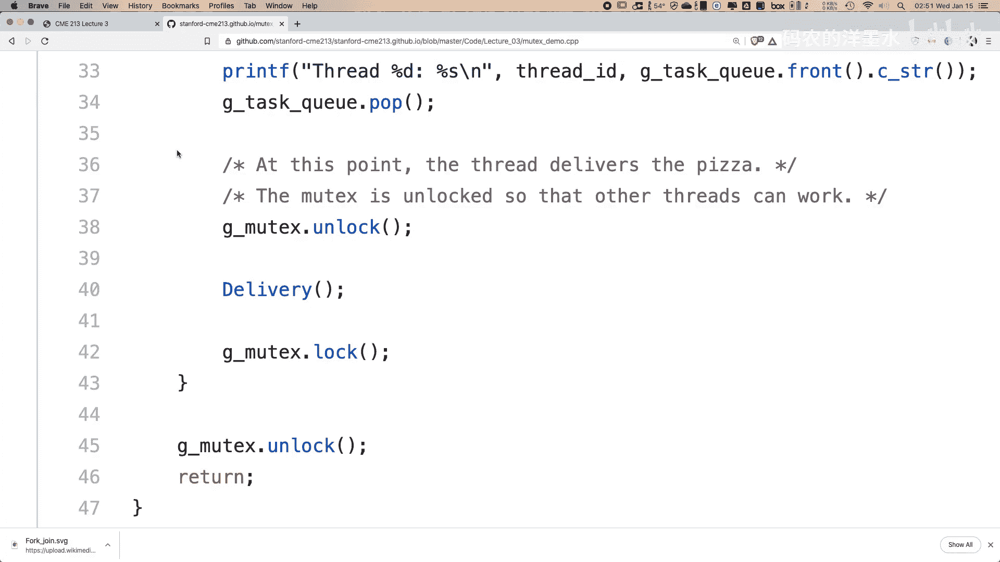

すごい。