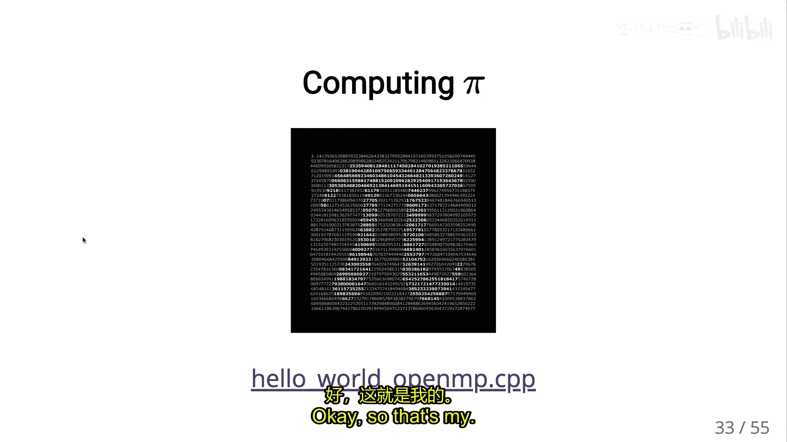
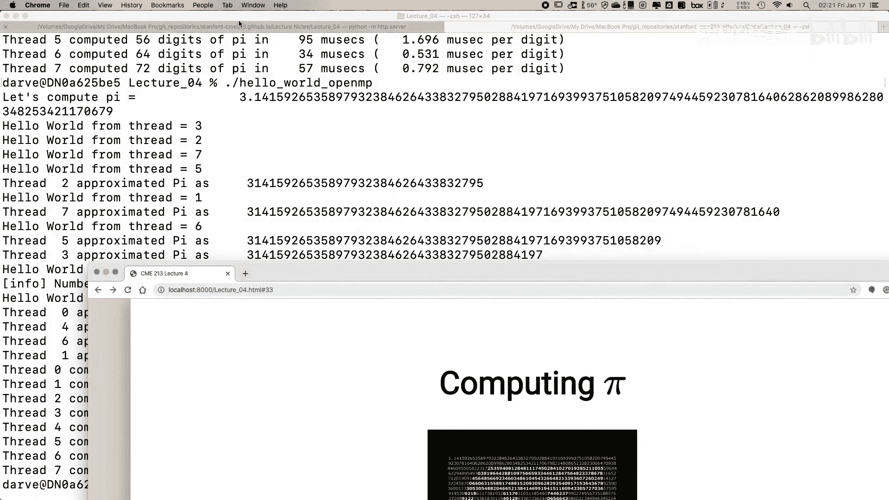
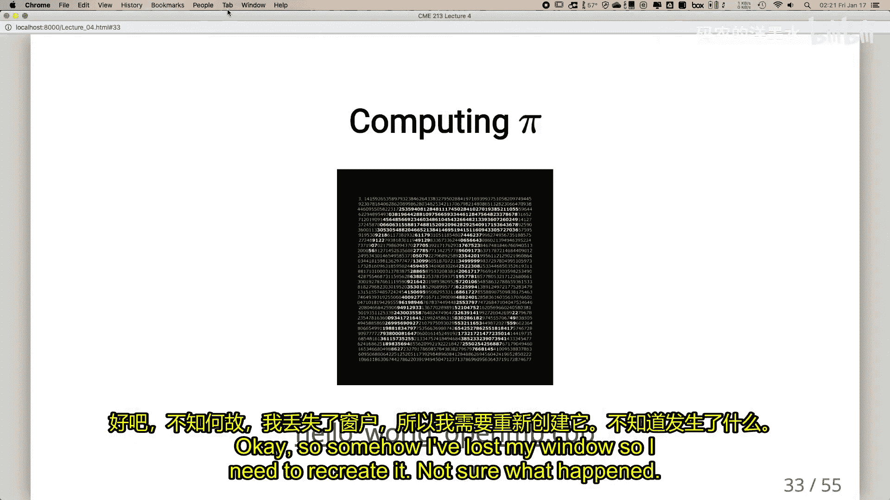
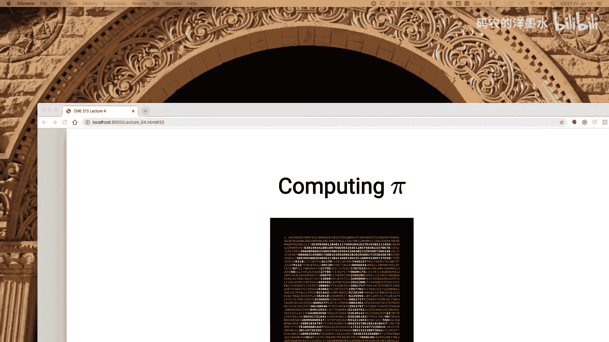
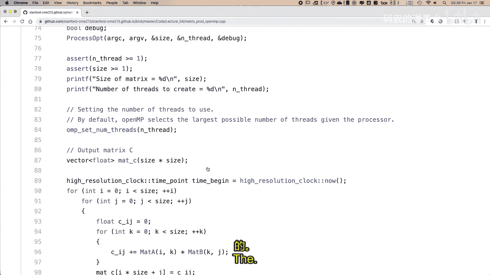
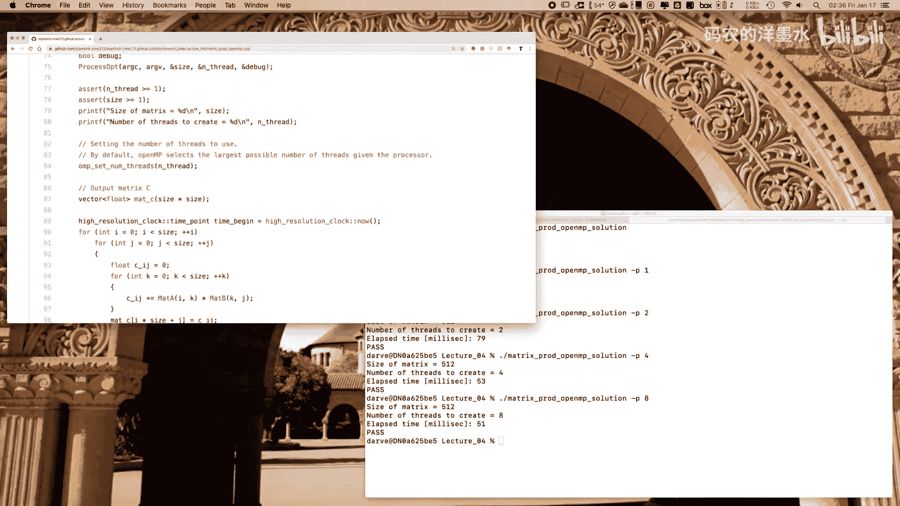

# 【全集】斯坦福大学-并行计算导论-CME213-中英字幕-1080P-p04-Lecture-4---OpenMP-1--BV1f8ijBYEjR_p4-

不没意思。Okay， so let's start。So actually let me just be right。他。All right。All right。

 so let's have stuff to cover today。 So maybe I won't have time to。To do everything， but。So first。

 I want to briefly talk about Google Cloud platformform。 So this is the。You know， hardware。

You're going to use for the class， or you should have received this email with some coupons。

So you can be de to get some credits。Okay。So you have more information at this page here。啊。All right。

 so you know， you can all let you kind of go through that。

 but you have sort of step by step instructions。You know of how to set everything up。

So I'm going to sort of go through that a bit。嗯。So the first thing is okay， when you log on Google。

 you have to be careful what account you're using。Okay， and not all accounts。Will allow you to。

We de the coupon， so I don't know exactly what's the rule there， but。

You knowEssentially you should use a personal Google account， so for example。

 if you log in under Google which is Stanford credentials， it's not going to work or if for example。

You had a Google account from some other previous university， so on and so forth， so some sort of。

Maybe G suite to goug， you know the sort of。嗯。Yeah， the organization account， maybe it's called。

 so anyway， so you have to use a personal account and then you should be able to redeem the coupon so you just open the email follow all the instructions。

And it should work out so this。Your account for $5 month。50 guys。

And then essentially it's going to be used whenever you use the Google Cloud。

 and they will just use your credit for that，And so as I mentioned， we can get additional money。

For this， so additional coupons， but you need to let us know ahead of time and then we have to make a request。

 we get some more coupons by email， maybe 24， 28 hours。And me give you the link and so on。

 couple so this is definitely possible， but it takes a couple of days to kind of do that。Okay。

So I'm just going to go briefly over the。The main steps。

 but then you just kind of follow the instructions and there are actually many steps。

 but if you just follow the instructions， it's really not that complicated。

It's actually once you understand the。know how this is organized and the logic of how things are done。

 then it's pretty straightforward actually。Okay， so first you have to create the so called project。

First step。Okay， so we create a project。 So Google will this link。Great project， you know。

 so this is last year， this is from this year and so on， so can you go and do that。呃。After that。

 so essentially all your virtual machines are going to exist under this particular project。

Then there is some software you need to install on your local machine sort of essentially to be able to connect and sort interact。

With these virtual machines。So there are instructions here for。lin。Mac Windows， Windows install zip。

 so you go there， you know， just fall。So it's pretty straightforward， you know。

 essentially download and run some script， okay， we start the shell and then initialize。

You're and then you're sort of good to go。Okay， so next step is so you have to create a virtual machine。

So what is a virtual machine， okay， essentially virtual machine has two components。One。

 it's a selection of some。Virtual hardware， so just say hardware。

And so there's a whole bunch of options that are offered by Google Bell。

 but basically it's something you want to do with the number of floor you want to select。

 you want to have GPUs or not。can would it has that sort of configuration。This is number one。Okay。

 second is。There is a choice of operating system。That you can install on this virtual hardware。

So you can essentially install Linux。Windows and a bunch of other the stuff。

 but your variant of that。And then once you have these two things。

 then you can start installing software， although the software installation at some level is standard。

 essentially for example， in our case we get Uuntu Linux。

 so the software is really just installing a Linux package using the Linux command。

 the usual command to install packages， so here you can do anything you can do under Uuntu can。

You can do a new virtual machine。O。So that's how you do things， so in fact。

 you can set up your own machine and do whatever you want here。

But you know we are giving you some scripts that will do that， so we download the script here。

 so this is to be run。On your local machine essentially contains a bunch of GC commands to create your virtual machine。

 so I'm just going to click here just to show you a little bit what's in there。

Hopefully says little mix a little bit less。Mysterious。But nothing really complicated。 So first。

 you know， where is your virtual machine located， So it's going to be on the West Coast。You know。

 one of the servers at Google。So this is just a name for each instance of the name。

 so it's going to be the openP name。Okay， so you just set some stuff， compute zone， blah， blah。

 bh okay so you create instance with this name， so here for example， this is saying oh。

 I want to node with eight cores， high CPU is a little bit cheaper actually。Sounds more expensive。

 but actually cheaper than standard。So then here you have， for example。

 you want to this type of OS Buntu。OkayAnd startup script is basically okay once this instance is created then we're going to run the script which installs software and so here you can recognize this is just a regular bash script we can do whatever you want and so first you know we disable SS so you cannot log on the machine until everything is done and installed and then here you know install packages this is just usual open to you know regular installation procedure for packages。

If youT get install and so on， you install that stuff。So here this is a script。That。

So is there some update on this script？Yeah， so。If there's it doesn。Instant started。

 but in 30 minutes， no one fl on， it will shut up automatically and if the。

CPU usage has been low for 20 minutes。 We also shut down on battery。 Okay。

 so the vision for this auto shutdown。 So you can see the way this。You know。

 this is done is that essentially， so it basically acts as a。So called demon。

 so basically this is a script that gets run as soon as the node is started and it actually keeps running and there's asleep。

in it， but it's sort of continuously running。And so it checks you know。

 essentially whether you log on the machine and whether there's any load on the machine and if not。

 then it decides the node is idle and it will shut down the node。

 the reason to do that is because if you start your instance，And you know。

 goes King in Tahoe and come back Monday morning， you've run out of credits because your machine just run you all the eight cores and you get you know you get。

Buildil248 hours of work， although you didn't actually do anything with it。

 but you get bill for that is。A mechanism， it's not completely to。Fll proof。

 but it's a mechanism that willll shut down the note if it's idle， so hopefully this is working。

 you it's not super easy to detect exactly what the meaning of idle and so on and hopefully this is。

Should should work， and obviously if you're working on the node， then there's no。

 you shouldn't see that okay。RightOnce everything is done， then SSH start。

 so actually now your SSH is developing on the machine so you can log so essentially as long as you cannot not SS in the machine。

 it means you're somewhere。In this installation phase。All right， so that's basically it。Okay。

 so it gives you a little bit of an idea of what's happening here。Okay， so for example。

 this is what did I ran， create open MPH on my machine。

 and that's sort of thing that I'm just seeing this so it says， oh。

Creating this instance with this machine type。Okay， and so like I said。

 you know it's a Linux we want do so we can throw whatever you want。

 I mean I think they're already you know we're already install sort of minimum packages you actually need for the homework so it's all good。

A course。So this one is pretty cheap， so。So now。Once the virtual machine is up and running。

 so it basically it becomes like a computer。It's like a farm share， you know a rice or carinnal。

 you can sg on the computer。And just do your work， so to log use SS S。

 with it's sort of wrapped around with GL， but essentially it's just a S。You see G compute SSH here。

 this has to be the name of the instance you created， so there will be many instances。

 like this is the first one with just eight cores but there' going to be one with one GPU。

 it can be another one with four GPUs so make sure you have the right one。

So obviously the reason why we have several is the four GPUs is way more expensive。

 so know if you're not using GPUs， you want to just use you know。The virtualual machine that。

 for example， is just a core， so you'll get built for expensive GP。And then to transfer。

Fileles just used basically SCP again。So here these are whatever local files we want to send。

And this is the instance， so basically this is a remote sort of directory。

 so here you indicate the instance virtual machine name for OMP。

And then this is whatever pass or maybe just。Do。Tils or whatever in the from directory。

If it will just transfer the files over。You can also use if you use option dash dash recurse。

You can transfer into directories this come in， it's just for files， you can put star。But know。

 it's just file， so if you want to do like directories。

 you have to use recur that this is on the webpage with instruction。

And then you can do the other way around， obviously。

 you can go from OMP to local app downloading files from the cloud on your computer， so for example。

 when you're ready to submit on Cardinal，So actually you could try to install this in Kaal。

 I don't know that works， it would be a little bit easier。

 otherwise you'd have to download on your machine and then onto Cardinal， sort of two step process。

Do you know this works on Cardinal or doubt it， maybe not。Yeah， maybe not。

 so maybe you have to use your own computer， otherwise you could actually directly download on Carnal and。

嗯。Okay， so basically that's it。And then， you know， if you're interested you can。

Look up more information about， you know， this Google channel and G out and so on。Okay， so basically。

Yeah， it's basically you create your project， create your image。Transfer the files onto the computer。

 onto this image， and log， and then your work and then download back。

And you're good to go So there are further instructions to you know。To request GPUs。

 you have to change your product， but so here I just refer you to the online instructions。

So that just to get the GPU so you don't have to do this immediately。

 but at some point if you do want to use GPUs。So any questions on this？

Essentially you can get started right away。More two。All right， so let's talk about Openmp。

 So this is today's topic and。Yeah， so openmp is actually changing rapidly。

 so I'm going to cover sort of the core functionalities。呃。But I'll refer you to。You know。

 some of these more advanced functionalities to documentation online， one thing to note is that。

If you go on the OpenI website。They describe all the functionalities of the current version of OpenMP。

 which is 5。0， but the compilers are always lagging behind。So it takes always a couple of years。

 can implement all the features。knowSome of these more recent features。Are you know， in the standard。

But not the study available on your computer。Here there's a whole bit of a uncertainty as true when you go to specific compiler what exactly you can or cannot do but。

Based on the current documentation， you know， there's a lot of interesting features that。

Are essentially going to be available pretty soon。Okay， so we talked about C+ press threads。

And you know， future promise， mut text， and there's a whole bunch of stuff if you go on the C+。

Reference website to about threats， so this is very highly efficient， very fast， low overhead。

Completely general， you can do anything you want with see class threads in terms of multi corere computing。

Okay， really advanced tuning and so on， but for many applications。

 this is a little bit too complicated， okay。So。If you want to take a scientific code and implement with CP by threads。

The code would look quite ugly。And also。It would。呃。The code will be very different。

From the original sequential code。And there are two problems with that。

 I guess the first one it is well， maybe you just want to run sequentially。

 so you go back to the original code and just run sequentially。But also。

You know human brain is used to think sequentially and it's kind of nice to work with a code that looks sequential and this index is going to be very nice if you write CP+ thread and so on immediately you know the code is much more difficult to read and so on。

 so it meanss writing code and debugging and so on which we complicated so you know openNP is。

A very sort of clever way to facilitate this process of writing programs for multi core processors especially who designed for scientific computing。

呃。So having said that。Well， I mean the。第。The way this sort of works is for you know most of the scientific codes are paraed by working with the Fo loops and most of the caps involve fo loops and here there's going be mechanisms to para as fo loops and that cover most of the cases and this is just one line that needs to be added to the code。

 so this is fantastic very， very similar。But as you go to things that are。You know， be all photos。

Okay， traversing linked list or doing more。Compplex operations where there is still incur。

 there's still parallelism， but it's basically more complicated than for loops。

 then you have to use some of these more advanced features of OpenM and things get more complicated。

at some point， the code in principle， so basically my point is at some point the OpenNP code pretty much looks as complicated as a regular C+ plus thread code if not more because now you have to figure out not just how to write correct OpenNP code but what the OpenNP code power is doing and it becomes non trivialvi and things become complicated。

So essentially， you know as long as you make use of openM in the standard way of disizing for and so on。

 it's very convenient， but as you go with these more advanced features。

 the code becomes a lot more complicated and the benefits of open MP sort of。Disappear a little bit。

嗯。Okay， so。So essentially， the way I'm going to cover Open P is through these two scenarios。

Which is sort of emerging is。You know two main ways of thinking about parallel your code。

 the first one is the photos this is what it was talking about because the photo loop is very very simple and it applies to you know a huge majority of problems so when you have many of the photo loops inside scientific computer are such that actually the you know instructions。

For let's say iteration I and some other iteration I plus1。

 they can be done independently there's no dependence between iteration I and the next one iteration I plus1 or between any two iterations so they can be done concurrently so any so you can do i equal0 and I equal 1 or  equal2 I equal3 concurrently at the same time in case you can do this four of them within the four different course and this obviously very simple technique due to parallelize your code and it's very common and works extremely well and so on。

 so this is a use case number one。The second is a little bit more fine grain or a little bit more vent。

So here you identify a block of code。That can be run concurrently with the rest of the code。

 it's basically you the equivalent of what we're doing in sequence+ threads with functions or something that can be run。

you know independent of the rest and so you identify this block of code as having no dependencies with the rest and you create what's called a task and OpenMP kind of handle that so these are the main two I things so today I'm going to focus on four loops。

And then next week on more features of for loops and also this concept of du。Okay， so again。

 open MP simplifies programming significantly。 and so the beauty is adding only one line。

Is sufficient to make your quick proud。So there's a lot of papers where people have taken the very complicated method and say。

 oh， I have now implemented the parallel version so you're like， wow， that is pretty amazing。

 but actually just open it just as a couple of liness and brow because again， shared memory。

 it's actually quite easy to parallel your code。At least in many cases。Okay。

 so really in terms of engineering computing computing， you know the multi corere shared memory。

 the standard is openmp and then distributed memory。

 the standard is NPI and like I was saying openmp is constantly being developed。And so for example。

 now it has support， well， it's not really there yet in terms of the compilers， but it has support。

 for example， for coprocessors like GPUs and so on。

 so it's going to go even beyond traditional multipleproces to the coprocessors and exteriors and so on。

 so they keep ionizing it extend opening piece so that it really supports a wide range of platforms。

Okay。So first， what is open peace？So what he。呃。It's not something you can touch。It's just a standard。

 okay it's just an agreement about essentially certain syntax and how a compiler is supposed to interpret that syntax。

 if sort of code is supposed to be generated。So it's called application programming interface。

 so it's basically a way to write program， and explaining the meaning the syntax and the meaning。

And so it' it' well， it's defined by a group of hardware， software vendors， national labs， or what。

So that's why I was saying， the open NP is just a group of people who decide。On what essentially。

Openly looks like and how it should work， but then there's a separate group of people who actually need to bright compilers that implement the standard。

 so the compile have many different compilers， so they have to of course satisfy the standards。

 but the actual implementation will vary。So it's different from， for example， QudDa is different。

 but QUDa is something that is developed by NVDdia and NVDA gives you a QudDa compiler and there's nothing to do about it here。

 OpenM is the standard you many compilers and many ways of actually compiling the code。

Proiling your open air pico。 So it's a little bit like， you know， C plus plus and so on。

 the C plus plus standard。 And but then you have many compilers。Okay so it's very portable。

 where some pretty much old machines for sharedd memory supports also matter language， C++ for。

So Forune is still there for many， many legacy codes and the engineering， it's very hard to。Develop。

Coodes， you know， takess a off debugging and so on。And so the philosophy is once it works。

 just step back。Do not touch the code ever again， so you get something that's a 30 year old。

 you can' touch it。So you have these old codes that still lying around。ま变少。So that's what it is。Okay。

 so if you want more information， you know here are some references， compete on that。

This is just a I won't spend too much time on that， but it's just an interesting。

 so this was actually published here， you can click on this link here， get more information。

 but it's kind of showing the evolution， well it's very， very small。Hard to be。

 but during thevolution of open and。So actually it've been accelerated quite a bit。

 this is actually kind of interesting。For example， even just a bit lesser and lesser and the electric bunch changes。

So it's really something that you know is evolving tremendously， so it started with you know Fortran。

 CC plus plus， so essentially initially。So CC++ is basically 1。0 per MP， 2。0 per MP and so on。

 so here it had blue parallelization， which is basically where this whole thing sort of started at the top in orange。

 you have For。Okay so this was the very beginning new parallelization。And then here you have tasking。

right the testinging is basically a more general concept。

 it's really quite close to C+ threads in the sense that well it's not a thread。

 but it's like you know defining a block or function and its basically opening it as a。

A pool of threads that are being created when the program starts and then you're going say okay well take this block of code and give it to one of the threads for execution so it's very close to that so of course the reason why they came up with this tasking is because this is more flexible than just simply loops。

All right， and then more recently， and so this is where actually there's been a lot of。Developments。

 so heterogeneity meaning that different types so actuallys a number of things being listed here。

 so first there is coprocessors and accelerator so GPU so actually there on we' talk about open ACC which is a way to program co GPUs and so this medical pilot to support Open ACC and so on but my sense is that the features found in open ACC will find their way in the openmp know it's kind of already the case。

 but sort of where things are sort of headed， so you know we're learning coDa programming this year。

 but perhaps at some point in the future will actually be doing the same thing with the openmp or open ACC It doesn't really change the complexity of the programming really it's actually for co-pro it's actually quite difficult there's a lot of salties and so on but anyway it's a different way of doing things of great advantage of openmp or。

you see is you're not tied with a specific vendor， right you're just following a certain standard。

 so as long as the vendor has a compiler， you can run， whereas this screw up。

 you completely need time N video。So there is that there's also Cindy。

 I not going to talk about that， but if you have vector processors basically。

So single instruction multiple beta， so it's like you take short vectors， maybe four， eight。

 multiple additions， multiplications， on and so on and so forth， same in the instructions。

So you can make use Cdy if you can imp this concept of thread affinity。

 so this has to do with this snema effect I was talking about。

 so if a thread is running on a certain core and it accessing memory that's kind of local to that core。

 then you want the thread to stay on that core， you want to migrate another core or even another cross on the same board and so on。

 so you have this concept of thread affinity and so on。

And so there's a whole bunch of all things like teamss and so on that have been added to essentially reflect。

well the complexity of the hardware and the fact that if you want to write reasonably high performance code。

Then you need to provide the compiler some information about what your code is doing so that your applicationation can be mapped efficiently on the hardware until they try to modify OpenP so that you can。

In these hints in the code and help the compiler generate it。You know， better， better cook。Okay。

 so first of all， so how do you comp is actually extremely sold。

 you know if you have a G class+ compiler essentially you're good to go。

 you just need to include OMP like H。Okay， it's not even required in all cases。

 but you know there are a number of。Calls you can make to the OMP library。

 So if you do that and need OM that H。 then in terms of the flag， well， the GPS plus plus its so on。

 the Gcc compilers are basically dash F openM， the Intel compilers， dash open N， okay。

 so itss just small variances。So， you know。Obviously， who cares about scientific computing。

 it's all about the iPhone。So on the Mac， there is no open peoplepy。

They's probably the only petform on earth。That does not support O， so you have to。

do some installation， I don't know every year I seem to beiscovering new instructions to do that and so we try like 10 different ways of installing all1NP on my machine。

 so I'm just going to tell you what seems to be working this year。So。Well。

 there are actually three different ways， but I'm just listening to that sort of you know。So first。

 you can actually use the existing GPS+ compiler that like if you install Xcode。

 Xcode and the command line， then you have a GPS plus know on your machine。

 but you do need to install an extra library so I can use Pro or MacOS so you say Pro install Le O MP。

And then you have to use these compile option， so essentially this is include because the OMP dot H in this include here。

 there's this weird X preprocessor F OpenP， and then you need to link to the OMP library okay so there's a lot of options to essentially this is not really part of the system G++。

Or use you can install GCC itself， not the one from Mac， but just GCC。So Bru sold Gcc。

 So now get you get it in local bin， So it's deeper plus9。

 and then it's just the regular cheapest plus we just use。 So actually this one is more recent。

So it has more feature and so on， it's probably a better thanr。This it。嗯。

So now you know a couple of things that this is not super important， but just in case you know。

You have to read a lot of stack over pages to find this。But you know when I found I was like quote。

 okay to write this down， how do you figure out what's because？一六。Like I said， openP used to be you。

 like four or five years ago， actually。You knowThings were pretty stable。

 but now is you know because they want to support accelerators and so on。

And GPUs actually standard is changing quite rapidly now。

 so there's really a lot of changes and the compilers are evolving quite a bit。

 so you may be curious well what exactly is microbartor supporting right now so you can figure out how far you can go into standard。

So if you run this command， so essentially the CPP and so on with the DM at the end will just pit out all the pound they fine。

And then you can grab the openmp1， and this will tell you the version of Openmp that's currently running。

 so for example while we're seeing CPP say this is the GCC on my machine。

's actually a more recent version。Of the system。Gepgra b。Mind you。

I was being around and there are features from the 5。

0 standard which comes after that that actually seem to be working okay so this doesn't mean that none of the recent features work。

 it means that essentially all the features prior to that work and just some of the newer features so essentially it can also just try it out to see what works or doesn't work。

So basically as you can guess， this code is just a year and the month and if you look in the documentation this is the corresponding openP version so because the documentation will refer to this number rather than this one。

So this is a little bit more advanced， but if you start reading documentation and you're curious。

 then you have the information here。Okay， so I'm going to talk about first parallel regions。

And so this is the basic sort of concept of OpenM so again Open MP。

 the idea of Open MP is to make things very， very simple and the idea is really to start from a code and this is really only because you're on shared memory。

So it is possible for a code to essentially run sequential for a while and then run parallel for a little bit and then stop go back to sequential and then for sequential and parallel。

 so this is sort of the idea of openmp and so that you can the key thing is that you can incrementally paralyze your code it can stop on something really sequential and for example。

 maybe most of the computational time goes into a couple of routines， it can just focus on that。

 you can just really make changes to a very very small part of the NPI for example discrete memory。

 it's a lot more difficult to be incremental。Okay， so。Right。

So I guess the warning number one is do not use that in the homework。😡，I mean most of you won't。

 but every year well actually last year I started with the photo but it really make logical sense。

 so this year I'm going to start go back to my original ordering which is stopped is Pra andPL but this is not what you're supposed to be doing for the homework for the homework if you for when recent I presenting this it's not because this is what people use because people don't use that but logically that's how you get started so this is sort of just for ease of presentation。

 but this is not you know the concept you're supposed to be using for the homework okay。

For the homework， you have to use pair4， which is the next next topic。

But this is the sort of foundational starting point so essentially the way things work is when you start the code。

 you're on shared memory or you're just starting your program。Launching a process。

 executing your program and so on， everything happens sequentially。

Until the program runs into this line so when the program runs into this line。

 and this line is followed by a block of code， so basically sequence plus Kelly braces defines a block of code。

So everything in that block of code is going to run in parallel and what that means is the compiler is actually going to generate code。

That so we look very different from the code you wrote actually。

 it will create a pool of a thread or a team of threads。

And then each thread is going to run this code that follows Pramatt1pPL so all the threads run that code in parallel。

 so for example if you have four threads for cores。

 okay this double code you we run four times by each thread and then once the block finishes boom you go back to sequential execution case you can alternate between parallelll and sequential okay so this is what this looks in the diraab。

 so this is the master thread。Okay， here you have this pragma OM panel and here you have a set of instructions。

RightSo you've hit prag P para， it means okay， now all the threads should be running that block of code。

 so you're going to fill ABC， they all execute this code， and then there's synchronization point。

 then everybody waits here， once everything is done。

 the mass continues executing until you enter another parallel region， then you repeat and so on so。

诶。So。So you see that this is more constrained than super best threads。

 why super is just series a creative thread brand dysfunction。

And that's it and this happens completely depending with the master thread here it really starts and there's a point where you start the parallel region and then the quote when you finish the parallel region。

Now呃。An important difference with C+ specified is C+ specified were expensive to create。

So here in OpenM you know it's heavily optimized， so it's not that you actually create threads here right the threads are created once and for all when the program starts so you don't pay the cost of creating the threads but it's just that here the system is going to give the threads actually something to do okay so the threads are probably constantly pulling or some sort of mechanism so when you enter here you know each thread is going to grab part of the calculation and run it and then again stop here sleep until something else happens so there is no cost to starting app parallel region。

So this is not exactly like C++ thread in that sense you don't have to pay the overhead of creating the fence on。

 this is already the F is already there， it's just like giving work。To the。Okay。

 so it's called a fork join model。呃。Okay， so I'm going to show you an example。

And you if you go online and look for He World example。They just have all the third Sprint how world。

 which is extremely boring。So I was trying to find something more interesting to do， not that easy。

 actually。It's very hard to find some very simple calculation that it is by output computinging。

 but so I'm going to show you a little bit this code here。What it does。

 so this is know not a super useful calculation， but you know it kind of shows you what's happening so this do work well so I'm going to keep what this is about by just computing digits and pi it's an interesting method。

You target the digital spine by groups of four， again doing some simple integer arithmetic。

Based on some interesting formula for pi， so I'll skip that code。

 but there is some code that calculates pi and all its digits。So here is how it works。

 so let's compute bias so here I printed a large digits as sort of reference。Okay。

And so this is what I am talking about。Al， so let me show you the code。 Well， actually， it's。嗯。Right。

 it's radio。So。You seeP not Wiimpy P。Okay。And so you see line 64， you open a curly brace 79 clone。

 so this is actually a standard。Co block。You suggest this law。Okay， and in。Open and P。

 it says the meaning exactly defines the beginning and the end of the parallel region。So in fact。

 if you have a single line。That needs to be executed in power。

 that would be a valid block and you could remove the curly bracelets。

 so its just a standard definition of a block or if you had a full loop or y loop。

 this would also define automatically a block。By the。

 so here it's defined by the cur braces and you have a bunch of instructions。

 and so when you enter here， so the last argument here is optional。

and this specifies how many threads so the end thread is something that I define no here。

How many threads you want to use for？For this calculation here。嗯。

And so if you don't put this argument in， you will just look at it。

The hardware configuration essentially allocate a number of threads forms。

 but you may want to change that so you have the option of specifying how many threads should be running this code So okay so what happens is then you can have end threads so eight you get eight threads。

That are just exactly all going to execute exactly the scope， okay everybody doing that。

So for example， I see TID is equal to OMP get thread numb， so it means return give me the F ID。

 so it will be a number between  zero and7， you can tell you like which third you are。

So if I say if I'm thread zero， so only one3 will do that。I'm going to query well。

 how many threads are in this steam right now doing this calculation， okay。

 so we're going to say eight。So this analytical thread should match the n threads above。Okay。

 and then now， for example， this line， every is going to print this line， okay。

 how world from thread， so。And then everybody's going to do some work。Based on。The F ID。

 we're going to calculate a varying number of digits。

 so essentially thread zero will calculate certain number of digits。

 one will calculate additional digits， two more digits， and so on and so forth。So the larger TID。

 the more digits are being computed， and then this is how many digits has been computed。

 okay this is just computed here， and this is how long it took to compute all these digits so here for example。

 I'm just going to run eight threads。They are all going to be more and more digits to and going to time it only takes to compute these digits and look the time per digits。

How long it took to calculate each digit？You know breach3。then so once you finish here。

 now here there's a synization point， the master fed weights that every is done and then when everything is done。

 it goes back to sequential， so only one thread actually executes the end of the code here。Okay。

 and it says， you know， thread， so on so， compute so this。 So all right， so let me show you what。

This looks like。I don't know if I had it open actually。Well， I could go to my terminal here。

I on please sorry。So just to show you briefly what's。Let's see。 So I not not the wrong。

The right directory。That's right。Should get the code。You hard to type out seeing。Well。

 I just want to show you give you some examples of run so you can see what the output looks like。

 so that should be it。Right， okay。SoSomething like this。So you see that how it works。

 So first you print this compute by okay。 So this is done sequentially。 Okay。

 everything after that goes parallel。 So everybody says， hello world。In different orders。

 so you can see that the numbering you know is semi you know increasing， but know2，0，3，1，4，5，67。

 so it's kind of you know。And then thread two， so for example， the info number of Ph8。

 this is only run by thread zero， so you get this message only once。

And then you have all the approximations of five with vary number of digits that are computed。

By every thread。And then at the end here was the point where things go back to sequential。

 and so now you have the main thread just outputting the result of these timings。

 so thread  zero5 16 digits in 20 microsecond， it's about one microsecond per digit。

And so in more and more digits。And so you can see the variation of time， actually in principle。

 if you do this a couple of times， you will see that。It's more efficient as。But， yeah。

 there's actually a lot of variation in in the tunnel。W。10 times。

difference between one of the rights and how many。Well， yeah， theres。Okay so。Well， the。

There are two things。First of all， the executionion time is extremely small， it's a microsecond。

So microsecond is very very short， and so as a result。

 there's a lot of numbers if I were to do much longer calculationition。You know。

 the noise was sort of。D to know it。And also， there is fundamentally a problem that on my machine。

 I don't have a cores， okay， so basically it's not possible for the effects to run continuously。

Well it usually never it really happens， but here it's really no。It's far from possible。

 maybe there's two cores。So you don't get to be switching between threads。

So what's happening is when you compute the runtime。It's not well it's just based on the clock。😡。

So for example， if a threat starts。But then yields to somebody else and then just come back。You know。

 much later。That would sort of count over this execution time。

 right so the execution time is very to industrial。So if you're doing。

If you're in a machine that is not running too many processes in the background， unlike my computer。

That's like sinking to three different clouds at the same time sense of crap。

 So if you have a computer， for example， if you love you know on a high performance cluster you know where the nodes are kind of quiet and you know you launch a number of threads。

 people number of course and you do a lot of math then GP on this number would be more stable。But。

 there's always a lot。And for example， here you should actually see that the temperature per digit here should go down。

 but it's not the case it's very， very random。Okay， so anyways。 I want to。呃。Sp too much time on that。

I so。Here。Roronom window。 I cannot get back my。Sorry， I lost my windows what's going on。Okay。

 so I guess my。

Where is it。

Okay， so somehow Ive lost my window。 So I need to recreate it。Not sure what happened。

So。Okay， hopefully this works。 Okay， so this is basically just a code I showed you。All right。

 and sample Paul put and so on， so if you're just kind of curious。

 this is a formula that's used it's a very weird formula you know where you just count one and three four and so on。

And carry you just count all the odd numbers。And automatically， he goes to buy it。 is there。A proof。

 you definitely well， know I don't。😊，呃。Yeah， this photo is remarkable just based on basically just counting integers。

But I can assure that T is kind of a universal， you know。Come from the heavens， right。

 just counting one， two， three， four， five， five pi pretty。It's pretty crazy。I mean。

 it's not a particularly good formula。 it kind of converges very slowly。 I mean。

 that formula convers way faster。But our way that' pretty so。Okay。So okay。

 so that's all right so like I said， this is the mental picture of how open energy works and you know the reason I went to do this example is to kind of。

Show you what happens， like what the compiler is trying to do with your code and what happens when you run your code。

 you have thesepar regionss， sequential regions on on。

But this OP parallel itself is a very simple construct and you're not going to be moved to go very far with that so the more useful thing and that is what is needed for the homework is the photo loop okay so for the homework everything relies on part of it is just rewriting your code so it's sort of more minimalable to open a B so in terms of writing loop that can be paralyzed where all the steps are all the iterations of the loop are independent from each other so there's a little bit of algorithming changes but mostly is just adding these pramas to to par your phones and this actually covers you know really most of the。

Scientific computing needs。Actually， you could see that at some level， you know， para。

Sent0ific codes is step number one。You go through your loops and perhaps you rewrite them or make changes so that each iteration becomes independent。

Okay so here it's just rewriting your sequential code by in the way that each generation is independent。

 and then once you have that you just add this Prag Omp PR4 and boom。

 it then just becomes proud very straightforward so you have this example in follow loop openmp CPP。

 but just going to I think。And just of time， just show you here。Then I have a little exercise。

 actually if you want to get started with your exercise， you can download matrixtriprod openmp。cppP。

So that's your for code and this will be our little exercise for for today。

 but if you want to write a parallel follow loop， so you go like this。

So there' are actually different syntax。This is the most common。

 so the syntax here has both the words pe。And the keyword four right after the other， Okay。

 so this combination means。That the previous code was sequential when you encounter this。

 you do two things， first it becomes a parallel region。

 meaning that you create a team of thread and so on and close thread that are going to do parallel work。

You're saying， okay， the next line。It's going to be a full loop。

 so this must be a full loop with this specific format， moreover， the iterations are independent。

 as you can see here， and you're asking the compiler to paraize this full loop。あYou know。あそ業ね。

Just give work to the state the work amongst the threads and have the threads do。

The chunk of the other。So there's another construct where。

But it's less common where you do prama Omp power， so first you create。A power region， okay。

 then you has your structured block。And then if you have a full loop。

 you can say pragma or MP4 and then the full loop is paralyzed。

 okay the difference being that without if you're inside pragma O MPP。

 then all the threads are executing the code。So if you're not saying Pragma1 before。

 then all the feds are doing the entire loop。Okay whereas you see Pra and P4。

 then the loop is actually parallel， which is probably what you want So here you it does the two things in one step。

 create a parallelel region and split the full loop across both frame， So this is the most common。

So in the homework， that's pretty much the only thing， but I mean， there's no pragma MP4。

 I do that of， right？I mean this is this is less common yeah。Okay， so yeah。

 if you can open up now matrix。Park open MP P。So this is a matrix matrix product。

And I want you simply to paralyze the code using Pragma O MP parallel 4。And once your code compiles。

You can so first thing is。You have to look at the make file。And select。You know， the so。

Maybe you can delete some of the option， but you have to say it to a compiler。

 so maybe GPS does if you have it。And then select。The combined options of dash F Open。

You just have to look in the make file little bit， what are the options are going to work for you？

So hopefully you can make it work。What is this inSo it's on the code？Slash lecture 4。真对客别。Yeah。

 you can also open the slides and click on the link， but this is a I can just a up。

So this is under code lecture4， so in lecture4 you have the makeC file。So basically。

 you can just change some of these options like the CPP。The compiler。The flags here， you know。

 maybe simplify， maybe LD flags， you don't need that， this is just the OMP。You can just use that。

Okay and matrix plots， we have the solution but。So basically the code itself is fairlyty straightforward food。

YouJust go here and you can recognize。Just just go here， you know， this is a matrix plug。

So these are actually functions that return the entries in A and B。

 but it doesn't matter we have3 loops， I， JK。So just you probably out when people al four。

 John nuts where？对。That's okay， and so。ありです。No， no， unless you keep on this course solution。

Well open。ニュースと。Ill tell you the where the four open and feeding， we're doing matrix。Right， right。

 it's matrix product yet。No the the good areな。やなます。我不去 add。在。Is is gear work？Yeaht。So。Yeah。

 so let me just， maybe I can just show you on the。You know what's up here。Okay。

So I can do make clean and make。Would make。到。It's get hard， too。Type without seeing the screen。Okay。

 so just recompile。 So you know， I'm using the system compiler G plus plus。

 well it's really G plus plus， but you know the version shipped。By mys so I all these options， okay。

And then you can go， so， I'm going to run solution。It goes like this。 And if you say dash P。

Then it will use you know， either one or two threads。 So in example。

 you can see that the speed up is a about factor of two。So about 1 160 meconds， 80 meiseconds。

And obviously， as I add more and more cores。It speeds up to a little bit。But at some point， you know。

 there's no gain。Because basically have more threads and cores。

 so nothing really happens just the operating system sort of keep switching between threads。

 but there's no gain， but so the best you can do is 50。Me second。They水 should be able to。

Observe that once you have this working， so are able to compound the code or I mean， maybe this is。

Okay， this is working work。Right here。W I can say Bo install a GCC， it takes a long time。Here is。

So I mean， if it's complicated to install， you can use cardinal rice。This example。

So let me if you have something working。不可 있었。So you have Open ID working？

Because your computer is window as well。Iデ this。And what's your color。不。二是 you意。Yeah。

 if you had do business， of course， we bring stole that。嗯し。

And can you try different number of different dash？可し。你 cannot这个。おしま。I sure。It thenOkay， cool。

That for once， Windows is doing television damage。確かる。Actually she met huge。그。You have it working。

alsoI meet those guys ahead。A it both subenss or the Linux subenss？Oh， you're right。I do the same。

Actually， nice said okay， it's working well for you。I had to change the。Just。Yeah。

 so I had this swap。Actionな。ます。他有呢确实。Yeah， so that's the max。い。Theres a search model。

He said the have vote。Yeah。Okay， so yeah， well。That one where we nose。ま点。

They actually very disappointed with this event。Okay is。い。The other one system still work。まい。で。

quiet as。All right。So yes speak。action is focus。You can see。It not not。如果。The guy whos worth。写。真性第。咱。

あ。咱那个规。But if you have to number。でしう。You think about。这点没事。結構あ。What to get idea。あ。是。So's actually。

Well its just。 Well， yeah。だけど。I don't see like any for just to do。You have to figure it out。有で。

the changes。一样。

です。そしていす。Okay。正し。先せさ。似我似分。そす。頑杯。见。われそいです。でしさ。Okay。こでさ。So I want to finish a couple more stuff。Okay。

 so here's your solution and you just have to add the preno and PR4 before this time and you're good to go。

Thats damage。theZ I if you can compile the code without this pragma， it works。

 actually it can even compile the empty compiler， it will just run sequentially and you just add this one line and boom will actually create in all the threads and so on and did them work so what's happening is here you have three loops。

 IJK only the i loop is going to be paralyzed right so essentially the loop from zero to size be size minus-1 will be spread a divided across the different threads and each third loop。

Just execute a chunk and so each thread actually does。

 then the J and klus are executed sequentially by each thread。

So assuming that size is sufficiently big， then you get a nice speed up here。

So let's continue just a couple more things to- well， I mean。

 this is sort of the main thing for today really。But so there's different strategies to break up this full loop。

 and depending on the operations you're doing inside the loop。

 then you may want to use different strategies。So this is so when you say pragma OMP4。

 pragma OMP Power4， you can add a bunch of clauses， so one of them is schedule。

So you can use the keyboard schedule and then you can specify you different schedules and you have this parameter chunk size that can be added so this is optional okay you can just stop here at when people have four。

 you can say schedule kind。We finish here， or we can see schedule kind and chunk size， okay？

So schedule is optional and chunk size is also optional kind so chunk size is going to be a number。

 so I explain second know how it works but it's basically just going to be well essentially the size of the block。

 the number of variations。That， you know。呃。So the site of the block that is going to be given to each thread。

And then the scheduling itself for the kind。Has three syn options， static。

 dynamic and guided a very couple more options。 But you know， I'm just。Keeping it simple。

 so aesthetic， dynamic， and guided。Okay， so what's so is basically。

 so essentially the idea is there's always a tradeoff。Between how smart。

The scheduler is and the overhead of the scheduling。所以三述的呃。

The smarter the scheduler tries to be the more overhead there is。And so the reason。Well， so you。

 what is the problem with the followed？Well， so you're trying to run this full loop。

And the question is， what is the cost of a single iteration？Okay，If this cost is constant。

Whatever it is， it's the same for each iteration。Then what you want to do is you want to split the full loop。

Search that each thread finishes at the same time okay the worst situation is when let's say you start with fourth thread and was busy and then very very quickly you have three threads that stop。

And one thread that sort of keeps going for a much longer time， because you lose the palium。

 you these threads just wait。So you want all threads the four threads to sort of finish at the same time。

So the difficulty is， well， when you're scheduling。

 you've got to sort of estimate how long it's going to take to finish。

So that you you can figure out essentially how many iterations to give to each thread。

 so if you knew ahead of time exactly how long each iteration takes， you could know find you know。

Division of the loop。Such that every finishes at the same time and it'll be done。

 but of course it's very hard to estimate how long each iteration is going to do so in static you're making a very simple assumption but it works in many cases where simply the time for each iterations is constant so actually what that time it is doesn't matter and sometimes as it's constant then essentially you just need to assign the same number of iterations to all threads plus or minus1 and you're good so this is static scheduling okay。

So it can specify a chunk size。呃。They have busy by chunk size。Not terribly useful。

 but there's some cases where。Con with theD is not very low， but static means you just， for example。

 you're going to spit your let's say the loop goes from zero and minus1。

 you take n over fourerations per thread and you assign this to four threads and you're done。Okay。

 so dynamic。So now let's assume that the time it takes to do iterations varies。

 and so what's another strategy？So N strategy is to say， okay。

 I am going to use a chunks of small sizes。So for example。

 you may have four cores but decide to create 16 chunks。Okay fair enough。

 so essentially each core is supposed to do four chunks。

But the time it takes will vary so instead of just sort of assigning ahead of time。

 you know given sets。To a thread， what you do is you just give a small chunk to each thread and then you just give one it going and as soon as the thread finishes。

 you give it the next chunk。So you see already the overhead is a little bit more because the thread needs to finish。

 request more and then there's a master thread decide， okay。

 well here is the next chunk then the thread take that chunk and starts executing so there's。

handshake， if you wish， it takes a little bit more time， but the advantage is， for example。

 you may have a thread that is assigned chunks that run very fast。

Because there are fewer fs for that particular it。So it finishes early， but given more chunks。

And maybe all these friends get chances that are very heavy， takes more time。

 but if you do this dynamically， hopefully it really sort of finishes more or less at the same time。

And then you have， you know， guided。In which it's the same strategy。

 but now the chart size is itself adapted so essentially。You shrink。

So you start with a certain chunk size and then you shrink it as you go。And so this。

Also allows you to take care of workloads that are even。That are're more uneven， okay。

 more irregular。So it increases the chances of everybody finishing at the same time。

 but the downside is， you know， you're not working with。Potentiialally small chunks。

 and so the number of times you need to assign chunks is much higher， so for example。

 if the chunks run actually very fast， then you would see the overhead。

So but when the workflow is very regular， this can be a good solution。

So this is basically kind of just a diagram of what this is so static， everybody's presign。

Static was your fixed size， dynamic。Is you know， you just start assigning zero with a three。

 then you wait and as soon as somebody finishes， you assign the remaining workload and then guided same thing。

 but you shrink。The size of the chunk as you get towards the end。

 this is a strategy that works quite well in very tall settings。

 even if the workload preparation varies widely， typically this is going to work out fine。

So just a couple more things to wrap up you know so this is an example。

 for example of a parallel region that contains two Fo loop right so typically each parallel region is just one full loop I mean many codes so then it's just to construct pragma Omp pair of4 but here I'm showing you construct where you have actually two full loops inside a parallel region so you start pragma MP parallel so now you create parallel region you have one loop you say pragmamp4 so you see without the pragma MP4 all threads will actually execute the line which is pretty not what you want okay so with pragma MP4 that thread is split I'm sorry that loop is split across threads and each thread does you know a chunk of it and then you have another photo loop what's happening。

These two are completely independent so if a thread finishes here right normally at the end of a pra OMP4 you know you have to wait okay theres the synchronization points at the end of the follow loop where all Fred's weight and then it gets there then you continue okay because typically you may have stuff after that depends on the result of the follow loop okay so you've got a weight to make sure that it done and then you continue so then synchronization point if you say no weight means well。

No worries just keep going so as soon as the event finishes and becomes idle。

 there's no work to be done。Then it moves on。 So mind you， for example， you have four threads。

And at some point， you know you read out of work。So the fourth thing working and then one of the finish is。

 well you know there's still few working， but there's nothing else do the phone。

 so I don't so that moves on and starts working on the next fold principle and when it reachess here so this is the point where you go back sequential another another seization point。

 you wait again for the ortho to finish。And then collapse。

So another kind of a little bit more advanced thing。Yeah， it's very most 250。

 so collapse is a situation where the loops are kind of short。Okay。

 so for example let's assume that you know this is completely each you know IJK is actually completely independent。

 okay， you can do all these IJKs completely independently。Well， if you just hit plug before。

 it would just realize the cube。😡，Okay and you would do J I sequentially。

 but maybe the K group is very short or it's not that long okay and so you know there would be some threads might be idle or simply there might be some loading balance。

 for example， one thread may get wideeration all the threads may get twoerations so there would be a huge。

Loading balance。But you may want to use the K and J thread and J loops together to paralyze。

 so it means that we look at set of O and Js that need to be computed and partition that across all threads。

Okay so now you can join a lot more pal work and in fact here you could say collapse three and have IJK instead of all IJK has being partitioned across process all threads so is the order of IKNJ importance？

In private IKJ， does it know that two is the last？The order here， well this is yeah。

 this I'm not so sure exactly。Well how important this is， so see the IJK or not。诶。

So collapse2 just knows that it's the first two， four loops it。I no yeah。

 it has nothing to do with IJK the private here， I'm not so sure how useful this is。

 but I mean the indices of IJK obviously they have to be private like each thread it's own copy。

Of the iteration index K， because they're doing different indices。Right so it's a little redundant。

 I would say by in example they had this， but the collapse two refers to the next twofold。

 the owner here doesn't matter。Actually， this has nothing to do with the loops。

 this is just referring to the variables。Happened to be in the loop， but that's not。自点と。

But the collapse2 refers to these two things。Okay， so well， I guess it's 250 so。Well。

 I'll let you be the the end。 This is less。Well， okay。

 let me just briefly introduce but I'll let you kind of read that that over time。 for example。

 if you say int shared int and then you have pragmal and PP， the shared int is defined。

Before the palell region， and so the assumption is that it's going to be a shared variable。

Okay so everybody is going to be able to read and write to the variable， in fact。

 usually you want authors us to read you so to do a write。

Then there is a risk condition because there's a reading right， so I' what's going to happen。

 but for example， as long as you're really doing a we， then it's a shared variable。

 everything is fine。Now the are situations where you may want to make the variable private， I mean。

 Jo speaking， of course you can just make a private copy and so on done with it。

 but you know maybe you don't want to change your code like whatever。

 but the variable has to be private so you can declare clause private。

And then is private becomes private to that threat。 So meaning that when you do this。

Each thread will have its own copy of is private although is private is showinging up。😡。

Before the failed region and that default default should be shared。Because saying private。

 everybody is own copy and this has nothing to do with so for example。

 the each own copy of is private when you finish this block。The master thread。Still sees minus2。

 basically they' are just completely different memory locations。

 no interference so use this keyword private， so this is not super common。

But it does show up in some cases， so you have shared private where you can explicitly declare whether variable is shared or private。

啊。So actually， I'm still trying to figure out。Shared。

Because I don't quite understand how you can specify。Shared for a variable that's you know。I mean。

 if it's defined before the block it's already shared， if it' defined inside the block。

 it's private like how。AnywayYeah， it it seem to make much sense but okay。

 I never try that so but private definitely that's that's can be used and then you have a whole bunch of the other you know things less you know example first private means okay' going to be private。

 but also you're specifying that。This variable is going to be initialized by the value it had before the prama directive was encountered so for example。

 if you had initialized the variable to zero， then it would create a private copy initialized in zero so first private。

Okay， so you have more information on the Openmp website for these and so on。Okay。

 so wrap it up here and next week we'll do we' look at。And basically tasks。

 which is a much more general way of expressing parallelism in your program and this is something that has been openM for some time。

 but has really been developed quite a bit， and now there's a lot of new features for tasks that are available。

Okay， thank you。

