# 【全集】斯坦福大学-并行计算导论-CME213-中英字幕-1080P-p06-Lecture-6---排序--BV1f8ijBYEjR_p6-

Okay， so let's start the lecture so todays。Different the just about sort algorithm。

And theres another exercise at the end， although this one is more difficult。

 so we'll try to go through that， but I think this is something that probably you'll have to review after class。

It gets more complicated algorithm and。More to be done。

But the first part of the class is just about reviewing。You know。

 discussing sorting algorithms and how they can be implemented on a shared memory machine。So first。

 I was discussion about a re reductionuction。So for the homework， you should not do a re reduction。

So yeah， to be careful about that， everything is just scale。

 but a reductionemption is an option in recent open MP。

 so you know I was just sort of curious about it， so I kind of looked it up。

So you have an example online with reduction array rate of CPP here。

And so this is just one line from this example。So if you look here， so this is not you know terribly。

know， meaning for example， because if you look at the way this is written。

 you're basically doing a sun。Over oil and the column。Okay， if you were to write the J loop。outside。

And just the eye loop inside， then in fact。No deduction is required because this entry will be local to a thread。

But say maybe you want to do the loops in this order because for example， in terms of memory access。

It's preferable for beef。Okay， so if you do that， then you know。

You can have friends in different eyes。Basically， we different rows。

But contributing to the same call。Basically， there's a reduction on。AJ。

 and so you can specify reduction you know， with the rate with reduction plus and then the array。

And so the syntax is you can just say just rate， and then it would be if it can figure out the size。

Then youll just use。The ruin size。Otherwise， you need to specify the indices and the array。

That you know for which the reduction needs to occur。 So perhaps it can deduce the size。

 the co can deduce the size， but if not， then you specify， the starting and the index。

 zero is a default。And the syntax for that is。So actually， this is a little confusing。

This is actually not。The' starting in N index。Okay， actually， the last index n minus1。

 so the syn actually is starting index， but then this is the length。

 This is how many entries you want to process starting from zero。Okay。

 so the syntax is a little weird， it's not you know like the usual maybe Matcl or Python syntax。

 with basically lower bound when you start， how many entries you want to look at。

 and then if there is potentially a tribe。So the actual formula goes like this。

 you start with some lower bound index lB， and then you have this stripe。

 the maximum would be alB plus s。Lb plus 2 S， Lb plus 3 S and so on。

 and you're going to pick n entries right so you start essentially at zero and then n minus1 times S so you can see that。

And it's also not definitely not the address of the final。

You know entry because you have to count on a strip， so for example， if you say a is0 n。

 that's all the entries in a， the n is the size， and then here is say n over two2。

 so if you have a strip of2，Okay then there's going to be n over two entries that you need to consider。

 so you could take all the even entries with this type of notation。All right。

 so this is just kind of a short recap on doing reductions with the array or it's a new feature of openM and it can be convenient。

 but there is again， the nontri cost doing that， okay。

 if you look at the previous cost or the previous code that I wrote。

What's happening is in order to do this reduction， there's no magic。

 okay you have to make multiple copies of a， so each thread will have its own copy of the vector so potentially quite a bit of memory allocation。

And then you do this reduction in all the local copies and then once you're done。

 you have to take all the local copies， add them up together， so let's say you have four threads。

 then you're going to have four partial copies that need to be added up and then you get the final result。

Wellll remind you just as sort of a note。You know， a memory application in multi threaded codes is very。

It's very bad performance okay it's a very expensive。

 slow operation and if you have multiple friends that make memory request。

 you really can slow the system down a lot。 So there's something to really pay attention to in parallelel code it's very common to sort of ahead of time。

 try to allocate all memory that will be required and then you sort of start the calculation because you know doing sort of memory allocation as you go is typically you know very will give you very poor performance So as best as possible。

 try to figure out how much memory you need can allocate and then sort of work with that okay that's typically a better strategy。

Okay。All right， so any question about this， a rate reduction， So just sort of wrap up。

Of Wednesday's lecture。Okay， so let's talk about sorting algorithm， sorting algorithm。

 it a specialty in computer science。They're not great some computer hours without。

hearing about sorting algorithms and here I'm going to just give you an overview of some of the common sorting algorithms and trying to focus a little bit on how you would implement those algorithms on shared memory computers and what sort of the challenges。

So Home P is basically looks at this sp， focuses on where sort。

W which is actually not that simple to implement as you。You're probably realizing now。

 So it's relatively reasonably simple in sequentialequ。 but when you go parallel。

 know there's a lot of difficulties。 So I'm not going to go much over that because you you guys are kind of working on it now so it's obviously restricted to just integers of floats So things that basically can be expressed with bits。

Okay， so Jesus is concept the buckets and so the ideas。

You look at the bit of innovation of all the numbers。

And then you look at you split all the bits into smaller groups， so for example。

 if you have groups of three bits，Then looking at three bits that gives you a number between zero and seven。

And so what you do is then you create eight buckets。And then based on these bit。

 you can short all the numbers in the corresponding bucket。

 and then you repeatedly do that by essentially looping over all the bit groups。Okay。

 until you've covered all of it， and so if you do this correctly。

 you get you you end up with a nice soded array。So I'm going to use these videos， oh yeah。

 I need the sound and check that。So it doesnt you need to sound that's one。

I don't know if this is going to work。Maybe there's no sound。Well， let's see what happens。

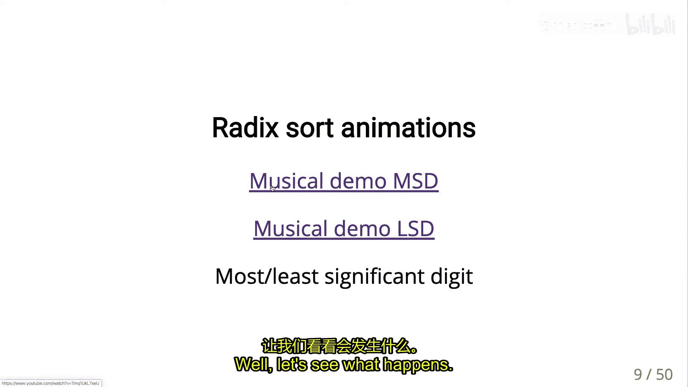

I you probably can use a sound on my computer。Ohです。So I guess I'll help do that。

Make sure what's wrong with the。With this thing， well。

 I wasn't working the last time so I have to assume that。And these sound is not working。

Let me just see if we can。we do the HDMI thing。Okay， so I guess the sound is not working。

 so let me just try to give you the sound of my computer。Not as great， but。

Actually with the mic here。Make workout to be pretty loud。Okay， that。🎼The sound maximum。🎼Well。

 the cell is naturally not。이거。个。な。哦哪玩。は。我还有一项。Okay， and when you do radic sort。In here。To play。啊。可。

🎼We ready for。ま。は贼。🎼我な。🎼biggest number。🎼Thank you我。Ste， the lowest significant digit。

🎼So here this one is sort of easier to bump ahead to basically。🎼Yes。🎼必须你。My kids from Northea。我不个。先に。

下一。🎼But you not。Thank you。We start this。But basically， when you start。

You know everythingSo nothing is sorted and then just keep going like this。

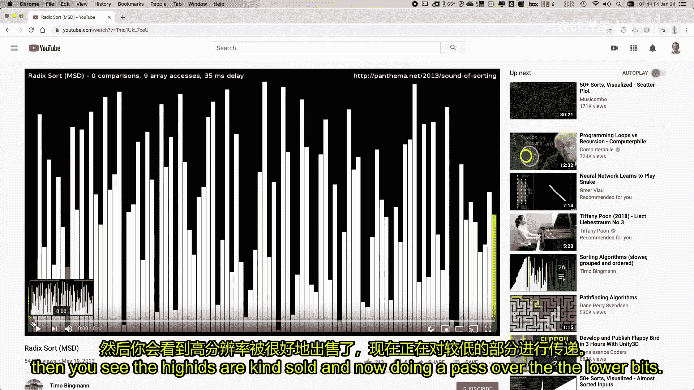

So after a couple of passes， okay， like right around here， for example。

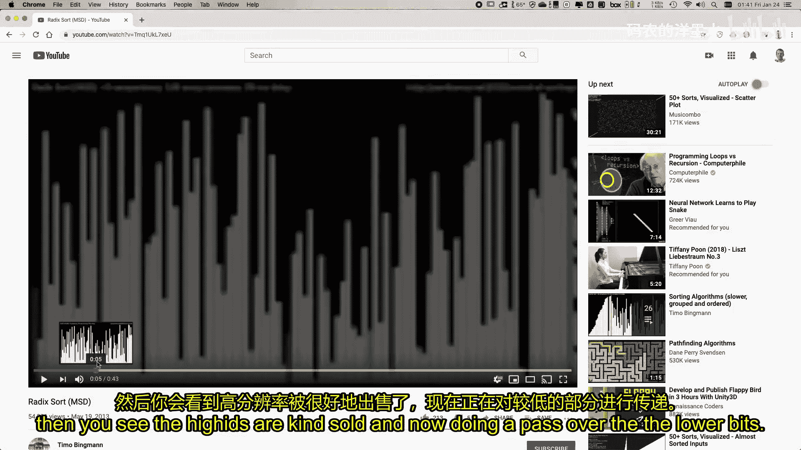

Then you see the high bits are kind so and now you're doing a pass over the lower bits now the trick is the soing is socalled stable so basically if you have two numbers sort of equal in input the output。

Maintains the same order。So essentially， what this is saying is， for example。

 if you at all the numbers in the high bits， and then you sort according to the little bits。

 then the guys who have the same high bits。以降 for the highway。We'll sort of stay together。

At the next pass， but then on top of that， you do a sort on the little bits。

So this one is sort of easier to comprehend。Okay。So 3 one。But yeah， he。ど。你个人？

This sort on the mors inside。你就你就这。The bucket。

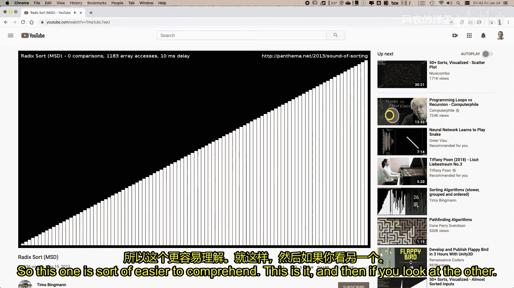

So this is it。 And then if you look at the other。

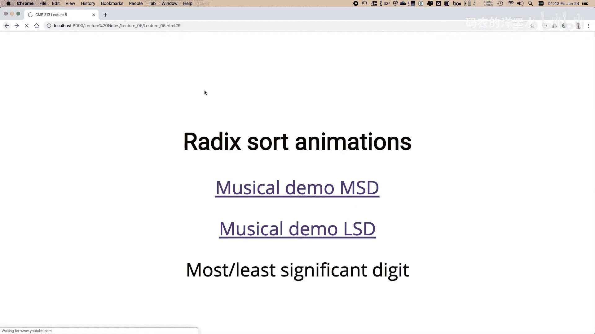

So第 other个问题是。Le significant digit so this one is actually way trick to comprehend。

 but it's actually easier because you start by sorting with the lowest bits and then you resort with the next set of higher bits and so on and just keep going like this。

And。And right， and so just you keep repeatating this sort。

 so this is basically what you're doing in the new homework。🎼微。🎼す。그 소리 by 팔 말 그 했。And for example。

 you can see how now you have you know。Well it's actually very hard to see。

 but you could basically need to ignore the， I mean it's physically possible to move。

It really make sense of this because really only at the end when you saw the high dates。

 you actually see。🎼，🎼。So for example， if you stop here， can you make sense of this？嗯。Well， yeah。

 so what's happening is basically these numbers。Being sorted on the low bits。

Are nearly equal except for the high bits。Okay， so this is why you have this huge jump。

 which is basically modest and overtuism to make this。啊，按确认的。그 나이 소리 하。

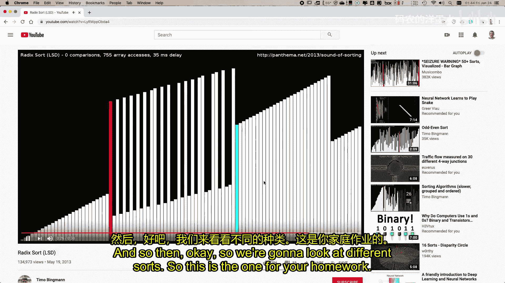

あ？呃。

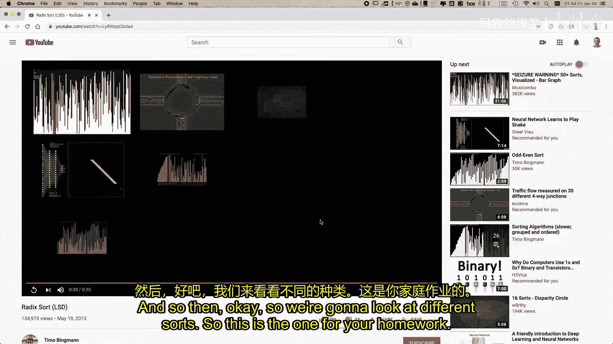

Okay， so we're going to look at different sorts， so this is the one for your homework。

so there's a number of classical equal sorts， so number one is quickword， number two is merge sort。

 the quickword is probably one of the most famous algorithm。

I know exactly this is the most widely used。Typically。

 the fastest algorithms are a combination of different strategies。

Quek sort merge short and maybe other sorts that you combine at different stages in order to really you know get high performance。

 So quick sort is doing is actually。Very， very fast， very， very good， it has a bad worst case。呃。

Worst case situation， I mean it depends on exactly what sort of quick sort you're looking at。

 the basic quick sort is a very bad worst case you can improve， but Jersey， for example。

 in the vanilla implementation， if the input array is already sorted， it actually takes10 square。

Verified and sort。That's really that whereas the most per raised the cost is just end log N。

 so the idea of quick sort so anybody familiar with a quick sort you can raise your hand。Okay。

 so we maybe have yes so。The idea is actually very simple。

 although the efficient implementation is more challenging。

 so you just pick more or less a randomdimentary or you can be more clever。

 but so it can be the first one， the middle one， last one know。So you begin an entry。

 and then the first pass is just you going to go over the data and simply separate all the points that are。

Lower than the entry you picked。AllThe entries that are larger。

 occasionally you basically just get two groups。Okay， and then you're going to take each。

 so of course all the entries in the first group are lower than the entries in the second group。

Because you're all either small and material or large in the material。

 so now you each sub sequence and just repeat the process until everything is sorted。Mind you。

 that's actually a very good strategy for humans。If you have a pile that you're trying to sort。

 it's actually a very good strategy。You want so papers going to grade。

 you pick the first paper and then just make two paths， you know that grade。

 higher the grade and just UPP， so it's actually very good for humans as well。

The merge sort is rather terrible for for units， but this one is actually quite equted。Okay。

 so this is an example of a strategy here。So for example。

 the pivot is shown in blue and different so nice thing is the sort is done in place that is you do not need special temporary storage。

But sorry， right？Work with the original storage this is very important。

 mergerch sort typically requires or this vague sort extra storage。

 although again you have more efficient implementation not do that but。

More complicated so the basic implementation requires us to storage， but here not the case。

So you start some three， and then you want to look through all the entries and separate on the left。

All the entries lower than three and on the right， all the entries larger than three。

So I guess the first example is going to be boring because somehow feeds the smallest entry。

 so it's already done。Nothing so actually that's going to very good actually。

 So here you have two subequences except that one subequence is basically just three。

And the other sequence is the original set of numbers。

 although actually this case is actually interesting。Because you see you。Well。

 the first step actually didn't do anything。Right。Isdu。

But it does require n operations to make sure that all entries are actually greater than three。

So this is how you get the worst case scenario scenario， you can see you're already sorted。

Then three takes n operation， but the next step will take n minus1 n minus-2 n squared so's completely silly。

 but know that's the worst case scenario so let's look at 156 which is kind of more interesting so this one。

You know， actually just takes， so you have to keep looking until while blue is 156。

 so basically it takes four stages， more less。So what's actually shown is a number of swaps so you're loop through your entries and you're looking at whether you're encountering entries that are lower than 156 the first one56 okay that's fine over on the left then you look2 or5 that's greater 93 is lower right so you need to be on the left of2 or5 so you flip and then you just keep going until you hit actually towards the end1。

26。 and then you're going to flip it with2 or5。 Okay， so you end up with this126。

And then I think you're done。So you don't have to go。No， sorry。It's a question about。Thisization。嗯。

So each row is a step in the process well yeah more or less。

 I mean it's not exactly a stand because for example。

 the second row is actually checking all the entries but basically nothing is sort of happening so there's nothing individual visual so for example。

 every swap is basically creates a new group。Because you have to do it in place。

 so you have to be little careful。How you do it， you cannot just loop and write out。

All the entries lower and all the entries greater， if not do it in place。

 so you traverse left to right and you do these swaps in order to get the output you want so you have to record。

 for example， you know the way for example， 126 goes here is because I recorded。

Then two or five was the beginning。Of the larger than section。so when you encounter 126。

 then basically you move 126 to the instead 205， move 205 instead 126 and then move this pointer for the larger than section one more so if you encounter another entry small in the pivot you can swap again and so so there's a bunch of counters that move around like this。

To see where this web in Sweden。And you don't want to swap every single entry that's lowered。

expensive。No， that's right， every time you encounter lower then there's a one。

And it doesn't look like 156。56。Okay， all right， so that rule is different。

That rule is actually you're done。😡，With that sorting， so to speak。

 but you have to place the pivot at the right location。

So actually the 156 is then swapped with the last entry in the lower then so that now it's in the right position。

LikeBecause the building is supposed to be in the middle。So this is what you're seeing here。

 and now you've done it。AndNow here you're sorting the left and here you're sorting the right。Roe。

 for example， wouldnn't I expect 156 to be swapped？気セ？And now， 126 is swept with1。

I don't spend much time on that， but 126 is， no it has to be， 126 is smaller than 156。

So the way it works is you look at where the larger events section begins， it begins at 205。

And you always swept with， you know， so any right here。

So you have the lower than section and the larger than section。Okay。

 let's say here you find a lower that。Okay so it's in the wrong position。

 so the way the samp occurs is it goes like this， you take this one which is a larger than you put it here so that's fine。

 you take this one which is a lower than you put it here and essentially you move。

That love by one or you brother。The pointer。You knowTo the leftmost entry in the larger than just is implemented by one。

So just keep going I this and so that entry keeps being bumped to the right pretty far。

 like who cares， and then you just keep insert the lower then。Like this。You get the I understand。

 I don't see。How that visualization implements that fire。ok k 啊。Yeah， al right。

 So maybe I can be asked to have to that。 So supposed the visual iss showing you that。

 But maybe this is not working。 But， you know， it's actually the red entry is。😊，So。

RightThe red entry is basically the entry is being swapped。

 so 56 there's I think this is already on the left。

 then the 93 is swapped with2 or5 and then the 126 is swapped with the 205 and then the 156126 are this is positioning the pivot。

And then就。呃。Yeah， I guess the only line that's vaguely suspicious is the third one。

Here you just weak the first entry and in some sense， you're not doing anything here。終。All right。

 so this is I want you this is thevis code。So I'll just kind of know。go over that quickly。

 but so basically just traversing your array and wherever you find that you have a lower dimension entry。

 so swallow did it。Whenever you encounter it， then you swap it， we。Sort of。

Greater than location basically。This number here can swap it and then you increment by one。

And then here this is basically inserting the pivot。At the right location。

 and then just repeat the quick sort with the left and the right。So okay， so guys。

 I show you more of these animations to the fun。So it works very fast。

 this is why this is kind of a preferred algorithm。

 no additional memory relatively easy to implement。But it has a very bad worst case scenario。

 although this can be this can be fixed。 So there's a bunch of So there's basically， you know。

 different ways of doing this， and they all very。

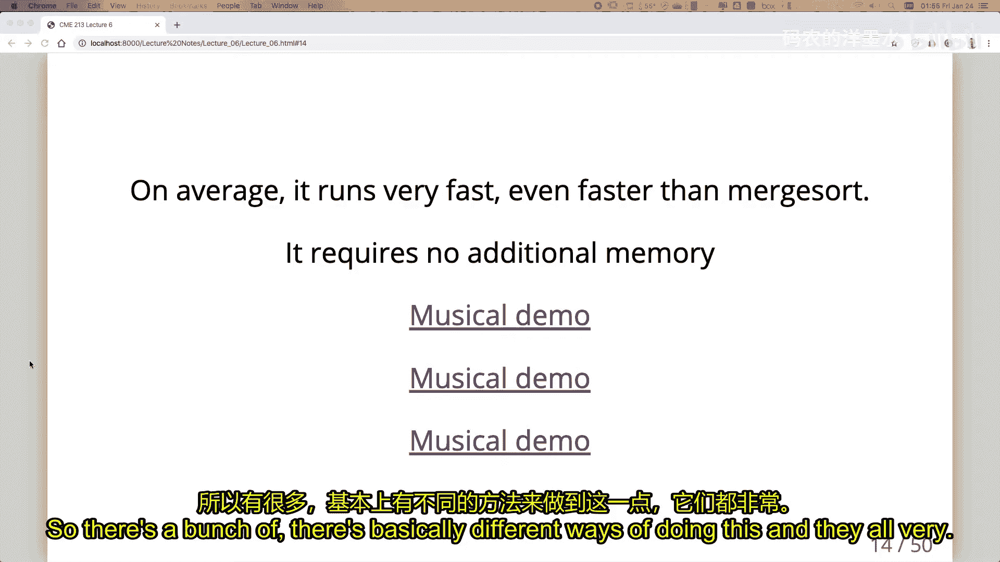

By how。How are you doing the swapwas， Okay so like which pointers you used to do the swaps。

 So here you using less pointers is basically what it is just described。🎼Where， you know。

 you keep going。🎼Please find that you lower in the Ps。🎼You what。🎼And this is noting where。

🎼You block start。Boom so here you see here you get all the entries lower than pivot。

 larger than pivot， and then you restart again here so this is the pivot and here this is the beginning of the greater than and this is searching for the lower than and just keep。

🎼So this one is basically， which way is Spain。🎼They sure pivot。

🎼So it's you can see because you allow you actually sorting sub sequenceences。🎼Thank youそ here。

What you're going with the next side？🎼Then you semi my story with the rest you。 and now you need to。

🎼You get all the sun。🎼S。🎼down。じゃないです。No always satisfaction when it finishes there。

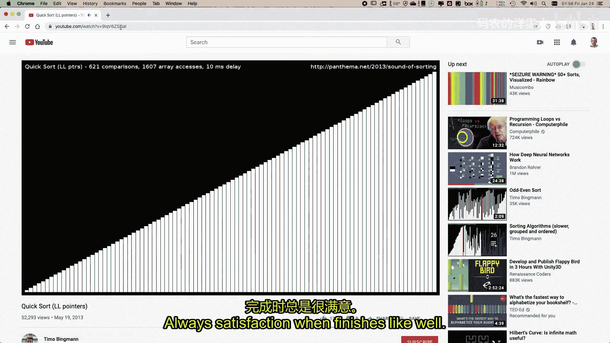

Sees like， well。

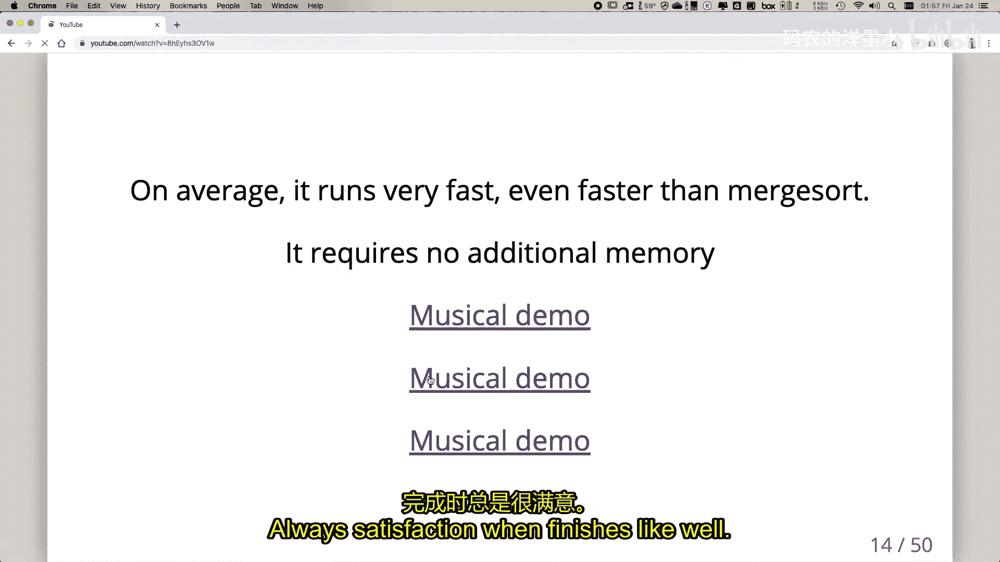

Okay， so this one is basically modest the same thing。🎼Using printerers。🎼the right idea。

🎼Right left and swapping whatever。这个这个。🎼think in the middle， Okay。

 which is not the sad but kind a choice depends on your options you distributed。🎼But。

🎼So makes more sense in this context too。 But the strategy otherwise the same thing to just basically doing the swaps in a different manner。

 but the strategy otherwise。🎼Exactly。🎼see。

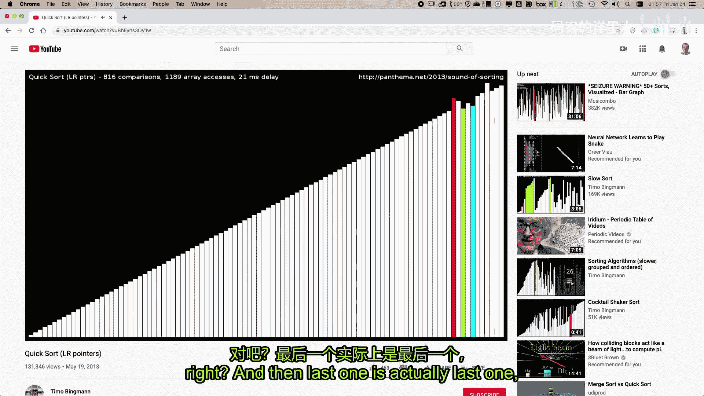

All right。And then last one is that is actually last one。

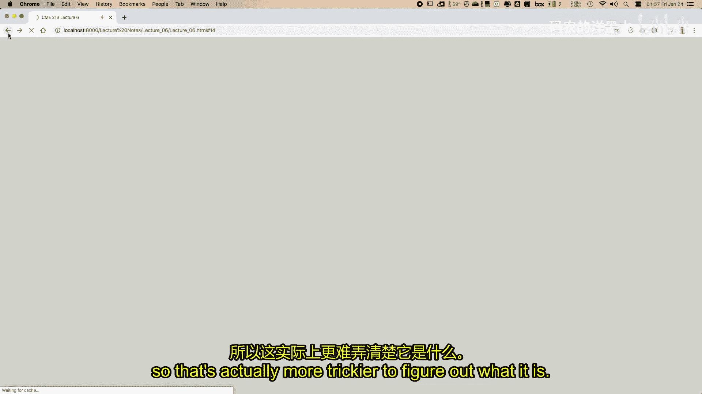

So that's actually more trickyier to figure out what it is， so this one is sort of special but it。

🎼Okay。Actually quick sort with basically less than right pointers。🎼短 you。

Opttimization for the case where it。だっしる。ついてな一個作程ばす。🎼你知道。🎼These are the yellow entries。

So when you start， you see these。I said were distribution in X cubed。You know。

 to me to get a lot of course in the middle。But you can see here， for example， when you stop。

You can see how all the guys equal to the pivot， you accumulate at both ends， well in the middle。

 the other pointers look at this strictly and as strictly small and strictly greater than。Qu宣对。

🎼So what that the the as before。🎼是我提交。🎼Equal inserted in the effort。

 So this is a good strategy when you have a lot of equals。And then insert。

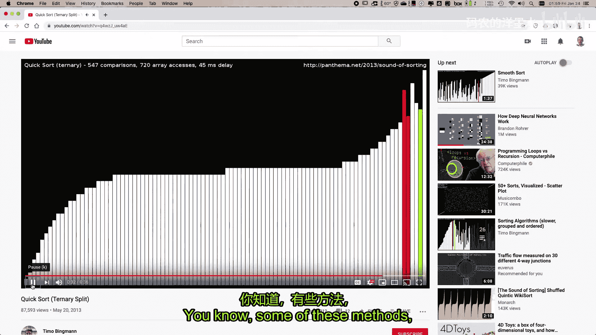

If think about the properties of your distribution， some of these methods， if you have some trends。

 if things are not completely random， but there's some trend。

 then some of these strategies are superior。Okay。All right， so like I mentioned， n square and so on。

 so this one is' not stable if you look at the elements that are equal。Typically。

 they can be reshuffled in different ways， right？You have variances that have to make。This。

It's really。Easy to see。So this is showing how to。Oh， wow， this is， yeah， this is。

It's not that great。so this is showing how you would go about doing a quick sort in parallel。

 actually， a lot of these ideas are going to be very familiar to。

The theique arere using in homework2， okay， so all these methods。あ。You know。

 have the same sort of difficulties into the bad implementation so they came up with。

It come up with the same solutions， so here the idea is okay， so you want to do with Wig sort。

Okay and the way you're going to do that is first you need to select the pivot。

Okay so so you could say， well it's going to be the first entry in the array。

 so seven so if you're in shared memory， you don't have to do anything， okay so it has this value7。

 maybe you make a local copy or whatever， but maybe knows the P7 and so you then take input at the top。

Subtivide across a different course。And then simply each core is going to do a quick sort or' going to do a lower than and the greater than on just a subset of the entries。

So you get the gray and white。And so then next step is to so this actually show on the next slide。

 next step is to then have a global big arrangement okay so this is similar to what you're doing in the homework tools so essentially this can be9 parallel except you need to know each thread needs to know where to write its gray and its white entries like what's the starting index so theres you again some histogram and some scan that need to be done。

But then you know essentially after that it's just a repeat okay now you have the less subsection。

 write subsection， so you sign a subset of the course to each subsection， you have a pivot。

 you have a local quick sort， and then theres merge between P0 P1 and P2p54 and just keepPP。Okay。

 so as you go you know lower in the album， it becomes more and more parallel。

 for example here each core has it well we not。Maybe not exactly here， but okay。

 towards the end here， you know each court has its own subsection that is sorting and things are quite fast。

So what difficulty you see is that in Greeks story。

 it's very hard to control the size of these subsections， it can be super andeven。

instance there's a load balancing problem， so basically every time you have some of these subs sequenceequences you need to figure out how many processes to assign to each subsection。

 and this may lead to load im balance， for example here， only two and three still have work to do。

 the others are done at that stage， so there's some load balancing issue。

And so looking at just the first step， which is going from local to global rearrangements。

Okay so here is basically where there is a difficulty。

 but this is again just exactly like in Ho War I， just a question know in Ho War I。

 you have the local histogram， the global histogram and the scan so here it's the same idea just want to figure out where you should write your entry So for example P0 has72 goes here P1 just as1 goes here P2 has 6 goes here P3 34 P4 spot So for example looking at P4 the only thing need to know is whats the index for its own entry。

So basically all the processes just count how many gray they have， how many white they have。

 so this is how many gray they have， how many white they have， you do a prefi sum。

Okay so this is actually exactly where you need to write your grade， index zero， you index2， index 3。

 index 4， index 6， the last one is skip。And this is actually where you start the white entries。

So here you have a pretty sum， so you need to add the seven case it's not shown here but you know。

At the seventh of the 7 plus0 is where you start writing the first white。

And center2 is when you write 17， which is the white。For P1。And then P2 is 10。SinceSinceよ。And you 12。

7 plus8。so诶最近之道转路。There's a little bit of good keeping。Then you can make this nice and pale。

 there are a couple of steps that are tricky for example， the prex sum。

But it's not too bad because the prefix time， you need to do this on basically P entries if you have P cores。

 so it's independent of the size of the array N， and prefixt time is a classic algorithm that can be accelerated。

Fastest time is。It's basically lock P passes。So you， it can be done pretty fast， but in practice。

 on multiple processors， you don't have that many cores or threads so you can just have one thread you will prefix them and this goes extremely fast。

On GPUs， it's more expensive and we have do report therefore， but here this can be done easily。Okay。

 so let's move on second。Second。So second is merch sort。So merger is actually conceptually。

Its somewhat simpler algorithm。呃。It's。Yeah， for humans， it's not super。

you know easy to use but for a computer you know it works pretty well and so it has actually it is in some sense slightly less efficient than Quick sort。

 but you can avoid this worst case scenario right if your vector is already sorted。

 essentially merge sort is still an log n the cost is basically。More less fixed。 So it's very。

 very fast。 So the idea is mature is very simple。 It just consists in observing that if you have two sequences。

Or sorted。And it's relatively easy to merge them into just one bigger sequence that is sort。

And the idea is。So works as false so let me just show you on this example here so initially you basically don't do anything。

 you just split your input into a binary tree so it's basically a recursive call and then you get to just very short vector so it could be here one or maybe just a small vector actually you could use another strategy to sort these small vectors but here you going down to just one entry so of course one entry in some rate sort there's nothing to be done here and now you reach the mergech step so mergech step is basically the first step is just to grab the mean and max at these two entries。

It's just kind of trivial and then you want to do merge here。

 so the idea of the merge is you have two pointers。That are going to be moving。

And you decide you know what's the minimum okay so you find the minimum is three。

 okay you insert and then you move by one， okay the minimum is 27。

 you insert and then you move by one minimum is 38 you insert and you're done until last time you so basically there is two point and you keep moving。

And each time you pick the min， you insert， and you move that point by one。

Just keep writing the minimum and eventually you have merged all the entries。

 just keep going until everything is sorted， so you see it's very。It's a very nice sort。呃。

Well it's very balanced because the thing is very regular， right， it's basically well。

You give by close to one。It's sort of a perfect binary tree here。

And so we get this nice animal again and so on， so it's quite efficient。So， can I show you the。

There music here。

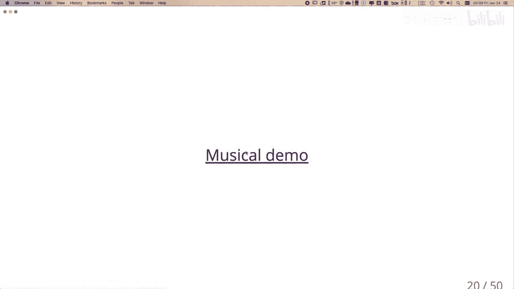

🎼准备先进你先。Its also in the race and then merging by using these two point。another。🎼blow。🎼Goい this。🎼。

Right， so right here。The men Max， min Max and so on。🎼我的你。🎼So when I showed to you。

 I was being dump barn here， it's more like。🎼same。先微点。Yeah。Yeah。🎼So yeah， that is sure where exactly。

联系。So this is kind of a visualization thing because technically you guys your movie and this is morning。

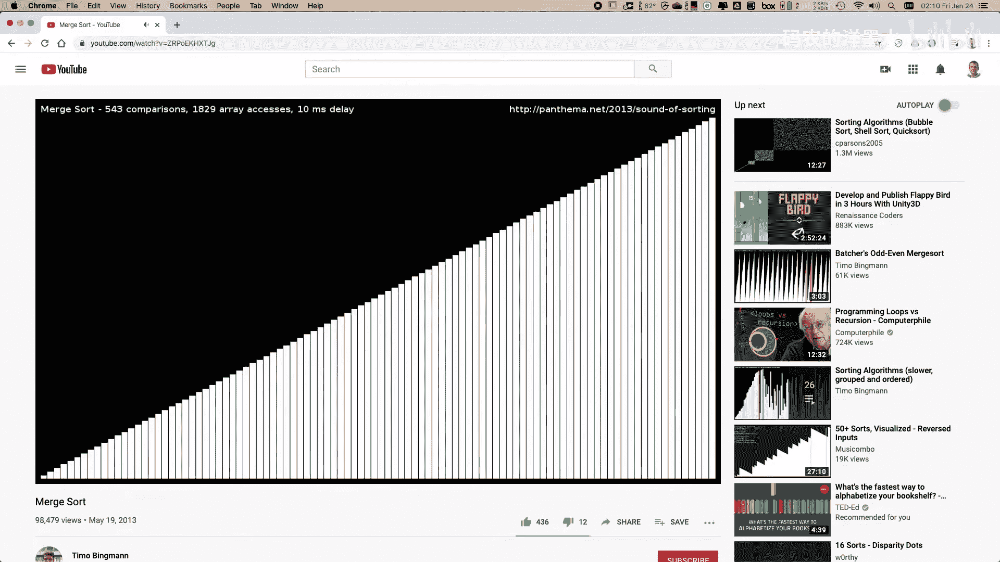

Okay。Oh yeah， I know what's happening。

It's yeah， because it's basically there's there's probably a problem with being in place。is you know。

There's a trick to making it in， which is following out what's shown here。

 and so there's a copy of the vector。Might be what's happening。

 So that's why you it's sort of doing this in two phase。

 It's actually doing it first and copying somewhere else and then just you know。

Showing you the result。Okay， so anyways， all right， so this is merch sort。

 so merch is actually a very tricky business。If you think about it。The the merge。

Its very nasty because merges a completely sequential process， right， you move left to right。

And how do you para this， So start initially you work with a lot of very small sequences。

 okay you just read the sequences， you have a lot of mergers， a lot of trial work。

But towards the end， you end up with these very large so blocks that need to be merged。So imagine。

 for example， that at the end you just have two solid subsequences if you want to emerge。

 or in principle， you have two pointers that need to move。

And it's not obvious there's no obvious way to realize this， so there's a trick。

 it's not a perfect trick， it's always a trade off。But the idea is， basically。

It's actually basically type of。of quick sort a little bit。

 so you're going to take one of the subences， so let's say here you're trying to merge T1 r1 with P2R2 so this sort the gel merge。

 you know where two subequences it's a location in the array you want to merge them。

And the idea is to do a little bit of quick search。

 you're going to pick the left one and you're going to pick a random。Entry for maybe the mi 1 x。

So now having picked x， there is a fast algorithm here to find out。

 basically like a log n algorithm to find， because this is sorted to find where is x where the lower than x here and the greater than x here。

Okay， so this is fast， so just log n here， actually everything is still sequential， but it's log n。

toable and then after that now you'll find because you know the lower than x can be merge with the greater than x and'm sorry the lower than x here can emerge with the lower than x over there and then the greater than x can be merge with the greater than x the only thing you need to know is where this point is but since you know how many you lower than you have then you exactly where to insert this and then you can just do this is a sequential merge on one core。

 not a sequential merge in another course you can have the two course just working so。

So that's a good strategy， obviously it depends on this thing being balanced okay so for example。

 if this is split in exactly two then you're fine， but if this is super uneven。

 then it means that what of the course is going to be done fast the so you always have this type of tradeoff。

So the performance， you have， again， the worst case， the best case， the average case。

 and you may have then various optimizations kind of around that。Okay。

 and so just to sort of wrap up。So just I'm just going to and then I want to move to the exercise of the byythgon sort。

 so you have a variant of rads， which is basically bucket and sample sort。

 I'm just going to go quickly over that， just a sort of illustration。

 so bucket is basically just a variant of rads。It's not the same algorithm。

 but it's kind of the same spirit。So the idea is it's actually even more simpler than。And we。

 let's say you want to sort integers or you want to sort floating point numbers。

So when we worked for numbers。If you need variables。And you need to know the smallest and largest。

Okay， so some。Some stuff to be done there， but let's say you know what the smallest and largest is。

 so you're in this interval AB， So now what you do is you take AB。

 you're going to spin into P sub intervals。Then similar to way sort。

 you can sort your input into all these buckets。Between A and B。

 and then you have P independent buckets， and now you just sort inside each bucket。So this is。

This is a strategy， so actually if you do the red sort。

You knowI could have asked you to do a similar thing if you do the most significant digits。

so what you have is a least significant digit， but if you do the most significant digit。

 then you can start this is basically same process。est largest bits sort into bucket。

 and therefore that its just sorting each bucket using the other bits。

 but this can be done in parallel where each thread does a different bucket。Okay， and so of course。

 the problem is， well， do how do you figure out？In an efficient group。Sa。Of buckets， if you have AB。

 you can split into buckets of equal sizes。But so his buckets might be empty and all the bucket like before。

 there's a lot of， again， load in balance because of the uneven filling of the buckets。

And so Spter sort is a strategy that tries to overcome that， basically it tries to figure out。

What are the optimal intervals？So it's actually interval such that the number of entries in each interval is about the same phrase it roughly and overP。

So the way this works actually not that bad， of course it's always a heurtistic。

 because you have to bounce you communication you know and the sequential steps with sort of。

Efficency， essentially the load imbalance。So what you do is so each core， which process starts again。

 as usual with the subset of the entries， and then the first step is just figure out what these intervals are and after that it's basically just the regular bucket sort。

 And the way to do that is well each process independently figure out their own intervals so that it spreads exactly equally so for example。

 p0 you three entries in the first bucket， three entries。

 second bucket two entries at the end here 3，3，2 here 3，3，2 so3 33，2。so you find the socal splitters。

 but these entries here such that your inputs are evenly split across each interval。

And now so these are the local splitters， but you want global speakerters。

 but so the idea is we're going to actually collect all the speakerters that you've compute so far and split that again。

 and hopefully this actually works reasonably well。

 so you gather all the Spters so now you have the number of entries here so maybe you have P sub intervals。

And so like P， you know these sections， and then P buckets。

 so maybe you have P square entries roughly here to now。In all those entries again。

 you look for splitters and these are going to be the final global splitters to be used so once you have the final global splitters。

 then you go as before， so everybody just sort by bucket according to those splitters。

 and then you do the Stogram and then you do global rearrangement， you create P buckets。

And then once you have everything sorted into this P bucket。

 then each process works on one bucket and sort within its bucket。

So just a variance of sort of ras and。嗯。And buckets sorting。

 but where you sort of optimize the choice of intervals。Okay。

 so basically this sort of wraps up sorting algorithms and the last one is going to be the pythonic sort。

 and that's the one that's going to be working on a little bit here。

How are the samples selected in this case？7。You mean the the  age and 17？

Which shes the local samples and 7？So 770， basically here P0 is going to。Well， it's it's you know。

On the face of it， it sounds pretty bad， but in parallel it works really well。

 so what you do is you sort your own entries。And then once you sort your own entry， essentially。

 you look at index 01，2，34，5， so  two and 5。And these are your sps。

But the point is this is sort and is expensive， but this is completely parallel。

So this goes presumably fast， once you have your splitters， then you collect。Okay。

 and then you split this again， so this is a sequential step now。

You know that picking those global spins is sequential， and then you the reuses that。这这个样。

So you select this。AndBased on that。So you select local scters。Assemble that。

 you know these are all the nople Sps。你你写呢。It's leaders for that group。

And hopefully those theaters are good for the original set。

These noble speeds split evenly in each noble set。And here， you know， obviously speak evenly as well。

 but you're hoping that  eight and 17。So you want to split into three groups。Like lower than eight。

 lower than 17 and the rest， and you're hoping that these three groups are even。

Because you know' splitters and then splitters the spters。But then the IRA was initially distributed。

D processors， it was already being distributed。Yeah， right。 And then the one just。

So you want a Google sort。sorry， so what would your question so like in the first step。

 the average already distributed among processor right？French， right。So when。

 when we want to choose global splitters， do we want to again。

Do we want to make that distribution uniform？Do you want to actually sort it like why are we doing the global splitting set and the average already is split。

あケ。Okay， so all right， so the first splitting is perfect。Why。

 because you take n entries and you just divide into P groups Okay so the first thing is perfect so what you want is you need to come with you know P buckets。

RightAnd each bucket corresponds to given interval and so the sort of first step in the algorithm is to take your input。

And put it you know all the entries in the first bucket， second bucket， first bucket after that。

 you can do independent sorts right actually the step is sort of。Not shown here。

 you do an assignment and sort so here you have the found result。

So the question is the first bi of course is completely even because you do just n over P。

 but you need to figure out the buckets and the splitters so that is the problem okay so now I take 817 so now once you pick those splitters 817 then that entirely defines the buckets and now those buckets are not actually equal right they're no longer n over P hopefully they're close to n over P so I didn't count here。

So they're pretty close to seven， so here for example， it should be seven， but you have two more。

And then you know 23 so here there's one more so they're just off by one or two so they're almost exactly even。

 but for example know the initially Pi zero had eight entries here only seven so you see' just slightly that but of course the key thing is once you have know things inside each bucket then you can sort independently again in each bucket and the final result that it's completely sorted。

So for example， if you look at the result of the first step。

 well you sort it in each sub sequenceequ， but because you didn't use this idea of buttic and Sps。

 it's not a global sort。So there reason to be that。Okay， so let's talk about bionic sort。

 so ponic sort is a very interesting。And you know we'll do this little exercise。

 but you know probably。Well I I to finish。But the biing sort is。嗯。So it's。at some level。

 it's a little bit like the mergech sort， so the merch sort was also had this very regular process the quick sort was very irregular。

 because you get the subsequences a different length and all very regularly。

Merge sort was more regular， but when you merge， know you still have these point that were sort of moving about to different speed and so on。

And sorting networks。I's a different idea here， the sequence of operations。Is always the same。

 so the way you're accessing data is completely deterministic。Okay so in mergers for example。

 you had the pointer to move at different speed， so here no。

 the pointers you always do exactly the same operations， you always wait on the same error location。

 the same order and so on。Sos this can be advantages for many reasons。

 so actually it was shown in a paper as we have call GPUs because it was such a regular calculation。

 it actually turned out to be very efficient， we a bit of valid because the original algorithm is actually not。

Re optimal。So they had to make some changes to improve the performance that broke the regular。

But so still you know it was very fast ins， but an interesting thing is because everything is completely fixed。

 you can actually build hardware， like fixed hardware that will do the sort so if you have a small you know sequence of numbers that need to be sorted really fast and you want to build special hardware for that then you can do this because the flow of data and pattern is completely fixed you can optimize you know the communication and so on you get super high performance so this is sort of very special so you know。

So this can be the fastest for this reason， and the only operation you have to be doing is compare and exchange。

 so basically you're going to take two numbers。Duper Maron。

IfA is more than B do nothing otherwise just one Okay is compare extreme and this is so this is the beginning that you're doing and now then you're going to apply a series of these cos。

 but the sequence and。It just became very always fixed， completely fixed。So it's very strange。

 there is absolutely no it' completely dependent of the input data， but nonetheless， at the end。

 everything is nice and sort。So this is just showing you that you get very high performance。

 so if you're interested in the staer， GPU sorting， it's comparing byyononic sort。

And they're super optimizing with another vitamintanium sort and this is a sample sort。

 I talked about it， this is a quick sort， it's actually not that good because this loading balance I was talking about。

And then they see thrust merge sorts and merge sort and the warp sort whatever of thatuce。Of course。

 it completely depends on what sort of input you're getting。

 I mean you can make quick story very fast or very slow depending on the type of input you hear I assume that it's completely random input but。

But so by the sort， if it's so regular， it was very good fit for GPU。 So mathematically。

 this is a very beautiful concept。It's highly nontrial and it's very hard to comprehend that just completely this deterministic sequence of operation actually can ni to a correct sort。

 so a basic concept is pyonic sequence。So you have different ways you have more less general definitions of byyonic sequence。

 but for just this application， the definition is that it's a sequence in which the first half might be increasing and then the second half is decreasing or vice versa so you keep。

Having to jump between these two。 So， or they descending。 and then second half is a sense。 So yeah。

 this concept of pyonic sequence。 Okay， and this is what we're going to be to be using。

 And so here's the key thing。If you take a bitonic sequence。

There is a very simple process of compare and exchange this cox。

 theres simple process of cox that will transform this vitalomic sequence into two。

Sequences where the first sub sequenceequence is smaller than the second sub sequenceence。

 so it's not a perfect sort， you can end up with the input is say a icononic sequence and the output will be two byonic sequence。

Where the left half is always lower than the right half。

 and then you're going to be repeating this and so on different ways to sort out。

So this is how it works， so you can， you know if you interested this and how did you take the pen on paper and sort of verify that this algorithm is correct。

What you do is I can compare。So what battery compare does is it takes this input in byythonlon in sequence。

 okay？And then it's going to output two sequences。That are both binic and everybody on the left will be smaller than everybody on the right okay and so the first half。

It is going to be taking this min and the second half is going to be taking the max。

Okay and here you're basically comparing the first entry and the middle one。And then next entry。

 next entry and until we reach one before middle and last。

So now you're doing min Max and so on so you see how beautiful this is。

 it means you go just left to right in the array and you if this is one that then do nothing。

 otherwise just swap okay that's basically with the min Max here is going to be doing and so you have two pointers that move starting from zero and n over two just keeping cementementing and if you're greater than swap。

 otherwise do nothing so it just is comparing swap that youre keep repeating。

So here is basically the diagram that explains it all， so again you're going to start like this。

 so 2。0 is one it 01 and over 2， you're going to take the min。And the max here， okay。

 so basically you swap。If you know this guy is small in this guy， so initially there's no s。

 but then what's happening is you're moving to the right。

So imagine you're moving to the right and let's just look at the min。So here it's just increasing。😡。

and here it's decreasing so when you start， you know so let's say that the red is min when you start。

But this guy keeps increasing so at some point they might become equal。😔，And when this happens。

 the one the less keeps going， the one the right。Keeps shrinking okay。

 so you see that you know when you do this myth。You will keep selecting from the left。

 and then at some point you'll keep selecting from the right。Okay。

 and this change happens exactly when you reach。A point where these two numbers are equal。

And because you're doing this mill， it means that all the guys on the left are going to be small and this equal。

All the guys on the right are going to be greater than this equal okay so first of all。

 you know everybody here is smaller than this equal value， everybody here is larger。

 so you have sort of partially sorted your input and moreover if you look at the pattern of things。

Then you can convince that here it has to go just up because basically。

It has to go down because basically comes from this guy here and here this is the max so this is the reverse。

So you're gonna to get two sort of。You know， opposite。Byonic sequences， increase decrease。

And then the increase increase。 So you get these two sort of opposite tionic sequences。

 and then they're sort of partially sorted Okay。 So this is the compare。AComp step。Okay。

So that's that's it。 So two byonic sequences left is more than white。All right。

 so the details of the algorithms are quite complicated。But at some level for the exercise。

 you don't need to understand really all of it， so I'm going to give you some code and so on that has most of it already implemented so you don't need to understand all the details。

 but the idea is to be to work as follows， you're going to start with very small byonic sequences so initially it's。

It just there's nothing to do because you just a vital sequence of just two entries。

And then youre going to take two bis， you going take。By the sequence of some length。

Then you're going do this compare so so this you're going to give you like the left byonic sequence in the right and you keep doing this compare again essentially the whole thing becomes sorted so you're going to get something that's going up and then after that you're going to get something that's going down So effectively what you did is you took two you were able to take two byonic subsequences and fill bega1 a begabyonic sequence out of it and just keep repeating until you're done。

So this is what this looks like。So it takes a while to kind of figure it out。

 so you start first with sorting up down up， down up down so is just to compare between adjacent elements。

And then you know so this is up and down， so now looking at those together。

 this is a bionic sequence。Now you do a compare so that you end up with two byonic sequences。

 but this one is small in this one and then you order within these subequence of size2 and so what you have now is you have a byonic going up and going down so this is a larger byonic okay so you see so with just two elementslets。

呃。And then so yeah， initially just two elementss， so then you have like4 byta sequence of size 4。

 and now you have bita sequence of size 8。And then again， you are going to compare。

 you get two sub sequenceequences， this one is small and this one get you sort。

and now you get this bionic sequence of length 16 and so the idea is you start with small bionic sequences and doing this business。

 you keep getting larger and larger byonic sequences until the whole thing is just sorted and each step here is basically log n。

And then you increase the size。😡，So every block， you have log n of these blocks。

 so basically log square n passes， which is super fast if you have enough computing units。

And everything is completely regular。So it's shown in this better because you can build hardware that basically does this communication extremely fast。

 you can figure out what sort of network and how to exchange data to make this super efficient。

 and it's exactly the same thing， no matter what the input is， so it's very。

 very special in that sense。Okay， so。So before doing the exercise。

 just going to show you that this demo pathython cloth， just skip that。

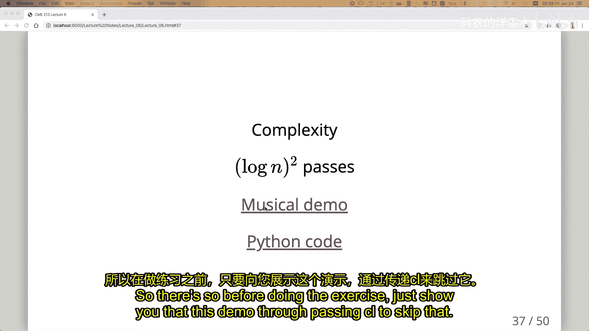

Because we going to do the SA fiscal directlyy。

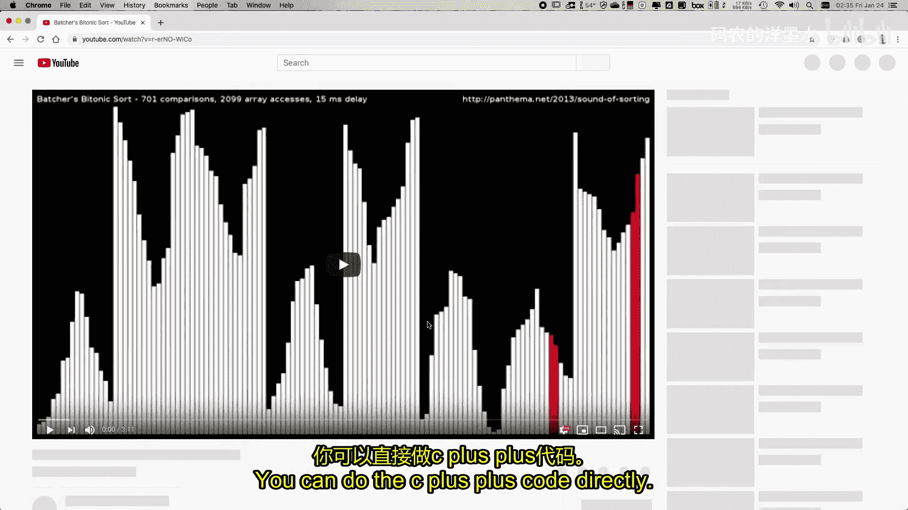

actually great。My in remarkable。もった。あ先。It's actually a little tricky to see。

 but this one is going up down and they want to actually go down up and then just keep going like this And so for example。

 you going to take this biic sequence and then you're going to sort it。

Take this byonic sequence is going to sort it， and then this is going to create a larger byonic sequence。

感じですね。う。And so this guy sorted now this guy is sorted to now this is a larger byonic sequence and this is a larger byonic sequence so you're going to take that one now sort it。

 so it's going to go up or down not sure and then this one sorted and then you're going to get this larger byonic sequence and so on。

て么。downown there。🎼We觉。三上。や是。老师这个照片然后一。And sword， which by telling secrets。🎼いそう。あ。So by the way。

 if you look here， you can see that you know。How this is sort of similar and different from merge short。

 for example， when you have a byy sequence going down and up so at some level you're dealing with two sequences that are sorted。

 so you you could do a merge sort if you wanted but the advantage of doing this is in the merge short again you have these points that move and so on in this regular fashion so in terms of hardware the calculation it hard to optimize because you have this uncertainty as to exactly how these pointers are going to operate whereas here in this log and passes everything is completely deterministic you always do the same comparisons of essentially the same memory locations because actual data vary。

连着里。🎼ど一せ。Thats the milk。St eleven。actually。

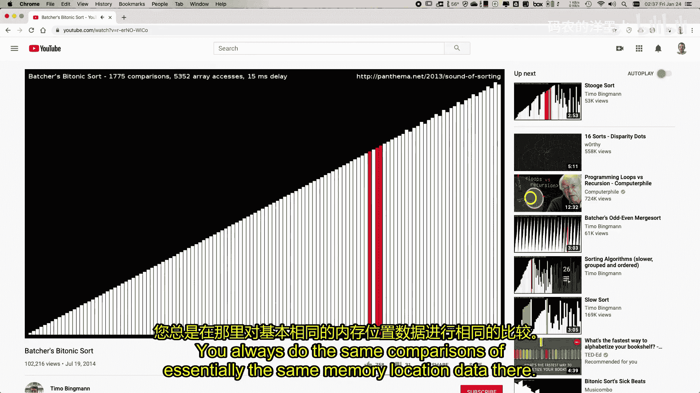

の。あ。こリズですか。Oh yeah， right， this is the same thing， but like way more。I don' get that。

 this is like way more。

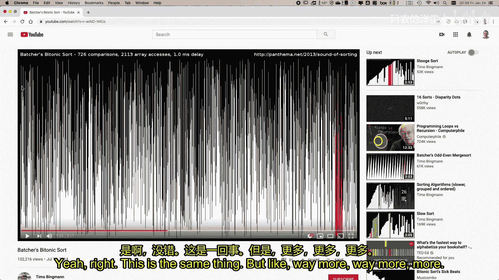

We more。Okay， so。So in case you nows can to open up your computer。Yeah， so okay， so。No。

body can my sense for this。Well， I put as many instructions as possible in the slides。

 so hopefully it makes sense。Well， I'd like you to at least go over the main ideas of how to implement this and then hopefully you can get started while the solution is here。

 so it can definitely work on this apps class。To see how this is done。

 so you have to start with Binic short lab。Okay， and you should be able to compile and run the code。

So it should work correctly， but it's not allies， so there's no openP in it。呃ok。

So just some information。Well， there is this option that。So by default。

 it's actually sorting a fairly large array because it's how you can get performance and see speedups。

But if you remove this end Dbug from the make file。

 you can be sorting a much more array and it will print some information。

 but at some level it's not super useful really for this exercise so you can keep this no debug option。

 I think you're usually be fine， but just to kind explain what this is doing。O。

So now if you can open up the code。Right。So， actually'm going to。Search， going to open the。

Toed right here， probably。I it just standard words it's。

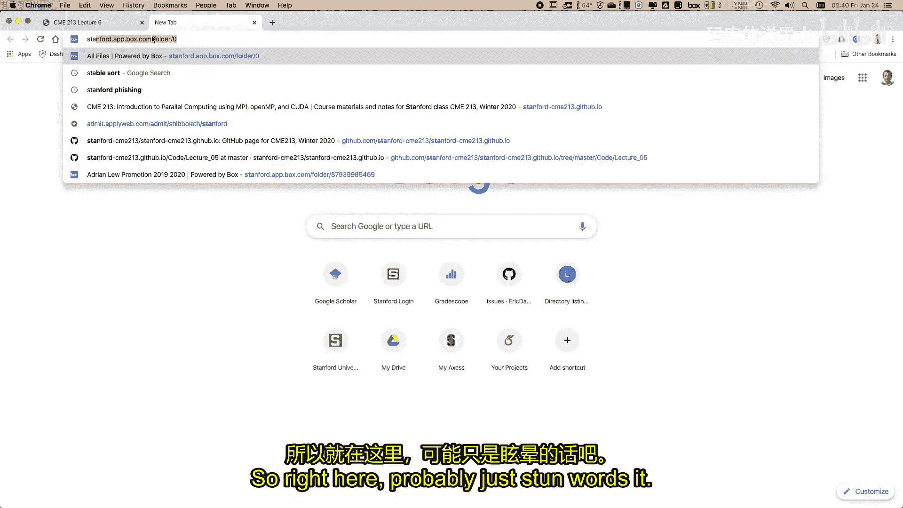

Tier。

So I'm going to open up the lab code and kind of show you what。We're talking about。

This is the that one。Okay，So it has actually a little bit of open peanut， but it's just a print。

the number of processes and so on， you know so it's just so you can vary the number of threads with this。

 so in terms of benchmarking and testing the gains that you get for multiple threads。

You can run your code with different exports。And this is just to check that。

 you know this is correct， so there's their own a printing number of threads being used。Okay。

 so here this will be used later on。Okay， so it starts here， so this is the first。The first bit。

And so the loop of eye is basically the size of the pyonic sequences you're playing with。Okay。

 so initially you start with just very small pytonic sequences， you have a lot of them。

 and as you go， you have fewer and fewer pyonic sequences。

And each by type sequence is being sorted independently。so for example。

 if you look at the so the eye look cannot be paralyzed。

The next iteration depends on the previous ones and nothing thing can do here， but the J loop。

That's independent。 So first step is to pre when people are four on the J loop。Okay。

 so I start with that。So you take the JOop and you add a prama when people are four in front of the JUop compile and that should take care of the first。

Step one， browse a Ju。So you keep the sequential bionic sort inside， but just put the pre out for。

Before the Je。So let me know when you have this working。So yeah usual you have to。

But just the meat file。Pture compiler， your options。Is this。Right， the lab file。

So the sort is the solution， the that file is the one you have to work with。Well， you can teach the。

だっとすぐし。But it's the first stepで。出だ。月 to 귀心い。More challenging。Yeah。would basically is very sequential。

 and you have to wait for the previous slide。呃 before going next slide现在。就是 the length of the。

Byonic sub。But the J is working older work in each byonic sub that's independent。

So basically can just do fragment with24。Good here。So you could compile it。It's just。Yeah。

 it's the first step， it's not that simple。Okay， so let's continue so okay。

 first step is just adding a prama1pR4 right here， okay， so yeah it's 44。So what's the problem with？

This strategy， Okay， Well， the question is basically how long is。The J loop。

 so me maybe zoom 10 a bit more。Okay， so the G loop goes some 0 to n， but it's sets by I。

So basically， the J loop is the。It's's it's operating on a byyonic sub， and I is a size as a sub。

 Okay， so're just jumping by I。 Okay， so this is fine。 But I keeps increasing。 You know。

 you start with very small subences。You keep multilying I by 2。 So J plus equal I。

 this is large and notous。 you have fewer words and fewer iterations。

 So at some point you're going to reach a point where you do not have enough iterations。

To keep all your friends of courserus busy。Okay， so what do you do， Okay。

 so now you need a different strategy。Plyzing I， parazing gene possible。

 so you're going to need to paralyize this bit here。

so what I want you to do is you're going to copy and paste this i loop。

And you're going to go from two up to chunk， which was computed previously。

 okay so basically you're going to go up to a certain size。With a million people L 4 J here。😡。

And then you got be a second loop the second time where you go from chunk。To end。Okay。

 now this loop is too small， so no prama here。Here you're going to call sort par。

 and then you're going to be working on PA to make that。如金不。So actually the par is already there。

 I mean it' just a copy of sec， so in some sense there's nothing in it， so you have secc。

 which is sequential sort。The PA， which right now is just the same thing。

 but we're going to be working on basically paralyzing PA。

So nice thing is basically the way this works is。That when the soup is very small。

It means you're working in very large chunks， so actually that routine becomes very per。

RightSo it's kind of one or the other。 Either you have many chunks and you can work on then perl or you have few chunks。

 but they're big。 So there's a lot of parallel work inside each chunk。

 Okay so so second step is you essentially copy and paste the eye loop。ok。あ、ベです。

Comp B Ilu in the first one。You a jobs so you keep。You going be buy a 4J in the second。

In the second block here， you're going to call the byonic R。Okay。So you don't paralyze the JU。

 but you call mag R in。TheC paste。So I don't know what to do with time it' 47。Okay we're here。

Maybe I'll just show you the。The solution can show you what this supposed to look like。But basically。

 I sort of。S be what needs to be written。So you have this IO here。You stop at chunk。

 and then just basically copy and pagee， but stunning at chunk times two。Up to end。

 and she was basically spinning the loop。In Juneville， part one and part2。

If you stop the first one stops at chunk， the second one， we start at chunk times two。

So this is what you's in here。Thanks we here at Cloud Mo andP4。Okay， so let me just of time continue。

So now we skip。Pring the Jelu。Okay， so Gop is just normal and sequential。

 and then you call byonic sort par。Instead of pythonic sort sequential so what's happening again is the GDPP is very short。

But。I here， which is the size of the chunk is very large。

 so there's going to be a lot of parallel work inside thatton Park。😡，Okay。

 so now let's go down in bionic sort par， see what's happening there。

I think for par it's actually the same assych， just copy it， but and now the iloop is very。

 very long， so this i loopop is basically doing the compare。And it's working with a very big choke。

Okay so essentially split length。Okay， which is basically n over2， or it's basically I in order。

Previous I over2， so it's the length of the pyonic sub sequence divided by two。

 so this is very long so you can just say pra PR4 because this is just a simple comparison。

 this is the coX operator。So this can be completely done in P， just looping through eye。

 everything is independent， and so you have plug IP4。And then once you're done。

 then so actually the original code。Just has these two things， so we can start with that。

That is the next step。Then I explain what happens with the last bit。Okay。

 so right now it's just basically paralyzing the eye loop。So you do probably and people of four。

In the eye loop inside。Donic sort part。So copy the eye。Okay， so basically it's， you know we're doing。

The first part is I going from zero to chunk， and then the second part is chunk times 2 up to n。

OkayAnd so what's happening is here you' work on very long， very big chunk so they compare step。

Which is the bi part can be paralyed， so you're going to para the loop over that。

 So this is the second pragma where P para for that's inside。Inside byonic sword par， so OK。

 so this is the second loop， from chunkng times2 to n， you call byonic sword par。

 when I really showed you that。And then inside bylink sort par， okay the eye loop。

 which is basically the compare loop， is very， very long。

 so this is the length or split length is very large and all these steps are independent so you can just add a prama or PR4 in front of this eye。

And there is one more difficulty here。Okay， so the difficulty is that。Okay， difficulty is。

 here's what happens。If you look at how the code works is you make these。

So let's go down to sort par。Whi just right here。So inside short part。

 you just call yourself with a sequence of size half， so you go n and over2 and over one on。

 so at some point state length again becomes too small。

So I need to wrap it up here So at some point here， the speed is too small。

 So here I'll just give you the solution， but know you have to think about it。

 So what's happening is you know there's not enough work in path for car when this becomes too small so there's an if statement that you keep going yourself recursively until speed length becomes too small so you stop before the end。

OkayAnd this is equivalent to basically when you do one of those。

It basically means you do a couple of steps and then you stop。

And now you go back to the outside loop and you finish off by paralyzing over the sequences again。

 because essentially the compare becomes too small。

 but again you go back to having a lot of chunks so you can go back to sort of your original strategy。

So that is trickier to figure out， so I'll let you think about that and need to wrap it up。

 but there is this condition， so essentially we have unfinished work。And this is done right here。

Right。So here this was your sort of original code because you have unfinished work。

There's just little bit that needs to be done here。

 but since we're working with develop lot of chunks。

Then can go back to the original strategy of OMP Brown4 J。The辩更 that。

So we go back and forth between essentially either having a lot of chunks and be paralyze over the chunks or having few chunks but very big and doing the compare in parallel。

And so you have to sort of keep going back and forth with these two strategies to get good parallelization strategies。

 so you can see that it's all problematic P4， but the algorithm itself is not that straightforward okay and so this is explained here。

 go back to loop I and add this little bit。To finish off the work。

So we can look at the solution here， and this is the time， for example， I got。On a Google cloud。

 so running one thread， three seconds， running with four threads。t8 second。

 which is pretty much exactly four times。Faster， so very nice speed up。So as you go closer to eight。

 then the speedup sort of tapers off a little bit。A little bit test benefits that least initially one2 four。

 you really get full speed up with。You know， this multipo implementation。Okay， all right。

 so wrap it up here， so essentially this completes you know all the stuffs about secret spreads。

 opening console， all the shared memory discussion。So this is the last picture on that。

 and so starting next week。We're going to be talking about QUudDa and the health program and V processors。

And so we're going to have finish by the NVDI guest lectures。And then MPI at the end of the quarter。

So if you have prompts， compiling and so on， or installing the Google Cloud。

 we can help you now if you want to stay around， we can help you fix your compiler issues。Thank you。

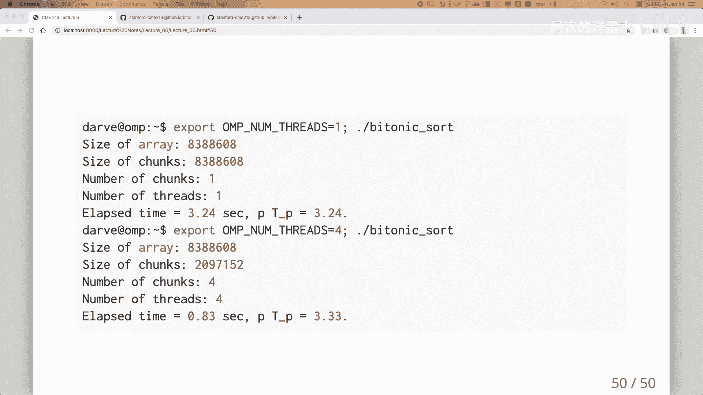