# 【全集】斯坦福大学-并行计算导论-CME213-中英字幕-1080P-p07-Lecture-7---GPU--BV1f8ijBYEjR_p7-

So let's get started， but today we are。Starting our first lecture on GPU computing so hopefully you guys can do the exercise well if not。

 you can just read the code online on the Github repo but。

You know if you can just run the code online it kind of more interesting。

 so I're not going to do any development， just sort of calling the code with different options is kind of minimal。

 but you know anyway， if you have the Google cloud working，That's， that's nice。 So， right。

 So in case you haven't。 So， okay， if you haven't created the。Beg give your coupon and so on。

 and it's probably great to do that， but if you've done everything and you have the code and so on。

 but you haven't created the instance yet。Then I invite you to do that now that takes seven minutes。

If you do this now， then willll be done when this is needed， so if you go on GitHub in the code，呃。

Folder， then you have created VN GPU1， as an image suggest creates one node is a single GP unit it。

And so you just run this code。So you need the Google SDK installed on your laptop。

And it will just create this instance with Uuntu， we download the Kuda I and so compiles。

 it can't pixel a while。That。And then you once it's ready。

 you'll be able to log on and you'll be able to run KDA programs with a single。It's one core。

2 hyper threads。In one you view， this is a node that essentially。You get here。Okay， so again。

 what you've seen so far， we started with multi corere programming and C++ threads。

So this is sort of the basic of multiple programming。

 know the sort of low low level module tools can do anything you want with S+ threads。

 then we looked at something that's more specialized for scientific computing。

 which is the using openM and the basic focus for example is how to para Fo because it's so fundamental in scientific computing so we looked at that and then a recent addition with T which is much more flexible。

So in principle， if you use Open MP to also run codes on the GPU， but it's pretty challenging。

 so the T is kind of looked into that。In principle feasible， but it seems pretty tricky。

 you need to reile GCC and so on。So maybe we'll do a little bit something with Open at some point on GPU。

 but most likely not， but you know。This technology is maturing， so you can， in fact。

 program GPUus using Open MP。 and if you ask me， that's probably the way of the future because。

So we're going to focus on QudDa， which allows you to program NVDA processorors with if you want to run AMD processorors that won't work。

 so it's very limited and nowadays it' thought to be some clusters with AMD GPUs。

So if you write your code cool， you you stopped So open and we'll see the own open ACC on these four gel tools。

to program these processors and' sort of the way forward theyre much simpler to use they don't have as many optimizations as coulduta。

 but they can do a lot of things。Okay， regardless， you know， this year we're going to focus on Quta。

 you know， the OpenP is not really ready for prime time yet for working in principle。

 but it's going to。It did charge it。And then we finish up with some examples of sorting algorithms。

 so today I want to talk about GPU computing and so as I did before。

 just briefly review some of the trends in hardware。

And allows you to understand a little better the context behind multi corere processors and behind GPU computing and GPU processors。

 so we saw this well before trends in microprocessors and so as I mentioned。

 there are some hardware limitationss，physical limitations。

 like the physics of a very small scale and so on that prevent。You know。

 manufacturers from building processors that you know can go up fairly fast or you know。

 increasing the speed of processors with the frequency， for example。

Numb cycles per second on the processor of plateau and essentially the efficiency of one unit sort of stone and the way to get more performance is really through more cores going parallel so there's a lot of plots on these links here I'll just skip that but if you're kind interested you can click on these links。

So now a couple of you know， plots which kind of highlight again some of the trends。

 also some of the things。呃。That kind determine。You know how efficient or how good a processor is。

 and it's not just the number of flos。Okay， so for example the。

So what this is showing here is the number of cores。That are computing number of cores。

 so thiss define what the core is， but number of physical cores that you have on various processors and so in blue you have the Intel Zion。

 in green， NVDdia， G4s， one of the lines， there lines of GPUs， so And。Breyon， so that this is the。

The sort of new processor that you know typically was not used for scientific computing or job purpose computing just graphics and games and you know rendering and so on。

 but nowadays know it's also a viable sets form and there's some tools to program in the video space right here and then the5 which sort of。

Has been discontinued。So it was a good processor。But。第二个。签有。有啲之。

Dump millions of dollars into a problem and say， oh it didn't work。 Let's move on。ふはふ。😊。

So you didn't that about my this take。But it didn't pan out。 so it was sort of， you know。

 it's been very interesting for a while， but it lasted for five years。

So as you guys still see on fire round， but essentially I think the production has been discontinued。

 this can now， particularly it was quite popular。Okay。

 so basically the way forward is through you know more pal and more cores。

 you can see the number of courses is actually quite tremendous。So the you know。

 you can go up to 1010 core， but even on recent。know really high end Intel it can go to 20 slightly more。

 but on GPUs you know this is sort of going the next level sort of approaching you know 100 cores。

 in fact， know I'll show you some statistics later on on the bolt and so on where the number of course。

Quite tremendous， of course you have to agree on exactly what is the definition of a core。

 but generally it's very， very very， very knowledge。And so of course this translates e parallelism。

Translates into performance， assuming， of course， that your calculation。

Can make full use of the hardware， Okay， so this is sort of a。The catch in this business。

 which is a computing is available， but it requires you to it restricts you to performing a substance set operations。

 so mostly， for example， a very large，You're number concurrent。Multplication ands。

Matrix matrixtri bug gives a prime example。But obviously， if you take an arbitrary scientific code。

 there's no reason why something we just makes small applications。

 and so as a result of the peak performance you see in an actual application may be quite different will be quite different。

And so when you write a GPU code， you wish to keep in mind well。

 what's the peak performance on my application？now it may or may not be realized in your algorithm。

 so you have to work on the algorithm， but even if you have the best implementation。

 then's just some theoretical limitation on how many Githubs you can get out of your card for your specific application。

So we'll talk more about this。But for example， you should do sparse matrix vector products。You know。

 you will get full memory bandwidth， but not full flos， for sure， it will be limited by memory。O。

 as example， where on spa matrix vector， these numbers essentially don't make much sense。

So this is really for compute heavy applications like matrix， matrix， dense matrix， matrix spots。

But you can see you get some。Terific， terrific numbers。Yeah呃。

He had a problem with the Google Cloud if you can。Maybe at the first。

And so in terms of scientific computing， it's a bit of a mixed bag。

So I would say that most codes are actually limited by memory bandwidth， okay， if you write。然 know诶。

Bad code， if you wish。Then you're going to have a huge memory traffic。

 and your performance swing can be limited by memory band。

So the good news is that memory also goes viral， you have more wires。

Going from memory to your processinging units， so actually the memory skills goes up quite nicely as well。

Okay， so we still will see extremely good performance on GPUs on account of this power memory。

 assuming again that your memory access you as usual is fixed。What the hardware is capable of。

 So we'll talk more about this， but there are also some restrictions in terms of。

The type of memory accesses you want to do， for example， if you do random memory accesses。

 should have a bunch of pointers， just reading memory at random locations。

The bandwidth is going to be terrible， much lower， but if you read a huge chunk of memory sort of contiguously。

You from this address on， you know， and then a big chunk of memory。

 then you're going to see this big memory bandwidth and very nice results。

So now if you work on standard。Scientific code， then you're going to be limited by memory。

 So if you put a lot of effort to do the algorithm， you can reduce。The memory traffic， essentially。呃。

So the idea is basically of reducing memory traffic is quite simple if you write。

Your code in naive way， you may have some variable X that you keep reading and know reading from memory and maybe writing to okay so the idea of improving your code is essentially to try to read X。

Say only once， do all the operations that you have do and then write back the result。啊 so。

It sounds easier said than done， in linear algebra。

 this typically means blocking so it typically means that instead of looping over scale of entries instead you partition your matrix into blocks and you have loops that go over these blocks。

Its essentially the project you have to do at the end of the quarter， so it's blocking algorithm。

 in fact these are techniques that were also very efficient on just regular scaleal processors because of cache and so on。

 so on the GPU it's done differently but this idea of blocking is sort of common for a lot of efficient algorithms in numerical numerical linear algebra。

For your high performance computing。 so you going have to do that。

 And so if you do these all districts， then you can reduce。

The memory track it a lot until now you're limited by how fast your processor can compute。

Whi is the more interesting stuff because you know the compute is extremely high and this is sort of the limit you really want to hit so typically authorizing the code means trying to reduce the memory traffic until you're limited by the compute and then typically now you detect performance and it can sort of stop there。

Okay， so a couple more statistics， so this sort is interesting。Pak performance per watt。

 so I mentioned that on very large customers。The leading factor is just the amount of energy you have to bring in because it means that well you need huge amount of electricity coming in。

 but then obviously the more power you're bringing， I mean this power basically has to go somewhere。

 you know， at the end of the day， it goes into heat。I mean， it keeps flipping transistor on and off。

 in some sense。So this whole energy just goes into heat eventually。

 and so the more energy you're consuming， the more cooling you have to do and that's actually very difficult cooling is a very energy intensive operation okay you need to bring cold water then you blow。

Your hot air through the cold water the air becomes cold and then you blow this air back over the processor and try to extract energy。

 it's a very kind of difficult process。And so that's why reducing the the increasing gear number of operations per watt is sort of critical and all these costs are sort of doing somewhat comparably。

 but again Intel is allies because it's much more general purpose and so the for example，G4 GPUs。

 the green here， which are just optimized for essentially flops。

 are going to do better on that metric。Okay， and。And the last。俾度低啊。

Is another very important so this is sort of related to just what I think about numerical linear algebra and how to get high performance out of your processor。

Which is basically for example， I explained that if you have this variable x and you keep you reading and writing and doing very few flops with it。

 then you're going to be limited by your memory bandwidth so what you want to do is you want to read in X do as many flops as you can before writing it and so this is to the question well exactly how many flops do I need to do in order to hide the latency of reading X okay the idea is imagine you're reading X。

 you're doing a bunch of flops。And then let's say the next variable is y。

 so ideally the time it takes to read Y should be smaller than the time it takes to compute with X。

So the question， how many fs going to an X？Well， first they can hide。

Reading y from memory and so the measure is this flop per byte that is you know basically obtaineded by measuring how long it takes to be one byte out of memory。

 let's say peak bandwidth， how long that takes。And this is translated to how many flops。

Can you do in that time okay and if the algorithm is such that the flow provide is higher。

Then you're going to be limited by your compute， by the performance of your processor in terms of computing。

 if you're below， then you're going to be limited by your bandwidth how long it takes to。

To read data for memory。So essentially one way to think about this is to imagine you know the。

The processor has a big plant， with a lot of pipelines and things moving about and manufacturing all these goods。

 and so if you want to figure out how fast you're producing these goods。

 essentially you're limited by the slowest component。So for example if it's memory。

 it means that the memory will go at maximum speed but the computing will then be idle。

 okay we'll be getting some data working very quickly with it and then just weighting。

 okay so this is memory balance。The limiting factor is memory。

 and then the reverse is ifre limiting by compute， so it means that the computing unit is busy all the time while the memory is idle part of the time。

So here on this plot here， you want to be low， where you want to have as few fs per byte as possible because that means it's easier to optimize your code right you can you don't have to make so many changes or in terms of linear algebra。

 you can use smaller blocks and still get big performance。

So lower is better and the test that GPUs are doing quite well。Whereas。Where have these guys？

Culable is。 I mean， somehow lately we won't hire， but。And then he does zion。

 you know it's much harm now of course。There's nothing wrong with Intel company versus NVDdia company。

 for example， Intel Zion is really on top of GPUs because here they have a design where they have a lot of core and computing units on their processor。

Okay， so they can therefore。They're optimized for high throughput。

 and so they try to reduce the number of drop provider。

I a memory system that can sort of support that whereas the CPU is just the Z on CPU is just job purpose。

 so it's much less optimized in that respect。More flat program。Okay。

 so and know some more numbers here， so just with these so Volta is' probably at top of the line right now。

So's 8。2 tear flow。It is pretty a tremendous 16 you know in single precision and then I'll talk about this。

 they have these sensor units which are specialized for small matrix matrix multiplications。

 the motivation being deep learning Okay so I'll talk more about that than extremely high memory bandwidth。

Thous0 gigabytes。So that's one terabyte per second。But of course this is pale memory access。

 so to achieve this you need a lot ofcur and you need a specific very regular memory access。

 so you know otherwise want you can get that and you know it does consume a lot of power you know for。

Home users， that is a lot， but if you look at how many flos you get， it's actually a good。

 pretty good deal。Okay， then you have the NVDdia propaga。W are we just talkingking here？

But like comparing the performance of a GPU node versus basically how many CPU nodes you need。

To get equal performance so on various education， life science， physics， geoscience and so on。

So the reality is it's。The reality is it's a little bit more complicated than that。In fact。

 you should take your code and run on GPU。The continuenu is going to close door。

Because the problem is it's a lot more difficult to prevent for GP。Like CPUUs are much more generalp。

 they're much more forgiving， you can do a bad implementation。

 you know the processor will kind of work around that and still give you good performance。

 but on the GPU it's much more strict you really have to follow the algorithm needs to follow the hardware if you just take an arbitrary algorithm。

 typically you will not use the hardware correctly and you will be very far from peak performance。

But if you spend the time to tweak algorithm and improve it and so that the hardware is to better use。

Then you will see these numbers and typically the speedup is more a factor of five， maybe 10。I mean。

 CC4， it's kind of little suspicious。Wch it depends how bad CPU implementation is and was a great secret of many GPU papers。

 you know。Use birds to view your dishes。By ways。Factor of 5，10 noise kind of reasonable。 And then。

 you know， this one is for deep learning。 And so the key thing here is that。

But we going to talk more about that is that specifically for inference。Which is basically。

Using a trained neural network。😡，Making predictions and your inference using your already trained neural networks。

 you know you have huge。Improvements， so it's highly specialized compared to single CPU and it's tremendous。

 but even between the0 D100 and P100。You have huge jump in performance。So basically。

 the V100 was designed around deep learning。So let's talk about the technology behind GPU processors。

 And so nowadays， you know the big struggle is this so called heterogeneous computing。

 and that's the。The next grand challenge。That。Well at least if you look at national labs and companies that do really take care HPC。

 you know for sometimes there was a push towards you knowteraf flop， data flop。Exa f。

then I don't know， maybe they got time of the Greek cut。

 but X F seems to be where reason going to be happy。 Okay， so theyre not manageable beyond except F。

 at least in the you know。Say my near future you know 20 years or whatever。

 so exactly up is sort of you know maybe a good number。

You can finallyulate your entire into your foreheadhead。No need or need are're satisfied now。Okay。

So what's the next thing though， Well， if you're happy with exact scale。

 you know you're definitely not going to be happy with power consumption with the size of this whole thing you know the complexity of the network and so on and so you're going to want processors that are more and more specialized to give you better performance and specializedize means that there's going to be a larger and larger variety of processors okay so you have different types of multiprocessors already and then different types of GPUus you know the MV and videodia and in the future they're going to be even more flavors of this hardware。

 So the challenge going forward is heterogeneous computing and have different types of processors that are good at different things and how to combine all of that in in your calculation。

 So this is sort of the challenge in the next 10，20 years。

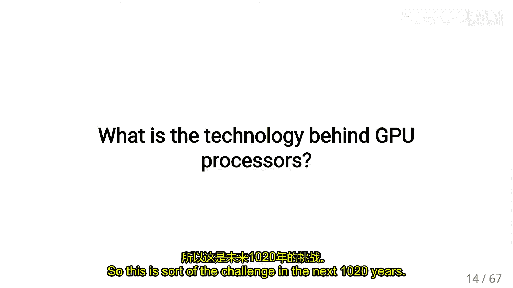

So okay， sorry this。F picture of ray tracing， example of ray tracing algorithm。

 you know showing the reflections of the light and so on。

 and so it goes started with graphics and this is one of the reasons why you know。

AndVDdia and AMD are sort of really ahead of the game in terms of this high throughput computing is because basically it's sustained by the gaming market。

And there's a small niche of scientific computing。But everything is about these graphics processors and games with realistic graphics and so on。

 and so that's fundamentally what'。Financing， if you wish the development of the sponsors and that's also a reason why for Intel it's very difficult to sort of catch up。

 I mean they have canal and so on， but the market treat speaking for high percentage computing is small。

Unless you have this graphics market to sort of sustain you。

It's very difficult and what was pretty remarkable， I guess。

 with NVDdia and also N&D is that they sort of are able somehow at producing this processors that are wonderful for graphics。

But can do other things as well。 so they can do the scientific computing。 and more recently。

 they can do this deep learning。 Okay， and there are some differences， but， you know。

 we can sort of pack a little bit everything on on their processors。

 Okay we're going to look at this。

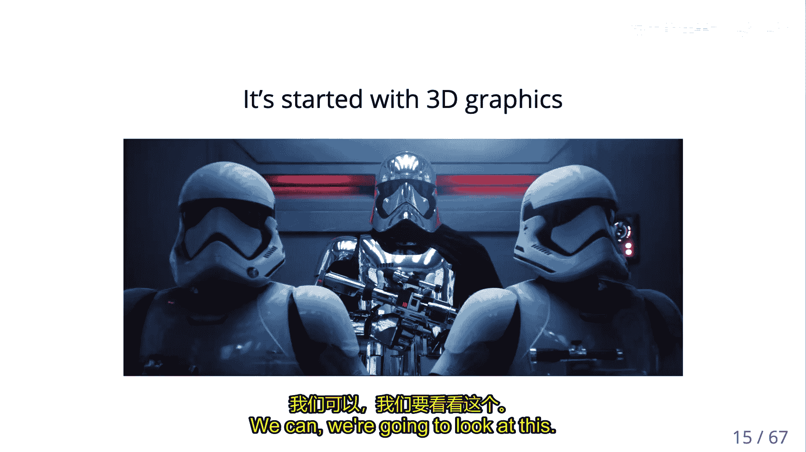

But the。The basic idea is quite simple， I mean， just to simplify the discussion， you have this image。

Okay， you have this image， so I'm going to essentially throw at you or let's say you're the processor。

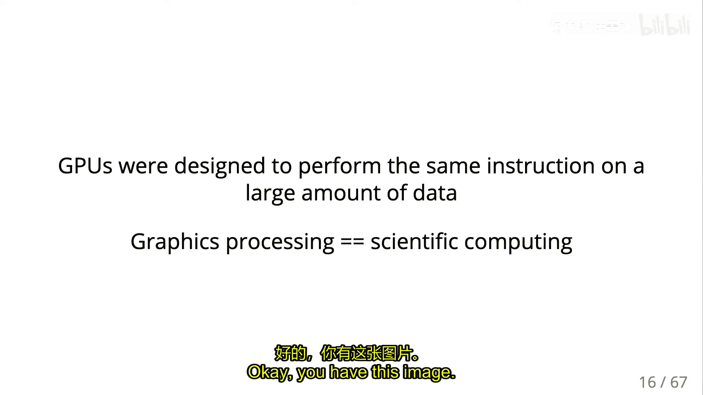

I'm going to show you the graphic fossiles were invented because essentially there was a huge computationalal workload。

For graing graphics and wanted to three the CPU for other tasks so there was a specialized roster just for graphics which ship off and so what the CPU ships off is it ships off you know description of the scene in terms of triangles mores so we have a 3D scene with all the surfaces defined with a very large number of triangles。

And then know for each surface for triangle， you have a。A certain material property。

 So basically it's a color。 and then something that describes how the。对。Light。

Raise bounce of the surface， like does it diffuse or does it reflect？

As you be perfectly diffusive or perfectly reflecting， so if it's reflecting。

 then it's like a mirror and you have to do retracing to kind of figure out the visual appearance。

 but so the idea is the calculationation at some level，It's very simple。

 you take each triangle and you ask questions， well， is this triangle visible or not。

 obviously if it's not visible you just drop it。But this one is visible and then what you do is you just look at all the pixels。

On the screen that essentially falls。F through this triangle。

 and then you just want to talk the color of each pixel。And so imagine you have a huge screen。

 maybe you have multiple monitors， whatever， so you have millions of pixels and you have to keep repeating this operation。

 what's the call that pixel， what's the call this pixel or just go through all these pixels one by one。

So it。The very benefit。呃。Se instructions， so you're always doing the same task， but on the very。

 very large。Now data。Okay， that's the design fundamentally of the graphics processor。

So and so this is very important to kind of。

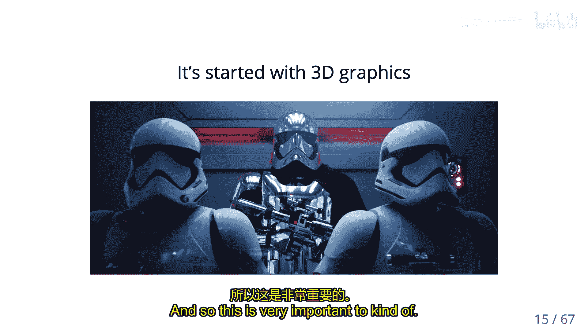

嗯。Get that message and it's been relaxed in the more recent paragraph and fundamentally that is how it works。

Essential the idea is you'rere going to do the same instruction。But on a very。

 very large amount of data， so for example， you do plus equal equal or plus or minus divide or do log sine cosine or know adopt product what have you so just a basic you know operation at this time。

 but you're going to do this on an enormous amount of data okay that is the。That is assumption。

And so。If you do scientific computing and you process a grid。

 while the grid might be 1000 by 1000 by 1000 a billion。

 okay that's huge and typically indeed if you define difference by data and so。

 you are doing the same operation over and over again with just different data。

So it's a good model for these processors and it's actually fits very closely what you do for graphic rendering。

 instead of rendering one pixelel， you just update a vertex in your grid。Okay， so it's very。

 very close。 that's why people jumped on this。And so I remember when so my students were doing this at the beginning。

 you it was very funny， basically they had to map every pixel。To a point on the grid。

 so they had like one triangle with a pixel in it and that was their grade。

Doing a pixel calculation was basically doing you know， fine different calculation on on the grid。

 So there's a very close mapping and so Andvidia sort of jumped on that early on and then made some tweaks to the hardware to facilitate。

 you know programming scientific application。 So initially it was just。was mostly。

Simplifying the programming， so instead of writing open gel and doing this fake graphics。

Weir you can actually sort of directly write C code and so on， but that was more of a compile issue。

 but then after that also came in a lot of changes in the hardware itself to support these types of operations。

So you know， just to kind of reiterate this point， so on the multiple processors。

 each processor is very big。There's a lot of areas for you know optimization， for logic。

 for cash and huge cash， so basically it's very forgiving okay you can have。

Sloppy algorithms that do a lot of memory traffic and so on。

 but you will do a lot of optimization to get good performance， okay。

And so it means the price is big。It's smart。The image is suggesting right now。So it's yeah。

 interesting image if you got it should be smart。It should be big， smart gun。

 it's big because it takes occupies a lot of space or maybe a big brain because there's been a lot of optimization。

Okay， but the next image is definitely correct。 So the GPU approach is instead to have small units。

That are sort of very dumb。 Okay， we cannot do things so we can process extremely fast。

 but basically thats all that's what it can do。The data comes in， compute， write back。

 and just keep doing that okay， very little bit of logic。Very limited cash。

And essentially no optimization because basically it's like， you know。I being an army of ants。

 but it's like imagine you're an endt leader and you have to lead a troops of 100 ants。

While if everybody's doing the same thing， that's feasible， it can say march， right， march death。

 whatever， it works。But I assume that they're really doing the same thing。

 okay if all the end are starting to different things。

 then you can see that the complexity of managing this。Go to the roof。

So this is the fundamental synimification that all the units are going to do exactly the same thing and therefore like managing the instruction that what is the next instruction where you are in the program and what is everybody supposed to be doing。

 becomes much simpleer because everybody's doing the same thing so you have like one instruction that can dispatched to equity and that does and go the next instruction and so on。

 and so you can control the army of ants very easily。

But this means that everything needs to do the same thing and so it's basically one instruction。

So each ant operates on different data， whatever needs to do the same thing， and then you want。

 next instruction and so on， and then hopefully you can carry this huge leaf here。

So it's great for a certain- so basically it's great applications that are very regular。

So I guess Jensen W got really lucky so to speak when machine learning came around because more networks are extremely regular。

They were sort of。Had this very regular design because Jo it was kind of simpler to。

To think about and also because it does process。Faster， but regardless。

 it has this very regular pattern。And so it was a great fit。For GPU processors。

 but in essentially to computing， if you define difference on the congen grid。

 it's also extremely regular， if you define elements already。

It becomes a little bit more complicated if you have very number of neighbors and so on。

 you know it's not as simple but if find different would be a great example。 Of course。

 if you dense in the algebra， that's fantastic Okay， then you can really。You know。

 do a lot of optimizations。But if you。You knowIf you work on a code that has a lot of branchinging。

Then。That is a lot more difficult。So it depends what you're doing， but for example。

I was on the project and somebody working gym mechanics。

You looking at the seismic waves in subsurferface of oil gas。

And so there's some really crazy physics。三万年 area上咯面响相对嘅。Different physics that was therapy。

A lot of different physics， depending on exactly what sort of rock you had。

 the rock properties and so on。 and so the code is full of if if this is the band and so on。

 So this was actually a very bad code。啊，就刚才这个几品。And actually， that was a postdoc seven years ago。

Who was working on this code giant？Whi is basically out of the Department of Energy。

 which is a code that's used to simulate。诶。Basically beam going through the body for medical treatment。

You know， you can use。Beams with different particles for example to treat tumors and so on。

 also this is the code that has a lot estimate because basically you track， for example。

 the electron，Proton are exactly the physics but through your body through the cells and then depending on the type of tissue then it behave in different ways going different states and so the thing goes full of air statements so this type of calculation is typically very very bad for GPU so nowadays the GPUs are more flexible but to a large extent this remains very very challenging。

そ like I said， you know。To get high performance， you're going to print a lot of computing units。

 but you have to give up something， and so you're going to have very。

 very limited memory and almost no optimization so the process is very。

 very dumb so you as a programmer you have to be twice smarter so you write the right algorithm that matches exactly what the hardware is doing。

And so this is， in fact。So this is kind of what this' is saying here， but this is。嗯。Right， okay so。

So that this is the change of D computing， and this means that you cannot。Program。

Your GPU without knowing。The architecture of the debut。So if you write on the multiple processor。

Yeah， you like you took 211 to 12， I don't know exactly what's covering these classes。

 but you can definitely write C the code and even do quite a bit of scientific computing without knowing too much about the hardware。

 although if you really want to get better performance you you start to worry about how to worry about the cash。

 the different levels of cash， how big the cash are and how exactly they work and what sort of memory access you're doing and so on。

 but you know。Okay， maybe you have to do that， maybe not for GPU it's pretty much a must okay。

 if you don't pay attention to the hardware， you most likely will run slower。

Then on just a multiC CPU is openM， which is very straightforward。

 but if you know about the hardware and write your algorithm accordingly。

 then you can get this good performance。呃。So okay， how does it work so I'll show you some what the hardware looks like and then this will lead into how to program because you could uses certain constructs and certain concepts。

That reflect what the hardware is doing。 So it's trying to extract a lot of the details of the hardware。

 but certain aspects of the hardware。Have to be present in the programming sort of more ethics。

So you can know about the Harvard to understand， why coulds make sense the way you write you and put that program。

So the first thing is， okay， you have this concept of thread。But。

The concept of thread is a little different。Because essentially。

What's happening is when you run a kernel， you're going to have certain calculations being done。

And essentially， when you start。Your kernel is a function， when you start your kernel。

 essentially the hardware is going to reserve all the memory it needs。For all the threads。

In your program to exist， so when you start your function。

 all the threads are created and there's a huge number of threads that are created。

And then going through your program。Is actually actually fitting different data to these threads okay so this turns a number differently。

 but in the hardware it's actually the same thing， just the indexing will be updated so in some sense switching thread there is no cost does' actually doing anything you just just next instruction will be executed by a different thread but there's actually no thread switching the thread over there and then the question is next instruction is going to be executed by what is the next instruction。

So this is very different from。A multi processor， a multi processor。

 there are really resources that are allocated in each thread and that need to be copied and moved about。

 whereas on the GPU， all the resources are already there and just the question is what is the next instruction？

So hence there is no cost to switch and threat。上。So you'll see what this looks like in the program。

The meaning of threat is quite different， in some sense。On the GP。And。

Okay so yeah I'll get back to that， but the basic units on the GPU is 32 threads that form called the work and that's the basic unit okay all the threads。

 for example， in your work are going to execute the same instruction so this is what I was talking about you have one instruction that's going to be executed by multiple units and there is no option here okay you cannot assign different instruction to different threads everybody does the same thing and so for example 32 threads is something that will explicitly show up in your program because it reflects the hardware。

Okay， so essentially， this is what it looks like， know CPU is a huge amount of cash。

 a huge amount of control， few computing units。 The GPU is a lot of computing units and practically no cache。

 So actually this is very， very challenging right， no cash is extremely challenging for scientific applications。

 but you can work around， you know， synchronization between threads。To sort of， you know。

 address this， But this is， this is very， very challenging。 Okay。

 so here you can throw any code here you have to highly optimize memory and bandwidth to get good performance。

So next slide is just for sort of reference， not terribly interesting。

 but these are just the older different architecture names。

 so talking about the Volta and then you have touring。But this is， I think， the highest performance。

And my parents is just for the future and then corresponding to so。Now。

 every new processor has new hub development， new features。

 and this is in turn presenteded by in the language。Okay， so we have different versions of Kuda。

So it correspond to compute capability， each processor has different compute capabilities。

 and with H two new compute capability， you have new sets of instructions or new features that can be used in your program and take advantage of certain features in the hardware。

But realistically， you know。And I stopped counting after three boys。RightBecause you know the。

Basically， the more advanced。This becomes the more sort of specialized you know you trying to address certain corner cases of computing。

Okay where you can get a little bit more performance if you do this to that。

So the more the events in compfiability， the more the optimizations become specialized and they become very complicated to understand and to figure out when they become useful so know for the purpose of this class we're going stop at minus 3。

0 and that' I would say know that covers most of the use。啊。You know。

 most of the use for scientific application， but when you read documentation and so on。

You know this does matter a little bit because depending on hardware we're using。

 you may or may not have access to certain features of KudDa。

 so you got to make sure that you code your writing is actually runnable can run on your hardware。

 but like I said， if you stick to what is in the class at Tport also essentially your code will run on arbitrary GPU nowadays。

Okay， so I'm going to keep moving on just to examine that。read anyway。

 so this is sort of the history of graphics card。呃。You know， it's like。It's like humankind。

 you know you start with different kind of humans。At the end， there's only sanctions， just show else。

重です。So here you it kind of feels like this， so at the top you have MD。HIND in red。

 here you have your Nvidia in green。There's intel which obviously on the strength of its CPUs sort of continued。

 but after that the rest is just all these species and so on。😀は。😊，This is a huge meteorite。

It good check at some point。All right， so this is more interesting for maybe Deon in this quarter。

But as you do your homework in particular your project。

 you want to what sort of hardware you're running on and so the hardware that we have is so this is at least expensive。

 but this is actually really what we need for discuss is the K80。So the KV actually is two GPUs。

But we sort of only me really。So for you， you cannot be visited on the cloud。

You cannot really see that there are two of them you just see the individual GPUs but in principle it has two of them so it's really very high end and so these are some of the characteristics but I'll come back to that。

Later on， your DSMX and so on。 so let's's just one。

 but this is for reference we can come back to these slides sort of later on。 Okay。

 so let's let's explain a little bit。How this whole thing works。So the main is。So GPUs。

 so they're called crew processors or accelerators。

And so what is meant by this is that you cannot program what you can run call GPU like to do on the CPUUs okay in particular。

 there is no operating system that's sort of visible to the user so to speak on the GPU so you cannot for example install Linux on a GPU that's a meaningless thing So obviously there is some sort of operating system that runs the GPU but it's not visible to the user So what you do is。

You always work on the CPU side。and then the CPU issues orders to the GPU okay so use essentially the driver and the library that's provided by NviDdia to interact with the GPU so you're going to say allocate memory on the GPUs but the CPUU says that and then the CPU says run this kernel okay so then this goes and runs on the GPU。

you see a free memory on the GPU this comes from the CPUU and gets that executed on the GPU so hence the code you write is just straight CC plus us。

 in fact， the code you write， should be speaking runs on the CPU。

 but it issues orders that things to do on the GPU and then the GPU takes care of sort of managing the pool。

 this s of things that you've assigned it to。And so right so essentially you run the host。

So let me just jump to this slide here， So this is for example， an example。

 so another thing to sort of realize is that you know when you do graphics。

It's a little bit of a one way treat in the sense that the CPU， you're playing a game。

And the CPU is just issuing orders like sending information about the current scene and what should be displayed on the screen。

 and then the GPU does its best to render the scene and then send it to the video card and the screen。

But for example。If the red bearing fails or there's a bug in the GPU or whatever。

There's nothing coming back to the CPU。Because you send the先。The CPU doesn't care， like if it fails。

 whatever。ピ goes veryて。Its a pixel that's weird， but nothing comes back and so on the when you program a GPU it's very similar。

 you ask calculations to be done。But by default， it just shippeds off and you're not informed of what's happening。

 so for example， if it fails。This if you will not know， okay， will not interrupt the main program。

So their commentss to say， oh， did was it successful， yes， no， but if you nothing。

 you know the CPU code will just go and maybe actually nothing happen on the GPU or it really fail。

 so sometimes really weird errors simply because actually the kernel just didn't run。

And there's no message， nothing that when you look get what's coming back。

 well essentially nothing is coming back， so when you check the results with CPU。

 nothing makes sense。sales晒。So this is one important aspect to look at and， you know， in the。

Sample code at the end， we'll see how this is。So for example。

 CPUU starts allocate memory and GPU so you issue an order。

 then the GPU goes in allocate reserves memory for to send data so the copy data。

 so actually the copy is that is synchronous， okay the host will block。

 we wait until the copying is done。Because the copy is sort of a very fundamental operation and it's hard for the CPU to continue。

You know while the copying is ongoing or typically you have to check so you know here this is synchronous。

 but for example， when you launch a kernel， meaning running a function。

 that is completely synchronous。So the CPU is actually returned immediately。

And then essentially the code with be executing and say send back the data。

 so now you're requesting to copy data from the GP to CPU so here we' actually block。

We will wait for the end of current execution。Okay。

 then there's been a memory copy and once this copy is done。

Then the CPU is going to be able to continue， So you have to be a little bit careful when you time。

That there are special things you can do to turn your code because everything is as synchronous。

You cannot help just look at what the CPU is doing。Its this asynchronous execution。

And finally free them energy。So let's talk about the architecture of the processor and then this will。

 so today we're not going to say much about the programming yet。

 but as we go know you will see how the programming really reflects what's happening on the hardware。

 so I'm going to take an example from this chipet which is the KaD。

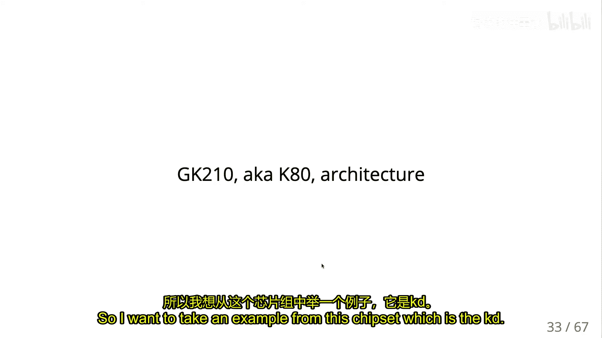

Okay， and this is what it looks like pretty much what I describe。But more specifically。

 so you have a bunch of course。So these are all small computing units okay at the top you have register file。

 so basically you know this is basically memory， but it has sort of direct access to the course or very fast so every cycle know the court can read and write to the register file。

And at the top you have dispatch in orange and then or maybe red and in orange you have war Schr。

 and then at the top you have instruction cache， so certain cache basically a system that manages what is the next instruction。

That a course should execute okay and the idea is， well， you do have a lot of cores。

So what is it the4，8 16 grain top so in principle the work is going to be 32 threads it's basically 32 cores。

 so the assumption is that 32 of these course will be executing the same instruction so this is why this is going kind of simplifyimplified you only need to track you track of instruction for。

32 cores or 32 threads。And so this guy at the top instruction cash is determining what is the next instruction to execute。

 and so this is rather tricky essentially。You can execute an instruction only if the resources to basically register sort of the bill like the input data is ready and there' is room to write the output of the instruction。

 okay that's more， and then you say oh this instruction is great to execute it。

 so it's going to be the next one。And then the work scheduler， the instruction scheduler and so on。

 or web scheduler， keeps trying to figure out what the next instruction should be。

And then here you have some units node store， which basically process memory instructions。

 okay so basically they're in charge of sort of completing memory addresses and so on。

 and then launching requests through the memory for either writing to memory or waiting for memory so this。

Weve register to， to memories with a special unit that takes care of that。

Okay and then here you have the integrated network here you have some cache。

 there's the L1 cache which is very very fast and shared memory so we'll talk about shared memory later。

So this is important， there is a readed only cache or the read only is not super important。

 but this is typically for textures。If you take textures and graphics if it comes it's just beat only data。

 but if you run scientific code and some of the data is beat only。

 then you can take advantage of this memory， but this is a little dense so I typically don't really cover that too much and this whole thing is called SMX so a streamming multiprocessor we have several of those on a device。

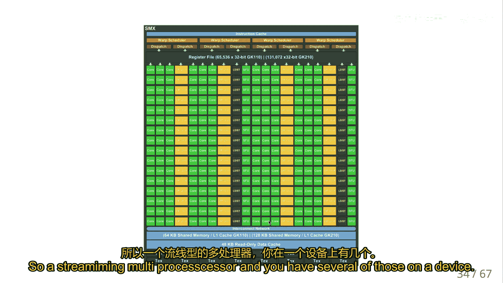

So for example， this is what this looks like， you it S anX 192 cores， so it's basically multiple 32。

 so the basic unit is 32， but you have several。You have 64 double precision units。

And then you have special function units for cosine， signine， log， exponentialial， and so on。

 and then you have load store units。You knowTo process memory transactions。

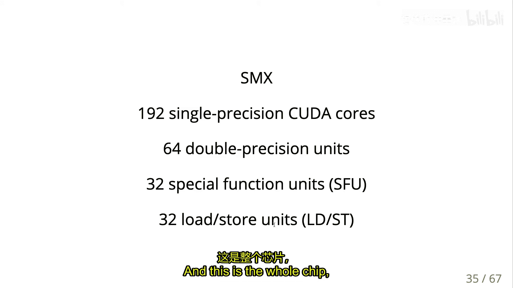

And this is the whole chip。Okay， the whole chip is basically a bunch of SmX repeated， okay。

 you have 13 of them。And。嗯。So 192 is basically a。に対し。It this says six times。But it's not six times。

 so basically you have six the quote of six warts。per SX。And multiply，3 times。It's definitely beast。

So you can see how parallel now you can see how parallel this is。

 it means that basically when you're doing a calculation。More or less。

You can count how many core you have and what should all be doing the same instruction。

So that's the amount of parameterss that you need to have in calculation， so it's really。

 really massive if you want to do a small you know 10 by 10 matrix multiplication。That fails。

 even 100 by 10 probably still fail。P performance probably need to be several hundreds。

 maybe a thousand， the keep then everybody's busy。So it's really massive amount of balance and a massive amount of concurrency。

 so imagine the multico processor is just know a measly， you know。Oh， I have this wonderful12 sport。

So that's how you get good performance format， but obviously being that concurrent is not trivial。

 I mean you need to have a seriously big data set。So there is more flexibility than what I suggested。

 but still， and the Vol is just， you know， this thing on steroid。

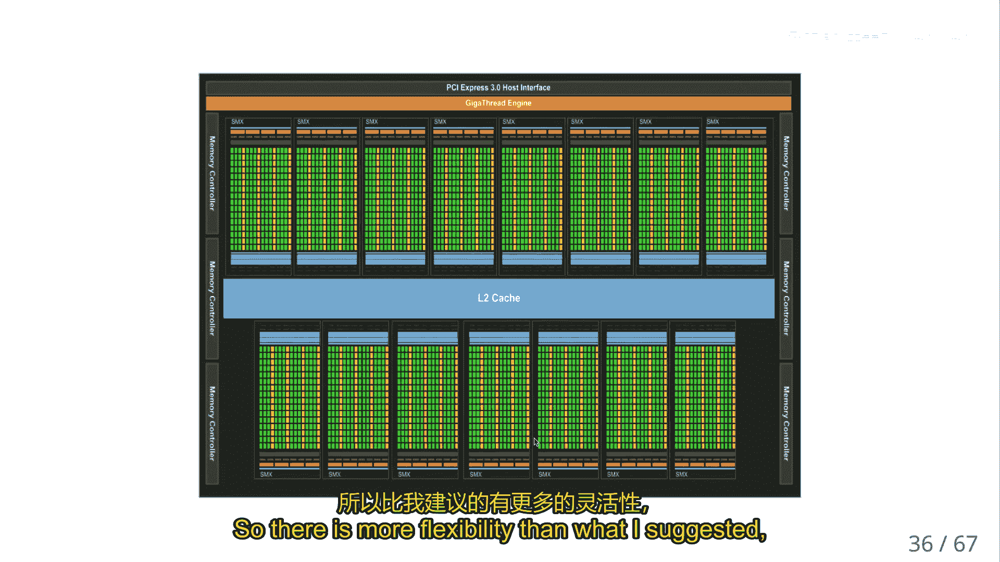

But okay， so both that is kind of interesting because so it has。

 you know a lot more stuff so that theres its integer units。

Floating point units in single precisionion 32， floating point units。

 64 down precision there's a load store special function units。Register file， workp schedule。

 dispatch unit， O。Instruction cache and so on instruction cache flow。

 so just that data you need to read the program so to speak is actually stored in memory。

 so you need to read a memory the set of instructions for your programming and so there' instruction cache。

But the new thing about the Volta， the key thing istens core。

Some parts of the processor that are designed just to calculate these matrix matrix multiplications intense support。

And so here you're seeing what。And VDdia is trying to do。Okay you have， on one hand。

 you have multiple processors which are few cores， but very fast， very general。

 very forgiving processors， then at the other end you have something that can only do graphics。

But you also have the， for example， the Google TPUs。

 okay Google TUs that dense processing units that are just highly specialized just for deep learning。

 it's very very limited actually， not even general deep learning is you know certain。Times。

 certain type of deep learning， although they're constantly improving their GPU to be more general。

But it's very restricted so here trying to find a middle ground some of the units are general purpose like the filling points and so on can do arbitraryory code and then some of the units are really specialized for small linear algebra okay like deep learning so it's kind of a mixed mixed bag and so they're not as high performance as CPUUs。

But they can do a lot more stuff， okay， so in terms of can you combine high throughput with some amount of flexibility trying to find the right sort of trade off here。

So it's not as flexible as a multiple processor， but it's a bit more flexible than for example， a T。

So this is what the Tensor core does， it's basically you know it's actually optimized for even。

 so this is another know complicated trait part of this computing is theres huge performance gain if you work with reduced precision numbers。

 for example， 16 bits 32 bits。Okay regularular filling32 beds， the double position 64。

 so you can get away with 32 maybe， but there's a lot of deeping these days with just 16 beds。

in 16 bits， it reduces tremendously the memory bandwidth and again it is a lot more。

 it treats a lot faster。So the den， of course is highly optimized for this type of use decision 16。

Bit， you know， arsenic。But it's restricted to justice。

 which is exactly what you do when basically quite more as applying a con filters size 4。

 or it could be a dense fully connected layer， anyway。

 there's a lot of matrix matrix multiplications in each layer of the D networks followed by these itulation functions。

T0 age and value and so on。 But the bulk is。The double times x， the matrix matrix multiplication。

 so this。Cours are designs Act for that。So this is for example。

 what performance you get on this SP32 so actually this is not F16 is really where you get most of the speed up。

 but even on SP32 you get a sizable speed up if we get the V100 so just compare against the P100。

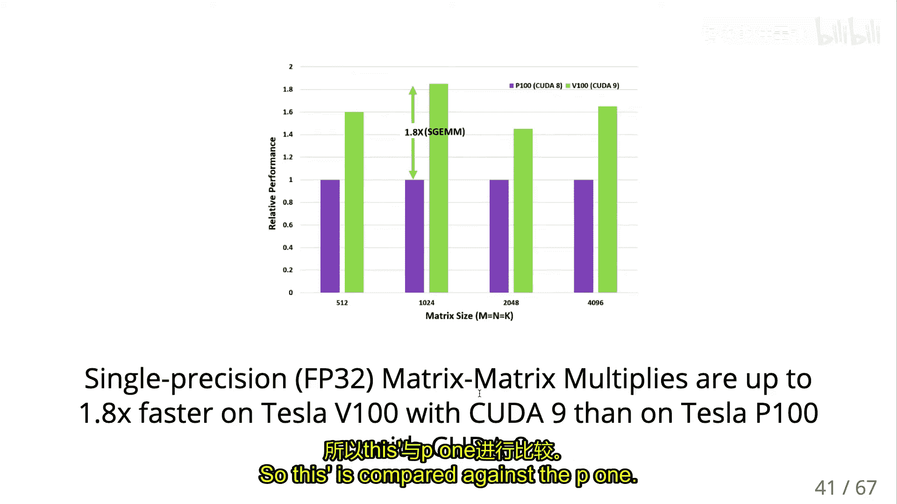

The factor of two in in this。And this is you know this is what the vote ro size so this is be massive you know。

 so it's now extremelying multiproster and I sure probably this one here， no it's this two units。

 so it'。So you have the number， you know it's crazy， how many？

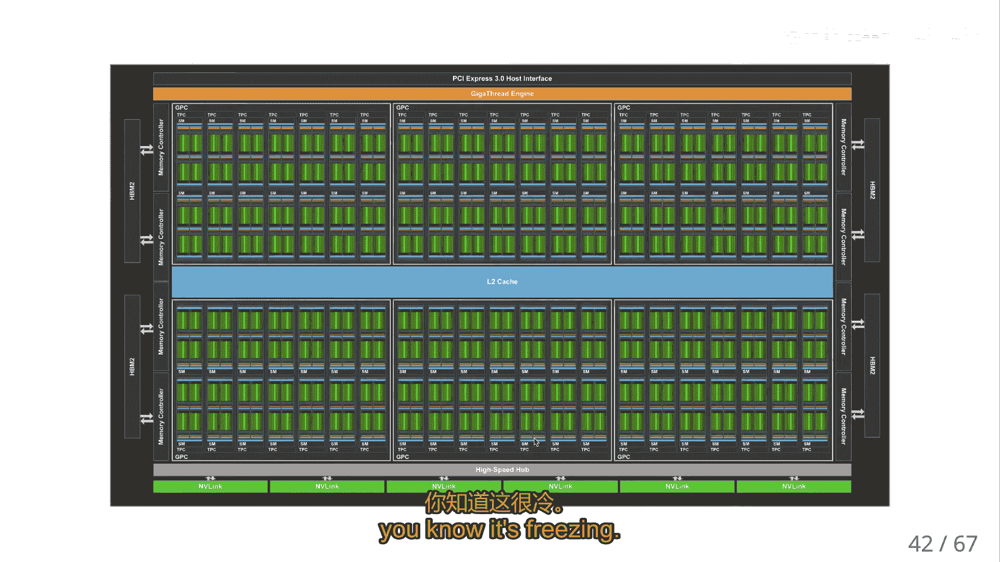

Proreing is。You't even see them there anymore Okay。

 so you have 80 80 Sm and you have 1 thousand0 core。But I'm sorry，s 5000 core。 but now， you know。

 it's a very challenging cost to use because you know， you need a massive。Workload。

you know to fill this up so you need really special calculations and you know with massive data set its very it's very very challenging to optimize so if you do deep learning and you sensor to throw a by torch then you find you know。

People who are clever than I optimized all the libraries and so on， but if you write your own code。

 it's quite challenging to make it scale to that。So。Yes， probably won't have enough time for the。

The the demo will do that on on Friday。 So in terms of the， the threads。 So the。

 the breakdown of the threads reflects the。Ref affectects the hardware。

So the basic unit is a 32 threads， there has been the design from the beginning。啊。

So many things hasn't really changed。Yeah。So basically you have this。

 the basic unit is actually the war， okay， 32 frames， so it's not the case that。Each thread。

 can do its own thing。ok。Only the warp， essentially an instruction is always assigned to a warp。

 okay that's a group of 32 threads。So it means that at the very minimum when you have an instruction。

You need to do it 32 times。And this instruction has to be executed by all the threads in the same war。

Okay， so there's no so called divergence， you can have two threads in the work doing something different。

And so this is directly reflected in the programming， so it's concept of war。

And so this so called simply model， single instruction， multiple threads model。

 multiple threads that do doing exactly same instruction。

So now the next thing is basically has to do with synchronization。So the way the calculation is done。

Is let's say you have， you know。A million threads to run。Okay， well it's not possible。

 allocate memory for million trick。Okay， so the example。

 say you can actually allocate memory for just a0th break。其术系嘅叫咩啲。Well， the idea is to。

To feature your calculation， your thread if you went into block and grid。

 So grid is essentially all the threads that will be admitted。And block is a small unit。

And the way a block is defined is essentially it corresponds to a group of thread。

For which you know resources。Can be allocated on a single S okay so a single S。

 a certain amount of register files， cash， instruction， number of course and so on。

 so there's a whole bunch of limits on how many fields you can have and so on and so to run a group of threads。

 you're going to require certain memory resources。Okay， and the resources of VanessM are finite。

So essentially the biggest group of threads you can fit on an S。

And that satisfy why all these constraints is called the block。Okay。

 O God is basically a group of friends are going to fit on NSM。Okay， so remind you。

 an S may have multiple blocks。But。It cannot have fractional blocks。

 that is just an inteigent number of blocks， be1，2，3。It needs to have at least one， so for example。

 if one S， one block does not sit on your S。We just not run， so that is one to fix。 if there's room。

 it will fit more than one。2 three four， by it small number。

I don't remember how it stops and that depends on the hardware， but after a few blocks， maybe eight。

 then that's just the maximum， for example， regardless of resources that，A got bars。And。

And the other element is that。This synchronization。So synchronization is very important。

Because it allows you know well this is how you can reduce memory， for example。

 certain threads may read some data that is going to be used by other threads。ok。

The only way to do that wouldO， every thread just reads data from memory。

 but then huge memory traffic， so it's better if say one thread reads it。

 then the data just stays there。The data may need to be used by multiple threads。Okay。

 so there's a problem of synchronization。 Okay， need to know， oh are you done reading， yes。

 then now I can work with the data give synchronization。We've seen this before。呃。

And this imposes restrictions， it's not easy to synchronize things。

So you cannot synchronize things that are inside a block。

 It actually synchronization has to happen only within。诶S三。

And essentially actually this response is you need to block。

with two threads that are in the same block can synchronize。In fact。

 there are different blocks cannot synchronize。no way for them to synchronize。

 they're going to be scheduled， so these blocks are scheduled at completely different times。

 So if you take two00 different blocks。You， they may be live at the same time。

 one may come before the other or vice versa is zero control， but for given block。

 then thread inside of block。Will all exist at the same time， created at the same time。

 die at the same time， and they will have the ability to synchronize。

So this is next level block and then the grid is basically just collection of all these blocks and thats totality of all the threads that are going to be assigned to calculation but again the thread is nothing the thread is just going to be a bunch of resources。

 you know hardware resources and when you talk about different threads in different blocks and so on。

 it's really just effectively just different instruction counters。So again。

 there's no cost of switching threads。Because you're not really doing anything with your resources。

 everythings just out at the beginning， just talking about the instruction， so the cost is zero。

But in terms of writing the code， it will appear as if you're running a million threads。

 but there's zero cost of switching thread and so on and so and that's for free。

And you suddenly don't have actually a million threads working on your。

GP might a much smaller number。it sort of being sort of recycled until you have to complete。

So I dont know if this。It's completely clear， but。So this is， you know， one way to picture this。

Execution very simply， essentially thisquiy line is our sequence of instructions that need to be performed and so this is defined by your kernel。

And so you're going to see with the first example， how this works。

 but essentially the kernel TPT starts by asking what's the current threat ID？Okay。

 we'll return index0 and minus-1。 And based on this index。

 you determine what's the data to be read or you can be reading x sub I。Okay。

 then it performed better an instruction and then writing the results， let's say some y of I output。

 Okay， so we just， so this is the better， what's my third ID。Okay， get the corresponding data。

 use some calculation， write the result。And it really does the same thing。

 it really does the same instruction， so you're allowed to some extent to put a statements depending on your ID。

 but as I said there's a huge performance in that so typically you you want to avoid a statements for just every to just do exactly the same thing。

Okay， so I guess let's get started。Not really。Well， okay， no， but so how about。We do this。

 I'm just going to go through the code very briefly。

But I want you to the next class we have this done and then we'll do this next class。So you。

Se of the Google platform and follow the instructions here， So basically there's a bunch of files。

Lecture 7， dot zip。And so you can compile so I grab some tests from the Q sample library。

 so you can do device query， we return some properties of the GPU， you can do bandwidth tests。

 so basically this is just to make sure that everything is sort of working normally so you can run that so for example。

 when you say device query， you're going to see you know you' going to say oh， it's a test like80。

You knowYou run Ka 10。2 at the latest。K capabilities is capability of the hardware。

 which is the KA programming， when you look at the QA reference， its capability 3。7。

 so all the features up to 3。7 are supported on that hardware。And then this is the memory you have。

So you have a gigabyte not that much， this is a lot less than on CPU， you have 13 multiprocessors。

 each have 182 could of course， basically six size failed2。A 200 great courserus。

This is a clock rate， so it's actually quite low 800 megahertz， but those5 units this。So high input。

 this is the memory clock rate and memory buzz， so this basically will tell you how fast you can transfer data。

And then you have more stuff after it。Okay， and so if you do bandwidth。

 you also have sorry this is bandwidth test。 you can run the good bandwidth test。

So we can do that before next class， so for example， the host to device。So this is going to。

 this is when you have data on the CPU and you need to ship it to the GPU。

 So this is actually you know big， a big deal。 So well， maybe。

The entire calculation can be done on the GP， in which case。

The data that needs to go from the CPU to GP is very small。

then you all this sample on GP and then you come back， but John speaking， that's not how it is。

 your code is just written for a CPU processor。And there's just a little bit of calculation in the middle that you'd like to done on the GPU So what happens is you know you run your CPU code。

 you know critical the number of at some point you have some data that you want to run the GPU kernel so you have to set the data across the GPU do some computation and then beat back the data and that is a huge problem because the bandwidth。

Is extremely small okay， it's 8 gigab。 So as a reference， this is the device to device bandwidth。

 this is a memory bandwidth， 260 gig。 So basically if you read right memory， roughly speaking。

 that's the speed you get。 If you say it a degree， this is the speed you get 8。

 there is a factor of 20。So it's the effect of 20。Seending data dispute like sending 20 dens for data only。

 it's very， very very。So if you keep sending data back and forth， forget it。

 to get the performance going to be determined， so you really have to think of control code as okay。

 I'm going to send some data， then I need to do a gigantic amount of flops and then read something back。

 but if you keep going back and forth。It's not going to work out。Okay， so again， we'll do this on。

On Friday， so you know in the code you'll see that there is a check coulder errors because the coulda functions fail slightly。

 like I said， so well sometimes it's got okay I'll have a check。

 but you know for this does debugging you writing bug code and so on。

 you definitely want to check that you know everything went correctly。

 so this check coulder errors we run a function that checks whether you know the。

While K sort of executed correctly， it doesn't mean that there is no bug like this。

 it did run onto GPU。Okay because sometimes the input parameter is something wrong。

 so it actually doesn't even run。Okay so you can check with this function to make sure that for example。

 you just allocate memory， get me fail， so here you can check with that。

So this is the code I'll talk about this on。On Friday。So more about this， so this will be on Friday。

 but you can start with this。Why I thought we have interesting Brazil。Let give me previous slides。

 but so you can compile and run first program。And this basically changes the size of the data。

 the size of your array you're competing with， and it's also changing the number of threads that you're using to execute your function So here for example。

 I'm executing using 32 threads。Okay， and you know。

 so give you this message with 32 threads and you can run with 1024 threads。And then。

 I invite you to play around with that number。And you're going to see that sometimes it works。

 sometimes it fails。对。Maybe it can make sense of it key point is everything should be a multiple of phase2。

 so n should be a multiple of phase2 but that's a work。啊。

And you know since this is you know designed by your scientist。

 you know everything is a power of two bits binary， so in terms of searching for a solution。

 you know it's better to power of two so you have to search to you know give you numbers before keeping out with one so just you look at bars of two and what happens you know for example。

 if you do 1025 or 1023 or you know off。闭闭闭云。Okay， then you should see that something unexpected to happen。

And I'll sort of discuss that on the findings。嗯。Okay， so any question on O this。

 let's do just Joe introduction。So a lot of stuff I said is kind of mysterious。But you hopefully也。

そうで、すねち療にを特に使って。Okay， so if you have problems with your Google Cloud。

 they're going to stick a around to help you。Yeah， yeah time to。

So yeah who then will help so yeah in particular I don't know what issue for example was。Was a。So。

 we can， see。Was when you qualified it。But you has to request this quota and when you in the menus。

 you should have a lot of options。就 hundred。Pages and pages of options。

 that you can do for GPUs and so on and make your request a quo up。

A fewew options that show up that a GPpU is missing。Something is off。

 so you should have this option and should be able select it， takes a couple of hours to see it。

 but after that it your true。そレ都一。Okay， thanks for end the lecture， Thank you。

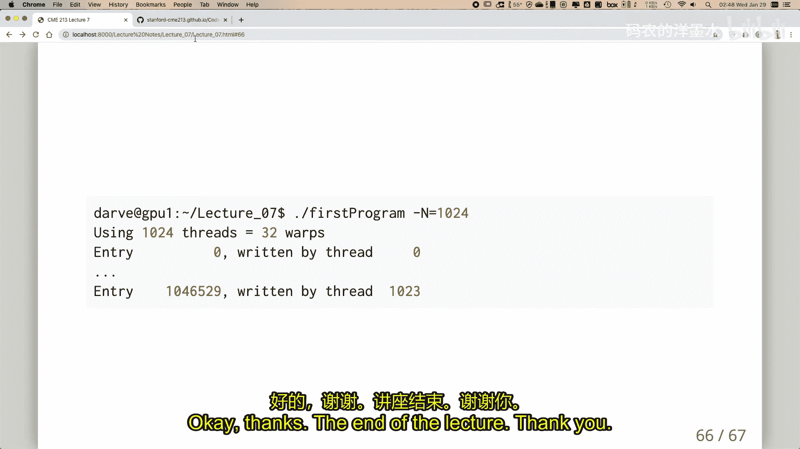