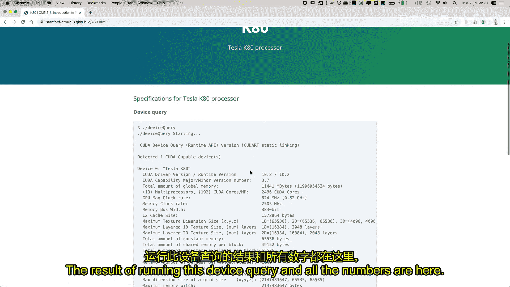
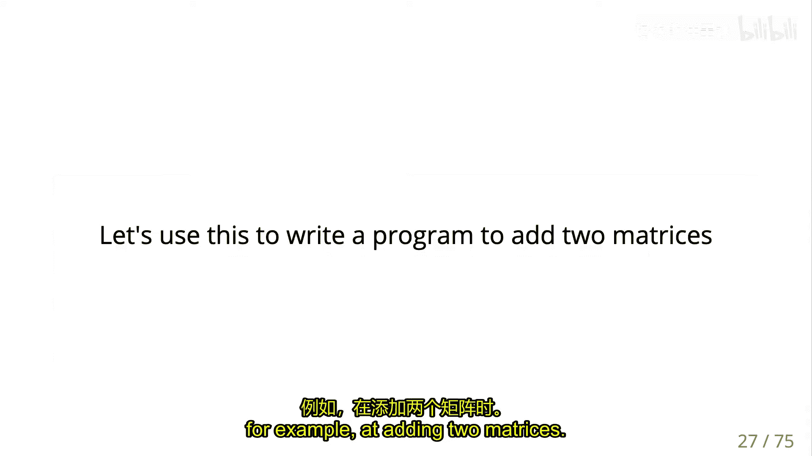
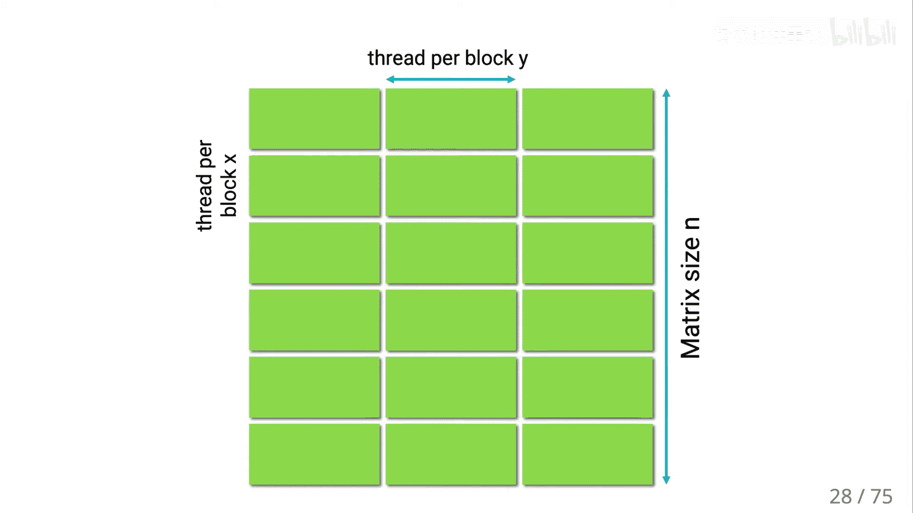

# 【全集】斯坦福大学-并行计算导论-CME213-中英字幕-1080P-p08-Lecture-8---NVCC--BV1f8ijBYEjR_p8-

Okay， so let's get going。Yeah， so we released homework three， which is that homework。

So the first we got homework。We're try to go through all the slides for today。

 maybe a little quickly， but I basically need to sort of finish。This introduction， so you guys can。

You know， do the。Do the homework three。Okay so。So first。

 let's start with sorry I'm going to keep you short， but let's start with the。

The script or the program that I gave you the best time。Okay， and。嗯。

So I don't know if anybody did that， maybe not。I are doing this now？So I tried to go on。

The been request for a GPU I waited for。Two days， we decided about more and the GPU settings still doesn't。

是不是。Yeah， I created another project。So what I've seen for some people is that you need to go under add little note to the GCP instruction notes。

 but you may have to enable the compute Engine API so you need to go to API and services library。

 look up computeute Engine API， hit enable and then the quotas will show up and then you can go through the request process So there are instructions on I've updated instructions on the。

所以说。How many do we need for？Just one。Yeah， just for you。啊。Okay， yes see if you have issues you。

 So now you guys you need to get this thing going。Yeah。So if there are issues。

 you really need to be on top of it and even have a TA， so I don't monitor what's happening on Canva。

don't get stock。You know， on these things， but you've been new to to finish this。Okay。

 so I don't know how many were able to do this。But you。

 we definitely need that at least for homework one。So。Okay。

 so you can download the so you have to first run the script okay and then well able to you know its going to create this virtual machine。

 GP1， you can log on the machine using basically G cloud compute SSH so it's。It's not a street SSH。

 but it's wrap around SSH essentially。Okay， and。All right， so you copy the files。

So use essentially the you also have instructions on the if you go on the data website。動か？

For the instructions at the beginning， you have tells you how to copy files。To and from the。

Google Chrowd Comp， so you can pick the files local in your computer。And then essentially you an SCP。

 I mean it's Google Google， it's Gi。Once to remember this syntax， SCP， and so on。

 so you can copy this file from your local machine to your instance， GPU1。

 and then you log on your VM and now you can unzip the file。

 so you need to unzip because there is a directory in there。Could I help her which？

Needs to be there for this whole thing to work。Essentially。

 I copied some of the files from the Ka samples。So you need to need this helper， this header library。

In case so make sure you have the zip file。So that you have。You know， the content。

Content of a good helper。Okay so this should work， and then you should be able to write the device query。

 which will give you some information about the device。And then bandwidth there， which is running。

Some。Making some then based measurements。So can you raise your hand if you have this VM working so I can see how many actually。

3。Okay。So I guess he's spend too much time on this because the third of the class actually。

I didn't follow here。有。そう見えるしです。私さて。退就。Well， that's not okay。

 let's not spend time on this because there's a lot of things that you know。说唔点散咗。INo。

 you should not need to sign up for a free job。You should go for the coupon to think first。

 so there's an earlier canvasing out where I put it。しあ。Your code。是で。Okay， well。

 let's not spend time on this because know only an hour and a half for the class so these issues can be done later。

 so okay， let me just just go ahead。And you can of skip that part。And then after the class。

 the teams will be around。诶。deeper Google Cloud for you。Or not I don't know。Okay。

 that's the weird stuff this year Okay so if you wear device query is going to give you a whole bunch I can't here but it' going to give you a lot of information about the device and so on and this is sort of will be useful later on you can come back to these numbers and as you go through the class you know these numbers are going to start making sense and you'll see how to use it。

But okay， so right now， it's just sort of making sure that， you know。

 assuming Google Google cloud willing you know and so on， that it can actually compound its code。

 And then the bandwidth test， So I mentioned you have post a device。

 And so I mentioned that this has a very low bandwidth，8 gig per second。Whereas device to device。

 which is basically memory bandwidth， or it's basically memory to Rexto file or to you know essentially the computing core。

 so the GPU memory to GPU core is way higher， so there's a huge volume of transferring data between the CPUU and the GPU。

Okay， hence， you have to really limit。This host to device transfers。

 meaning you send some data and then you have to do a massive amount of computation before trying to read back the data。

Okay， so I guess first program。So let me just go through that。 So you know。

 maybe you'll have to run this later。 but you know， I don't want to。Get hung up on this。

To long so the first thing is there is this， so I mentioned the kernels are launched asynchronously okay so it's not really a big deal and very often you don't have to really worry about it。

 but you know especially when you're sort of new to this and you're going to make errors。

The kernels typically fail silently， okay correspond with the graphic rendering。

 you ask the graphics card to render a scene and somehow there's some error in instructions you're sending your open GL or whatever some bug on the card。

You knowIt's not going to interrupt the CPU or， in fact， you know。呃い有呃。Yeah。

 there's nothing that comes back in case of failures。😡，So when burninging kernels。

 it basically sort of follows the same pattern that essentially。

 you know unless you do something special， the kernel will just fail and nothing will the CPU will not know about it。

so hence， that you have this function check Qda errors。

 which will check whether bad something bad happened。

Or whether the current was able to run and so on。So for example， around Kuda Manoc。

 you can put these checkze ka errors to see whether the allocation was done。So now。

 if you look at this。So you have K a， so you start by alin memory on the device。

 so the output is a pointer。So here it gets little confusing but you know。It's。

It's not too important for us at this point， but for example when you say could matter what exactly is happening so D output。

Is a variable。That exists on the CPU memory。 Okay， so it's a memory location on the CPU。Okay。

 so once you quit that that， you're actually running a function on the CPU， okay。

 essentially the CPU is at making requests。To the GPU， essentially running a CPU function。

 and then the Quda driver essentially takes care of executing this function on the GPU you run this function。

Now there is a memory allocated on the GPU and what comes back is your dress。

Of that memory location and this memory location is stored at know in the variable of the output。

 so the output is variable on CPU it floors。A memory address that we live on the GP。Okay。

 so for example， if you say star the output。On the CPU， this is meaningless， it's about。

 going to start the output on the GPU。Only that。That makes sense， okay。

And when you say kernel want and the output， okay， so what you're saying is you're going to run a function function called kernel。

And you're going to with input argument to the output。

So we'll look in a second with this function actually does。

And then after that you just have standard STL vector H output。

 you know could andM copy so you're transferring data from the GPU back to the CPUU okay so you see the could andM copy device to host so here's this argument specifies which way the communication is going so you say device to host the device GPU host to the CPU okay。

But here you have an address on the CPU， here this is an address on the GPU， a number of bytes。

That need to be transferred。And then you do Kuda free， which is basically the opposite of Kuda。呃M。

Okay， so any any question about this So what right， Okay， so yeah。

 we'll get to that's the whole today's lecture And so a couple remarks， you know， first of all。

You can see the delivery memory management。Is different from usual is a little different。Okay。

 and you have coulda matter， could have free and so on。 So as a result， you know there's a lot of。

Data structures。For example， SEL like vector data structures。

It's kind the infrastructure that are not usable on。On the GPU， okay？

So there are a number of things that， you know， for example。

 we can' create a vector int right here and somehow use it on。On the GPU。All right。Okay。

 so now so what are these Chevrons。 So we're going to go over the arguments， but。

Do you have special arguments？Okay， so let's keep the one for now I just look at n。

 n is basically just a number of threads。That are going to be running this kernel。Okay。嗯。

And so the the number0 and minus1。嗯。All right， so okay。

 so the way this gets executed is it sort of looks a little bit like openM。

But the idea is that when to interpret this。Is that there is a full loop implicit。

When calling eternal。Okay， so it's a little confusing the first time you see it。

So coming back to the original code in Maine。Right here。

 what you're doing is simply Connell was just one。You know， input argument， Okay。

 and then the function。It's just this。So there is no loop， okay， there is no for loop or anything。

Okay， but。So what is happening is。Unity character， we just check on the one end， so this creates。

These threats。From0 to a minus1。So each thread is going to have a simple ID。

Okay so the thread ID x dot x， so this is so called built in variable。

 the compiler and VCC knows about this variable。You包 that variables with。

Deing whether the headers and so on。And so it's taken care of by Kuda， and so each has a F ID。

 and so essentially what's going to happen is you have these n minus1 threads。

And each thread simply is going to run。This function。Okay， and since each thread has a unique ID。

 then you know， they're all going to call F。Of their ID and then essentially write the output in this array。

 Okay so essentially this is an initialization where you're looking through all the entries in the array。

And then you're computing F of I and assigning this to out I。Okay。So when you run a kernel。

 okay you're basically specifying a function， you specifying a number of threads。

 and then all these threads get created and then each thread is going to run your function。

 so it's exactly as if we have this an openL parallel follow loop。Okay。

 and for each iteration of the loop， you were creating one frame。So this is how it works。Hence。

 the sort of process of writing K code a little bit。It's you， get of close to a get some level。

 you going yourself from your code， you going to look。For the four groups that。Can be paralyzed。

 so you're going to take the outermost loop that can be paralyzed where each iteration is independent。

The content of the loop essentially become eternal。

And then the number of iterations you want to do in the loop is basically the number of threads you make declare clear。

你确。Okay。So does that make sense， I mean， once you do this couple of times， making get used to that。I。

 it is a sort of a different way of。So it's basically a type of open MP。

 but where you have essentially a massive number of threads doing the work。

 right number of threads in going to be in。あ有。Tens of thousands million in in that rage。 Okay。

 so it's huge。Okay， so we need gigantic for size 100000，1 thousand0 might start。Be to work。

 but 100 would be way too small， which can depend also how big your function is。I here it's very。

 very small。Okay， yeah so we put like。The inner for loop inside the kernel。

So if you put a photo inside the kernel， then simply what this is saying is that each thread will just run this photo。

So let's say， for example， you have a nested loops。Okay， well then the outer loop。

It would be sort of gone and the inner loop would just show up here， for example。

 if you had a product a matrix vector product the eye loop would be outside and then the gym loop would be right here。

And of course， you have the same thing as as usual race conditions， you know， for example。

 if you were to do a matrix vector product。You want to assign a threat per a row so we can do the plus equal。

 and there's no risk condition。Okay。All right， so let's so now you've probably noticed these keywords。

 global device and host。And so now this is the next difficulty。

 which is that now when you get there function。Well。

 possibly it be it may have to be compiled from the CPU or it may。Have to be compd with the GPU。

 okay， obviously the batteries are going to be different。We running different processors。

So this is basically where these keywords are diu。呃。So let's start with global， okay？

So global host and device。 So actually， let's just go back to this example。

 and I'll just explain from this example。So first one。

 most the one you would need most often is simply global， O global。

Means that this is a kernel that will be called from the CPU and will run on the GP。

This is basically what I just did， okay Col， Chevron。As where Che。

 this has to be a kernel a global function because we add this global and then。

The cool compiler will realize， okay， but that's a function that needs to be called from the CPU。

 so it's going to be looking for that call and then it needs to compile in the version。啊，这个经济。い電ロ。

take care of coordinating in the CPU and GP。Okay， so this is global。 this is the most common。 Now。

 device and hosts。 Well， you can see that here， for example， I'm going F。Okay。

 so F is running on the GPU。But very importantly， S is not a function that the CPU is calling， okay。

 it's not using Xmpron or anything， it's just a function that shows up。

Inside this GPU function kernel， okay so it's basically you have something running already on the GPU that's calling a function。

 running on the GPU that's called device function， okay device。

 meaning that essentially it's a function that runs on the GPU and it is callable。From the。

deviceice and then while host， what do you think is host？We are right， so it's basically a regular。

 just a regular CPU function。Basically function you can call fund the CPU， compile powerful CPU。

 run on just a normal function。Well， at some level， you know。

You skipip post except that technically if you just had device。

The compiler would not compile F for the host， or if you call F on the host that will be taken to youba。

But if you put nothing， neither device nor host。😡，Then essentially that's the same as host。

It's just a regular normal function。Okay， so conclusion。

 this is what you call with a Cheevron from the CPU。And whenever functions show up inside。

 they have to be device functions。All right， so this is sort of summarized here， global means again。

 executing on the device。But callable from the host， it's a very special function。

 requires this Chevron's on。Host， this is just a regular function。

 execute on the host call from the host， and device is executed on device。

 but coable from the device Okay you can call this from the host。Okay。

So these are different functions now you also so I mentioned thread IDX。Right， so we'll。

So I'm going to come back to that。But this is a built in variable。

 it just gives you the idea of the thread and you can use it to figure out what that thread is supposed to to be doing。

So now， if you run。This code first program。You can notice a few things secure using32。So。嗯。

So first of all。Where did things happen？When n is not a multiple failure。Sometimes will run。

 sometimes it will fail。Technically， it has to fail all the time， but for some reason it works。

Basically， theres some memory eruption with evidences nothing to do。So if whether it works not。

 but so if you have N equal 32 or multiple 64 in order 96， 108， then you're fine。

 okay other than that there is a problem and the reason why this is the case。Is again， because of。

These works。 so the friends are grouped together by Du of phase2 in the award。

And all threads have to the same instruction。 Okay， there's no avoiding that Okay， So in fact if。

If you have， for example， a branching。And if you say， oh， if my fair ID is less 10 16， then do this。

 otherwise be nothing。Then while this branching will be respected。

 essentially the other threads will just be sort of idle。Perhaps you do something。

 but essentially either。result of their operations would be discovered they think as either。

Half of the work doing something， the other half sort of been idle。

 but essentially you you can think of it as just simply。

All the friends in the world are just executing the same instruction at the same time。

 So for example， if you go back to the code now， so let me just scroll back。

 see what the code was doing。You can see that there is indeed a pro。That。For example。

 let's say I declare， oh， I want to run with just 16 threads。well。

 I'm going to allocate memory for a vector of size 16。But here there's no air statements。

I'm not changing the size of anything， So in principle， I'm only running kernel with 16 threads。

On the vector of size 16， so if you just look at the code。You know。

 threat LX cannot be greater than 16 and everything's fine。

 except that if I tell you that all threads in the warp。

Have to execute this same instruction and now it's so about because you going have threads that are basically。

 you know， let's say between 16 and 31 that are going to execute this function， but now。

It memory direction。A you're trying to access a memory location that would not help。

So you have to be careful right although it looks like here no particular problem。

 I'm launching n thread， my vector has size n， well in Valentine not exactly because all threads in the world has to do the same thing。

呃。So you may have more threads than you think， so to speak。Okay。

 so this is number of things you know， so number one is you know n should be a multiple of 52。Okay。

 and this is something that anyway， you'll be doing throughout the quarter when we decide number of thread is always going to be a multiple authority affiliate。

Because otherwise， you know。It just essentially doesn't make sense。So okay。

 number3 has to be number 32。So we've established that and so here for example。

 I'm computing 32 threads， one warp。And then you have for 32 wars， okay？And if you run。

At more than 1024， then you run into another home。😡，Okay， so it says。Inval configuration。So mind you。

 this air was caught because I used， could I get less air， otherwise？Gdge。This error。And so， okay。

So how to figure out to know what what this is all about So you can go online I。You know。

 did this for you？And you know， you can look at this data sheet of basically this。

The result of running this device query and all the numbers are here。

And so if you look at these numbers。You know， it's going to mind boggling but。

So you can look at it so could capability 3。2， we'll come back to that so you have the memory。

The speed of everything， size of the L2 cache， we'll talk about that， this is very important。Okay。

 constant memory we share memory so we'll talk about this later， so warp size。

 so this is 32 so but this is pretty much constant in principle there is a variable called warp size。

 built in variable warp size。But for all existing g views right now， it's always steady to。

They're sort of fixed。But now you have， you know。Some numbers。So these are the important numbers。

Maximum number of heads for block。The maximum number of feds per multi processor。So like I said。

 you know， old threads。Require resources to run， so essentially memory resources。And so for example。

 I mentioned that。The processor is organized into a series of streaming multiprocessors。Okay。

 of we are me。Big sub unitss， okay？And now you have this concept of block， okay。

 so a block is basically a group of wars。And one block， an entire block。

Must reside on one student multiprocessor， okay it's not possible for a block to live across two multiprocessors。

It says to be entirely on one multibuster， you may have more than one block。Per multi processor for。

It's engine no fractional blocks。So now maximum number of fit would block 2024。

 well now we can see you know what was going on， so the chapterron one comma N。

 what the one is saying is，Were getting one block。It' a 10243s。and since the maximum is 724。

 if you ask 2025 threads。For this dog， it just fails， and patience doesn't exist。

 it you not possible。So the idea therefore is that if you want to work with an array that has size greater than 1044。

 you've got to use one one done。So there's no way around that， okay。

 your calculation is always split into a large number of blocks and each block into a certain number of threads。

So now the way this happens is you can also see that， okay， you have。You know。

2000Now this is the number of threads per multiprocesor。😡，so for example， if you declare， oh。

 I want100 threads per block。😡，Then how many blocks are you going to have on one multi processor？

Right， too， okay， most two， because you can run out of some other resource， but let's say maybe。

If you say I want 500。Right。Fri 12， you can have fourth， so on and so forth。

But you also have a maximum number of blocks。Per multi processorces。This is here， Maybe not。No。

 but there's also an maximum。Right。So。O。So hence the way to think about this。It's basically。

 you know， you have these blocks that have to live on each multiprocessor。

 and essentially the size of the block is limited。By the resources that you have available on each multiproces on each of these SM or SMs。

So this number is actually being fixed。YouIt means the number affect a block。So it raise us up bound。

 but it's going to be more or less the same in all your programs。

Okay so you can think of it as being， for example， 5，12 might be a reasonable choice。是 number of。

Wats per block is32？Number of wars for I't count Y India。32 square。你 so诶我呢。

How do number worse the wrong？呃。Yeah， I guess you're right I mean， I don't know。 Yeah。

 that sounds right。 I mean you just look at the number of threads per block。

 32 threads per warp So yeah， you divide that 32 Okay so yeah that' 3032。

 so you has 32 warps per block。And I guess 64。Wps。At most remote process， that's right。Yeah。

 you can do these calculations。Right， so hence。Well， we'll see how you can vary。You。

For optimization purposes， the number of threads per block。呃。The roughly speaking， you know。

512 is going to include number。30亿。Okay， so I'll leave it at that for now， you know so maybe 256。

5 12， you know one of these numbers is typically the right this number is sort of fixed and then depending on your problem size。

 what you're going to really vary is the number of blocks you have in your grid so that you can have。

The number of threads you want and you can compute your calculation。So you guys see how it works？

Yeah。So let's go back。Okay， so basically that is not the full syntax。The the first。

The number of blocks and the second number is the block size。

 the number of threads you have in a given block Okay so now with this， you can essentially go to。

Go to any。Go to any size you want。 Okay So again， just to summarize， you know。

 calculation is organizing two number of blocks。In one block as to fit entirely in HSM。

 and you know then you have a lot of blocks that essentially form the entirety of all the threads that you want to run on your device。

 that's more or less unlimited for。You know， all purposes。 So this is just an example of， you know。

 how things work。So again you have so at the top essentially your blocks。

 each block is a large number of threads， and then the way things are run。

Is that you're going to sort of schedule these blocks。

On HSM and essentially just keep executing the instructions。For all blocks and when you're done。

 you just move on to the next market so。呃。RightAnd you can see know again。

How you know why this sort of works。Because really what you're doing is you're allocating resources for threads on HSM。

And then when you look at what the execution is actually doing， you know for example。

 let's say block zero， okay so here you're basically going through an instruction counter。

 going through your program and executing all the instructions。Okay， you're moving to the next block。

Okay， well， you know， technical changing thread and so on， but in reality of the hardware。

 the only thing you're doing is you're just implementinging a counter。

 like just changing the index of the current block and just essentially repeating the same function。

Okay， so that's why going from one block to next， there is no cost which cant actually do anything because in by one。

 the block index and just moving on so the scheduling is like super fastest。

So the only thing you have to keep track of is， what's your block index and so on。

 which instruction you're at， and then the scheduler can sort of go about it。So for example。

 an example you have two streaming multiprocessors。

 then you schedule the blocks on these two multiprocessors。

 if you have more streaming multiprocessorss and of course it goes way faster it goes like this and so just as a side note you know kind of looking ahead a little bit。

Is， for example， you can see that， say you had five blocks。Okay， if have five blocks。Well。

 on the left you'd be sort of semi I okay， okay， you would do this in like three passes。

But here it would be much worse because the first pass， everybody would be busy， second pass。

 only one S has actually need work to do。So when you look at the phone。

 you may have these weird effects。Of regularity。Because of the number of clocks I' trying to run and the number of SMs that are available。

 you may have situations where few SMs actually are doing any work。So that's why， for example。

 it's not necessarily a great idea to have very large blocks。

Because if you assigned a lot of threads for golf。跟。You have fewer blocks。

And so it increases this problem。It's better to have a lot of blocks that print fast。

Because essentially then for example， then sort of the situation of starting and finishing is less visible。

 so that's why 256 and 512 are good numbers but typically theyre big enough of performance and this gives you a lot of blocks so that the scheduling is very smooth and all the SMs。

Tend to finish around the same time。Yeah， so did you kind of feel like？Generic GP， you'd say。

 I have look up how many streaming mold processes you have。悲心咧。Like how many。

Pieces of data you need to do kind of divide those。The size the numbers a little bit。

 so you get a good number in box that okay， so no it's a little simple than that， fortunately。

So really， the only parameter you have is number of threads per block。

Because basically the total number of threads you want to run。

That smallness depends on your algorithm， that say it's your vector size number entries in your vector simplifyifies。

Okay so this is going to be roughly independent of the hardware。

 okay like he said the first approximation， so the number of nerve edge you want to run sort of fixed and so really your tuning parameter is how many threads per block you want to have。

And that you need to play around with a little bit， but like I said。

 there are really only finite number of reasonable choices。

Like this default number I mentioned is d5。Because you the scheduling and so on。

 this is all figured out while the operating system or the scheduler。

 so you don't have to't actually， it's not visible for you。Does that answer the question？

So is an ideal？西。あさした。major。Well， no you want to finish at the same time。

 so basically there should be like full rectangles full rectangles。If you have。

Any control over it me？He wanted to be。Do you want that rectangle to be squared？Okay。

 all right all right，So first off， in this figure。We're looking at two different types of GPUs right like this is a GPU with too streaming up I mean this is actually not real GPs because they have more Ss right this is one type of GPU。

 This is another type of GPU so you don't get to decide how many Ss you have for example。

 I guess in our case it's 13， that's it。Okay， so number of columns is sort of fixed。

So by designing a number of blocks， just designing a number of rows， but like I said。

 mostly you want it to be full， so you can see that if the blocks are small and you have a lot of them。

Then it' going to be very， very close to essentially the last row would be short。

And then we will tend to finish more less at。But if you do some testing on small problems。

Then definitely you start seeing these effects， right。Well， it it sounds funny， small pro吧。You know。

So these gigantic problems。 So， you know， it sounds like there's a lot of reps to do and so on。

 but in reality early。You knowOnce you go into your code， yeah。

 there's a lot of kernels to be run and so on， but very often you actually do need to run a kernel on dataset thats。

It's not gigantic， it's not small， so let's say you want to run on GP it would take some time。

 but it's not gigantic either， and it very often folds in middle ground where you start seeing these effects so the prom on this。

 for example， the V100 and so on， we saw it has a lot of essence。Okay。

And each stream multiprocessor can host a to of friends。

So you really need a number of threads that's really gigantic and it's not always obvious how to do that。

Just as a simple example， this concept of batched。Thattch Jen。Okay， batch matrix， matrix， product。

The reason why people came up with this is， well， you。

 who wants to do matrix matrix products with matrix2000， is's actually not that common。

But it's very common that you have a lot of smaller size。Ma matrix S need 100 or 500。

 but you just have a lot of them and needs to even smaller。

So then now it becomes a lot more complicated because each， say each matrix matrix of such 100。

 that's not enough work。To keep all the Ss busy。Okay， so you have to think about it differently。

 thats just okay， well， one block。You're going to do one matrix matrix product。

we've had enough logistic products then maybe I can keep everybody busy and so on and so forth。

 so it's starts getting quickly quite complicated。So the fact that you have a massive amount of concurrency。

You know， sort of sounds great on paper。 You can get， you know， amazing performance。

 but you've got to have enough work， concurrent work to express a new algorithm。Okay。

 so now in terms of expressing dimensions， so again。

 you get to will familiarize yourself with this you know in the coming weeks。

 but the wind indexing work is basically。So you can use thread scroll block。

 so this is indexing of the threads in each block and then none blocks is basically the indexing of blocks inside the grid。

And each index has basically can be either just a skillr that's basically dot x。

Or it can be two integers， dot x and dot y， or three integers， x， Y， and z。

 so you can think of it as just being a long array or being rectangle or being a parallely。Again。

 you specify these dimensions， so it's a dimm three variable， so it's in general three ins。

And you can specify just one， two， or three depending on- so here this is just for sort of convenience。

So if you form it naturally 1 D， you to use just one dimension， but if it's actually 2D or 3D。

 then you want to go to the FD， so just to sort of a convenience。Yeah。

 I'll just give you that there are a few other considerations， but you know it's really just。

You know， let you say this just a convenience about how you want to index， for example。

 if you have matrix， then you wont touch x at y。Its doing dangerous。Number。Okay， so let's look。

 for example， at adding two matrices。

So if you add to matrices， this is what this is going to look like okay？Essentially。

 you can video your matrix。So， again。When the hardware provides you。

 it's basically just a bunch of threads that can do something。

And what your current defines is what a given thread is going to execute。

 so that's not big give to you。 it's try to do anything。So for example， if you look at this matrix。

 I want to do a equal B plus C。Well， it sort of makes sense that maybe one thread is just going to do an edition for one entry。

 this is simples。But actually， you also decide that one thread is going to do an addition for like a small two by two block or a small format4 block or like whatever you want。

So you have to decide essentially this mapping from the 30 next to。The actual workload like inta。

 So here let just you think simply。I just want to add two matrices and for the NGIJ。

 I'm going to have one thread， so one thread per entry in the matrix。Okay。

 so now you look at your matrix， it's a square matrix of size n to n by n。

And so you've got to divide it。You know。Inter these blocks。So I'm going to use the 2D indexing。

 so I'm going to have dot x， which I'm going to say it is the row， it's the first one。

And then the dot Y， which I'm going to say is the column。So we x like。

 that's like matrix and y sort of horizontal it's going to come。And so here， what this is showing is。

 well， so this example is a little twisted， but this was just making the example a it more less trivial。

I decided that a thread block would not be square so in fact。

 what I picked is I picked thread blockss that have only two rows。

And then there's certain number of columns， Okay， so it's a big。Now this is your basic block， okay。

 two rows and a bunch of columns。And now you have to keep tiing these blocks until essentially you cover your entire wgets。

So again， you decide what's the size of your block， how many threads do you want in each block？

And then based on this， you can decide the total number of blocks along x and along Y that's needed to just carry out the calculation to just do everything that needs to be done。

Okay it be false so far？Okay。So。So the way this goes is NS phones。

And。Yeah and this is obviously know can complicated but you know that's how it is so I'm going to declare threads go up so here like I said you know I going to take two peru and then this parameter end thread which controls how many threads I want。

You know， across the columns。Okay， now you want to up in number of。Blocks per grid。

 okay so how many blocks of your grid， so let's just look at the second one is a little easier and then we look at the first one。

So essentially， the number of blocks is roughly speaking， just a magic size。

Divided by number of thread and divided by n thread。Okay。

 but there's a problem because you can't have fractional blocks。Okay。

 so essentially the last dog has to go beyond。At least to end， but because it has a fixed size。

 it't even go a little bit further。Then理 hit。So hence this is this weird stuff here。

 so basically this is just a seal。Okay， you do n divide by n frame， and then you take the seal。

 So you take the。Smallest integer。That's larger。That kind rain Fred。And if you do integer athmetic。

 that's how you do it。n plus FM is4 divided the n。You can trust me on that is's actually seal operation okay so you do essentially you will look at a number of blocks。

 you end up with a fractional block at the end， it's a half block。So you round it up。😔，そ吧。

This is running up。😔，Okay，' showing up to n and see for x。

 it's the same thing except that I assign two threads along that dimension。

So it's n plus one divided by two is correct。And now you your blocks， this number of blocks。

 that number of blocks along x， number of blocks along Y。Now I take these two numbers， nu blocks。

 threads per block， and this goes straight into your Chevron here add。Mattrix size， you know， input。

 input output， these are pointers as I'll get memory you know ahead of time when you call the kernel on。

This。W do we have a minus-1 there。Yeah， so the minus1 well。So， okay， so actually。

 let me just skip the next slide we can answer that。Well， you can just write up。

And see that it works。 So basically， this is the formula。 The number of blocks is。

Never threats you want。Plus。Number of fed per block that you've assigned -1。

 and everything is divided by number of feds per block。 So more just total number of feds。

Youiv by the size of each block， but you have this bit minus one。😔，To do this running up。Okay。

 so if you're not convinced， you can just give it a shot。C诶嗯。So I want you to have five friends。

So this is the total number of threads I want to have。And I'm going to have to round this up。

我其实 say five。Now I want to create blocks that have four threads per block。Okay。

 so since I want five threads。ok， are you就 two glove。Okay。

 so actually I going have eight threads created。Five that do some work and through that idle。

 and we'll see how that happens。感谢。So你的住那。Number of number of heads I want five。Plus four minus1。

 three，5 plus three eight。D I by 42， okay works out。

And so you can see that nu third per block minus one is the right formula。

 say that you put a four here with one block。You have four。Plus 3，7，1。Okay。

 so he works up correctly gives you。Yeah， it's didn teacher around it。也 you could do有 way to do it。

Running down， no running up。So you run it the next number of blocks。

Oh yeah I'm saying this division operator。All right， exactly， the integer is I'm sorry。

 the integer is basically the motion。So interior division。

 so you can as a float where you drop the decimal。So it is sort of running down to the。

So you can think of it as indeed a rounding down。So if you add n minus1。

 then you actually get the run。So以 do好。Yeah， I guess I could have added the little function。して。

We work to Spain。People insist on writing it like that。I stick to。

 you but this is weird that you have thousands of lines of kuda that have this n minus1 the。Well。

 that's how it is，IBecause the hazing， right to go to that to be a real career parameter。😊，Okay。

 so let's jump in well all right。So there's another bad consequence with that。

 let's say I wanted to have five threads。But I'll get two dogs。

 so I really have paid friends running。But I need just one in five， so， what do I move to left？Well。

 so you have the control over that， so eight are going to be running。

 so hence you need a statement to make sure that you do not go out of balance。

So this is the second bit that always happens is first of all。

 you're going to ground up the number of blocks。Okay， so at least all the size you need。

The second is。Because you round it up， some of the things need to be idle。So it's a taking bids。

That's， you know。Could have been added to the Ka library just for clarity is that basically when you start a account there's almost always an a statement right I typically you chapter and sides and then there's an a statement check whether you actually know a legitimate thread or just a effect that supposed to be idle because of this surroundinging。

そ分 anyway。They know me around that。But you cannot。There's no around that for a couple of reasons。

First of all， like I said， integer blocks。And then even more than that。Well。

 then there's this other argument that I talked about， which is the war you cannot kind of work into。

So， you know， unless n was even in multiple or 32， you know， so anyway。

 this F is needed for many reasons。So you have this。Okay， all right， and so here。Okay。

 the next bit is how now you calculate in this business？You have a third ID okay。

 so it's a little more complicated than the first example。

 because now you have your ID inside the block。And then you have your blog ID。ok。So。Now， again。

 it seems to me they could have just given you a function like what's my F ID because that's what you do like 99。

99% of the time， but no。You got your ID inside the block and your block ID。

 youve got to reconstruct like your global ID。So this is a formula for the global I。Okay。

 this is the number of threads you have in your block。This is your block I。Okay， so basically。

 and that is your thread ID inside the block。 So for example， that number here。

Maybe it goes from zero。To 1023 or  zero to 511。对。And then this is 512 or 1024。

 and that's whatever blocks you have and this can be you somewhat。Morejo number。Okay。

And so here I'm list in this table。You know， all these sort of built in variables。Fed ID X。

 which is a F index in the block。Block them。That's the number of threadres in the block。

So basically third ID x is between0。And block D minus1。Then you have your block ID。

And that's basically the number of blocks。 So again， block ID x is between 0。And red D minus1。

That's when he's going to use this。It's there。And all these variables had in dot x， dot Y， and dot T。

You may or made呢。You want to use it this optional。So obviously do dot x most likely。

 but the dot y and dot z are sort of optional， it depends whether you want to have 1 D。

 2D or 3 indexing。Okay， so basically， you see that coming back to。呃。Once this lecture。

 you see how old is complicated business。Simply reflects the fact that you have these streaming multiprocessors。

That are sort of independent， okay， not coordinated。The fact that you have these groups， of course。

That all execute 32 course， that all execute the same instruction， so this is with concept of reward。

And then B is basically saying， well， you know， coordination won' exist at the level of a stream multi processorcessor。

So I'm going to create a corresponding entity in the language， a block that's it on1SM。

And they can have some coordination only inside this do。Not between blocks。

 and so this is affected by this indexing scheme and so on。Okay， and last bit is this thing here。

 so basically going back to the code。It looks kind of not super nice。

You'd want ABC to just be vectors。But ifre asL vectors。

 yeah it doesn't work with you you's an asL vector， the memory just lives on the CPU。

 it's not going to live on the GP。There is no equivalent。So hence you often default to。You know。

Poiners。knowEven this type of indexing。So everything goes back to pointers size and so on it sort of more primitive。

 but I guess you have to live with that， so there is a little bit available and I'm going to talk much about it。

This year。But you would to thrust。You have the equivalent of the STL for Ka， but it's very limited。

 basically it's mostly vectors and so on because there's a lot of stuff that in KUa doesn for GPUs doesn't make sense。

 for example， you only list。Linked list would be very efficient， whether there's a bunch and so on。

 a queue or whatever。So essentially aside from vectors。Not much is truly useful。

 so thrust provides the equivalent of an SE vector， it has a lot of algorithms。Its the most。

It's most useful and think about first are all the algorithms that sort。Prefixt sun and so on。

And transform and this comes straight from the。Sttype with library。

 but they're very useful for running credit code。But the data structures are very very。呃，有。

More woody entry， so of course， you can write know you can write sequence best classes and so on。呃。

And writes， you plus code and whatnot。But essentially， things revolve around this。Imagine of memory。

 And this is where you。Just taking the STN and putting it on GPU is not that straightforward。

 and there's all stuff again on the SL that does not make a lot of sense on the。わな。诶。

As our data scriptors， they designed for。But we work terribly this。啊呃。Well， yes， yes， yes， yes。

 well I mean， okay， I have to think about some example， but yeah。

 there are the structures that you know are very efficient in parallel， but typically，呃。即即地经哋。

What's happening is when boom down。You。To gain。More efficiency。

 you often increase the number of flaws。Typ memory trade off the trade off。

So you increase number of flops， but it gives you extra powers and can burn on more processes。

And you're more skilled， so when you keep know improving your power algorithm and very often you end up with an algorithm that actually is not the efficient。

In ceal， because there's more flops。But just has more concurnce。by example。C的。は关。喂再单 치지啊。Yeah。

 so in in by CG， essentially。What you do is。诶一体体。嗯。I don't remember over the details。

 but basically the idea， instead of sort of just doing a matrix vector multiplicationation and then some vector operations。

You can read it by blocks， so you do multiple multis at the same time。

 and then do these block operations so you sort of delay the authorization。

And update and it's more less stable， it's a little bit like the difference between modified branch and testable branch rates。

Ticle gravity sheet is unstable if you do it by small blocks， it still works。

But you have some STG problems， so for example， this 59 Cg you get more ballasium but。

It's more unstable and you can get into some medical issues。But yeah， you can join more。More frogs。

Can you more prowls， sorry more prowls with that？So I want to talk about， okay。

 I want to talk about compiling Ka codedia， I don't think I'm going to finish there's just too many slides。

But I want to go briefly over that。But， this is a。我出 something that's very of confusing。I mean。

 on daily basis， you don't really have to deal too much with it in this class you won't have to deal with it because we'll be giving you to make fun and so on and telling you about code。

 but it's still something that I think you should know about and it's kind of confusing。

So I just want to kind of mention and hopefully you get a couple of ideas in your head that could be useful in the future。

 so this is showing the pipeline of the compiler，Okay， and so well， you can look at it。

 but its details are not super。It'sup important， so basically this green box here is correspond to one dotcu file。

 so an input file that gets compile and so on。And you essentially get the equivalent of some sort of dot or binary。

 and then there's a process of linking this with the rest of your code in order to produce one it's aable。

OkayAnd so in this business you have here pipeline on the left and here on the right。

 you have another pipeline I'm going to talk about that where you have this PTX that is generated。

And so what's happening is the compilation actually happens in two phases。

And this is the key thing that I want to talk about。 So first you're going to generate this PTX okay。

 this is the first。First Asia， this is D。Sd green line。

It correspond is concept of virtual architecture。and then there's this whole process where you actually joint an actual binary that can be run on a GPU so the green box correspond to virtual architecture。

 this PTX， this is not a binary that can be run。Something that correspond with virtual architecture。

 and then the second comp phase where you actually produce a binary。Okay， and。Okay。

 and the reason why this comes about。I a suppose。That。Well。

You need to find a balance between performance。And essentially， you know。

It simplicity of combining those。Okay， so the basic problem is that。

Why is not a pro too much for us doing research in。Most people in yourself for a business。

 you ship and executable。You won't change the source。And then ask the user to compile the source。

So there's a little bit of the problem that you don't really know the hardware the person is being to use to run their coat。

So basically you need to provide a binary for each hardware for each type of processor。Okay。

And if you go and down and install software， you're going to have oh， the Linux version。

The Mac version and the Windows version and pretty much doesn't say anything else。

But if you think about it， it's pretty remarkable。😡，Because for example。

 let say you install a Windows version。Well， hold on， I mean there's a wide variety of processors。

Why do different on at all？But okay， they all essentially follow the same instruction center。Okay。

 theres basically an agreement。As to what can do in the binary， how the binary is constructed。

The potential instruction can have a so on， and it agrees， okay， I can run all these instructions。

It's sort of competitive， okay I can take any arbitraryary processor and run this instruction set。

Okay， so that's great。But like I said。These。Processors are general purpose。 Okay。

 they're made convenientveient。Could be used for any reputationputation？For mass production。

 we were not made for specialized taskss。Okay GPPUs are different。

 GPUs are made for specialized tasks， graphics and so on， and now for John purpose computing。

And so the key for GPU is to get performance。ok。Good performance and you know。When you start GP。

 you're going to say， oh， it has this great tracing thing， you know， just look at my game。

 how beautiful it looks。It's all about performance okay。

 so you've got to have these new features in your processor。

But then the counterpart is your executable needs to take advantage of these features。Okay。

 so as a result， for GPUs， it's not the case that instruction set is fixed。

InSo just keeps being revised， so that's a major that this compute capability that you're talking about。

 3。7 and so with each new capability you have new features。

 so really new things that new instructions that can be used to program your processor。Okay。

 it's not back compatible。Or actually no it's sorry is backward combat moment。

 because example if you use new features， you cannot run on the old hardware。

 so this leads to you know some difficulty。Like how do you ship if you go it。

How make this work so the way they did it is that basically they have this two stage compilation and then this content of just in time compilation。

So they try to essentially delay co to the last minute so that when you actually run the code。

 they look， oh， that is actually the GPU on now， so let me come bow for that hardware。

Okay so if it was a full compilation， this would be tremendous。

 so essentially they tried to subdivide into PTX， which is super close to the binary。

 but it's not an actual binary。Okay， and then there is a second pass in which you transform the PGX into actual binary for actual GP okay these two phases。

So PTX is basically depends， relies on a set of features or GPU capabilities。

 so these are sort of more abstracts。Your functionalities。

You you have to try to find the right mill ground and want the PDFx will be as detailed as possible so that the second phase。

Compilation two can be fast and highly optimized， but not too detailed so that you't have a a million versions of this thing。

So try to find this mill ground。So essentially this should be as close as possible to your real GPU。

 but again， you try to limit how many different you know。

Capities you have so that you you don't have to compile your code like you know 100 times and then the second thing is build up lectures is actually binary that can run on specific。

Specific GPU。 So this is you know， kind of a close on this compilation。 So you have the Px stage。

And then you have this Kubin or K Bri， or the real SM architecture。

 and then you get something that runs at the end。Okay， and so when you compile。

 you've got to pick all these numbers， you've pick all that。So for the virtual picture。Well。

 the way it works is basically。Its sort of a you know， nested set。

So as you increase the compute capability， you just add features， like never sub features， thank God。

 so you just increase okay， so basically in terms of virtual architecture。

You should look at the virtual architecture that you know。Contains the set of features you need。

 but nothing more。You need a certain number of features。

 it's going to correspond to certain virtual architecture， and that's it。

 these are the features you need and this is the virtual architecture you're going to use。Okay。

And you see， okay， you cannot。It doesn't make sense to do something smaller because you're cooking not compile。

 it doesn't make sense to do something bigger because you would make a requirement to have certain teachers that are not actually used。

So here， virtual architecture used essentially be the smallest。That can satisfy your thoughts。

 but actually for us， it would be quite small， but I mean。

And then the read architecture is something different。

 so read architecture is based on this virtual architecture。

 then you can generate multiple binaries for different processors。

 so in principle you may want to generate a lot of bin so you can generate like few or four binaries that are going to run on the corresponding GPUs。

All right， so okay， so now how does it work？So this whole thing needs to be， you know， again。

 it's all about optimization and shipping。You know， your code and so on。

 so of course you can compute for many， many GPU architectures like real GPUs。

 but there's still a problem with that。That first of all， you pan， you can gig get each。And second。

When the next GPQ comes out。Then your code no longer runs。So that's that。

So you got to find something that's sort of in between。

 so this is this idea of just in time calculations。So the option is， okay。

 you start with this virtual architecture。Okay， and that' that is， basically， he's going to。

Crespond to the PTx， which is something close to the binary， but it's not the binary。Okay。

 so you these speech。Okay， now from this P TX， you're going to compound the PT TX to a bunch of。

Real binaries for real GPUs。So now you start your code。The driver lookss。

I had this GPU who I had the corresponding binary， yes， just load。If the binary is missing。😡，Okay。

 so you look at essentially all the real architecture that we' compiled。

 but the one I want is missing okay then you go to the PTX code and compile the PTX code for your GPU so for example。

 it's a brand new GPU okay the binary is not contain that well you can go from the Px compiled and run So it's not。

As's great because you have to start time and you go compile on， it's not super long either。

 but if you cant avoid it， definitely you won't avoid it。

 but this sort of provides a full back position。To be able to run your code。

 even if it was not compile for your GPU。It is concept of just in time compilation。嗯。

So typically this will work if you have a brand new GPU， but it's not going to work backward。

 like for example， if your virtual architecture is 5。0， which is very recent。

 but you have a very old GPU， then that doesn't work because you're requesting features that actually do not exist in your hardware。

 but the more interesting situations for vendors is you purchase the latest GPU。

 now it's going to run。Because have more features， and so you can take this BtX and write it on the GP。

So let's kind of play with that， So I'm just going to give you some examples of how this works。

So first of all， to declare virtual architecture， it's always compute underscore。

 and the real architecture is always S underscore。这个 is个。No making sure that the use。

So things up if I see this。So NVCC， this is my compile， I have my dotcu file。

 then I declare my virtual architectures， this is GPU architecture， virtual architecture。

 so I said compute 50， so this set a feature list and want。

The PTx generated is going to use50 features， which is the PTx， stage one。Then you go to GPU code。

 okay that is stage2 now you take this ETx generate by for all these platforms。5，0，5，2。

So this code runs on 5052， so essentially if you look at GPU code。

 this tells you where this is going to run。And this again， tells it the virtual architecture。

 so for example。these numbers cannot be lower than this number because here you the minimum feature set。

If you run old hardware， free zero inconsistent。Okay， but here， of course， you get later numbers。

 like five， two， six， seven。So I'm going to skip that since we had a cool running。

 but if you run this on GCP， what's going to happen on our K node？家と比话先。S。

 So what do you think is going to happen？Well， onces con of our GPUs。I have 37， 3。7， KVT，3。7。Okay。

 so where a 3。7 can evolve， it's the Kepler。Okay， but it's cheap 510， Do you remember what it is。

 but this is way more recent， this is too recent for our part okay。

 so our card cannot run so if you compile and you run， it will say no binary。For this GP。

 it would is bail。So fail because we're SM37。Now， if you do that， what happens？

Fail because you're requesting you features 50， okay that's your PTX。

 but then you're running on hardware that does not support 50， so that's also a fail。Okay。

 so SM37 does not support the 5，0 features。Now you can do this， Okay， so that actually。Okay。

You can do this but still fails， Okay， you can compound out。

 but that's still not the hardware that we have， Okay， so that's not super logical because you know。

We need that， but there match with the mismatch with the SMM。Okay so now this one。

 so note the difference。This one， I'm doing a binary for 50。 that doesn't work。Here。

 I'm still doing a binaryai 50， but I'd also say oh，😡，You know， while you add it。

 include the PTX for 37。Okay， so now this is going to work。Okay， the binary is missing。

 but the PTx is there and it's a 3。7 PTtx。Which can run on SNV7。

 so it's going to be to just in time virus。So it's not super great because you have suggesting time compile。

 at least that thing will compile and run okay。So again， S N 50 is wrong。

 but because you have the PT T X that's loaded， then it could be jinco aboutd and and run。

 and this is going to to work。Okay， so the bottom line is I want you to know about this because know going forward you know you want to compile your code。

 you've got to figure out what GP you have， your compute capability and the option to compile of course the this since the hardware is fixed you homework from now on which is good with this option okay。

 compute 37 and SN37。And if you're you know if you're lazy there are some shorthand。

 so actually we're even going to use a shorthand， we're just going to use architecture SN37。

 which is a little bit of contradict because architecture is supposed to be followed by virtual。

 but when architecture just followed by a real GPU。

 this gets extended into PTX for this and then compile for this exact。

Platform and also include this Ptx。 So we're sort of good。 So actually。

 this is what we're going to be using to compile our code。Okay。呃。So there's another shorthand。

 So now if you stick GPU code。Then basically， it will just turn the Px and then just include that Px that said no binary actually included。

And so， so just to conclude， this is what you have in your homework。

 So you can use GP PU architecture， GPU code or this art S7， which again， you know。

 essentially has S M plus P T X， which actually don't need。 So this is you know。

 a little bit inefficient in that respect， but you know。It's a little bit shorter。

 so we kept that for。Further their homework。By the way。

 so I wanted to explain this because it's kind of very confusing and you know we can refer to these slides later on。

 you know if you want to use that， so just as a reference you know here you have the list so not going to click here。

 but this is a link to the virtual and real architectures。Okay， so。Okay。

 so let me just wrap up with a couple of things。 These options for compilation， nothing you know。

 unusual。Debug on the host， Dbug on the device。 This is the G profiler options。

For the underlying GCC compileer for the host。Optimization level。

So just to note that there is a visual providerr， but we'll talk about this later。

There's a Qdar Men check， but again I don't want to talk about that， but as a reference。

 if you're interested in checking your memory， you have tools to do that。And okay。

 so now this is stuff thats for the work。Unfortunately， it's 50 so I have to stop here。

In terms of your homework， you can， you have enough not to get solid with your implementation and so on。

But in terms of the performance results and sort of understanding interpreting the results。

You did this bit here where we talk about memory access and performance from memory access。

 like how can you tell whether you can have good memory access or bad memory access？

So this is what you need for your homework and so we'll talk about this on Wednesday。

 but really pay attention to that。Because basically this is the answer you need for the homework and every year I have a couple of students who look for exotic explanations。

 but no， it's just this issue of memory so you need to understand how memory works。

And then you'll figure out。For the for the homework。Okay， so I wrap it up here。😡。

And so I'll finish that on Wednesday。 And so now I guess were gonna have a session with Google Cloud if you're stuck with that。

 All right， Thank you。😊。

あごい。