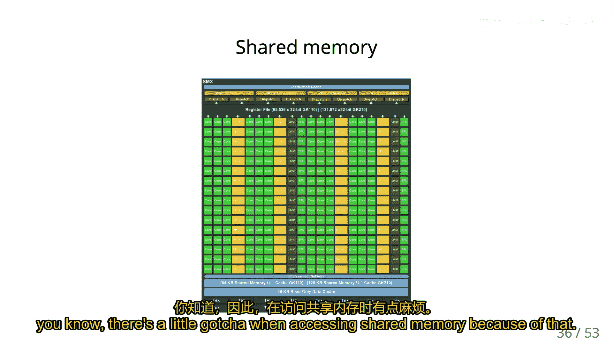
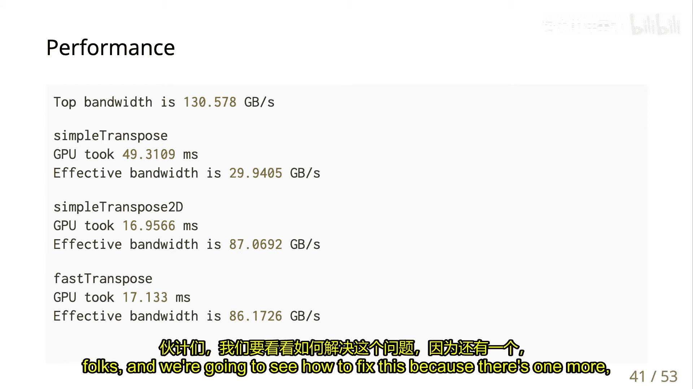
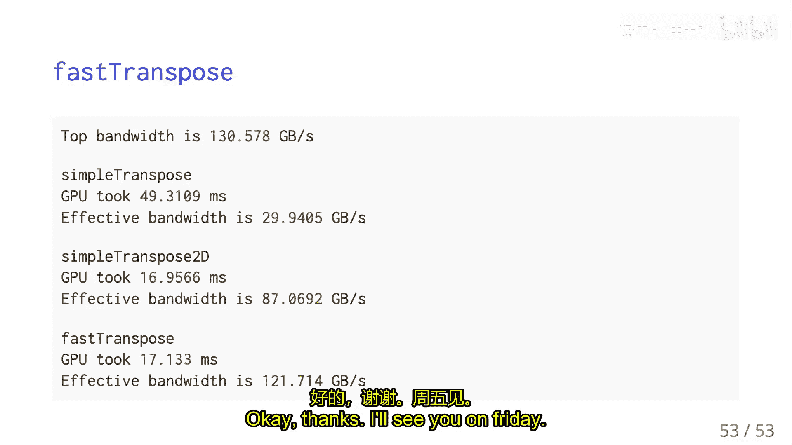

# 【全集】斯坦福大学-并行计算导论-CME213-中英字幕-1080P-p09-Lecture-9---GPU-共享内存--BV1f8ijBYEjR_p9-

Okay， so let's start。So we're going to continue our lecture on GPUs。啊就。

Almost sort of wrapping up a little bit。 I mean， there's still more stuff to come， obviously。

 but on Friday。I'm going to focus on the homework three。

 so' going to be like one special lecture on homework three。

kind of give you a little bit of a background homework three and can of explain you know。

Some of the findings you going to discuss。And then next week we'll have the video lectures and then we'll sort of wrap it up after that。

I said electricity' cover。How profile， GPU code， how you open E， to simplified programming。

 GPUs and some aspects of optimizing。GPU code， so actually。

 we're going to talk a little bit about GPU optimization today。And you know。

 one of the key key aspect， you know， the primary。Your focus for augmentating code is this issue of memory。

 the fact that memory traffic。GP memory to a GPU register is you know。I'll fit the ballneck。

And how can you reduce the traffic？So here， actually what we're going to talk about is。

How to optimize that data transfer oror？If you have to understand what you're bandwidth。

 you we can expect for a given data transfer and then hopefully you can。Can you write your code？

Around that。But then later on， we'll also discuss a little bit how to。

Even reduce the traffic by changing the algorithm。So I think this is really one of the key aspects of optimizing GPUs。

嗯。Okay， so I'm going to talk about how the different caches and how they work。

 so essentially we have the L1。Now two caches， these are the main ones。So。

So something that's a little confusing is that how these caches are used actually depends on the graphics card so hence there are changes according to the QUa capability you have and so on。

 but typically H L1 is associated with the specific SMX， so sort of a specific block if you wish。

 while L2 is shared across the SMX， across the O streaming multiprocessors。

So we're going to try to focus on the 3。7。So the L1 cache is sort of not merely cache。

 initially it was sort of a cache。In a more traditional sense。

 caching data fetchched from memory and so on。And you can still to some extent use it in that way。

 but somehow， you know。What happens is you have a very large number。Of threads。

That are sort of live in the system。OkayAnd we mentioned that there is basically no cost to switching thread because essentially all the memory。

 all the resources allocate and so on， so it's just changing whats next just really deciding what's the next instruction that needs to be run。

 that's basically what thread switching boils down to。So it's very fast。

 but you need to hold all these registers and all this data。关儿。And so there are register files。

 but typically you're going to run out of space， and the L1 cache is been used to store these local variables。

 so local variables are basically just variables that are created when the control starts。

And sort of disappears when the kernel finishes， sort of never goes back to main memory。

 in principle， okay just created there initialized。

Used for computation and then destroy after the colons completed。

And then you even have temporary register skills meaning that when the program is trying to use more registers than actually available in the hardware so this is that one cache it sort of an extension of the register f okay slightly slower but you know still very very fast and increases the size quite a bit so actually the consequence is this。

To some extent， the number register is available to a thread actually very， very large。

 because it's much larger than on the regular CPU okay so this is a whole kind of different from the usual architecture。

And then you have the L to cache and the L2 cache actually in some sense it's quite large。

 but if you divide a number of thread now they're actually very small compared to regular CPU cache。

Okay， and this one is more。Your classical。呃，有家属。Can be used for local variables。

 but it's mostly global memory the read write from Google memory。

 and then they're stored temporarily in this L2 so that you reduce，Accesses to main memory。

 global memory。Okay。So all right， so the other thing is when you when you want to reason a little bit。

OrOr understand how。You know this。Memory traffic works and how it's optimized and what exactly happens in hardware。

 you have this concept of cacheline， which is basically what this is saying is that when you request the variable X。

For memory。It would be very inefficient for the hardwareware to just fetch exactly x。

 four bytes or maybe even one byte， if it's a character， it would be very inefficient。And you know。

 it would just mean that the number of memory transactions to handle would be gigantic and just sort of you know。

Reasoning and optimizing that the overhead would be tremendous。

 so essentially over memory requests are grouped。By 32 bytes or 128 bytes。

 it depends exactly at which stage in the system you are， but roughly speaking。

 we're going to say 32 bytes。So which is only eight floats， each float is four bytes。

And so what this is saying is when you request a float from memory。

It's best for you're going to get at minimum eight floats， which are this continuous chunk of memory。

And so right there is a big opportunity for improvement to rather lose performance。

 which is that if out of these eight floats， you really only use one，And its not the other seven。

 then you've just divided to bandwidth by effectively8。So hence， when you request a float。

 you really want to make use of old。This group of eight foot。

and so what this means is you need to understand the access pattern， okay。

 you need to understand well， when I'm requesting H loads， when this thread is requesting H loads。

 am I making use of the also detail around it？ケです the机制。

So what's a little complicated is you're probably familiar。With cash on a regular CPU。

 so actually can you raise your hand if you're familiar with how cash behaves and how to write code on the CPU with accountinging for cash？

All right， so I guess my comment for that。😊，But all。

 so I'll just skip that because but there's a connection to the CPU cache but differences as well so I wanted to comment on that。

Just skip that。So I'm going to use some simple code like this to sort of try to make this a little more concrete。

都系即就系送问嘅。Let's backtrack little some of you guys to 11 to 12， right？😊，Yes， yes yes。So I mean。

 they talk about caption 21 and 212， maybe in 212。Buts yes， it's no。They do talk about catch。

So what do they say about the cash？Do you guys remember？' maybe that's a problem。😊。

There is better not to ask these questions。Okay， all right， anyway。

 well I don't want to do a class on catch that's fine， let just move on。So basically， okay。

 so I'm just going to kind of just focus on this code here。And。Okay。

 so you can recognize how the code works the3 ID， so essentially this is your ID inside the block。

then that's number of threads in each block and that's the idea of the block， okay。

 so basically this is your sort of global ID from0 to n minus1。Okay。

 and you you have this little bit of pro that because you have。Sort of entire blocks。

 X could be greater than N a little bit。In this condition， and then you just take from this pointer。

 this address， and just do a copy。So first of all， when we talk about memory access。

 what exactly are we talking about？So。Well， if you think about the CPU code。

The way to reason about memory accesses in a CPU code is to just look at what a given thread is doing and what memory addresses it's trying to access so for example if you have the full loop。

 you go through Esion 01，23 and then see what are the memory addresses that are being accessed are they contiguous or not。

 if it' going to be in the cache and so on。So here on the GPU， this is different。

What happened sort of， let's see there was you know some loop here or whatever。

 actually this you know this would be irrelevant， okay what happens sequentially in time is irrelevant。

The key thing is to understand what a warp is going to be doing so essentially the group of operation that you consider is what the warp is doing to different threads in the world so essentially you have to look at a given instruction and you have this concept of colonist memory access so a certain type of memory access。

And the way to reason about that is just to look at a given one instruction。

 so it's going to be a read from memory and a right to memory with's actually two separate instructions really。

😡，嗯。You look at in instruction for a warp， looking at all the files in that workp。

 and then looking at all the addresses， then you want to try to make sense of what are these memory locations in memory。

 so for example， if you take threads the first warp，So XID would go from  zero to 31。Okay。

 then that war will just。Address a contiguous chunk of memory starting at i datata up to I datata plus 31。

 this is one nice chunk， okay then it's going to in the same way， the rights have to be contiguous。

So' essentially all the rights happen in L2 and then Google memory。

 so if you make everything contiguous or Qesed， then you minimize the traffic between L2 and global memory。

Okay so this is what we're talking about， so again。

 you have to reason at the level of a war and what the different threads in your work are doing it。

 what many locations are they accessing？ and this will depend on X ID and the connection with threadI and so on。

🤧Okay。So essentially theres a fairly complicated process。You know that sort of does these things。

🎼So you know essentially you have an instruction so everybody execute the same instruction。

 but the data is different okay so everybody says Mary load。

And then there's going to be a bunch of addresses。And the system needs to sort of make sense of that and translate this into a number of cash line requests of size 32 bytes。

So you know it's when to take only the addresses and when they fall in the same segment。Our 32 bytes。

 then essentially this becomes just one request for 32 bys。

And then you just sort of go over that and try to figure out know just how many 32 byte segments are required for memory。

 and that is actually the final。Request， set of requests made to memory。

 and then you then the data starts being transferred and once it gets you know in。

In the register file， that completes the transfer。The memory invest are service。

 and so the al will be in the middle of that， the al two cache。Okay。

 so here are some examples of what can。Happened good or bad。Okay， so the。

So the top is so you have uncached and cache actually。

What this means if uncched is actually uncched in L1 so cache in L2。Okay in cache is cache in L1。

 so know again， depending on the hardware and so on。You know， things may be different， but for us。

 it's basically the blue。The blue things uncched， so essentially only the L L2 cache is used here L1 is。

It's not used in the cash process just for these local variants。

And so the arrows represent the 32 threads， so basically represents a war。Okay。

 and then you encounter instruction， which is either a load or store。

 so you're reading or writing to memory。Okay， and these so each threads basically eacharrow represents the corresponding memory address。

Remember， that's you're knowing what story， okay？And so for example。

 here you can see that this is sort of a very regular pattern each thread sort of。

Addresses con memory locations， except to hear you， just for illustration。

 there are a couple of threads that actually flipped their addresses， but regardless。

 the point is that each thread is requesting four bytes。ok。

And if you look at the first and last addresses。Okay， this whole thing fits inside four segments。

So this is sort of perfect， okay， you're requesting 128 bytes。

which is basically each thread requesting a float is sort of the standard if you wish。

each is requesting a float， so 128 bytes and that here in this example fits exactly four segments and so you may be fetching 128 bytes from memory。

 okay this is perfect and that there's no loss， you're fetching exactly the memory the data that you need。

But。So here this is a simple example of where things might fail， I mean it's not actually that bad。

 but okay， so let's say now that things are misaligned so in the memory is made out that you have the segments。

And typicallyically when you argued memory， the array starts at a segment。

 like address zero is the beginning of the segment， can then goes on。And so if you have。

 let's say you have an offset。Where somehow fed zero， wants not。

An address that's aligned with the beginning of the segment， but let's say is one off。Okay。

 so all the addresses is sort of offset by one， in case of same thing as above offset by one。

 when I the problem is the last thread actually needs just one float。From the new segment。

 so you're actually going to read five segments in this example instead of four。Okay。

 and essentially you're wasting almost entirely the fifth segment。So it's not a tremendous loss。

 but it means that energy will take five units of time。Instead's of4。

These're basically fetching 128 plus 32 bytes instead of just 128。

And so the red during previous case where you have cache light at 1。8 byte， then that is。

 it's even worse to lose the factor of。So quite。This is what happens if you catch an L1。

 so it's actually。Of course it's advantage just to guessing L1 for them。The penalty you have to。

So this is an example of a code that would do offset。Okay。

 so I just add the offset here so you can see how the same code as before， XID。

 same thing as before thread ID， but I just add offset so that when XIDs we take a war starting at zero。

Then this is going to be essentially one， so it's offset by work。So。Okay。

 so this is the result I got。Okay， and you can see that actually it works。

It's very hard to make things work on GPU very often。

 you make these assumptions should run your code and does something different。

 here at least since you follow the prediction， which is that if you have set by one。

 you lose performance， essentially offset zero is just straight access 4 milliseconds。Offset one。

 you know you get 6，2，6， 32， so basically you're back to a line because the offset is multiple of。Of。

So it's actually 32。Yeah， actually I could have tried even smaller offset 32 bytes。

 so it correspond to only eight roads so I could have tried offset at eight， but regardless 32。

 64 and 128。Gets me back to high。So this is what you have， mind you。Actually， there is a。

A catch here。And anybody anybody see what the catch is？Because they are。这件。

Are you doing about the answer 32 the answer is 32？Oh， well。Yeah， but that's， I mean。

 this is ti because the that's， but the vector size。Did you give by or whatever I spent terms。他都也委。

Unfortunately these should change offsets。You know， some of the elementss are skin。

here's just measuring the。It's not going to looking at the correctness。Of the operation。No。

 but there's another gutcha here。Can you该 see的。你 gotcha。Well， if you run this call。

What do you think is going to happen？I sure you're not going to see the numbers I showed you。

The officer。No the something房。Yeah， you lose a couple of elements like things that copy。Yeah。

 it been to the beginning with got copy。You start from essentially offset to end place。Well， okay。

I mean， it's not perfect science。But let's look at the end here。This work is not going to need this。

These numbers and these numbers are in the out to catch。But。可意。Well it's a gas。So。

What about warp number one， maybe the next one？No， if Forb zero makes a request。

And all these numbers。I read the memory and sitting in the cache， and then here comes Warp one。

 requesting from here and down， while it's into cache， so it's going you to use it。ok。

You guys see that？So actually， if you run this code。You're not going to see the offsets。😡。

Because it's a gigabte of memory。And the only thing you're actually just losing is just awesome。

Just a couple of bikes in the vehicle， get the rest。

So it's un complicated because essentially some of the warps are requesting data a memory that is basically going to be used by other warps。

宝山区研生会宋你 gas。You know， no access to memory。You know， you're in efficientfficient。

So when you run this benchmark， need to make sure。That the next war actually does not request anything here。

 so actually something is wasted。So what I did is I just inserted some space of next workp。

knowIt's a little bit further down the line。Okay， it's， it skips， it skips that。Okay。So that's that。

Okay， so the other thing is。So the other access that's really more pragmatic。

 offset I would say small is a relatively small thing， I mean when you process a 2D grid，It does。

You tend to happen， but even then it's not that bad。That phrase example。

 if your phrase apple has a little square。And you truly grid and you have your thread block。

こ like this。Then you can see that， let's say your data is data out the memory。You know， real wise。

Then there's going to be designated junk。You know， in the addresses between these rows。

So here the offsets will sort of be more visible， particular， typically the left will be not aligned。

 and then when you reach the end here， then you jump， so there's going to be quite a bit of waste。

Inurance of the cash on so there are situations where it's actually quite hard。To avoid this offset。

 but let's say that it's not too bad。Okay the thing that is a bit trickier is this try。Okay。

 so if you look at stride。This one is neutral valid because you're essentially skipping。

You know strike minus1 numbers， and that's basically exactly just how many data you're losing in terms of。

啊。In terms of memory traffic， and so this has a huge impact on the performance that's much more dramatic。

Mind you， okay， I'm always reading the same number of。It's a amount of data。Okay so for example。

 here are the strand of 16， here a set of 8， but I only read n over2。

 you have a chart of4 but read only n over 4， n over 8 and n over 16。

 so the amount of data is strictly the same。But just the strike is different。

And essentially the running time essentially goes up pretty much by how much data is sort of wasted so for example。

 when you go from one to two， essentially is keeping every other the numbers。

So although you're effectively。Requesting from memory the same amount of data secured。

You know's N over 16 and here N over 16 withs try of two。So he goes starts at N over eight。

But the actual memory traffic is twice bigger， right？Because in terms of span of addresses。

 the trying to access， it's twice stated。So the memory has to work twice as hard。

 and so the running time is， well it's not exactly twice for some reason。But it's quite a bit more。

And you go to four， again， it new doubles。And then at some point。

 it sort of stabilizes because now you're sort of jumping by something that is more。That decide size。

The cache lines so essentially now it doesn't matter the entire cache line are wasted in each cash line you keeping one number。

 and then it doesn't matter how many cache lines are jumping。Performance tends to stabilize。

So I start as。Clear cut is what I said， for example， strike two， technically should be twice slower。

Four should be four times so and so on， and the 816 should that should be equal。叫做。

It's sort of maximum lost maximum efficiency， but roughly it was。垃。Everybody follows that。So in fact。

 if you think about it。Well， okay， if you remember what was said in 212 about cash for CPUs。

 it's exactly the same reasoning。There's actually no difference， except said that on the CPU。

 you just look at what's happening sequential in time for a given thread， what memory X's doing。

 where it curious to look at what it worked。And the addresses the work is doing。

 but it's different that it's kind of the know the same sort of issues。Okay。

 and this is sort of I have this big table here that kind of summarizes。What's been on？

So you know you have to register， so first all is is it on the chip。

 so basically is it more or less the。Where the processor is or is it in the GPU memory？😡，Okay。

 and then is it cached？So well， this is what they can call， but some of the variables are read only。

Let good。This is the scope， so basically once this data has been read in memory， the crew can access。

And then this is essentially when is the resource allocated and destroyed， so for example， registers。

So obviously this is on chip。Okay， not cached obviously， so scope is just one thread。

 okay so register typically it only accessible by single thread。

 okay there's no sharing of exchange here， then you have local memory which is pretty much the same thing。

Okay， pretty much same thing， but it makes use of the L1 cache。呃。So if they say off chip。

 I mean that's not entirely correct， I guess it could be off chip。

 but typically it will still be on chip。So it's cash， in some sense， well。

 this is the algorithmwe cache。And then share memory， so we'll talk about this later on。

 but this is now very important because shared memory is a memory that all thread in the block can access。

The patient allows you to have some threads read some data。And then also we treat with it。

 so the idea here is to improve efficiency。You want to reuse a piece of data as much as possible。

 the idea is one thing is going to read the data， but then you're going to do a lot of computation with it。

见见。Do this with the shadow， so this is a more advanced。Optimization， but for example。

 for the project and so on， you're going to have to do that。And for homework three， so you'll。

Very important Dle memory is basically just a Gpsy memory。

 so obviously that one is definitely off chip。Well， so it's cached in Al twomos。呃。

So the host can in some sense， access that memory， I mean to that driver and out it by the thing。

Okay， then constant text I' see that because of graphics。

 there is certain memory on the GPP that are reing。And they actually can have very high bandwidth。

So but it's read only， but you know when you write scientific codes。

 I actually love the data often is's just read only like parameters and various things。

So it can be useful， but again this is more advanced， so I'm not going to really cover that too much。

 so a lot of that actually is done by the compiler so you know don necessarily need to。

We didn't know much about it because you say data is read only。

 the compile could definitely recognize that and optimize the code around that。

So in terms of homework three， just a quick。Comment。So actually， I mentioned that， no。

 I said on Friday we'll talk about homework three， obviously I'm talking about homework 4。

So basically the upcoming homework is not the one that's just right now。

So homework3 is the one that you guys are doing right now。

 and so essentially you know there is so again here it runs into a couple of complications。So again。

 understand performance is always very， very difficult because actually you need to understand what the hardware is doing。

and so that requires a lot of sort of in depth knowledge so I talked about the memory access。

 okay and that's one of the things you should look at so have kind Qest memory access Qest means that essentially you know you're going grab a cache sign and then make use of all the data。

In the cache line， it's credit， the opposite is for example。

 random access where you request random me locations and so in each cache line。

 you only read that when one float。This is the word So crisisis is the opposite to we continuous showle memory and make use of the entire cache on。

And Ro there is trying to offset， you have random memory access and so on。

 so you have to look at the workp and figure out what is the chunk of memory a warp is requested。

Okay， so now it turns out that there is another competition。Which is that。诶。

So his someone said he's super obvious。But when you access data， for example， you say I data。

Square bracket X ID， so you're requesting the data for memory， okay with a pointer。

An offset or request member location， there's special units。

Lad store unit that's responsible for doing that， basically it's responsible for you know。

Grabing variables from the cache and various medications and sort of moving them into registers or vice versa。

 taking stuff out of registers and putting them in the pipeline for you know to。

So they can be written to cache or to memory and so on。

 so there's a special unit that actually does that。load store units。Okay。And so， for example。

 in the code， if you compile so this is an example of。PTX code。If you're interested。

 you can compile your code and there are some options where you can generate the PTX and you can go through your code so it's sort of semi human readable。

 you can recognize your different kernels and so on and look at the PTX code so。

It's complicated first side， but if you spend a little of time to kind of go through that。

 know it can make sense of it， you can recognize the registers and different operations and so on。

 and so for example it' is an example of you know a load of reading data from memory so essentially X here is an address。

And so by the way， when you request， for example， I datata of XID， there's actually。

 you know this is nontri operation， you got stuff on the project。Then X Is and offset。

 so you can calculate the new new address which basically an add Okay so now you get a memory location。

 the address it goes into this X， and then you say load at this register location okay so it's basically thought。

You register file where you want the result to be in then auto operation of choosing data will then make use of this register。

Again， it's global to different view。就是 the float。Float 32 beds， okay， four bites， float。

 go memories or different flavors here load。And then correspondingly， there's a store。Okay， store。

 so we're basically the same take Reg R and write it to memory location。X， okay。

So what's happening is so you'll see in your homework。But when you're working with a character car。

Okay。It's just one bite。Okay， and so this is sort of very inefficient because you're going to use one structure。

To basically take care of just one。One car okay and so there's a limit to essentially the limit factor is the instruction that is。

 for example， your memory faster than that。Then essentially your name faculty would actually be instructions。

 its sounds sort of obvious， but you you look at your kernel。It's a very。

 very sort of simplified journal。And。And relatively speaking。

 there's a lot of instructions that are used。just do memory transactionss。

So what's equal to instructions？One of them is the load store。

 but there's others and so with a car you have to issue large instructions for radically little memory and so actually becomes of volumemic。

In that this extreme thene for car， whereas for in and in， you have the same of instruction。

 but the load store now are  four bys。So hence with the same of instructions you're bumping up the amount of memory requested。

 so now the memory transfer becomes the bomb， again you'll see that in your performance spot。

 so I want to mention that because this is kind of a nontrivial sort of result。That you have。Okay。

 so let's move on to the next topic， so any questions about this？

So when you said that on the CA case。The instruction for the bottle。ごせ。T that we have。

Are they the one on that？The computation speed well it's computation speed， I mean。

 computation is basically just the rate at which you can execute instructions。Okay。

 so here I don't remember， but for example， inside the loop， maybe you have。Oh。

 maybe eight or 10 instruction spectra。And so weve got to。

 and so you have to look at how long it takes。To perform all these instructions。

 and at the end of the day， the only thing you've done is you've requested。One bite。Okay。

 so I guess 22 bikes if you look across a war。But now， so basically， the reasoning is， well。

 how long does it take to。Yousure these instructions。

And how long does it take to do the memory transaction？It it turns out that instruction is story。

Well， which say might make sense because you working with car is not very common。

And so when they designed the hardware， it didn't make sense to。

You knowSo of be fast on the instruction here，Well actually the wig grew fat， well。

 it's actually a little bit worse than that because if you look at the diagram。

You have way more core than node store units。Right so right to be speaking the。For example。

 if you ask to do。I a plus or plus your。A multiplication addition。

 then you're going to be using the compute unitsnet。Okay you have a lot of them。

 So now you reach a very high performance， but the load story you have much fewer of them。

 So the performance just on the load store is actually quite low。

And so here that's why it's a high performance， right you had more road store units。

know may worked out， but again， since it's just a car which is kind of uncommon common。

 the hardware is not pretty optimized around that。So you can go back to some of the figures。

I had at the beginning where and you can see how many floating opportunities units you have versus low story units。

To essentially design the load store units so that if you request four bytes or eight bytes。

Then this would more match the memory time。ok。😊，So let's talk about matrixtri transpose。

 so this is going to go into the topic of shared memory。In January， sort of you know。Well。

 I'm still teaching shed memory。Because you know I teach Kuda。

 but the truth is shared memory is very complicated to program with okay it's really how you can get high performance without shared memory it's very hard to or you must。

Impossible to really get maximum performance， but it's very， as you're going to see in the homework。

 it's very tricky to use as lot of indexing and anything you have to go through。So in practice。

It's more less， well， it's more less practical if you want to write。

A lot of engineering code and so on using sharedd memory is going to be very difficult if you just have a couple of kernels。

 you want to heavily optimize， then you want to use sharedd memory。

 but there's definitely a tradeoff here and for example Open ACC or if you use the OpenN。

 things like shared memory are not well they might change the。You know。

 capabilities of open and and open in the future， but currently you know， it does not expose。

 for example， things that shared memory。Too low in the。In the hardware to your level。

And so if you write， you know with these， I would say more modern and probably what will become the standard in the future。

 then actually Shandenmer is not visible in these。In these techniques。 But Ka。

 can you share memory that's how you get the best performance。 Okay， so we' going cover that thing。

So the idea is very simple， you want to do matrix transpo。

And so essentially Mont is input a matrix and whenever you have this red block here。

 you want to move it to this del okay。And so this will be a good exercise in understanding how the memory accesses。

 the read and the writes， and then we'll see how we can use shared memory to optimize this operation and reach peak performance。

Okay， so very simple thing， but many optimizations， it's a very good example to look at。

So let's start with a very basic implementation。Okay， so again， so one of the。

One of the difficulties is we're working with a matrix， which is truly indexing。

But the slide is going to be in so actually I could have written to the index here。

 but the slide is just going to be written as just a sort of 1D index。

It's not super logical but all right that's what I have here。

 so the first step is to convert the thread ID into a column and row number。

So this is one type of memory， but it's good either。Sort of logical numbering here。嗯。Okay。

So basically you know。If you change， if you vary。F ID D X。Okay， then let's say GI would be 0123。

So column is 0123， and the rule is more less constant， okay？呃就 you reach就对。So。嗯。

So hence you can think of this as being sort of。You know， real major。Of course。

 we're doing a trans and sometimes it's through a majorre sort of moving inside。

Because where you're checking， you calm and doing distance and so on。And then you have to flip it。

 so essentially you're reading in call plus row times the number of columns。

 which gives you the common row index。and then you're writing in this way is we basically just flip。

Will and call and you're good so if you do that。You can啊。Now recognize a number of things， so again。

 if you just look at a warp， you can have TID going from 031。😡，Okay。

 so let's say number of columns is a large number， so call is basically going to also change  zero to 31。

Whereas broke here， maybe constant so you're just reading in one row。

And so if you look now at addresses， so again， you have to look at addresses for warp rather than what a single thread might be doing。

 so if you look inside the warp， then you can see that call goes from 0 to 31。

 so essentially that is a nice colonist memory access it going to be just one chunk of memory。

So this is for the read。And when you write， okay。So the right is not that good because the row is constant。

 but that's fine。But then coal is changing， so there's a huge， huge tri。

Okay so the rights are going to be terrible， meaning that what's happening in the right is that essentially you're going to just modify one number。

In your cache line， but then writing out the entire cache line。So this is essentially， you know。

 okay。So this is what the pattern looks like， you know on the red you to the right the yellow going down。

 so the red is coales contiguous memory accesses and the yellow has a huge jump okay so I'm going to。

Write it like this。From Western movies， so read， good Gu。Right， bad guy。

So let's move on to better implementation。 So the first thing is you want to use a tool indexing okay and if you use a2 indexing。

 basically what this is saying is that。You're going to have a award working on your job。

Okay occasionally instead having a work， just work on like this one row of onecom。

 you want to work to work on a little block。Okay， and so what's happening is that when you're going to do the read。

 okay you're going to read a few locations and then you're going to jump。Okay。

 so this may be one cache nine or maybe a couple， and then same thing here， okay。

So here you're going to actually write like this， but in terms of mirrorloc。To contiguous。

 too contiguous with a jump。 Okay， so it's going to you're going to see quite a bit of improvement in the next code。

 So this is what this looks like。 so essentially。Using x and Y indexing for this case here。And。诶做。

But this isn't。Of course this is a nice way to write the code and it's kind of the logical way to write the code。

 but the trick is not that I use X and Y index indexing， the trick is that inside a given work，Okay。

 inside a given warp， I'm going to have various call and row that basically row changes。😔。

Is it being constant in the PC example？So essentially3 ID x， I believe goes， well。

 into the next slide。So third at the x goess to up to8。Okay。So eight floats。

 which is actually just one dash line， and so the rest of the warp。Goes on to the next row。 Okay。

 So I X Y is going to be 0，1，2，3。 Okay， that's these are other threads inside one word。 Okay。

 so density， there will be a comes four rows。So it comes for row。 and actually that is。Actually。

 it's still perfect because acoms is actually just 32 bys。And then there's a strike。

So actually you're good on the read。And then for the rights， well， no， it's not that great。

Well you have it still it's kind of okay， you have four rows and eight columns。

 so this is a jump on the column， but you have four rows， so basically in the cache line。

 you're actually writing half of the cache line next 16。じゃ追据。It's pretty reasonable。Okay。

So this is you know how I do it， so you carry you know a block of。So actually。

 it's how you declare the block， so you say x goes from0 to7。Okay so actually a warp。

We'll have the second index going01 to three。Okay， the entire block is basically going to be eight of these wars。

That's going to be an entire block。And then the grid dim。

 then it's n divided by these numbers so here n。It is a power of two so。

 which is very simple like that。So you see how， for example， here。

Because of the way I wanted to define my workp and so on， and then my block。

 so the warp is basically eight by four。but then you knowに。Big a block， so I made the block 8 by 32。

 so actually the block is sort of not square。It's a more rectangle， but that's fine。

 that actually doesn't really affect anything。嗯。Of course， you could have slipped。328。

 but you see it's sort of fundamental and here the block is rectangle right。

You can actually take a square milk and some clever indexing， but the way I did it。Naturally。

 you led to this rectangular。Okay， so hence you know if you look at the axis column 0 to7。

 so actually this is one cache9， grows 0 to3， so when you're in the weed still doing fine。

 the right is a little bit more balanced， okay it's sort of 5050。

 you're essentially using only half of your cache9 efficiently。Okay。

 and if you run a benchmark on this。This is what you get。 so 60 megabytes is my matrix。

So then with bench。Is basically just doing a straight memory body， just to see how fast。

I can copy memory you actually see that it's not that high。

 if you look at the hardware and what's quote， you get slightly higher numbers but with the you know。

With the sort of configuration of the card， know you have one that you give it per second。

 basically the maximum you you can get。And so the simple transpose was just one row，  30 gigabytes。

 it's very low， and the 2D where you reach four rows is much higher。But so theres a significant loss。

 again， because of basically the rights are not that good。

So I want to reconcile these read and write and come up with a better way of doing this。

So the idea is then if you use shared memory because essentially。

The cache line had this sort of problem of。You know。

 not using the entire cache line and so on and so forth。

But shared memory is different okay going through sharedd memory I'm going to be able to optimize both the read and the right essentially there is no cost in sense doing the transpose。

In shared memory， there would be zero cost of doing the transpo or no overhead and the shared memory being much faster than the cash I'll be able to reach。

Ex。InIn the memory transfer。Okay， so shed memory so I mentioned。Actually， yeah。

 I mentioned the low store unit， so since I have this plug here， so for example。

 you can see how many cores you have。Okay， this is the green stuff。Dark green is the load stores。

 you see that you have two of them know in terms of insert throughput of load stores are that high。

 but here I'm showing you this picture just to show you there the shed memory。

 so basically here for example it says 64 kilobyte of shed memory。

Or L1 cache or 1208 kilobyte to she memory， L1 cache， actually these are two different。Chipets。

 so this shared memory is shared with L1， okay there's different configuration。

 but physically it's the same memory， and then there's this we only need data cache and so on。

Intenet network register out the top， which is huge。

And then you know outside of the SNX you have the auto dash so shared memory is basically you know very very close to register at the top shared memory at the bounce it's very very fast it's nearly the same as register okay so being and writing to shared memory you for you know or then the purposes you can think of it as being as efficient。

As registered now the main difference。And where things get more complicated is。For register files。

Okay， every。Memorory location in a register is attached just a single thread。

So so that is basically optimal and nothing can go wrong here。you have a thread。

 it has its register location， and the register is just located near the thread and its open problem。

So in the LN cache， it's a little bit more complicated because these me locations are accessible by any thread in the block。

Okay and so here， you it's a little bit more complicated to do。

 you effect can access any member location here and you to optimize this and so you're going to see that there's a little gotcha。

When accessing shared memory because of that。

Okay。So it's on chip。Very high bandwidth， extremely low latency or no latency， practically。

But only works at the level of a thread block。So heres how you use it。

 so actually the syntax is remarkably simple。It doesn't mean that using it is simple。

 but it's just inside your kernel。It' just going to have a variable。

 so you're going to have a little array， so it's accessible through indexing。

 so its another difference with registers， registers that you need to access them by name。

But sharedd memory， just like verbal memory， you can have a pointer。Okay， and you can have an offset。

Okay， it's a regular point of athletictic so you can do indexed。

You can access data using index arrays。So that case is where you actually need that。

The registerries are more limited in that。So for example， here you carry a little array。

Size work size。And with this keyword， share。And so we'll get so。

First thing to understand is that so this is going to be a special。Memor litigationation。

And it's the same for's the unforgiven block， so each block。Each thread log will have。You know。

 access to this variable， but different blocks。Or access different locations。In shared memory。

 okay so this block is reserved for a given thread block。

 they won't have the same all the threads the that block will just be looking at the same memory location in shared memory。

Okay so it's the thread block level， and then this is just the size。And so you have Warp ID and La。

 So La is basically going to be a number between  zero and 31。Okay， so this is the way I go the code。

 so basically this is your ID inside the work。Okay。

 and and then work by these or what number and both is the variable al in chair memory。

So now the way you load the data isn't very simple。

 so the nice thing is the sharedd memory does not care about this transpose business get since you can index arbitrary locations and you get the same bandwidth。

 it's highly optimized， that essentially when you do the transpose in the shared memory there's no cost to that。

So first step is you're going to be data into cha memory。

 So the point here is you're going to use sha memory so that。

Everything is perfectly corrected okay so essentially so you can do this in different ways。

 but just a simple way is a warp is just going to read one line in the matrix at a time。

 so it's going to be 128 bytes。F memory continues and just straight put it in shared memory。

 okay so the read is perfect and it was't already sort of semi by perfect before。

 but okay that's that we keep。So you're just reading， you know， one line。

 one row in array array in so。So if you look at GC。Essentially， it depends on the third I。

 which is a lane， everything else sort constant， because that's just depends on the warp I and so on。

So everything else is constant so only GC is changing inside the work case it's all nice continuous use access。

 and then actually you're also writing it。Contiuous and shared memory。Everything's nice。So now。

So you're going to be a square lock inside Chen， so the next step will be to transports。To a write。

 also careesed， but with a transpose access in chain memory。So the older threads right in memory。

But then different thread are going to do。The read from chat memory。

 reading from chat memory back to global memory， so since you're flipping the threads。

You need a sink sink thread。So let me explain this maybe on the board here。For this is join。

But here is what's happening to why we have the same friends。Well， so basically。

You're reading a little block in memory in your matrix。Okay， this is a block in your matrix。

And the way the code is written。Worb zero is going to read this。😡。

Then work one is going to read this。Okay， and so。有。Work 15。Iaac work。水中。31。

But then so when you going to do the right。You're going to be also writing with a real banner。

But if you look at the access in terms of。Access memory， the access will be the other way around。

 it's transport。It's War zero we'll be accessing in shared memory。The first comb。

And War 31 in Alaska。Okay because the transfer。So the idea is you know。

Using Chry because essentially， some friends。The obedience of numbers and other threads write out these numbers。

 okay you're flipping things in the middle， So this is why you need to sing friends。

Because for example， the way the hardware again works is each instruction is executed by giving more。

 but everything is completely out of order。A work does one section at time， so all threads the work。

 they all do the same thing。But we warbs is just whatever， there's no synchronization of any kind。

 so for example， Warb zero， without the syncth thread。

It would be possible for War  zero to execute this instruction。And then just going into the code。

And maybe word zero then tries to execute the next instruction， which is a read gem memory here。

 but hold on， the data is not copied。Because you need to wait for all works to be done copying before you can move on to the next stage。

Okay， so you had to follow the thin kind， so the thing I has to do with the fact that the wars are going to execute these instructions。

 so specifically this instruction here。The words come in any order。

you cannot proceed until all the data is in so all the works are done。

 so even if warb0 is done and wants to move on， let know it has to wait for all the other works to complete and then it can move on so hands theres a sync threads here。

Okay， so we're in deep snow。A follows？Any questions or？

So basically next step is then the actual transpose， okay so the actual writing out。

 but now you're going to see how again everything is the rights are also queesed。

So the GR depends again on plane index， so 0 through31。And then you can see how also 0 through 31。

 So the right is also completely quiet。So you're going to be reading in shared memory with this funny you。

Vertical way， but the right。It's going to be like this。But gave War zero， so this is a right。

This is a right。To呃。R out。So this one is completely。Nice and cool。But obviously in shared memory。

 it's flipped because you can do the transpose， so you're going row wise in shared memory。

A base war of zero。We'll read from she memory like this and we'll write like this。

 in so the write perfect she memory like this。Okay。Alright， so。So it's just a transport。

 but here there's sort of no cost。At least presumably he， but there is a gotcha， there is a gotcha。

If you run this code。No。No performance improvement。

This is so called fashion and we're going to see how to fix this。Because there's one more。

Thiscuse me and get my numbers。There's one more budgetcha in this business， so what's going on？

Is that， again， if youre looking at registers。Each thread has very fast access to its register。

 mostly because。The registers are only assigned to one thread。

So just replay to the thread and you're good to go。

But the chand is more complicated because anybody can read and write。And you know， so it means that。

Any thread needs to have a size access。To any location in Chad memory。

 so this is a lot more complicated。So the way to make this happen。

I to， well， it's actually the usual thing with memory。

And that's why also the reason why this contiguous memory access is very fast。

 you get as Q axis and so on， basically you just make the memory pair。Okay。

 you mean the memory peril， meaning that you have multiple wires。

That connect the she memory to essentially the register files of the courserus。

And as long as all the wires are used， then you get very fast bandwidth。

 but if all your data is going through the same wire，And all the others are idle。

 so basically have3 wires。So if only one of them is used， then they Chrome。

 this is essentially what was happening here， so if use all wires， then you're fine。

And the way things happen is it's very， very regular。Is essentially the memory is split。

So I'm going to show you。The graphly wrong， but let me just。It was straight here。On the board。So？

It's essentially you can think of the memory。As being or the shared memory。

As being organized like this， so you have 32。Of these beds。Okay。

 and so you have the memory location here， memory location here， so all right， and each bank。

Has a sort of direct access。To see the register files secure the course， direct access。反正。

You have more and more data here and so on， so here you can pilot。As much to do that as you want。

But when you request data。If essentially a workp， it is requesting data that fall into different。

Banks， then you get all the wires。If the work requests data that falls into the same bank。

Then there's a problem。And memories， it's basically always memories always。

This is how you get high bandwidth with memory and because typically memory is very slow so you just put more wires in parallel。

 This is how you can get you know very high memory bandwidth。

 but typically this has restriction in terms of。You know， you need to。

You know get data in this order， but this is also why， for example， the gas line is also sort of。

So why there's a cache line， because the cache line essentially goes like this。

 and so if you replace enter cache line it goes very fast。个基数。

This is also one of the reasons why that is organized that that。Okay。

 so this is basically what's explained here， any question？Okay。嗯。All right。

So this is a sort of definition。嗯。So well， you can you can。Be this offline。

 but basically this is saying that if you're reading。From 32 dresses。

And they all fall in different bands。Then you get full bed。If not， then its bandwidth is reduced。

Okay， and so the case that doesn't work， if memory requests fall in the same memory bank。

Then there's a bank conflict， so actually if two threads for example， request the same word。

 the same four bytes。And actually there's a special mechanism in the hardware that it will work okay。

 so if you actually replace the same data in the same bank， it's fine。

 there's a called broadcast mechanism。But if you request， you know， two different things。

In the same bank， then it's called the bank conflict。Okay， bank conflict。

 meaning that essentially it will just。Send the first one。And then the second one。

 so it basically values divided by two。 So if you go into the same。Bank in the same bank。

 32 numbers in the same bank， then you get lost in bandwidth or 32 that's tremendous。

 so the share memory very fast， but when you have。A palia 32， then it slows down。

OkayAnd so this is the actual number， they have four bytes and two clock cycles。

 so it's not the register is basically you know one clock cycle or it's more instantaneous because it' starting to slower with two clock cycles。

 but it's still very fast。So here are some examples of different excesses and what works doesn't work。

So here， this is a nice access。Okay so these are memory locations。

 so it means that you start to address zero and then move to one， two， three， four， five。

 so this is again work so it's a。Discussion similar to previously by looking at memory bands。

So here it's perfect。Second case here， there's a stride of two。Okay， so if the stride is basically。呃。

Lets seeSo it just tried。So I'm going to get this wrong。It has to be。

Well obviously if it's a power of two， that's that， okay。

 two means that essentially you're using only the even banks， so you're going to have a conflict。

 a bank conflict of two way bank conflicts。If you have four， then you have a straight of four。

 then there's going to be four way bank conflict and so on and so forth。

So we can figure out if you're。They're basically all odd numbers。

 I think essentially if you're prime with two， then there's no bank conflict。

And if you have part of two。And your' just trying。Then you can get the corresponding conflicts with about two times。

You， odd number。To we conflict， four times on numberumb。It's a four week concrete and sort。

So avoiding conflicts at some level is very simple， if you have a stride to access。

 it means the stride needs to be odd。As long as it's odd， then every gets a different than。

Get full on the same bank。So here this is showing a。The case of a stride。Let's try a three here。

Yeah messy。But it's a train of three， so essentially it always falls very nicely。

And then you can have more exotic things， but kind of you know for example。This one is。Randdom。

Random essentially random permutation， kind of weird， but works。呃。

So here the social random permutation plus。For example3 and four actually requesting the same word in band5hi。

 so again， if you have same word this broadcast does not count as a conflict。

Again here this extreme case， everybody's requesting the same data， 12 or 20， but's the same word。

Right， so basically it's the same。Same entry here， so it can broadcast no content。Actually。

 there's a way to get this quickly。Into the into the computing units。Okay。

 so just to sort of wrap up。Then we'll just finish here。So for example， if you look at you know。

This guy here， when you were writing into blocks， so here you have to look at lane。

So perfect str of one。So now no problem。 Okay， every bank is used。Here， you know， driver。So again。

 yes to look at lane。And the tried。What's so confusing is。呃。So the column index here is constant。ok。

So the when you're changing the rowex， this trial is actually the number of columns in block to size。

Of the length， the size of the second index here。So this is a number of comps in blood。

I's actually just try that you get when you move across roads。So here is block as size 32 by 32。

Then that's a strike of 32。And so that's terrible， but the cure is very simple。Okay。

 the cure is just to deter a block。Which has size， work size。By work size plus one。Okay。

 so if you say war size， so the space you actually need is warp size by verb size。

 it just a square 32 by 32， okay I decide you actually need it。

 but it's just add plus one then you make number of columns odd。

 essentially it is how things work out so it's kind of tricky， but if you do this block lane thing。

 so lane zero is here。And lane1 is basically you in the row index by one。

But then in terms of memory address， you actually 32 plus 1， 33。After。Okay， so you stuff from zero。

You go here， these are different banks， Bank 31。Bank failure twist is here。

 so actually next one is actually right here okay so when you say lane equal1。

 you're actually in different bank compared to Le equal zero。And then name put two and so。

So this space is wasted， there's nothing here。But just because you're putting this。

And there's nothing here iss just because of plus one。And then the last entry is not used the plus1。

 because the last entry is not used， but it's allocate， so there's space for it， but it's not used。

 but because there is space for it。问清楚lin的X是抄一个。And this is what happens when you go to you。

诶When lay。Goes to 32， essentially appear here and so on。So the fast transpose now is then gives you。

This top bandwidth of 121。Youre actually very close to the dog speed here。So诶。

So you feel playing a little bit， but it's very minimal。Okay。

 so any question I'm going to finish here。Okay， so essentially on Friday。

 just want to talk about Nix and John comments about。From guarantee and so on。

So some general comment for also still for performance。

And then talking about the next upcoming coci homework4， giving you the correct number。

So homework four。So basically there's just going to be five homeworks。

 so this is homework4 is the last homework on Kutuda， so this homework4 is sort of the real。

W have homework。Because three is just sort of a little bit of a warmup， so four is going to be more。

More difficult。It's more categoristic calculation， so we'll talk about that on Friday。

 and then homework5 will be MPI homework。それですこ。Come down later and so also just before releasing you。

 just wanted to make a note。So we postpone a bit the。The deadline for forward three。呃。

But what's happening is you have to be careful with the final project， so essentially。

We're going to release homework four on Friday。And then after homework for， you have two weeks。Okay。

 and after that， the final project starts。Okay， so you can of think about it so essentially you know in homework force definitely lower than homework three。

 this is why initially you had homework three。Jo this Friday， so not's on Wednesday。

 but just be careful with that。The due date for homework 4 is going to be way down the line because essentially they are only two homeworks now。

 four and five。At some level， there's no reason to put early due date。

But essentially don't wait for the actual due date because you I want you to get started on the final project in two weeks so my recommendation is two weeks after this Friday it should be done with homework4 so you can actually get started on the final project as soon as possible and while homework 5 will four in the middle but want homework4 to be out of the way so deadline will be actually。

Maybe three weeks from now for14， but don't wait an actual deadline to reveal。真的是。

I going finish it two weeks on Friday so that when the farm plan kicks in。

 essentially you can get going。So this is still a bit of juggling with the schedule。

 but I just want to warn you that you know weeks from now is the final is starting。

And to arrange your time around that。Okay， thanks， so I'll see you on Friday。

