# 【全集】斯坦福大学-并行计算导论-CME213-中英字幕-1080P-p10-Lecture-10---作业--BV1f8ijBYEjR_p10-

Okay， so let's keep going。 So today， I'm going to。Rund up a little bit of Wednesday's lecture and then sort of focus on Home4。

 which I think we have released or you' just going to do it today。SoSo it's up okay。

 so you can have a look。啊。So I can explain， you previously so the homework three is due on Wednesday next week。

 but then in two weeks we have to get started with the final project。

 so the idea is that you try to complete homework four。In the next two weeks， Okay， so you know， we。

We sort of push the due date to give you a little bit more flexibility， but at the end of the day。

 you know。The work needs to be done by the end of the quarter so essentially you know you have a little bit of freedom to move things around。

 but you know there is definitely some amount of work to be done and so make sure you organize yourself around that so homework4 is more。

Is probably one of the more complicated homework for this。At least well for the coer part。

 definitely。And so you only do want two weeks for that。And then again， you， Friday and tweet weeks。

 we're studying the final project， so strong advice。To complete homework4 before then。

 although it' just a deadline。We for homework four is actually past that。

 but I'd recommend sort of finishing early on homework4 so you can focus on the found project which will be。

Fal product is definitely， you know， significantly more， more involved。 and。

 And for the final project， you'll have starting two weeks from now till the end of the quarter to。

So yeah， the first first sort of comments is sort of。A more general philosophical comment。

And I'm not going to go too much into the details of that， but it's sort of a general。Concept。

That you should have in mind when thinking about processors。Network communication and， you know。

Join speaking operations on a computer。So I'm going to take this example， but it's actually quite。

It's actually a very good example it seems linear related to Hindu。Comp。So basically。

 the idea is so you're trying to produce these。呃。Some goods。

 and it's commercially beneficial to outsource。The fabrication， and so you。You know要。Has some plan。

Of the country where Yugo are produce sewage。Taking this is but your own city。China， US trade by。

An example we'll do here。But the point is。How does this work？Okay， how is it possible？That。

It's economically viable to do that。Okay， pencils are very cheap， you have to cross。

Halfway across the world， but still you know。It's commercial advantageous。So the idea is， well， okay。

 so the labor is cheaper over there， but then you're going to use a very slow。

There is no means of transportation， basically cargo ship and so on， some gigantic ships。

 but definitely take a couple of months。To cross the Pacific。So the reason why this works is that。

So the operation self takes a lot of time。But if you set things up correctly。

You can actually sort of mass produce pencils， and mass sell them。And so the idea is follows， okay。

 if you have a process in which， for example。如果你喺咪 single说。

Then know this is going to be very difficult， let's say it takes three months to cross so obviously in cargo you may have a lot of pencils but there's a limit to that and there's going to be huge delays between shipments。

 between the ordering and shipping and so on， so very， very long delays okay。

And the way and so the fundamental problem here is that you know， it just takes。

So much time to cross the Pacific。But curiosity。If you。Going into parallel computing。

 and use multiple ships instead of just one ship。You can actually completely change the picture and go from this very little process where a ship arrives。

 let's say， every three months to a ship arriving every day。Okay。

 it looks all of a sudden that you know。And you provides every day。

It takes one day to produce pencils。It's not true， but it's going to look like this。

And the trick is to use many， many ships。And to have a large number of ships constantly going back and forth。

Between China and the US， so this is the idea of problem computing，And。Okay。

 so if you look at a computer， this is actually。Exactly what happens， although。You know。

 you may not realize it。It looks like， oh， the ship is coming every day or every cycle。

 there is a floating point operation being done。But it takes way longer than a single cycle to do a floating point operation。

 so how is it possible that every cycle you can crank out these operations。

 although it may take say 20 cycles or 30 cycles。To perform the operation。Okay， well。

 the idea is that this city you want to do a。Add addition。The idea is that you have this pipeline。

D right up here， you have this pipelines where。Instead of viewing。One operation in this matter， okay？

That is just one box， so essentially you order a ship。You wait。Itrs， you unload。

 you send it back and so on。 So you just have this sort of。When Iic view of the operation。

 instead you're going to break it up into stages。Okay， such that you know。

You move data in here and every cycle。😡，The data moves through。Each one of these stages。

And then you exit here，And so this is similar to essentially having a ship。

Stop from China right here and sort of slowly making its way to the US。

But you see how to make this work， you need a lot of concurrent operations so for example。

 in this diagram here， let's see。We have like eight stages。Okay。And so essentially is the number of。

 say， and let's say this is doing addition。Between two three point operations， three point members。

If you have many， many additions to perform， actually more than eight， that's to be number。

Lge graduate8 to say。Or64 or 100。Of these editions， then you can start with the first edition。Okay。

 and then when the first edition moves the second stage。You go to second condition。

Second edition was here， third edition and so on。So of course， initially nothing happens。

 you have to wait eight cycles。To see the results of the first operation。

But once the first result comes out， then magically it looks like every cycle you're pumping out。

You know， additions。So it's basically like the ships that initially need wait for the first ship to arrive or once the first ship。

Arrives， then there is one immediately behind and so on that could day behind and so every day it looks like wow。

 there's a new ship that's coming in。Get a new look you know。

A new ship of worth of my goods every day， although China's really so far。And。

And so this is an extremely important optimization。So when designing hardware。

This is an almost sort of systematic idea that we need to do all the time。

Because basically a cycle is very， very small， okay in the cycle， what can you do。

 not very much okay？You have to go through a bunch of transitions and so on and just how fast this transitions are changing。

 so you cannot do a whole lot every cycle， so whenever you have to do non-treial operations so these floating point units。

 memory access， and so on and so forth。If you just view this as sort of a mono block。

 it doesn't work out so every time you know。哦。Artect designers figure out the architecture and the transistors and so on and how to of design that processor every time there something that is sort of long。

 they need to try to break it down into a sequence。Of steps。

 that are such that once the data moves to second stage。

 then the first stage is available for further processing。

Okay until you have these gigantic pipelines that are built。

And so this leads to two separate concepts。Okay， so this is sort of you know this diagram here。

 so this leads to you know two separate concepts， so the latency and the bandwidth， okay。

So the bandwidth is sort of the。Quantity that is sort of advertised Okay。

 so the bandwidth is basically saying， well， when you reach。Tump speed， okay。

 or essentially when your pipeline is completely full。How quickly is data coming out？Okay。

 so every cycle you have a new operation， or for example， when you quote memory bandwidth。

 just that's the rate， okay that get you get back your second and so on。

 how fast things are coming out。So that is the。The bandwidth。

 and that really essentially depends on your ability to break down your operation to these steps。

 but say。If each stage actually you can break it down so each stage is just one cycle。

 then you better it's actually just one cycle of every cycle， boom， you have something coming up。

 it's huge。But then you have this concept of latency。

 latency is the actual time it takes to perform the operation pretty much。

Okay so it's the time basically from start to finish。

 so latency is defined as you know if you just do your operation on a single piece of data。

 how long is it going to take。That's the link。And so you can hide the latency through concurrency。

 okay， you can hide the depth。Of this pipeline。Okay， how deep this pipeline is。You know。

 through concurrence， so the idea is you break it down to stages。

 but then you need the number of how independent work that's large compared to depth。

Of your bike because。As you do these operations， none of these additions， for example。

Can depend on the result of previous editions because obviously you won't see the result of the first operation until you've done here。

 so everything else needs to be completely independent， so you need a lot of concurr。Okay， and。

And so that's basically， you know， so hence， you know， this actually makes it rather difficult。2。

Okay， this actually makes it rather difficult。To write who I could for this reason。

 because what you need to do is， first of all， need to have an amount of work that's sort of large。

Compared to the number of course， and you know in the Volta， it's really a lot， of course。

 it's in the thousands。Okay， so you need a data set that starts to compared to that。But in addition。

 you know。You need even more than that because you need to fill up this pipeline essentially。

 so for example， if you have some operation like you can addition， the multiplicationation and so on。

 it's not enough to just have one for each corner okay you need to have multiple of them that are sort of independent that can be pushed through this pipeline okay so you need a gigantic amount of concurrence。

O， I'm going to sort of focus a little bit on that in the next couple of slides。嗯。And。

So how to maximize concur， where basically you want to have as many as possible issuing instructions。

Obviously so basically each thread would be sort of pumping。You know。

 one instruction into this pipeline which have more f。You have more of that coming in。

But the other thing is it's actually possible， so I'm not going to discuss much about this。

But there's also so called instruction level parallelism。

And that's pretty much know very closely relatedd idea。

 but if you just look at the level of a single thread。

if a single thread issues operations that are independent from each other。Okay。

 so it could be something as simple as x equal a plus B， and then you know Y。以こあ。Well， actually。

 you could probably be able to see them。So you might be able to probably and be user registers。

 but essentially the second instruction in Europe is independent of the result there's no excellent。

Okay you can issue essentially these two additions sort of concurrently or whether you can pump A plus B in and then A plus C and so on。

 and so by issuing more by giving more concurrent instructions。

 that can be done independently of each other， then you can just feed up all these pipelines。

So it's very common that， for example， when you write codeDda code， always。

 you very often have this tradeoff between， you increasing the number of threats。Okay。

Or adding each thread issue more instructions。あか。So there is sort of a limit。

To this instruction level palism。But very often you can sort of play around with that and have each thread。

 for example， issue instruction that are independent of each other and try to create more concurrency in this manner。

So instruction level column is something you do by essentially modifying your code and making sure that you're writing your code in a way that you know。

You have certain sequences of instructions that are essentially are independent of each other and can be done concurrently。

 but this just is used to have more threads。You know。

 in life that can just issue instructions and you know， you just create a lot of。

Con currentt work and hopefully the hardware can just optimize that。

easiest I'm going to sort of focus on that。So what I'm going to focus on is obviously what limits。

The number of threads is our hardware resources， otherwise you you just allocate you know a million thread and know everything would be good。

 but so what limits the number of threads you can run are hardware resources and so this is where I think get a little tricky because essentially you want to figure out what is the。

The dimension that's limiting the number of threads you can run on your processor。

 mostly limiting a sort of factor and is there a way to get around that and we'll see that there are tools to do that。

So there's the maximum dimension of a grade， but that's you know。Typically not very important。

 Of course， if you have a very small column and you have very。Few blocks， okay。

 then you've been running in difficulties， but typically you have a large number of blocks and so youll find here。

So now critically is the dimension of the blocks number of threads per block。

 and there are some limits here and so we'll talk more about that。

 and then as you've seen there is a maximum number of threads per block。

And also there's a maximum number of blocks per streaming multiprocessor。

 so meaning that if the blocks are very， very small。Then it seems like， well。

 we can have just more blocks， but there is a limit of just number of blocks that can live inside an S so each block should be reasonably large。

 otherwise you're going to be hitting this limit here of 16。

there's also a limit on the number of warps。And so these are sort of equivalent number of threats per sample。

There's obviously a limit on the number of registers。

That a block can use and there's a limit on the shared memory， so for example， if you all memory。

Well， this may limit number of blocks that can run because each block needs to require a own chunk of shared memory。

 so you go from one block to two blocks， you double shared memory。

Registers is more proportional to the number of threads， basically。

 so each thread needs to have a little bit of register space。

So that sort of scales roughly the number of threads。

So how do you make sense of this and how do you optimize around this so essentially you need a tool which tells you。

 okay for a given kernel， you know how to figure out these barriers。

And essentially that means for us the min。ATwinning parameter will be the size of each block。

How many effects you want to have in each block， and then the number of blocks that typically cannot really be controlled。

 but it will tell us at least how big of a problem you need to reach sort of big performance on your GPU and the problem is too small。

 well maybe there's I think can about it， but at least you know that the GPU is not going to perform well on this prom。

 maybe you have to grow on the CPU and so on find some other route。So how do you figure out？

You know how you figure out how many thread are going to be running on each streaming multiprocessor and then you have this concept of occupancy。

 which is basically， you know， let's say you have 2000 threads maximum on HSN Well。

 what fraction of these 2000？Are you going to be able to use okay so what you。

 100% means that you have 2，000 thread running on each S。I don't see you1 thousand0。

 then you'd say you had 50% occupancy occupancy， basically the fraction of this maximum that is actually running。

Okay so hard to say， you know what's a good occupancy but you know you want to be pretty high。

 definitely about 50%， there may 70%， 80%， but again it also depends on this instruction Dev parallelism if you have a lot of instructions in your code that sort of are independent at each other then you can get by。

Practically fewer threats or lower occup。So you have two techniques to you have two techniques to kind of。

YouGo out this phone， one is okay， but you know。呃。Maybe a little complicated because essentially essentially you can use the KDa API so you're going to make a call in your program to figure out these parameters。

 so it's kind of awkward when you write the code because essentially it means that before running the kernel you need to run these functions to figure out the right parameters to run the kernel。

It be more complicated to write the code。So I'm just highlighting here a couple of functions。

 so here you have。Cud occupancy， so it's going to give you trying to maximize the occupancy。

 max active blocks per multi processorcessor。So essentially it's going to try to predict the calculate。

You know， for a given block size， the number of blocks。That are going to be running on HSM。

 and then you can optimize your block size in order to maximize this number。

And then there is another。You know。Not the function related。

 which gives you not just the recommended block size。

 but also tells you something about the grid size， like how many blocks。

Should you have in order to properly。GP， so you have these twoku function you can use。

But a tool that's sort of quite useful and hopefully makes more sense is just a spreadsheet。

That NviDdia。You know has written， which is called the Ka occupancy chat code， so if you go。

 you can click online on the slides here and it will open the spreadsheet。

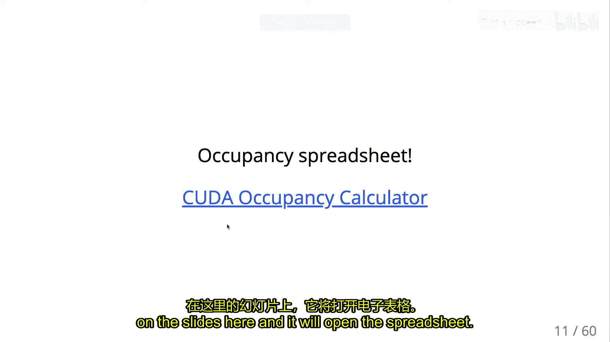

So this is what the spreadsheet looks like， so I'm just going to you know just。

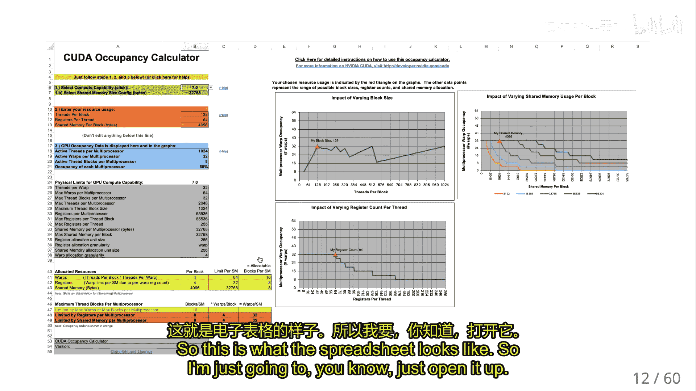

我 put你 up。You know，Right here。

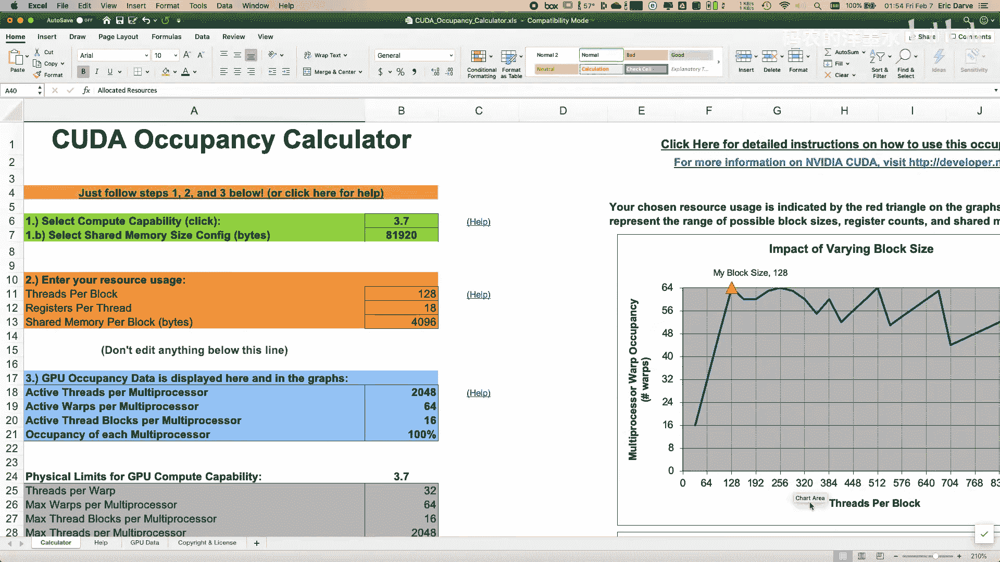

So it's。Do not rub it。So you can see so it has a number of things here。

 so you start here on the left。To a。

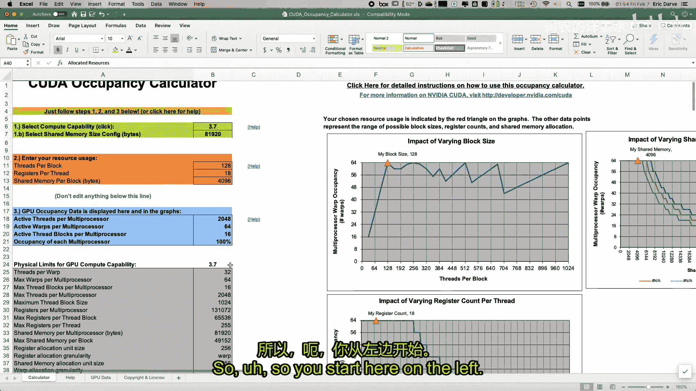

Zoom back in so you guys can see what's。

So if your computer is open， you can have a look at this。So here， you essentially need to you know。

Look at just step one and two， okay。呃。Yeah， they say one， two and three。

 but it's really just one and two， everything else below that is you cannot edit。

So here you have to enter the compute capability， so we're 3。7。

Here this is more how the card is configured， like how many shed memory is available， versus L1。

and then here you have a couple of parameters that sort of the things that you want to sort of optimize a little bit。

Okay， the main one obviously is number of threads per block okay so this is number going to be sort of playing ways to figuring out how many threads you want per block。

 okay。Next one is registers per block and shared memory per block。

 so I'm going to talk more about that， shared memory per block。

Can you guys see the slides in the back？So shared memory blog。

 basically this is just the amount of shared memory that you're allocating。

 so here I do this code transpose， let' see you from last lecture。

Looking at how many sharedd memory we're allocating and see this is just the amount of sharedd memory that we have per band。

Ssoom a little bit more。

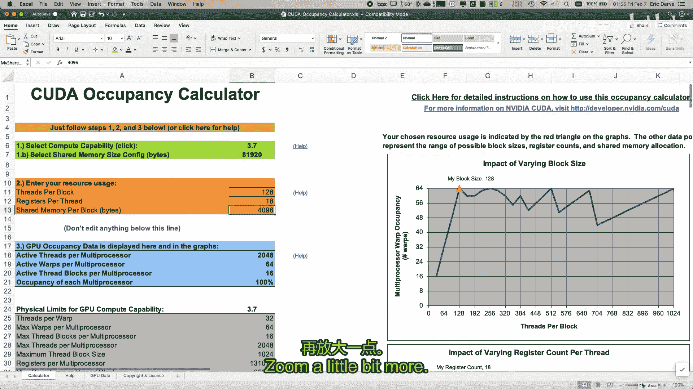

see this。And here registers per thread is actually something that the compiler can tell you。

 so that is not easy to figure out to essentially when the code get compiled。

 the compiler spends a lot of time optimizing the use of registers to use as few registers as possible。

 of course， dependencies between all the operations。So that's why it's CO stone。

 changing the order of the operation and so on can sometimes save a little bit on registers。

So but this is done at compound time， right during execution， there's no really change with that。

 this is everything is sort of set。系咁。And then you know here you have。You know。

 some data that basically corresponds to what's happening when you run this curve。

 so if you example is going to tell you how many threads are actives， so here， you know it's a 2000。

 so essentially with this configuration at reach 100% and this is also shown here。

 you know this is where I'm at here， and 64 is a maximum number of wars。O at the maximum here。Okay。

 so you have 64 worth multiproces， you know maximum 16。Active threat 16 blocks。

 and then occupancy is 100%。

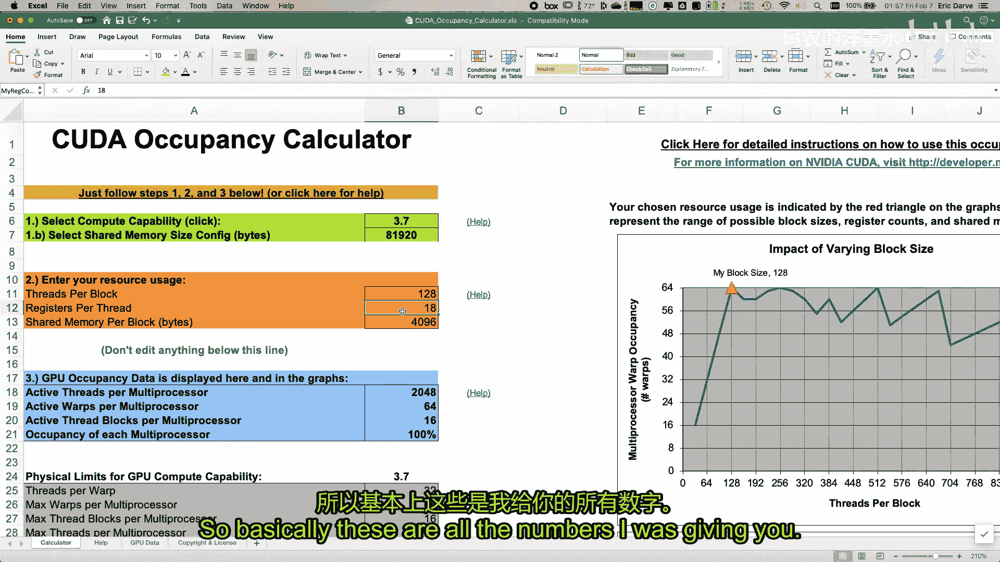

Then after that below that you have some physical limits。

 so basically these are all the numbers I was giving you， so you have 32 threads per warp。

 maximum number of warps， maximum number of blocks， and so on and so forth。

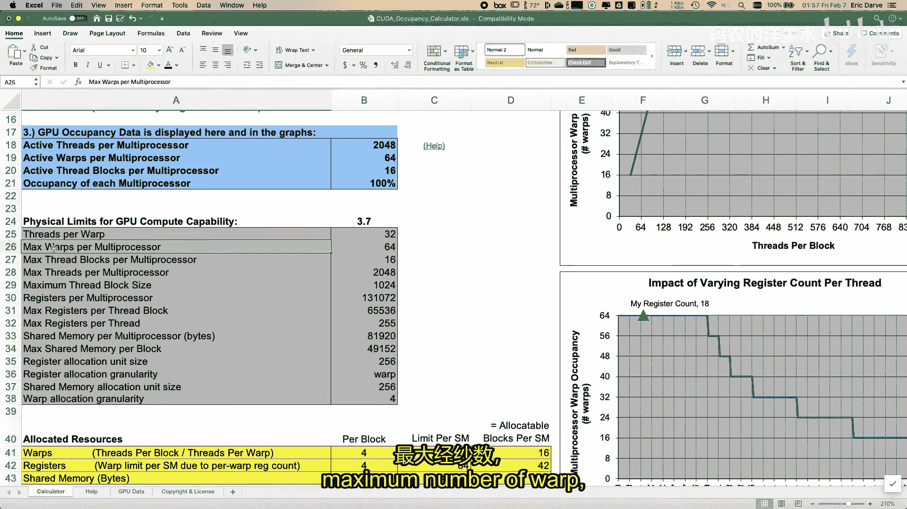

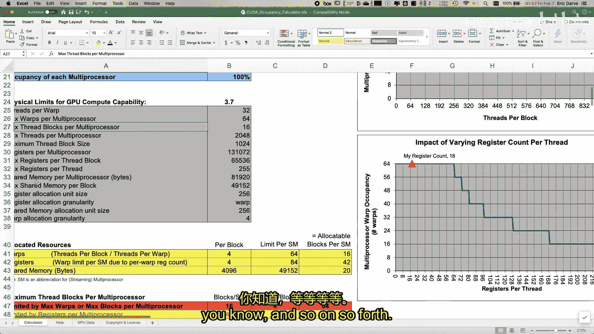

So this is the resources， the number of ver， register。

 sharedd memory that you have across essentially on HSM with all your blocks and so on。

And here you know also some important numbers， which is basically。

 this is currently the limit factor okay。But here， for example。

 I picked blocks that are pretty small 256。So the limit I'm hearing is 16 blocks， right， 16 blocks。

 so we cannot allocate more。So for example， if you look up here。

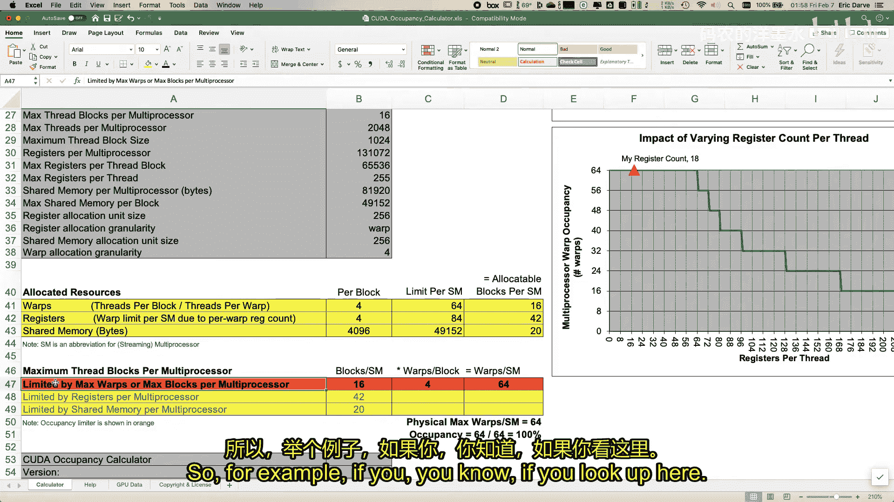

Okay， so here you have some help here if you' curious， there's a bunch of numbers。

 basically our use spreadsheet with all the data and so on， but continue to look at that。

So for example， if you look here， so this is sort of the key plot here and this one is actually little。

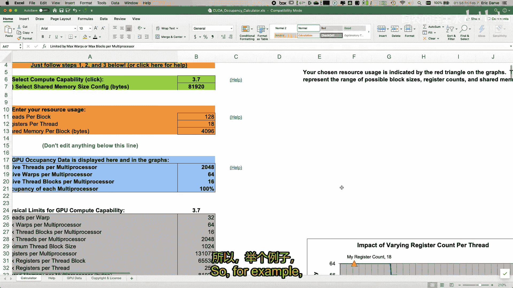

Trey to understand。So this is showing as you vary number of threats per block so this is a key parameter。

 how the occupancy is varying so it's very regular so that's why you essentially has the spreadsheet because know it is a nontrivial prompt because you know depending on how you pick threats per block you hit different。

Essentially different limits on your hardware and so you get this sort of real behavior So for example here。

 if you put few threads per block，Essentially the limit is you allocate 16 blocks。

 but then you cannot go beyond that， so you're limit by the maximum number of blocks that can be allocatelk。

 so this is basically here， that's why it increases just linearly because basically the number of blocks is fixed。

At 16 and then just multi by the number of sets per block and that total number of tragic and high。

 so once you reach 128 you're at the maximum。So what's happening is so here you have 100% occupancy。

 so here you know you have the maximum， if you increase number of that look up a little bit。Okay。

 then。You have to let go of one block。It otherwisewise you have too many strength。

 so you let go on one block， so this is why know you have these white falses here this basically correspond to just adding 32 so everything goes by 32 obviously because that's one work。

So every time you add one more warp。You reduce and you remove an entire block， that it goes down。

You just make each do a tiny bit bigger， but then you remove one block and what's happening is initially you have a lot of do 16 dos。

 so when you just remove one do it's not super visible but as you have fewer and fewer blocks。

You know this effect is more and more pronounced， but this dead here becomes more and more pronounced。

Okay， so you can look at this plot exactly what's happening， so initially it's very smooth。

Initially you have the number of blocks is going down very slowly， and at some point you're able to。

 essentially the number of blocks sort of is fixed。

So here you just see the increasing number of threads， then you lose one block。

You can hear you number of block is fixed， so it just goes up， lose one block。

 number of block is fixed and so on。So this is the main plot。

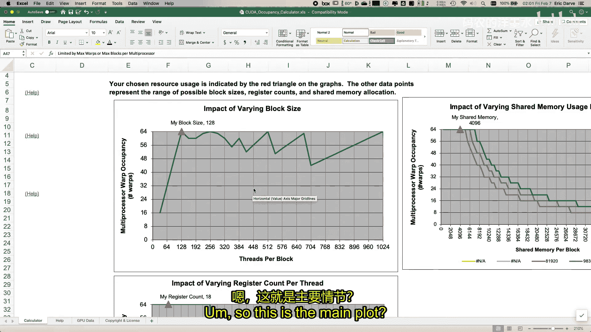

And then here， if you look to the right to have other so this is a little trickier， but this is。

 for example， if you were changing the amount of shed memory allocated， so for example。

 if I allocate more shed memory then progressively the occupancy would go down because it would just run out of memory。

So this is something that perhaps can be changed。You getting your code GB。

 you can control the amount of sharedd memory you're allocate okay so you want to allocate as little as possible。

 but there are many factors same tradeoffs here。So here we're doing pretty well at 4000。

 but as soon as you go to 8000 and so on， you know it kind of。You know， you go into these problems。

 something a little bit more difficult is a number of registers so you know thats that's。

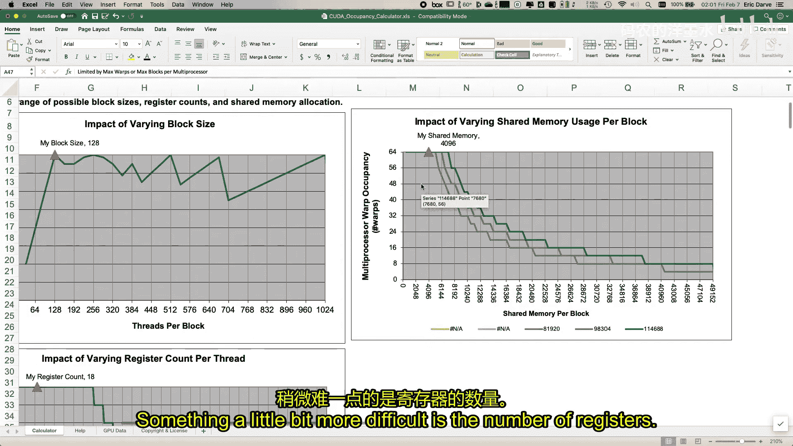

re here so here you know there's quite some mountain of 18。

 but once I reach 64 that's quite a bit more but I would again run out of register space actually here and we fine with the registers while to join the number of registers。

This is tricky by inviting your code， changing a little bit。You know。

 the use of local variables and so on because it's essentially。

Ginting code that minimizes the number of registers is sort of an NPR problem。

So the compile does its best， but it doesn't necessarily find the optimal solution。

 so sometimes you do the same operation， but you just for example。

 introduce numerical local variables， we change the order of things and so on。

 and the compiler inter differently and can optimize。

 or sometimes you can split a kernel into small kernel and so on。

Inuce this register pressure so that some tricks that can be done， but this is more challenging。Okay。

 so we can play around with this spreadsheet here。So， let's see。

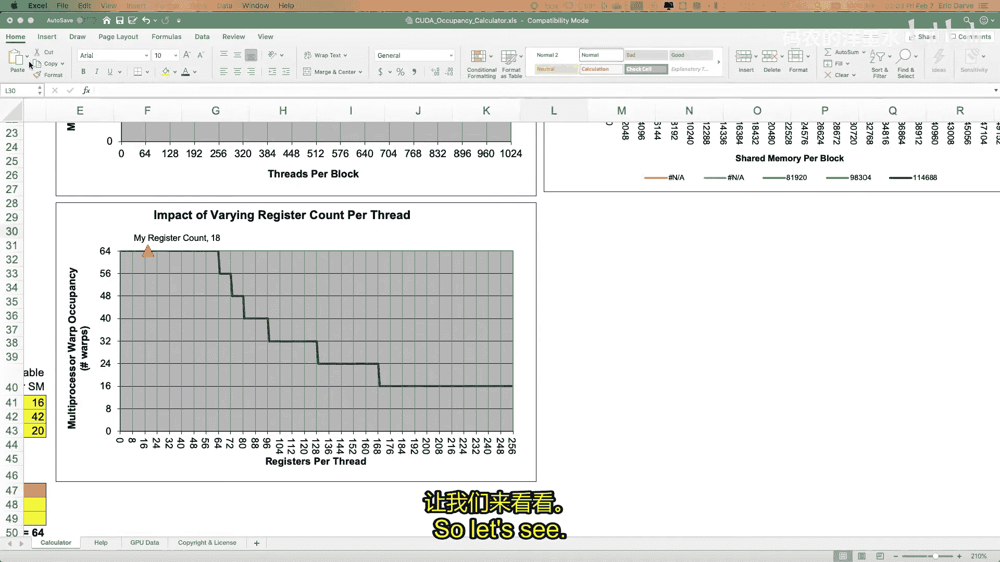

And I have some difficulties getting back， my。Where is it？Yeah， we。啊，O。It's in full screens。

 So it's kind of hidden。Allright， so my slide。 So okay。

 so one thing that so this is I just want to go quickly on that because this is we technical thing。

 how do you figure out the number of registers that is required for running a game journal so the compiler can give you information So use a special option So PT T X assembly。

Verbose， okay？And then basically the output just gives user information， so for example。

 this was the transpose fast transpose kernel， with some C++ compiler naming stuff or fast transpose。

And they just tells't you you know。Thepect frames。Sill stores， steel loads and so on。

 so this is not super relevant for us right now， but does do 18 registers。

4000 bytes of shared memory and100 bytes， this is constant memory and talk about that and this is basically the really only memory that has a spatial storage phase and is more efficient。

So you can basically these are two numbers I entered， you know1 aging registers， 4，000 bytes。

All right。So this is this is what you get。 Okay， so you can use this spreadsheet to sort of get a sense of what。

You know， you expect with your kernel and then you can play a little bit with you know threat per block。

 but like I said， you know， as you can see， I mentioned， you know， 128 is peak。You know。

 you have 256 also peak here， 512， so these are sort of you know。

 256 to 512 sort of good numbers because they give you a lot of blocks。And， you know， typically。

 you're close to。To 100% of those。Okay， so in the end， but in the end。

 it's sort of often just tro and error， but you can start with 236 or 512 as being good initial guess。

Any question on this？O。So let's talk about another topic sort of briefly， but also。

So very important to understand performance and to sort of understand whether your calculation is suitable for execution on a GPU。

 this concept of branching and divergent execution paths。

So here there's a special kind of difficulty。Which so the basic units are these war。

It made of 32 threads。And every thread in the work executes the same instruction。

 so the hardware is not tracking the instruction per thread。But it's about the level of the warp。

 okay？And。So I'm going to show you exactly what are the consequences of that。

So Vota actually turns out is， well， for our purpose， it doesn't really。Change too much。

 but I'm going to show you what you can do is vote， but to Pascal。

 which is prior to Volta and that's the。GP you have on the cloud。Essentially。

 there's just a single program counter。That is shared amongst all 32 threads。

 so meaning that you're not distinguishing what each thread is doing。

 rather you're looking at what the workp is doing and the work is given instruction and that's it。

And the thread they're sort of following， just following the work and also of all doing the same thing。

So let's see what's happening。So now the problem is in your code， there's going to be some branching。

branching could be， you have an if， you have a while， or even you have a full loop。

 but the length of the full loop sort of varies between threads。We've got a example of branching。

So essentially， it may not be true that all threads。actually do you have to do the same thing。

 okay the execution path will depend on your third ID。Not by a whole lot but a little bit。

 I mean sometimes actually about by a lot， I mean you start having statements， you。

 you really could do very different things。And that's very bad， so you definitely want to avoid that。

So let's see what happens。So essentially， you know here。The the GPU or the driver or the。

Opering system of the GPU is going to cheat a little bit。

 so it really doesn't have this ability to have divergence， all to do the same thing。

But there is a capability in the hardware to mask certain threats。Okay， so in some sense。

 some of the threads， know， they're going to do some operations。

 but the output is going to be discarded。There'sibility for to mask certain threads。

But essentially actually everybody still needs to do the same thing。

So aside from this mask apply at the end， everybody's doing the same thing， and so for example here。

You know you have an example， if IDX in4， they's just say you have eight threads in your warp。Okay。

 and so if you're 0123， you do AB， otherwise you do x y。

OkaySo first you start the first slides are going to do AB。

 Now the other thread are not doing anything， or rather they're doing AB。

 but the mask is being applied so that at the end of the day， it's like they're doing nothing。Okay。

 then when AB is done， then the code goes to the other branch。And does the x y。

 and then it resumes you if it converges and if it does the same thing。

So you can see how this branching is terrible because now you have a sequential execution of your code。

Instead of AB and Xy， in principle those could be run at the same time because 01 through3 are doing AB。

 and then4 through seven are doing X Y， so those are completely independent could be done at the same time。

 but though it's going to be having sequentially because of what the hardware is doing and this is done through a mask。

So the execution is completely serialized， meaning that instead of being proud。

 things happen one after the other sort of sequential。ok。So next's we've have two cases。Okay。

 just to make the point so here for example。Something that's called Bra thread。

So let's look at the code， so what is this code doing？So what are the threats in the warp doing？😡。

Right， so basically you have the event threads doing something and the odd threads doing something else Okay so that is definitely a terrible case experimental case I showed you so half of the threads are doing the first branch。

Second half。And waiting， then when the first half is done。

 second half does the other part of the branch and everything is completely serialized。

So if you look here， what's the difference here？😡，Also， even in odd， we're done differently。Right。

So now the even odd is at the workp level， like the even warp or doing this， odd workp or doing that。

Okay， so now actually that branching。Is inconsequential because instructions are kept at the war level。

So you， maybe you take the branch， everything goes conly and everything's fine。So。

So of course this example is a bit artificial because in practice。

 it's very hard when you have an if statement to make sure that the branching happens at the workp value I mean typically happens depending on the result of the if statements which obviously depends on the thread ID but that's typically unrelatedrelated with the workp ID。

 but in some cases you can reorganize the calculation and so on so that things work out kind of reasonably well。

 but that's sort of hard to control， but it's important to see that you have this granularity and so essentially。

Threads that are sort of contiguous or near other take all the same branch。

 then you will not see the effect of this branching， but if the branching sort of appears random。

If you are inulated， then you will see a massive slowdown in your code and you have to be very careful because you know these if statements by the nest and so on。

 and so very quickly you know you may have only one thread actually doing anything in the works okay so that would be terrible。

So I want to briefly mention the voteta， this is how recent development it's kind of interesting。

 but it doesn't entirely address this， but it kind of illustrates that this branching could really create some serious problems。

So the performance here is still there。Here is how it's advertised。But it's really not。

It's really not as great as this sounds， so prevota， like I said， the program counter。

the instructor encounter was at the level of the war。

Okay so essentially you have 32 thirds in the warp。

 and then the program counter was right here at the warp level and really does the same thing as well。

In Vota， they actually have each thread， each has its own。Program counter， okay。

 so actually its thread keeps track。Of where it is at。In the program。ok。Having said that。

 the hardware still is such that the 32 cores need to do the same instruction and still the same as before。

So what's the difference？Okay， so difference is follows， and it sounds like a small point。

 but I'm going to give you an example showing that， you know it actually in some common cases。

Can make a big difference。So the difference is again。

 when the warp is running only one structure that is still true， that remains true。

 so there is so now。But let's do for example， at this case， you're running again， AV and X Y。

So previously， the warp。😡，Was essentially doing either one branch or the other branch。

 because everything was at the work level。We worked at the first branch on the second branch。

So if you're at the thread level， this is a little bit better。

 it means that you can have some of the threads， for example， doing A， for example here is do， okay。

 first threads do A。But then because the parameter encounter is at the level of thread。

 it is possible at the next step to have threads running x。

 okay so the other half of the threads are running X。

 so now essentially you have inside the warp threads that are actually a different insertion counter。

Okay， different places in the program， basically。They're still sort of executing the same instruction or planning this mask。

 but in terms of tracking where they are in the program， it's become not independent。

Okay and so for example， then the first threads can then go back to B。

 and then this guy can do y and be done and then you know everybody actually that's。That seems wrong。

 okay， here everybody should be doing Z。So here basically there's convergence that everybody goes back and does Z here。

So actually， this was done in part because， you know， they're sold bugs。That can come from。

This fact that it work is stuck at the set instruction。Okay， all bugs that can appear in programs。

 and so I'm going to show you one example of these bugs and just move on。

So this is kind of an interesting so again， this is more。Going a little bit beyond this gas。

Going back to some of the core topics of parallel computingut。

 and so we talked about new Texases and so on， for example， in locks。So essentially。

 you have situations where you need to access a shared resource and using blocks。

 so this is an example way you take。And the threads need to access a shared resource。

 so they need to use a log to access that resource， okay。

 make sure that no other the threads can do that at the same time。Okay。

 so you have socal starvation three algorithms， which are basically algorithms such that you know even when you have a content and resource like a log is still guaranteed to complete just sort of。

Simplify the discussion here。So now let's look at at this code。 And if you look at this code。

 it doesn't seem very。Pro， it's just a linked list。

Okay and using G to I'm going to keep the details of the algorithm。

 but this is just a linked list and you're inserting a node in your linked list and so before insertion you have to do a lock okay so you lock your nodes。

You make the changes， you add this B， and then you just unlock everybody。

 so this is we've seen code similar to this。Okay， and what is the problem with this code， actually。

 there's a very subtle form in this code because of the log。Can anybody explain what the problem？

Here。SoIt's not very easy to。To start， actually。If you haven that right to。全到。系需要喂。

If you have a drive try to request accessing。So the answer has to do with a deaddo situation。

So it's actually tricky because to see the problem you sort of need to。

 it depends on how law is implemented。Okay， so it's not actually。And visible。

But when you enter a lock。There's definitely a statement。Because one thread is going to continue。

And others need to stop。 So now you have to look at exactly what's going on with this lo。

But let's say that， for example， one of the threads you know。The requiress the lock。

But its a the workp。Decides to look at the instruction。Which is basically looks at the federal。

 could not acquire a law。Okay so the instruction for the remaining trend is to test test them。Okay。

 so the word you're going to say testinal。But the poem is， you unless the board starts executing。

The thread that owns the lock。You can really suck right because the thread that O the lock is not going to make any improvements is so here you need to actually do the divergence right。

 the thread that on the lock needs to be able to move forward。While the other threads are weighed。

So it's kind a weird problem okay， mind you if the work decides to go with the thread that owns the lock。

 I show you're fine。 then everything was executed at some point it would unlock。Go back。

 you know and so， but if the workp at some point decides。😔。

To stick with the friends that are testing the lock， then you cannot make progress。So， you know。

It probablybably took a while to figure out。that bug because somebody probably took some code that they had and wanted to run it on GPU。

And this would completely randomly。A dead arch。And this is type of bug it's very。

 very hard to figure out， and so Christ Vota by allowing threats to make progress with their own program counter can actually get around this type of problems。

So I think this is a kind of interesting example of the sort of difficulties you can have in multi corere computing and specifically because of this lock of this warp。

And the fact that all threads are executing some instruction。

 how this change in voter sort of gets around that。Okay， so let's talk about the homework now。

So this wraps up， so again next week we will have coola lectures。

And then just a couple of lectures to basically I said that we' sort of done what with KUuda and then we' going be moving on to NPI so homework4 is a little treaty so I want to talk a little bit about it so the homework itself there's some difficulties in the programming and so on I mean nothing。

You know like theoretically mind bugging， but it's mostly about checking out unbounds from like you can at indexes。

Checking whether you're inside the domain or outside， so nothing like really earth shattering。

 but sometimes it takes a while to kind of figure out how this indexing kind of works out。

So the idea is to find difference's a classical just benchmark or demo， withkuuta。

So you have find different scheme， so I'm going to skip how this works。

 but so you have a oil method explicit， and so essentially there's maybe some linear operator like a spa matrix or stencil that you apply to your temperature at times at10 n and gives you the temperature at time n plus one。

And involves the timet involves the discretization of the second order derivative。

With five difference and so on so。 But the detail of the math not matter。 This is just a star。

 star operational G。 And so this can be represented as a stencil。So what iss showing is the red node。

 the center is the node being updated and around are dependency so we're just going to look at the 2Dgrade for simplicity。

 so the node location IJ is going to need the node west， east， north and south。For each update。

Okay it's the second owner， full order， you need to go to more neighbors。

 so basically these are you know。Approxiations of your second order derivatives。

With different orders， so you have a central difference， second order。

 if you go to more neighbors to get high order schemes that the air decay more rapidly。

With the me the H squared H to the4 or H8， so H H you have to go really， really far。

What's interesting is depending on the nature of numers。The sense you're using。

 you can get different performance in your code， right the number of videoths actually is going to change。

So obviously here you have more flops what I'm talking about is the performance that the number of flops you doing per second。

So here you're need more fl per second， to go faster。

 we need more efficient than with the second order， so the efficiency is going to be different。

So you're going to have to kind of think about that。So there are various details in the code。

 I'm skipping through a lot of that just in interest of time， just to note that for example。

 there's a little problem with the boundary。Because if you have the fourth of stencil。

 you need two neighbors， you， West east or south。Okay， so on the boundary， you know in principle。

 there is nobody， for example， let's see on the left boundary， there is nobody left of you。

So we need a special stenc but we sort of here ignored a little bit。

 these details was constigious and not relevant for our discussion。

 so the way we did that is essentially you're running a case where we have essentially an eigen mode or eigenvector of your PDE。

So it's just a decaying mode。And so we have the identical solution so we can essentially set the values on the boundary sort of analytically so we don't have to worry about that。

 so the point is nodes on the boundary are set by a special routine and just have to worry about doing the calculation inside okay so basically we're just going to apply the same stencil for all points inside the domain。

We that。Okay， so implement a QdDA routine to update the notes inside the domain with a five different centered stencil。

Okay， so just a little bit about the。All things are laid out， so you have a couldie mesh， okay？

You need to decide， so in memory， of course everything is just1 and D so to speak。

Addressing and so on so you can think of this 1D so you need to decide how to map this 2D domain onto this 1Ds sort memory and so the way we do this is we move first along X and once we're done with this row we move on next row andend and so ons called lexiqco graphical order。

So now here's the key diagram。Here's a key diagram， and so this is the same important diagram。

Think about when writing GPQU codes， is something I mentioned a couple of times already。

And so it has to do with this concept of earthquake intensity。

Which is number of flops per bitete that you need to do。 So what this is saying is if you're doing。

Few flops per bite， okay？Not too many flops， then you're limited by the memory bandwidth， so in fact。

 in your homework for example right now when you're doing the inch，Or the in。Okay。

 you're doing relatively few flos per bite。 Okay， you have this load store instruction。

 But then they request a lot of data。 So few flops， if you divide flos per bite。

 it's a smaller number。So you' going me on the left you're going to be memory bound。

 so actually in your homework， you know because you're doing this memory copy。

 you want to be memory bound。But， you know， in most cases。You're trying to do some calculation。

And you want to be from that。That you want to be limited by your memory。

 so being on the left here is typically not that good。Okay。

 and if you're able to reduce the memory traffic。So again， going back to your homework。

 in the case of car， you're actually loading a lot fewer bytes from memory。

 while pretty much doing the same drops。Okay， so actually you' continued balanced with that。

But for example， again， if you're processing this grid。

What you're interested is in applying the stencil， so doing these multiplications。

 additions and so on， so you want to do the compute at peak bandwidth。

 so you want to be on the right here。And so that means you， high aritic intensity and it's quite。

It's quite bad， you can see that here this is a10。But this is fps goodbye bite， so for example。

 say youf floatat。Ins four bys。So it's more like crops per4 byte that you need。

 so essentially you need to multip by four so this number。In correspond to more than 40 flops。

Per float。So fully flops is a lot that is a lot of multiplication edition with just a single number so aably。

 you're going to load a bunch of numbers， but that's per number read for memory。

 that is a lot of operations and if you want to get to big performance maybe need to be even more than that。

So this is a key thing to understand how many flops are you doing per word read from memory。Okay。

 so so you， these are， for example， what's happening with spa speech implications。

So you have very few frogs， you're right here。Dense switch multiplication so here you're going to be reaching the maximum output and also this is differentiating the GP and CPU。

That's you know sort of give performance， but just is just showing some example。

 so also you know we need to do this， you know， so to understand you know this。

Isue of performance you need to understand， of course the memory of traffic so you want to see if the boneneck is compute or the bonenecks memory you know you need to understand how fast your memory is and how fast your memory is depends on where you're reading data from you're reading from L1。

 extremely me fast， L to slower， slower， very， very slow。Okay。

 and the sizes the cash depend you know will determine whether your data you know is still L1 or maybe it was evicted。

 you have to go to L2 was evicted to go to offense on So this is what things look like in video。

 so it's actually。Still very differently you have the tunnel registers because all these threads that need to be live on the processor。

 you have the tunnel registers whereas the output cash and so on per thread is actually sort of very small so it's going to be very constrained。

So's very hard to use cash actually on GPU so， but this is important because know if you're reading from L2 or from main memory。

 the bandwidth will be very， very different， right？So for example， if you're reading from L2。

 then your aic intensity can be way lower。Because the memory will be like super fast。

 okay so you'll be able to be compute limited even at a lower arithmetic intensity。

 but if you really need to go for main memory constantly。

 then you need to bump up the arithmetic intensity a lot。Okay。

 so now there are a couple of calculations you can do so on this simple example。

 you can actually quickly figure out where you are on this diagram。More complicated code。

 it's way more difficult， but you when you look at your code。

 you can count how many flaps you're doing and how many pieces of data you're reading so you can actually do this type of calculations so let's take an example here。

So here's， you know what the the。The second order statencil looks like。So you you get discount okay。

 this is one， one，1，2， three，4，5，6，7，8，910 okay so you have 10 turning point operations okay and then you can just read well how many。

How much data that you're reading， so you're reading this guy。This guy， this guy。

 you know basically to five， okay， so you're reading five numbers。And you're writing one number。

 okay， so current zero is actually being read and then you have to write the results back to memory。

So as small as six numbers。So you can discount all this that stuff， So conditionss， multiplications。

 read writes， total6。Okay， and then you can。And then you can duck it your ring density。

 and try to improve that。So let's see how， how this is going to be， how this is going to be done。

So there's going to be two main ideas in this form。The first one is going to be the use of cache。

 sharedd debris， so essentially this idea is you're going to load data into the cache and try to reuse it as much as possible in order to reduceuse memory traffic。

Okay， so you keep it there and do as many flops as you can with it before writing back the result and second。

 which is a little bit。Easier to figure out is that the memory access should be correct。

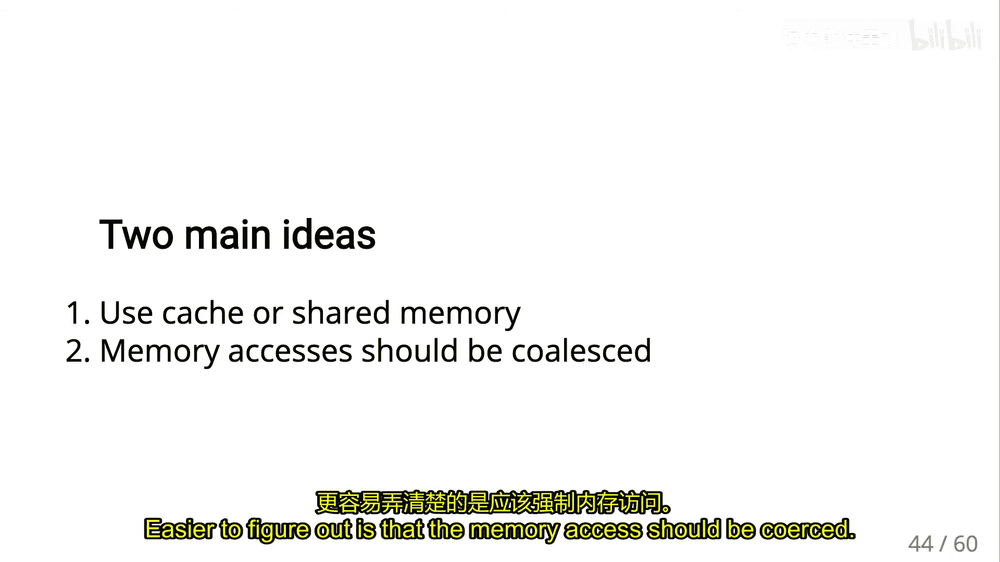

So let's go through， should there are three essentially implementations。诶你俾我两个准。

They're going to get different diversity density in between the better and better across the three output。

So the first idea is easiest just where essentially a thread block simply reads you know memory just contiguous。

 you use the memory contiguously， so you basically sort of reading row by row in your grid so your thread block is going to thread zero。

Wors on this， thread1，2，3，4， so essentially third zero is going to be stopped reading this， be this。

 reading this， reading this， reading this， reading the flops， and then writing the result。So it's。

Okay， it's。It's not that great， but you know there's example if you take this point here。

 it's actually being used by three threads， right， that thread and then the guy on the left and right。

Are both using that gap。 Okay， so there's some reuse。 If you look at the top and the bottom， okay。

 no reuse， only one third is reus that here。When the threat are time seems be reading and。

Is there a risk that to work？Well， okay， so they're not being invite right into the same every location right。

 So for example， you have two arrays in the thing right there's TN and gen plus1 right？嗯。Yeah。

 because otherwise， yeah， otherwise it would be a risk condition。Yeah， on the。On a CPU。

 you can work your way around that do it in place。But。Here what is impossible here。

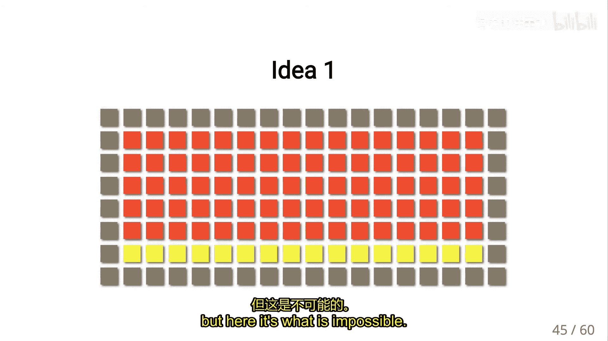

Okay， so for example， here， you know， let's say you have 16 threads， so you look at all the reads。

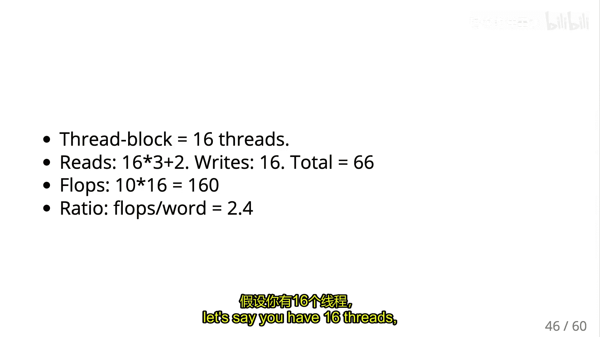

Okay， so it's basically 16 times 3。 is' basically those three rows。

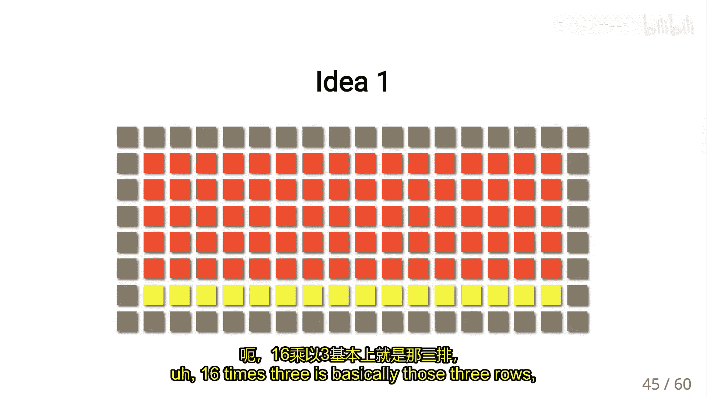

Okay， and then you look at all the flops。 So there's a little bit of reuse。

 So the flops per word is 2。4。 Okay because the guys in the center are basically have3。

 but then the boundary is， just used by only one thread。So you know， 2。4 you。So in the end。

 we're not going to be able to be compute bound this is just sparse basics operation。

Not possible to be complete bound， but the idea is going to reduce the memory traffic。

 so actually it doesn't matter what subs are're doing here。

 we're going to try to rearrange the calculation so that you we use make better use of the cash。

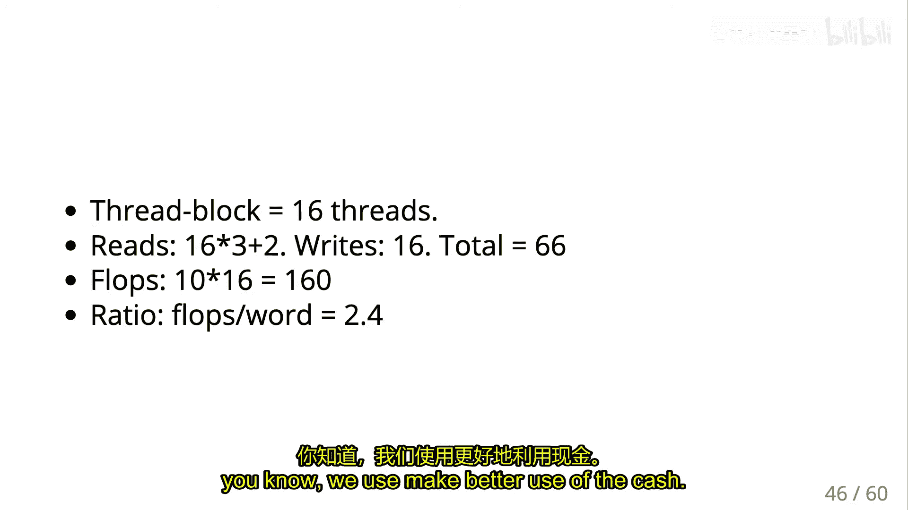

And we can reuse data。 So the second idea。It's going to be as follows。That if you read a square。

 it's actually much better because if you think about it。知诶。嗯。Right if， if， if you have， for example。

In node here， let's say second over stencil。At most， it's used by five threads。Okay。

 so whenever you have a node that's inside。It's used by five threads。This guy here is used by four。

 and this guy here maybe by three。so the more you're close to the boundary。

 the fewer thread of sort of accessing your data。So it's good to be inside and less good to be on the outside and in the oney case that also be the worst they do。

Okay， you had the smallest views。And again， the stuff on the boundary here that is used by only one thread。

Okay that's hard to avoid。Okay。最师嘅。Rfely speaking。The maximum is achieved。

When the volume divided by the surface。Is Mexico。Okay。Maybe an easier way to go。

 if you've done some mechanics， an easier way to think about this is surface divided by the volume is minimal。

So this reminds you of well problem。For those of you who've done food mechanics。卫生。

do you remember the why is that？Right， yeah， exactly， okay。Good training and tank。

 so you have this concept of surface tension， this concept that when you have an interface essentially between water and air。

 there is an energy cost， which basically has to do with。

You could say cutting hydrogenin bonds fors right so there's having waterman with nice hydrogen bonds all around。

 there's much fewer bonds so there's this energy cost associated with the surface so you want to minimize the surface to for up in space。

Okay， you have all these jokes， you know。知唔知伟。Cap Hadna drinks is whisky in space。

 it's this perfect sphere， and it's difficult drinking is whisky。so in the space。

 when there' is no gravity and so on， the water just goes into this nice nice bubble。Would be a disk。

Very difficult to do， but you know a square is。 So the square is the one that achieves。The optimal。

 and， in fact。The bigger the squared， the band the ratio just attack you if you have a very big squared。

 every reason inside。Wch the peak。I think intensity。

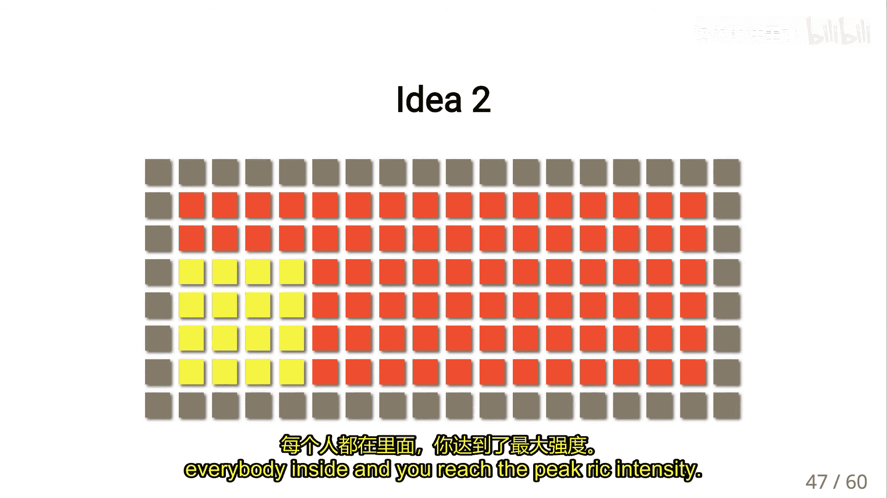

OkaySo so for example， if you do this， then you reach you know， you go from 2。4 flops per word to 3。

3 and you can do a little bit， so I'm going to skip here but you can do some calculation so you the maximum is actually five。

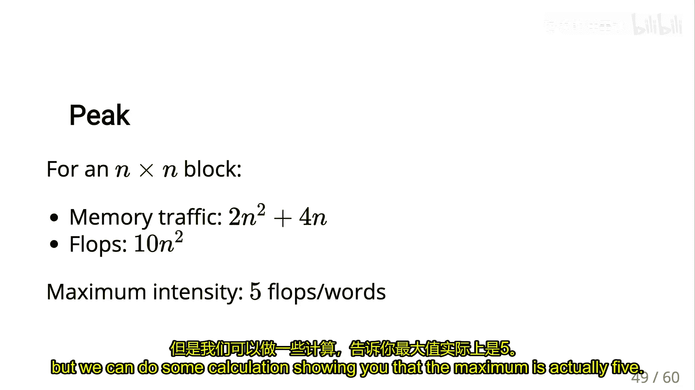

Okay， so I'll let you you know now look at the details in the homework and so on。

 so there is a so called global memory implementation where you have a thread block so no sharedd memory just basically still accessing global memory and so on。

 but you can have a thread block working on a square on your mesh。

 and essentially you can have a bunch of wars you know reading a bunch of rows。

And then moving on next rows and so on， Okay so the reason is if you take a square。

 a square is actually too big， that's too many threads。Okay。In your thread block。

 you know if you're about 256 or 512， you actually can allocate the thread block which is as big as the square。

 I mean the square here is going to be 32 right so 32 by 32 is too big so instead you can have your thread block working on a couple of rows。

And then the threads are looping。So that you can cover the entire square， okay。

 so you're going to loop， you have a loop along y so that you start at the top of rows and then you can process the entire square。

So here when you buy this code， looks the same。The idea is that， for example。

Let's say you have just two works working， so first the two works load okay so they can be loading this。

 loading this and so on so forth。Okay， then you're done Now when you move to the next stage。ok。

One of the work is going to work on this， but this is already in cash。

This is already in catch okay this is going to be loaded。

 so you're going to be able to reuse a lot of stuff that is sort of at this interface we can do work today and this is how you can get good。

Good usage。Of reduction in the memory traffic， this is overnight， okay？

But it's sort of invisible because you're just reading the fact that it's in cache。

 you need to think about where the data is and realize that at this point。

 you some of the data is in cache， well， there is obviously some data that needs to be read from Google memory but whatever is in cache is going to be very fast。

 so this reduces the memory access， so this is going to be the second algorithm。

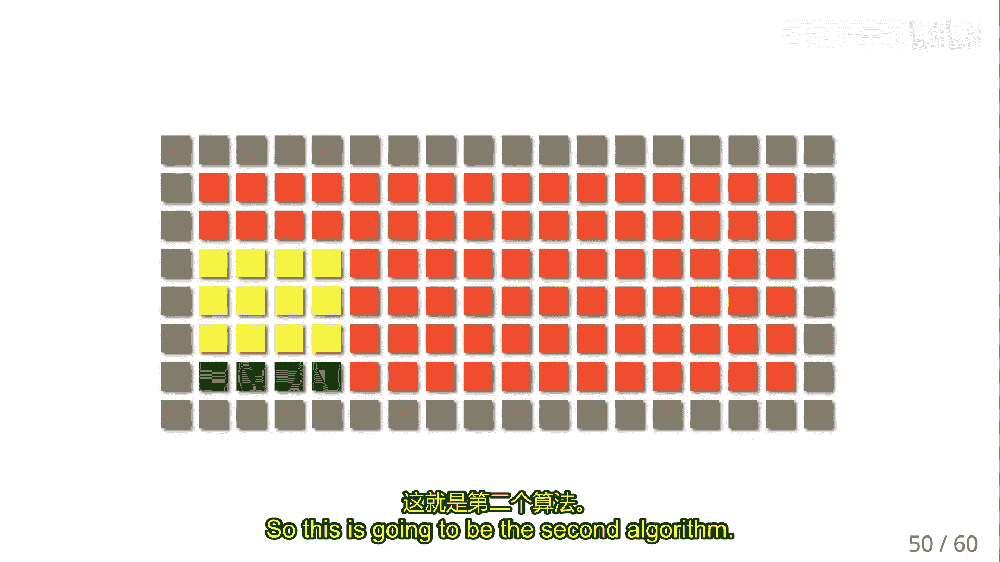

Okay， and okay。So now the next thing is the second point is a little easier to see is this issue of Qs memory access or accessing nice chunks of size 32。

 32 bytes， which actually just eight flows， but you can try to go for the full warp working。

 so actually didn't I don't think I tried，嗯。Yeah， so the size along x is going to be a multiple of 32。

 now I realize that you could actually， since the cache line on the cap is actually just 32 bytes。

 which is just eight floats， you could actually try a smaller， shorter。Chong size of X。

 but the idea is you need to be colored， okay so what this is saying is since it's contiguous memory。

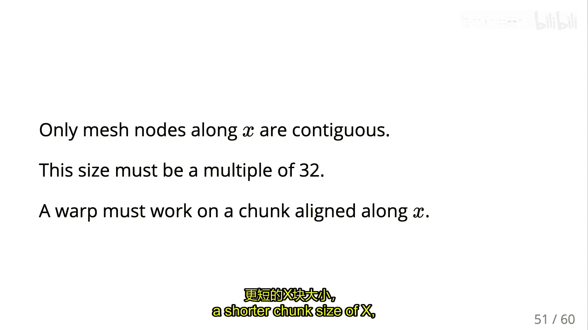

This quest access or this cash line is going to set。This dimension here。Okay。

 so there's going to be some issue of offsetting， okay。

 because you know things do not start exactly the right address。

 but you want this length here to be a multiple of the 8 or 32， so you have this nice memory access。

So this is going to essentially fix the dimension of your along x so you want to have multiple of this and then once you're happy with your x dimension。

 then you're going to decide on your y dimension so the y dimension determines the number of third per block you have okay and that's going to be this 256 side2 So here this is kind of you know。

believe or set， so this is going to determine how many of these rows you have。

And now that is a third block and now remember you want to do a square。

 so you're going to again iterate across the y axis to do your square。

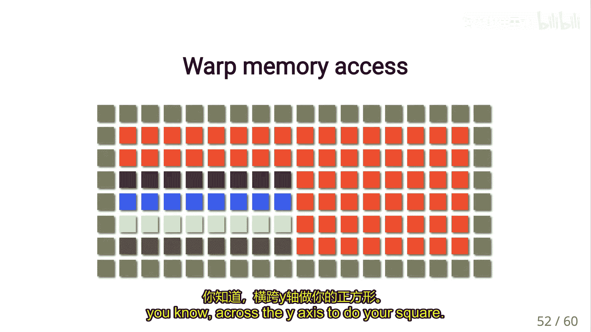

So this is going to expand here。So long x dimension is roughly 32， although you could try 8， But。

 you know， you want a big block。 So 32 is probably good。 The good back here。 But in principle。

 any multiple of8 might work。 So there might be some w room。 I don't think we tested that。

maybe you can investigate this a little bit， but then along why you know number of words along why。

 this would tell a number of threads in your block。

So you know let's say if you want5 threads x is 32， so actually this is 16 okay。

 but if your square is 32 by 32， then need to iterate just twice then we have the entire square done with that。

Okay。嗯。

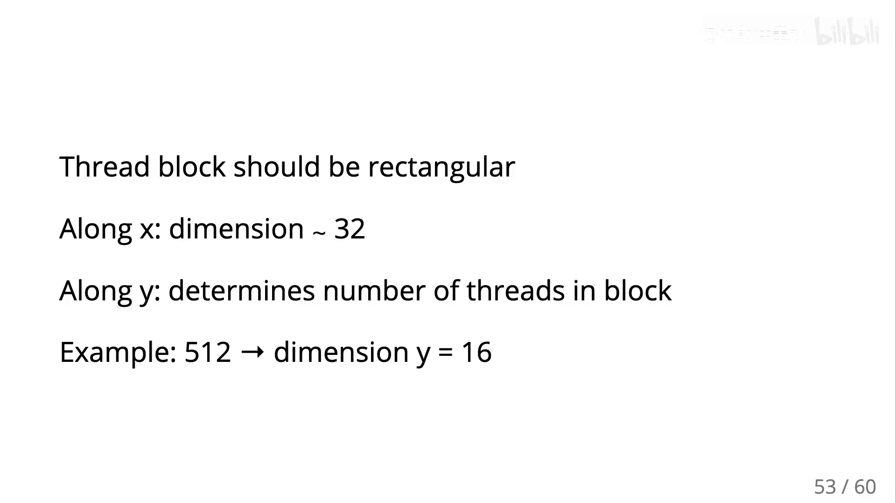

Okay， so here just to note that you know， you can have some issues with the balance。

 you have to be very， very careful。You can tell you each fed block is just working on a small chunk of the grid。

So you've got a tile on your thread blocks correctly and then you have just integer blocks。

 so some of the threads will have indices that go beyond the end of the grid。

 so there's going to be some air statements。This happened on X， this happened along Y。

 and there's just a bunch of F statement here you have to be careful with that。

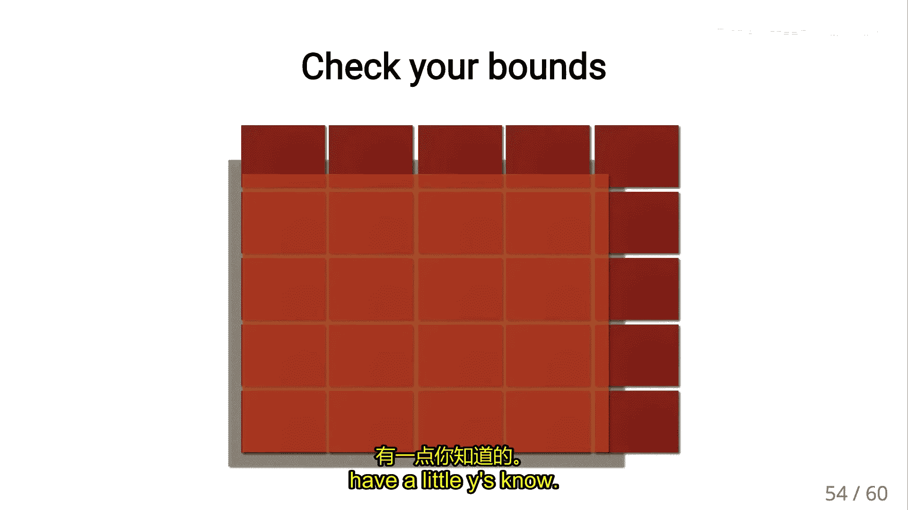

Okay， and then finally， shared memory algorithm。 So this one is。

So basically what you're trying to do here is here because it's algorithm and simple。

 which completely determined the memory access， okay we're reading， doing these calculations。

 writing。So the cache does pretty good job， but the problem is the cash is kind of small。

And you have， you，s just L2， and so all the fed blocks are sort of competing for that space。

And so if a warp， for example， you could have a bunch of warps reading some data here。

and then they have to move on， but in between， it's very possible that the data has been evicted from the cache。

 in which case， you know this whole scheme sort of falls apart a little bit。

So if you want to make sure that the data that you brand is here， then you have to use shared memory。

So also shed memory is L1 and so it also gives you access to this very fast space and otherwise if one is not accessible。

 otherwise it's just L2 and so on。So to X L1， it's you know reasonably big， it's very very fast。

 so that's something you want to do。 So the way things are going to be done is first you're going to load in January。

So again， remember that there's a little bit of a stuff on the border because the stencil beam extends a little bit。

 so second order four folder a for stencil， so the way to write the code is because you're limited by memory。

You want to basically focus on the read， the on the reading。

Okay so you're going the on your thread block based on be。

 so your thread block is going to be this entire square okay so first step is all threads just read and then there's the sink thread。

After that next stage， then you have a compute stage。😡。

Where you know essentially thread that are sort of inside do the calculation and are responsible for updating。

 so it's going to be an if statement。You know， because basically other blocks will do this update here。

 this block is only responsible for these guys。So there's going to be a little bit of a statement here。

 but again the computer is very fast， so the fact that some of the things are idle is going to be relevant here。

You have to focus on the memory bandwidth and the read right。Okay， so basically that's small as it。

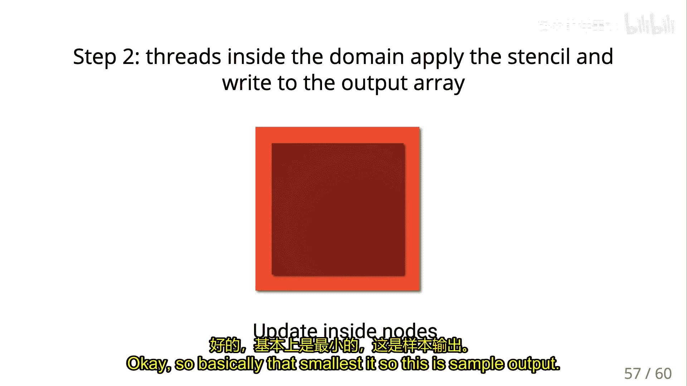

So this is simple output， you know， you can come back to that but just run this morning。

 thats what the numbers are' getting。So we can see how you know。We have Global。

 which is few algorithms I talked about， can see how the runtime goes down the air， so in CPU and GP。

 things are done in different orders。So although everybody supports。I deeply norm the ordering。

 the operations are non committed either。So you get this bone effect yeah。like。いやあ。You said。

Covered by some。Right。Inside the red block。The data on。大正。

The twiceice iss being loaded once by this clock。Right exactly stuff on the boundary gets loaded by multiple blocks。

So that stuff might be the cache， but terms the she memory。

It's going to be duplicated in check extension。Then there's no avoiding that。あ。Actually。

 technically speaking， the stuff on the boundary is only used by one thread。So。

You could load it and register。There's a little optimizations here to save shed memory。

Because the stuff on the boundary technology is not used by any other fence。

 only the stuff in the middle is actually shared， truly share。But， that's a small。

That's not in the solution sets。It's kind of complicated。But' just more。

So here you have two different orders， eighth order， I should give you highest bandwidth。

 gigabyte per second， you go up to 800 gigabyte per second。I don't you remember the peak？Oh well。

 but that's not the。That is sounded too good， I think these numbers are too high but because this is not the true peak。

 it just basically， you know because part of it is in the cache essentially， so it's way higher。

But basically based on the runtime and in some sense。

 the data you you're reading and writing that theoretically。Isuming there's no cash。

 thats what did this。But again you get 800， and so here you get lower numbers。Because it's。

 it's so it's older to。So essentially there is way less reuse here。Much less efficient。Okay。

 and I think this is just the last slide。

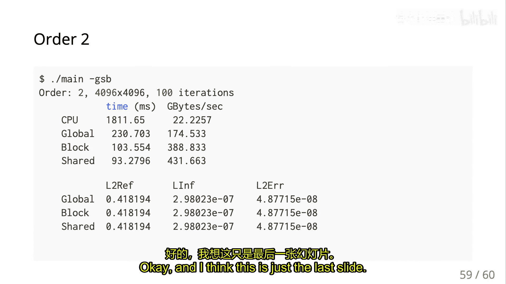

So now you can think of what's the best possible algorithm。

And the best so here it gets little tricky， but essentially， if you want to push these ideas。

You want to create the biggest square possible。😡，Okay， so you can iterate。AAlong the wax， okay？

But so the idea is you want to create the bigger square。

 so essentially you're going to allocate it as much as you can in this x direction until essentially you burn how to sharedd memory。

You're going to load then just a couple of rows here， okay？

And then you need to figure out some complex like point arithmetic and so on。

 so that essentially you start computing here。Then you load the next block in shared memory and this is the part that sort of overlaps and you do your updates and then you go on like this and you traverse as far as you know。

And keep going up， you can go as far as you walk at this point。

Ca of sort of reusing data and your show memory as best as you can。

There is an interesting also optimization which is that the grid may not be that big。

 so there's always a tradeoff between how big your square is， which is good for artthmeagic density。

 but then if you take these gigantic squares， you have relatively few blocks that are running。

 which is not good for concurrency。So for small grids， there's a little bit of tradeoff between you。

 small squares that are inefficient， but you have more of them and very big squares that are very efficient。

 but then you have fewer of them and so not too many blocks from。Okay， so this wraps up Home4。

And so we'll get the guest lectures on Wednesday。

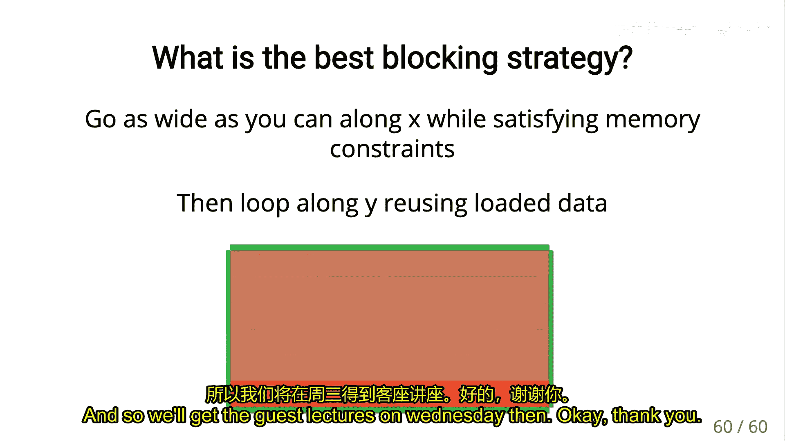

Okay， thank you。