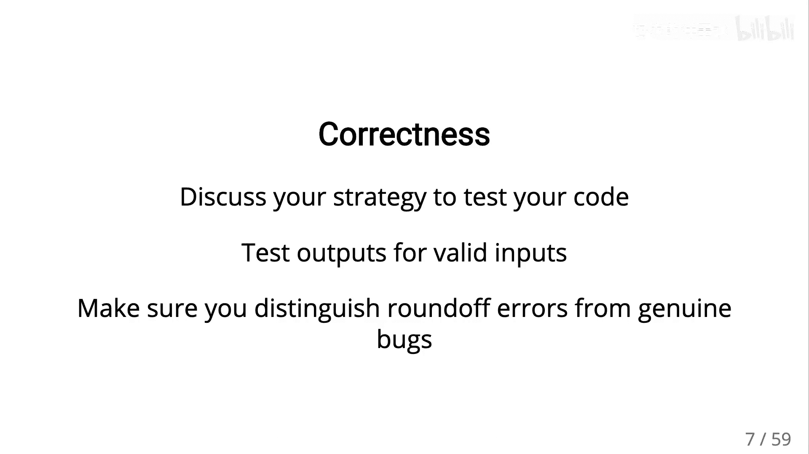
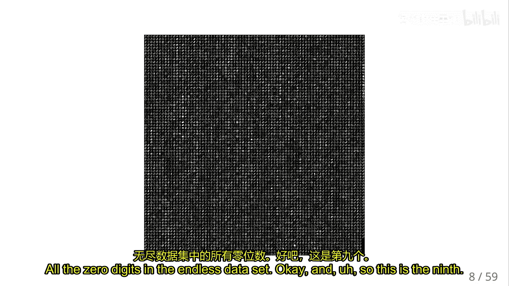
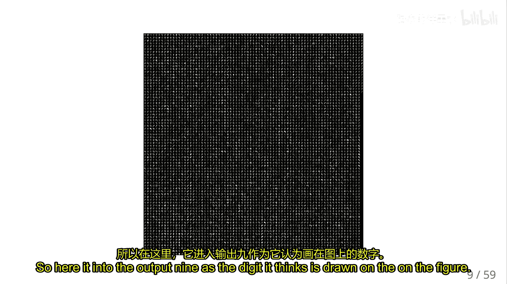
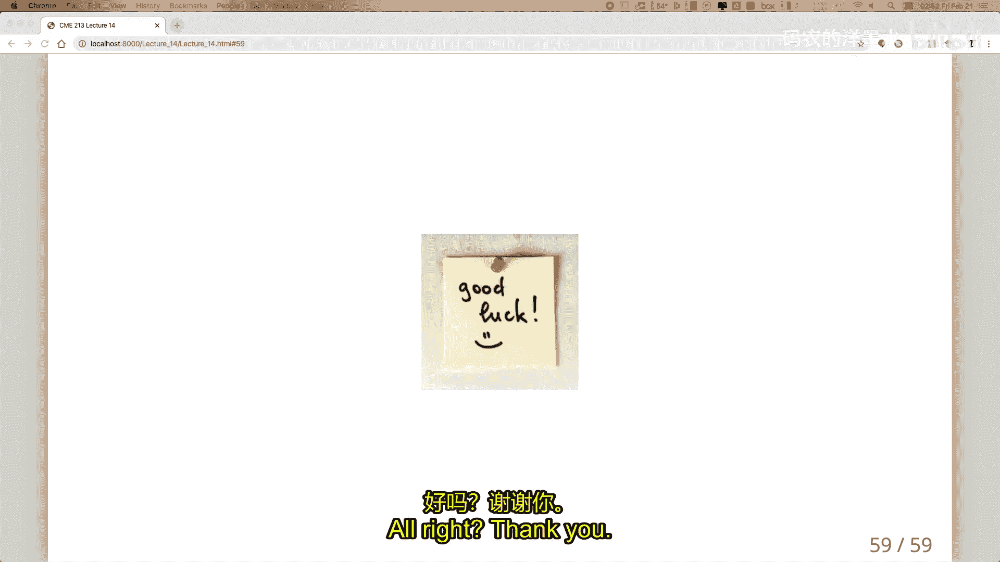

# 【全集】斯坦福大学-并行计算导论-CME213-中英字幕-1080P-p11-Lecture-11---最终项目--BV1f8ijBYEjR_p11-

Oh look frankly， I'm going to post and note that。😊，Third。好不。😀は。😊。

For a presentation of the final project， so it's a bit， but anyway， you guys are here。

 so thank you for being here。So hopefully this is of benefit for you。Okay。

 so about project So this is。So Kingway is being proposed to the part one， right？

And then we'll set up great scope。So actually， in terms of PDS。

 it's going to come in two ways the Part one， which is more explanation about the。Any worries。

And you know， the problem and so on。And the part two。

Maybe over the weekend or just a couple more days。Some of the practical details。

Of the of the project， we're just know fixing couple oftypos and making sure everything is is。

Is working there。So yeah， so you can add this part one and part two， but it's just。You know。

So just describing the overall project。So what you have to do is implement a neural network to recognize handwritten digits。

So it's a this data set， so it's a very standard problem in machine learning。

 so actually the problem itself is not super interesting。

 but we're going to look at aspects of QUDa and MPI implementation。you do that？诶。

Pverse to exercising。You programming。So in terms of the logistics。Okay， so it's right here。

 so that's going to be a preliminary report， which is sort of an initial milestone to make sure that essentially you guys are on track。

O case it is going to be Friday， March 6。And then the final report。

 which is more as due at the time of our file exam， and there's no file exam， but that's the time。

 so March 18。And the primary report focuses on working code。There's no consideration of performance。

 so you have you turn the working code。That passeses some tests and so on。

And then there's a short report just of essentially what you've done。

 but then the focus is going to be on the final report。

 which then needs to focus on essentially some of the optimizations is Ca an APII that you were able to do implement。

 and then there is the accompanying that the found report for pages。

The discussion of what you've done。You know， profiling and so on and so forth。

 this is the sort of breakdown of the code。So。Yeah， so。

I guess one thing I want to emphasize is correctness of the code。Is really paramounts。

Fness of the code is really parallel。So you're really to make sure that whatever you're doing。

Has being debuged and is working， this is way more important。Then implementing optimizations。So the。

The rubric will be shown in the PDF， I mean， this part one does PDF。

But essentially theres for example 20% here for the preliminary reporting code which is basically working code。

 but then here there is another， I want you remember the number if it's 20 or 50%，You know， again。

 for the working code。Essentially， if your code is not working。You know。It's great to be a appeal。

But if your code is working， you're sort of guaranteed to have you know。A lot of you。

 I think half of the points are whatever already in。

 so you know it sort of purposely you know made this way so that the optimization obviously is important。

 but the main thing is obviously to get a working code。

And I think it has become especially important in the second phase。

It gives you you to work in the graduation and so on。

And maybe you're sometimes too ambitious or whatever。

 so you want to implement some good ideas that you know， of course。You want to do it。

 but sometimes you're unable to make it work。So make sure that you have a full back position。

OfAn idea that maybe is' less， you know。Simpr is not what you wanted to do， but it is a working code。

I want to emphasize this because if you turn in something that doesn't work and has the latest and greatest。

 you're going to really lose a lot of points here。So it doesn't happen super often。 but， you know。

 a couple of students， you know， sometimes。Fall into this trap。So again。

 you know preliminary report is really focused on correctness， so again。

 detail will be given the PDF， so I don't want to spend too much time on that。

And then the final report will have profiling analysis so part of it will be， for example。

 what data you collected， the plots that you're including in the report and so on。

 discussions the plots， obviously part will be performance so the actual numbers like how fast your code going in the end and how far along you went in terms of optimizations and then know overall quality of report so you know。

So make sure it's written in like the grammar is correct。

 and the things are organized and just the quality of the English if you wish or of the presentation。

And so essentially if we have the discussion should be around how did you identify the performance Balnes in the code。

 maybe superfilling and so on。How did you address these performance ballnecks and what was the final result？

Okay，So also very important is。Then his exercise， of course， you know， I guess at the end。

 you want a code that runs very fast。But this is secondary。To you demonstrating that， for example。

 you can identify and discuss bonenecks。And propose solutions to fix these vex。 Okay， for example。

 if you just have this wonderful code， but you know itself in the sky， you you just stroke of luck。

 yout know why this is working or there's no discussion or maybe you know。

 but you just didn't discuss it in the report。Then you lose a lot of sports。

 so make sure that there is a discussion of the process you followed to identify performance bios。

And then， you know， actually， this is in some sense。

 just identifying the performance vex is a big chunk of the。Of the grade。

 and then you hopefully proposing solutions。And then being able to implement that。So again。

 correctness， I want to really emphasize that。And I know that this is very confusing for many students。

But you need to follow a process to test your code so well we're already giving you a lot of tools。

 so at some level it's just following the instructions， you in the found project and so on to test。

 but you know I want you to really think carefully about the steps you took to test your code and make sure it is correct。

ok 啊。And this is something that， you know。You know，8 students do wrong all the time。That。

 you know they。comee to the meeting， they have these results。オッケ？You know， good， not good。

 but then you know， it's always very， very hard to figure out whether the code is even correct。

Of course， if the code is not correct， then we can spend hours discussing the results。

 it's going to be us。So you need to have a strategy and sometimes students discover six months down the road。

 oh， well。I've been working with this for six months。

 actually that was an error in my code to essentially a lot of the conclusions were wrong。Okay。

 so we seen done good。And even worse， if it's actually if the publication isn been accepted。

You're embarrassing。对个设计说有的这证表要本。But definitely the strategy and have this mindset of when you're writing an algorithm。

And every function you write and so on， you should be able to test and verify your code and it's not trivial。

There's no time to really go over that in details。But you need to come up with the process。

And it's not trivial only to think about it。And to make sure that it's fresh。

So here there's also a footnote， round of errors from genuine bugs。

 so this is an even treeca discussion， for example。

 you know when training you do this it's an effective process。

 and so round of errors can accumulate depending on exactly how you do things。And so you know。

 if you look at the solution after many， many steps。

 it is possible that you see deviations from the CPU code。And of course， after one step。

 the difference is going to be very， very small， okay it should be on the order of round of errorss。

 definitely if you do just one matrix matrix product with a small matrix。

 you should not expect launch errors， it should be really a round of errors， so float or double。

You know after one epoch or one training iteration also you should expect more errors。

 but obviously as you keep going more and more iterations then things may stop diverging so you see it's really not distinguishing the run of errors which is not easy。

 but you know if you pay attention to that and you sort of careful of monitoring the error as every step and how it grows。

you can notice as a certaintain whether this is roundund of errors or actual errors。

So are we using the。Cereal。我先。Gold standard or something。When we say our code hasn。Well。

So that's a good point。Well， in principle。The error is against the。Algorithm。

 certain algorithms calculationc。That mathematic tissue produces a different results in the exactly argument。

Okay then you have。You computer different that will make some roundness errors。So here。

 you can do different things。Will give you the， the CPU code。So you could say， well。

 that is the reference result。That code to you and that code is working。

I mean it may not be optimal in terms of Brown affairs， but in some sense it is correct and so on。

 so she becomes to that to Ro of affairs。So one strategy might be， for example。

 that you write a GPU code。That is very， very straightforward。

 sort of follows the CPU code very closely， does a lot of wrong stuff in terms of performance or memory reloc。

 whatever。But it stays very close to CPU code， and then you should find very， very small errors。

And then perhaps in this code， this GPU code can be used as a basis to test more advanced GPU codes。

 because presumably it depends how you do things but。

depends depends what sort of changes you're making in your algorithm that some changes will not。

Result in round of errors that are different than if you should get exactly some results。So。

 so you can you have。Strategies where you make changes to your code and you keep testing and you compare against your previous version。

It's would be easier to track around affairs。诶呢份微。You see。Well， your answer is。なです。つす。

was your like you said。The correct answer， the one that would be。but we don't have access to that。

So the next best thing is see you could。你信唔息。I mean诶。So that's right， practically for you。

 the gold standard of the exact result is the CPU code， I just want to mention that。You know。

It has its own ground of therapies。It's not perfect。Yeah， for example。

 there was a discussion of mixed precision。F。But the truth is mixed decisions is extremely difficult。

Because it always who makes decision on simple cases of gene algebra。Soing assistance will have you。

But for complex code， track。Tracking round of errors is extremely difficult and typically they actually do grow wider bit and they're very hard to control and even double precision know you can easily lose eight more eight digits or even more so these are not trivial issues so things in double。

It's definitely， you know。It's very hard to deviate a bit。

O， so呃。What's that？Number isnt。Right， so this is the MIS data set。う。then this data set。

 so it's kind of showing a weird way， but it's basically initial square is actually  what is the 28 by 28。

 I mean that pixel， black and white， or I mean grayscale。And it's a hand drawn， you know。

 so we have digits from zero9， so here this is all ra is all there。

All the zero digits in the N data set， and so this is the ninth。

So basically the goal is to write the little network that takes this input one of these images。

 so it's actually again， the input image actually little one of the little squares。24 by 24。

You take this input and then the output is going to be the label。So basically digits。

 and normally let try to guess what digit is being drawn。

 so here it should the output9 as the digit it thinks is drawn on the figure。

Okay， so this is our neural network。Okay， it's very simple。

Now the product is already quite complicated and there are many ins and outs。

 so you you just get really simple， so they actually only sort in some sense two layers or one hidden layer。

Okay， right right here， so I guess most of you are probably familiar with the。

So can you raise your hand if you're familiar with this deep learning？8，90%。So all right。

 so the input is basically this image okay so I'm just going to go briefly。

 but the input is this image， so these green dots here， then you do a matrix vector multiplication。

Plus bias is another vector。You apply a non nonlinear your function， it's going to be a sigmoid。Okay。

 so it gives you the output here， and then just repeat， matrix， vector multiplication。

 you add a bias。Okay， and the output is going to be basically 10 numbers。

O between 0 and1 that can be sort of interpreted as a probability okay sort of the probability。

 so for example， let's say the first output is a probability that the digit is a zero second output is a probability the digit is a one then  three4 five nine and typically the guess is going to be the largest probability and you're going to say well。

 this is what the neural network guess for that particular input。Okay， so it's very simple。

 There are only these two layers。 So in the neural network， there is a。Some weight， W1 and bias B1。

W W2 and bias B2， okay， that's basically what you to train。And this is a very。

 very simple problem so you actually。Really don't me more that， one sort of big thing we did here。

Is we picked your free pin gears。Okay， and no。For I missed。

Usual choice is to use convolution errors so applying small convolution filters。

But here we're doing fully connected， one of the reasons is then you have to do these gems。

And which is an interesting problem to do on K Ka， which is in the exercise。

 and actually also interestingly the fact that we picked a fully connected layer means that there's actually two ways to implement this in MPI and these two ways are sort of interesting。

And it's directly connected to the fact that we have these fully connected dense dense matrices。

So various decisions here for the project。So now again， you know you can。

Look at the details in the in the write up so there's you know you can vary the number of。呃。

Notes in the hi layer。With this option， okay？And then finally the output layer。

 so the way this works is we use the softm function， so if you fill it with deep learning this is。

This is extremely standard， but if not， I'm just going to explain what this is about。

So the softm is basically a simple formula， which allows you to take a set of numbers that are just build numbers。

So between myinini and Pisinni。Okay， and and sort of。And。Anyways。YeahBecause。

So it basically allows you to turn these real numbers into essentially publish numbers。

 so all positives。All between zero and1， so the way you make them positive is basically just apply this exponential function So here you have 10 numbers between my Soinni and Persinni。

P the exponential function， then everything becomes positive numbers。

 then you normalize across the 10 levelss from zero to9。And this gives you。

This gives you basically now what's like a profit， okay。And then again。

 the maximum will be the label or the digit drawn on the image。Okay。

 so this is going to be the focus of the work。And again， details in the handout。

 actually this lecture is a little bit difficult because in some sense I just want to give you a heads up of what's coming up。

 but a lot of the details we need to look at the write up。bearar with me。

 maybe not everything will be clear， but hopefully you get some of the high level ideas and then as you go through the write ups and so on you can come back to these sides and try to make sense of what I was explaining especially towards the end。

 you'll see if it gets a little complicated and takes a little bit of thinking。

Maybe youll have to go back to these slides and to write up a couple of times to sort of figure out how everything works。

But， the basic thing is at every layer， so you have these two hidden layer and the output。

 so every time you do this operation， so you have some input of vector x。Multipplaymetric。

Okay and then apply a bias， Okay， so just a linear general linear transformation， Okay。

 and then you apply a non nonlinear function。 So the way this works is。

So this is a vector matrix vector， so this is a vector。

 and what this is saying is here you simply take entry ZI and sigma and this gives you entry AI so sort of element by element can operation。

This is the convention here， so in terms of sigma。Many choices。

 okay again for us this is not super relevant， so there are different ways to pick this and so on。

 so 10H is a popular choice here， sigoid which is the one that we're going to be using in this project value is also very popular。

You know， especially for for certain problems， actually value is sort of。

While the choice here is sort of very dependent on the application， value is kind of OK ish， I mean。

 it has this zero gradient。Here， and then of course it's not differentiable here。

So since we're going to be using a great and decentcent method later on。

It is a weird for a mathematician， but there's a lot of red stuff in the machineerni eventite。

 by the way， so it does work in some applications but for us it's going to be the se point。Okay。

So very briefly again， know this is just a very high level kind of or a few of the main concepts。

 not going to explain the details， you have to read so part one sort of goess over all the math and so on。

 so we definitely need to read this very carefully but it's not super complicated but just a couple of not and so on。

 but I'm just going to keep it at the very high level。

So basically the training is just based on it's not problem on gradient。

 so we're going to define a loss function which essentially measures the error。Of the neural network。

And then we're going to minimize this error by updating the coefficients of the neural network using the gradient。

Of this air function， so called loss function。Okay， so the error function again。

I will refer you to the Vick， so essentially you have a bunch of images。 for each input image。

 the neural network is going to make a prediction why hat？Okay。

 and then you're going to compare that against the real answer， the known label for the image。Okay。

 and so why I is actually a vector？Of the name said。Which zero everywhere。

 it just do one at the cranked。Digits。 and you want quite hat to be seeminglyly very close to a sort of1 hot vector just was the zeros and the one at the correct location。

 and there's error function， there's some formula with log and so on。

Qucenttropy that tells you sort of how far apart Yi is from Yha， so let me just skip that。

 but the point is the air function is the sum of these error terms where you're sending over all the input images that you're using to train your neural network。

对。Right。And P here is basically the all the weights and biases and networks， so it's W1。

 B1 and W2 B2 I talked about and essentially you want to adjust P。

 optimize P so that you minimize this error and for MIS this is a relatively simple problem so you can make really the error quite small。

Okay， I don't know that you can reach you 100%。But it can be really close to that。

So you're going to make the JP very， very small， and for that you use a gradient method。Okay。

 so gradient tells you the direction around which J increases。And if you want opposite the gradient。

 then change to decrease。the gradient becomes small and smaller as you get closer to the optimal points。

 and once you reach the optimal point， your gradient is zero。Okay。

 so this is the type of a thing you do， you calculate the gradient。

You have a learning rate or a parameter alpha that you use to scale your gradient so it basically sort of determines how。

What's the length of your step， how far you're step？Okay。

 and so it's a highest gradient and you update the new network coefficient key。So these Ws and Bs。

In order minimize to minimize it。So now it's well known that J is a non nonlinear function。

 it's a non convex function， so it has a lot of local minimum。

There's a lot of theory or hand wing around， you know。

This local minimum and global minimum and so on。 So the point is， if when you run this green method。

 you should not。Expect to sort of always converge to the same solution will depend on your initial guess。

Again， then acquisition the brand of errors and all things。

 but the point is there are many local miniba， and so there are many sort of bad solutions to this problem。

So now the way this works is。So here again， if you're familiar with this， you know what I talk about。

 if not， well， okay。refer to the right up， but essentially in this calculation there is two phase。

 there is a sort of forward pass in which you take the image and try to produce a label。

 and then there is a sort of so-called back propagation which corresponds to computing the gradient。

Okay you have to to compute the gradient， you to take this loss function J and you have to be able to differentiate this so J is a killerar。

 you have to be able to differentiate J with respect respect to all the neural network parameters。

And so this is the way this is done。呃。So啊。呃。So it's。

So it's basically a rule of differentiation so you have a。

Forward mode and reverse mode so it' so called the reverse mode or back propagation。

 so the way it works is you start from the essentially the end and then you back propagate through your neural network to the input so essentially so again when you refer to the right up here and I want to go through the math。

There's not enough time in this lecture， but in the fourth pass， you know you stuff from the input。

 you push here and then you get these 10 labels and then you take R Max， this is your prediction。

And then based on this， why。You can calculate the loss function and then you s all these loss functions across all the input image。

 this gives you one killer， which is your error or loss function， okay this is the error。

 and then you want to calculate the derivative of J with respect to these weights， W1 B1， W2B2。

 the weights of your neural network， you going to minimize this error and so the way this is done is you start on the n and then you start doing calculations with the last layer。

And then this layer， and then finally you you top the gradient with respect to W1w1 here。

 so essentially first gradient with to W2， then this next step you get the gradient respect to W1 coefficient so it goes right to left it's talk called backplification。

 and this just correspond to the chain wall。And you can do the chain left to right or right to left。

 but here because essentially the last function of the scr。

 it's easier to do a right to left strategy and so this is what everybody does。

 it's called back propagation。O。So this is basically this algorithm and then there is another。

Compon to this， the way the code is set up。That you guys need to know about。

 it's called stochastic grain descent。Okay， so can you raise your hand if you're familiar with the stochastic gradient descent？

えそ？So most of you， so I'll just explain again briefly。So the idea is that the cost function。

Its basically written as the sun。 So here are all the good images of。If you wish simple expressions。

functionSo JI。So some have any main terms。So you happens with the gradients， well， the gradient。

 you know it's just a linear operator， so the gradient of J is also the sum of all these gradients。

Okay， so in stoastic gradient descent， what you do is instead of actually。Using the grain of G。

You actually use only a subset of the terms in this sum， okay， use a subset of the terms。Okay。

 so you get a partial gradientant。you wish。And then you use a partial gradient to a big P。Okay。

 it turns out that this is actually a very effective。Strategy。So if you think about it， it seems。

You know， a little ludicrous。Why would you use a subset？Of your son to update the gradient。

 why not just sum over the entire set？And a big but for example。If you。

 you let's say this is your input set。You know，If you look at your operation。

Computing the gradient means summing up over all input images。

Okay so in order to calculate the gradient， you have to calculate this error for all the images。

 calculate the sum， defense and so on。And the differentiation here is there's no mystery here。

 the way you calculate the gradients is you calculate the gradients for each term。

 and then you just keep summing all these terms together okay。So for example。

 when we're doing dement gas degree in descent or when we you think about it。And just say， well。

 instead of actually。knowG in the entire input， I'm going to split it， let's it here in four pieces。

And then I'm going to calculate。You got the sum for this first quarter。And that's a fossil gradient。

Then move on to the second quarter。Third and fourth。So actually once you reach this fourth update。

You see that you really haven't done。Will work than the full graders。

 I mean you just went over the entire data set once。Okay， I mean。

 obviously you did a little bit more you minus P and so on。

 but actually the difference is fairly negligible， so it's really same number of flos， however。

Let's say that this first quarter is actually already a pretty good set。

 it's pretty representative of the whole set， this is kind of the idea of this random subset。

 it's pretty representative and actually after so if you compute this gradient here and do the update actually the P you're going to get is actually pretty good okay it's a legitimate step you're stepping in the right direction。

And so what's happening is once you reach the end， in fact， you will have done four updates of P。

Okay， for the cost of just one pass。Okay， and to that。

 this actually accelerates convergence in many cases。

So if you're familiar with the Jacobbi method and Ga CDL， it's a little bit the same idea in Ga CDel。

 know as soon as you do a calculation， you get a new value and you use it for the next duration。

 so here's the same idea， you do some calculation update P and immediately use it for the next round and so on so P keeps being updated throughout and so you get as in Ga C deel versus Jacobbi you get better convergence okay？

So you you can do more updates of P and these these updates are sort of good。That it's why。

 of course know。It's all tricky because you actually never really apply the gradients。

 so strictly speaking， you would never converge with this method。

 because you're never actually applying truly the gradients so there's no way you can find the exact solution。

But in machine learning， everything is wrong， so it's correct。Well， you know， I mean if I draw this。

 you know， if I draw this， what is it， I mean it's a one or a seven I don't know。Yeah。这是大ら是。い分てし。

ok 诶。Another。I think in argument though， it's also the fact that in stochastic here is actually not random。

 basically just fit the input set into subset and so on and looping。

 so there's no stochastic component， but originally it was designed stoastic method you have an actual random subset that you can apply a random permutation on your set and do different things。

So this random aspect。I you know， in many cases， allows you to escape you know local mini。

 so again what this means here is you know again， this is very sort of hand wavaving。

 but your function is extremely。You know's extremely onvex and there has a lot of local mini so at the end of the day you're going to get the local mini or essentially let me just maybe draw like this。

But the situation is a bit like this is that you have many local minima。

But many of them are sort of you know actually mathematically is strictly equivalent with simple ver that actually would give you the accuracy in output。

But even if you remove these ferutations， many of these minima might be very， very similar。

So at some level converting to local minimum is kind of OK age。

 maybe theres one here that's a tiny bit better than maybe this is the actual global minimum。

 it's tiny bit lower， but again， if you're low enough that's good。

 but you definitely want to avoid being stuck in what these kind or really bad and so a suastic component very often kind of allows you to avoid this type of situations。

And get down here。All right。So so basically just a summary， you know forward pass。

 this is basically left to right from input to output， this is your DNA prediction to the label。

 and then the back propagation mentioned from right to left， it's based on the chain walls。

 so this is how you get all the math。 essentially all matrices are transformed into their transpose more or less。

This is what you get from just chain rule and just partial derivatives。

And so you just keep iterating， know this forward pass， back past and so on。

 It is to getastic gradient descent until you get convergence in case we。Hegra， you know。

It's forward pass， and then you get your loss function error， got the gradient， you go backward pass。

 W2， W1 update， and then just repeat for the next batch and so on。Okay， all right。So of course。

 there's a lot of code to write， and I will give you a lot of style code and so on。

 but know again I'm just skipping to the key steps。

 So it's going to be a bunch of matrix matrix product。

And a bunch the non nonlinear activation function， so non nonlinear activation function this is pretty straightforward forward is a sigma and so on。

 very easy to implement。 So in principle， the way I explained things I talked about W times x。

Okay so if you have one input image， it's just actually a matrix vector product。But for efficiency。

 you always process many images at points or many xs。We should w times x x is down matrix。

 and everything is a matrix matrix spark， and that can be done very， very efficiently。

 We've heard about tensor cores and so on and so forth。Okay。So here I think I already showed this。

 but want to of come back to this tool here。In particular， talk about sort of important。Aspect。

 which is this concept of overfitting and this concept of regularization。Okay， so。Actually。

 this is not something that's really critical for the final project。

 but you there is some we are using regularization and it's an interesting mathematical concepts。

 so I want to briefly sort of explain。What this is all about。Okay。

 so this is the so what is happening here？So this is a what's called a classification prompt。

 so you have two glasses， say this is the class minus1， this is the class1 or your orange blue。

And so you can play with different data sets。And。But here， for example， you have batch size。

 which is basically how many data points so out of all these guys， you're going to subselect 10。Okay。

 and calculate the gradient between these 1 points and then move on to another set of ten and just keep going。

Okay， so these represent the W。So there's a bias， maybe the bias iss actually is still square。

Not sure。 Youre probably。Right， so this is the bias and these are the matrix entries。

 so called weight， weight matrix， and if it's very thick， it means it's a very large entry。

And I think the color is basically whether it's positive or negative。

 so positive is the blue and negative is the yellow。Okay so you see how the information flows。

 so here it's basically modest what you have to do for the tunnel project。

 except that the output is going to be tender。So you have this。All right。So， that's that。嗯。O。Right。

 so now I want to show you another situation。So it's in the slides， but I'm going to just stick。

On this thing here。Okay， so here what I'm going to do is I'm going to add。

Just want to do this correctly？ing to add some layers。So， maybe。4。1，2，3，4， yeah。Okay。

And going to so what I'm doing here is un'm purposefully。Creating a problem。Of overfitting， okay。

 actually it's going to be fine here。啊。But。So。It's actually going to work。

But you're going to see that there will be some issues， so what overfitting means。Essentially。

 the question is， so here for example， my activation function is10H， okay it's from right here。

 it's1age function。And so I'm applying these metrics。Vectctor multiplication，10 H。

And so here you have， you know it's a fully connected。So you have a lot of coefficients， for example。

 here between here and here， you have 64。😡，Edges or entries in the matrix， and now the 64 here。

 so let's it gone in2。Okay， and so with that many coefficients， you can really。

 have a wide range of functions that can be represented。

And so you run into difficulties when essentially the number of parameters that you have in your neural network。

Becomes comparableul or even larger。Then the number of points you have in your training set that is all these circles。

Okay， so it becomes an underdetermined problem， okay you don't have enough things to train。

Determine all the coefficient in your neural network， meaning that there are many choices。

Of no networks that will be excellent。On the training set。But essentially， we'll have weird behavior。

W behavior outside。Of the training center。Okay， so it's underdetermined to think about something X equal equal B with a fat matrix。

 well you have many， many solutions， okay， so just giving you the right hand side B is not sufficient to find a unique solution。

And so in this case you need to use a regularization to impose additional constraint on the pro in order to get a good solution。

 So here it's kind of O is， but for example， let's。Let's stop this。And I'm going to do some noise。So。

 okay。Again， I the the screenshot just to remember what it is I have to do。 And， you know。

 I'm going to also。去。So actually， so also you have a choice of what input features to use。

 so here I'm adding input features that are sort of a little tricky。

But you're going to see what happens， if it actually doesn't always work out， it kind of varies。

But things are way more irregular here or maybe not。Well。

 so what's happening so actually this case is not too hard if'll run another one what's happening is I well first I add additional features so in principle of course。

 you know if you have x1 and x2， this is sufficient to determine any map。

But you can add your down features and these are sort of harder to deal with that's why I added them。

 but then importantly I added this noise okay and yeah so actually now it starting to see what's going on。

So here yes， imagine the great solution is indeed this this。This is what your effort。

But I think you went out in the world， collected samples。And there's a lot error in your samples。

Okay， so you know that your answer is supposed to be this smooth object。But you have noise。So。

 there' is a difficulty。And so this is a problem overeeing。

 so what you're seeing here is a neural network is trying to desperately fit all the blue points that are given and it's assuming wrongly that all the blue points are exact。

That they can be trusted， so for example， there is a small blue point here。

 there is some small blue point here here and here。

 so addition to the complexity of the neural network。

It's trying to fit all these points and because there's a lot of questions in the network。

 essentially more than the training set， then you have these instabilities that benefits。

 okay you get this very balanced。So of course as another you could say， well， yeah。

 but this is dumb you're giving me。Wrong data。 What can I do about it？Well。

 if I'm giving you wrong data。And not saying anything else， Indeed， there's nothing。

But if I'm saying， well， okay。But。Somehow I know or the solution I want should be smooth。Okay。

 so this is busy and giving you some other imp information about the expected。Shape of the solution。

 So all my I to be smooth。We then can get that by applying a regularization。

And the brakeization will essentially force， yeah， actually， this is a very nice case you see。

We are shape， it will force this boundary。To be smooth， okay， to have essentially digital curvature。

 so I'll come back a little bit to that exactly what's happening。And yeah， it's very stable as well。

 to see how so here the stability is actually from the stoastic payment method。But it keeps changing。

So now let's give it a break and let's apply regularization。

 so here it's what we've done for us L2 regularization， so I'll give you the math in a second。

But just do that。And if I did this correctly。Now it's going to work out so it should avoid。

weirdSo of course， now with the regularization， there is a fight between my saying that I want this boundary to be smooth。

And the data I'm giving the network， okay so the network is trying to balance out the truth。

so for example， there are a bunch of good node that are now， the network decided well。

 I'm going to ignore those because we're insisting on a smooth boundary and that just cannot accommodate these guys。

you know， with this food boundary， and similarly， you know。

 there might be some orange noseser inside that to some extent are going to be ignored by the known network。

い上え一なでこれで。So here， I guess maybe I should wait to see where this converges。

 but it should basically just stay around that point。Okay。

 so this problem of overfitting is very important， and it's a combination of how complicated your neural network is。

 like how many free parameters you have in your neural network。

 and the amount of noise you have in your data or even the amount of data you have。

 so there's a lot of factors that come into this overfitting problem。

 but it's a common problem in machine learning， and there are various methods to deal with that。Okay。

So okay， let's stop the training here。So， I think that's basically。Yeah， what I wanted to show you。

So basically here you have a bunch of screenshots in the slide but you just main if you want to build able this role。

 then you can try to reproduce。What I did from these screenshots。

And so the regularization simply comes in the sort where you have the previous same term had before the pair function。

 and then you add Lada p square， so this is the L2 regularization through its the classical regularization and where P is basically all the weights and biases that you have in your known network。

And so when Nda is very， very large。Then there's going to be a lot of weight put on this regularization so peak。

The network coefficients will tend to become smaller when Lada is very， very small。

 then essentially the。Network coefficients will be able to change and adapt and the focus will be on reducing the air。

 so when you trust that this data is very， very accurate，Then it makes sense to make this area very。

 very small， then you want to pick Lada very small。

When there is quite a bit of error in the Lada eye。😡，Then you want to make lambda larger。

And apply a constraint on P， and then the network will try to kind of balance these two terms。

So it's a little bit mysterious， why you would do the regularization in this way。

But if you look at the formulas， maybe it makes a little bit of sense。

I don't know if this is exactly what's happening in practice。

 but roughly speaking definitely in the limit of very large lambda that should be true。

 so if you increase Lada， essentially you're putting dis penaltyity on W andV。

 so you're going to make W&V very small。If you're trying to minimize this loss function。

 if you make W and D very， very small， then the variations in Z。

 like the range of variation will be quite small。Okay， as a result， the non nonlinearated sigma。

This would tend to become just a linear function。And。So now the output is just a killer。ok。

And so you have an linear function。The input is a vector， the output。He's a killer。

So what is this function， It's basically the。I was hold the dual fair whatever。佢哋中意你中意可得个 function得。

嗯。Nope， it that should be linear。It's not just a maximum on vector to skill but it has to be just a linear operator。

I find just that。Right found dog product between two right Okay， exactly。

 so the general formula is basically a dog product plus a bias。Okay。

 so if you want to grab the formula， just some h transpose x plus B。Now， issue test is based on。

 let's say positive or negative。In the limit of very small weight and everything becoming linear。

 essentially you're just doing a harderer plane。And one side。

 you have one label zero on the other side， you have the other label of one okay which is a hyperpa。

 so roughly speaking， you know you can see how byalizing W and B this boundary that separates the two glasses tend to become sort of flatter and flatter。

 I mean closer to a plate at least you know。It be a low pervature surface。

 so this would be the general behavior that you can expect。Okay， and so just very quickly， you know。

 how can you figure out then how to pick this lambda？ Okay， there's a lot of theory around that。

 and there is， you know。Well I'll go again briefly on that I want get to move on to the。

Second half of the talk here， but you're going to use the training set and the test set。

And the training set is the one that is used。It calculates the gradients，So， so basically。

As you're training。You're using the training set and your loss function just goes to zero。

The test set is basically evaluating your air function， but on another set。

 the one that was not used to train the neural network。

And so you get this type of essentially behavior。This is showing what's happening with two different types of regularization。

 so let's see here you have the training set， the blue dots。Here the death setss。

So the blue dots but different set of blue dots and there's a amount of error right again there's a lot of error in your data and terms of you know it's sort of。

A linearar regression type of thing， it means it's nonlinear， but you type of regression。Okay。

 so your prediction actually should not go through all the bluehas。

 should be a smooth curve that stays close。Do the blue dots and minimizes some norm， so for example。

 the orange。Has this overfitting problem， it's trying to be very， very close。all the blue dots。

 but there's a lot of error in these blue dots。 so when you look at the test set。

 you realize that something is wrong right if you just look at the training set。

 the orange is doing pretty well because it's very， very close to all the blue dots， you say wellow。

 small error fantastic but actually it's because you're trusting too much your training set。

You go to a test set to essentially see known set of blue points and now you like oh。

 there's a lot of variability in these blue points， and actually now I'm pretty far。

 okay the error is very large。Okay and so here for the orange， the air will be very small。

 if for the orange， thearrow will be very large， this is a bad case you're overfitting。

 okay you're trusting your data too much。The green is a better prediction。

 okay it has its regularization， so it's not doing that well on the training set apparently。

 but the beauty is when you move on to test set，The accuracy is about the same， okay。

 that's a good sign that you have the right amount of regularization。So I sort of， you know， took my。

Western heroes here to kind of summarize this。So if you're doing well on the training and terrible on the tests。

Then again， you're overfitting to increase regularization。

 you could also simplify your neural network。Youre gonna to increase regular ownership。Of course。

 if you're doing bad on both， you have too much organization。

Then all your coefficient are too small and essentially your network is just not able to represent。

Your solution because you know just too much talent。

 And so you want to be in this sort of regime here。Okay， so basically， so this is a training set。

 test set， and then you also have a you know another equal validation set that can be used to adjust。

 for example， the hybridpar and networks that the number of layers。The size of the layers and so on。

I I's skip that。Okay。All right， so let's continue and let's try to wrap it up。 So first。

 a couple of just practical things。So while it's going to be explained in the rh up。

 Ill just move over that quickly。So there's a script you download on Github。

 so to create a VN for the final project so it's going to out four GPUs that's pretty costly so you definitely need to watch your。

Your credits。Making sure that you don't run out。So we can give you more credits you worked it out okay。

So yeah， we still have a number of unused credits。So。They're essentially William。

you least to do a couple of things to actually get access was credit， but in principle。

 if you go back and you request more print， do not use your email address twice， but okay theres。

They will allow us to do that but we then to do something。

 so I think we have some legalgle room if not then we actually need to request really more credits。

 but right now we're still on the original batch。Of grades， we had coupons。 Okay。

 so now with is create， you run， this we way to create the VM。So here we need the little thing that。

Okay， the start code， what you do is you log under the end and then you run。This script。

 this is another script that is created under the end。By this command for this you know is。

USR Bin actually， and it's simply going to download a file from GitHub and un zipip it。

 and this will be the starter code for your project and also in create we download without essentially everything we download the Ms dataset set。

In slash data， we。Install bunch libraries that are needed for the projects。跟说。听就束。Right。

 it's hope we can make it。你个意见呃。Okay， and then you can stop you working and check you know your billing to make sure that you have some credits left okay so again know there's a gem algorithm and the NPI so now the rest of the lecture I want to just go over these two points。

So the GM OEMM I think is well the implementation is rather involved but there's a lot of stuff online you can use and just going to highlight the key points here。

 so you know again you're welcome to read stuff online I mean I guess I suppose it's part of the exercise and there's really a ton of things explained and there are a bunch of links that we're giving you on how to do that。

So that's fine， but again in terms of writing software， you have to write。Your own code。

 write your own code and the report should be written using your own words。

 so no copying of anything anywhere。No， no copying。 You have to。Everything original material。

And then I'm going to focus a little bit on the API。

 but the API honestly is just kind of complicated， so most likely you have to come back to that once you're sort of in the middle of it。

I mean this now， I don't know that there's necessarily a better time to do that。

 but the idea here is we more to go back。To。what I'm today。

 once you're working on this and then hopefully things will start making sense。

 so the gemard though that I think is pretty reasonable and so the problem is how to increase the arithmetic intensity。

Okay， so actually before doing that， let me just so this is the gen， okay。

 this is a matrix matrix product。Okay。And。Well， you know， you could。You could do the followingaw。

 which you just say， well， I'm going to have one thread。Ass to completing CIJ。Okay。

 and then I have a loop over k， so I'm going to loop over k here and I'm going to load this number。

That number。You can do a multiplication in addition and get the result。

 but you can immediately see that the RN intensity is going to be extremely low right it has to load sort CIJ presumably is a register。

 it's not going anywhere， but it definitely has to read A and B。And so you're learning two floats。

Doing just multiplication dishes is very， very north and intensity。

Some of the A and Bs can be in cache and so on， but it's hard to guarantee that Soz you had very poor performance。

 so the idea is how can you reorganize your algorithm？Such that you increase the athmetic intensity。

 you load less numbers and do more fluxs or said otherwise， the basic idea is that。

If you've loaded AIK。And BKJ， then you want to do as many fs as possible with these numbers。Okay。

 so if I say it like this， that doesn't make sense， so you don't know what operation can do。

 it's multiplicationation。So what's the idea Well， essentially the idea is if you have one AIK。

Well let's load a bunch of BKJs， so maybe same K but different Js。

 so then I will use this and similarly， since you've loaded that，You can， you know。

 load a bunch of those to do more flos。 So once you draw this， it actually turns out to be fairly。

Dish straightforward forward， sorry for the projector。Called the maintenance Is grass。

But the is as follows that the idea is to do things as rank one updates so rank one update is actually a very。

 very good strategy and that's basically the basis of this block gem algorithm。

 so here it's showing how things are mapped Google memorymorization memory register file and so on so I'm not going to explain on the details here。

But suffice to say that。What a thread block is going to do it's going to work on this entire block。

But the way the data is going to be sort of traversed is you're going to call， well。

 just think of it for simplicity as just one column here。And one row here， okay。

 so you're taking one column， one row。系原写唔声书意处先佢个 d i机。You said she takes in cake。It came very high。

 we bring multiple AIKs with the same cane。So it's going to come。

 and then you have B KJ while K is fixed， so you're load a bunch of Js。

so you're loading for example B numbers here， B numbers here。

 but now the number of multiplications is b square right so this is what I'm saying right re using it right so essentially for example。

 if you take one number here，It's going to be used。😡，By all numbers in that row。

 So hence you want to know many guys in that row and similarly here， if you take one guy here。

 then it's all everybody in that co。 So you want to take many of them right So you do this rank one of day。

 one column1 row。You have two big numbers to load and these square modification applications to do。

 so if you make these efficiently large and you can make your code compute back then you have all these different strategies to do what so this is what a thread block tile is doing。

 then what your work is doing， then even a single thread is not going to update just one number。

 it means multiple number at once that Google block。Do you have to get them about this。Okay。

 so this is the basic step to basically break update。Okay。

 you're going to load a whole bunch of AIK and BKJ。So B of those， B of those， essentially I。

 you have B of these。B of those， okay， then you are getting b squared numbers。

And so the a intensity is much higher right so for example， if you take this block size B。

Then you're loading 2 B numbers and doing b square flops and so you can get arbitrarily high at feeling intensity。

 and so if you do things correctly， you can be very close to peak performance。Okay。Alright。

 so just a rechat。So again， not straightforward， definitely。

 but we give you some links and stuff to read， to make sense of that， but that's the basic。Okay。

 have you seen with that？Okay， so so nexts move go to。The more difficult part。

 which is the MPI implementation。So in the MPI， so well， first of all， haven't talked about the MPI。

That's okay because the basic ideas of the API are pretty simple。

 you everything is really about kind of the details of how to do things efficiently and so on。

 but the high level ideas are finished forward， so an APII assuming a distributed memory model。Okay。

 so you're assuming that you have essentially separate computers。Connected by a neural network。

And you're going to run a program。On each computer so here you can have four。

Notes and four computers are before programs running。And you need to exchange data。

 and so you use the NI library to exchange data， so it allows a node to send it upon the array to another node and for the other node to receive it as you use the send you and very on the method you exchange data。

and this is how you can program in MPI so the nice thing about MPI is it's distributed student memory so essentially you can deploy this on massive computers because it's just a bunch of computer nodes with a network and that more or less can scale infinity okay I mean network technology is very advanced。

 of course it's very slow， it's a much slower network。

 youre prepared to see the memory and processor network that you have you model more it's very very fast so here it's not slower。

 but it's so much of wire and so on and you get switches and you can sort of scale this very easily at sort of low cost。

So here is。Here is essentially the operation that you need to do。Okay， so this is the input image。

 so actually the way to think about it is an image here is which is really just a column vector。

 but you're going to take a whole bunch of images as input okay so the input is actually a matrix。

Okay。And。So again， I mentioned that you have this linear operation。

the nonlinear activation function and so on， but here just to simplify the discussion because I don't want to get bumpgged down into the details。

 again that's in the runup， I'm just going to focus on the linear matrix matrix multiplications and kind of satisfy aside the activation function。

This is。It's kind of a small detail variance it's a middle。So you have all these images。

 so each column is one image， you have many images， so first step is you have W1， W2。

 so you have the weights in your neural network。So here this is the size。

 number of nodes you have in your in there， this is the size of your image。

 and you do just do a matrix matrix spot，Then you have a second matrix product here。

 this is a number of nodes in your hidden there。And the size here is very small because that's 10。

 that's just number of outputs， number of labels， okay the output here is just 1 so you know this times sta times that and the output is1 okay and then you can calculate the loss function of and sort so forth。

So， the the just。Wwhich is used in many codes， but of course if you go the ten flow and so on or pipetorch going use more advanced techniques and actually you're going to see a little bit of that。

 but the basic technique is to do a so called data parallellysis so data parallelm means you take your images。

 it's very simple and you just split so here for example you have four nodes so you take your input image and you split in two four blocks so you have four。

groupups of images okay and essentially the loss function is just the sum of loss function over all images。

 so essentially everything is completely dependent here。

 you're going to take this image this group of image and there's going to be one processor。

 one computer node that's going to take this group push it to the network。Calculate a partial loss。

 The another node does that。Computer partial loss and so on。 So at the end。

 you have all these partial losses。 Actually， what you do is you then calculate the。直接区也就呃呃呃。

Then you。Calcuate the gradient， so you're going to do back propagation。Okay。

 you're going to do back propagation。For output and layer one， you can get partial。

Contribution to the gradients with four。Graients， you sum all these partial contributions together。

And that is the final gradient update okay， essentially you take your input image。

 split through four blocks， push it to your network， do back propagation to calculate the gradient。

 you get four partial gradients， do a reduction。And that's your final gradient， okay？

So basically that's how it is。 you know， the last function is just a sum of all these input images。

If you take the gradient of J， you can also write it as a sum of four gradients， same idea。

And so simply what you do is you split your input into these four sets。Okay， you get partialshall。

Graads， we do reduction of all these gradients。And that your update obesity is going to boil down to just support APII all thes。

So you get four arrays， go down ribbons and we make will just sum everything up。

And he each note the results of the sum， and that's the gradient to use。Okay， so sorry。嗯。

So this is basically what this is， okay again， take the image three4。

 push forward pass back propagation， you get four partial gradients， some of them together。

 all reduce you get now one gradient that every node uses，To update， to update the weights。Okay。

 so this is a basic strategy because it's very simple。It's just you speak input。

 then there's an orbit use at the end。Apply the gradient， and just move on next iteration。

 just keep going。So that's the。That's the easy implementation。But。

The downside is because we're using these fully connected layers。You have a lot of coefficient。

 These matrix are really big。So the reduction is actually very time consuming。 Okay。

 it's more equally time consuming as the actual number of flops。

 don't remember exactly the ratio of it。It's actually even longer， quite a bit。

Do you remember the ratio between MPI and the compute？Another ratio。

 but it it's big because the second scheme is way faster。 Sos it's a basic conversion。

 So what is the second scheme。 So second scheme has to do with the details of you know。

What we do in the neural network。Okay， and it's called model palazin。Okay。

 tomorrow this is where I want you to implement at the end。

So this is sort of in the final stages of the optimization， this one is a lot more complicated， okay。

 Bob now going to understand all the details today， hopefully we can get the high level ideas。

 but I have some figures that you can come back to and hopefully helps you make sense of what's happening with that。

Okay， so actually， curiously， the implementation is actually very， very simple。

It is actually simpler than the other one， but understanding why it works is more difficult。

 but implementation is in fact almost simpler。Like in terms of value code， it's a little bit short。

So here' is the idea that instead of spinninging the images。

We are actually going to replicate the images on those， so everybody has a copy of all the images。

 okay。So it sounds like a lot of communication， but it turns out that this actually can be fairly hidden。

And it can be done very fast。This is， very cheap actually。So then， okay。

 so now we do more browser meaning that we split。The neural network coefficients。Across the nodes。

 rather than speeding the data。Whereas being the model， to in this case， the model are the。

No network coefficient。Okay， so this is a splitting and here because of the way we do things。

But anyway， for fully connected bears， so Im giving up again some references in the right up。

 this is a very common strategy for fully connected bears to paralyze the calculation。

So what you do is you're going to speed W1 and you're going to speed W2 and so I spin in this way so you assuming four nodes and you're going to see that curious there's hardly any communication to perform iss pretty unexpected actually。

 but let's assume that everybody has all the images so when communication but it's quite fast。

Then take this image， capture the pump at W1， but now what I'm going to say is node0 only takes care of the top。

 then node1 here， node two here， and node3 here。So node zero can actually completely perform。

The matrix vector multiplication with its roots because it has older columns and it has a complete set of images。

So actually you can do this entire multiplication。So now let's move on to next multiplication。

 so this W2， this is the last layer。Okay。So when you this multiification。You multily this。

By row zero， this by row one， this by row two， this by row three， okay。

So all these notifications also can be done immediately。Well， here there's one communication。

 which is you can get partial results。For each product。But there's a sum。So you need to do reduction。

Theres still election here。But if you look at the amount datata that needs to be reduced。

 it's very slow。 why， because here you only have 10 outputs， So this is actually a very， very small。

 This is a very thin matrix。 I mean， the width is still image。But very， very few roads。

 so actually you've reduced the amount of communication by some gigantic number。So it's very。

 very efficient， so you can do a reduction here basically to perform the sun。Okay。

 and then this goes into the result。Okay， so there's one reduction here for the purple block。

And that's it。You actually， there's no more communication， okay， that is very weird。

And so I guess you'll have to trust me。 I attempted to make some drawings， but it。

 it gets complicated。 So you have a reduction。 Okay， required the end to get the output labels。

 But as I explained， you know， the reduction actually very fast because， you know， this is very thin。

 here only dimension 10。So it's very， very fast。Okay。嗯。最屋企。Here I'm trying to say， sorry guys。

 it's going to be pretty cryptic， so this is my ten。But okay。

 the bottom line is you need to read about back propagation to understand the notations。

 but still I'm going to kind of explain a little bit and know you don get it but。

You come back to this after reading all the material and working on this a little bit and then hopefully it makes sense。

 So this is showing what's happening during the backag。

And that's my attempt to show that no further ferutation is required for thebacteragation。

 which is highly unusual。But it turns out that this is the case here。So in the backag。

 you start from why。Okay and then you need to update W2。

 so actually the update of W2 I'm not showing it here but it only requires y and everybody is y。

 so actually you can immediately update W2 no problem。

 so actually for example node zero will update the top node1， this part。

 node two this part no3 this part so everybody updates their own chunk。The purple nodes， okay。

 you're done with the W2 update now there's a W1 update。

But the W1 update follows exactly this formula， so again I simplify the formula here just to keep it simple。

 no activation function， non nonlinearities and so on。Just the update for W1。

 it's actually W to transpose times y which are the label so basically its this product here。

And then x transform is where x is basically one image。So you x transpo just one， So actually。

 if you look at this operation。This is going to be a column。Times a row so it's a rank one update。

 of course you have to make a sum of all images， so it's not a rank one update。

 but each term here is rank one and then sum of whole images and this rank one if you look at the sum。

 all nodes have all images so everyday has ads， no communication。

Everybody is why I mean that was a previous reduction we've done that if it is y and now if you look at W2 transpose times y。

 well then this is the first block then y， second block then y and so on。

 but these are exactly the blocks that each node has。And then I take above0。

 this is used to a row zero， but that is also the same block that node zero has。

 so actually just by kind of following with formula and sort of not worrying about anything。

 know you take your own w to transpose Y， you update your own W1 and actually everything sort of magically works out with no communication。

All right， so BCT， this is it。So warning， you know， the math equations are actually wrong。

 is just to show you the flow of you know。Of operations。

 I didn't mention the activation function and so on， but this is in the right up， actually。

 to be honest。You have the skeleton of the CPU code and so on。 So at some level， you know。

 you could just look at the algorithm to kind of figure out what needs to be done。 But okay。

 so it's in the CPU code。And right。Okay， that's it。Okay， so Wednesday。And I guess we heard that here。

 thank you for we sending email when everything needs to come because Wednesday we have a group exercise。

one group exercise how we will go outside it has to do with style theing。

 but it's a good activity so it will be fun， so we'll do this on Wednesday。

So I'll send emails so that everybody hopefully can actually be here for that lesson。All right。

 thank you。

I remember。