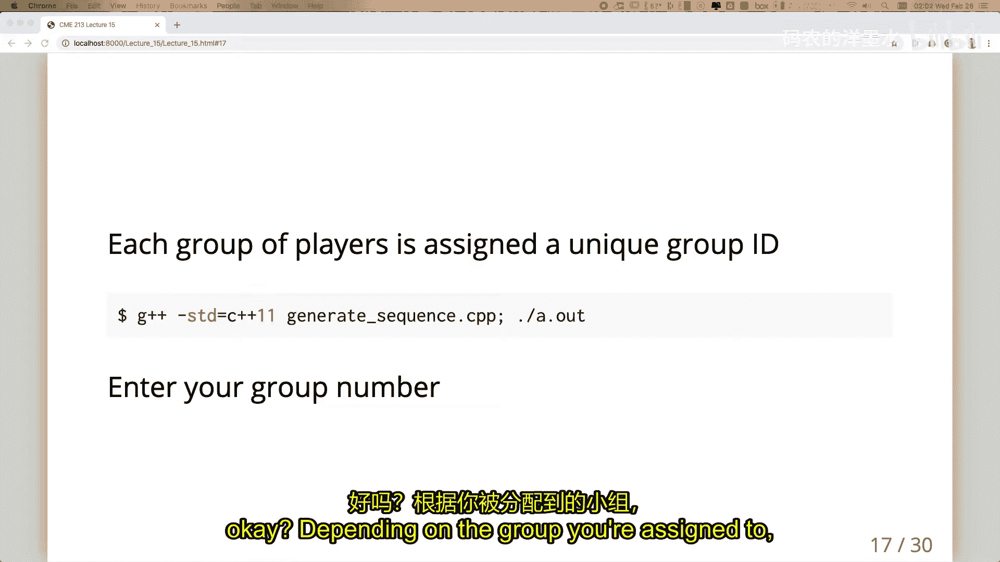
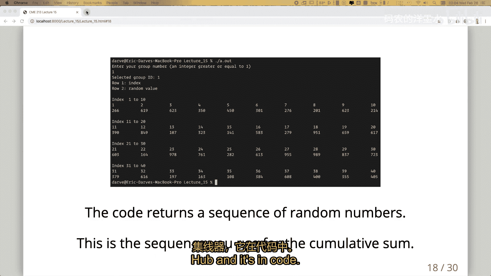
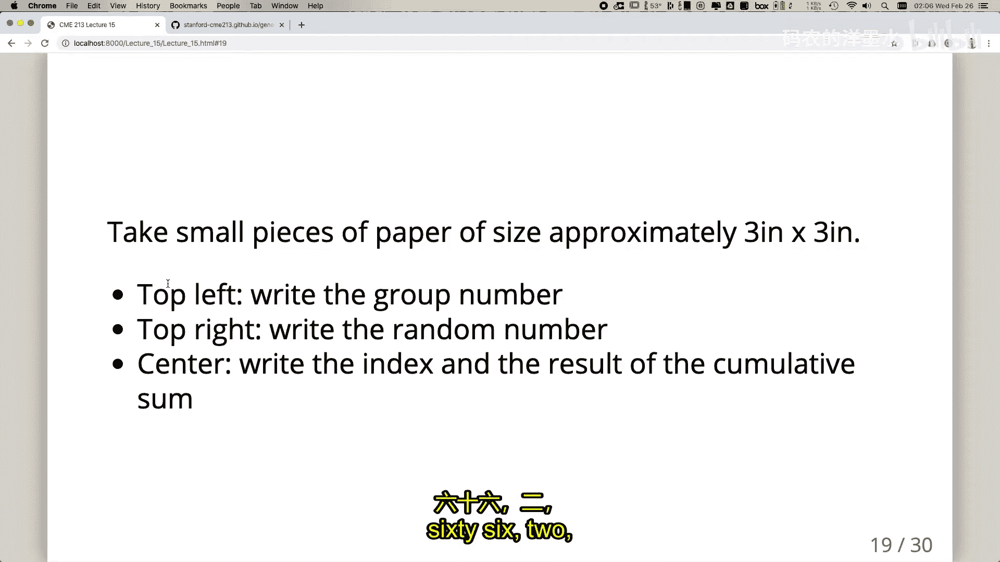
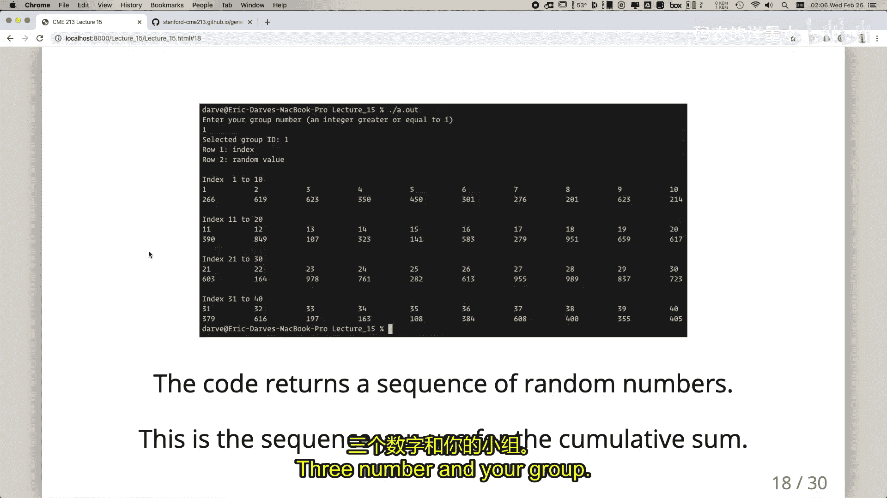
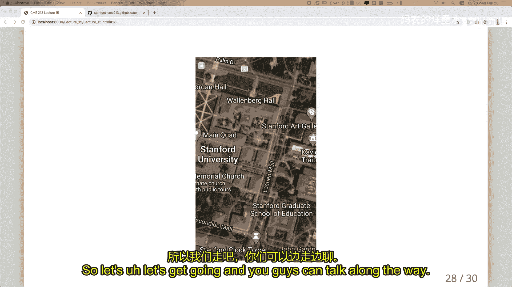

# 【全集】斯坦福大学-并行计算导论-CME213-中英字幕-1080P-p12-Lecture-12---前缀扫描--BV1f8ijBYEjR_p12-

Okay， so let's， let's start the the lecture。Allright诶。So today， you know， as I mentioned。

 we're going to do this。 That's group activity。 So hopefully this is。Fun day， fun lecture。

 So we'll be going outside on the， on the lawn， on the， the oval to do that。

So a little bit less woody than on the figure， have a picture of us。Okay， so before doing that。

 so it's basically around this。Calculation of prefit scan。

 so I'm going to do a little bit of kind introductionproduct about this type of calculation。

 where it's about how to implement it in parallel so a little bit of theory。啊。And then after that。

 hopefully everybodys really completely confused and then we can start the exercise。

And you can think about all this。So actually the the basis。A pretty extent。Is the g opcal R scan。

 which is just actually a reduction， so that we've seen before a couple of times。

So I'm just going to go over that quickly， but if you want to calculate a reduction。

 so essentially sum up all these numbers in Tau， okay in principle， this is a sequential operation。

 you do 3 plus 1 plus7 plus0 plus4 and so on， it's very sequential。

But if you have a lot of processors， you can exc this。And it's a little tricky。

 you have to do these sort of pairwise summations， you can realize that instead of summing up all these numbers one by one。

 you can take pairs。Okay and some of the pairs， so that is a parallel operation you can have four processes processors working on this edition then you get four numbers。

 and so you basically use sociivity of。Of the addition and you perform subsequent editions of these four numbers。

 get two numbers on one number， so you you have one posture working， two and four。

So we need four processes to do this in terms of complexity。There's an important concept which is。

You know how long does it take to run this algorithm。

 so we'll sort of go over that in more details well。

 a little bit more when discussing MPI and in the last homework。

 which kind of discusses a little bit a couple of concepts around that but in terms of para execution of this algorithm。

 there are two important concepts， first one is the basic one which is how long does it take to execute you know this algorithm。

 assuming you have enough processes。We you have processors。

 so you assume that you have an unlimited amount of processors。Well。

 here you really only need four in this example and then how long does it take to do this。

 Well even if you have you know very large number of processors still it will take essentially you know three passes to do this so first one edition done by four processors so it's the time to run one edition then you know second pass for this edition and third pass so in three time units so to speak you get you get this this is the first concept and so when you analyzeies a pair algorithm you know you can do this type of the NA where you assume you have a large number of processors and then you want to see how many passes it takes to go through the computation and that's how long it takes。

Okay， second concept is sort of related to that， a little bit less important。

 but it's still kind of important measure， it's what is the computational cost？

Or number of operations， you have to perform in PA， okay， so this is slightly less obvious。

But if you do a reduction sequentially， so what you have here you have eight numbers。

 there's really only seven editions to do， whereas in PL there's actually more additions。

 so you have one，2， three，4，5，6， seven， so that is wrong。Okay， I guess it's just the same number。

In this example， but we'll see that in the prefix scan you can get different numbers of operations and so yeah so here somehow you get exactly seven。

 but it's very it's not uncommon that when you look at the number of operations done in parallel。

 it's actually more operations than was done sequential so in this case it's just the same but sometimes it's more I guess it cannot be less。

 but you can be definitely more you didn't have。Of two， you would have to。Had。一个。Oh， yeah' right。

 maybe if it was not a power of two possible， you may end up with more。Maybe you're right， Jim。Yeah。

这作为 the。Well， this is a very simple algorithm。 So it's going to be very close。

 So this is example algorithm called work efficientff in the sense that the number of operations is basically in parallel and sequential。

Well the definition of work efficient， either work efficient means that they're equal or more reasonably they're simply proportional to each other but so if you look at the ratio of number of flops in parallel divided by number of flos in sequential。

 that ratio essentially is bounded okay it doesn't increase， so I'll give you an example。

 decreased scan where actually this is not the case， the algorithm is not worth efficient。Okay。

 so this is what we have to do。So the exercise， so called prefix can。

So you're going to be given a bunch of numbers。So。So hopefully you guys have brought some paper and you have to put it in small pieces so I can't go over that。

 but you're going to be given a bunch of numbers。and this is the output of the prefix scan。

 so the prefix scan。Sometimes start at zero， so it could be 03，8 and so on。

 but here we're going to make it start at three， so essentially first number is the same and then next one is three plus5。

14 is 356， 16， and so on up to here， 20 is basically the result of the reduction。Okay。

 so it' sort of a also community sound。 So you do with the。

Sun up to the point where you add and so for your perspective give you an array with n numbers。

 then the pre scan， the output is another array of n numbers。Okay， so。

So let's look at two algorithms， so essentially you I want to so we'll go into the exercise。

 but you're going to have to do this prefix scan in PEL， so I want to present two algorithms。

 so these are sort of computer algorithms。So you as humans probably want to have something slightly the different。

 but I want to review these algorithms so you get an idea of how this can be done in parallel。

 so work efficient is essentially you know if you go back here。

You can recognize that for example 14 is a result of a reduction on the first part of the array and 16 is a reduction up to index 4 and so on。

And so know we have a tree to do reductions and so similarly， we're doing prefix scan。

 we're going to want to use essentially reduction trees， but to do a prefix scan。So this can be done。

So in our first algorithm， which is a work efficient algorithm。

 the number of flops is more or less the same as the sequential number of flops up to some constant。

Okay， and there's sort of two phases。 So this algorithm is。

While this algorithm is always a little complicated first part is relatively straightforward it's a collect or reduction so this falls very closely just a reduction step so again you we need to do a reduction for in some sense all entries。

 so the second phase in which this partial results are sort of distributed so we get end numbers corresponding to the these。

The screen that you sunk。So here is how it works， so I'm going to stay on this side for a little bit。

 hopefully we can make sense of what's happening here。So the first part。

Is reasonably straightforward because essentially that is exactly the same workflow or flow information as in the reduction tree。

 okay so you start with all the pairs， okay drop it the sum， so the way this diagram works。Okay。

 it's sort of a so called circuit representation of the algorithm。So the input is at the top。

 so you have， I think you're 16， okay， so you have 16 numbers， imagine are at the top。

And then the operations are sort of going from top to bottom， okay？And so every time you have a plus。

 for example， the first plus here， let's say this your point。

 this plus here means you take the number currently at this location。

So it's actually the original number here at index2， take this number。

 actually this one is the result of an addition， so you take these two numbers。

 add and write the result here， okay so this is the notation here it's a so-called circuit notation。

Okay。So initially you start01 you add and you write the result at one， and then two，3。

 add write the result at three and four， five write the result at five and so on and so on so you hold these additions and then you take the result of the pairs and sum them up so 01。

23 you write the result of three， so here you have essentially the result of adding everything up to this point。

Okay， and here you have the result of adding everything in this range and so on。

 and then you just keep going， adding these two guys。Okay。

 so here essentially the result of the sun all the way up to here， the sun all the way up to here。

 and here the final reduction。So actually， right here there the final deduction。

 so that is actually the correct。Result for the last one is we just copy straight。

 first word is kind of trivial is a straight copy，And then the other one's， essentially the idea。

I that for example， when this just done with a simple one， let's see this one。

 so this one is supposed to be the result of all the previous guys to the left。

And essentially you're going to look at sort of the binary representation of this number if you wish。

 so for example， this is basically3 plus one to get to so actually maybe easier to almost count。

From one， the。Feb one。So you're going to get the results of， you know。

 you want a partial result of something up to here， which actually is available right here。

 and then you just do add this one entry here。And then similarti， you know you can。

Do the same thing here， okay？But the way this is going to work is now you have sort of four plus two。

 so you go back to the previous adding up to four and then adding up to two okay。

And then once you have it， so for example， this one requires one more pass， okay？So essentially。

 if you look at the binary presentation and sort of look at how many bits are equal to one。

 that's sort of how many passes you need to do to get there， okay。So when you're here。

 just no operation。Here is just essentially sort of two bits， with just add。Okay here also two bits。

 here's three bits。Even more bids took to one right。So essentially， you do this reduction。

 and then you have a way to from all these partial results and sort of looking at the binary representation of each number。

 you have a way to propagate these partial results to get essentially one amount to reduction at every output。

Okay， so you can look at these slides online if you want。Okay on the。On the Github。

For today's lecture lecture 15， have this figure here。Okay， any question on this？Okay。

 so there's a reduction and then there's a distribute fix。Okay，All right。

 so now you know you have some results here， so let me just go over that so first number of passes。

 so number of passes， when you do reduction， you have log2 n passes。

And here there is a reduction followed by this sort of distribution， so just staring at it。

 you can see that it's two log n passes so it's twice longer as just a straight reduction okay and if you look at the amount of work。

 so this one is kind of treatier although staring at it。

 you know I sort of empirical currently observed that the reduction。Have n flops。Okay。

 so you you multiply by  two， so you have actually two times the sequential flops。

 okay so the scan is just n flops so here you have essentially two n flops。Okay。

 so amount of work is two times sequential fs， So it's still called work efficient。 I mean。

 there is a factor of two， so it's not you know。Perfect。

 but it's couldn' work efficient because essentially the ratio parallel work divided as sequential work is about the number equal to two dozen growth。

 you will see that the next algorithm actually grows。

So it seems reasonable that this ratio should be bounded。

 but you'll see that actually the next algorithm。Has sorry， you know what makes months。

Doing this correctly。啊，的呃。In Bell。Sometimes it's actually beneficial。To do a lot more work。

 because if it allows reducing the number of passes， Okay， and for example。

 if you look at the previous。You know， previous plot here。

You can see that a lot of the units are idle， so this is kind of the idea a lot of the units are idle。

 so by making these units busy we actually are going to be able to reduce the number of passes and there's no mysterysteries you make the units busy you're increasing number of flops so you're going be work inefficient you're going to fit up this diagram here with some plus signs so it's going to be a lot more flops being executed but it will go faster so essentially this algorithm is good if you don't have too many processors so actually。

Let's say here， if you have eight processors， then they're all busy doing the first phase and so on。

 so maybe this is not actually grid algorithm， but if you have less than eight you have only four processors。

 then this is good because you're going to be able to extract some parallel but the number of flaps is kind of reasonable。

 so you're going to do well。Okay， so。Alright。Okay， so this is the second algorithm。

 so called hit steel algorithm。And the idea here is to， again。

 go back to the physics scan and observe that essentially you know we're doing many， many。

Tree reductions in。So it's actually each output is the result of a reduction。

 and so you can view this as concurrent reductions。

 and so perhaps you can use then concurrent trees with multiple sort of tree traversals in order to calculate these reductions。

嗯。And in fact， for example， okay。idea。So。So this is different diagram， different type of diagrams。

 so first of all you can see that there's a lot more pluses okay and this translates into this is the work inefficient algorithm。

 there's a lot more work than in sequential algorithm。But if you can passes。

 it's actually only log n v， okay you can see that here there's a jump of one， two， four， and eight。

 so you can see that if you have entry input then in log to end。

 you will get done with this algorithm。呃。So the algorithm here is different。

But if you stare at it for a little bit， what you simply will recognize it's a very general algorithm。

 what it does is essentially it says， okay， well let's take every output I have。

 let's see this number here。And so I essentially need to do reduction。

And I'm going to do a tree reduction so let's imagine doing that okay so you' going to end tree reductions happening in Bell。

 so that would be not super efficienticient。And what's not efficient is that many of these three reductions。

 you know， share common operations， for example， all these three reductions are going to start by doing these pairwise editions。

 so clearly no need to repeat repeat that。 So okay， fine， I just start with。You know。

 just a parawise edition。OkayAnd so after that， you things get a little bit more complicated for example here。

 you recognize you know adding well I see this guy for example here。

 you're going to add two pairs and the next guy over is also adding two pairs but sort of shifted by one okay so this is where you're starting thing that you're doing multiple sort of tree reduction that are sort of you know ideally at the end everything is just shifted by one。

Okay so you do these multiple tree reductions and then you just keep going like this。

 for example here you add things that are separated by four and here things that are separated by eight and so you get all the correct outputs by essentially doing these tree reductions that are sort of shifted by one during every paths。

Okay， any question on this？あIt's。アレザク？Have operate。Okay， when you have it。

So when you have the eight plus sign。たれ。Right， where's the answer？Okay。

 so the answer is just the answer is always here， okay this is the output。

 the end of each line here is basically contains the output you can think of this as sort of each line being sort of a memory location。

Okay， for example， when you take this guide， it means take this memory location。

 this memory location add， and then write at this location。Okay， so for example。

 let's take the first one， first one is again， unchanged。The cumulative sun。Of index zero。

 which is just the number itself。 Okay so as you get the last one。

 last one is actually just a straight， So it's a tree reduction， but sort of。

Maybe done a little bit differently， but it's the in reduction before。

 so essentially here you're going to have the last two pairs。 and then the two pairs before that。

The then added here， okay， so this number here is everything to the right。

 you know the four to the right。😡，Okay， so this one also， if you look at it carefully。

 is going to be all four to the right。So when you add these guys， you get everybody。

Eight to the right and this one also eight。Fromside to the next， a to the left。

 and here8 to the left。Okay you can add those together and so this is a tree reduction for the best one and if you look at this guy。

But actually this guy is pretty much exactly same thing， except that it's shifted by one。

Okay and you know so for example， this guy here you know you do so now he to do exactly the same thing。

 but essentially forgetreting about the last one so you can have fair addition here， pair addition。

 and then addition of four numbers to the left， okay and then this guy is going to be four to the left and then because four to the left so this guy is basically eight to the left okay？

And then做。And so since you're sort of looking at summing things coming from the left。You know。

 so this guy， you know just。No operation， this guy just summing one guy to the left and then essentially you're done and then here you're summing two to the left。

And two to the left， the case going to be four to the left。Okay。

 and then this one is basically this one and then you the next one。So点咩所以 b c诶。Yeah。

 so basically just doing tree reductions where you're sort of storing the results in the rightmost node and then shifting everything by one。

So that， you know， you get the correct。Reduction at the end。

 but the key is that you know you're constantly reusing these parawise sum， for example。

 this parawise sum is used for the last guy and then this parawise sum is used for the last one okay and then it's also used for this one。

Okay tom getting lost。我其一直唔知唔明。This one。So you'll you' beusing essentially you're writing tree reductions for every output and then sort of looking at the operation that sort of overlap and avoiding these repetitions。

あ。How会。你嘅。嗯。Okay， well reading the algorithm is actually even more confusing than the code is。

You know， minus due to the eye？はは。😊，I mean， actually the code is。

Well the code is actually you can see what the code is the first pass is take entry I and add I minus1 okay next pass is take entry I and you add essentially2 over so I minus2 and here you do I minus4 right every pass you do I minus2 to the J。

At best do best。我要。ふ。😊，Okay， that's clear， okay， cool， right？ok， so you can post with them online。

Next we here basically shift field， taking one to the left here minus two， minus4 minus8。嗯。Okay。

 and so in terms of number of passes， its just log and pass。In terms of number of operations， okay。

 it's a little bit difficult to count， but to simplify， you can roughly say。Okay， there's n。

N operations at every pass， roughly speaking， so you have logging passes， you have n。

 log N operations。whereas the scan is only essentially n or n minus1 additions。

So you have an extra log n factor okay so in that sense it's worked inefficient if you look at the ratio of parallel work divided by sequential work grows at log n so it's unbounded as you increase the size of the data the number of path is so what this means that the algorithm essentially runs twice as fast。

 but this assumes that you have a lot of processors available so if you have essentially eight clusters to process 16 elements。

Then you're golden this is going to be faster， okay if you have fewer， maybe four。

I say even two processors， then this is going to be you know。

 that's not going to work number of the running time is going to be much more than long end and you're going to be hurt by the fact。

That the amount of work is much greater compared to sequential fluxs。 Okay。

 so the optional algorithm， hence becomes all complicated。

 It sort of depends on N and how many processes you have to。To process this。ok。So again。

 you know when a lot process is available， then the silly steel is superior， fewer passes。

 but a lot more work to be done。So if you have fewer processors。

 you want to have the work efficient algorithm。Okay。So I can post pseudo code for。

For these algorithms after the， after the class。Okay， so let's move on to our fair exercise。So。

 actually， there's a。Sign up sheets for today。Press it around。

So if you can find your name and sign it。嗯。So let's see how many students we have actually。8。呃。

So it looks like we're 22。class22。So。I say groups of seven。So let's me three groups。

There should be three groups of seven， so I guess you have eight layers， three group of seven layers。

Okay and the idea is to do a paraic scan， but using human processors。

 so I'm going to explain what this means。呃，O。So first of all。

 how do you judge the I'll let you self organize okay so you' going。Three teams， okay。

 and the first step is to so each team will have your own prefix scan to calculate taking time phone numbers。

Okay， and so the way this is going to work out。Is you know you can go online。

On the GitHub reposory in the code folder， this is Gi sequence， so you just compile the code。

 you run it。Okay and so when you run it， you have to enter your group number。

 so it's going to be one， two or three depending on the group you're assigned to。

 okay and here is basically the output。

So you enter your group number， okay， group one， and so this is going to be the sequence you're going to be using so now it's。

Sor of pseudoran sequence。And so I could then pat accurateulate the solution and so on。

 so have the solution。嗯。Okay， so hold on second， let me just think about this for a second。嗯。Okay。

 so why don't we start with this first？So I'll explain the rules in a second but know this you need to do here before getting out so can you now rearrange so you have to move around to see or whatever I want three groups of roughly same number of people。

 so let's say seven。So have three groups of seven， and then once you're kind to assemble into groups。

 I'll give you a group number， and then you can download and run this code。Run it。

 and you have to then。create 40 pieces of paper with the numbers for the physics extent。

So let's get going。And yeah， there' kind of sheet， so make sure you can。

YouGet to write down your name on the send sheet。So let's see， so there's one group here。

 okay so we do group number one is here。Okay， so what other the goods can be。

 so there's going you here the savings one。Is the back end group in the phone。

Gop number two is going to be in the front here。And then they say that group。

So three here locations is one to make sure you have the right group number。One is here。

 group two is here and the back group three down seven people here， seven people in the back。

And you guys are。没那个。More people here。Any one more person？Okay， group number2。

Okay one of you needs to open your computer so you can go online on Gitthub and it's in code。

So wheres it。Here。So just go online here code， and then you can just download this giantite。Sequence。

So got to run the code。And then was one， two， and three。

And then you get all the numbers and the numbers you need to write on a piece of paper because these are the numbers。

You want to work with？And so here's what I'm suggesting in terms of writing numbers。

So top left would be your root number， one，2， three。

 top right is the random number and in center you can write the correspondingence index and then while question not yet but what you've done。

 you're writing the results。your piece paperSo make sure you get the index correctly because obviously the20 sum is very dependent on the index。

So you need to have the group number， the index。And the number quick points to Dix， right？

Rightice center。Please start writing two off left at all those。 I'll write that have to students。

I give come don' see that。我霆。The certain thing is like what。You do need to。I write。いげ。I matter。

So already you can so right now I'll move the top left and top right number。リデデ。Well。

 it's the index corresponding to the random number right on the previous you know basically here you say 12 66。

2， 6， 19，3， 6234 but you need the index right if you just want a random number。

You can introduce一下。So make sure you have the index。And the random number and your group。

Okay， so let's keep going， so yeah， try to keep it organized。あ。YouGet out over here。Thank session。です。

Because I want you guys to spend time thinking how to so  minutes？Right， so。やっぱそす。对对。よりこれな。か。Yes。しすが。

We do some。行。前だけや抜て。Officiency is smaller。So let me know what you're done so I can move on to the actual rule of the game explain how important the zoo is。

There's in。如。我。や。批准那一个。いやはい。See， take I can you。大て？明らる。Oh yeah，被什么。こ。でで。I think you that。1 point8。

It thereに。こ that。What we ready， there we go。So basically， yeah。

 what we obviously is the and the number cheat。Here in the。うん。Okay you。F。I don't think I see okay。

YeahYeah。So there's an index。はこ大。So second sheet there 왜一个 though。three。Okay。Take the rain。言ってば。

Yeahあ。Alread mostly。So I' doing a second answer I'm。here。I efficiently okay。that only goes us to 38。

If we might one。because I think there's number， everything right different rows。by就班。三十年。啊。M。I I。

You're a hero。すい。よまし。I'm not sure how much。Actually， we could use four units。Thats a mean。Yeah。

 you want。That。That's okay。你比个过。はいてです。Okay， let's get going over。so I don so you。You guys are a good。

 yeah， great pair。同我想。though you have multiple error' no error。と利要。How we're waiting then668。呃。

basically want to have the center of the index，Me it。 It took some time。这分た。In。very's too fast okay。

The second one needs to have three。I where we resting closely。さ。So goodYeah， it's first for other。

the size just 10。over others was basically。So let's continue， okay， I want to move on。Okay。

 so make sure you write the correct index and random number， okay。

It's a little bit frustrating as an exercise because you it's actually not easy to get everything correct。

 but that will also be very tragic to be rigorous。Okay， so here are the rules。Okay。

 here are the rules， so quick。So basically the idea is to sort of reproduce the behavior more or less of a computer or different parts of a computer。

 so okay so first I'm going to define this memory location which is basically an area where you can store a piece of data。

 so in your case so it could be a register file or memory location。

 so in your case it's a piece of paper。And so on a piece of paper。

 you can only write a single number at a time so you can obviouslytri or erase a number to write a new one。

 but you can not have more than one number written on a piece of paper and so this is sort of for the next rule so you know melock is full when there is actually something written on it and it's empty when nothing is written okay so Melock is a number written on a piece of paper。

Okay， so now it's going to be up to you to kind of organize。

 but there's going to be three types of players that are allow to do different things。

OkaySo there's going to be some men players that are sort of holding the data and you know orchestra just things a little bit。

 there's going to be some net players that essentially you bring data from memory to crossing units and then there's going to be some players that are essentially responsible for doing the additions okay so each player has only one type but you know you can divide yourself amongst these categories however you won't so actually this is you know you want to make sure that it's well balanced okay that there's not like。

If you have only one crossing unit， it's going to be really busy and everybody's going to be waiting on that person。

 so you want to kind of evaluate how long it takes to do each operation and sort of allocate resources accordingly。

Okay， so first the men players。So vampires， those are essentially take pieces of paper and they can simply copy or strike through numbers。

 so essentially no operation， but they can you know。嗯。Well， basically actually the the strike。

 but the most important thing is they're going be the ones that sort of organize the calculation Okay so there's no real exact equivalent would be like the computer program if you wish there are the guys who are essentially going to determine know what's the next operation to do and so on and give you know these mes a pieces of paper to the net guy Okay so all right。

 so now runners So this is this is important this is to simulate the delay between you know transferring data from memory to crossing unit。

Okay， so's very important， so you can take numbers from the ME guys and you can bring that to the crossing units and back。

So you can't hold more than three menros at a time。

 so the idea is basically the operation is you take two numbers。

 you add the two numbers and write the results on the third piece of paper so this is sort of the basic operation so hence net layer is going to be holding these three pieces of paper。

 so it grabs three pieces of paper from them， bring those pieces of paper to a processinging unit。

Then typically there is an exchange， crossing units gives back three and exchange。

 and then the net pair brings back the few pieces of paper。

 so the main guys are going to be sort of folding all the pieces of paper。

 but then there's sort of a ballneck as to how many pieces of paper net can carry and the crossing units that's basically just atic units it takes two input in one output and that's the only thing that it can do。

Okay， so only three M at a time for the net player。Okay， and then finally， you know， crossing units。

 so this one is sort of the at some level be。Well， actually， the net layers have to run very fast。

The men players have to think and mostly get organized and the P player is sort of， you know。

 you have to be fast， you basically just simply just take two numbers。

 you have three pieces of paper， take two numbers。So one piece of paper should be must be empty。

 okay， so this is where you the men guys need to make sure that you know there's some space on the paper so it's numbers。

Strickicking through whatever， so you have two papers， with numbers， one paper， no number。

 and basically just do the operation， just add right the results and then give it back to a net player。

Okay so a net there can just arrive， give the papers， maybe wait or you。

If you have many nets and one P， the nets can keep going back and forth。嗯。Okay。

 so the only thing you can do is two and write on the third one， so if you want to do more patients。

 you need to give those papers to somebody else。Okay， to twin。So here I thought about this。

 how much running is going to be involved in the second。So I decided on 20 meters。

 well you know obviously just put a mark down there， but roughly 20 meters between P and aM。

 so this is going to be an important number because it's the P in principle。

So obviously there is the issue of being organized， okay。

 so the MBI is actually it's not tricky to figure out how to do it。But if you're really organized。

 then you can keep pumping numbers so the P you can do the operations using your cell phone or whatever that you be addition。

 so it can be reasonably fast， so for example 20 meters。

 I would say you want to maybe have two net or maybe even three running right you only have one running。

Then this game will do operations faster than the guy running。Okay， and you get tired。

 so you run slower， so more guys running。Okay， so basically this is it。Okay。

 you have to pick a team name。And then I guess we're going to go， so we're right here。

So I look for a good location and we're going to go to the basically the oval on these logs here there's some space so right now we're just going to leave the building。

 just walk over there。I'll let you think about so you know I can talk along the way that we took last time it ready。

So maybe 15 minutes。30 minutes from the end of the class so start discussing how to organize yourself and then we'll'll give you some more time to think and then we'll get started the so main thing is to figure out what sort of algorithm that you want to do。

 how to organize yourself。If who does what， it's really a question of sort of organizing everybody in the team。

So let's get going。And you guys can talk along the way。

