# 【全集】斯坦福大学-并行计算导论-CME213-中英字幕-1080P-p13-Lecture-13---MPI--BV1f8ijBYEjR_p13-

Okay， so today we're going to move to the last part of the class。

 which is on NPI and iss going to be。Homework， homework5 on NPI and also， you know， as we discuss。

 this will be part of the of the final project in terms of implementing the。The deep neural network。

So just a brief introduction。嗯。呃。So obviously from a programming standpoint。

 the shared memory is the easier platform， okay you can have any process。Can we invite。

The memory locations。呃。れよ？Exquisite communications they have to worry about。

So it simplifies it will not be the programming。But as you can imagine， there's no。そ感。Still。

 data needs to be moved around and so on， and so essentially you're asking the operating system to be responsible for。

For data movements。And coherence so for example， if a。

If a processor makes a change to a memory location。

And then let's say it does it write and then another。Thread wants to read。

 then make sure that the rights is sort of visible to the process that's doing the read。

In principle that sounds pretty straightforward， but things get very complicated once you say， well。

 actually when you're writing data to a memory location， you're not necessarily writing to memory。

 you're typically only writing to cache。Okay， I may even register。

because it's very expensive to good memory and if you every read write goes to main memory。

 it's very very slow so you're going to start using this cache and so now things become a lot more complicated because when you say when was the last update to this memory location。

 where is the data and so on， it becomes quite complicated。

So operating systems are quite good at that， but definitely it's very difficult to maintain this coherence in the memory and making sure that essentially the results are correct。

 and that essentially every right by a thread is visible by other threads when they're doing a read and so on and so forth。

So there's a limit to essentially。Not necessarily a limit on the size of the memory it's really a limit on how many cores。

Are allowed to read and write to this memory。Okay。And so。

The more scalable approach which sort of puts the burden on the programmer is to then declare that you're going to have computer nodes that are sort of independent so they're connected by network but a process can only read and write to its own memory if you want to read and write to another memory location or memory owned by now the process it's not possible and there's going to be a different mechanism to do this and it's essentially matched by the user rather than。

C the operating system。And so the advantage of this approach allows you to build much larger computers with a very。

 very large number of processors， and the hardware。

 implement the solution is significantly simplified。Okay。

So process can no longer read and write to another processor's memory。

 but obviously they still need to exchange data so if a processor doesnin computation and produces some numbers。

 if you see these numbers are going to be needed by another processor to continue the calculation and so how can we make this happen。

 so this is the sort of solution of proposed by MPI， this concept of message？

So essentially a message is some memory location， so essentially an address and number of bytes from that starting from that address。

 so this is a sequence continuoustuous sequence in memory thats say one process has in its memory P0。

 and then say you want to send this data to processor1。

 so you're going to take this jump of memory essentially put it over network。

Communicated through the network and then written at the end on the receiving node in some memory location on。

 say， processor P1， for example。So you exchange these messages。

 which is basically consists in send and a receive。呃。

But the trick is that the user now needs to explicitly do that okay so essentially if another process needs some data。

 then when you write the program， you need to explicitly say， well， send this array。

 this address from this process to that process and so on and this consists of a pair of send and receipt。

Okay， so there are many ways to do this， but the standard is MPI， so NPI is。So it's an API。

 okay it's a standard， again， that defines various functions in the API， how they behave and so on。

 and then they're implemented by different vendors， libraries， and so on。

So MPI so de facto standard for distributed memory computing， the focus is on high performance。

 high efficiency， so it's become a very， very popular model。So NPI is message passing interface。

So you know here I'm going to take a little bit of a sort of a break。

 it's not really super important。Well this class to understand this taxonomy， but it's very。

 very common and a lot of people refer to it。So may as well briefly discuss that。

 so we have this vocabulary and we understand these different concepts。But， you know。

 if you look at the。Computer architectures， the way the computers are organized。

So you have different types of sort of canonical organizations。

That I use and I correspond sort of different constraint or different purpose。So we've already seen。

 you know， in。So called same T So this is a single instruction， multiple threads， Okay， and on Qa。

 this specifically corresponds to the fact that。呃。So essentially the threads are not individually keeping track of their instructions。

 okay instead you have a scheduler that issues one instruction for let's say warp and all the threads in the warp are going to execute this instruction so there's simultaneously this concept of threads。

Okay， which are you know。Have some independence， that some resources and so on。

 but they're sort of tied together by the fact that they're all executing。

The same instruction at the same time。 Okay， so this is single instruction， multiple threads。

 Now you have a slightly closely related concepts。Just Cindi which came actually before the CT。

 so CinT is really connected to GPUs and so on， so Cindi is sort of concept that came that was there before and it's sort of a very closely connected。

 so it's single instruction， multiple data。So again does a little bit the same thing。

 but you no longer have this concept of thread， and in practice it means that on the multi core processor。

 you have these vector capabilities to do sort of media processing in。For to pay movies。Videos， you。

 the sound and so on。And so it has ability to perform the processor has the ability to perform short vector operations。

 and so for example， you have operations like doing additions， doing multiplications。

 and the input is a vector it say size 48 and so on and the output is going to be correspondingly a vector。

 until so you have multiple units that are performing the same operation but on different data。Okay。

 so it's very close to the previous one except that。Here。

 you don't think have this concept of thread。It's just unit that's going to do a certain calculation。

 whereas in Kuta， you do have this concept of threads and threads have resources allocate to them and so on so there's a slight difference here。

But the Cindi was sort of the older concept and basically corresponds to his vector operations。Okay。

 then you know， with've actually， this something that we've。Already seen to multiple instruction。

 multiple data， so essentially this corresponds more to the concept of multiple core threads。Okay。

 where you have different units。That you， essentially execute different functions and on different data。

So it's multiple instruction， multiple data， so it's basically what happens on a multicore processor so you may have one process with many threads。

 but all the fed are sort of doing different things so it's a much more flexible model compared to the GPU model and so typically you have much fewer threads in this case。

 but they can do independent things。These run different functions， different。

 it's probably of the same program， but different functions。Okay， and so finally， Joe， you know。

 you had many more of these。F letter equi， but this is sort of the one that's going to be relevant for us today is a single program。

 multiple data。Okay， single program， multiple data。 And so this is essentially the MPI MPI model。

 So the idea now is you can have multiple。Multiple nodes。

 essentially multiple computers or processors。And all each processor is going to run。

They're all going to run the same program。So essentially you can have multiple processes that are running。

 okay so it's a bit like logging on different nodes and then just starting the same program。

 so every time you start a program you start a process on that node。

 so you have all these processes or programs that run concurrently and then。

 but they're part of this sort of pull processes that are allowed or this capability of communicating through the NPI library。

So it's a little confusing that everybody' is running the same program。

 but as we've seen previously it's the same idea before， so everybody's running the same program。

 but every process is assigned a unique ID or rank from zero to n minus1 and so based on this rank。

 you can do different different operations so for that point you're processinging a grid。

You can switch your grid into subdomains and process I is going to compute subdomain I。

 or if you're doing IJ matrix， then process B may take care of the IJ block in the matrix based on the rank。

Okay， the communication is therefore exchanging data or bytes through a network。

 but this is done explicitly in your computer program。

 so essentially the user needs to specify exactly how these communications are happening。

So this is roughly kind of an outline of what a typical NPPI program would。Looks like。

And so there are certain constraints， so here I'm just going to give you a brief introduction and then next week we'll sort of go into more of the details。

But。So here you assume you have four cores。everybodys running actually the same program， but again。

 because everybody has unique need to rank or ID， they're going to take a different path through the program。

 or at the very least they're going to work on different data。

And then to exchange data to send data from core0 to core 1， you're going to call APII send。And AIBC。

Okay， so。So called two sided communication in the sense that there is a send and a received you need this pair。

 send received pair。And the reason why this is the case is， well， the sand might be somewhat clear。

 okay， well， you， this process， the data is ready。You know， if some data is ready。

 it's been computed， it available， and you going be sending it over the network， okay。

 so you can do a send。What's happening with the receive is just essentially。At some level。

 a very practical thing。Which is that imagine you're sending a big array。

 let's say it takes a gigabyte of memory， well really you need to have some memory location to store。

 okay allocate'll memory so you need to provide a memory address that's allocate and ready to be used for this communication and if you think about it。

It's more than just。😡，You know， having alled memory。

 but essentially it should be an area that for example， you're not currently working on。

 you don't have live data that you know know you're using in your calculation because it's going to be overwritten by the communication okay so you need to specify a holding area。

 a pointer and then essentially sort of leave it free while MPI is doing the communication and writing in that memory location and then at some point MPI will say I'm complete and now the data is there and can be used。

Okay so they are very constrained that you know need to sort of happen for these communications to be done correctly。

 so on the send side the data needs to be ready， it needs to be computed so this happens at certain point in the program and then on the received side well then the space needs to be available and sort of free to be written upon and then you once。

The BCC completes， then this program here can continue and make use of that data。

 okay so let's called two side of communication and each side is actually rather important。

And there is a more recent version of NI。That NTI2， which has one side of communications。

And you know when you think about one sided， it sounds great， oh well。

 I can just send data over there， no need to do or receive。

But it's actually a little bit mis because you know， there's no。

There's no magic okay if there's no receive， it means that somehow you know that there's some space available on the receiving note so in some context。

It is possible to have this type of guarantee， but in general this is not possible。

 okay so this is really for certain types of calculations only。

That this one side of communication makes sense in gel。

 you do need two side of communication and in order to make sure that the resources are available and so in terms of memory for this communication to happen。

Okay， so let's go ahead and let's look at our first MPI program。So like I said， NPI is a standard。

 so you have many。You know library， many vendors， libraries and so on that you know offer API implementations。

 so these are the most common so open API might be the。

Sort of somewhat of a standard who it's very commonly used so open API is the one we used for Google Cloud。

 okay so you have the link here and then there is this Nva pitch and N pitch and there's also some C APII libraries。

 Intel libraries， there's a Microsoft MPI libraries so you you a bunch of。

Libraries that sort of implement this the the MP， the， the API from。Of of NI。

So this is actually quite complicated。呃。To be done， because the。

The whole problem is understanding the network of the computer。

 and the network capabilities of the computer。So it's actually quite difficult to design the library that can be installed on a computer。

 will figure out what sort of network how the node are connected to each other and so on。

 then based on that， you figure out a good way to perform the communications。

So there are lots of technical details that are rather complicated to get this correctly。Okay。

 so now just like OpenM and so on， this is very， very portable。

 so it an NPI can be installed on any computer， you can run it on your multi corere computer。

 okay you don't actually need multiple computers。Because if you run on your laptop。

 you will see multiple processes。Starting on your computer and these policies in principle are now allowed to exchange data。

 so they cannot read and write。To each other's memory， the different processes。

 so their sort of memory is protected， but they can exchange data through NPI。

 which is sort of a different process。 and then obviously you can do this on GCP and then on computer clusters。

 on many many platforms。So here I want to make a short note， this is not like super important。

That it's the doing cloud computing。You you get access to this virtual hardware and this is sort of the power of you know cloud computing that。

 you know you get this sort of generic hardware that has well definedfined capabilities you know you can install the Guntu。

 you can the Qa libraries， you you have NPI and so on， so for example。

 when you allocate for the project， you know it will look like a shared memory computer。

 maybe you can I think create instances up to 96 course on OneNote。

And it all looks just like you have 96 threads or cores with shared memory and you have this concept of virtual CPU。

 which is basically one thread， so actually for example。

 a typical core can do hyperthreading can run two threads at the same time。So for example。

 if you request two virtual CPUs， you may actually just get a single core and with two threads。

 two hyperthreads on this core。So the point is， you know， so you have this sort of。

You know instancess you can create okay and when you start your instance。

 you know some resources are allocated in the cloud and so on。

 and the system is such that you know you don't really know，The actual underlying hardware。

That you're running on okay， so typically it will be just one node。Okay， it will be one node。

 it may be know a single processor。Or it maybe be a couple of processors on different sockets on the same motherboard。

But it may actually be even， you know you're using one thread from this process over here。

 one thread from that process over there， I mean， it could be a fairly complicated setup。

Because it depends on the sort of software they're running to do virtual the virtualization。

 you always do the same， but the underlying hardware。

 how this is implemented physically may change and if you log out and if you stop your instance and restart it we get something different。

And typically the。So we're not seeing this too much。

 at least hopefully we won't see that in the projects。But for example， when you get performance。

You can get surprises because especially if you start allocating requesting a lot of nodes because you really don't know how fast the network is on the regular high performance cluster。

 you have a very fast dedicated network， you know that you're going to get computer node on that network and so on。

 but cloud computing， not the case， okay so it could be actually between your nodes。

 there may be a slow network， it could be very far away， probably not， but who knows。

So there's a lot more variety of hardware， and so things are a little bit less。呃。

Sort of fixed and sort of known。Compared to a regular high performance cluster。Okay。

 so in terms of compiler， well it's just NPI C+ plus。

 so essentially just a regular you know C++ compiler， but then a couple of libraries you know。

To compile the code， and then you have the header NPpi。 page。Okay， so another element that is uncomp。

Is that。Well now starting your program is obviously more complicated。

 it's not just running your program， it's not just going to command9 and launching your program because this would only start your program would just have one process like on the node you're logged on so if you want to imagine you have 128 nodes。

 you want to start your program well you have to start 128 processes。

 so it's basically the equivalent of logging on each node and then starting your program on every single node。

So this gets obviously very cumbersome real quick。So there's a command NPI run that essentially takes care based on a list of hosts or computers that can be used to run the program will start a code and run it on older the nodes。

 so typically there is some underlying infrastructure that helps NPI run， for example。

 figure out what are the available hosts that can be used for computing and how to choose them and assign them to your calculation and so on。

So in our case it's very simple， when you log on GCP。

 you have a certain number of CPUU cores available and MPI run will just start。

 for if you have eight cores， then or eight threads， it will just start eight copies of your program。

 so you get eight processes。Running， and then similarly。

You need to handle situations where one of the process fails。Okay so maybe it terminates。

 okay that's fine， but it's very possible that know there's a bug in your program in fact there will't be bugs in your program and so one of the nodes。

 one of the process dies， okay well then you need to pay attention and stop everybody else because NPI is designed in a way that if one node dies essentially the calculation cannot proceed it's very sensitive to failures。

And so you can imagine that if node dies， and for example。

 you were sending it data or you were expecting data from that node and so on。

Program would not be able to run if that node dies。

 so NI run or the NI library detects where a node has stopped running and then will just terminate all the other methods。

So in fact， you gave a bug and your program crashes and N will。

Terinate all the other nodes and there's a special API finalies command in your program that happens at the end。

 which will ensure you know。Sort of a smooth termination if your program successfully competes。

Okay so for example， here is where you get running this。

 so start from here we just on GCP so just do make okay so you make file there's NPIC++ you know create this superable NPI pi send。

 NPI hello， and here I'm showing you how to run NPI hello with so NPI you say NPI run。Dash and8。

 so this means that you're going to run your program eight times so you're going to create eight processes。

 so actually number of processes you're creating is。呃。It may be different from the number of courses。

 okay if the APII run dash N2 even if you have many many cores， and similarly I can say N16。

 N32 or N64， then you will have multiple processes assigned essentially perport and as before you have the operating system that matches all these processes and tries to kind of schedule them on the available resources。

Okay， so this is the output of the program， hello from Du so and so， you know from June 7。

Then one process， you need to print。All the number of API tasks are running and so on。

And then you have these error messages， so I'm going to talk a little bit about this。

Super important really， but I wonder what's happening with this thing。

So it says that it's unable to find any relevant network interfaces for called open fabrics。

 which is open ID。Okay， and so it telling you that another of transport is going to be used。

Although this may result in no performance， that sounds pretty bad。Well， I can disce this warning。

 okay？And then， you know， here it says that basically， you know。

 many processes are kind of giving you out this message or it's kind of scarring you the。

The you know， just。Then the same thing happening on the nodes。So okay， so this is sort of a you know。

 more technical thing， but I want to briefly explain this。

It kind of shows you also the complexity of this so you have you know network is a complicated thing。

 I definitely don't know the ins and outs of you know network technology and network software。

 but suffice to say that there are many different。Pieces of hardware and essentially protocols for libraries that can be used to communicate。

And some are low performance， some are high performance。

 so the high performance obviously are very expensive。

But it will give you you know much communication。in fact， you know， in a given network， you may have。

You know， several protocols that are。You know。So of working at the same time。So actually。

 NPI may have different channels that it uses for communication at the same time。Okay。

 so you can refer to here documentation， so you have many transport layers。

 essentially it's combination of the software and the hardware that suits to actually exchange data and perform form various optimizations during this communication。

So for example， these are example of so infininni band， this is a very very fast network。

And then you have others like portals four and so on。

So you also have protocol associated with shared memory only available on shared memory nodes we can play with that a little bit and then you have TCP sockets so TCP is sort of the。

If you wish more less universal standard for communication between computers。

 so TCP sppets are basically always available， this is sort of the default standard。

Your channel for communications between computers in a network。

 so CP sockets is always available in Finnni band， for example this requires you to purchase a special。

A card for your network interface。 Okay， you need a special card in your computer and a special network that switches and so on that supports the infinni band standard and so on。

 And so it it's both the standard and the。And the hardware is high performance。Okay。

And so this open IB， so basically what it's saying is。It sounds like you're real。

Get a rear message but exactly very important。Because DBC MPI again， is a high performance interface？

And it's going to be used in high performance clusters and most high performance clusters support these very fast networks。

 they can feedvan and so on， okay they spend a lot of money to get this fast network。And so in fact。

 MPI sort of will expect that you this Sfin event， for example。

 is sort of available or there's a sort of fast interconnect you can use for communication and so the warnings just telling you that you seem to have a lousy cluster okay is that okay。

 and the underlying assumption is actually you have spent your money on the good cluster the good network。

 but there's a gun in your program andre not able to use it？

 then you want to go back and fix it so you can actually get the performance that you date for。

So that's what the word is basically about and so here you know because we are on the cloud computing there is in fact no fast network。

 it's just a CCP network or a virtual version of it or whatever。

 so hence we don't have access to this。So here I'm just going to skip。

 but you may want to at some point look into that because if you want to really get good performance and so on and understand a little bit what's happening。

 it can be good to look at the options that are supported by your NPI library so you have this OMPI infos again for OpenMPI。

We gave you a lot of information about essentially the way API was the library was implemented。

 all the options that are available， so you can hopefully you can tune it for your computer at hand。

So on the VTA is the option where we had to look at。

 so this is basically this is the option that specifies how to perform these transfers。

 we call byte transfer layers， which is basically the lowest sort of level of communication called point to point or between two nodes in the network。

And then you have MTL and T and so on， which are sort of high level。

you know options that do know more events have more advanced features。

 but we don't really need that right now so just BTL and so for example right now in OpenMI it's actually is not not that complicated。

You have these different options so like I mentioned TCP sort of the default。

 this is what we're going to be using and Vaer， kind of a strange name or whatever Vaer and SMM to shared memory our protocols that are specifically for shared memory so meaning that if two processes are on the same node and theyre trying to communicate through API APII will be able to use something well it basically doesn't use TP because you're on the same node。

 so we use some other mechanism for to make，ForCom on the send。

 so basically the communication now is just a memory copy。

And then you can use libraries to have processes kind of exchange data with shared memory when they share memory。

So it's basically just to copy between processes， and this can be done with this v。Okay。

 let's open I high performance， and then the TCP。So now， all right， you。

I've told all this speech， what's the final message Well， okay， so the final message is。

 well you can run without any option， get the warnings。

 I mean it doesn't really change anything things except you get the warnings。

But if you want to get rid of the warning， you can either specify that you want to use CCP itself itself。

 this is good， or easier is just to say well， use all transport layers that are available but just keep open ID because I now know that this is not available on this machine and then it will use essentially the other ones。

とゥコミュニケーション。All right， so let's close this note and continue。

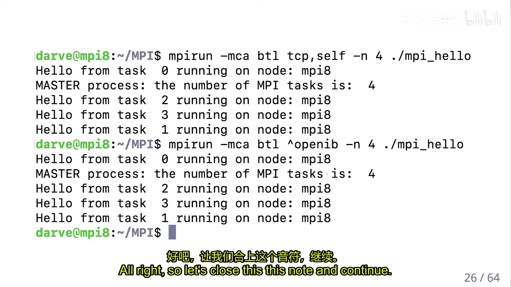

All right， so let's look at to our first program MPI， hello so the option you know。

So I mentioned this dash n， also dash NP same thing， is used to determine the number of processes。

 okay。So you can click on program here， but I don't think do that just show you the。The code here。

 so this is what the typical API code hoops like and mean a very， very simple one。So very。

 very basic but it's actually it's mostly interesting the how you start and how you end。

 will look a little bit。What goes on in the middle of later on， so first you always have MPI in it。

And NPI Flines， okay？So MPI emit essentially， so again， you're starting。

 you're running a program on one node， so you need to be aware of you know。

How many nodes are involved in this calculation and how is it that you're going to be able to communicate with them？

O this is this MPI in it。Okay， that tries to kind of set everything up so that all these communications can happen and can happen efficiently。

 and then at the end you do NPI finalize。and when you reach this。

 it means that your calculation essentially is complete， so for example。

 if the process continues and ends， then so that that process dies。But you know。

MPI will not throw a fit and kill everybody else because you will say okay， well。

 that process just finished normally the program， so now we're fine。

 you just need to wait for the other process to finish as well。So APIF files sort of declares that。

 okay， if you reach this point， then everything is normal and if this process dies。

 it's kind of locate just because we're done with the program。And then so you have NPI comp size。

 so now you're going to have a lot of MPI functions of this type， which allow you to go into NPI。

 so it's about NPI comm size。Socom is communicators， size of communicator。

 so communicator is basically simply the set。Of all processes that are able to communicate with NPI。

 it's called the commmunicator， and NPI Chrome worldorld is the sort of default communicator。

 it's basically the communicator of all nodes in this calculation。

 and we'll see later on then in some cases you want to create subgroups。Of processes， okay。

 so small groups of processes。And create communicators。Associated with these cgroup。

And so there's going to be something， you know。Something else than NPI Commonwealth that we'll show。

 but right now just NPI Commonwealth meaning all the processes。Okay， and so here， you know。

Just ask the MPI library， well， how many processes are in NPI and Commonwealth。

 essentially total number of processes involved in this calculation and then MPI saw the。

The rank is basically the idea of each process it goes from0 to n minus1 it hold a rank in NPI APII called rank。

Okay， then you can have stuff like get processing name， kind of use this。

 but well it can be used mostly for debugging or you're going to want to print messages or write to a file So actually writing to a file。

 for example， is。This can be important because if you want to debug your program or somehow print that to a file you have to be a little careful because if you write to a certain file。

 well all the processes everyone is running the same program。

 so presumably all the processes arere just going to write to the same file so that's going to be conciion。

 everything' is going to be sort of entangled or mingled。So here for example。

 you mean query what's the host name。Okay and then based on this。

 create a file with special name and write to it。Okay， so。All right。

So let's look at a program that's a little bit more complicated， so computing pi using MPI。

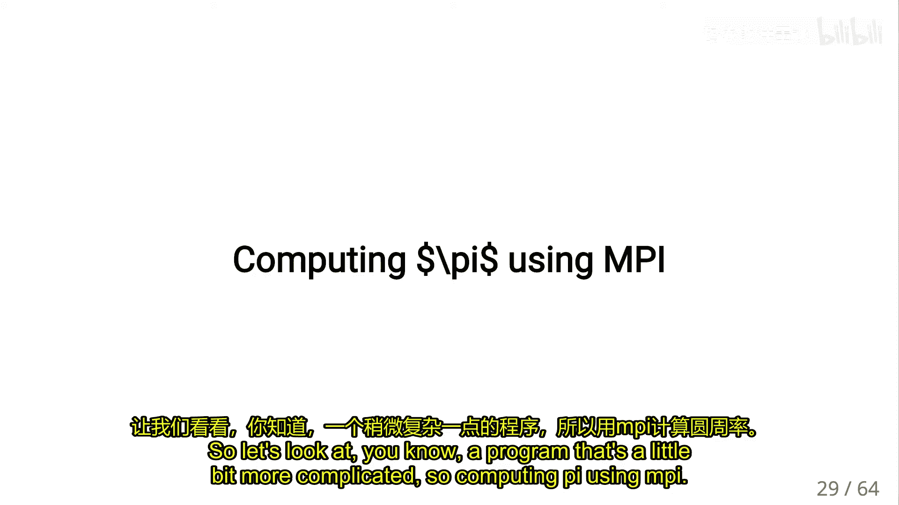

And so okay， here is the。The screenshots。When you're running the code。

 so I'm running again on four processes here， NPI pi send， okay so I'm starting all these tasks。

And so essentially here， you know this is。The bicycle demo for pi where you just throw a random dart。

 so basically you take a random point on the unit square and then you look whether you go inside the unit circle or outside and this probability will converge to pi。

ProBT converges to。呃。By R square， divided by forcecing。

So you can extract pie in this average and so here what I'm doing is simply starting four processes and each process starts this out with its own random seed and then generating a random sequence。

 so different random seeds so everybody gets its own statistics， like how many samples were in。

 how many samples were out and then essentially you just average out all these statistics on a single node and this gives you an approximation of five its convergence is basically one over squared of n where n is number of samples。

 so it's quite slow。

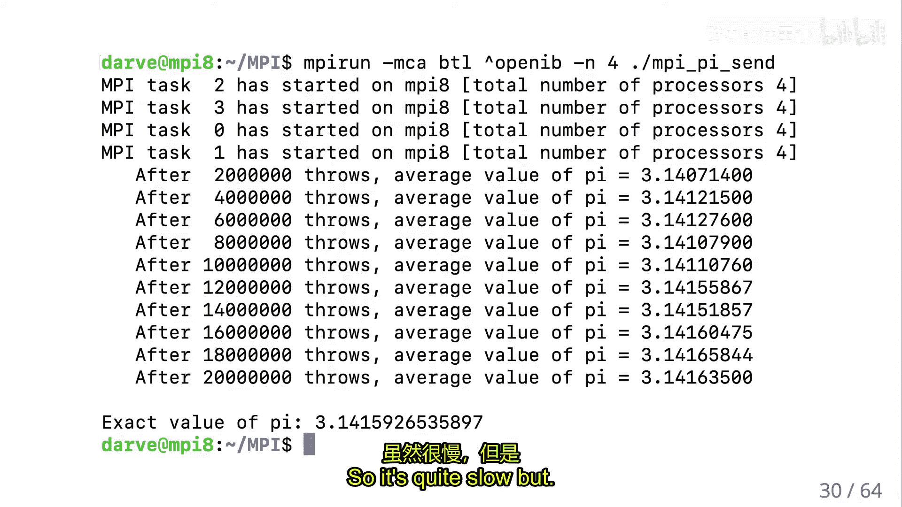

You have convergers more or less。So let's see what goes in the code now so you can you frontt go online。

 this is on GitHub， but I'm just going to show you the。This is of code here。

 so actually this code here is。So you you're going see the NDI is it's fairly simple conceptually。

 but in terms of writing the code， it's sort of ver and a little bit tedious。

 so for example here imagine so you have all the processes that are throwing these darts or judging these random numbers。

 anybody has their own estimation of pi okay they look at how many random points were inside the green circle so they really compute by pi。

And now you need to take all these statistics from say these four nodes， and again。

 you need to do some sort of reduction。So now it's more complicated。

 you cannot just take my pie and just add all of them together。

 now you need to explicitly send that result over the network to one node， the master node。

 and then the master node is going to do this reduction。

So this is a very classical sort of setup in the APII where you say if my rank is so and so。

 then do this and otherwise do something else okay and so this code kind of shows up the place and so typically in send receive it's almost required to do that because really in send receive it's notsymmetric。

 somebody needs to send the other guy needs to receive there's an F send and call NPI send if received point accuracy okay。

So you can see that the if statements are going to multiply in the codeVD。no。

We way around that and then a couple of things that can be done to avoid that but to a large extent you know that's what it is so here for example。

 everybody he sends to node zero or master node， so you say if rank is not master then to asend and if rank is master so that here it will do a receive。

All right， so let's look at the MPI send， so MPI send， so like I said， the standard is very simple。

 because it's going to be really generic。So the way the descent works。Is you give an address， okay。

 you give a memory address。And then essentially， you specify how many elements。

Should be sent over the network， starting from this address， and evenspec the target。

Okay so I shall come down to that， so this is same the buffer number of elements， the type。

Destination of the target process。So the communication so this is just you know。

Essentially when you're here specifying the rank of the target process。

 but the rank is defined only in the context of a specific communicator if you look at the subsets and so on。

 then within the subset you may have a different rank so you specify the rank and the communicator together and that uniquely defined a specific process。

And then there is a tag， so tag is so we'll see how to use it when in some cases it may be useful to just sort of receive messages and for example。

You don't specify which source the message is coming from or you're sort of generically waiting for a message to arrive。

 and then you may want to use a tag to be able to essentially distinguish messages。

 so this is what we're going to be doing here。Okay， so。Okay， so。Since everybody's falling asleep。

Let's ask your question， what is the point of NPI data type？

Why are we specifying any guide at the time， actually。

 let me just show you all the types that are available so that it is no surprise here yet。Car in。

 long， you know unsigned， flow， double， pool， complex， double complex。W car， bites， packed bike。

So for example， you have APII byte， where APII byte is that the name indicatess。

It is a bytes sequence of bytes， so a sequence of bytes or bits， get just a binary presentation。

 you send that over the network， fine。So why is it that we need to specify data types？W。Can years。

Well， more or less， right， because for example， the int。That's four bytes， okay。

 the float is four bytes， the double is eight bytes。So you know how many bytes。

 it's like when you do the Q and copy。It's actually be the tag。

 just give you an address and you say size of the time。Ds a number of elements。

 and we're done with that。So。ok。在年件。I think。Typically in GPU。

 they are integer processing units and double processing floating point processing unit。

 kind of we have to tell MPI。Reach time so that。So that the system know。

Which kind of maybe integer processing in units or load point？Now， of course。

 you need to have type information。But for example。You know， you can have an array of int。

And then we have double， and it is legit to just take。

The beginning address and just write whatever sequence。

Of bits you want right without specifying the time without what can add an array of integers。

 another array of integers and do men copy。G them and copies doesn't care but it's still tight which discussing the bits。

The types is just something that the compiler essentially uses for correct。

Good execution and indeed some of the assembly instructions。Do depend on types。But when you copy it。

 it's just bit。Okay， so I guess go back to the slides so maybe they can read it。

 like read the documentation。You mean， this one here， yeah， so it just part can read the actual。

Yeah是VT的有。Okay， well， the question is what is a float？Okay， what is this book？

So you guys remember whatever a focus is？Scientific not number。Okay exactly。

 so you have this Matisa exponent and scientific， these two pieces of information。

And although the standard kind of defines exactly the range of everything and so on， for example。

 just the sign date。You know， the stem doesn't say whether the first page should be assigned or maybe the last page should be assigned。

 or you store the exponent then the Manisa or the Manisa then the exponent， or even， for example。

 the menisa， you know， like what's the order for the bit？Could be any order you want。

So the problem is when you write the MPI library， you have to be very careful。That， you know。

 you're now running on different。Computers， they might even be running， so the hardware is different。

Your big system might be different， and everything might be completely different。

So the way numbers are presented could be different。So on regular clusters。

 usually all the nodes are sort of identical， they run the same Ukraine system and so on。

 so everything is the same， but in general， this is not the case。So for correctness。

 you have to specify the type， for example， if a float is defined differently two different processors。

 then the MPI will have to actually do a lot of bit manipulation。

For the numbers to match on both ends， talking essentially about the same floating point number。

 but with different representations。Okay， so it's actually very tricky。

 and so you need to be careful that if you send by。know this may work on some processors。

 but not necessarily for all of them。Okay so let's look at the second part。

 so if rank is that master so here I just sort of got the first bit， and so now if rank is master。

 you think the else branch， its the second half of this program。

 and now you have API received okay so what's happening is see the way this is working is master is node zero and equals zero。

So you're going to be waiting for all other。Processes from 1 to n minus1， receiving this number。Okay。

 again the time。And here the way things are done is I'm saying MP in sources， okay。

 so the problem with MPI is that MPI very often。Leads to programs where there's a lot of synchronization points okay and sort of superior synchronization points。

 for example， here， if you process zero。You're waiting for n minus1 numbers in your calculation。

for example， the order in which the numbers are arriving is irrelevant， okay。

 it doesn't matter like whichever is the first one to arrive that sets good。

So you can write a program such that here， for example， you specify oh。

 it should come from process one or process two， three， and so on。

And then you again will just wait until the for process one arrives and will not proceed further until this happens。

 okay so for that point process two cents first。And just wait， you have to wait for one to arrive。

So here I used a special keyword API in source， which allows to say， well， from whatever source。

The message is arriving from。It's going to sort of satisfy this received， it's going to be matched。

That said is going to be matched with that receipt as a successful receipt。

And so now actually I'm going to use the time because what's happening is so I'm computing pi so I'm generating the statistics。

 but I'm doing this over several rounds right if you go back to the output。

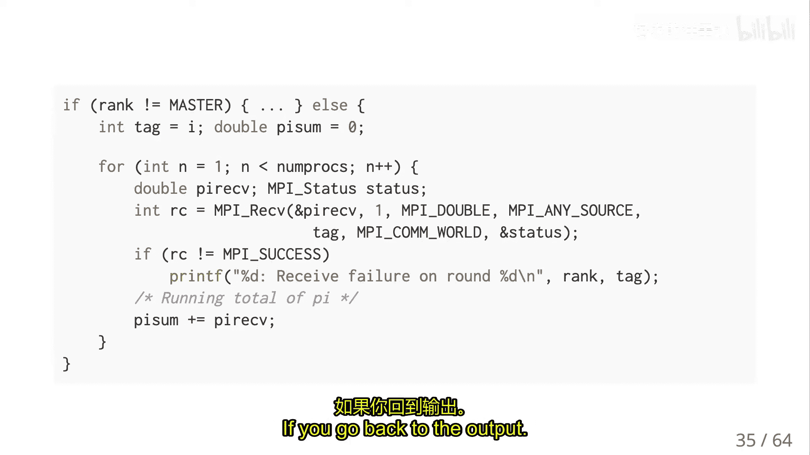

Right so go these rounds so initially you have2 million throws divided by four。

 so whatever maybe it's 500，000 per process， okay everybody there's 500，00。

 so you get 2 million and then this is first round and then you iterate the next round you get4 million and then 6。

8，10 and so on you and so you have all these rounds and so if I say MPI any source。

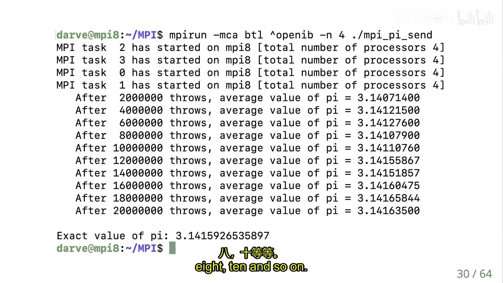

Right。RightIf I say NPI any source， you have to be careful because I could start mixing up the rounds together。

So the tag actually contains the ground information。So essentially this loop is going to keep going。

 so you have a di equalal eye。This loop is going to get going until essentially you receive n minus1 messages we say at the beginning tag zero。

Okay and that finishes the first round and now you go to the next round。

 you're now waiting for n minus1 messages with tag1 which is next round and then tag two and so on。

 and so now the way the program runs now is kind of interesting every round the messages arrive in different orders and their process in whatever order they're arriving but you make sure that data from different rounds are not mixed together。

At some level， of course， it doesn't matter because everything being random。

 you could actually mix the rounds， but there's definitely some cases where mixing the rounds would be an error。

 and so this avoids that。Okay so basically， you know this is the syntax for NPI received。

 same thing as before message count， be type source。

 now you have this extra tag and I'm sorry the tag was there before and then they have this extra status。

And the status is something that can be used for example。

 if you use these wildcards like NPI any source and so on。

 then you can use status to figure out what was the source if you're interested in that or if somehow the source is important。

 you can use status to query information about this NPI received in case the things here were you know。

For the wild guards。Okay so this is the overall program， and so you can see now how tag I。

 so I'm sending to process one with tag I and here any source with the same tag tag I， okay。

 so I'm going to matchingagining it。The same receiving special。

 so it's very important for correctness， it's essential that all the sense are matched with a corresponding receipt。

Okay so here the send is going to be defined by you know the type， the length and so on。

 the tag and the comb， and then it has to match the receipt so the receipt needs to have the same type。

 same length so here actually this is going to match and each source okay obviously needs to have the same comb and the same tag so every every send needs to be matched with corresponding receive otherwise the code will just hang if you have a send。

 but nobody ever does the corresponding receiver and it hangs and vice ver you receive there's no send。

 then again it will hang and be stop there so that's above in your program。

So you have to make sure that all sense have in matching received， and in particular。

 the sort of signature or the type of the message has to exactly match the type that's in MPI S。Okay。

So each stand must be matched by correspondinging receive， then also the question of order。

And of course everything happens as ecosystemous and so on and the network can do these strange things。

 so in principle it may be possible for messages to arrive in different orders。

 okay that you can send message one message two， but somehow message two arrives before message one。

But it actually may very well happen。For example， if message one is one gigabyte and message two。

 you you send immediately after and it's just one byte。

 it's very possible that the byte actually arrives before message ones compete。

But the MB library guarantees。The messages are received in the same order they were sent。

OkaySo essentially even though the data may arrive first。

 NPI will pretend that the communication is not complete yet because there was a message before that that's still being processed。

 so the order is sort of enforce until message one is done NPI will not say message2 is ready so the order is maintained so that for example。

 if you're doing your receipt and so on or if your testing for communications。You know。

 you know exactly the order in which the messages are arriving。

 you know that this exactly matches the order in which they were sent。

 so since it's the same program， obviously you can determine completely。

 you know completely ahead of time， what these orders are and so on and you can make sure that your program is correct。

Okay， so this is basically saying the same thing， but sender sends two messages of the same type。

 one or the other。Then the NPI runtime ensures that the first message is received first。

 meaning that the communication will complete first。

 so we'll see next week that this concept of completing a communication is actually will be subtle。

 so here the way I explained you have APII received and it's so called blocking that is essentially the coaches weights。

unil that completes， so then it's going to appear， but you also have non blocking send and receive where essentially you can test whether the data has arrived and it's not to continue do something else and come back to tests。

The status of the communication and then in that case。

 its concept of completion becomes a little bit more complicated。Okay， so let's talk about。

So there are a number of things I need to cover for the found project。

 the most important thing is collective communication this is what I'm going to talk about now now for the homework there's actually a number of concepts and communicators and so on that I need to cover so I'll have to postpone that to。

To next week， so you talk about communicators， groups and so on， but at least for the final projects。

 everything you only need cognitive communications I're going to try to cover that today。Okay。

 so collective communication are very important so what weve talked about so far is point to point。

 so basically process zero sending data to process one its called 02 point so one note another note so of course。

At some abstract level， you know that's all you need， I mean。

 that's all that can have happen in network anyways。

 you know data going from one node to another node。Okay， so some network sort of may support。

Broadcasting and more advanced operations， but typically at this point to point is the。

The basic sort of building do。But we've seen。That there are certain operations where this point to point is not sufficient。

 so for example， if you want to do a reduction。 something that we've seen before。

 but here it's kind of interpreted in a slightly different context， let's say you do a reduction。

 well you could have old processes， say send data to node zero。But actually。

 this is not an efficient way of doing things。Okay， and the reason is the reason is as false。That。

呃Essential the。The network， you can think of it， the network as basically roads。

Or transport or wires that connect different nodes together。

The basic problem is a finite number of wires。よ available。

And so if everybody just sends directly its reduction data to node zero。

Then there huge ballneck at node zero， right node zero is going to receive a huge flood。Of data。

 and let's say there's only one mark coming in， it's is going to be very。

 very slow and if you think about it， that makes no sense because for example。

 let's say you want to reduce n numbers。Ially node zero you may only receive a couple of numbers they do foundation and that's it this should be a better way than receiving all the end numbers altogether at node zero so of course we're familiar with this this is a classical tree reduction but now it's not about know sort of leveraging the compute capability。

 it's about leveraging the network， the communication capability okay so imagine node zero。

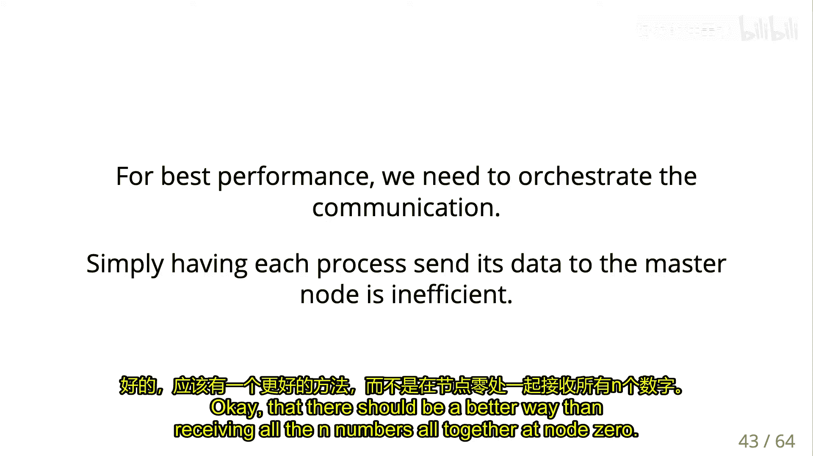

You want to minimize the bandwidth that at node zero。

 so let's say node zero is doing the left branch here so it's going to be receiving two numbers then receiving another number。

 then receiving another number only three numbers and essentially there's a lot of communication happening but on these other nodes that are essentially using other parts of the network other wires and so on and can be done independently is that overall the bandwidth appears to be much higher because you're using more fully your network so essentially this is what this is all about so you have this。

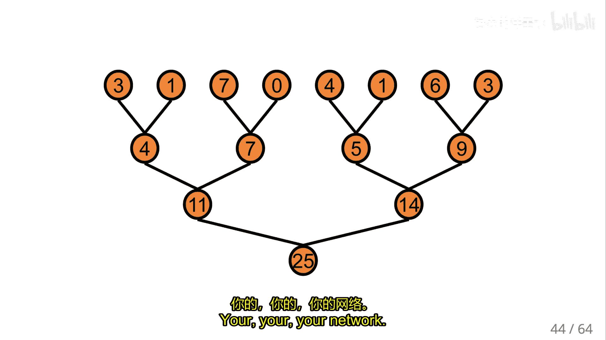

So apparently， this is the Los Angeless High。Frety impressive。

So basically you want to use all the wires all the highways， all the lanes available。

And if you tell the cars that they should all take exactly the same road， gigantic grid。

 okay so you want the traffic to kind of distribute as much as possible throughout all the communication highways and essentially this is what so when you do this correct operation。

 this is essentially the top okay you want to move data around。And you have certain network topology。

 so you have certain highways available， and the question is how do you route the information through that network in order to complete this operation as quickly as possible so this is a very complicated business。

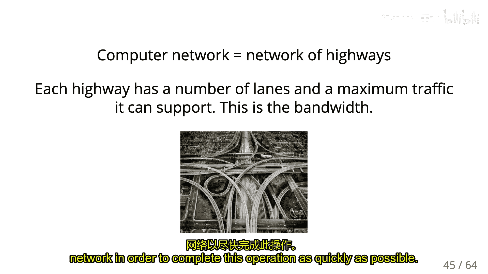

And maybe not always done very， very well because its very， very complicated。

 so obviously you for a given pathology or given system of highway。

 you can definitely figure out what's optimal， but it's much more difficult to have a library that is sort of optimized for sort of gel configurations。

But what's happening is you know so communications are complicated。

 they depend on the network topology， but the good thing is essentially there are relatively few of these communications。

 so for example we always be talking about reduction or scan。

 and then there is a broadcast and so on so a number of basic operations that keep being reused over and over again。

 so there's more as 10 of them or whatever。And so API has special function calls for these collective operations。

 and hopefully they're reasonably optimized for the platform that you have。

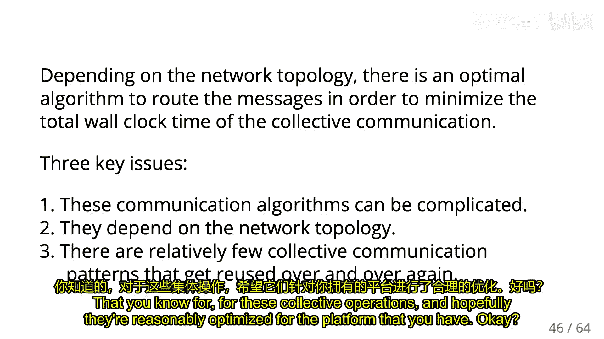

So let's review these functions， so first one is MPI broadcast。

 okay I'm just going to go quickly over these different functions now。

 so first one is NPI broadcast so APII broadcast basically means that a process has a decent information。

 okay the green square， and then it needs to send the green square to all the other processes。Okay。

 so typically the way this works in process zero may read data from file or may you know。

IRequest an input from the user， okay gets that information。

 and then it's going to send information to all the other processes so they know what to do。Okay。

 so much more common actually is the sort of dual or reverse operation， which is the reduce， okay。

 so everybody has a piece of information。Okay， and you want to add all these numbers together and just get one number。

 so for example， you know it going to stop adult products。Or。We reaching sector product or。

Top out two vectors then it's a sum， and you can do local sums in the end each process has just one number and those need to be added together to just get the final number。

 so the reduction and this sort up for calculating norms， errors， linear algebra。

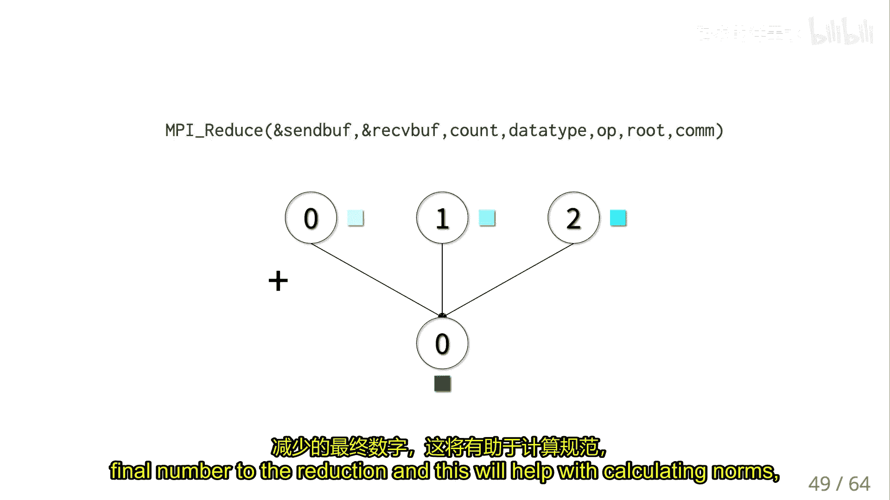

Lots of situations where you have a reduced。So reduce can be done with many， many types of operators。

 okay， so essentially all operators that are。Communicative and associative can be used。

As reduction operators， so we've already seen that， we have Max， min， some product。

 allological operations。And then also Maxlock and Minlock is kind NP thing but it's very useful。

 so MaxL and Minlock allow you to do a reduction。or essentially two things。

 so let's say an integer and know the number or tag that's attached to this integer。

 so it' allows you for example， for example， doing a max， let's say doing a max。

 so the max itself is the reduction operation， but then you may want to know what was the location of this max。

 okay the index， for example， the rank that contained a max or whatever。

Information that was attached to that number， so maxL is going to do the reduction max on the first number and then the second number is just sort of attached to it and can beque later on to get additional information。

 so I'll show you an example。

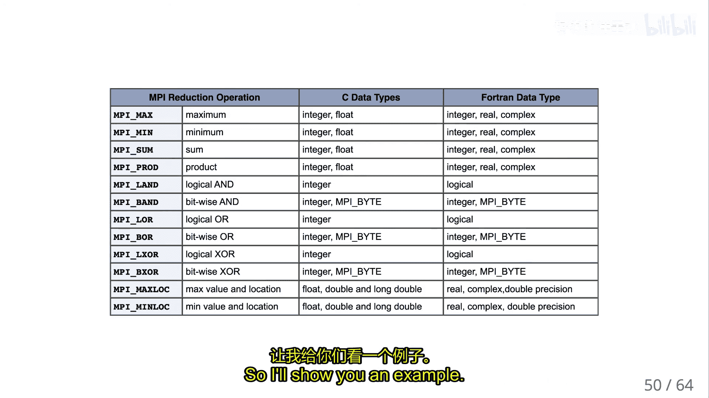

Okay， so you know， here's an example with。Again， this NPI prime and now looking at doing this reduction。

 okay？Actually， it'sI NPI prime。Yeah previous examples is pi so here it's so different。

 we're essentially going to have each each process essentially calculates you know how many primes are in some interval and then the counting so basically counting the number of primes and then maybe looking at the largest one they have found okay so you imagine your interval from0 to n minus one you're going to split this interval。

 let's say into four parts so each process is going to compute one one part okay so you have my start this is limit is just how many primes will do and then you have certain stride so that every compute is testing different integers n and then you is a prime then if you has en counted and then you just keep the largest and then you want to look at。

The total number of primes that were found， so you do NI reduce。

you're sending PC and storing the result here， this is an int。

The reduction operation is a sun and the results will be stored on this node。Okay。

 and then here similar reduction。But doing a maximum， you now going to find the largest。

 so this is the largest that process I has found but you want to find the largest overall。

 so you can do a max reduction and put the result on node master。

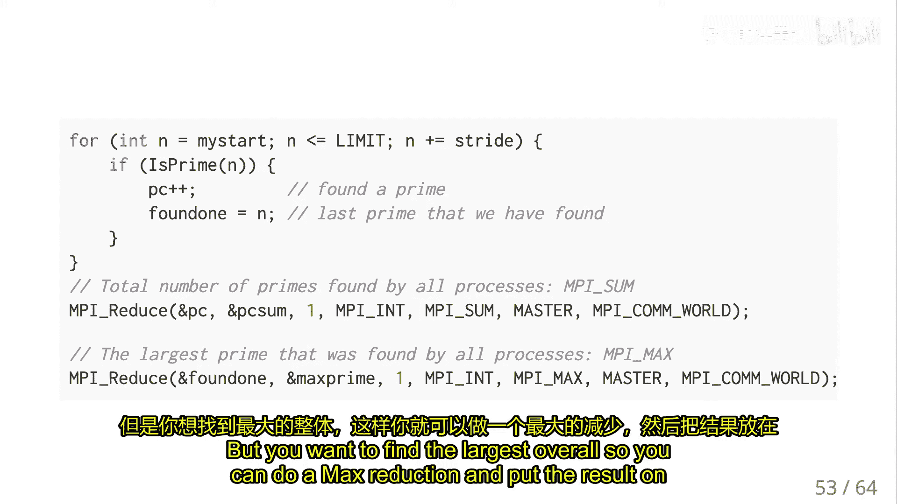

Okay。Well， okay so we're kind of running out of time。

 but if you're interested you can click on this link to this is actually anything to do with API。

 but it's pretty cool。

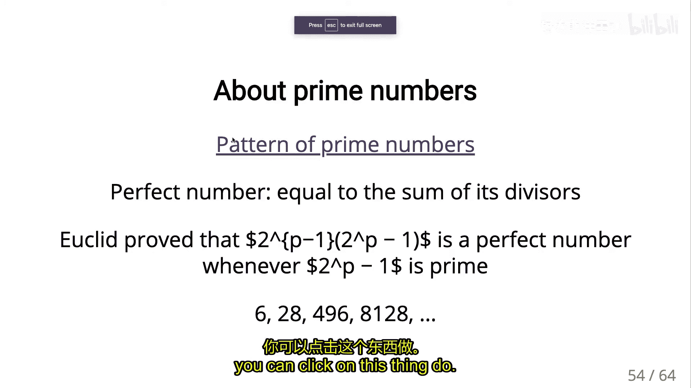

So it's showing you how to visualize prime numbers。By looking at multiples。Sてと。

So essentially each line here。Represents essentially a multiple。

 so the first line is just going around every one， but then next line is going around every even so multiples of two。

And then there's no line for multiple to threes， another line for multiple the four。

 not line for multiple to five， and so if you look at a number。

The number of ining lines is basically the number of factors that you have in a given number and so if you have only two lines。

 then these are prime numbers because that's the one and then the number itself and if you have more than two lines then it's a number that's not prime and then you have this concept of perfect。

Perfect numbers。What's perfect numbers？Perfect number is number when you look at all its division。

And you send them out together， you get back。Exactly the same number。Okay， for example。

 six works like that， one， two， three， and then the factor is you get that six that's the perfect number。

28 is not the perfect number。And so we can play around with this and look at the numbers that are perfect and so on。

And strange to， you can even scroll to the right。And get these crazy looking plots。

So you can see it's kind of interesting to see those that have a lot of lines in coming。For example。

 that guy is a huge number of factors。Anyways， first just a side comment。All right。

 so just wrap it up， so now you have the gathering operation。where basically has a piece of data。

 it's going to be gathered on one node and then you have the corresponding scatter operation where a node has different pieces of data and then each piece gets sent to a different node so for example in your final project okay you're going to have rank zero who's going to read all the data all the images compile file but this is going to have all the images in what are the implementation you want to split this data into some sense of images and send each subset to a different process。

Well， this is exactly an MPI scatter operation。And then you have the reverse。

 which is sort of MPI all gather， everybody has partial。

You know partialial data and you want to gather everything on all the numbers on every node。

And so another thing that you need for the final project is NPI all reduce。

So NPR reduce is basically a reduce， so you're going to take these three pieces of information。

 add them together， the difference with reduced is everybody。Has the result at the end。

 instead of reducing onto just one node， you're doing the reduction and then sending a copy over to all the nodes。

So for example， when you' computing the gradient。when you're competing the gradient， as you remember。

 everybody gets a fraction of this sum， we like you have four processes。

 everybody gets a porter of this sum。Okay， but then you want to apply the gradient。

 so you've got to sew across。All four nodes you have the partial gradients and then all the nodes need the result for the gradient so it's exactly an overd okay maybe there's a partial gradient。

 you add all these gradients together and then all passes need to have this gradient available and you can update the neural network coefficients it's an MPI all reduce。

Okay， so you have another example promin value， which does that。

 so promin value basically it actually。Does this min lock， so each process has a bunch of integers。

 each process is going to compute its minimum， so for example。839。

 and then you're going to take a mam across all ne processes and then set the result to all rats。

Okay so this is basically reduce， only one rank has the lowest value here。

 all ranks have the same value this minimum， so this is an all reduce and this is basically what it looks like know just NPI or reduce and I mentioned this mean knock。

 this is an example of min knock， so the way we knock works is you have array and global array so you can take the minimum。

But you want to also know where which process you owned the minimum had the minimum。

 So the way you do this is you create an array of ins。Okay， the first entry。

Is the actual value minimum？And the second entry is rank or whatever number you want attach to。

So you do this， local rest zero， local rest1， now you do need NPI Millock。result is written here。

 and so global rest by definition， the first entry will be the actual minimum that was found。

 according to this reduction operator， and then the second entry is going to be the rank that was attached to the minimum that was found。

And you also have the NPI2 ink as a special type because these guys are in two， right there。

 two inks。This is needed for Frank kitite and Minok。Okay， and then last thing is all to all。

 so this one is sort of a matrix transpose， if you wish， so here each process is like three numbers。

And then these numbers are going to be shuffle， so if you think about it。

 it's basically the same as taking a matrix。And saying well when you start。

 each process has a given row in the matrix and after the old wall each process has a given column in the matrix。

 it's sort of a transpose operation， so for example zero is going to have all these guys。

 the first one， one will have all the guys in the middle and two will have the guys at the end。Okay。

All right， so very quick introduction to NPI， how to use NPI point to point Com？

Creective operations and so while there's a lot more to cover， so this is essentially sufficient。

To do the final project now， in terms of cohort5 there's quite a bit to cover。

 so we'll do that next week okay thank you。

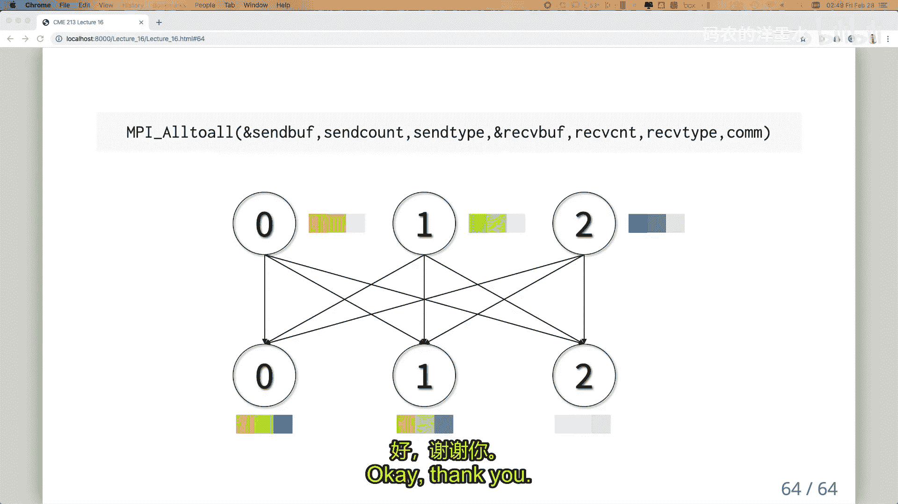