# 【全集】斯坦福大学-并行计算导论-CME213-中英字幕-1080P-p14-Lecture-14---等效率--BV1f8ijBYEjR_p14-

So in the homework lab， you basically。Then you have to do this matrix matrix product with the so called DNS scheme。

へ？There are essentially two main parts。Three main parts one is running the writing the program so kind of we'll go over that during these lectures。

 second part sort of B some benchmarks and so on okay please straightforward forward then the last bit has to do with the more theoretical kind of analysis of the running time and so today I'm going to focus a little bit on that and so hopefully all the concepts that you know so all the theory stuff do Home5 will be covered in in today's lecture so I'm going to start with。

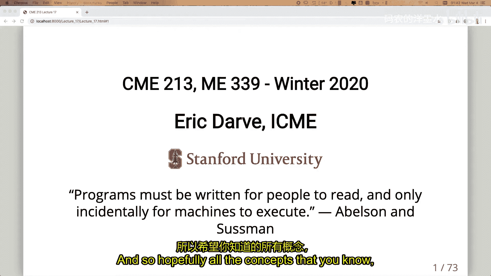

A simple example and just niche Spec products。So a simple example you can illustrate and then again Friday we'll focus more on specifically the matrix matrix product and so on。

 So here I just want to do x equal a times B。So we're going to go over the algorithm how to do that。

 but then I really want to focus on this sort of theoretical analysis that you need to do at the end of Form5。

Okay， so you have to do this matrix vector product。

 x equal a times B and matrix H you want to the student the student memory visible NPI。

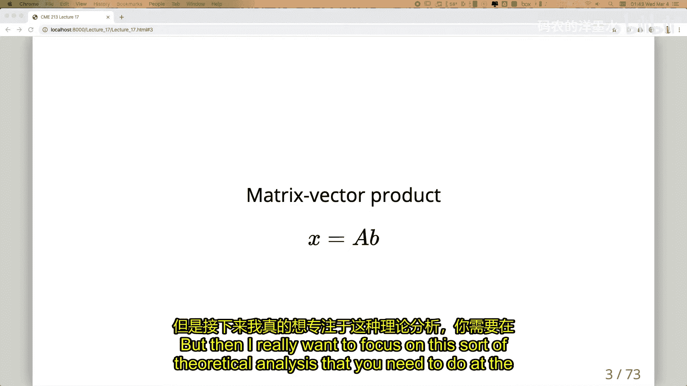

So these are the input， and this is the output of your algorithm。

and essentially the question is when you have to perform all these modifications and additions and the question is how are you going to distribute the data。

 so essentially where is the data located on which process and so on and this determines how the NPI implementation goes。

So we're going to go over three schemes， first one is to partition the matrix sort of across columng so you take one row or a group of rows。

Goes to one process， okay until you partition across the roads。

 then there's a similar scheme where you partition across columns， but it's very， very similar。

 and then there's another scheme where you partition the matrix in 2D。

So you get a series of blocks and each block is then associated with a process。

So you're going to see what sort of communications。

 communication patterns are associated with its decomposition， but then more importantly。

 we're going to do analysis of the running time of each algorithm to kind of figure out sort of theoretically whether one algorithm is superior to the other or not。

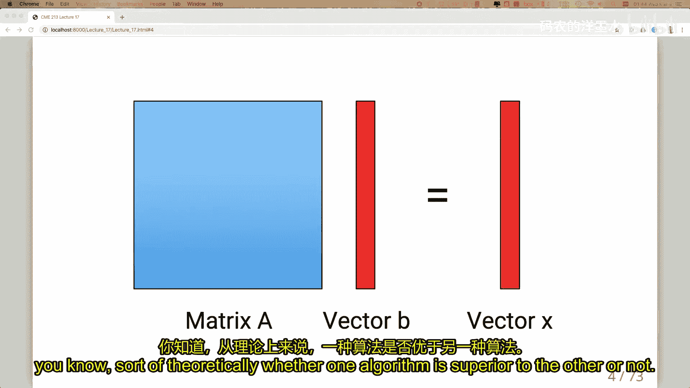

So I look at row partitioning， so group partitioning is basically the idea is you're going to take your matrix。

 decompose it across the rows like this， and then each common block is stored on a given process。

And so the question is， so you start like this， so the matrix decompose like this。

 you signature two vector is also distributed in a sort of similar manner。Well so for the vector。

 you know there's sort of only one way to really distribute it so this is sort of natural now the question is okay。

 you want to do a times B。So here for example， let's take the blue process。

 the blue process actually can do the multiplication because it has a little bit of blue here。

 but it needss the other entries in x so it can do the multiplication。So the first step is actually。

Give to all processes the entire vector B。Okay， and so each process is going to start with just a piece of B。

And then you go N function so that each process has the entire vector B。

Okay so this is an example of a collective communication that we covered last week and if you go over different options you have。

 you will see that this is an NPI all gather operation， you're going to call NPI allgaer。

With the input， and then。After the function competes， each process has the entire vector。

 and now you can just do the multiplication。

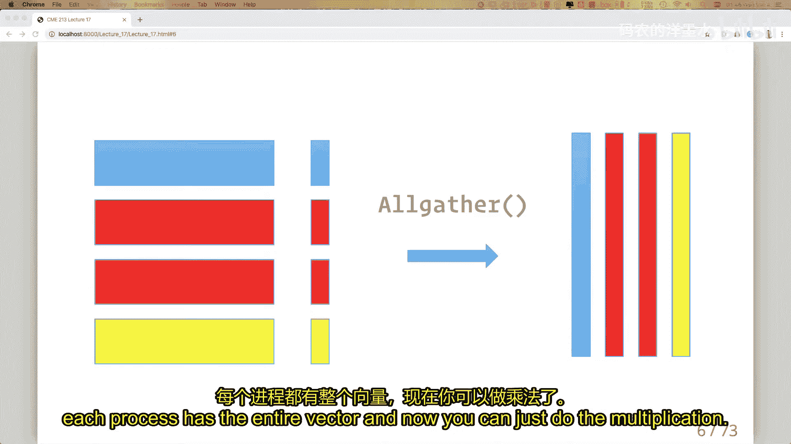

Okay。So you call MPI or gather to do that。 once so just going back one slide。

 once each process has an entire vector。

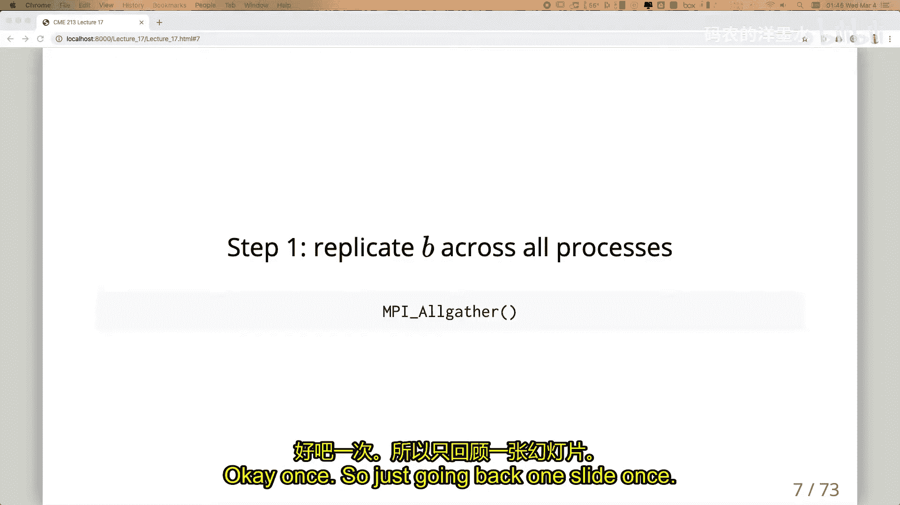

Okay， and then it has this block。This row of a， then each process can just do the product。

 there's no further communication data exchange， you can just do the math and you have the results okay so step number two is just the local product。

 no communication required。

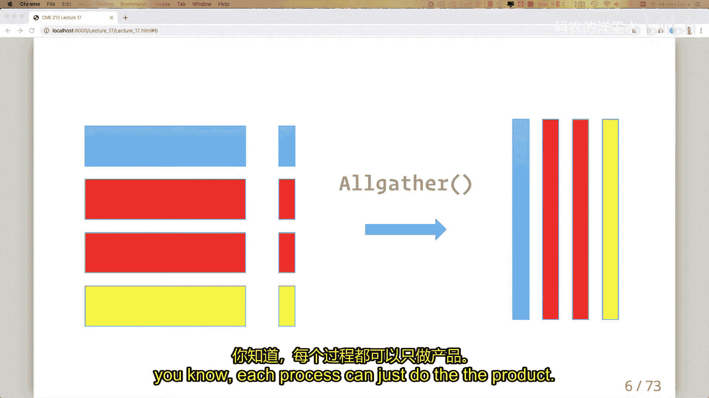

So you can follow this link to get the entire code on GitHub。

 I'm just going to show you the essentially the。core the code， the part that with MP and so on。

 so you call MPI Mon Ga and the way you do this is you give the address of where your local copy of B is located and you want to finish。

With a copy of the full defect vector。Okay， so here you give。

 you know what's the address of my own local copy， each process as a different copy。

 different block could be。That's the size of each block。絶体？

And each process is going to sell data of size and all。Again。

 the result is stored then inside of the beEC， Okay， now you have a few rows。

The entire B so you can do this multiplication， you can see how this looks like。

Here wrote so it says from Z and local， and this is very common in MP that。

They sort of global memory。The real rule number if you want。

 and then there's a local numbering for just the rows that you have okay so the local numbering I starts at zero。

 but in reality you this is a specific。Set of rows in matrix。

and then you get the subset of the X entries， and you see that for example。

 the matrix may be very large。Forjo processing and local entries。In this calculation。

 and no further calculation the communication is required， once you have x， you're done with it。Okay。

嗯。So any question about this implementation， all gather。Okay， so this is a block communication。Okay。

 so the code stops there until communication is complete and so everybody needs to give you address of Facebook data and where to store the entire。

Be there and of course， amount data to send I。The amount of data you have it can be essentially the amount of data other processes are going to save。

Okay。嗯。So the second scheme is the column partitioning。

 so this one I'm going to go a little bit more briefly over that it's very very similar。

 so we are going to do a partitioning across the columns。

 but you'll see that actually the steps are sort of closely related to the column partitioning and in terms of performance and so on。

 it's almost identical so these two schemes are sort of know sometimes called dual of each other or they're very closely closely related so in the column partitioning the idea is now each process stores you know subset of the columns we have all the rows。

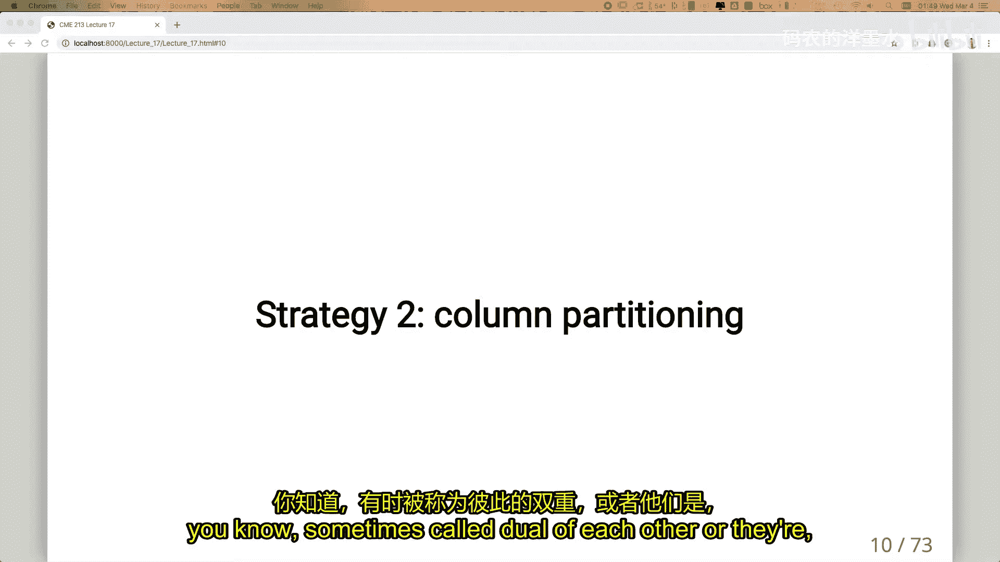

Just a few of the comps。again， you multi this vector。

 but every process has a local copy of the vector。the main difference here is that when you start。

Each process actually has all the data it needs。Okay， you have a bunch of comps。

You have some entries in B， so actually the entries you have。

Exactly correspond to columns you have so you can actually fully do the product。

 although what you get， as a result， is just a product for these calls， the partial product。

And so there is another addition here， which is going to be a plus， a reduction。Okay。

 so now it's more like led to the calculation with these blocks。

We get partial results then the communication， whereas in the previous scheme， it was communication。

 then do the multiplication。With've no more data exchange。

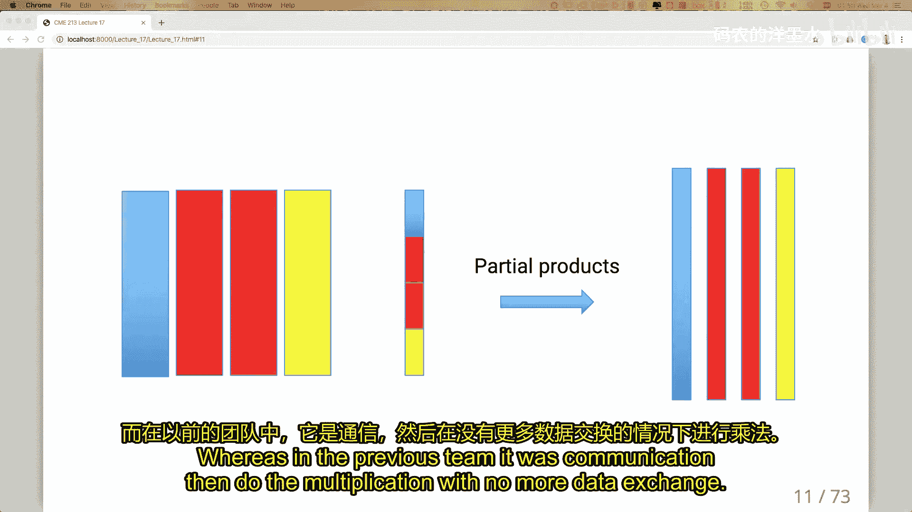

So here step one is to you do the partial product。Each process。

 so actually no data exchange is required。you get partial results for x， now you do addition。

A reduction across all processes we're going to call an MPI reduce。

Okay and so the result may be stored on one process。

 but then if you maybe want to distribute the result as well。

 then you're going to take this result here and then scatter it across all processes okay so it's an extra step just so that each process has a little chunk in the output。

For the output vector x so again reduction here with collectiveive communication。

 reduction across all plus， get the final resolved and then scatter。

SoThat equity has just one piece of the data。Okay， so here I'm going to skip the details of the code。

 but it's an N careR reduce。Flled by an NPI scan again this is doing the addition to finish off the matrix vector multiplication and then this is just to sort of change the data layout so in principle you end up with one process having the result so you can scatter it so every process has a little chunk。

Of the result vector x。Okay， so the performance is。iss very similar to group partitioning。

 so it's like first one is doing communication and then the multiplication。

 the other one is that's do the multiplication and then the communication。

 but at the end of the day it's kind of very similar。All right， so you have this。Okay。

 and so now I want to contrast this against the NAA coach。Which is a 2D partitioning。Okay。

 and so I'm not going to show you benchmarks， but if you look at this role partitioning or called partitioning the equivalentvals。

As you keep increasing the number of processors。Assigned to this task or the number of ranks in MPI that are doing this matrix vector multitation。

 then you will see that the efficiency goes down in the sense that the runtime initially goes down very rapidly。

 but at some point as you keep increasing processes the runtime decreases more slowly and in fact at some point it may stop going down altogether。

 in fact if you keep going it may even go up so that's definitely very bad。

So there is a better approach。Wwhichch is this 2D block partitioning。

 so I'm going to explain again the algorithm， but then I want to focus on how do we model the running time of these different algorithms and how do we compare these running times。

 so it's a theoretical exercise just based on the model of the running time but it's something very important to understand how efficient parallel algorithms are and something you have doing in oneword five。

So let's look at this 2D block partitioning， so John is speaking here。

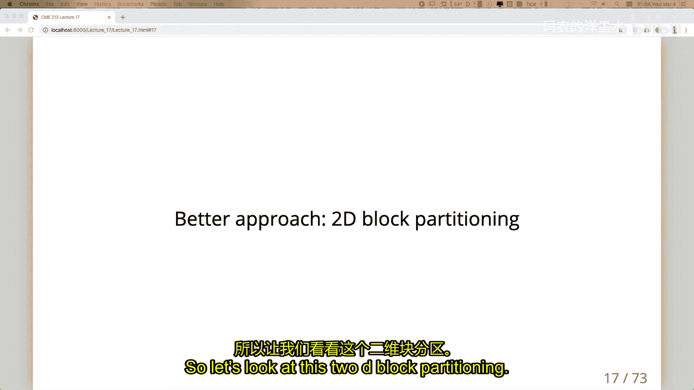

You know， at the very high level， we had a matrix。So we decided to do either this row partitioning。

 this column partitioning， but it seems more natural that we should subdivide the matrix into blocks and assign a given block to a given process。

Okay so a process is now responsible just for taking this block。

 multiplying by the corresponding entries in B。Okay。

 then you get a partial result for x there's going to be a reduction to get the full result。

And so it definitely looks more complicated， in fact， if you think about it。

 it kind of feels that there should be more communication because you have all this partitioning and so on。

 there's going to be more movement of data， but actually you'll see in the analysis that turns out that this is the more efficient。

 more efficient method。So let's look at the different steps。

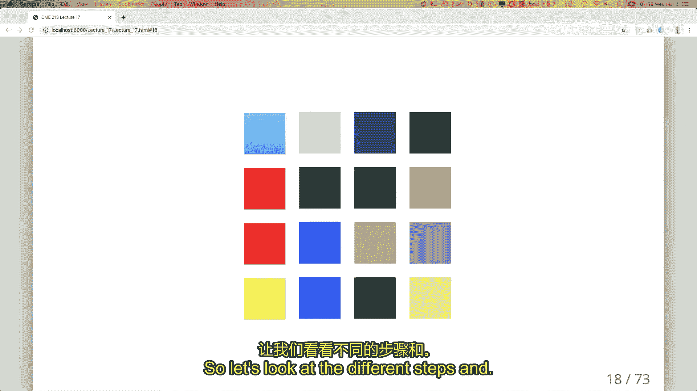

So。Yeah， I guess I'm changing， I just seen to all those lectures。

 so there was sort of a follow up on Friday， which I guess will be canceled。

So probably will not show you how this is implemented。

 I will just jump in you know what needs to be done in homework 5。

 I mean homework 5 is sort of varied on this so you it's all。R。

 but here I'll just show you the the sort of high level picture that I guess will just skip the。

Implementation， and then on Friday， I'll just focus specifically on the matrix matrix product you have to do for the board。

僕をやして工から。嗯。But okay， so essentially the steps are as false。So first， when you do this blocking。

 things become more a little bit more complicated when you start， and you'll see that the home thigh。

 you have a similar situation。That the vector B is sort of one dimensional。

 it's just a vector whereas you have this 2D partitioning。

 so in principle it's not reasonable to assume that B is stored in every process instead we' to assume that for example B is only stored in this the processes with say J equals0。

So you're going to assume to start with all processes having been dis in homework five。

But you always had to make these decisions about where the data is， the homework5 it's even more se。

 we're going to start assuming that the matrix is actually stored on node zero。

 so node zero actually has the entire matrix。And so the first step will actually willll be sending blocks a node zero to all to some of the other processes so we'll get that。

So here we're going to assume that this card j equals0 actually has B。And so for example。

 the first block B here corresponds to this column， so this is sort of fine， it's in the right con。

 but this guy needs to move to the second con， correspond to second column in the product。This guy。

Third calm this guy to last off。So the way you do this。

 and there's going to be a very similar pattern in homework five。

Is first you're going do just this point to point， so process to process communication point to point。

 so you take this block， you call J equal zero。72 called j equal 1， and then this block j equals0。

 j equal 2， j equals0， j equal3。This is just a straight send receipt。

 So if you're this guy you send else， if you're this guy you receive okay， so just do that。

It's going to be a bunch of sanducive bears。With if else statements。对。Now next step。

 so this actually is quite fast because for example。

 if you just look back just to a very high level in the previous implementations，You know。

 for example， the first step is oh， each process had a piece of B。

 but then you wanted to do a collective communication so that all processes had the entire B okay so that was actually quite expensive communication whereas here this is just sending this guy so just a piece of B to another process okay so the amount of data you have to send is much smaller a small chunk from one process to another process so it is actually quite efficient。

And after that， the second step is actually also quite efficient。

 so you want to essentially broadcast okay that is you want to take the block you have it in each column and broadcast it in the entire column。

 for example the block11 broadcast entire column， the block 22 broadcast in the entire column。

 okay broadcast and broadcast so this is going to be a broadcast operation。

 so it's to collect your operation and user the P or broadcast function MPI to do that。And again。

 this is going to be very efficient， first of all， all these broadcasts are sort of independent so they can all happen very efficiently。

And you're broadcasting only a small amount of data because it's just a chunk of B。

 and you're broadcasting only to a small number of processes here， these groups of four processes。

So again， this operation is actually going to be quite efficient and faster than the previous。

 for example， operations that we're doing， such as， you know， again。

 remember that in the row partitioning each process had a chunk of B and then you have to do。

This gather so that all processes had the entire copy of pe， so this is a much more expensive。

Communications here so far， the block decomposition is paying off。

 you're just sending much less data and you're sending it to sort of fewer processes only inside a con。

 it is enabled by this block partitioning。

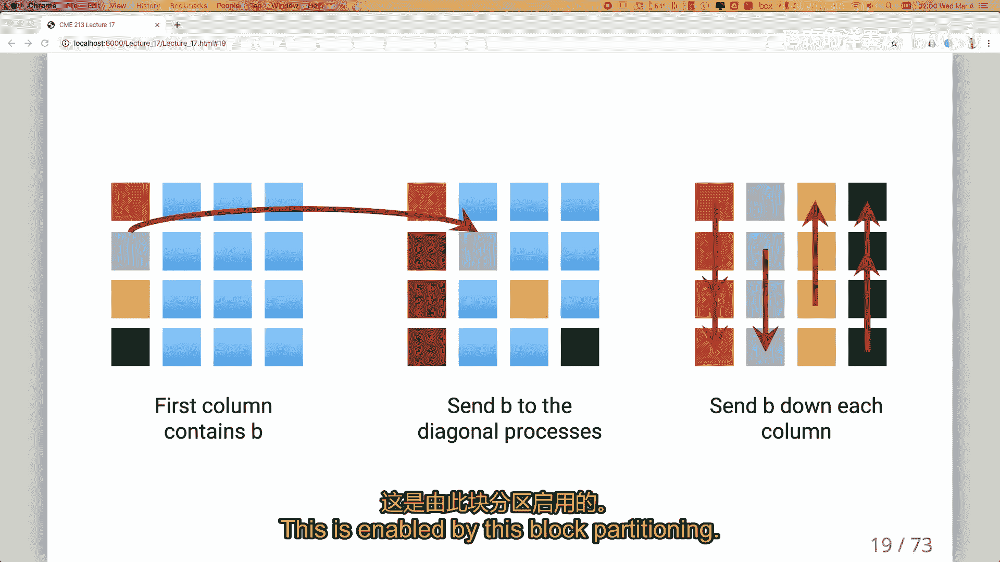

Okay， so essentially three steps。

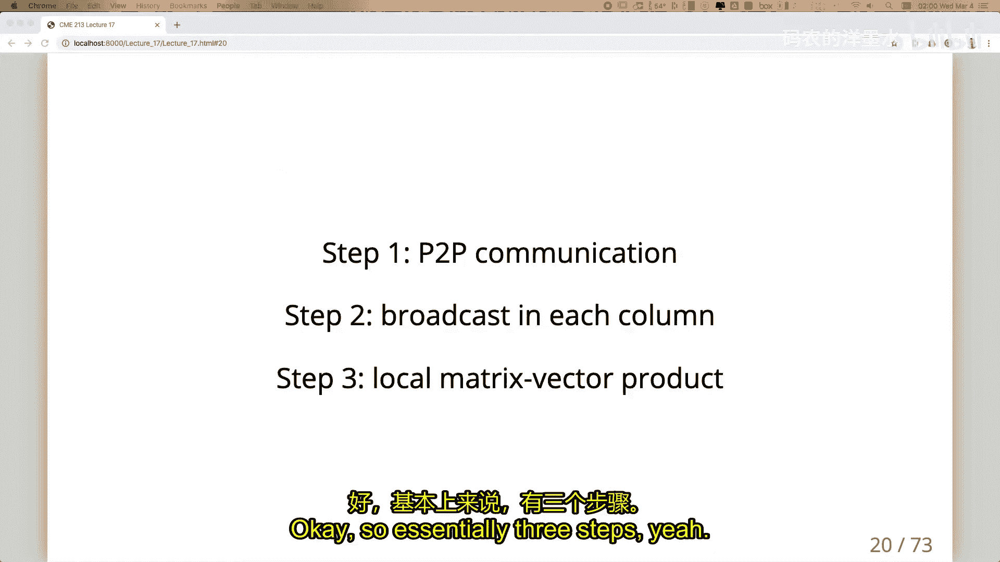

Yeah。ま、緊トが。Do each of these square correspond to？Processor or。Okay， so well。

 it's sort of a combination of everything you said。

So essentially it both represents the layout of the processes on a grid， okay。

 so this is different processes。Okay， and so it's shown。

So here you know what I'm really showing is just the layout of the processes in earlier slides it was showing the matrix how the matrix was mapped on the processes。

 but here this is showing how the B data is moved about。Between processes， for example。

 it's showing you send receipt from one process。To another process。

And then this is training a broadcast。For example， grant process here to order the process inside the skull。

 it's a broadcast。In the set of four processes。The process means。Well， it means， no。

's it's an NPI process which gives you some thread。So remember that in API。

The way it works is essentially on each， so it can be done in different ways。

 but essentially you start independent processes or independent programs。O slide， for example。

 you have I don't know， if you have four computers。So you can do this in different ways。

 but let's see， for example， let's say you have four computer nodes。And they each have two threads。

Or two let's say two cores， brother。Any。Right， so true course。So what you could do in the NPI。Okay。

 say， for example， NPI run。Dash and8。Okay， and then you have your。You're for。

D so what this so let's actually just give you a name。Let's say the program is called just A。

So what it's going to do is actually， it's basically the same as logging。Onto these four nodes。

And you know， I don't know， from the terminal running。This program it twice。

So he's actually studying the program twice， let's see from the terminal， think of it this way。

So every time you run， you launch an executable。So from the terminal or otherwise。

It creates a process。Okay， so this is different from threads。

 processes are much more sort of independent。And， for example， a process cannot。

Read and write the memory of another process。Pise detected。So they're sort of independent。

 so here you know you're going to run these independent processes if you do a top。If you do a top。

 then you will see each process。With a separate line， whereas when you have a multi threaded code。

 you would just run a single instance of the program。

Okay and this program will have multiple threads， okay and to up if you do the top。

 you will see only one copy of this， only one of those。

 and also the threads because they're threads in the same process。

 they have the ability to read and write memory between each other。AgainThey can access same memory。

 basically they can access any memory that's allocated for this process。

Okay so MPI is really looking at the level of running independent programs or independent processes and therefore the data exchange has to happen through MPI。

嗯。And so here， for example， each square in this diagram represents one of these programs or processes running on a node。

 so you can think of it as， for example， it could be a machine with four nodes。

And maybe each node has four cores。Okay， so here you'd have four processes running presumably each on one core。

 on different core， but again， the operating operating system is doing that。

 and then here you'd have another node， another node and another node。

And have all these guys where okay they can exchange data and so you can see that for example。

 if two processes are on the same node， then the data exchange is sort of a shared memory data exchange。

 it's just a memory puppy， if they're on different nodes。Then you has to go through the network。

It's much lower。So anyways， NPI sort of takes care of optimizing the communication based on where things are。

Okay， any other doubts？Okay， so the homework five， you have a very similar sort of setup here。

So just to summarize， you， so you first start with moving B。

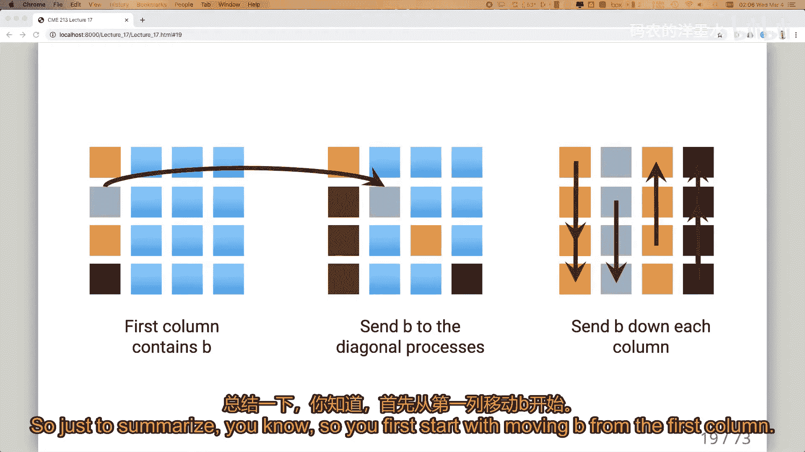

From the first con。

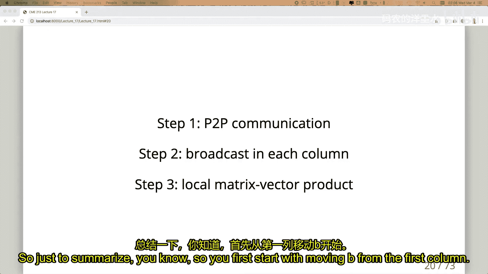

To the other columns， so again， it's just fractions chunk of B。

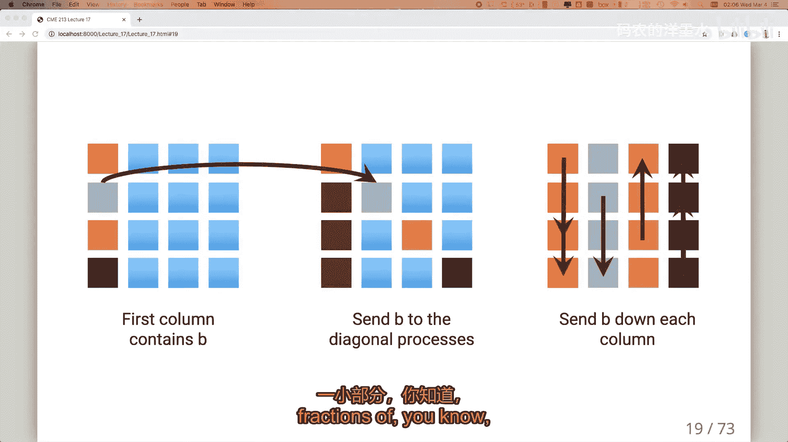

Okay， then you have sorry， then you have a broadcast in each column Okay so this is the last step to do broadcast once you have broadcast。

 then you're good okay each。

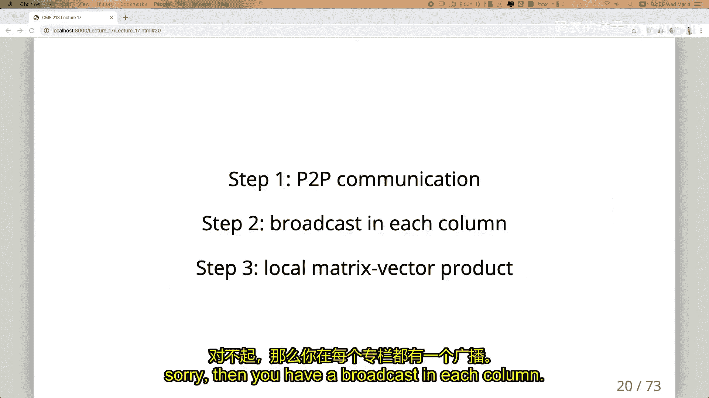

Process， okay each one of those。Now has the buff of B needs and it has a corresponding B。

 so you can just do the matrix vector product。You know with the data you have so though more communication required。

 So this is what I called the local。

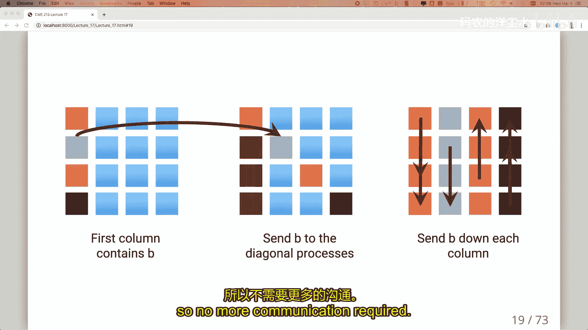

Matrix vectorpart local meaning that there is no exchange of data for MPI calls just to trade A times x。

You know， product。Now， when you're deal with that product。

 then what happens is everybody has just a partial result for x， and you need to， there's a sum here。

 so again this is going to be simply a reduction， but the reduction again is very efficient because you only do a reduction across the small piece of the vector。

And the reduction happens across only four processes here instead of like everybody。Okay。

 so if you have 16 processes， sort of only 25% are involved in each reduction。

 so this can be done much more。Efficient。Okay。So。So if you look at the algorithm。

 maybe you can feel that this is going to be more efficient first of all。

 we have this 2D blood partitioning， so for example here I could use 16 processes。

If you were just doing grow partitioning it will be only four processes so already I can use a lot more processes okay and I should expect know to go faster as a result。

 but then if you look at the pattern of communication you'll see that in fact each process is even sending a lot less data around okay so you have this point two point initially and then theres some broadcast but it happens inside each column and there's a reduced。

Happening in each road， but again， the reduce is basically just doing a reduction across a small chunk of data。

 so it can be much more de efficient。So we feel that this should go faster。

 but let's see how we can quantify this。Location is is step four reduction across columns。Okay。

So this is sort of a summary of what I said。 So， you know， we don't have any sort of。

Communication that involves sort of all processes exchanging the entire vector B， for example。

 only small chunks of B are being sent around。 Okay， and only subset of processes sort of need to。

 to communicate in this in this approach。 So it should be more efficient。Okay， and then， like I said。

 you know， for example， if you have this partitioning into 16 blocks，4 by four。

 then2 give blocks you can。Use up to 16 processes whereas the group partitioning or column partitioning it's only four processes。

 so it seems that we can use more processes in this 2D partitioning so the question is well can we do the math？

And sort of demonstrate or quantify the improvement。And so when do the math。

 there's one thing which is running a benchmark。Which in some sense due to the real running time。

 but running the benchmark is tricky because it depends on the specifics of the hardware。

If you run the same benchmarks， you get different results and so on。

 and it doesn't give you a lot of insight really in these algorithms。So the better approach。

Is actually to derive a theoretical model of the runtime with a simple model。

 but you know as long as there's enough in it to do the analysis then this will work out。

 so we're going to come up with the model of the running time of each algorithm and then based on this and this concept of ISO efficiency which you need to work on for Home5。

 we're going to be able to compare these algorithms and determine which one is the most efficient。

Okay， so a this is very very important concept though。If you write the paper on power computing。

 you definitely want to discuss your algorithm them in these terms。 and it's always。Done， I mean。

 good day first is done。Not does that， but these are extremely useful tools to kind of understand the efficiency and performance of algorithms。

So there's a number of things that。And'm going to have to kind of define。

 to kind of understand know how to think about the efficiency or performance of an API code。

So first on notation， so Tp of n， the basic notation， this is a running time。

 P is a number of processes and n is some size parameter， so here it' is going to be the matrix size。

 so Tp of n is a running time of my parallel code。So joy speaking， so if you want to allies。

The running time the code， in principle， there's going to be sometime when the processors are doing computation。

 okay， that's pretty obvious。They sometimes dedicated to communication。

And then sort of related to that， there is some idle time。

 okay when you essentially maybe have nothing to do。Okay， you're waiting for some data to arrive。

 but for example。The data is not ready， so it's not even being communicated we just waiting for the data to be computed somewhere。

So you know there is some time that needs to go you know where you idle and you need their computing。

 you're not。Doing any communication， you just you because of some dependency。

 you're just waiting for some other process。To finish some computation so that some data that you need becomes available and hopefully can be sent to you across the network。

So idle time is difficult to model， so here we're just going to focus on computation and communication and we're just going to just have a very straightforward analysis where we're just going to look at how long it take to the computation and then look at then the communication time and just add those together。

Join speaking there。Optimizations you can do to make it better。

 but here we're just going to take this simple kind of approach。So now very potent is the speed up。

But even more important will be efficiency， efficiency is actually the real concept we're after and it's built on this concept of speedup so speedup is a fairly you know。

obvious concept， is' simply the result of what's the running time in sequential divided by the running time in power。

It makes sense， so for example， maybe ins sequentialequential， this is one second。In parallel。

 it's half a second。Okay it's one divided by one2。Just speed up is two in these case。

 so it's the sequential runtime it's a head number divided by the parallel runtime。

 that's a slow number。Theto speed up is always a number greater than one and hopefully。

And you want the speed up to be as large as possible。 The speed up very。

 very large means that the pair runtime is very， very small。 Okay， that's what you want。

 So you want a very large speed up。 So fortunately。

 the math matches the English you know meaning of the words。Right。So now， but moreover。You have the学。

And so this is the key， but here the idea is okay， while you're going to run your benchmarks。

 you're going to find some speed up， you vary P， you very N。

 you get different speed ups Now the question is，Well， what is good and what is bad， okay？

So the idea is as far let's say that this is one second， let's say you assigned two processes。Okay。

 Ily， it's half a second。So this data。Let's say you assigned four processes。

If you assign four processes， ideally this would be a quarter。Of a second。Okay， quarter of a second。

So， just to。So we don't get mixed stuck in there。In the numbers here， so we have four processes。

And the running time is a quarter， okay this is ideal， I'm running four times faster。

 so the speed up is four。So you can convince yourself that essentially in the ideal case。

 the speed up should just be linear or equal to the number of processes。

 so just linear the number of processes。So this is ideal。

 meaning that when the nerve process is not too big， this is going to be roughly true。

 but as P increases， this becomes less so at some point S may just become constant。

meaning that there is essentially no acceleration， although you keep adding more and more processes to calculation。

 the runtime is constant， so speed up is constant and this is of course something to be avoided。Okay。

 so here I'm just going to go briefly over that。 it's not super important。

 but it's just sort of a kind of a high level thing to keep in mind。

Actually this is more sort of a practical lesson rather than mathematical equation。

But there is a simple concept。The concept itself is kind of wrong。

 but it has some useful insight into it， which I want to get at。 So in handout's law。

What you say is you so again， you're looking at the speed up。Okay。

 you want this speed up to grow like pe。But you write it as the sequential time。

And then we divide by the parallel time okay so how do you estimate the parallel run time。

 so in the simple formula you're going to say， okay， there is a fraction F of the program。That is ce。

It cannot be paralyzed。Okay， so then the running time is just the sequential running time， so t1。

 and it's only fraction F。SoNow y minus 51 this is a remaining fraction for the rest of the program。

 here you assume it's perfectly paralyizable okay so again。

 it's pretty simplified but let's in it and this is perfect， so the right down is divided by P。Okay。

The fraction is ce。Fraction that is perfectly parallel， okay， so rank time is divided by P。Okay。

 so now you're using some simple math。But don't， for some reason computer science。

 even a simple math operation， a great deal of credit is given to it。So I'm going to divide by T1。

And I get this equation。And now you can ask yourself， well， if I increase P， what happens。

 like I said， you know， as you increase P， you want to speed up to behave like P。

 okay to go linearly like P。 So if F is very， very small， can be neglected。你须系定啲嘅。

This is almost one over P， so the whole thing is very close to P， this is good。But as B increases。

This eventually。It needss to go to  zero， it becomes small， and it doesn't matter how small f is。

 ultimately F dominates。So here you can do a simple check。Well， basically these is being positive。

The impose is quantity， then there's an upper bound one over。So this is thing that。

The speed up has increased speed。First is going to go up like P linearly。

 but that is going to plateau at this constant。Okay， so you have that。

 you have this curve here that kind of illustrates various types of speedup depending on the fraction of the code thats parallel。

 so hear you know very sequential code， more parallel here this is a very parallel code so initially you have very nice speedup。

 but then it sort of tapers off。You know towards the。Cs a number of processes。啊。So here okay。Well。

 so a couple of， you know。Let's discuss this results。Actually。

 this is kind of interesting because when I did my first internship。50 years ago。

Youve ever take a decade。The guy tell told me。Tal computing is absurd because it ends all。

Because you kind of feel that， actually in the face of it， this is really bad。Because， you know。

 if I， if I look at this， this lock here， if I say， oh。If 1% of the code is serial。

 at 1 percent that's very small。Then when P hits 100。That's not that large。Then actually you're done。

 no more speed up。So the error in the reason though is at the fraction that is sequential。

Typically goes down or hopefully goes down， but in many cases it does go down with n。😡。

So they actually constant。As you work on larger and no phones。

 this number here goes down so that in fact， you can see nice speed up even for a very large number of processes。

不。But the more important take home message， so this is the first bit。

The more important message is that and that is definitely be true。

And this is something that we've actually seen already when doing COUDA programming。

 which is you're got to take your code and there's this part of the code that takes a lot of time。

So just to take a practical example of you know。What some my students in my group are doing。

I you run a fast linear year silver for x equal B。And you write the silvering pal because that's。

 of course， where the meat and the action is。But there is often a lot of stuff you need to do like the preprocessing。

 which is basically building in the matrix， kind of distributing the matrix to all the processes and so on。

 and doing various operations of this type， which in principle don't take too many flos。

But the problem is if you want to still the Greenage。

Problems and really use a lot of processes then this little bit of preprocessing you do at the beginning then becomes a vomit that typically you run out memory or you could even take a lot of processing time okay so what's happening is when you go and paraze your code first you look at the parts that take the most time and then you para these parts but then those go very very fast and asP increases you know the time that these parts take really go down massively and then other parts of the code that seem to be you not very important。

 it's down to dominate the running time and now you have to tackle those。

And so what this is saying is when P is not too big， then paralyzing your code is not too hard。

 you just go at these big routines and you paraly them， but as you keep increasing P。

 it becomes harder and harder because essentially more and more pieces of the code need to be paralyzed until essentially every。

littlettle piece of processing， it's happening your code is brown。

And then you can really scale to very large problems。

And so the takecode message is therefore you know this is the QutDa optimization loop is profile the code。

 see what takes time， paraze this， then increase。But then you have to constantly rerun your profiler to figure what is the new boneage and it's going to pop up from unexpected places and now you para that it goes faster and just going there。

So this is very similar to what we had with Kuda。Okay。

 so let's go back to this analysis and's then apply to our matrix vector product and homework5。

 I'm going to apply this to the matrix matrix bar。So first of all， I hit speed up。

Feverly talks about speed up。Well， I'll tell you why everybody talks about speedup。

Because speed up goes up。😡，So you know it's good， even if it goes up slowly， you can say oh， see。

 it's going up。But the real thing is。What you're really after is ideally。

 the speed up goes up like P。So what you really want to know is is it going up by P or slower than B？

Okay， that is a real question after， for example， if it goes up like a scro of P。

 that's no good or lock P in terms。Okay so hence the better thing to look at is the speedup divided by P because now that's just a fixed number。

 could be actually you can think of it as one being the best。

 but in practice you just want it to be constant。Okay。

 and so it's t10 running time divided by p times prior running time actually this number is very seldom published mostly because it looks doesn't look as good as P as S。

Because if P that always go up， whereas if you divide by P。

 now it will definitely go down and the best you can do is just making it constant。

Okay but this is a real one to look at and so for example。

 you can see that if the speedup is constant， so basically you're adding more processes。

 but the running time stays the same。Actually， that guy。

Will go down and that's correct because it's telling you that there is a problem that actually your code is not good scaling。

 you adding more processes and it's not going any faster because it does definitely wrong。

So the efficiency will go down and in fact this is what you want to see。Okay， so ideally。

 efficiency remain constant as P increases。So now what is sort of the mental picture you should have about the efficiency？

Okay， so it's basically true， just very generic。You know conceptcepts are things to have in mind。

Which is that as you increase the number of processes， pretty much the efficiency can only go down。

 at best， it's flat。But it's going to go down and essentially what you want to know is you know。

 let's say you want your efficiency to be above 0。4 or 0。2。

 then you want to know about how many processes can I assign to my calculation before it reach。

It reaches that efficiency。So it has to go down and hopefully it goes down slowly。

 but that's the first mental picture。Second mental picture is that if you solve a larger problem。

Of course it's not always true， but most algorithm， if you have more work to do。

 the efficiency will go up。Okay， we've seen this in Ka and so on。

 so if you're processinging a larger matrix。Then typically。

 the efficiency will go up as you increase。The size of the matrix or the amount of work that needs to be done okay so typically as you increase the amount of work。

 then each process has a lot more work to do and if your algorithm again is written correctly。

You have relatively speaking less communication relative to the computation。

 and so the efficiency tends to be。So these are two mental pictures you want to have。Okay。

 so let's apply this to matrix vector multiplication。So there's a little tip bit about。

You're modeling correct computationut， for this I'm going to skip because it has to do with hypercutbe networks and the budget of the network and so on。

It's not super violent for us anyways。So what I'm going to just show you is give you a table that you can simply refer to that gives you the rank type。

 actually the homework we're giving you the formula to use， but just sort of a reference table。

 this is energy telling you for all collective communication。

The time it takes to perform the communication。So actually， let's look at the bottom one。

 which is circular shift means essentially you're sending a piece of data that to your right and visiting a piece of data from the left so it's basically just a point to point。

 actually。And it's written this fashion。Okay and this is how you model communication。

 so there's a time for latency and a time for bandwidth。

 so the time for latency this goes back to you know this idea of pipeline。呃。

If you send just one by the data， it's going to take a certain amount of time to send it across the network no matter what。

So this is the latency， okay， but now if you send a lot of data， if you send a gigabyte。

Then dec laency becomes negligible， and now the running time simply becomes linear。😡。

In the amount of data you're sending。That can sense。

And so now it grows linearly with the amount of data you're sending。

 so L is the amount of bytes you're sending， and TW is the inverse of the bandwidth。Okay。

 or it's the。Number of second per， it's a bitete。That that。

The bandwidthand gives you in your network。How many seconds it takes to。Send one bike。

 assuming you're sending a lot of them， sending a gigabyte worth of data， so it's a bandwidth。

So TW is the inverse of the building。And then you can look。

 so I'm not going to move the entire table， but for example， the broadcast， which is one to all。

 so you have different implementations of the broadcast。But roughly speaking， you can recognize。

That you're using a tree structure。Okay， and so you're going to have lofty passes。

That need to sort of happen one after the other， so you block P passes。

 times the time to send a piece of data that goes like this。Similarly， you have for example。

 scatter is rest you recognize tree structure with the latancy。But the。

Here because it's a scatter gather， it's the amount of data that's when nerve processes is what you have in terms to bandwidth so anyway you have this table that you can use to brain types so whenever you have lump key terms it actually means that you have a very fast algorithm。

Through based on the tree structure。To do your communication。Now， this assumes a hypercu。

Hypercue has to do with the topologyology the network。As it tells you。

 essentially something about how long it takes to exchange data between any two nodes of your network。

So you want to of course， use the fast wires instead of。

Com speaking between node that are very far in the network。

You want to communicate with nodes that are very close and are directly led by wire。

 and so these elements make use of this hypercube structure when scheduling their data exchange。

So anyway， first， these are maybe technical details， we just want to use the formula。

 so in the homework is given to you。啊So this is说 the。Notutations in Fibble。

 and it such the message invitetes， piece number processes， T a latency。

 so the time it takes to send just a tiny piece of data， and TW。

 basically this is the time it takes if you send a large amount of data to the shippro code the bandwidth。

So let's apply to matrix matrix product， matrix vector product， again。

 you have to do something very similar in homework 5。

So here I'm just going to give you a bunch of formulas， I mean， the details won't really matter。

But try to get to high level ideas so hopefully you can apply the same ideas in Home  five。

So first we start with the show time。Okay， so when you do matrix matrix for homework5s and cube。

For matrix vector， it's n squared， so this is a reference serial running time。Okay。

 and then you have to estimate the time it takes to do the computation and the communication。

so here's row partitioning， so this is time for computation。

 so you have it was partition across rows， so it's basically the total number of flops divided by P。

 so alphaine squared divided by P and here you recognize for example we had the scatter or maybe the reduction so depending on so the row partitioning was actually a scatter。

So with a tree and on， so there's a about picture。So now let's just plug in this formula and let's see。

 well what do we get for the efficiency？So efficiency is T1 divided by B。Kal runningington。

So it the power is the previous formula， multi by P。Okay， you get T1。

 so you get this ugly looking formula。So when you look at this。Main question we're going to be after。

刚才。Of isO efficiency。Okay， so what isO efficiencyency means is。That。Again。

 if you look at this formula and for example， you increase P。

 you see that the efficiency goes to zero。Okay， so this is what we said。

 if you assign more processes to recapation， the efficiency has to go to zero。

 so this is what we see here to increase P， the whole thing just goes to zero。And vice versa。

 if you increase n， the matrix size。Okay， if you increase n， then this is the opposite。

 the efficiency goes up。asytotically， the efficiency goes to 1。

 to increase n this goes to zero goes to  zero goes to1， so the whole thing goes to1。

How did we come up with the expression for T&P？This guy here？诶 yeah我 the worry about。

Oh so is this was just a previous slide。So just P times Tp。

 So where we estimated the right time for the。Computation。

And the right time from the communication based on the table that I give。Right， yeah。

 so this term is basically， you know， so you have to look。

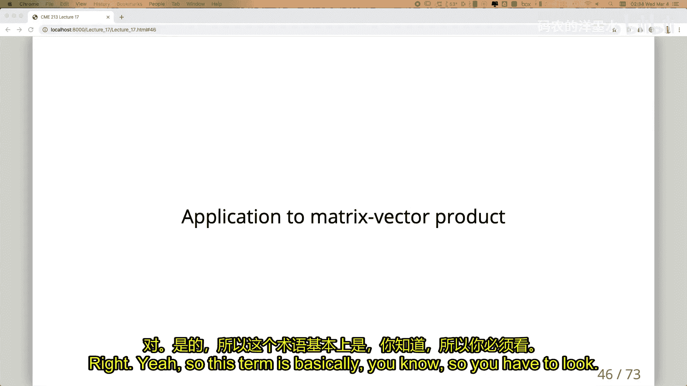

Exactly which point was。But I think it was probably a。A scattered， but not mistaken。

 so it should be not free。Plusice MP。

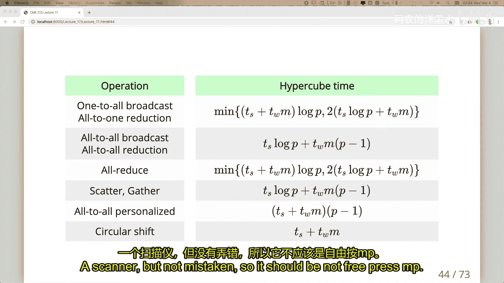

So let's see if this works out。We definitely have log P。And then second term is MP。

 so that should work out because you everybody has basically n over P times p。Okay。

 so basically this was just reading from the table。And applying the result of the table。

 and then this is just the computation。So there is one more're time giving you this formula so no。

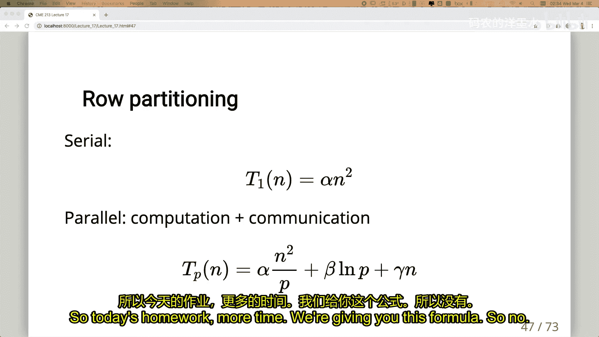

No worries there。Okay， so going back to that again， as you increase the number of processes。

 the efficiency goes to zero。If you increase the prompt size N。And the efficiency goes to work。

So fine， this is a usual trend in these algorithms， you know， again a sense。

 so what do we do with that？Okay， so hence enters the idea of I do efficiency。

So isure efficiencyency means， oh， let's say the efficiency is what half。to be what have。Then again。

 if you increase。If you increase the say the efficiency， you can think of it this way。Okay。

 this is the target efficiency want to have。If I increased P。Okay。

 then the efficiency will go down some points。Initially it will be larger than what half after it will be the worldwide。

And then vice versa， if you increase n。Then the efficiency goes up so maybe you sound with a very low efficiency increase n。

Okay。Get above what happens。And so this book here is special， okay？

The efficiency is exactly at one half。And so the question is。That。There is a function。Right。

Such that if P is equal to F of an entro， the function is going to be something I need to figure out。

But there's a relation between P and N， such net。😡，The efficiency。

Stays exactly at one half or joy speaking。Just the constant。And the exact constant doesn't matter。

What we after is what is this relation between P and N such that the efficiency is constant？And。

Basically， what this tells you is。As you increase the size of the prom。

How should you increase the number of processes such that efficiency is constant？

So you should increase P faster。The efficiency will go down if you increase be slower。你非这么过。

And if you increase P exactly with this relation， then the efficiency would be exactly constant。

So mathematically， of course， this is sort of a。Mathematicically， the trivial result。

 you just say this function equal constant。And then implicitly， this gives you P as a function of n。

So it actually gives you a curve。Another way to interpret this。Is if you look at this in the。

PN plane。其送呢啲啊。So maybe this is n。This is P， so if you're along this curve。

 then the efficiency may be you say what half。Okay， each your above。

Then the efficiency would be below lower what half。And if youre be。

 then the efficiency would be grinner。Then on the curve， efficiency is exactly what happens。

And in fact， you want people to be。A good program will allow you。To take P very， very large。

 you assign a lot of processes to your calculation while being very efficient。Okay， bad program。

To be efficient。We can only assign very， very few。Processses。没有。

So it's kind of I take some time to wrap your head around this， but it's actually a very。

 very powerful concept， so the question is as efficiency。

 how quickly can we increase P such that the efficiency is constant？Okay。

 and I want to go over a couple of calculations， so I'll give you an exercise at the end because I want you to do it and more exercise。

So you can do the same thing for Home five， it's actually it's a very simple process。

 but the first time you do it， it's very counterintuitive。But once you get the hang of it。

 it starts to make more sense。So here is the efficiency we have of the group partitioning。

And when I say I want to be is efficientffic， I want E to be constant。So what does it mean well。

 for E to be constants？You want this expression here。😡，To be constant。对。So if P。

 let's say p is proportional to n。That's， that's see a piece proportion to end。 that's the answer。

The proposal to end then definitely this term is constant。

 not going to zero and not going to continue continue。So now this one is 1。Log n divided by n square。

 So basically it's log n。Divide by n， actually this term goes to zero。But that's fine。

 so it's one plus zero plus constant， okay， the whole thing is constant。So if P is proportional to n。

 the efficiency is constant。 So that is a rule。 You cannot decrease P faster than n in that skin。

 if you increase P faster， the efficiency go down， if you increase P slower， the efficiency goes up。

 They tell you how quickly it can increase P。Okay。Everybody thought that。

So you're going to do the same thing for the 2D block scheme but I'm going to ask you to give you a couple of minutes。

To get to do that。So there is more slides， but the second part is I'll do that on Friday。

Start discussing communicators and groups for。4 more5。Okay， so let's look at2 B box scheme。

 So here again， I'm going to keep the sort of theoretical analysis because that result is given for you in homework 5。

 So I'm just going to go very briefly。 So this is the amount of。Computation。

 well it's always n squared by by P that's just you know。

That's always the same formula then sending B to the diyad all okay so it was the same as before。

 but now you have square of P because it's a 2D block structure okay and this is the piece of B that you have this is just a。

The  point。2 point communication， then there's a broadcast。

Well it's the same thing but now there's a log， you're going to do treatment。

 this is a broadcast in the column， so this is log against square of P and the amount of data you're sending is square of P because this is just one column and then the reduction inside one rower across columns。

Ottris is just the same expression。So the logic is because of quality communication and the square of P is because of the 2D blocking。

 so you're winning because of essentially this square of P that you have in this 2D algorithm。

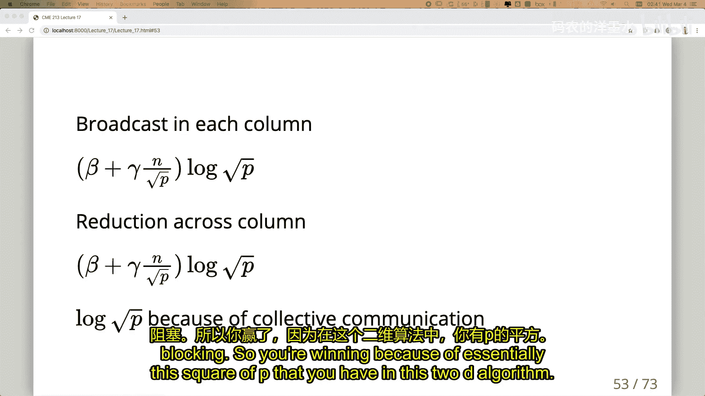

Okay。So first I'm going to give you the result。Then a little bit of interpretation but then I'll come back to this results because this is a bit in Home5 it's a little bit more difficult to figure out and I want to go through duration or I'll let you work a little bit through that so you understand the deposits so here is the efficiency so again this is T1 developed by PTP so you go back you know so here I'm skipping it but essentially you add all these terms。

Okay， this gives you TP and then PTP divided by T1 is just。This crazy formula。

And then we're going to come back to that later on， but just to sort of continue this discussion。

 what you find is that if p is equal to n squared log square n，Then you have isO efficiencyency。

 so if P satisfiedifies this rule， then we can check that this term here is constant。

And this term here goes to zero。所以经啊。S only me when this is the case。N square simplifies。Okay。

 divide by log n， everything squared， this is basically log n， so we get1 over log n goes to zero。

 so this whole thing goes to zero。And now you can also evaluate this one' constant to constant zero1 efficiency constant。

So now the question is， okay， if you compare the rope partitioning。P increase like n。

 And here P increase like n square divided variable by squared。 So basically， in the second case。

 this is the plot。In the second case， the 3D blocking。Is as a much higher isefficency curve。

 like the P is higher。Okay， so here， for example， this is。

You this is basically the n or the work size。and then this is the isO efficiencies which is speed。

This P is a function of n or the is efficiencyficiency plot。curve versus the work size。

 And so for room partitioning， it's n， this guy for 2D buildinging， it's n square divided。

By log n square and the green is just n square。2D partitioning is higher。Then grow partitioning。

 this means that you can assign a lot more processes。

For the 3D partitioning while maintaining efficiency。Which translates into simply。

 the code runs faster。Because you have a high efficiency but you have more processes。

 I means the code strictly runs faster okay so the higher the isO efficiencyency curve。

 the faster the algorithm is going and so you can see how now we start with all these complicated formulas but just simply by doing these plots。

 then we can figure out well which algorithm。Has the highest curve is on top and that is the winning algorithm okay so the higher ice efficiency you can have。

 the better the algorithm will be， so here we're winning with the orange method， the 2D blocking。

Okay，So higher efficiency plot is better， so you can maintain the same efficiency。

 but with a larger number of processors means you know the running time is strictly lower。

 but this is a nice way to visualize this。

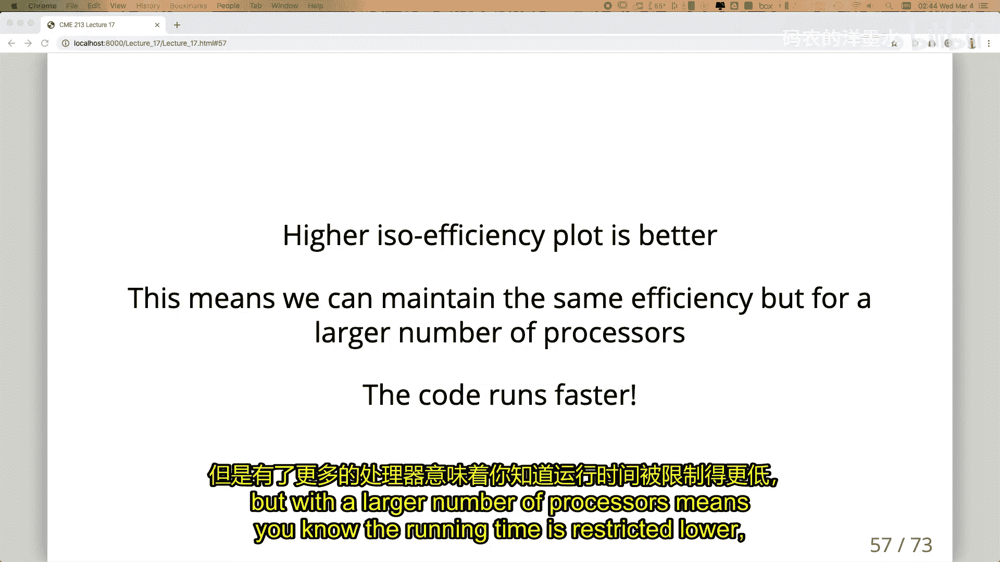

So let's here I'm going to let you sort of work on this now as a little exercise。

 so if you can take out some pet on paper。I want you to start on this formula and then try to figure out。

The isO efficiencyency de that I gave you sort of reallyized that。So hopefully in this day and age。

 you still have paper。If not， you can elbow go your neighbor and grab a sheet。李国珍。你开入照。

So if you have a staash， you can set it around。I mean the depends first。Maybe是。Okay， so all right。

 so everybody gets the pen。Your paper。Okay and。You want E to be constant。 So this is the same as。

This。Being constant。So now the question is， well， we know I have told you that once your' efficiency。

 this term is constant， and this term goes to zero。But how do you know that？Okay。

 so the way to go about this is to basically essentially when you do identify efficiency。

 that have sum bunch terms， one of them。Essentially， it's going to be constant。

The other ones are going to go to zero。If you pick the wrong one。😡。

And the one you think will be constant， but the others will go to infinity。Okay。

 meaning the efficiency goes to zero， so that doesn't work。

So the way to make it work is you going say， assume this is a constant term。

 you make this equal constant。So basically， P is n squared。如系你 by log嘅。Now， assuming this relation。

 you plug in here and you will see that this goes swing thin wrong。Okay second assumption， take this。

Send it to constant now P is going to be n squared divided by log n squared。But I can hear， oh。

 now this goes to zero。Correct。Okay， so that's how you do it， take each term， assume it's constant。

 check the other one， if the other one goes infininity wrong， if the other one boost is zero。

 correct， and you could you know if you had like five terms。

 you would just do the same thing five times。So I'll let you work on this。嗯。

Yeah and then maybe the solution。Does she have？Wriing up some stuff he up from the board。

It can how too long。I want you to do it。No we kick the board。Or because its just a little piece。

What you talk about。Okay， so we couple minutesで。To work through that。Then I'll give you a solution。

And then well just wrap up the class。So you should be able to work out it is the first term。Okay。

 so we're almost at 50 so I want to kind of wrap this up。

 so you've probably got this expression to correspond to taking this term here。

And saying it's constant。 Now， the thing is you want P as a function of n。 And here you have log P。

 So you may wonder。I'm stuck， how do I solve this。Okay， well。

 the idea is you really just want something of this form， you a big theta or essentially a big O。

So the constants don't really matter， right you want to use the leading terms。Okay。

 it turns out that all these relations， you can prove it， but log P simply behaves like log N。

So the simplification is therefore trivial。You can just write log in。

Essential the next term is something like， log N。But that's negligible compared to log n so you can just avoid it。

 Okay so the first order。Lo people to be as lot。But this is one bit here that's kind of important to get something that only has n in it。

 and you don't have to solve P out P equal。And which is crazy。I tried。Well， I mean。

 of course I had a solution and it could be computed， but。😊，When you want the anti expression。

So here it's extra， actually， if you do an expansion， you get log log P and。Inial terms。All right。

 the first order， this is just login。Okay， so just wrap it up here。

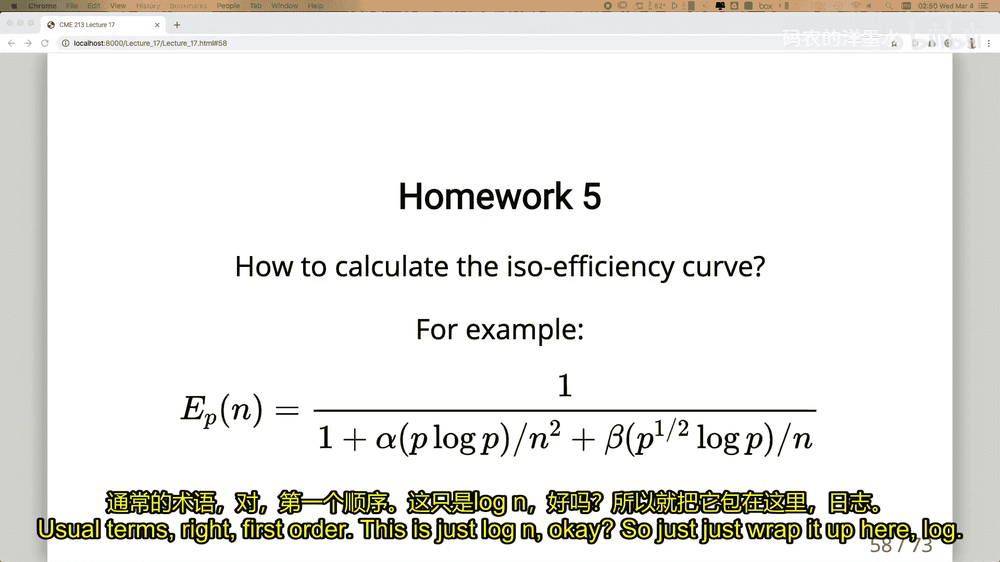

好。Well， in principle， yeah， it's loggged technically you could write it as log n square。

But then the two goes out， it's2 log n， so terms to the constants。You just say long it。But呃。

I think P should equal。Many times an underscore invited by the log。Well， that's no。

 so the piece square。This is what you get in the second。It's the second term。Right。

So if you assume that this one is constant。Okay， then you get n squared divided by log n。

And then you can see the second term， so he'll skip the second term you can check goes to infinity。

Okay， if you make this assumption， then you get log n square。Right， so okay now you get square。

 the second constant and now first one goes to zero。Okay， so that is the correct one。

 so hence the correct answer is the second mind here。Okay。

 this is the one that makes sure that this term is constant。This one goes to zero。

 if you try the first option， this ones constant， this one goes to infini。

 so efficiency goes to zero so。That doesn't work out。Okay， so all right。Okay。Another way so sorry。

 just another thing。 So this is another interpretation ahead in the slides。

 which is once you get these two relations， you can also check which one is the lowest one like the most restrictive and that is the correct one This is another interpretation by looking at the most restrictive answer so which is dividing by log square n is the most restrictive and so this is the correct。

Correct answer。Okay， so I think this is it。So all right， so end of the class so you can。

She want to stick around？OrI can answer further questions about this analysis。

But that was all for today's lecture。

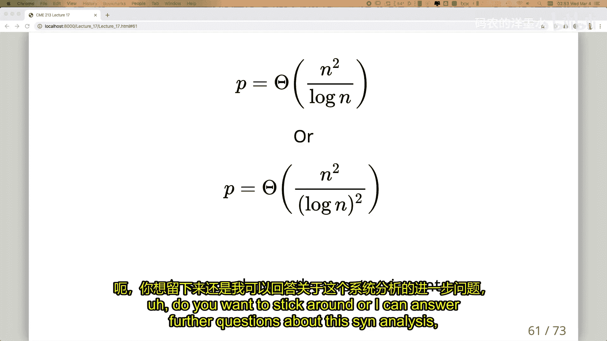