# 【全集】旧金山大学-面向程序员的机器学习-中英字幕-1080P-p01-Lecture-1---随机森林--BV1YAvYBAEG3_p1-

对。嗯。Okay so let me introduce everybody to everybody else， first of all。

 so we're here at the University of San Francisco learning machine learning or you might be at home watching this on video。

 so hey everybody wave here is the university of San Francisco graduate students thank you everybody and wave back from the future and from home to all the students here if you're watching this on YouTube please stop and instead go to course。

fat。AI and watch it from there instead there's nothing wrong with YouTube but I can't edit these videos after I've created them so I need to be able to like give you updated information about like what environments to use how the technology changes and so you need to go here right so you can also watch the lessons from here。

Here's lots of lessons and so forth right so that's tip number one for the video tip number two for the video is because I can't edit them all I can do is add these things called cards and cards a little things that appear in the top corner the top right hand corner of the screen so by the time this video comes out I'm going to put a little card there right now for you to click on and try that out unfortunately they're not easy to notice so keep an eye out for that because that's going to be important updates to the video all right so welcome we're going to be learning about。

Machine learning today。And so for everybody in the class here。

 you all have Amazon Web services set up so you might want to go ahead and launch your AWS instance now or go ahead and launch your Jupyter notebook on your own computer。

If you don't have Jupiter notebook set up， then what I recommend is you go to cresle。com www。cresle。

com， sign in there， sign up。And。You can then turn off enable GPU and click start Jupiter and you'll have a Jupyter notebook instantly。

 that costs you some money。 It's 3 cents an hour。 Okay。

 so if you don't mind spending 3 cents an hour to learn machine learning， here's a good way。

 So I'm going to go ahead and say start Jupiter。And so whatever technique you use， there you go。

 one of the things that you'll find on the website is links to lots of information about the costs and benefits and approaches to setting up lots of different environments for Jupiter Notebook。

 both for deep learning and for regular machine learning。

 so check them because there's lots of options。啊。So if I then go open Jupiter in a new tab。

 here I am in Crresle or on AWS or your own computer。

 we use the Anaconda Python distribution for basically everything。

 you can install that yourself and again there's lots of information on the website about how to set that up。

We're also assuming that either you're using Cressle or there's something else which I really like called paperspace。

com， which is another place you can fire up if you put a notebook pretty much instantly both of these have already have all of the fast AI stuff pre-installed for you so as soon as you open up Cresle or Paspace assuming you chose the Paspace Fast AI template。

 you'll see that there's a fast AI folder okay if you are using your own computer or AWS。

 you'll need to go to our GitHub repo fast AI fast AI and clone it and then you'll need to do a Conda and update to install the libraries and again that's all information we've got on the website and we've got some previous workshop videos to help you through all of those deaths。

So， for this。😊，Class， I'm assuming that you have a Jupyter notebook。Running， okay？嗯。

So here we are in the Jupyter notebook and if I click on Fast AI。

 that's what you get if you get clone or if you're on cressal， you can see our repo here。All of our。

Lessons are inside the courses folder。And the machine learning part one。Is in the ML1 vote。

If you're ever looking at my screen and wondering where are you。

 look up here and you'll see that tells you the path， fast AI forces ML1。Yeah。

And today we're going to be looking at lesson one random forests， so here is lesson one RF。

So there's a couple of different ways you can do this both here in person or on the video。

 you can either attempt to follow along as you watch or you can just watch and then follow along later with the video it's up to you I。

Maybe have a loose recommendation to say to watch now and follow along with the video later。

 just because it's quite hard to multitask and if you're working on something you might miss a key piece of information。

Which you're welcome to ask about， okay， but if you follow along with the video afterwards。

 then you can pause， stop， experiment， and so forth， but anyway you can choose either way。

I'm going to go view tole header， view toggle toolbar， and then full screen it。

So itll get a bit more space。🤧。So the basic approach we're going to be taking here is to get straight into code。

 start buildinging models， not to look at theory， we're going to get to all the theory， okay。

 but at the point where you deeply understand what it's for and at the point that you're able to be an effective practitioner。

嗯。So my hope is that you're going to spend your time focusing on experimenting。

 so if you take these notebooks and try different variations of what I show you。

 try it with your own data sets， the more coding you can do the better。

 the more you'll learn okay don't you know my suggestion。

 at least all of my students have told me the ones who have gone away and spent time studying。

Books of theory， rather than coding， found that they learn less machine learning and that they often tell me they wished they'd spent more time coding。

The stuff that we're showing in this course， a lot of it's never been shown before。

 this is not a summary of other people's research， this is more a summary of 25 years of work that I've been doing in machine learning so a lot of this is going to be shown for the first time and so that's kind of cool because if you want to write a blog post about something that you learn here you might be building something but a lot of people find super useful so there's a great opportunity to practice your technical writing and here's some examples of good technical writing by showing people stuff which you've it's not like hey I just learn this thing I bet you all know it often it'll be I just learn this thing and I'm going to tell you about it and other people haven't seen it。

In fact， this is the first course ever that's been built on top of the fast AI library。

 so even just stuff in the library is going to be new to like everybody。Okay。

 so when we use a Jupyter notebook or anything else in Python。

 we have to import the libraries that we're going to use。

Something that's quite convenient is if you use these two auto reload commands at the top of your notebook。

 you can go in and edit the source code of the modules and your notebook will automatically update with those new modules you won't have to like restart anything so that's super handy then to show your plots inside the notebook you'll want that plot in line so these three lines appear at the top of all of my notebooks。

嘿。You'll notice when I import the libraries that for anybody here who is an experienced Python programmer。

 I am doing something that would be widely considered very inappropriate。

 I'm importing ST okay generally speaking in software engineering we're taught to specifically figure out what we need and import those things。

嗯。The more experienced you are as a Python programmer。

 the more extremely offensive practices you're going to see me use， for example。

 I don't follow what's called Peate， which is the normal style method style of code used in Python So I'm going to mention a couple of the things first is go along with it for a while don't judge me just yet right there's reasons that I do these things and if it really bothers you then feel free to change it right but the basic idea is data science is not software engineering right there's a lot of overlap you know we're using the same languages and in the end these things what may become。

Software engineering projects， but what we're doing right now is we're prototyping models and prototyping models has a very different set of best practices that are taught basically nowhere right they're not really even really written down but the key is to be able to do things very interactively and very iteratively right so for example。

 from library import star means you don't have to figure out ahead of time what you're going to need from that library it's all there okay。

Also， because we're in this wonderful， interactive Jupiter environment， it lets us。😊。

Understand what's in the libraries really well。 So， for example， later on。

I'm using a function called display right， So an obvious question is like， well。

 what is display so you can just type the name of a function。And press shift enter。

 number shift enter is to run a cell。And it will tell you where it's from right so anytime you see a function you're not familiar with。

 you can find out。Where it's from。And then if you want to find out。What it does。

Put a question mark at the top。Okay， and here you have the documentation。

And then particularly helpful for the Fast AI library， So the Fast AI library。

 I try to make as many functions as possible be like no more than about five lines of code It's going to be really easy to read right if you put a second question mark at the start。

It shows you the source code。Of the function。Right so all the documentation plus the source code so you can see like nothing has to be mysterious and we're going to be using the other library we'll use a lot issyit Learn which is kind of implements a lot of machine learning stuff in Python the PsyitL source code is often pretty readable and so very often if I want to really understand something I'll just go question mark question mark and the name of the Psy learn function I'm typing and I'll just go ahead and read the source code。

As I say， the first AI library in particular is designed to have source code that's very easy to read and we're going to be reading it a lot。

Okay。All right， so today we're going to be working on a kle competition called Blue Book for bulldozers。

 So the first thing we need is to get that data。 So if you go kgel bulldozers。Then you can find it。

So。Cical competitions allow you to download a real world data set that somebody a real problem that somebody is trying to solve and solve it according to a specification that that actual person with that actual problem decided would be actually helpful to them。

So these are pretty authentic。Experiences for applied machine learning Now， of course。

 you're missing all the bit that went before， which was why did this company to start decide that predicting the option sale price of bulldoers was important Where did they get the data from How did they clean the data and so forth。

 Okay and that's all important stuff as well。 But the focus of this course is really on what happens next。

 which is like how do you actually build the model。

One of the great things about you working on Calg competitions。

 whether they be running now or whether they be old ones is that you can submit yours to the leader board。

 even old closed competitions you can submit to the leaderboard and find out how would you have gone and there's really no other way in the world of knowing whether you're competent at this kind of data in this kind of model than doing that because otherwise。

If your accuracy is really bad， is it because this is just very hard。

 like it's just not possible then the data is so noisy， you can't do better。

 or is it actually that it's an easy data set and you've made a mistake and like。

When you finish this course and apply this to your own projects。

 this is going to be something you're going to find very hard and there isn't a simple solution to it。

 which is。You're now using something that hasn't been on KaGO， it's your own data set。

Do you have a good enough answer or not Okay， so we'll talk about that more during the course。

And in the end。We just have to know that we have good effective techniques to reliably building baseline models。

 otherwise， yeah there's really no way to know there's no way other than creating a capital competition or getting 100 top data scientists to work at your problem to really know what's possible。

So Kgal competitions are fantastic for for learning。

 and as I've said many times I've learned more from competing in Kgal competitions and everything else I've done in my life。

So to compete in a capital competition， you need the data， this one's an old competition。

 so it's not running now， but we can still access everything。

So we first of all want to understand what the goal is， and I suggest that you read this later。

 but basically we're going to try and predict the sale price of heavy equipment。

And one of the nice things about this competition is that if you're like me。

 you probably don't know very much about heavy industrial equipment auctions right I actually know more than I used to because my toddler loves building equipment so we actually like watch YouTube videos about frontend loaders and forklifts but you know two months ago I was you know a real layman。

So one of the nice things is that。Machine learning should help us understand a data set。

 not just make predictions about it， so by picking an area which we're not familiar with。

 it's a good test of whether we can build an understanding because otherwise what can happen is that your intuition about the data can make it very difficult for you to be open- mindded enough to see what the data really see。

It's easy enough to download the computer。 sorry， to download the data to your computer。

 You just have to click on the data set。 So here is。Train。zip。

And click download and so you can go ahead and do that if you're running on your own computer right now if you're running on AWS。

 it's a little bit harder right because unless you're familiar with text mode browsers like Elinks or links it's quite tricky to get the data set to Cagle So a couple of options one is you could download it to your computer and then SCP it to AWS so SCP works just like SSH。

 but it copies data rather than logging in， I'll show you a trick though that I really like and it relies on using Firefox。

For some reason， Chrome doesn't work correctly with Kagel for this。So if I go on Firefox。

To the website。Eventually。嗯。And what we're going to do is we're going to use something called the jascript console。

 So every web browser comes with a set of tools for web developers to help them see what's going on。

 and you can hit。Okay。So'll do it three here。Developer。Control shift I。 Okay。

 so you can hit control shift I to bring up。This web developer tools and one of the tabs is network。

Okay， and so then if I click on train dot zip。And I click on download。Okay。

 and I'm not even going to download。' just going to say cancel， but you'll see down here。

 it's shown me all of the network connections that were just initiated， right。

 And so here's one which is downloading a zip file from storage do Google APIs dot com。 blah， blah。

 blah。 That's probably what I want。RightThat looks good。

 So what you can do is you can right click on that and say copy。Copy as curl。

 so curl is a UniX command like W get that downloads stuff。So if I go copy as curl。

That's going to create a command that has all of my cookies， headers。

 everything in it necessary to download this authenticated data set。 So if I now go into。

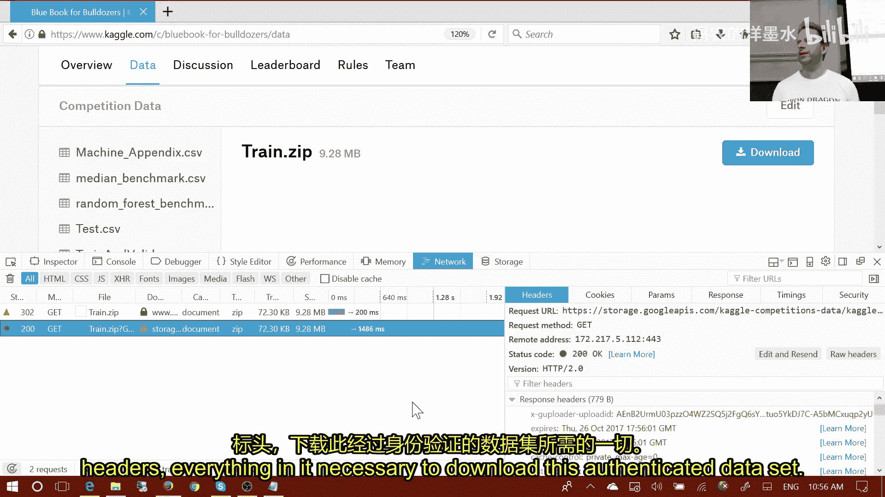

My server， right， And if I paste that。You can see a really， really long cow command。嗯。好。

One thing I notice is that at least recent versions have started adding this minus minus。2。

0 thing to the command。 That doesn't seem to work with all versions of curl。

 So something you might want to do。

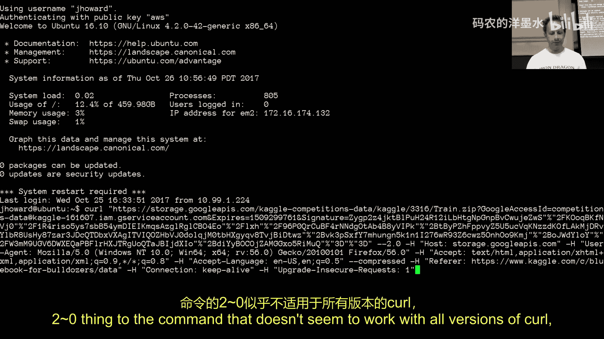

Is to。我 does it。ok。有。Is to pop that into an editor， find that to。

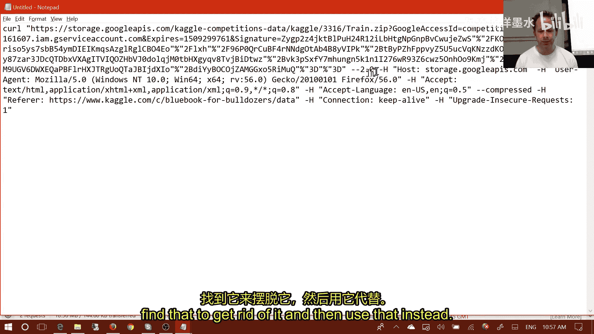

Get rid of it。And then use that instead。Now one thing to be very careful about by default CA downloads the file and displays it in your terminal。

 so if I try to display this it's going to display gigabytes of binary data in my terminal and crash it okay so to say that I want to output it using some different file name I always type minus O for output file name and then the name of the file bulldozers。

Dot and make sure you give it a suitable a suitable extension。 So in this case， the file was。

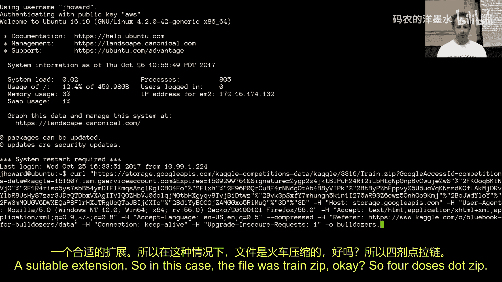

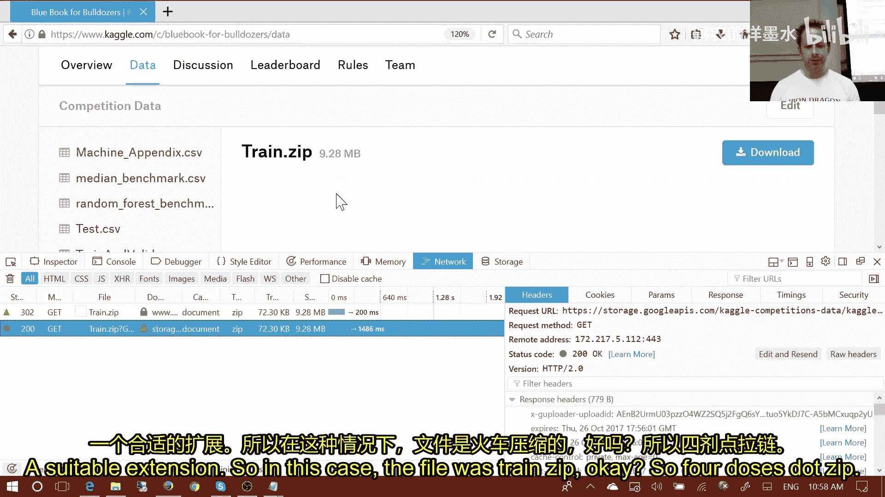

Train dot zip。 Okay， so auto is dot zip。There it is， okay， and so it all is so I could。

🎼Make directory bulldozers。🎼And I could move my zip file into there。Cos throwing way around。我。Yesす。

Okay。Thank you。呃。有了。Yeah。

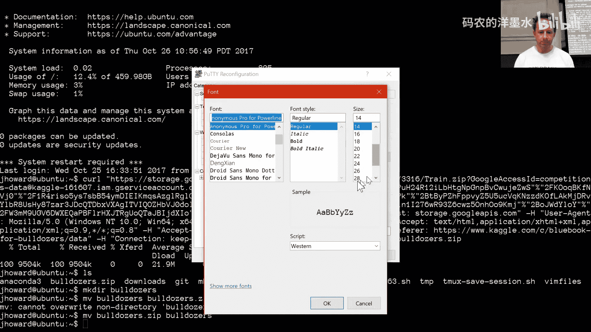

Okay。嗯。Okay。Okay， and then you， if you don't have unzip installed， you may need to。

Soo app install unzip or if you're on a Mac。It would be B install unzip if breww doesn't work。

 you haven't got home B installed， so make sure you install it and then unzip。Okay。

 and so they're the basic steps。One nice thing is that if you're using。Cressle。

 most of the data sets should already be preinsled for you。

 so what I can do here is I can say open a new tab。嗯。Here's a call trick in Jupiter。

 you can actually say new terminal。And you can actually get a web based terminal。

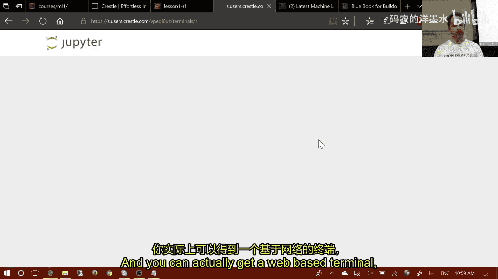

And so you'll find on CresL， there's a slash datas folder。Slash data set， slash kle。

/lash datas slash past AI， often the things you need are going to be in one of those places。嗯。Okay。

 so assuming that we don't have it already downloaded in paper actually paper space should have most of them as well。

 then we would need to go to fast AI， let's go into the courses， machine learning folder。

And what I tend to do is I tend to put all of my data through a course into a folder called data you'll find that if you try and if you're using what we're using Git right you'll find that that doesn't get added to get because it's in the gett ignore so don't worry about creating the data folder it's not going to screw anything up so I generally make a folder called data。

And then I tend to create folders for everything I need there。So in this case。I'll make the photoss。

CD。And remember， the last word of the last command is exclamation mark dollarllla。

I'll go ahead and grab that k command again。Yeah。Yeah。Yeah。Yeah。Yeah。

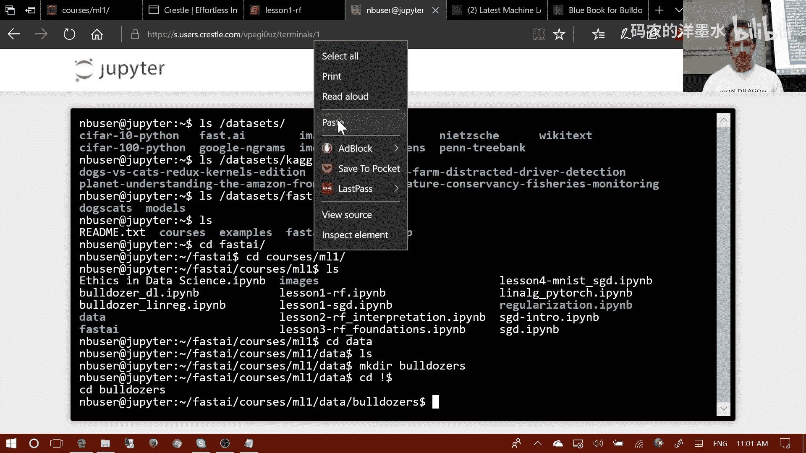

Okay， and zip。What doess。There we go。So。Okay。You can now see I generally have like anything that would change that might change from person to person I kind of put in a constant。

 so here I just define same code path， but if you've used the same path I just did you should just be able to go ahead and run that and。

Let's go ahead and keep moving along， so we've now got all of our libraries imported and we've set the path to the data。

嗯。You can。Run shell commands from within Jupyter notebook by using an exclamation mark。

 so if I want to check what's inside that path， I can go LS。Data slash photoss。Okay。

 and you can see that works， or you can even use Python variables if you use a Python variable inside a Jupiter shell command。

 you have to put it in curlys。O。So that makes me feel good that my path is pointing at the right place。

 if you say LS Curly capital's path and you get nothing at all。

 then you're pointing at the wrong spot Yes， let me this box。

this up here you the curly brackets Yeah， so the curly brackets refer to the fact that I put an exclamation mark at the front。

 which means the rest of this is not。A Python command gets a bashed command。

 and bash doesn't know about capital path because capital path is part of Python。

 So this is a special Jupiter thing which says， expand this Python thing。

 please Before you pass it to the shelf。Question， Thank you。

So the goal here is to use the training set， which contains data through the end of 2011 to predict the sale price of bull doses。

And so。The main thing to start with then is， of course， to look at the data。

Now the data is in CSV format so one easy way to look at the data would be to use shell command head to look at the first two lines。

 head， bulldozers， and even tab completion works here as Jupiter does everything。

so here's the first few five lines okay so there's like a bunch of column headers and then there's a bunch of data so that's pretty hard to look at so what we want to do is take this and read it into a nice tabular format okay so does Ternce put any glasses on me I should make this bigger or is it okay is this big enough font size okay？

So this kind of data where you've got columns representing a wide range of different types of things。

 such as an identifier， a a currency， a date， a size。

I refer to this as structured data Now I say I refer to this as structured data because like there have been many arguments in the machine learning community on Twitter about what is structured data。

 weirdly enough this is like the most important type of distinction is between data that looks like this and data like images where every column is of the same type like that's the most important distinction in machine learning yet we don't have standard accepted terms。

 so I'm going to use the terms structured and unstructured。

 but note that other people you talk to particularly in NLP and NLP people use structured to mean something totally different so。

When I refers structured data， I mean columns of data that can have varying different types of data in them by far the most important tool in Python for working with structured data is pandas。

Paands is so important that it's one of the few libraries that everybody uses the same abbreviation for it。

 which is PDd。 So you'll find that。One of the things I've got here is from Fast AI imports importm star。

The Fast AI imports module has nothing but imports of a bunch of hopefully useful tools。

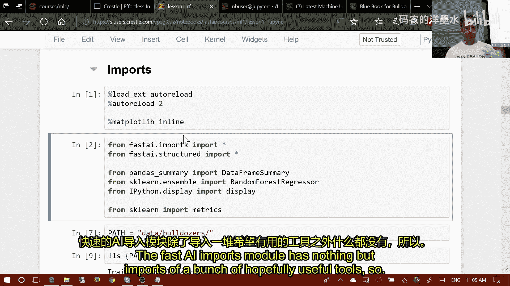

so。All of the code for Fast AI is inside the Fast AI directory inside the Fast AI repo。

 and so you can have a look at imports。And you'll see it's just literally a list of inputs and you'll find there。

Pndas as PD and so everybody does this right so you'll see lots of people using PDd。 something。

 they're always talking about pandas。

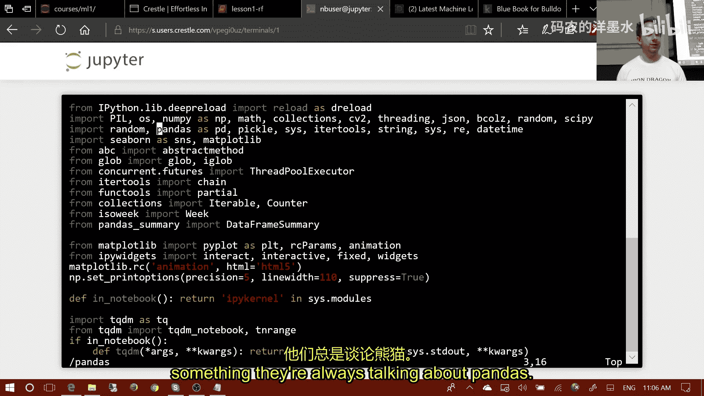

So pandas lets us。Rate a CSV file。And so when we read the CSV file。

We just tell it the path to the CSV file， a list of any columns that contain dates。

 and I always add this low memory equals false that's going to actually make it read more of the file to decide what the types are。

This here is something called a Python 3。6 format string it's one of the coolest parts of Python 3。

6 you've probably used lots of different ways in the past in Python of interpolating variables into your strings Python 3。

6 has a very simple way that you'll probably always want to use from now on and it you' create a normal string。

You type in S at the start， and then if I define a variable。And I can say hello。Carolly's。

Python function。O。This is kind of confusing。 These are not the same curs that we saw earlier on in the L S command。

 right， That L S command is specific to Jupiter and it interpolates Python code into shell code。

 These curs are Python 3。6 format string curs。 They require an F at the start。

 So if I get rid of the F。It doesn't interpolate Okay， so the F tells it to interpolate。

 And the cool thing is inside that。Curlys， you can write any Python code you like just about。

 so for example， name dot upper。Hello Jeremy。Okay， so I use this all the time。

And it doesn't matter because it's a format string， it doesn't matter if the thing was。嗯。

I always forget my age， I think I'm 43。It doesn't matter if it's an integer， right。

 normally if you like to string concatenation with integers， Python complains。

No such problem here Okay， so so this is going to read path/lashtrain。

csv into a thing called a data frame。嗯。Candndas data frames and R's data frames are kind of pretty similar。

 So if you've used R before， then you'll find that this is a bit reasonably comfortable。

 So this file。

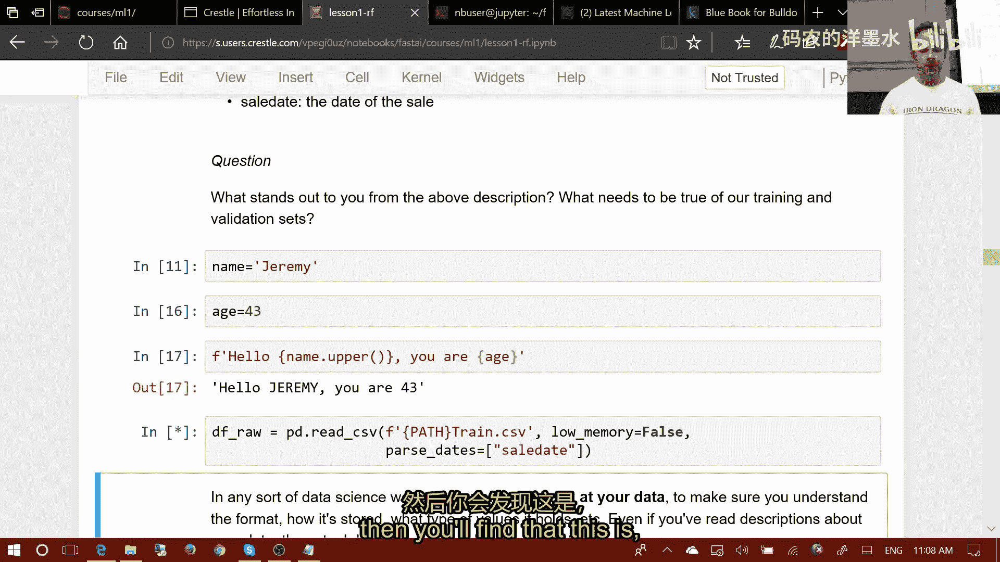

Is。9。3 makeg， and its size is。Sorry，112 Mg，112 Mg， and it has。400，000 rows in it Okay。

 so it takes a moment。

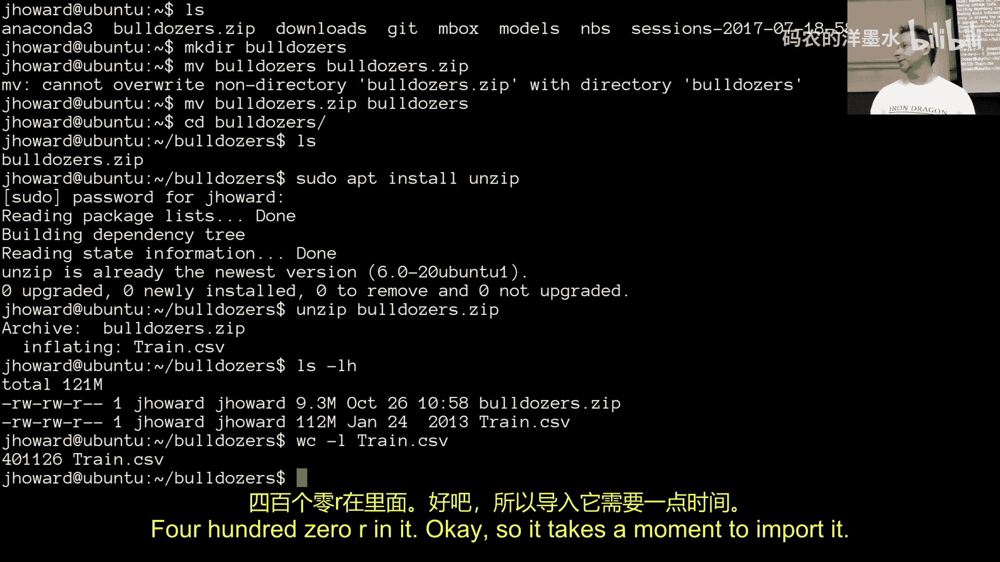

To import it。嗯。But when it's done。嗯。We can。Type the name of the data frame DfR and then use various methods on it so for example DfrR。

 tail will show us the last few rows of the data frame by default it's going to show the columns along the top and the rows down the side but in this case there's a lot of columns so I have to set dot transpose to show it the other way around。

I've created one extra function here， display all normally if you just type DR if it's too big to show conveniently it truncates it and puts that littleipses in the middle。

 so the details don't matter but this is just changing a couple of settings to say even if it's got1 thousand rows and a1 thousand0 columns please still show the whole thing。

Okay so this is finished I can actually show you that so if I just type this is really cool in Jupyter notebook you can type a variable of almost any kind of video。

 HTML an image， whatever and it'll generally figure out a way of displaying it for you okay so in this case it's a pandas data frame it pick it out a way of displaying it for me and so you can see here that by default it actually doesn't show me the whole thing。

So。So here's the data set， we've got a few different rows， this is the last bit， the tail of it。

 last few rows， this is the thing we want to predict。Price。

 and then all of the other we call this the dependent variable。A dependent variable is the price。

 And then we've got a whole bunch of things we could predict it with。

 And when I start with a data set， I tend， yes， Terence， can I give you this。Green box。Hello， Jeremy。

 hi Terrence。嗯。I've read in books that you should never look at the data because of the risk of overfit Why do you start by looking at the data Yeah so I was actually going to mention I actually kind of don't like I want to find out at least enough to know that I've like managed to import it okay but I tend not to really study it at all at this point because I don't want to make too many assumptions about it I would actually say most books say the opposite most books do a whole lot of EA exploratory data analysis first yeah academic books I the academic books I've read say that that's one of the biggest risks of overfitting。

But the practical book say let's do some EA first Yeah。

 so that the truth is kind of somewhere in between and I I generally try to do machine learning driven ADA and that's what we're going to learn today。

Okay。嗯。So the do thing I do care about though is what's the purpose of the project and for CA projects the purpose is very easy。

 we can just look and find out there's always an evaluation section how is it evaluated and this is evaluated on root mean squared log error so this means they're going to look at the difference between the log of our prediction of price and the log of the actual price and then they're going to square it and atma。

Okay， so because they're going to be focusing on the difference of the logs。

 that means that we should focus on the logs as well。 and this is pretty common， like for a price。

 generally you care not so much about did I miss by $100 but did I miss by $10% so if it's a million dollar thing and you're 100000 off or if you it's a $10000 thing and you're $1000 off。

 often we would consider those equivalent scale issues And so for this auction problem。

 the organizers are telling us they care about ratios more than differences and so the log is the thing we care about。

So the first thing I do is to take the look。Okay， now MP。

Is Numpy I'm assuming that you have some familiarity with Numpy if you don't we've got a video called Deep learning workshop which actually isn't just for deep learning。

 It's for a whole's basically for this as well and one of the parts there which we've got a timecoded link to as a quick introduction to Numpy but basically Numpy lets us treat arrays matrices back to high dimensional or tens as if they're Python variables and we can do stuff like log to them and it'll apply it to everything。

 Ny and pandas work together very nicely。 So in this case。

 DfR do sale price is pulling a column out of a pandas data frame。Which gives us。A pandas series。

It shows us the sale prices and the indexes，And a series can be passed to a nuy function， Okay。

 which is pretty handy。 And so you can see here， this is how I can replace。

A column with a new column。Pretty easy。So okay now that we've replaced sale price with its log we can go ahead and try to create a random forest what's a random forest we'll find out in detail but in brief a random forest is a kind of universal machine learning technique it's a way of predicting something that can be of any kind。

 it could be a category like is it a dog or a cat or it could be a continuous continuous variable like price。

It can predict it with columns of pretty much any kind。Pixel data， zip codes。Revenues。

 whatever in general， it doesn't overfit， it can and we'll learn to check whether it is。

 but it doesn't generally overfit too badly and it's very。

 very easy to make to stop it from overfitting。You don't need and we'll talk more about this。

 you don't need a separate validation set in general， it can tell you how well it generalizes。

 even if you only have one data set。It has few， if any statistical assumptions。

 it doesn't assume that your data is normally distributed。

 It doesn't assume that the relationships are linear。

 It doesn't assume that you've specified the interactions。 It requires。

Very few pieces of feature engineering for many different types of situation。

 You don't have to take the log of the data。 You don't have to model plane interactionss together。

 So in other words。It's a great place to start right if your first random forest does very little useful。

 then that's a sign that there might be problems with your data like it's designed to work pretty much first off。

 can you please throw it out or towards this gentleman， thank you。What about cur Yeah great question。

 So there's this concept of curive dimensionality In fact。

 there's two concepts I'll touch on Curive dimensionality and the no free lunch theorem these are two concepts you'll often hear a lot about they're both largely meaningless and basically stupid and yet I would say maybe the majority of people in the field not only don't know that but think the opposite So it's well worth explaining The Cur of dimensionality is this idea that the more columns you have。

It basically creates a space that's more and more empty and there's this kind of fascinating mathematical idea。

 which is the more dimensions you have， the more all of the points sit on the edge of that space So if you've just got a single dimension where things are like random then there's spread out all over right whereas else if it's a square。

 then the probability that they're in the middle means that they kind have been on the edge of either dimension So it's a little bit less likely that they're not on the edge edge dimension you add it becomes more appicatively less likely that the point isn't on the edge of at least one dimension and so basically in high dimensions。

 everything sits on the edge and what that means in theory is that the distance between points is much less meaningful And so if we assume that。

Somehow that matters， and it would suggest that when you've got lots and lots of columns and you just use them without being very careful to remove the ones you don't care about that somehow things won't work that turns out。

Just not be the case。It's not the case for a number of reasons。

 One is that the points still do have different distances away from each other just because they're on the edge。

 they still do vary in how far away they are from each other。

 And so this point is more similar to this point than it is to that point。

 So even things will learn about K nearest neighbors actually work really well， really。

 really well in high dimensions， despite what the theoreticians claimed。

 And what really happened here was that。In the 90s theory totally took over machine learning and so particularly there was this concept of these things called support vector machines that were theoretically very well justified。

 extremely easy to analyze mathematically and you could like kind of prove things about them and we kind of lost a decade of real practical development in my opinion and all these theories became very popular like the curive dimensionality。

 nowadays and a lot of theoreticians paint this， the world of machine learning has become very empirical。

 which is like which techniques actually work and it turns out that in practice building models on lots and lots of columns works really。

 really well。So yeah， the other thing to quickly mention is the no free lunch theorem。

 there's a mathematical theorem by that name that you will often hear about that claims that there is no type of model that works well for any kind of data set。

Which is true and is obviously true if you think about it in the mathematical sense。

 any random data set， by definition it's random right so there isn't going to be some way of looking at every possible random data set that's in some way more useful than any other approach。

In the real world， we look at data， which is not random mathematicalmatically。

 we'd say it sits on some lower dimensional manifold。 It was created by some kind of。

Caused all structure there are some relationships in there so the truth is that we're not using random data sets and so the truth is in the real world。

 there are actually techniques that work much better than other techniques for nearly all of the data sets you look at and nowadays there are empirical researchers who spend a lot of time studying this。

 which is which techniques work a lot of the time。And。

Ensembles of decision trees of which random forests are one is perhaps the technique which most often comes up the top and that is despite the fact that until the library that we're showing you today。

 fast AI came along there wasn't really any standard way to preprocess them properly and to properly set their parameters so I think it's even more strong than that。

Yeah， I think this is where the difference between theory and practice is huge。

So when I try to create a random forest aggressor， what is that random For aggressor。

 okay it's part of something called SKL SKL issKt Learn。

 it is by far the most popular and important package for machine learning in Python。

 it does nearly everything。It's not the best at nearly everything but it's perfectly good at nearly everything so like you might find in the next part of this course with Jannette you're going to look at a different kind of decision tree ensemble called gradient Boosting trees where actually there's something called X boost which is better than gradient boostosing trees in psychitlin but it's pretty good at everything so I'm really going to focus on psychitlin。

Random forest， you can do two kinds of things with a random forest。

 if I hit tabab or haven't imported it。So let's go back to where we import。

So you can hit tab in Jupyter notebook to get tab completion for anything that's。In your environment。

 and you'll see that there's also a random first classifier。So in general。

 there's an important distinction between things which can predict continuous variables。

 and that's called regression and therefore a method for doing that would be a regress or。

And things that predict categorical variables。And that is called classification and the things that do that are called classifiers so in our case we're trying to predict a continuous variable price。

 so therefore we are doing regression and therefore we need a regressiongressor。

A lot of people incorrectly use the word regression to refer to linear regression。

 which is just not at all true or appropriate， regression means a machine learning model that's trying to predict some kind of continuous outcome。

 it has a continuous dependent variable。So pretty much everything in psychic learn has the same form。

 You， first of all， create an instance of an object for the machine learning model you want。

 You then call fit passing in the independent variables。

 the things you're going to use to predict and the dependent variable。

 the thing that you want to predict。 So in our case， the dependent variable is。嗯。

Is the data frames sale price column。And so the thing we want to use to predict is everything except that in pandas。

 the drop method returns a new data frame with a list of columns removed。Right well。

 a list of rows or columns removed， so access equals one means removed columns。

 so this here is the data frame containing everything except for sale price。Okay。

Can I hit the box or can you throw it to Alice directly？That's true。

 so if you answer over multiple columns， you're just passing a list of screens of the column names let's find out so to find out I could hit shift tab。

And that will bring up a quick inspection of the parameters in this case it doesn't quite tell me what I want。

 so if I hit shift tab twice。It gives me a bit more information yes and that tells me it's a single label or list like list like means like anything you can index in Python there's lots of things by the way if I hit three times it will give me a whole little window at the bottom okay so that was shift tab。

Another way of doing that of course， which we learned would be question mark DF Ro。The it drop。Okay。

😊，Sorry， question about question mark would be the source code for it。Our single question， mark。

Is the documentation。So I think that trick of like tab complete shift tab parameters。

 question mark and double question mark for the docs and the source code。

 like if you know nothing else about using Pon libraries。

 know that because now you know how to find out everything else。Okay。

So we try to run it and it doesn't work。Okay， so why didn't it work。

 So anytime you get a stack trace like this。 So an error。

 the trick is to go to the bottom because the bottom tells you what went wrong above it。

 it tells you all of the functions that called other functions could cause other functions to get there。

Could not convert string to float conventional， so there was a column name sorry a there was a value rather inside my data conventional the word conventional and it didn't know how to create a model using that string。

Now that's true。 we have to pass numbers to most machine learning models and certainly to random forests。

 so step one is to convert everything into numbers。诶。So our data contains both continuous variables。

 so numbers where the meaning is numeric like price and it contains categorical variables which could either be numbers where the meaning is not continuous like a zip code or it could be a string like large。

 small and medium so categorical and continuous variables we want to basically get to a point where we have a data set where we can use all of these variables so they have to all be numeric and they have to be usable in some way so one issue is that we've got something called sale date。

Wwhich you might remember right at the top we told it that that's a date so it's been passedd as a date。

 and so you can see here it's data type， D type， very important thing， data type is date time 64 bit。

So that's not a number。And this is actually where we need to do our first piece of feature engineering inside a date theres a lot of interesting stuff。

All right， so since you've got the catchbox， can you tell me what are some of the interesting bits of information inside a date？

Well you can see like a time series pattern I guess that's true I haven't didn't express very well。

 what are some columns that we could pull out of this year month and date？

The date as in like tell me at least be a number， year， month， quarter。

 you're want to pass it to your right and get some more behind you， just pass it to your right。

 you got some more columns for us。Day of the month day of month。 Yeah， keep going to the right。

Day of week， day of week， yeah。嗯。Theres the week。Wek of year。 Yeah。 Okay。

 I'll give you a few more like that you might want to think about would be like， is it a holiday。😊。

Is it a weekend？Was it raining that day？Was there a sports event that day？

Like it depends a bit on what you're doing right so like if you're predicting soda sales in Soma。

 you would probably want to know was there a San Francisco giants ball game on that day so like what's in a date is one of the most important piece of feature engineering you can do and no machine learning algorithm can tell you whether the giants were playing that day and that it was important so this is where you need to do feature engineering so。

I do as things as many things automatically as I can for you right so here I've got something called add date part。

What is that？It's something inside fast AI gott structured。Okay。And what is it？Well。

 let's rate the source code。Here it is。 So you'll find most of my functions are less than half a page of code。

 So here is something it's going to。 So rather often rather than having docs。

 I'm going to try to add docs over time。 But the designed that you can understand them by reading the code。

 So we're passing in a data frame。And the name of some field， which in this case was sale date。

And so。In this case， we can't go Df dot field name because that would actually find a field called field name literally。

 so Df square bracket field name is how we grab a column where that column name is stored in this variable so we've now got the field itself。

 the series。And so what we're going to do is we're going to go through all of these different strings And this is a piece of Python which actually looks inside an object and finds a attribute with that name。

 So this is going to go through and you can again， you can Google for Python get attribute。

 It's a cool little advanced technique。 but this is going to go through what it's going to find for this field。

 it's going to find its。Yeahear， attribute。Now， pandas has got this interesting idea。

 which is if I actually look inside。Let's go field equals This is the kind of experiment I want you to do right。

 play around sale date Okay， so I've now got that in a field object and so I can go field。

AllAnd I can go field dot。Tab。And let's see is year in there。

Oh it's not Okay why not Well that's because year is only going to apply to pandas series that are date time objects So what pandas does is it splits out different methods inside attributes that are specific to what they are so date time objects will have a DT attribute defined。

And at that is where you'll find all the datetime specific stuff。うう。

So what I went through was I went through all of these and picked out all of the ones that could ever be interesting for any reason and this is like the opposite of the curse of dimensionality it's like if there is any column or any variant to that column that could be ever be interesting at all add that to your data set add every variation of it you can think of there's no harm in adding more columns nearly all the time right so in this case we're going to go ahead and add all of these different attributes and so if everyone I'm going to create a new field that's going to be called。

嗯。The name of your field with the word date removed sort of be sale and then the name of the attribute so we're going to get a sale year sale month sale week sale day。

 etc cea， etc cea Okay and then at the very end I'm going to remove。The original field。

 right because remember we can't use。Say orll date directly because it's not a number。Okay。

 can we passed。So you're saying this only worked because it was a date type did you make a date type it was already saved as one in the original Yeah。

 it's already a date type and the reason it was a date type。It's because when we imported it。

We said PAse dates equals and told pandas it's a date type So as long as it looks date is and we tell it to parse it as a date it'll turn it into a date type Is there a way to do that so it would just look through all the columns and say like if it looks like a date maybe a date have to know which one。

I think there might be， but for some reason it wasn't ideal。

 like maybe it took lots of time or it didn't always work or for some reason I had to list it here。

 I would suggest checking out the docs to pandas。read CSv and maybe on the forum you can tell us what you find because I can't remember offhand。

不能说。嗯。Good tele I mean。So how about the time zone， Like， how can we get the time zone。

Let's do that one on the same forum thread that Vaner creates because I think it's a reasonably advanced question but generally speaking the time zone in a properly formatted date will be included in the string and it should format it。

 it should pull it out correctly and turn it into a universal time zone so generally speaking it should handle it for you。

嗯。So I notice you for indexing a column you inter， going to use DF dot and theF bracket。

Is there any consideration。The square brackets one is Sa。

 particularly if you're assigning to a column， if it didn't already exist。

You need to use the square brackets format， otherwise you'll get weird errors。

So the square brackets format is safer， the dot version saves me like a couple of keystrokes。

 so I probably use it more than I should。😊，In this particular case。

Because I wanted to grab something that was had field name was had something inside it。

 wasn't the name itself， I have to use square brackets。

 so square brackets is going to be your safe bet if in doubt。So after I run that。嗯。

You'll notice that。T f ro。DocCons gives me a list of all of the columns。

Just as strings and at the end， there they all are。

 so it's removed sale date and it's added all those。So that's not quite enough。

 The other problem is that we've got a whole bunch of strings in there。

They can just leave that there， do want to pass it back？Passect， thanks。对。USo。Is like low。

 high medium， thank you。So pandas actually has a concept of a category data type。

 but by default it doesn't turn anything into a category for you。

 so I've created something called train cats。Which creates categorical variables for everything that's ciing。

And so what that's going to do is behind the scenes。

 it's going to create a column that's actually a number。

 right it's an integer and it's going to store a mapping from the integers to the strings okay。

The reason it's train cats is that you use this for the training set more advanced usage is that when we get to looking at the test and validation sets。

 this is a really important idea， in fact Terrence came to me the other day and he said my model's not working why not and he figured it out from himself it turned out the reason why was because the mappings he was using from string to number in the training set were different to the mappings he was using from string to number in the test set so therefore in the training set。

High might have been three， but in the test set， it might have been two。

 So the two were totally different。 And so the model was basically non predictive。 Okay。

 so I have another function。calllled apply categories where you can pass in your existing training set and it'll use the same mappings to let you make sure your test set validation set uses the same mappings Okay so when I go train cats it's actually not going to make the data frame look different at all behind the scenes it's going to turn them all into numbers。

We finish at 12。

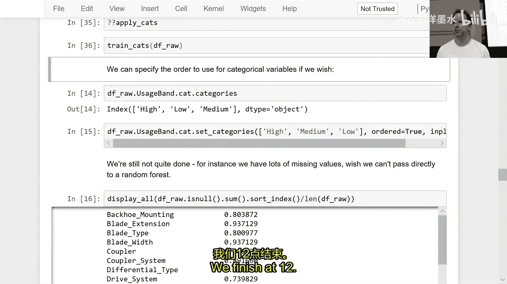

1150。

Let' see how we go I'll try and finish on time so you'll see now remember I mentioned there was this dot Dt attribute that gives you access to everything assuming it's the date time about the date time there's a dot cat attribute that gives you access to things assuming something's a category and so usage band was a string and so now that I've run train cats it's turned it into a category so I can go。

DFro dot usage band。打 cat。and there's a whole bunch of other things we've got there Okay so one of the things we've got there is dot categories and you can see here is the list。

Now， one of the things you might notice is that this list is in a bit of a weird order， high。

 low medium The truth is it doesn't matter too much。

But what's going to happen when we use the random forest is it's actually going this is going to be zero。

 this is going to be one。 this is going to be two， and we're going to be creating decision trees。

 And so we're going to have a decision tree that can split things at a single point。

 so it either be high versus low and medium or medium versus high and low that would be kind of weird right It actually turns out not to work too badly。

 but it'll work a little bit better if you have these in sensibleensible orders。

 Okay so if you want to reorder a category then you can just go cat do set categories and pass in。

The order you want until it is' ordered， and almost every pandas method has an in place。

A parameter which rather than returning a new data frame， is going to change that data frame。Okay。

 so I'm not going to do that like I didn't check that carefully for categories that should be ordered。

 but this seems like a pretty obvious one。Okay。Can you reiterate that issue。

 I don't understand what the Sure， so the usage band column。It's actually going to be。哦。

This is actually what our random forest is going to see these numbers，102。

1 and they map to the position in this array and as we're going to learn shortly。

 a random forest consists of a bunch of trees that's going to make a single split and the single split is going to be either greater than a less than one or greater than less than two so we could split it into high versus low and medium which that semantically make sense it's like is it big or we could split it into medium versus high and low which doesn't make much sense right so in practice a decision tree could then make a second split to say like medium versus high and low and then within the high and low into high and low but by putting it in a sensible order if it wants to split out low it can do it in。

One decision rather than two， and we'll be learning more about this shortly。

It honestly it's not a big deal， but I just wanted to mention it's there and it's also good to know that people when they talk about different types of categorical variable。

 specifically you need to know there's a kind of categorical variable called ordinal and an ordinal categorical variable is one that has some kind of order like high。

 medium and low and random forests aren't terribly sensitive to that fact。

 but it's worth knowing it's there and trying it out。嗯。

Still order ordering wouldn't help our maximum that that's what I'm saying it helps a little bit right it means you can get there with one decision rather than two。

Yeah。I noticed there is a negative one in that list of categories。 Is that like an NA or Yeah。

 exactly。 So for free， we get a negative one， which refers to missing。

 And one of the things we're going to do is we're going to actually add one。

 Can somebody pass it back to Paul is we're going to add one to our codes， maybe in two goes。

Let people know it's coming。Yeah， so we're going to add one to all of our codes to make missing zero later on。

So categories stringte dum three columns we're going to get to that Yeah so get dums which we'll get to it a moment it's going to create three separate columns ones and zeros for high theres medium and for low whereas this one creates a single column with an integer zero one or two're going get to that one shortly did you have a question too Paul or you're just point out okay。

Okay， so at this point， as long as we always make sure we use dotcat。codes。

 the thing with the numbers in， we're basically done。

 all of our strings have been turned into numbers， our dates been turned into a bunch of numeric columns and everything else is already a number okay。

The only other main thing we have to do is notice that we have lots of missing values so here is。

There for all dot is null， that's going to return true or false depending on whether something is empty dot sum is going to add up how many are empty for each series。

 and then I'm going to sort them and divide by the size of the data set。

 So here we have some things which have like quite high percentages of。Nolls。

 so missing values we call them in。Display or。I't know what I called it， maybe I didn't run it。Okay。

大家。Okay。So。We're going to get to that in a moment， but I will point something out。

 which is reading the CSV took a minute or so。ThePro took another 10 seconds or so from time to time when I've done a little bit of work I don't want to wait for again。

 I will tend to save where I'm at。 So here I'm gonna to save it。

 and I'm going to save it in a format called feather format。 This is very。

 very new But what this is going to do is it's going to save it to disk in exactly the same basic format that it's actually in RA This is by far the fastest way to save something and the fastest way to read it back So most of the folks you deal with unless they're on the cutting edge won't be familiar with this format。

 So this would be something you can teach them about。

 it's becoming the standard it's actually becoming something that's going to be used not just in pandas。

 but in Java in Sp in lots of like things for like communicating across computers because it's incredibly fast and it's actually co-designed by the guy that made panthers by Wes McKinney so we can just go dearro Feather and pass in some。

Name I tend to have a folder called temp for all of my like as I'm going along stuff and so when you go OS do vectors。

 you can path in any path here you like it won't complain if it's already there because Ive got exists okay because true if there are some subdirecties it'll create them for you so this is a super handy little function。

Okay， so it's not installed so because I'm using Crsle for the first time。

 it's complaining about that So if you get a message that something's not installed if you're using Ananaconda。

 you can condoda install Crsle actually doesn't use Ananaconda it uses P。

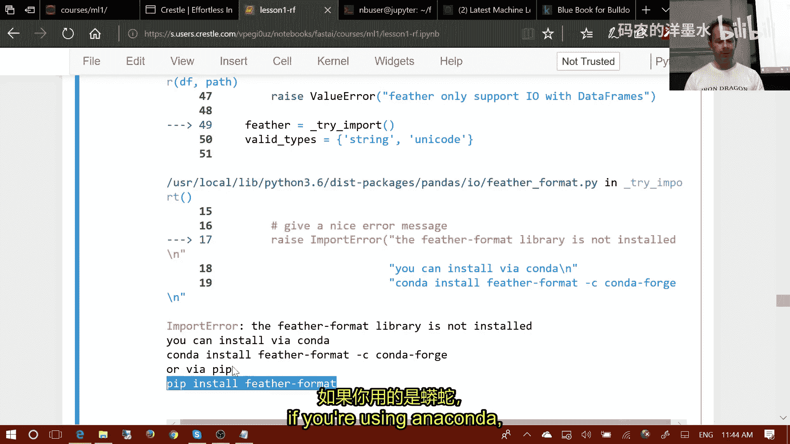

Okay。Okay。对。嗯的。Yeah。And so we wait for that to go along， Okay， and so now if I run it。

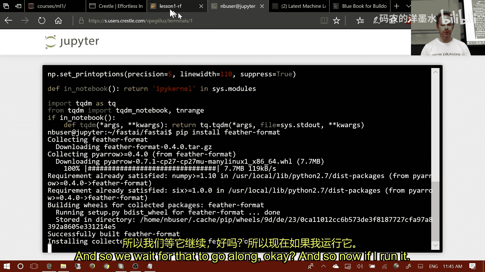

And so， sometimes。You may find you actually have to。Restar Jupiter。

 so I won't do that now because we're nearly out of time。 So if you restart Jupiter。

 you'll be able to keep moving along。 So from now on， you don't have to rerun all the stuff above。

 You could just say P D dot read feather。 And we've got our data frame back。

So the last step we're going to do is to actually replace the strings with their numeric codes。

And we're going to pull out the dependent variable sale price into a separate variable。

 and we're going to also handle missing continuous values。 And so how are we going to do that。

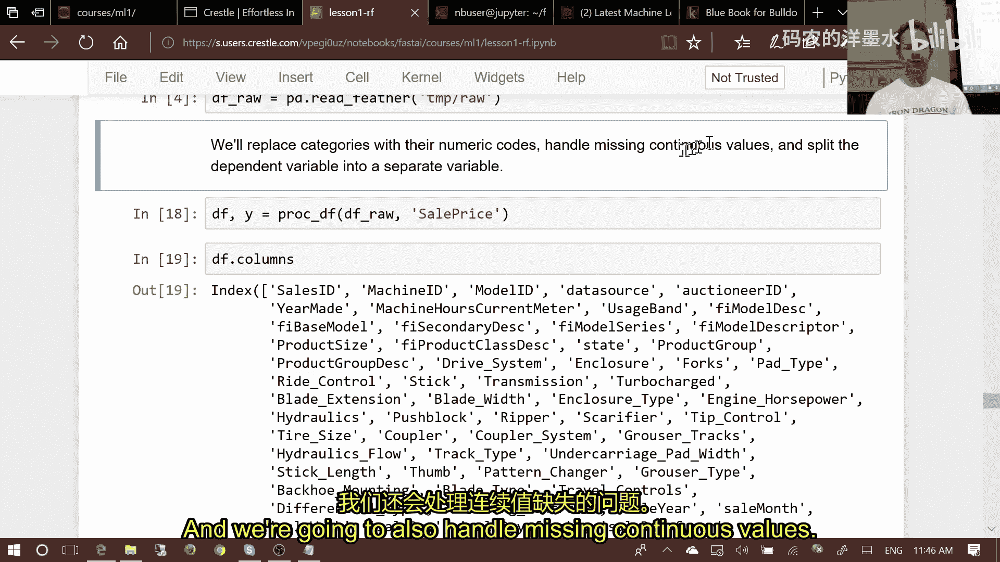

So you'll see here we've got a function called Proc Df。

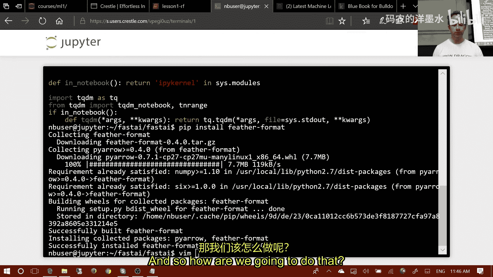

What is that pro toF？So it's inside fast A IOt structure again。

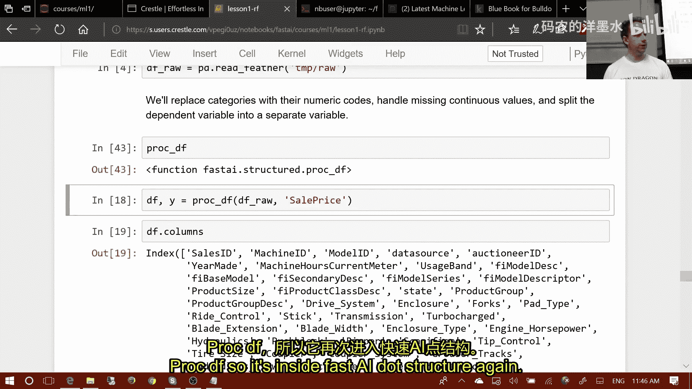

嗯。Okay。Yeah。And here it is。So quite a lot of the functions have a few additional parameters that you can provide and we'll talk about them later。

 but basically we're providing the data frame to process and the name of the dependent variable。

 the Y field name okay and so all it's going to do is it's going to make a copy of the data frame。

It's going to grab the Y value。It's going to drop the dependent variable from the original。

And then it's going to。Fix missing。So how do we fix missing？

So what we do to fix missing is pretty simple if it's numeric。Then we fix it by basically saying。

 let's first of all check that it does have some missing so if it does have some missing values。

 so in other words the issnL。 sum is non-zero， then we're going to create a new column called with the same name as the original plus_ NA。

 and it's going to be a Boolean column with a1 anytime that was missing and a zero anytime it wasn't。

We're going to talk about this again next week， but this is I'll give you the quick version having done that where they're going to replace the NAs。

 the missing with the median okay so anywhere that used to be missing will be replaced with the median or at a new column to tell us which ones were missing。

We only do that for numeric， we don't need it for categories because pandas had his handles categorical variables automatically by setting them to minus1。

So。What we're going to do？Is if it's not numeric。😡，And it's a categorical type。

 and we'll talk about the maximum number of categories later， but let's assume this is always true。

 so if it's not a numeric type， we're going to replace the column with its codes。

 the integers plus one so by default pandas uses minus one for missing so now zero will be missing and one。

 two， three， four will be all the other categories。

So we're going to talk about dummies later on in the course。

 but basically optionally you can say that if you already know about dummy values。

 there are columns with a small number of possible values。

 you can turn into dummies instead numericalizing them。

 but we're not going to do that for now so for now all we're doing is we're using the categorical codes plus one。

 replacing missing values with the median， adding an additional column telling us which ones were replaced and removing the dependent variable。

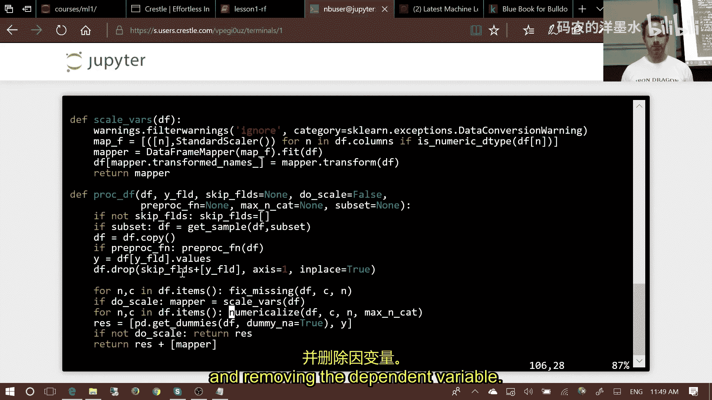

So， that's what。Proc Df does runs very quickly okay so you'll see now sale price is no longer here okay we've now got a a whole new variable called Y that contains sale price you'll see we've got a couple of extra blair underscore NAs at the end okay and if I look at that。

Okay。Everything is a number。Okay， these Booleions are treated as numbers。

 they're just treated as zero or one， they're just displayed as false and true。They can see here。

 is it the end of a month， Is it the start of a month， Is it the end of a quarter。

It's kind of funny right because we've got things like a model ID which presumably some like I don't know it could be a serial number or it could be like the model identifier that's created by the factory or something we've got like a data source ID like some of these are numbers。

But they're not continuous。 It turns out， actually， random forests work fine with those。

 And we'll talk about why and how and a lot about that in detail。 But for now。

 all you need to know is。No problem。 Okay， so as long as this is all numbers， which it now is。

 we can now go ahead and create a random forest。So。M。 Ranofort regressor。

Random forests are trivially parazable so what that means is that they if you've got more than one CPU。

 which everybody will basically on their computers at home and if you've got a T2 medium more bigger at AWS you've got multiple CPUs trivially parazable means that it will split up the data across your different CPUs and basically linearly scale right so the more CPUs you have pretty much it will divide the time it takes by that number not exactly but roughly so n jobs equals minus1 tells the random forest aggressor to create a separate job so a separate process basically for each CPU you have so that's pretty much what you want all the time。

Fit the model using this new data frame we created using that y value we pulled out and then get the score okay the score is going to be the r squared we'll define that next week hopefully some of you already know about the r squared one is very good zero is very bad so as you can see we've immediately got a very high score。

That looks great， but what we'll talk about next week a lot more is that it's not quite great because maybe we had data that had points that looked like this and we fitted a line that looks like this。

When actually we got one that looks like that the only way to know whether we've actually done a good job is by having some other data set that we didn't use to train the model now we're going to learn about some ways with random forests we can kind of get away without even having that other data set but for now what we're going to do is we're going to split into 12。

000 rows which we're going to put in a separate data set called the validation set versus the training set going to contain everything else。

and our data set is going to be sorted by date and so that means that the most recent 12000 rows are going to be our validation set again。

 we'll talk more about this next week it's a really important idea。

 but for now we can just recognize that if we do that。And run it。

 I've created a little thing called print score and it's going to print out the root mean squared error between the predictions and actuals for the training set。

 for the validation set， the R squared for the training set and the validation set。

 and you'll see that actually the R squared for the training was 0。98。But for the validation was 0。

89。Okay， then the IMSSC， and remember this is on the logs was 0。09 for the trading set。

25 for the validation set Now， if you actually go to CaL and go to the leader board， in fact。

 let's do it right now。Yeah。He's got private and public， I click on Public leaderboard。

And we can go down and find out where is 0。25 so there are。475 teams。嗯。And generally speaking。

 if you're in the top half of a capital competition， you're doing pretty well。So 。25 here we are 。25。

 What was it exactly 0。25？2507。Yeah。Yeah about 110 so we're about in the top 25% so so the idea like this is pretty cool right with with like with no thinking at all using the defaults of everything wherere in the top 25% of a chemical competition so like random forests are insanely powerful and this totally standardized process is insanely good for like any data so we're going to wrap up what I'm going to ask you to do。

For Tuesday is like take as many CAle competitions as you can。

 whether they be running now or old ones or data sets that you're interested in for hobbies or work and please try it right try this process and if it doesn't work you know tell us on the forum。

 here's a data I'm using， here's where Ive got it from。

 here's like the stack trace of where I've got an error or here's like you know if you use my print score function or something like it like you know show us what the training versus test set looks like we'll try and figure it out but what I'm hoping will find is that all of you will be pleasantly surprised that with。

With the， you know。An hour or two of information you got today。

 you can already get better models than most of the very serious practicing data scientists that compete in cable competitions okay？

Great， good luck。 and I'll see you in the forums。Oh， one more thing， Friday。

The other class said a lot of them had class during my office hours。

 so if I made them one till three instead of two till four on Fridays， is that okay？Seminar 0。Okay。

 I have to find a whole other time All right， I will talk to somebody who actually knows what they're doing unlike me about finding office hours。

Absolutely。

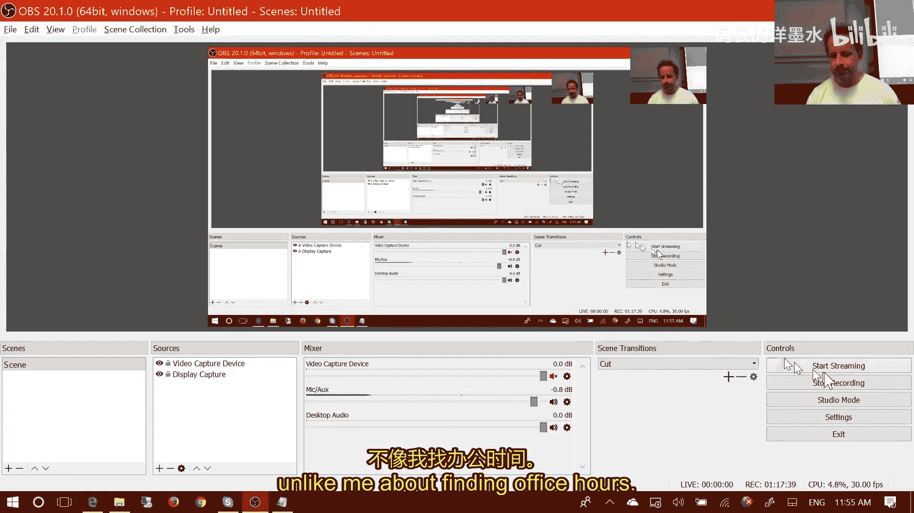