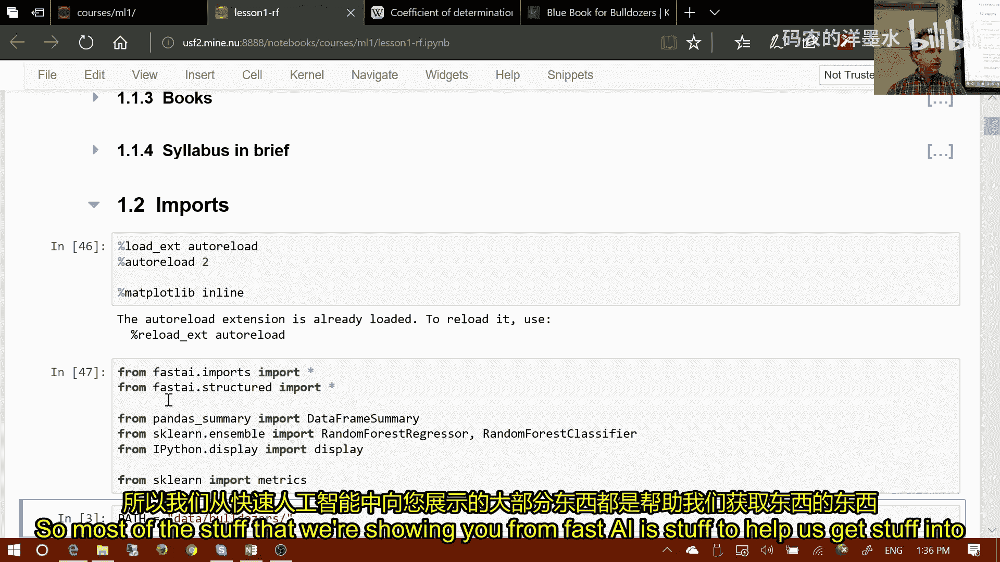
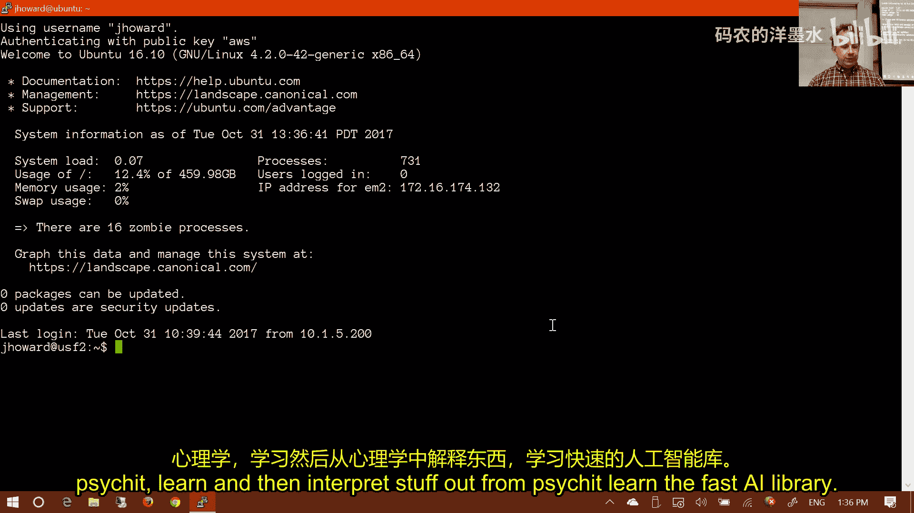
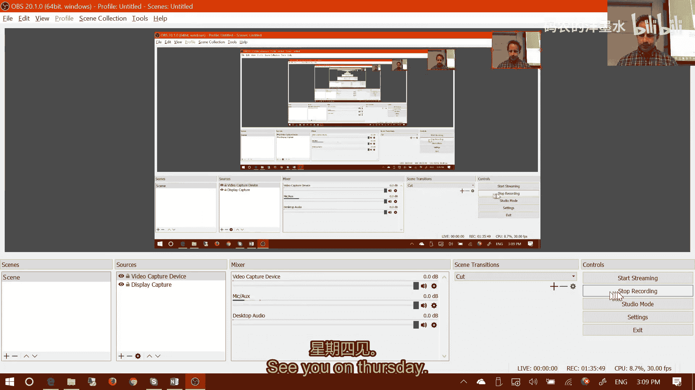

# 【全集】旧金山大学-面向程序员的机器学习-中英字幕-1080P-p02-Lecture-2---随机森林深度解析--BV1YAvYBAEG3_p2-

So from here， the next two or three lessons were going to be really diving deep into random forests。

 so so far all we've learned is there's a thing called random forests。For some particular data sets。

 they seem to work really， really well without too much trouble。

 but we don't really know yet like well how do they actually work？

What do we do if they don't work properly， what are their pros and cons what can we tune and so forth so we're going to look at all that and then after that we're going to look at how do we interpret the results of random forests to get not just predictions but to actually deeply understand our data in a model driven way so that's where we're going to go from here。

So let's just review where we're up to。So we learned that there's this library called AI and the Fast AI library is basically is' a highly opinionated library which is to say we spend a lot of time researching what are the best techniques to get like state of the art results and then we take those techniques and package them into pieces of code so that you can use the state of the art results yourself。

 and so。Where possible？We wrap or provide things on top of existing code and so in particular for the kind of structured data analysis we're doing Psyit Learn has a lot of really great code so most of the stuff that we're showing you from Fast AI is stuff to help us get stuff into Psyt learn and then interpret stuff out from PsyitL the Fast AI library。

The way it works in。

Our environment here is that we've got。Our notebooks are inside fast AI repo s courses and then slash M1 and DO1。

And then inside there， there's a Sim link to。The parent of the parent fast AI。

 So this is a Sim link to。A directory containing a bunch of modules。

So if you want to use the Fast AI library in your own code， there's a number of things you can do。

 one is to put your notebooks or scripts in the same directory as ML1 or DL1。

 whether it's already the Simlink and just import it just like I do。

You could copy this directory dot dot s dot dot/lashci。Into somewhere else and use it。

 or you could simplyim link it just like I have from here to wherever you want to use it。

 So notice it's mildly confusing。 There's a Github repo called Fast AI and inside the Github repo called Fast AI。

Which looks like this， there is a folder called Fast AI。Okay。

 and so the Fast AI folder in the Fast AI repo contains the Fast AI library。

And it's that library when we go。From Fast AI do imports import star。

 then that's looking inside the Fast AI folder for a file called imports imports dot PY and importing everything from that。

Okay。Yes， Danielle。一。Thatsか。And just like as a clarifying question for the sibling。

 it's just the LN thing you talked about last class。

TheThat's just the Len thing that you talked about last fall。 Yeah。

 so a Sim link is something you can create by typing。

LN minus S and then the path to the source which in this case would be dot dot dot dot fast AI could be relative or it could be absolute and then the name of the destination if you just put the current directory at the destination it all use the same name as it comes from like a。

Alias on the Mac or a shortcut on Windows。Yeah。不定讨论的。And when you do the。Import can I just Hannah？

Yeah， go， imports this and then append that relative link that also creates the sameimlink。

And we're hook to。I don't think I've created the Simlink anywhere in the workbook。

 the Simlink actually lives inside the Gitthub repo Okay I credit some S links in。

The deep learning notebook to some data， that was different。

At the top of Tim Lee's workbook from the last class。

 there was import cis then append the fast day I Oh yeah， don't do that。

 Probably don't I mean you can， but I think this is。

I think this is better like this way you can go from fast AI imports and。

Regardless of kind of how you got it there， it's going to work。对。Okay。

 so then we had all of our data for Blue Book to bulldozers competition in data slash bulldozers。And。

Here it is， right？So we were able to read that CSV file。

 the only thing we really had to do was to say which columns were dates。And having done that。

We were able to take a look at a few of examples of the rows of the data。天酷。Okay。

And so we also noted that it's very important。To deeply understand the evaluation metric for this project and so for CAgle they tell you what the evaluation metric is and in this case it was the root mean squared log error。

So， that is。嗯。The sum。Of the actuals。Minus。嗯。The predictions。But it's the log。Of the actuals。

 minus the log。Bothvis。Squad。 so if we replace。Actuauals with log actuals and replace predictions with log predictions。

 then with's just the same as root mean squared error。

So that's what we did was we replaced sale price with log of sale price。

 and so now if we optimize for root mean squared error。

 we're actually optimizing for the root mean squared error of the logs。ok。😊。

So then we learned that we need all of our columns to be numbers。

And so the first way we did that was to take。The date column。

And remove it and instead replace it with a whole bunch of different columns。

Such as is that date the start of a quarter， is it the end of a year。

 how many days are elapsed since January the 1t 1970， what's the year， what's the month。

 what's the day of week and so forth？Okay， so they are all numbers。

Then we learn that we can use train underscore cats to replace all of the strings。With categories。

Now when you do that。It doesn't look like you've done anything different。

 they still look like strings。But if you actually take a deeper look。

You'll see that the data type now is not string but category。And category。Is a pandas class。

Where you can then go dot cat dot and find a whole bunch of different attributes。

 such as cat dot categories to find a list of all of the possible categories。

 and this says high is going to become zero， low will become one medium will become two。

 so we can then get codes。To actually get the numbers so then what we need to do to actually use this data set to turn it into numbers is take every categorical column and replace it with cat do codes。

And so we did that using。Yeah。Proct F。Okay， so how do I get the source code for Proc Df？Okay。Yeah。

Question， question， Mark。Al right， so if I scroll down。

 I go through each column and I numericalize it。 Okay， that's actually the one I want。

 So I'm going to now have to look up numericalized。Yeah。So tab to complete it。If it's not numeric。

Then replace the data frames field with that columns docat do codes。Plus one。

 because otherwise unknown as minus-1， we want unknown to be zero。

That's how we turn the strings into numbers they get replaced with a unique basically arbitrary index。

 it's actually based on the alphabetical order of the feature names。The other thing Pro F did。

 remember， was。Continuous columns that had missing values， the missing got replaced with the median。

 and we added an additional column called column name underscore NA。

 which is a Boolean column told you if that particular item was missing or not。So once we did that。

 we were able to call random forestest aggressor。tfi。And get the dot score。

 and it turns out we have an r squared of 0。98。Can anybody tell me what an r squared is？Melissa。

 you want to tell me？O。なくな？Oh。So R squared essentially shows how much variance is explained by the model。

 this is the yeah， this is the relation of this is SSR， which is like。嗯。

Ting to remember the exact formal bit。I mean roughly intuitively。 Yeah， and。

 it's how much the model explains the how much it accounts for the variance in the data。 Okay。

 good so。Let's talk about the formula。With formulas。

 the idea is not to learn the formula and remember it。

 but to learn what the formula does and understand it，So。Here's the formula。

It's1 minus something divided by something else。So what's the something else on the bottom。

 S taughtt， Okay， so what this is saying is we've got some actual data。Some YIs， right。

 we've got some actual data。3，2，4，1。Okay， and then we've got some average。嗯。Okay， so。Our top bit。

 this S， S type， is the sum of。Each of these。Minus。That。So in other words。

 it's telling us how much does this data vary。 perhaps more interestingly， is。

 remember when we talked about like。Last week， what's the simplest？

Non stupid model you could come up with， and I think the simplest non stupid model we came up with was create a column of the mean。

 just copy the mean a bunch of times and submit that to Call。If you did that。

 then your root mean squared error would be。😡，This。

So this is the root main squared error of the most naive non stupid model where the model is just predict the mean。

On the top。We have SS Res， which is here。Which is that we're now going to add a column of predictions。

嗯。Okay。Okay， and so now what we do is rather than taking the Yi minus y mean。

 we're going to take Yi minus F。Right。And so now instead of saying what's the root mean squared error of our naive model。

 we're saying what's the root mean squared error of the actual model that we're interested in then。

We take the ratio。So in other words。😊，If we actually were exactly as effective as just predicting the mean。

 then this would be top and bottom would be the same， that would be1，1 minus1 would be  zero。

If we were perfect， so Fi minus Yi was always0， then that's0 divided by something，1 minus that is1。

Okay， so。What is the possible range of values？I askedquad。这种这种。Okay， I heard a lot of 0 to 1。

 Does anybody want to give me an alternative。N one one， negative one to one。

less than less than one anything less than one， there's the right answer。

 Let's find out why Can we hit the box。Okay。多。是。哎。嗯。

Okay so why is it any number less than one you can make a model basically as crap as you want and just like as big arrow as you want and you're just subtracting from one in the formula exactlyact so interestingly I was talking to our computer science professor Terrence this morning who was talking to a statistics professor told him that the possible range of values was asked where it was zero to one I said that is totally not true if you predict infinity for every column that's sorry for every row then you're going to have infinity for every residual and so you're going to have one minus infinity okay so the possible range of values is。

Les than one， that's all we know and this will happen。

 you will get negative values sometimes in your r squared and when that happens it's not a mistake。

 it's not like a bug， it means your model is worse than predicting the mean。Okay。

 which is suggest it's not great。So that's ourquid。U。It's not。It's not necessarily。😡。

What you're actually trying to optimize。Right but's the nice thing about it is that it's a number that you can use kind of for every model and so you can kind of start try to get a feel of like what does 0。

8 look like， what does 0。9 look like to like something I find interesting is to like create some different synthetic data sets just two dimensions with kind of different amounts of random noise and like see what they look like on a scatter plot and see what they R squared just to kind of get a feel for like what is an ask you know as an ask square of 0。

9 close or not about 0。7 close or not。嗯。Okay。So I think r squared is a useful number to have a familiarity with and you don't need to remember the formula if you remember the meaning。

 which is what's the ratio between how good your model is。

 which means square error versus how good is the naive mean model， Great squared error。Okay。

 in our case， 0。98， it's saying it's a very good model。However。

 it might be a very good model because it looks like this。😊，Right， this would be called。

ttingSo we may well have created a model which is very good at running through the points that we gave it。

 but it's not going to be very good at running through points that we didn't give it。

So that's why we always want to have。A validation set。Okay。Creating your validation set。

Is the most important thing？That I think you need to do when you're doing a machine learning project。

At least in terms of in the actual modeling。Because what you need to do is come up with a data set where the score of your model on that data。

It's going to be representative of how well your model is going to do in the real world。

 like in CAle， on the leaderboard or off CAle， like when you actually use it in production。I very。

 very， very often hear people in industry say， I don't trust machine learning， I tried modeling once。

 it looked great， we put it in production， it didn't work。Now whose fault is that right。

 that means their validation set was not representative。

So here's a very simple thing which generally speaking Kagle is pretty good about doing if your data has a time piece in it。

 as happens in Blue Book for bulldozers in Blue Book for bulldozers。

 we're talking about the sale price of a piece of industrial equipment on a particular date。

So the startup doing this competition wanted to create a model that wouldn't predict last February's prices but would predict next month's prices。

 so what they did was they gave us data representing a particular date range in the training set and then the test set represented a future set of dates that wasn't represented in the training set so that's pretty good right that means that if we're doing well on this model we've built something which can actually predict。

The future， or at least it could predict the future then assuming things haven't changed dramatically。

So that's the test set we have， so we need to create a validation set that has the same properties。

So the test set had 12000 rows in。 so let's create a validation set that has 12000 rows， right。

 and then let's split the data set into。The first n minus 12，000 rows。

For the training set and the last 12000 rows for the validation set。

 And so we've now got something which hopefully looks like。

Caggle test set close enough that when we actually try and use this validation set we're going to get some reasonably accurate scores and the reason we want this is because on CAggle you can only submit so many times and if you submit too often and you'll end up opening to the leaderboard anyway and in real life you actually want to build a model that's going to work in real life did you have a question can we help the green box you？

That's what。Can you explain the difference between a validation set and a test set， absolutely？

So what we're going to learn today is how to set one of the things I'll learn is how to set hyperparameters。

 hyperparameters are like tuning parameters that are going to change how your model behaves。

Now if you just have one holdout set， so one set of data that you're not using to train with and we use that to decide which set of hyperparameters to use。

 if we try  a thousand different sets of hyperparameters。

 we may end up overfitting to that holdout set， that is to say。

 we'll find something which only accidentally worked。

So what we actually want to do is we really want to have a second holdout set where we can say， okay。

 I'm finished。Okay， I've done the best I can。And now just once right at the end。

 I'm going to see whether it works。And so this is something which almost nobody in industry does correctly。

You really actually need to remove that holdout and that's called the test set。

 remove it from the data， give it to somebody else and tell them do not let me look at this data until I promise you I'mfin like it's so hard otherwise not to look at it and for example in the world of psychology and sociology you might have heard about this replication crisis and this is basically because people in these fields have accidentally or intentionally maybe been pe hackcking which means they've been basically trying lots of different variations until they find something that works and then it turns out when they try to replicate it in other words it's like somebody creates a test set somebody says okay this study which shows you know the impact of whether you eat marshmallows on your tenacity later in life I'm going to rerun it and like。

Over half the time， they're finding the effect turns out not to exist。

 So that's why we want to have a test set。You get that next door。

So for handling categorical data you converted those to numerics to numbers order numbers I've seen a lot of models where we convert categorical data into different columns using one hot encode Yes so which approach to use in which model yeah we're going to tackle that today yeah it's a great question。

Okay， so I'm splitting my data into validation and training sets and so you can see now that my validation set is 12。

000 by 66 whereas my training set is 389，000 by 66 okay so we're going to use this set of data to train a model and this set of data to see how well it's working。

So when we then tried that last week， we found out just a moment， we found out that our model。

 which had 0。982 r squared on the training set， only had 0。887 on the validation set。

 which makes us think that we're overfitting quite badly。

But it turned out it wasn't too badly because the root mean square error on the logs of the prices actually would have put us in the top 25% of the competition anyway。

 so even though we're overfitting it wasn't the end of the world。

 could you pass the microphone to Marsha please？In terms of dividing the set into training and validation。

 it seems like you simply take the first and train observations of the data set and set them aside。

 why don't you like why don't you randomly pick up the observations？Because if I did that。

 I wouldn't be replicating the test set， so CAL has a test set that when you actually look at the dates in the test set。

 they are a set of dates that are more recent than any date in the training set。

So if we used a validation set that was a random sample that is much easier because we're predicting optionss like what's the value of this piece of industrial equipment on this day when we actually already have some observations from that day so in general any time you're building a model that has a time element。

 you want your test set to be a separate time period and therefore you really need your validation set to be a separate time period as well and in this case the data was already sorted so that's why this works just more question over serious。

Yes。So let's say we have our test the training set where we train the data and then we have the validation set against which we are trying to find the R square in case our Rqua turns out to be really bad we would want to tune our parameters and run it again so wouldn't that be eventually overfitting on the overall training set yeah so actually that's the issue so that would eventually have the possibility of overfitting on the validation set and then when we try it on the test set or we submit it to CAgle it turns out not to be very good and this happens in CAgel competitions all the time Kaggel actually has a fourth data set which is called the private leader board set and every time you submit to CAL you actually only get feedback on how well it does on something called the public leaderboard set and you don't know which rows they are and at the end of the competition you can actually get judged on a different data set entirely called the private leader board set so the。

way to avoid this is to actually be a good machine learning practitioner and know how to set these parameters as effectively as possible。

 which we're going to be doing partly today and over the next few weeks。

Can you get the actually what do you throw？Is it too early or late to ask。

 what's the difference between a hyperparameter and a parametermeter？不不。O。🤧嗯。So。

Let's start tracking things on root mean squared error， so here is root mean squared error。

In a line of code。 And you can see here， like this is one of these examples where I'm not writing this the way a proper software engineer would write this。

 right， so a proper software engineer would be a number of things differently。

 They would have it on a different line。They would use longer variable names。Yeah。嗯。

They would have documentation。啊八88 right。But。I really think， like for me， I really think that。

Being able to。Look at something in one go with your eyes。 and like。Over time。

 learn to immediately see what's going on has a lot of value and also to like consistently use like。

Particular letters to mean particular things or abbreviations。

 I think works really well in data science。If you're。

Doing it like a take home interview test or something。

 you should write your code according to PEp8 standards so Pp 8 is the the style guide for Python code and you shouldn't know it and use it because a lot of software engineers are super anal about this kind of thing but for your own work。

 you know， I think this is I think this works well for me， you know。

 so I just wanted to make you aware A that you shouldn't necessarily use this as a role model for dealing with software engineers。

 but B， that I actually think this。this is a reasonable approach Okay so there's our root mean squared error and then from time to time we'res going to print out the score which will give us the RMSC of the predictions on the training versus the actual the predictions on the valid versus the actual RMSC the r squared for the training and the R squared for the valid and we'll come back to OB in a moment so when we ran that we found that this RMSC was in the top 25% and it's like okay there's a good start now。

嗯。This took eight seconds of wall time， so eight actual seconds if you put percent time it'll tell you how long things took luckily I've got quite a few core。

 quite a few CPUs in this computer because it actually took over a minute。

Compute time to parallelze that across course。 if your data set。

wa bigger or you had less cause you know you could well find that this took a few minutes to run or even a few hours my rule of thumb is that if something takes more than 10 seconds to run it's too long for me to do like interactive analysis with it right I want to be able to like run something wait a moment and then continue。

So what we do is we try to make sure that things can run in a reasonable time。

And then when we're finished at the end of the day， we can then say， okay， this feature engineering。

 these hyperparameter， whatever these are all working well， and I'll now rerun it you know， the big。

 slow precise way。So one way to speed things up is to pass in the subset parameter to Proc DF and that will randomly sample my data right and so here I'm going to randomly sample 30。

000 rows now when I do that。I still need to be careful to make sure that my validation set。

Doesn't change。 And that my training set doesn't overlap with the dates。 Otherwise， I'm cheating。

 So I call split valveels again to again do this split by dates。嗯。

And you'll also see I'm using rather than putting it into a validation set I'm putting it into a variable ch underscore this is kind of a standard approach in Python is to use a variable ch underscore if you want to throw something away because I don't want to change my validation set like no matter what different models I build I want to be able to compare them all to each other so I want to keep my validation set the same all the time so all I'm doing here is I'm resampling my training set into a20 the first 20。

000 out of a 30000 subset。So I now can run that and it runs in 621 milliseconds so I can like really zip through things now try things out。

Okay。So with that。Let's use this subset。To build a model that is so simple that we can actually take a look at it。

 and so we're going to build a forest is made of trees。And so before we look at the forest。

 we'll look at the trees。In psychic learn， they don't call them trees， they call them estimators。

 so we're going to pass in the parameter number of estimators equals one to create a forest with just one tree。

And then we're going to make a small tree so we pass in maximum depth equals 3 and a random forest as we're going to learn randomizes a whole bunch of things。

 we want to turn that off so to turn that off you say bootsottrap equals false so if I pass in these parameters it creates a small deterministic tree。

So if I fit it and say print score， my R squared has gone down from 0。85 to 0。4。

 so this is not a good model， it's better than the mean model， this is better than zero。

 right it's not a good model， but it's a model that we can draw。

 so let's learn about what it's built。So a tree。Consists of a sequence of binary decisions。

Of binary splits。So at first of all， decided to split on coupler system greater than a less than 0。5。

 that's a Boolean variable that's actually true or false。

And then within the group where coupleler system was true。

 it decided to split into yearmade greater than less than 1987。

 and then where couplepller system was true and year made was less than or equal to 1986。

 it used FiI product class De is less than。Or equal to 075 and so forth So right at the top。

We have 20，000 samples， 20，000 rows， right， and the reason for that is because that's what we ask for here when we split our data in the sample。

か。不的。系。I just want to double check that for your decision tree that you had there that the coloration was whether it's true or false not so like it gets darker it's true for the next one not the Docker is a higher value we'll get to that in a moment okay。

So let's look at these numbers here， so in the whole data set， well our sample that we're using。

 there are 20，000 rows。The average of the log of price is 10。1。

And if we built a model where we just used that average all the time。

 then the mean squared error would be 0。477。Okay， so this is， in other words， the denominator。

Of an Rd， right， This is like the most basic model is a tree with zero splits， right。

 which is just predict the average。So。The best single binary split we can make。

ItTurns out to be splitting by whether a coupler system is greater than or equal sorry less than or equal2 or greater than 0。

5， in other words， whether it's true or false。And it turns out if we do that。

 the mean squared error of couple system is less than 0。5， it's false。Goes down from 0。477 to 0。11。

RightSo it's really improved the error a lot。In the other group， it's only improved it a bit。

 it's gone from 0。47 to 0。41。And so we can see that the coupler system equals false group has a pretty small percentage。

 it's only got 2200 of the 20000。Where else this other group has a much larger percentage。

 but it hasn't improved it as much。So let's say。You wanted to create。A tree with just one split。

 So you're just trying to find like， what is。The very best。Single binary decision you can make。

For your data。How might you be able to do that， How could you do it？I' going to give it to Fort？

Specify the max depth of one。But I mean， you're writing， you don't have a random first。

How are you going to write what's an algorithm， a simple algorithm which you could use？Sure。

So we want to start building a random forest from scratch。So the first step is to create a tree。

The first step to create a tree is to create the first binary decision。How are you going to do it。

 I'm going to give it to Chris。Maybe in two steps。So isn't this simply trying to find the best predictor based on maybe a linear regression？

You could use a linear regression， but could you do something？Much simpler and more complete。

 We're trying not to use any statistical assumptions here I can't see your name， sorry。P。

 of course your friends。 I need that。Can we just to like take just one variable if it is true。

 give it like the true thing and if it is false？So which variable are we going to choose？

 So at each binary point， we have to choose a variable。And something to split on。

How are we going to do that， I'm going to pass it over there。

Happ your name so the variable to choose could be like which divides the population into two groups which are kind of heterogeneous to each other and homogeneous within themselves。

 like having the same quality within themselves。And they're very different Could you be more specific like in terms of the target variable maybe yes let's say we have two groups of the split so one has a different price altogether from the second group but internally they have similar prices Okay that's good so like to simplify things a little bit where we're saying find a variable that we could split into such that the two groups are as different to each other as possible。

嗯。And okay， how would you pick which variable and which split point that's the question。Yeah。嗯有。Yes。

Yeah， what's your first cut， which variable and which split point？好啊。

We don't like we're making a tree from scratch， we want to create our own tree。That makes sense。

 we've got somebody over here nicelyle pass it maybe。嗯。Yeah。

Can we test all the possible split and see which one has a small RMZ and that sounds good okay。

 so let's dig into this so when you say test all of the possible splits。What does that mean。

 how do we enumerate all the possible splits？嗯。Oh I think of that， but。金额。For each variable。

 you could put one aside。And then put a second aside and compare the two and if it was better， good。

 Okay， so for H variable for H possible value of that variable。See whether it's better。 Now。

 give it back to Masley。 I want to dig into the better。 When you said， see if the RMC is better。

What does that mean though， because after a split， you've got two RMSSEs， you've got two groups。

So you're just going to fit with that one variable comparing to the other it's not so so what I mean here is that before we decided to spit on coupler system。

 we had a remove means squared of 0。477 and after we've got two groups。

 one with a mean squared error of 0。1， another with a means squared error of 0。4。

So you treat it individual model separately。 So for the first play。

 you're just going to compare between each variable themselves and then you move on to the next node with the remaining but even the first node。

Like。So the model with zero splits has a single root mean squared error。The model with one split。

 so the very first thing we try， we've now got two groups。With two mean squared errors。You런 개 아니。

Do you pick the one that gets them as different as they can be Well Well， okay。

 that would be one idea， get the two mean squared errorss as different as possible。

But why might that not work， What might be a problem with that。Sample size。

Go on because you could just literally leave one point out Yeah so we could have like year made is less than 1950 and it might have a single sample with a low price and like that's not a great split as a you know because the other group is actually not going to be very interesting at all。

Can you improve it a bit， can Jason improve it a bit？Yeah。Could you take a weighted average？Yeah。

 a weighted average。 So we could take 0。41 times 17000 plus 。1 times 2000。 That's good， right。

 And that would be the same as actually saying， I've got a model The model is a single binary decision。

 and I'm going to say for everybody with year made less than 986。5。 I'm going to fill in 010。2。

 for everybody else I're going to fill in 9。2， and then I'm going to calculate the root mean squared error of this。

Crappy model and that would give exactly the same right as the weighted average that you're suggesting。

 Okay， good， so we now have a single number that represents how good a split is。

Which is the weighted average of the mean squared errors of the two groups it creates。And thanks to。

 I think it was Jake， we have a way to find the best split。

 which is to try every variable and to try every possible value of that variable and see which variable and which value gives us a split with the best score。

Does that make sense？Okay， what's your name， sir？Okay。

Can somebody give Nata their box and I will out？嗯。Yeah。Yeah。

When you see every possible number for every possible variable。Are we saying like here we have 0。

5 as like our？Criteria to split。The tree， sorry。Are you seeing we're trying out every single number for every possible value right so a couple of system only has two values true and false so there's only one way of splitting which is trues and falses yearm is an integer which varies between like I don't know 1960 and 2010 so we can just say what are all the possible unique values of yearm and and try them all so we're trying all the possible split points Can you pass that back to Daniel' pass it to me and I'll pass it to Daniel。

Yeah。remember， I speak loudly， that one is straight。アドバイスの possible析ての。嗯。

So I just want to clarify again for the first split。

Why did we split on coupler system true or false to start Because what we did was we used Jakeake's technique。

 we tried every variable for every variable we tried every possible split。For each one。

 we noted down， I think it was Jason's idea， which was the weighted average mean squared error of the two groups it created。

We found which one had the best。Mean square error， and we picked it。

 And it turned out it was coupler system true or。Does that make sense。

 I guess my question is more like so coupler system is like one of the like。Best indicators。

 I guess it's the best Okay， we tried every variable and every possible level level after that it gets less and less everything else that tried wasn't as good Okay。

 and then you do that each time you explain right， so now that we've done that。

 we now take this group here， everybody who's got couple of system equals true。And we do it again。

 for every possible variable， for every possible level， for people where coupler system equals true。

 what's the best possible split？And then are there circumstances when it's not just like？

Vinaries like you split it into like three groups for like example you' made so I'm going to make a claim Okay and then I'm going to see if you can justify it。

 I'm going to claim that it's never necessary to do more than one split at a level because you can just split it again because you can just split it again exactly so you can get exactly the same result by submitting twice。

Okay， good， so。That is the entirety of creating a decision tree。

You stop either when you hit some limit that was requested。

 so we had a limit where we said at max depth equals3。

 so that's one way to stop would be you asked to stop at some point and so we stop otherwise you stop when your leaf nodes。

 these things at the end are called leaf nodes when your leaf nodes only have one thing in them。

That's a decision tree， that is how we grow a decision tree。

 and this decision tree is not very good because it's got a validation R squared of 0。4。😊。

So we could try to make it better by removing next depth equal3 right and creating a deeper tree。

 so it's going to go all the way down it're going to keep sptting these things further until every leaf node only has one thing in it。

And if we do that， the training R squared is， of course。1。

Because we can exactly predict every training element because it's in a leaf node all on its own。

But the validation ask squared is not one， it's actually better than our really really shallow tree。

 but it's not as good as we'd like。Okay。So we want to find some other way。

Of making these trees better。And the way we're going to do it is to create a forest。

So what's a forest？To create a forest， we're going to use a statistical technique called bagging。

And you can bag。Any kind of model， in fact， Michael Jordan。

 who is one of the speakers at the recent data Institute conference here at University of San Francisco。

 developed a technique called the bag of Little。Foootts。

And which he shows how to use bagging for absolutely any kind of model to make it more robust and also to give you confidence intervals。

The random forest is simply a way of bagging trees， so what is bagging？

Bgging is a really interesting idea， which is what if we created five different models？

Each of which was only somewhat predictive， but the models weren't at all correlated with each other。

 they gave predictions that weren't correlated with each other that would mean that the five models would have to have found different insights into the relationships in the data。

And so if you took the average of those five models， right。

 then you're effectively bringing in the insights from each of them。

And so this idea of averaging models is a technique for ensembling。Whi is really important。

Now let's come up with a more specific idea of how to do this ensely。What if we created a whole lot？

Of these trees， big deep， massively overfit trees， right but each one。

 let's say we only pick a random one/10th of the data， so we pick one out of every 10 rose at random。

 build a deep tree right which is perfect on that subset and kind of crappy on the rest。

 let's say we do that 100 times a different random sample every time。

So all of the trees are going to be better than nothing right because they do actually have a real random subset of the data and so they found some insight。

 but they're also overfitting terribly。But they're all using different random samples。

 so they all overfit in different ways on different things。So in other words， they all have errors。

But the errors are random。What is the average of a bunch of random errors？Zra。So in other words。

 if we take the average of these trees， each of which have been trained on a different random subset。

 the errors will average out to zero and what's left is the true relationship。😊。

And that's the random forest， so there's the technique， right。

 we've got a whole bunch of rows of data。We grab a few at random。put them into a smaller data set。

And build a tree based on that。Okay and then we put that tree aside。

And do it again with a different random subset and do it again with a different random subset。

Do that a whole bunch of times。And then for each one。

 we can then make predictions by running our test data through the tree to get to the leaf node。

 take the average in that leaf node for all the trees and average them altogether。Okay。So to do that。

We simply call random forest aggressor and by default。

 it creates 10 what psychic learn calls estimators an estimator is a tree so this is going to create 10 trees。

And so we go ahead and train it。Okay。I can't remember if I remember to。Thank。あ。Yeah。Okay。

 so create our1 trees and we're just doing this on our little random subset of 20000。

And so let's take a look。At one example， can you pass the box to Devon？

So just to make sure I'm understanding this so you're saying like we take 10 kind of crappy models we average 10 crappy models and we get a good model exactly because the crappy models are based on different random subsets and so their errors are not correlated with each other if the errors work correlated with each other。

 this isn't going to work okay so the key insight here is to construct multiple models which are better than nothing and where the errors are as much as possible not correlated with each other。

Is it so is there like a certain number of trees that like we need that in order to be like there's notice as a thing is like valid or invalid there's like has a good validation set RMSE or not you know and so that's what we're going to look at is how is how to make that metric higher and so this is the first of our hyperparameter and we're going to learn about how to tune hyperparameter and the first one it's going to be the number of trees and we're about to look at that now Yes。

The subset that you are selecting are they exclusive can you have overlapping of Yeah。

 so I mentioned you know one approach would be pick out like a10 at random but actually what pst loan does by default is for N rows it picks out N rows with replacement okay and that's called bootstrapping and if memory serves me correctly that gets you on average 63。

2% of the rows will be represented and you know a bunch of them will be represented multiple times。

Sure。So rather than just picking out like a tenth of the rows at random。

 instead we're going to pick out of an N row data set。

 we're going to pick out N rows with replacement。Which on average gets about 63， I think 63。

2% of the rows will be represented， many of those rows will appear multiple times。

I think there's a question behind you。嗯。In essence。

 what this one was doing is un just picking out the data points that look most similar to the one you're looking at Yeah that's a great insight so what a tree is kind of doing there's not quite complicated way of about doing that there are be other ways of like assessing similarity there are other ways of assessing similarity but what's interesting about this way is it's doing it in in tree space right so we're basically saying what in this case like for this little tree what are the 593 samples know closest to this one and what's their average closest in tree space so other ways of doing that would be like and we'll learn later on in this course about K nearest neighbors you could use like Euclidean distance see but here's the thing the whole point of machine learning is to identify which variables actually matter the most and how do they relate to each other and to your dependent。

ToSo if you like imagine a synthetic data set where you create five variables that add together to create your independent to create your dependent variable and 95 variables which are entirely random and don't impact your dependent variable and then if you do like a K nearest neighbors in Euclidean space。

 you're going to get meaningless nearest neighbors because most of your columns are actually meaningless。

Or imagine your actual relationship is that your dependent variable equals x1 times x2 then you actually need to find this interaction so you don't actually care out how close it is to x1 and how close to x2 but how close to the product so the entire purpose of modeling in machine learning is to find a model which tells you which variables are important and how do they interact together to drive your dependent variable。

And so you'll find in practice the difference between using like tree space or random forest space to find your nearest neighbors versus like Euclidean space is the difference between a model that makes good predictions and a model makes meaningless predictions。

Alyssa， do you have。Why be queue for a break？I did， but I feel like we've got only 35 minutes。Yeah。嗯。

Great， so。So in general， a machine learning model which is effective。Is one which is。Accurate。

When you look at the training data， it's accurate at predicting actually。

fining the relationships in that training data and then it generalizes well to new data and so in bagging that means that each of your individual estimators。

 each of your individual trees， you want to be as predictive as possible but for the predictions of your individual trees to be as uncorrelated as possible。

 and so the inventor of random forests talks about this at length in his original paper that introduced this in the late 90s。

 this idea of trying to come up with predictive but poorly correlated trees。

The research community in recent years has generally found that the more important thing seems to be creating uncorrelated trees rather than more accurate trees。

 so more recent advances tend to create trees which are less predictive on their own。

But also less correlated with each other so for example。

 in Psyt Learn there's another class you can use called Extra treesre aggressor or extratratre classifier with exactly the same API you can try it tonight just replace my random forest agressor with that that's called an extremely randomized trees model and what that does is exactly the same as what we just discussed but rather than trying every split of every variable it randomly tries a few splits of a few variables。

So it's much faster for train， it has more randomness。

 but then with that time you can build more trees and therefore get better generalization。

So in practice。If you've got crappy individual models。

 you just need more trees to get a good end up model， Melissa could you pass that over to De？如果。

Could you talk a little bit more about what you mean by uncorrelated trees？

If I build a thousand trees， each one on just 10 data points。

Then it's quite likely that the 10 data points for every tree are going to be totally different。

 and so it's quite likely that those 10 a thousand trees are going to give totally different answers to each other。

So the correlation。Between the predictions of tree 1 and tree2 is going to be very small between tree1 and tree3。

 very small and so forth。 On the other hand， if I create 1 thousand trees where each time I use the entire data set with just one element removed all those trees are going to be nearly identical ae their predictions will be highly correlated and so in the latter case it's probably not going to generalize very well whereas else in the former case the individual trees are not going to be very predictive So I need to find some nice。

In between。Okay。Yeah。So yes， Danielle and is there a case where you want to use one over the other like any particular times Yeah so again hyperparameter tuning so Jimmy mean in terms of like random random forest versus extremely randomized space yeah so again a hyperparameter water tree architecture do we use so we're going to talk about that now can you pass that to Dan。

Yeah。Yeah， I was just trying to understand how this random forest actually makes sense for continuous variables I mean I'm assuming that you build a tree structured and the last final nodes you'd be same like maybe the small node represents maybe a category A or a category B。

 but how does it make sense for a continuous star So this is actually what we have here and so the value here。

It's the average。So this is the average log of price for this subgroup， and that's all we do。

 The prediction is the average of the value of the dependent variable in that leaf node。

Okay so that means finally if you have just like 10 leaf nodes。

 youll just have 10 values by predicting that's well if it was only one tree right so a couple of things to remember the first is that by default we're actually going to train the tree all the way down until the leaf nodes are size one。

 which means for a data set with n rows， we're going to have n leaf nodes。

And then we're going to have multiple trees which we average together right so in practice we're going to have know lots of different possible values。

It's a question behind you。So for the continuous variable。

 how do we decide like which value to split out because there can be many value we try every possible。

Value of that in the training set。One it be computationally computationally expensive and this is where it's very good to remember that your CPU's performance is measured in gigahertz。

 which is billions of clock cycles per second， and it has multiple cores and each core has something called SMD。

 single instruction， multiple data where it can direct up to eight computations per core at once。

And then if you do it on the GPU the performance is measured interra flops。

 so trillions of floating point operations per second and so this is where when it comes to designing algorithms it's very difficult for us mere humans to realize how stupid algorithms should be given how fast today's computers are so yeah it's quite a few operations。

😊，But at trillions per second， you hardly notice it。麻下。

I have a question so essentially at each mode we make a decision like which category which variable to use and which clippoint yes。

 yeah， but one thing I can't understand so we have MSE calculated for each node right so this is kind of our one of the decision criteria but this MSE it is calculated for which model like which model underlies the model is the model is for the initial root mode is what if we just predicted the average。

Right， which is here is 10。098 and just the average and then the next model is what if we predicted the average of those people with cut plus system equals false？

And for those people with couple system its true And then the next is what if we predicted the average of couple systems equals true year made less than 1986。

 iss it always average or we can use me or we can even run linear regression There's all kinds of things we could do in practice the average works really well。

 There are。There are types of- they're not called random forests。

 but there are kinds of trees where the leaf nodes are independent linear regressions。

 they're not terribly widely used， but there are certainly researchers who have worked on them。Okay。

 thank you。Andll pass it back over that a forward and then to Jack。

So this tree has a depth of three and then like on one of the next commands。

 we get rid of the max depth， the tree without the max depth。

Does that contain the tree with with the depth of three Yeah so is that like by definition。

 it's yeah well except in this case， we've added randomness， but if you turn bootstrapping off。

Then yeah， the deeper tree will， you know， the less deep tree would be how it' would start and then it just keeps spinningtting。

Yeah。Right。So you have many trees you're going to have different leaf nodes across trees hopefully that's what we want so how do you average leaf nodes across different trees so we just take the first row in the validation set。

We run it through the first tree， we find its average， 9。28， then do it through the next tree。

 find its average in the second tree， 9。95 and so forth。

 and we're about to do that so you'll see it Okay so let's try it right so after you've built a random forest。

Each tree is stored in this attribute called estimators underscore。Okay。

 so one of the things that you guys need to be very very comfortable with is using list comprehensions okay so I hope you've all been practicing okay so here I'm using a list comprehension to go through each tree in my model and'm going to call predict on it with my validation set and so that's going to give me a list of arrays of predictions。

So each array will be all of the predictions for that tree， and I have 10 trees。NP dot stack。

Concatenates them together on a new axis。 So after I run this。And called Dutch shape。

You can see I now have the first axis 10 means I have my 10 different sets of predictions and for each one my validation set as a save 12。

000， so here are my 12，000 predictions for each of the10 trees。

Okay so let's take the first row of that。And print out。 And so， here are。What we are just saying。

 here are 10 predictions， one from H3。Okay， and so then if we say take the mean of that。

 here is the mean of those 10 predictions。And then what was the actual。The actual was 9。1。

 our prediction was 9。07， so you see how like none of our individual trees had very good predictions。

 but the mean of them was actually pretty good。And so when I talk about experimenting like Jupyter notebook is great for experimenting。

 this is the kind of stuff I mean dig inside these objects and like look at them， plot them。

 take your own averages cross check to make sure that they work the way you thought they did write your own implementation of R squared。

 make sure it's the same as a psychit learn version。

 plot it like here's an interesting plot I did let's go through each of the 10 trees。😊，Okay。

 and then take the mean of all of the predictions。Up to the I tree。

 so let's start by predicting just based on the first tree， then the first two trees。

 then the first three trees， and let's then plot the R squared。

So here's the R squared of just the first tree， here's the R squared of the first two trees。

 three trees， four trees， blah， blah， blah up to 10 trees。

 and so not surprisingly R squared keeps improving right because the more estimators we have。

 the more bagging that we're doing， the more it's well it's going to generalize right？

And you should find that that number there， bit under 0。86， should match this number here。O。

Let's rerun that yeah okay so actually slightly above 。

86 so again these are all like the cross checks you can do the things you can visualize to deepen your understanding Okay so as we add more trees our our square improves it seems to flatten out。

After a while， so we might guess that if we increase the number of estimators to 20， right。

 it's maybe not going to be that much better。好。And。So let's see we've got 0。862。First is 。860， yeah。

 so doubling the number of trees didn't help very much， but double it again。8ight6，7。

 double it again，86，9， so you can see like。There's some point at which you're going to you know not want to add more trees。

 not because it's never going to get worse because every tree is you know giving you more semi random models to bag together but it's going to stop improving things much and so this is like the first hypercrameter you'd learn to upset is number of estimators and the method for setting is。

As many as you have time to fit and that actually seem to be hoping。O。Now in practice。

 we're going to learn to set a few more hyperparameters。Adding more trees slows it down。

 but with less trees you can still get the same insights。

 so I build most of my models in practice with like 20 to 30 trees and it's only like then at the end of the project or maybe at the end of the day's work I'll then try doing like I don't know。

 a thousand trees and run it overnight。Was there a question？ Yes， can we pass that to Prince。Yeah。

Yeah。So each tree might have different estimators， different combination of estimators each tree is an estimator so this is a synonym so in psychic learn when they say estimator they name three so I'm mean features features tree have each tree will have different break points on different different columns but if at the end we want to look at the important features we'll get to that。

Yeah， so after we finished with kind of setting hyperparameters。

 the next stage of the course will be learning about what it tells us about the data。

If you need to know it now， you know， for your projects， feel free to look ahead。

 there's a lesson two RF interpretation is where we conceal。Okay， so that's our first hyperparameter。

I want to talk next about out of back score sometimes your data set will be kind of small and you won want to pull out a validation set because doing so means you now don't have enough data to build a good model what do you do there's a cool trick which is pretty much unique to random forests and it's this what we could do？

Is recognized。That's some of our in our first tree， some of our columns， sorry， some of our rows。

Didn't get used。So what we could do would be to pass those rows through the first tree and treat it as a validation set。

And then for the second tree we could pass through the rows that weren't used for the second tree through it to create a validation set for that。

 and so effectively we would have a different validation set for each tree。

And so now to calculate our prediction， we would average all of the trees where that row was not used for training。

so for tree number one， we would have the ones I've marked in blue here and then maybe for tree number two。

 it turned out it was like this one this one， this one and this one and so forth right so as long as you've got enough trees every row is going to appear in the out of bag sample for one of them at least so you'll be averaging you know hopefully a few trees Now so if you've got 100 trees it's very likely that。

All of the rows are going to appear many times in these out of bag samples。

So what you can do is you can create an out of bag prediction by averaging all of the trees you didn't use to train each individual row。

 and then you can calculate your root mean squared error， R squared， etc， on that。

If you pass OOB score equals true to Psyit learn， it will do that for you and it will create an attribute。

Okay。calllledOOB score underscore and so my little print score function here if that attribute exists it adds it to the print。

 so if you take a look here， OOB score equals true。

 we've now got one extra number and it's r squared that is the r squared for the OOB sample it's r squared is very similar。

 the r squared in the validation set which is what we hoped for can we plus it？

Is it the case that the？The prediction for the OOB score has to be must be mathematically lower than the one for our entire forest。

Certainly it's not true that the prediction is lower。

 it's possible that the accuracy is lower Yeah it's not mathematically necessary that it's true but it's going to be true on average because your average for each row appears in less trees in the OB samples and it does in the full set of trees so as you see here it's a little less good so in general it's a great insight Chris in general the OOB ask square well slightly underestimate how generalizable the model is the more trees you add the less serious that underestimation is and for me in practice I find it's totally good enough。

😊，You know， impact us。Okay， so。This OOB score is super handy and one of the things that's super handy for is。

You're going to see there's quite a few hyperparameters that we're going to set。

And we would like to find some automated way to set them。

And one way to do that is to do what's called a grid search a grid search is where there's as learn function called grid search and you pass in the list of all of the parameters。

 all of the hyperparameters you want to tune you pass in for each one a list of all of the values of that hyperparameter you want to try and it runs your model on every possible combination of all of those hyperparameters and tells you which one is the best and OOB score is a great like choice forget gettinging it to tell you which one is best in terms of OOB score like that's an example of something you can do with OOB which works well Now。

If you think about it， I kind of did something pretty dumb earlier。Which is。I took a subset of 30。

000 rows of the data and it built all my models of that。

Which means every tree in my random forest is a different subset of that subset of 30，000。

Why do that， Why not？😡，Pick like a totally different subset of 30。

000 each time so in other words let's leave the entire 300。

000 records as is right and if I want to make things faster right pick a different subset of 30。

000 each time so rather than bootstrapping the entire set of rows。

 let's just randomly sample a subset of the data。And so we can do that。

So let's go back and recall Prot yet without the subset parameter to get all of our data again and so to remind you。

That is。Okay，400000 in the whole data frame of which we have。389，000 in our training set。And instead。

 we're going to go set RF samples 20，000， remember that was the site of the 30，000 we use 20。

000 of them in our training set。If I do this， then now when I run a random forest。

It's not going to bootstrap an entire set of 391，000 rows， it's going to just grab a subset of 20。

000 rows。Right， and so now if I run this。😊，It will still run just as quickly as if I had like originally done a random sample of 20。

000， but now every tree。Can have access to the whole data set right so if I do enough estimators。

 enough trees， eventually it's going to see everything。so in this case with 10 trees。

 which is the default， I get an r squared of 0。86， which is actually about the same as my r squared with the 20。

000 subset。And that's because I haven't used many estimators yet。

 but if I increase the number of estimators。😊，It's got to make more of a difference， right。

 so if increase the number of estimators。So，40。It's going to take a little bit longer to run。

But it's going to be able to see a larger subset of the data and so as you can see the R squares gone up from 0。

86 to 0。876 so this is actually a great approach and for those of you who are doing the groceries competition that's got something like 120 million rows there's no way you would want to create a random forest using 128 million rows in every tree like it's going to take forever so what you could do is use this set array of samples to do like I don't know。

 100000 or a million well play around with it so the trick here is that with a random forest using this technique no data set is too big。

I don't care if it's got 100 billion rows， right， You can create a bunch of trees each one of the different randoms I've said Can somebody pass the actually actually it。

Yeah。咁就咧男就 no。We lots of extra pieces of past so if youve got a sppy so my question was for the all scores and these ones。

 does it take the only like for the the ones from the sample or does it take from all the that's a great question？

So unfortunately， psyit loan does not support this functionality out of the box。

 so I had to write this。And it's kind of a horrible heck right because we'd much rather be passing in like a sample size parameter rather than doing this kind of setting up here。

 so what I actually do。Is if you look at the source code is I'm actually this is an internal this is the internal function I look at their source code that they call and I've replaced it with a lambda function that has the behavior we want unfortunately the current version is not changing how OB is calculated so yeah so currently。

OOB scores and set RF samples are not compatible with each other。

 so you need to turn OOB equals false if you use this approach。Which I hope to fix。

 But at this stage， it's it's not fixed。 So if you want to turn it off， you just call。

Reset RF samples。Okay， and that returns it back to what it was。Okay， so。In practice when I'm like。

Doing interactive machine learning using random forests in order to like explore my model。

 explore hyperpara， the stuff we're going to learn in the future lesson where we actually analyze like feature importance and partial dependence and so forth I generally use subsets and reasonably small forests because all the insights that I'm going to get are exactly the same as the big ones but I can run in like you know three or four seconds rather than hours so this is one of the biggest tips I can give you and very very few people in industry or academia actually do this most people run all of their models on all of the data all of the time using their best possible parameters which is just pointless if you're trying to find out like which features are important and how are they related to each other and so forth。

Having that fourth decimal place of accuracy isn't going to change any of your insights at all。 Okay。

 so I would say like do most of your models on， you know。

 a large enough sample size that your accuracy is。You know， reasonable when I say reasonable。

 it's like。Within a reasonable distance of the best accuracy you can get。

 and it's taking a small number of seconds to train so that you can interactively do your analysis。

So there's a couple more parameters I wanted to talk about。

 so I'm going to call reset RFf samples to get back to our full data set because in this case。

 at least on this computer it's actually running in less than 10 seconds。😊，So here's our baseline。

We're going to do a baseline with 40 estimators。Okay。

 and so each of those 40 estimators is going to train all the way down until the leaf nodes just have one sample in them。

So that's going to take a few seconds to run， here we go， so that gets us a 0898。

R squared on the validation set or 0。908 on the OB now in this case the OOB is better why is it better Well that's because remember our validation set is not a random sample our validation set is a different time period okay so it's actually much harder to predict a different time period than this one which is just predicting random okay so that's why these is not the way around we expected。

So。😊，nextThe first parameter we can try fiddling with is min samples leaf and so min samples leaf says stop trading the tree further。

When your leaf node has。嗯。Three or less samples in。

Theyre rather going all the way down until there's one， they're going to go down until there's three。

So in practice this means it's going to be like one or two less levels of decision being made。

 which means we've got like half the number of actual decision criteria we have to do so it's going to train more quickly。

 it means that when we look at an individual tree rather than just taking one point we're taking the average of at least three points。

 that so we'd expect the trees to generalize each one to generalize a little bit better okay but each tree is probably going to be slightly less powerful on its own。

So let's try training that so possible values of min samples leaf。

 I find ones which work well are kind of one，3， five， 10， 25。You know。

 like I find that kind of range seems to work well。

 But like sometimes if you've got a really big data set and you're not using the small samples。

 you know， you might need a min samples leaf of。Hundreds or thousands。

 so it's you kind of got to think about like。How big are your subsamples going through and try things out now in this case going from the default of one to three has increased our validation at R from 898 to 902 so it's a slight improvement and it's going to train a little fast as well。

Okay，'s something else you can try， which is and so since this worked， I'm going to leave that in。

 I'm going to add in max features equals 0。5， what does max features do？Well， the idea is that。

The less correlated your trees are with each other， the better。 Now， imagine you had one column。

That was。So much better than all of the other columns are being predictive that every single tree you built。

 regardless of like which subset of rows always started with that column。

So the trees are all going to be pretty similar， but you can imagine there might be some interaction of variables where that interaction is more important than that individual column。

So if every tree always puts on the first thing， the same thing。

 the first time you're not going to get much variation in those trees。

 so what we do is in addition to just taking a subset of rows，We then at every single split point。

 take a different subset of columns。So it's slightly different to the row sampling for the row sampling。

 each new tree is based on a random set of rows。For column sampling， every individual binary split。

We choose from a different subset of columns。So in other words。

Rather than looking at every possible level of every possible column。😡。

We look at every possible level of a random subset of columns。Okay， and each time。

 each decision point， each binary split， we use a different random subset。How many。

 well you get to pick 0。5 means randomly choose half of them。The default is to use all of them。

There's also a couple of special values you can use here。Yeah。

As you can see in max features you can also pass in square root to get square root of features or log2 to get log2 of features so in practice good values I found are range from 1。

5 log2 or square root that's going to give you a nice bit of variation right can somebody pass it to Daniel。

And so just to clarify， does that just like break it up smaller each time it goes through the tree or is it just taking half of what's left over like hasn't been touched each time there's no such thing as what's left over like after you've split on year madeade less down or greater than 1984 year made still there right so later on you might then split on year made less than or greater than 1989。

So so it's just each time rather than checking every variable to see where it's best but is。

 you just check half of them。 and so the next time you check a different half。

 the next time you check a different half。But I mean。

 like in terms is as you get like further to like the leaves。You're going to have less options。

 right， No， you're not。 you never remove the variables。 Okay。

 you can use them again and again and again because you've got lots of different split points。

So imagine for example that the relationship was just entirely linear between year made and price。

 right that in practice to actually model that， you know。

 your real relationship is year madeade versus price。But the best we could do would be this kind of。

 first of all， split here。Right， and then to split here and here。

Right and like split and split and split so they were binary I'm saying like yeah even if they're binary most random forest libraries don't do anything special about that they just kind of go okay。

 well try this variable oh it turns out there's only one level left you know so yeah that didn'tly they don't do any kind of clever bookkeeping。

Okay， so if we add next features equals 0。5， it goes up from 901 to 906。

So that's better still and so as we've been doing this。

 you also hopefully have noticed that our root mean square error of log price has been dropping on our validation set as well。

😊，And so it's now down to 。2 to86。So how good is that right so like our totally unted random forest got us in about the top 25% now remember our validation set isn't identical to the kal test set right and this competition unfortunately is old enough that you can't。

even put in in a kind of after the time entry to find out how you would have gone so we can only approximate how he could have gone。

 but you know generally speaking is going to be a pretty good approximation， so 2286。

Here is the competition， here's the public leader board。Oh。2 to。8， six， here we go。

 14th or 15th place Okay so， you know roughly speaking looks like we would be about in the top 20 of this competition。

With a basically totally brainless random forest with some totally brainless minor hyperparameter tuning。

This is kind of why the random forest is such an important。

Not just first step but often only step for machine learning because it's kind of hard to screw it up like even when we didn't tune the hyperparameter。

 we still got a good result。And then a small amount of hyperparameter tuning got us a much better result。

Any kind of model， so and I'm particularly thinking of like linear type models which have a whole bunch of statistical assumptions and you have to get a whole bunch of things right before they start to work at all。

Can really throw you off track， right， because they give you like totally wrong answers about how accurate the predictions can be。

 but also the random forest。You know， generallyenerally speaking。

 they tend to work on most data sets most of the time with most sets of hyperparmeters so for example。

We。Did this thing with our categorical variables， in fact let's take a look at our tree。Okay。Okay。

Single trade。Look at this， right， F product class desk。Less than 7。5。 what does that mean？FI product。

Plus。Desk。Here's some examples of that column。right so what does it mean to be less than or equal to 7 Well。

 we'd have to look at dark cat。Dot categories。To find out。Okay， and so it's 0，12，34。

567 so what it's done is it's created a split where all of the back hole loaders and these three types of hydraulic excavator enter in one group and everything else is in the other group。

So like that's like。Weird， you know， like these aren't even in order。

 we could have made them in order if wed bothered to say the categories have this order。

 but we hadn't right so。😡，How come this even works like because when we turn it into codes。嗯。嗯。

It's actually。This is actually what the random forest sees。

And so imagine to think about this imagine like the only thing that mattered was whether it was a hydraulic excavator zero to two metric tons and nothing else mattered imagine that right so it has to pick out this this single level well it can do that because first of all it could say okay let's pick out everything less than seven versus greater than seven to create you know this as one group and this as another group right and then within this group it could then pick out everything less than six versus greater than six which is going to pick out this one item right so with two split points。

We can pull out a single category。So this is why it works right is because a tree is like infinitely flexible。

 even with a categorical variable， if there's particular categories which have different levels of price。

 it can like gradually zoom in on those groups by using multiple splits now you can help it。😊。

By telling it the order of your categorical variable， but even if you don't。It's okay。

 it's just going to take a few more decisions to get there and so you can see here it's actually using this product class desk quite a few times。

And as you go deeper down the tree， you'll see it used。

More and more right so whereas in a linear model or almost any kind of other model。

 certainly any any non- treee model pretty much encoding a categorical variable like this won't work at all because there's no linear relationship between totally arbitrary identifiers and anything。

So these are the kinds of things that make random forests very easy to use and very resilient and so by using that you know we've gotten ourselves a model which is clearly you know world class at this point already it's like you know probably well in the top 20 of this caal competition and then in our next lesson。

 we're going to learn about how to analyze that model to learn more about the data to make it even better so this week try and like really experiment。

 have a look inside， try and draw the trees， try and plot the different errors。

 maybe using different data sets to see how they work really experiment to try and get a sense and maybe try to like replicate things like write your own R squared。

 you write your own versions of some of these functions see yeah see how much you can really learn about your data。

About the random Bar。Okay， see you on Thursday。

