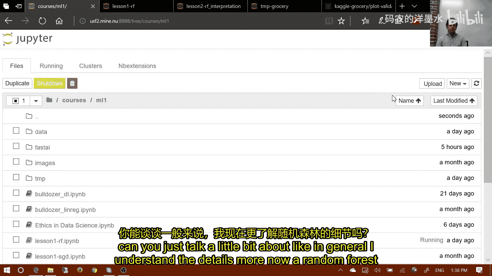
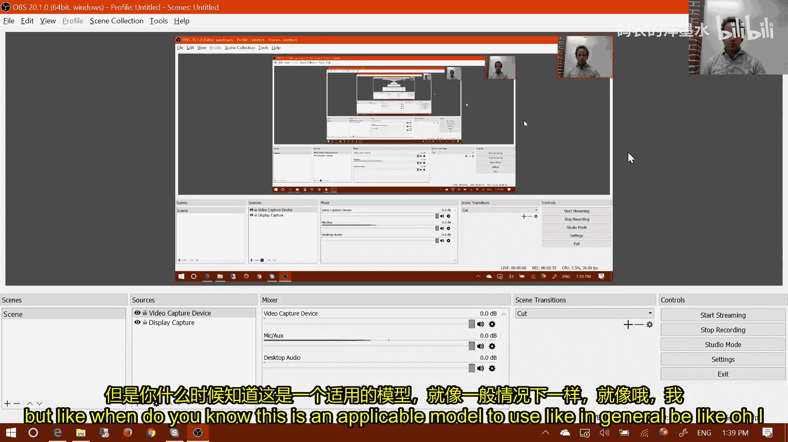
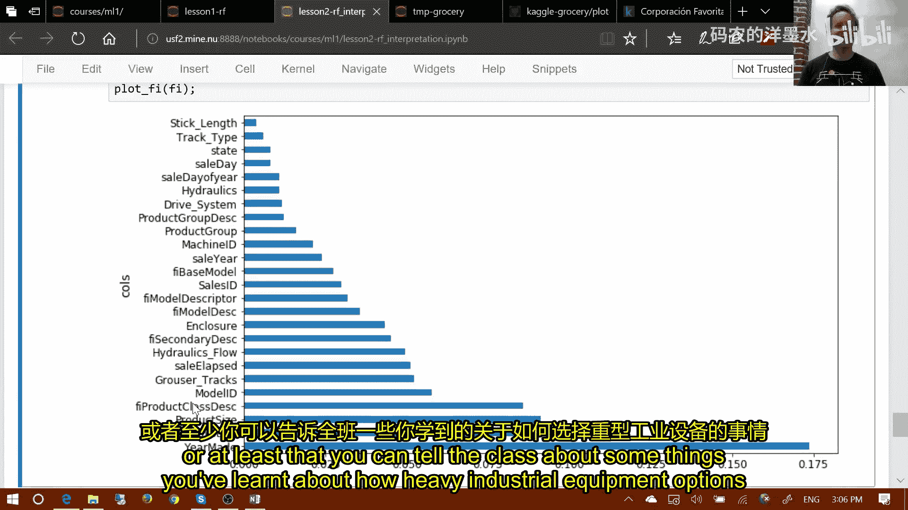

# 【全集】旧金山大学-面向程序员的机器学习-中英字幕-1080P-p03-Lecture-3---性能、验证和模型解释--BV1YAvYBAEG3_p3-

Last lesson we looked at。What random forests are， and we looked at some of the tweaks that we could use to make them work。

Better。So in order to actually practice this， we needed to have a Jupyter notebook environment running so we can either install Ananaconda on our own computers。

 we can use AWS or we can use cresle。com that has everything up and running straight away or else Paspace。

com also works really well so assuming that you've got all that going hopefully you've had a chance to practice running some random forests this week I think。

One of the things to point out though， is that before we did any tweaks of any hyperparameter or any tuning at all。

 the raw defaults already gave us a very good answer for an actual data set that we got off cattle so like the tweets aren't always。

You know the main pace they're just straight， but sometimes they're totally necessary。

But quite often you can go a long way without doing many tweets stall。

So today we're going to look at something， I think maybe even more important than building a predictive model that's good at predicting。

 which is to learn how to interpret that model to find out what it says about your data。

 to actually understand your data better by using machine learning。And this is。啊。

Kind of contrary to the common refrain that things like random forests are black boxes that hide meaning from us and you'll see today that the truth is quite the opposite the truth is that random forests。

Allow us to understand our data deeper and more quickly than traditional approaches The other thing we're going to learn today is how to look at larger data sets。

Then those which you can import with just the defaults and specifically we're going to look at a data set with over 100 million rows。

 which is the current cargo competition for groceries for。

Did anybody have any questions outside of those two areas since we're covering that today or comments that they want to talk about？

不。Yeah I apologize it's kind of like basic just to make sure i'm understanding the concept'm can hear oh sorry can you just talk a little bit about like in general I understand the details more now random forest but like when do you know this is an applicable model to use in general'll be like oh I should try random forest year because that's the part that i'm still like yeah think i'm told to I can but yeah so the short answer is。

I can't really think of anything off hand that it's definitely not going to be at least somewhat useful for。

 so it's always worth trying。I think really the question is。

In what situations should I try other things as well？

And the short answer to that question is for unstructured data， what I call unstructured data。

 so where all the different data points represent the same kind of thing like a waveform in a sound or speech or the words and a piece of text or the pixels in an image。

 you almost certainly are're going to want to try deep learning。嗯。And then outside of those two。

There's a。Particular type of model we're going to look at today called a collaborative filtering model where which it so happens that the groceries competition is of that kind where neither of those approaches are quite what you want without some tweaks to them so that would be the other main one so you're seeing neither are you seeing deep learning and neither deep learning or random forests is exactly what you want you need to kind of do some tweaks you see。

Yeah， if anybody thinks of other places where maybe neither of those techniques is the right thing to use。

 yeah， mention it on the forums， even if you're not sure you know。

 so we can talk about it because I think this is one of the more interesting questions。

And to some extent， it is a case of。Practice and experience。

 but I do think there are two main classes you know about。So。Last week。We。

At the point where we had kind of done some of the key steps， you know。

 like the CSV reading in particular which took you know a minute or two at the end of that we saved it to a feather format file and just to remind you that's because this is。

Basically almost the same format that it lives in RAM so it's like ridiculously fast to read and write stuff from further format so what we're going to do today is we're going to look at lesson two RFF interpretation。

And the first thing we're going to do is read that feather format file。Now。

 one thing to mention is a couple of you pointed out during the week。

 a really interesting little bug or little issue， which is in the ProF function。Yeah。

The ProtF function， remember， finds the numeric columns which have missing values and creates an additional Boolean column as well as replacing the missing with medians。

And also turns the categorical objects， you know， into into the integer codes the main things it does and a couple of you pointed out some key points about the missing value handling the first one is that。

Your test set。May have missing values in some columns that weren't in your training set or vice versa。

 and if that happens you're going to get an error when you try to do the random forest because it's going to say。

 you know if that is missing field appeared in your training set but not in your test set that ended up in the model。

 it's going to say you can't。Use that data set with this model because you're missing one of the columns it requires。

That's problem number one。Prorole number  two is that the media。

the median of the numeric values and the test set may be different。For the training set。

 And so it may actually process it into something which has different semantics。

So I thought that was a really interesting point， so what I did was I changed Prop DF。

 so it returns a third thing NAs and the NAs thing it returns。

 it doesn't matter in detail what it is but I'll tell you to so you know， that's a dictionary。

 that where the keys are the names of the columns that have missing values and the values of the dictionary are the mediumns and so then optionally you can pass NAs as an additional argument to Pro DF。

And it'll make sure that it adds those specific columns and it uses those specific mediums， Okay。

 so it's kind of it's giving you the ability to say process this test set in exactly the same way as we process this training set。

 Can you pass that。Yeah。Hi， is this a updated feature so you just updated so I just did that have yeah in fact that's a good point before you start doing work。

Any day I would start doing a Gi pull and if something's not working today that was working yesterday。

 check the forum where there'll be an explanation of why you know this。😊。

This library in particular is moving fast but pretty much all the libraries that we use including Ptorrch in particular move fast and so one of the things to do if you're watching this through theOC is to make sure that you' go to course up faster AI and check the links there because there'll be links saying oh。

 these are the differences from the course and so they're kind of kept up to date so that you're never going to because I can't edit。

What I'm saying on。Yeah， but yeah， do a gi pull before you start each day。嗯。

So I haven't actually updated all of the notebooks to add the extra return value。

 I will over the next couple of days， but if you're using them you'll just need to put an extra comma andAs yeah。

 otherwise you' get an error that it's returned three things and you only have room for two things。

Okay。What I want to do， I think what I want to do before I talk about interpretation is to show you what the exact same process looks like when you're working with a really large data set。

So。And you'll see it's kind of almost the same thing。

 but there's got to be a few cases where we can't use the defaults because the defaults kind of like。

First run a little bit too slowly。 Okay， so specifically， I'm going to look at the。Yeah。

Cable groceries， competition， specific lady。What's it code here it is compress your favorite grocery sales forecasting so this competition。

Well， who was entering this competition？Okay， a lot of you。

 who would like to have a go at explaining what this competition involves。

 what the data is and what you're trying to believe。Yeah。Okay。

 trying to predict the items on the shelf， depending on lots of factors like oil prices。

 what you say predicting the items on the shelf， what do you mean， what are you actually predicting。

 how much change to have in stock to maximize their， I guess。It's not quite what we're predicting。

 but we'll try and fix that in a moment， so go on。And then there's a bunch of different data sets that you can use to do that。

 there's oil prices， there's stores， there's locations。

 and each of those can be used to try to predict it Okay。

 does anybody want to have a go at expanding on that？嗯。All right。

 so we have a bunch of information on different products so we have so far。All right。

 so for every store for every item for every day， we have a lot of related information available like the。

Location where the store was located the glass of the product。And units sold。 And then based on this。

 we are supposed to forecast in a much shorter time frame compared to the training data for every item number。

 how much we think it's going to sell。 So only the units nothing else。 Okay， good。

 So somebody can help get that here， so。Yeah。So your ability to。

Explain the problem you're working on is really really important okay so if you don't currently feel confident of your ability to do that。

 practice right with someone who is not in this competition， tell them all about it。So in this case。

Or in any case， really the key things to understand a machine learning problem would be to to say what are the independent variables and what is the dependent variable so the dependent variable is the thing that you're trying to predict the thing you're trying to predict is how many units。

Of each kind of product。Were sold in each store on each day during the two week period。

So that's the thing that you're trying to predict。And the information you'd have to predict it is how many units of each product at each store on each day were sold in the last few years。

And for each store， some metadata about it， like where is it located and what class of store is it for each type of product。

You have some metadata about it， such as what category of product is it and so forth for each date。

 we have some metadata about it， such as what was the oil price on that date。

So this is what we would call a relational data set。

 so a relational data is one where we have a number of different pieces of information that we can join together。

Specifically this kind of relational data set is what we would refer to as a star schema。

 a star schema is a kind of data warehousing schema where we basically say there's some central transactions table now in this case the central transactions table。

IfWe go to the data section here is train。csb。And it contains the number of units that were sold。

By date， by store I D， by item， I D。Okay so that's the central transactions table very small。

 very simple and then from that we can join various bits of metadata and it's called a star schema because you can kind of imagine the transactions table in the middle and then all these different metadata tables going onto it giving you more information about the date。

The item ID and the store ID okay sometimes you'll also see a snowflake schema。

 which means there might then be additional information joined onto maybe the items table that tells you about different item categories and joined the store table telling about the state that the stores in and so forth so you can have kind of the whole snowflake。

So that's the basic information about this。Problem， okay， the independent variables。

 the dependent variable。 And you probably also want to hear about like things like the time frame。

Yeah。Now。We start in exactly the same way as we did before loading in exactly the same stuff。

 setting the path， but when we go read CSB， if you say limit memory equals false。

 then you're basically sayingUse as much memory as you like to figure out what kinds of data is here。

 it's going to run out of memory pretty much regardless of how much memory you have。

So what we do in order to limit the amount of space that it takes up when we read it in is we create a dictionary for each column name to the data type of that column and so for you to create this it's basically up to you to run less or head or whatever on the data set to see what the types are and to figure that out and pass them in。

So then you can just pass in day type equals with that dictionary。And so check this out， right。

 we can read in the whole CSV file in。One minute and 48 seconds。And there are。125。5 million roads。

So like。When people say like Python slow。No Python's not slow。

 Python can be slow if you don't use it right， but we can actually pass 125 million CSB records in less than two minutes。

Yeah。My language hat on for just a moment， actually if it's fast。

 almost certainly it's going to see Yeah， so Python is a wrapper around a bunch of sea code usually so yeah。

 so Python itself isn't actually very fast。是样。So。That was Ternce Parr who writes things for writing programming languages for a living so and is right Python itself is not fast but almost everything we want to do in Python and data science has been written for us in C or actually more often in Cyython which is a Pythonlike language which compiles to see and so most of the stuff we run in Python is actually writing not just C code but actually in pandas a lot of it's written in like assembly language it's heavily optimized behind the scenes a lot of that is going back to actually calling Forran based libraries for linear algebra so there's layers upon way of speed that actually allow us to spend less than two minutes reading in that much data yeah if we wrote our own CSB reader in pure Python it would takes thousands of times at least thousands of times longer than the optimized versions。

Yeah， so for us what we care about is the speed we can get in practice and so this is pretty cool as well as telling it what the different data types were。

 we also have to tell it as before， which things do you want to pass as，As date。

I've noting that in this dictionary， you specify in 64 in 33 and intake8。

I was wondering in practice is it like faster if you all specify find them to ink or slower or like any performance consideration So the key performance consideration here was to use the smallest number of bits that I could to fully represent the column so if I had N8 the item number。

 there are more than 255 item numbers in but I mean more specifically the maximum item number is bigger than 255。

So on the other hand， if I had used N64 for store number it's using more its than necessary。

 given that the whole purpose here was to avoid running out of RAM。

 we don't want to be using up eight times more memory than necessary so the key thing was really about memory and in fact when you're working with large data sets very often you'll find the slow piece is the actually reading and writing to RAM。

 not the actual CPU operations， so very often that's the key performance consideration， also however。

 as a rule of thumb smaller data types often will run faster particularly if you can useD so single instruction multiple data vectorized code it can pack more numbers into a single vector to run at once。

Thank you。That was all heavily simplified and not exactly right。

 but where can back that for this purpose。Once you do this。

 the shuffle thing beforehand is not need anymore， like when do send a random subction。Yeah， so。Yeah。

So although here I've read in the whole thing， when I start。

 I never start by reading in the whole thing。So if you search the forum for SHF， SHUF。

 you'll find some tips about how to use this UniX command to get a random sample of data at the command prompt。

And then you can just read that and the nice thing is that that way。

 like that's a good way for example， to find out what data types to use， you know。

 is to read in a random sample and let pandas figure it out for you。Thank you。

 I think I'm still fine this one。嗯。Yeah and in general。

 I do as much work as possible on a sample until I feel confident that I understand the sample before I move on so yeah having said that。

 what we're about to learn is some techniques for running models on this pool data that are actually going to work on arbitraryrbitarily large dataset sets that also I specifically wanted to talk about how to read in large datas one thing to mention on promotion object。

 objects are like like saying create a general purpose Python data type which is slow and memory heavy and the reason for that is that this is a boolean which also has missing values and so we need to deal with this before we can turn it into a boolean so you can see after that I then go ahead and I say fill in the missing values with false Now you wouldn't just do this without doing some checking ahead of time but some exploratory data analysis shows that it seems that this is probably an appropriate thing to do it seems that missing does mean false。

It objects generally read in a string so replace the strings true and false with actual booleanions and then finally convert it to an actual boolean type so at this point when I save this this file now。

Of 123 million records takes up something under two and a half gigabytes of memory。

 so like you can do run you know look at pretty large data sets even on pretty small computers。

 which is interesting。So at that point now that it's in a nice fast format， look how fast it is。

 I can save it to feather format in under five seconds。Okay， so that's nice。

And then because pandas is generally pretty fast， you can do stuff like summarize every column of all 125 million records in 20 seconds。

Okay， so the first thing I looked at here actually is the dates right generally speaking dates are just going to be really important in a lot of the stuff you do。

 particularly because。Any model that you put in practice you're going to be putting it in at some date that is later than the date that you trained it by definition right and so if anything in the world changes you need to know how your predictive accuracy changes as well and so what you'll see on CAL and what you should always do when you're on projects is make sure that your dates don't overlap so in this case the dates that we have in the training set go from 2013 to mid Augustt 2017。

Okay， there's our first and last。You。And then in our test set。They go from one day later。

Right August the 16th until the end of the month。So this is a key thing that like you can't really do any useful machine learning until you understand this basic piece here。

 which is you've got four years of data and you're trying to predict the next two weeks okay so like that's just the fundamental thing that you're going to need to understand before you can really do a good job of this and so as soon as I see that。

What does that say to you if you wanted to now use a smaller data set？

Should you use a random sample or is there something better you could do？Yeah。

Proably from the bottom more recent Yeah get the most recent right and if you ever have trouble answering questions like this just try to make it as physical as possible so it's like okay I'm going to go to a shop next week and I've got a $ five bet with my brother as to whether I can guess how many cans of cokea are going to be on the shelf all right well probably the best way to do that would be to go to the shop same day of the previous week and see how many cans of cocoa on the shelf and guess it's going to be the same you wouldn't go and look at how many were there four years ago。

Yeah。But couldn't four years ago that same time frame of the year be important I mean like for example。

 how much Coke they have on the shelf at Christmas home is maybe way more than so exactly so it's not that there's no useful information from four years ago and so we don't want to entirely throw it away but as as a first step like what was this what is the simplest possible thing it's kind of like submitting the means I wouldn't submit the mean of。

2012 sales， I would want to probably submit the mean of last month's sales， for example。So yeah。

 we just trying to think about like。How might we want to kind of create some initial easy models and how and later on like we might want to wait it。

 so for example we might want to wait more recent dates more highly， they're probably more relevant。

But we should do a whole bunch of exploratory data analysis to check that。

So here's what the bottom of that data set looks like。Okay。

 and you can see literally it's got a date， a store number。

 an item number and give it sales and tells you whether or not that particular item was on sale at that particular store on that particular date and then there's some arbitrary ID right so that's it。

So now that we have read that in we can do stuff like this is interesting again we have to take the log of the sales and it's the same reason as we looked at last week right because we're trying to predict something that kind of varies according to ratios they told us in this competition that the root mean squared logarrow is the thing they care about so we take the log they mentioned also if you check the competition details which you always should read carefully the definition of any project you do they say that there are some negative sales that represent returns and they tell us that we should consider them to be zero for the purpose of this competition so I clip。

The sales so that they fall between zero and no particular maximum。

Okay so clip just means cut it off at that point， try andcate it。

And then take the log of that plus one Why do I do plus one because again。

 if you check the details of the chemical competition。

 that's what they tell you they're going to use， is they're not actually just taking the root mean squared log error。

 but the root mean squared log plus one error。ok。Because luck at zero doesn't make sense。

We can add the date part as usual and you know again it's taking a couple of minutes right so I would run through all this on a sample first so everything takes 10 seconds to make sure it works just to check everything looks reasonable before I go back because I don't want to wait two minutes for something I don't know it's going to work。

But as you can see， all these lines of code are identical to what we saw for the Baldozaers competition。

In this case， all I'm reading in is a training set。

 I didn't need to run train cats because all of my data types are already numeric if they weren't I would need to call Tra cats and then I would need to call apply CAs to apply the same categorical codes that I now have in the training set to the validation set。

I call Pro DF as before to check the missing values and so forth。

So all of those lines of code are identical， these lines of code again are identical because root means grid errors do what we care about。

And then I've got two changes， the first is set RF samples which we learned about last week。

 so we've got 120 something million records， we probably don't want to create a treat from 120 million something records I don't even know how long that's going to take I been I haven't had the time in patience to wait and see。

So you know you could start with 10，000 or 100，000， you know， maybe it runs in a few seconds。

 make sure it works and you can kind of figure out how much you can run and so I found getting it to a million it runs in under a amount right and so the point here is there's no relationship between the size of the data and how long it takes to build a random forest。

 the relationship is between the number of estimators multiplied by the sample size。傻飞。

IJust curious what end job is because the pass has always been negative one and you made it eight years Yeah so the number of jobs is the number of core that it's going to use and I was running this on a computer that has about 60 core and I just found if you tried to use all of them it spent so much time picking up jobs it was a bit slower so if you've got like lots and lots of calls on your computer sometimes you want less than。

Negative one means use every single core。There's one more change I made which is that I converted the data frame into an array of floats and then I fitted on that why did I do that because internally inside the random forest code they do that anyway right and so given that I wanted to run a few different random forests with a few different hypercurmeters by doing it once myself I save that minute 37 seconds。

Right， so。If you run a line of code at a text like。Quite a long time。

 So the first time I ran this random forest aggressor， It kind of took two or three minutes。

 And I thought， I don't really want to wait two or three minutes。

 You can always add in front of the line of code。He run。

Pcent P run and what percent P run does is it runs something called a profiler and what a profiler does is it'll tell you which lines of code behind the scenes took the most time and in this case I noticed that there was a line of code inside Psyit learn that was this line of code and it was taking all the time nearly all the time and so I thought oh I'll do that first and then I'll pass in the result and it won't have to do it again so this thing of looking to see which things is taking up the time is called profiling and in software engineering it's one of the most important tools you have data scientists really underappreciate this tool but you'll find like amongst conversations on GitHub issues or on Twitter or whatever amongst the top data scientists they're sharing and talking about pros all the time and that's how easy it is to get a profile。

For fun， you know， try running P run from time to time on stuff that's taking 10。

 20 seconds and see if you can learn to interpret and use profiler outputs， you know。

 even though in this case I didn't write this pst learn plus。

 I was still able to use the profile to figure out how to make it run over twice as fast by avoiding recalculating this each time。

So in this case I build my regressor， I decided to use 20 estimators。

 something else that I noticed in the profiler is that I can't use OOB score when I use set RF samples because if I do。

 it's going to use the other 124 million rows to calculate the OOB score which is like again it's still going to take forever so I may as well have a proper validation set anyway。

 besides which I want a validation set that's the most recent dates rather than as random。

 so if you use set RF samples on a large data set， don't put the OOB score parameter in because a takes parameter。

So that got me a 0。76 validation root means squared log error。

And then I tried like fiddling around of different min samples。

 so if I decrease the min samples each from 100 to 10。

 it took a little bit more time to run as you would expect。And the error went down from 76 to 71。

 so that looked pretty good so I kept decreasing it down to three and that brought this error down to 0。

70 but I decreased it down to one we didn't really know so I kind of had like a reasonable random forest yeah。

When I say reasonable， though， it's not reasonable in the sense that it does not give a good result on the leaderboard。

And so this is a very interesting question about why is that and the reason it really coming back to Savannah's question earlier。

 like where might random forests not work as well Let's go back and look at the data。Okay。

 here's the entire data set that we're not the whole data， here's all the columns that we used。

 so the columns that we have to predict with are the date。The store number， the item number。

 and whether it is on promotion or not。And then of course we used a date parts so there's also going to be day of week。

 day of month， day of year is quarter start， et cetera， et ceter。So。If you think about it。

 most of the insight， you know， around like。How much of something do you expect to sell tomorrow？

Is likely to be very wrapped up in the details about like where is that store。

 what kind of things do they tend to sell at that store for that item， what category of item is it。

 you know， if it's like。😔，Fresh bread， they might not sell much of it on Sundays because on Sundays you know fresh bread doesn't get made where it's gasoline。

 maybe they're going to sell a lot of gasoline because on Sundays people go and fill up their car with a week ahead right now a random forest has no ability to do anything other than create a bunch of binary splits on things like day of week store number item number It doesn't know。

Which one represents gasoline， it doesn't know which stores are in the center of the city versus which ones are out in the skis。

 it doesn't know any of these things。Its ability to。

Really understand what's going on is somewhat limited。

 so we're probably going to need to use the entire four years of data to even get some useful insights。

 but then as soon as we ci using the whole four years of data。

 a lot of the data we're using is really old。So interestingly。

 there's a cable kernel that points out that what you could do is just take the last two weeks。

And take the average sales， the average sales by date， by store number， by item number。

 and just submit that。And if you just submit that。You come about 30th。嗯。All right。

 so for those of you in the groceries Ternce has a comment or a question。

I think this may have tripped me up actually I think you said date store item I think it's actually store item sales and then you mean across date Oh yeah you're right it says store item and on promotion promotion yes。

If you do it if you do it by date as well， you end up so these each row represents basically like a cross tabulation of all of the sales on that date in that store for that item so if you put date in there as well there's only going to be one or two。

Items being averaged in each of those cells， which is know too much variation。

 basically it too sparse。It doesn't give you a terrible result， but it's not 30ious。So your job。

 if you're looking at this competition and we're talk about this in the next class is how do you start？

With that model。And make it a little bit better。Because if you can， then by the time we meet up next。

 hopefully you'll be above the top 30 because you know， CAgel being CAle。

 lots of people have now taken this kernel and submitted it and they all have about the same score and the scores are ordered not just by score but by date submitted so if you now submit this kernel。

 you're not going to be 30th because you're way down the list of，Of when it was submitted。

 But if you can do a tiny bit better， you're going to be better than all of those people。

 So try and think of how can you make this。That's how to get better。Yes，H。

Could you try to capture seasonality and trend effects by creating new columns like these are the average sales in the month of August。

 These are the average sales for this year。 Yeah， I think that's a great idea。

 So the thing for you to think about is。😊，How to do that right， And so like see if you can。

 see if you can make it work because there are details to get right。

 which I I know Terrence has been working on this for the last week and he's gone almost crazy right the details crazier get crazier the details are。

AreDiff。They're not difficult like intellectually difficult。

 they're kind of difficult in the way that makes you like when I head by your desk at 2 am and like this is some information in general is。

The coding you do for machine learning is like。It's incredibly frustrating and incredibly difficult。

 not difficult like technically， but difficult like if you get a detail wrong。😊。

Much of the time it's not going to give you an exception。

 It'll just silently be slightly less good than it otherwise would have been right And if you're on cattle。

 at least you know， okay， well， I'm not doing as well as other people on cattle right but if you're not on cattle。

You just don't know like you don't know if your company's model is like half as good as it could be because you made a little mistake right？

😔，That's why one of the reasons why practicing on Ca now is great right because you're going to get practice in finding all of the ways in which you can infuriatingly screw things up and you'll be amazed like for me there's an extraordinary array of them but as you get to know what they are。

 you'll start to know how to check for them as you go right and so the only way like you should assume every button you press you're going to press the wrong button right and that's fine as long as you have a way to find out。

😊，Okay so。嗯。We'll talk about that more during the course but unfortunately there isn't like a set of specific things I can tell you to always do。

 you just always have to think like okay。😔，What do I know about the results of this thing I'm about to do I'll give you a really simple example I'll give you a really simple example。

😔，If you've actually created that basic entry where you do take the mean by date by store number by on promotion and you've submitted it and you've got a reasonable score and then you think you've got something that's a little bit better and you do predictions for that。

How about you now how to scatter plot？Showing the predictions of your average model on one axis versus the predictions of your new model on the other axis。

 you should see that they just about form a line。And if they don't。

 then that's a very strong suggestion that youve screwed something up。 so that'll be an example。Okay。

 can you pass that one to the end of that row， possibly two steps？Once再。Yeah。

 so for a problem like this。Unlike the car insurance problem on Kago't where columns are unnamed。

 we know what the columns represent what they are。Do you how often do you pull in data from other sources to supplement that？

Maybe like weather data or you know， for example or。

How often is that used very often and so the whole point of this star schema is that you've got your central table and then you've got these other tables coming offered that provide metadata about it so for example。

 whether is metadata about a date right now。On cattle， specifically。

Most competitions have the rule that you can use external data as long as you post on the forum that you're using it and that it's publicly available。

 but you have to check on a competition by competition basis they will tell you outside of KaL。

 you should always be looking for like what external data could I possibly leverage here。Yes这。

Because otherwise they're kind' of hear on the recording okay so are we still talking about how to tweak this data set if you wish Well I'm not familiar with the countries here。

 so maybe Ecuador Ecuador so maybe I would Ecuador's largest grocery chain Ecuador's largest grocery maybe I would start looking for Ecuador's holidays and shopping holidays。

 maybe when they have a threeday weekend or week and actually that information is provided in this case and so in general。

 one way of tackling this kind of problem is to create lots and lots of new columns containing things like you know average number of sales on holidays average percent change in sale between January and February and so on and so forth and so if you have a look at。

There's been a previous competition on Kagel called Rossman's door sales that was almost identical。

 it was in Germany in this case， for a major grocery chain。

 how many items are sold by day by item type by store。

And in this case the person who won quite unusually actually was something of a domain expert in this space。

 they're actually a specialist in doing logistics predictions and this is basically what they did was a professional sales forecast consultant he created just lots and lots and lots of columns based on his experience of what kinds of things tend to be useful for making predictions so that's an approach that can work The third place team。

Did almost no feature engineering， However。 And also， they had one big oversight。

 which I think they would have won if they had no had。

 So you don't necessarily have to use this approach。 So we'll be learning anyway。

 we'll be learning a lot more about how to。Win this competition and ones like it as we go。

They did interview the third place Dan， so if you Google for Kagel Rossman you'll see it。

 the short answer is they use it deeply。嗯。So one of the things and these are a couple of charts that so Terrence is actually my teammate on this competition。

 so Terrence drew a couple of these chats for us and I wanted to talk about this which is。

If you don't have a good validation set， it's hard if not impossible， to create a good model。

 so in other words like if you're trying to predict，Next month， sales。And you build a bunch。

 you know you try to build a model and you have no way of really knowing whether the models you built are good at predicting sales a month ahead of time。

 then you have no way of knowing when you put your model in production。

 whether it's actually going to be any good？So you need a validation set that you know is reliable at telling you whether or not your model is likely to work well when you put it into production or use it on the test set。

😔，So in this case， what Ternce has plotted here is so normally you should not use your test set for anything other than using it right at the end of the competition or right at the end of the project to find out how you've got。

 but there's one thing I'm going to let you use the test set for in addition and that is to calibrate your validation set so what Ternce did here was he built four different models some which you thought would be better than others and he submitted each of the four models to caL to find out its score and so the X axis is the score that Cagel told us on the leaderboard。

ok。And then on the Y axis， he plotted the score on a particular validation set he was trying out to see whether this validation set looked like it was going to be any good。

So if your validation set is good， then the relationship between the leaderboard score。

 the test set score， and your validation set score should lie in a straight line。

Ideally it'll actually lie on the y equals x line， but honestly that doesn't matter too much as long as relatively speaking it tells you which models are better than which other models then you know which model is the best and you know how it's going to perform on the test set because you know the linear relationship between the two things。

So in this case Terrence has managed to come up with a validation set which is looking like it's going to predict our CaL leaderboard score pretty well and that's really cool right because now you can go away and try 100 different types of models feature engineering waitinging tweaks。

 hyperparas whatever else see how they go on the validation set and not have to submit to CaL right so we're going to get a lot more iterations a lot more feedback this is not just true of CaL but every。

Machine learning project you do and so if you find so here's a different one he tried right where it wasn't as good right it's like oh these ones that were quite close to each other it's showing us the opposite direction that's a really bad sign it's like okay this validation set idea getting in like a good idea this validation set idea it look like good idea so in general if your're validation set not showing a nice straight line you need to think carefully like okay how is the test set constructed how is my validation set different there's some way you're constructing it which is different I'm going to have to draw lots of charts and so forth。

嗯。So one question is and I'm going going to guess how you did it。

 so how do you actually try to construct this validation set as close to the so what I would try to do is to try to sample points from the trading set that are very closer possible to some of the。

Point in the test set person what says I don't know， I will have to find the features。

But in this case thisies the last points basically all different Ter trying different variations of so the most。

 what I noticed was， so first I looked at the date range of the test set。

And then I looked at the the kernel that described how heres the date range of the test set。

 So the last two weeks of August 262017 That's right。

 And then the person who submitted the kernel that said how to get the 0。

58 leader board position or whatever score the average I looked at the date range of that and that was 9 or 10 days。

 Well， it was actually 14 days and the test set is 16 days。 But the interesting thing is the。

Test set begins on the day after payday and ends on the pay day。

 And so these are things I also paid attention to。But and I think that's one of the bits of better data that they told us。

 you know， so these are the kinds of things you just got to like。

like I said quite lots of pictures and like even if you didn't know it was paidday you know you would want to like draw the time series chart of sales and you would hopefully see that like every two weeks it would be a spike or whatever and you'd be like oh。

 I want to make sure that my I have the same number of spikes in my validation set that I' had in my test example Okay let's take a five minute break and let's come back at。

232。Yeah。Okay， so。This is my favorite bit of interpreting machine learning models by the way。

 if you're looking for my notebook about the groceries competition。

 you won't find it in GitHub because I'm not allowed to share code for running competitions with you unless you're on the same theme as me that's the rule after the competition is finished it' be on GitHub however so if you're doing this through the video you should be able to find it。

So。Let's start by。Reading in our feather file， so our feather file is exactly the same as our CSB file。

 this is for our blue Book for bulldos competition。

 so we're trying to predict the sale price of heavy industrial equipment at option and so reading the feather format file means that we've already read in the CSB and processed it into categories。

And so the next thing we do is to run property F in order to turn the categories into integers。

 deal with the missing values， and pull out the independent variable。Okay。

 this is exactly the same thing as we used last time to create a validation set where the validation set represents the last couple of weeks。

 the last 12，000 records by date。And I discovered thanks to one of your excellent questions on the forum last week I had a bug here。

 which is that Pro DF。Was shuffling the order， sorry。

So not Pro D and last week we saw a particular version of Pro D。Where we passed in a subset。

And when I passed in the subset， it was randomly shuffling and so if everybody said split valves。

 it wasn't getting the last。Rs by date， but it was getting a random set of rows so I've now fixed that so if you rerun the lesson one RF code you'll see slightly different results specifically you'll see in that section that my validation set results look less good。

 but that's only for this tiny little bit where I had subset equals。Se， yes， attention。

I'm a little bit confused about the notation here， So NAS is both a input variable and it's also the output variable of this function。

 And why is that。Yeah。The property F returns a dictionary telling you which things were missing。

 which columns are missing， and for each of those columns what the median was。

 so when you call it on like the larger data set， the non-subset。

 you want to take that return value and you don't pass in an NAD to that point。

 you just want to get back the result。Later on when you pass it into a subset you want to have the same missing columns and the same medias and so you pass it in and if like this different subset。

 like if it was a whole different data set， turned out had had some different missing columns。

 it would update that dictionary with additional。Key values as well so it kind of you can you don't have to pass it in if you don't pass it in then it just gives you the information about what was missing and the mediumns if you do pass it in it uses that information for any missing columns that are there and if there are some new missing columns that will update that dictionary with that additional information So it's like keeping data sets column information Yeah it's going to keep track of all any missing columns that you came across in anything you passed the correctly yeah you。

Okay， so。We split it into the training and test set just like we did last week。And so to remind you。

Once we've done property Df， this is what it looks like， this is the log of sale price， okay。

So the first thing to think about is we already know how to get the predictions。

 which is we take the average value in each leaf mode in each tree after running a particular road through each tree。

 that's how we get the prediction。But normally we don't just want a prediction。

 we also want to know how confident we are of that prediction。

 and so we would be less confident of a prediction if we haven't seen many examples of rows like this one。

And if we haven't seen many examples of rows like this one。

 then we wouldn't expect any of the trees to kind of have a path through which is really designed to help us predict that row and so conceptually you would expect then that as you pass this unusual row through different trees。

 it's kind of going to end up in very different places。So in other words。

 rather than just taking the mean of the predictions of the trees and saying that's our prediction。

 what if we took the standard deviation of the predictions of the trees so the standard deviation of the predictions of the trees。

If that's ha， it means each tree。Is giving us a very different estimate of this rose prediction。

So if this was a really common kind of road， then the trees will of learnedt。

To make good predictions for it， because it's seen lots of opportunities to split based on those kinds of roads。

so the standard deviation of the predictions across the trees gives us some kind of at least relative understanding。

Of how confident we are of this prediction。That is not something which exists。

In psyt Learn or in any library I know of。So we have to create it。

 but we already have almost the exact code we need because remember last lesson we actually manually calculated the averages across different sets of trees so we can do exactly the same thing to calculate the standard deviations。

When I'm doing random forest interpretation， I pretty much never use the full data set I always call set R samples because like。

We don't need a massively accurate。Bandom forest， we just need one， which indicates。

The nature of relationships involved right and so I just make sure this number is high enough that if I call the same interpretation commands multiple times。

 I don't get different results back each time that's like the rule of thumb about how big does it need to be but in practice like 50000 is a high number and most of the time you know it would be surprising if that wasn't enough and it runs in seconds so I generally start with 50000 So with my 50000 samples per tree set I create 40 estimators I know from last time that min samples leafing equal 3 max features equals 。

5 isn't bad and again we're not trying to create the world's most predictive tree anyway so that all sounds fine we get an R squared on the validation set of 。

89 again we don't particularly care but it's。As long as it's good enough。

 which it certainly is and so here's where we can do that exact same list comprehension as last time。

 remember， go through each estimator at each tree， call do predict on it with our validation set。

 make that a list comprehension and pass that to NP。 stack。

 which concateates everything in that list across a new axis。Okay。

 so now our rows are the results of each tree and our columns are the result of each row in the original data set。

 and then we remember we can calculate the mean right so here's the prediction for our data row number one and here's our standard deviation。

Okay， so here's how to do it for just one observation at the end here。

 we've calculated for all of them just pretty it for one here。第。This。

This can take quite a while and specifically it's not taking advantage of the fact that my computer has lots of core in it。

List comprehensions， this is like the list comprehension itself is Python code right it's my Python code and Python code unless you're doing special stuff runs in serial which means it runs on a single CPU doesn't take advantage of your multi CPU hardware and so if I wanted to run this on more trees and more data you this one second is going to go up and you see here the wall time。

 the amount of actual time it took is roughly equal to the CPU time where else if it was running on lots of core。

 the CPU time would be higher than the wall time。So it turns out that psychic Learn provides a handy。

 actually notsyic Learn， Fast AI provides a handy function called parallel trees which calls some stuff inside psychic learn and parallel trees takes two things。

 it takes a random forest model that I trained， here it is。

And some function to call and it calls that function on every tree in parallel， so in other words。

 rather than calling t dot predict x ballad， let's create a function that calls T dot predict x validad。

Let's use parallel trees to call it on our model to every tree。

 okay and it will return a list of the result of applying that function to every tree。

And so then we can NP。 stack that so hopefully you can see that that code and that code are basically the same thing right but this one is doing it in parallel and so you can see here now our all time has gone down to 500 milliseconds and it's now giving us exactly the same answer so a little bit faster time permitting we'll talk about more general ways of writing code that runs in parallel that turns out to be super useful for data science。

 but here's one that we can use it's very specific to random forests。Okay。

 so what we can now do is we can always call this to get our predictions for each tree and then we can call standard deviation to then get them for every row and so let's try using that so what I could do is let's carry a copy of our data and let's add an additional column to it which is the standard deviation of the predictions across the first axis okay and let's also add in the me so they're the predictions themselves。

嗯。So you might remember from last lesson that one of the predictors we have is called enclosure and we'll see later on that this is an important predictor and so let's start by just doing a histogram so one of the nice things in pandas its got built in flooding capabilities as well worth Googling for panndadas flooding to see how to do it。

Yes， Terrence。Jirerman， can you remind me what enclosure is？

We don't know what it means and it doesn't matter， you know。

 like that's the whole purpose of this process is that we're going to figure out。

We're going to learn about what things are or at least what things are important and we'll later on figure out what they are or how they're important so we're going to start out knowing nothing about this data set right so there's something so I'm just going to look at something called enclosure that has something called EOs and something called OOs and I don't even know what this is yet all I know is that the only three that really appear in any great quantity are OOs EOs WAC and EOs and this is like really common as a data scientist you know you' often find yourself looking at data that you're not that familiar with and you've got to figure out at least like which bits to study more carefully and which bits into matter and so forth so in this case at least know that these three groups I really don't care about because they basically don't exist。

So given that we're going to ignore those three， so we're going to focus on this one here。

 this one here and this one here， and so here you can see what I've done is I've taken my data frame and I've grouped by enclosure。

And I am taking the average of these three fields， so here you can see here's the average sale price。

 the average prediction and the standard deviation of prediction for each of my three groups。

 so I can already start to learn a bit here as you would expect the prediction and the sale price are close to each other on average so that's a good sign。

嗯。And then the standard deviation varies a little bit。 It's a little hard to see in a table。

 So what we could do is。We could try to start like printing these things out。

 so here we've got the sale price。For each level of enclosure and here we've got the prediction for each level of enclosure and for the error bars I'm using the standard deviation of prediction so here you can see the actual and here's the prediction and here's my competence interval the all。

Okay。嗯。Or at least it's the average of the standard deviation of the random forests。So this tells us。

 it'll tell us if there's some groups or some rows that we're not very confident of at all。

So we could do something similar for product size。Right so here's different product sizes。

We can do exactly the same thing of looking at our predictions and our standard deviations。

Okay we could sort by and what we could say is like well what's the ratio of the standard deviation of the predictions to the predictions themselves right so you would kind of expect on average that when you're predicting something that's a bigger number that your standard deviation would be higher so you can like sort by that ratio and what that tells us is that the product size large and product size compact。

Our predictions are less accurate。You know， as relatively speaking as a ratio of the total price。

 and so then if we go back and have a look。Well there you go， that's why from the histogram。

 those are the smallest groups。Okay so as you would expect in small groups we're doing a less good job right so this confidence interval you can really use for two main purposes。

 one is that you can group it up like this and look at the average confidence interval by group to find out are there some groups that you just don't seem to have confidence about those groups。

 but perhaps more importantly you can look at them for specific roads and so when you put it in production？

You might always want to see the confidence interval。

 so if you're doing say your credit scoring so deciding whether to give somebody a loan。

 you probably want to see not only what's their level of risk but how confident are we and if they want to borrow lots of money and we're not at all confident about our ability to predict whether they'll pay it back。

 we might want to give them a smaller loan。Okay， so those are the two ways in which you would use this。

Okay let me go to the next one which is the most important the most important is feature importance and the only reason I didn't do this first is because I think the intuitive understanding of how to calculate confidence interval is the easiest one to understand intuitively in fact it's almost identical to something we've already calculated but in terms of which one do I look at first in practice I always look at this in practice so when I'm working on whether it be a capital competition or a real world project I build a random forest as fast as I can try and get it to the point that it's like you know significantly better than random but doesn't have to be much better than that and then the next thing I do is to plot the feature importance and the feature importance tells us in this random forest which columns。

Ma it。Right， so we had like。Dozens and dozens of columns originally in this data set and here I'm just picking out the top 10 so you can just call RFf feature importance again this is part of the Fast Ao library。

 it's leveraging stuff that's ins Learn pass in the model。

Pass in the data frame because we need to know the names of columns and it'll tell you it'll order。

 give you back a pandas data frame showing you in order of importance。

 how important was each column and here I'm just going to pick out the top 10。

So we can then plot that right so FiI， because it's a data frame。We can use data frame plot commands。

 so here I've plotted all of the feature importances。

RightAnd so you can see here like and I haven't been able to write all of the names of the columns at the bottom。

 which that's not the important thing， the important thing is to see that some columns are really。

 really important and most columns don't really matter at all and like in nearly every data set you use in real life。

 this is what your feature importance。Is going to look like it's going to say there's like a handful of columns you care about。

 And this is why I always start here， right， because at this point。

 in terms of like looking into learning about this domain of。

everav industrial equipment options are only got to care about learning about the columns which matter so are we going to bother learning about enclosure depends whether enclosure is important and。

There it is。 that's in the top 10。 So we are going to have to learn about enclosure。 Okay。

 so then we could also plot this。As a bar plot so you can here I've just created a little tiny little function here that's going to just plot my bars and I'm just going to do it for the top 30 and so you can see the same basic shape here and I can see there's my enclosure。

Okay。So。We're going to learn about how this is calculated in just a moment。

 but before we worry about how it's calculated， much more important is to know what to do with it。

So the most important thing to do with it is to now sit down with your client or your data dictionary or whatever your source of information is and say to them okay tell me about yearm what does that mean where does it come from lots of things like histograms of year made it's got lots of year made against price and learn everything you can because year made and couple of system they're the things that matter and what' will often happen in real world projects is that you'll sit with the client and you'll say。

 oh it turns out the coupler system is the second most important thing and then they might say that makes no sense。

Now， that doesn't mean that there's a problem with your model。

M there's a problem with their understanding of the data that they so let me give you an example。

 I entered a CAle competition where the goal was to predict which applications for grants at a university would be successful。

And I used this exact approach， and I discovered a number of columns which were almost entirely predictive of the dependent variable。

And specifically， when I then looked to see in what way they're predictive。

 it turned out that whether they were missing or not was basically the only thing that mattered。

 and as data said。And so later on so I ended up winning that competition and I think a lot of it was thanks to this insight and so later on I heard what had happened and it turns out that at that university you know there's an administrative burden to filling out the database and so for a lot of the grant applications they don't fill in the database for the folks whose applications weren't accepted right so in other words these missing values in the data were saying okay this grant wasn't accepted because if it was accepted then you know the admin folks are going to go in and type in that information so this is what we call data leakage and data leakage means there's information in the data that I was modeling with。

which the university wouldn't have had in real life at the point in time they were making a decision right so when they're actually deciding you know which grant applications should I like prioritize。

 they don't actually know which ones the admin staff for later I'm going to add information to because it turns out that they got accepted。

Sit again， right so。One of the key things you'll find here is data leakage problems and that's a serious problem that you need to deal with。

嗯。The other thing that will happen is you'll often find it signs of colinity and I think that's what's happened here with coupler system I think coupler system tells you whether or not a particular kind of heavy industrial equipment has a particular feature on it but if it's not that kind of industrial equipment at all it will be empty it will be missing and so coupler system is really telling you whether or not it's a certain class of heavy industrial equipment now this is not leakage this is actual information you actually have at the right time it's just that like interpreting it you have to be careful okay。

So I would go through at least the top 10 or like kind of look for where the natural break points are and really study these things carefully。

😔，To make life easier for myself， what I tend to do is I try to throw some data away and see if that matters。

 so in this case I had a random forest which。Let's go and see how accurate it was。89，889。

What I did was I said here， okay， well let's go through our feature importance data frame and filter out those where the importance is greater than 0。

005。Right， so。025 so 。005 was about here。 right， It's kind of like where they really flatten off。

 right， So let's just。Take those。And so that gives us a list of 25 column names and so then I say。

 okay， let's now create a new data frame view which just contains those 25 columns。

 coal split bowels on it again within the test and training set and create a new random forest。

And let's see what happens。And you can see here。The Rqua basically didn't change 891。

Versus889 so it's actually increased a tiny bit right I mean generally speaking removing redundant columns you know it shouldnt obviously it shouldn't make it worse。

 if it makes it worse they weren't redundant after all it might make it a little better because if you think about how we built these trees when it's deciding what to sp on you know it's got less things to have to worry about trying it's less often going to like accidentally find a crappy poll so it's got a slightly better opportunity to create a slightly better tree with slightly less data but it' it's not going to change it by much but it's going to make it a bit faster and it's going to let us focus on what matters。

So if I rerun feature importance now。I've now got 25 Now the key thing that's happened is that when you remove。

Redundant columns is that you're also removing sources of colineity， right in other words。

 two columns that might be related to each other。Now。

 cuity doesn't make your random forest less predictive。

But if you have two columns that are related to each other。

 you know know this columns a little bit related to this column and this columns a strong driver of the dependent variable。

 then what's going to happen is that the importance is going to end up like kind of split between the two coline columns it's going to say like well both of those columns matter so kind of going of split it between the two so by removing some of those。

Colums with very little impact， it makes your feature importance plot clearer。

 and so you can see here actually year made。Was pretty close to couple system before。

 but there must have been a bunch of things that were colon with yearmade which makes perfect sense right like old industrial equipment wouldn't have had a bunch of kind of technical features that new ones would for example so it's actually saying like oh okay yearm really really matters right so I trust this feature importance better you know the predictive accuracy of the model is a tiny bit better but this feature importance has a lot less pollity to confuse us。

So let's talk about how this works。And it's actually really simple and not only is it really simple。

 it's a technique you can use， not just for random forests。

But for basically any kind of machine learning model。And interestingly。

 almost no one knows that like many people will tell you oh this particular kind of model there's no way of like interpreting it and the most important interpretation of a model is knowing like which things are important and that's almost certainly not going to be true because this technique I'm going to teach you actually works to any kind of model so here's what we're going to we're going to take our data set。

The bulldozers right and we've got this column which we're trying to predict， right， which is price。

And then we've got all of our independent variables。Okay， so here's an independent variable here。

Yeah made。Plus a whole bunch of other variables， and remember we had after we did a bit of trimimming。

 we had 25 independent variables。Okay。How do we figure out？😮，How important year made is。 Well。

 we've got our whole random forest right， and we can find out our predictive accuracy where we're going to put all of these rows。

S about random forest。And we're going to spit out some predictions。

And we're going to compare them to the actual price you get in this case， for example。

 our root means squared error and r squared。And we're going to call that like that's our starting point right so now let's do exactly the same thing。

 but let's take the year made column。And randomly shuffle it。They randomly permute just that column。

 so now year has exactly the same like distribution as before the same means down deviation。

 but it's going to have no relationship to a dependent variable at all because we totally randomly reordit it。

So before we might have found our R square with 0。89， right and then after we shuffle。EA。

 we check again， and now it's like 0。8。Okay， oh， our core got much worse when we destroyed that variable。

It' was like， okay， let's try again， let's put Y made back to how it was。And this time。

 let's take enclosure。And shuffle that。And we find this time of enclosure。It's  point at 4。

And we can say， oh， okay， so the amount of decrease in our score for year made was 0。

09 and the amount of decrease in our score for enclosure。Was 0。05。

And this is going to give us our future importances。For each one of our colleagues。Yes。Yeah。

Wouldn't just excluding， let's say， each column and running running a random forest and checking the。

The cake in the。 Yes， so。You could remove the column and train a whole new random forest。

 but that's going to be really slow。 Where this way we can keep our random forest and just test the predictive accuracy' get。

 so this is nice and fast by。 In this case， we just have to rerun every row forward through the forest。

 for each shuffle column。 we're just basically doing predictions exactly Okay， great question。😊。

So if you want to do like multicolonity would you do two of them and then random shuffel and then three of them random shuffovel like that yeah so I mean I don't think you mean Monteco linearity I think you mean looking for interaction effects yeah so if you want to say which pairs of variables are most important you could do exactly the same thing each pair in turn in practice。

There are better ways to do that because that's obviously computationally pretty expensive。

We'll try and find time to do that if we can。O。So we now have a model which is a little bit more accurate and we've learned a lot more about it。

So we're out of time and so what I would suggest you try doing now before the next class for this bullordozs data set is like go through。

The top， I don't know， five or 10。Proredicors and try and learn what you can about how to draw plots in pandas and try to come back with like some insights about like what's the relationship between yearmade and the dependent variable。

 what's the histogram of yearmade you know try and find you know some possible like now that you know year made' is really important if there's some noise in that column which we could fix are there's some weird encodings in that column that we could fix this idea I had that maybe a couple systems there entirely because it's colinear with something else generally try and figure out whether that's true if so。

 how would you do it FiI product class desk。That brings alarm bells to me。

 It sounds like it might be a high cardinality categorical variable。

 It might be something with lots and lots of levels because it sounds like it's like a model name。

 So like going to have a look at that model name， does it have some order to it。

 Could you make it an or variable to make it better does it have some kind of hierarchical structure in the string that we could split it on like hyphen to create more subcolums。

 know， have a think about this， know， and so try and make it so that know by Tuesday when you come back。

 You've got some new， ideally， you've got a better accuracy than what I just showed because youve found some new insights or at least that you can tell the class about some things you've learned about how every industrial equipment options work in practice see on Tuesday。

😊。

