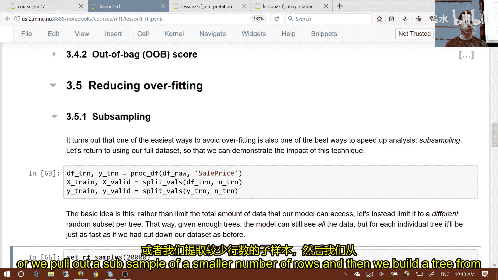
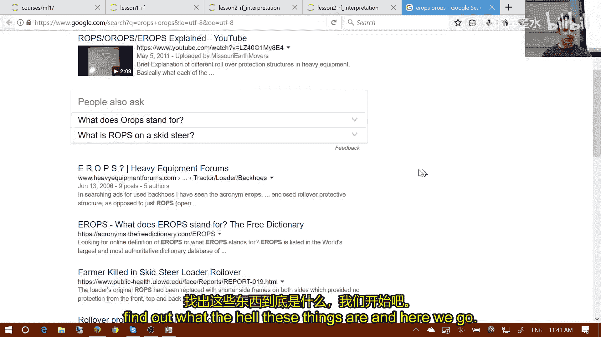
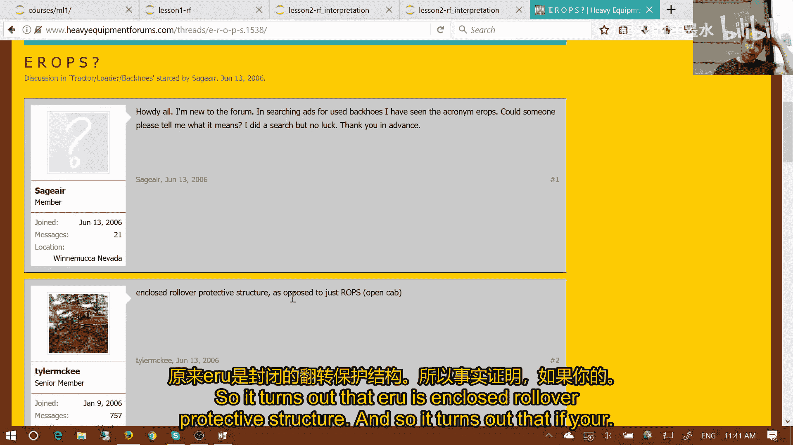
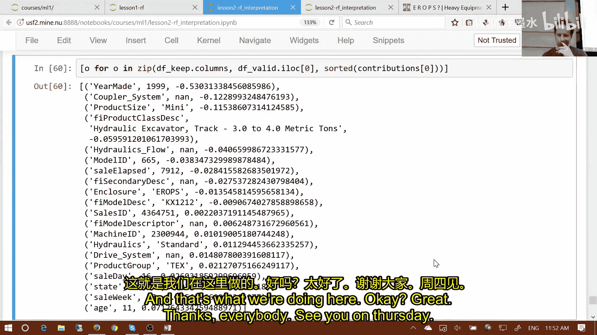

# 【全集】旧金山大学-面向程序员的机器学习-中英字幕-1080P-p04-Lecture-4---树解释器--BV1YAvYBAEG3_p4-

All right， welcomee back。 something to mention， somebody asked on the forums really good question was like。

😊，How do I deal with version control and notebooks。

 The question was something like every time I change the notebook， Jeremy goes and changes it on Git。

 and then I do a gett pull， and I end up with a conflict and。blah。

 blaAnd that happens a lot with notebooks because notebooks behind the scenes are JSON files。

 which like every time you run even a cell without changing it。

 it updates that little number saying like what numbered cell this is and now suddenly there's a change and so trying to merge notebook changes as a nightmare so my suggestion like a simple way to do it is when you're looking at some notebook。

Like lesson two RFF interpretation and you want to start playing around with this。

First thing I would do would be to go file， make a copy。And then in the copy。

 say file rename and give it a name that starts with TmpP。

That will hide it from get right and so now you've got your own version of that notebookbook can that you can play with okay and so if you now do a get pull and see that the original change that won't conflict with yours and you can now see there are two different versions。

There are different ways of kind of dealing with this Jupyter notebook Git problem like everybody has it one one is there are some hooks you can use it。

 like remove all of the cell outputs before you commit to Git。

 but in this case I actually want the outputs to be in the repo so you can read it on Gitthub and see it so it's a minor issue。

 but it's something which。Catches everybody。Yes， there。

Before we move on to interpretation of the random forest model。

 I wonder if we could summarize the relationship between the hyperparameters on the random forest and its effect on you know overfitting and dealing with coarity and yada yadada yeah。

 that sounds like a question born from experience absolutely。So。Yeah。

I'm going to go back to lesson 1， RFf。If you're ever unsure about where I am。

 you can always see my top here courses M1， lesson 1 RFF。In terms of the。Hyperparameters that。

Are interesting and I'm ignoring like pre processingcess， but just the actual hyperpar。

The first one of interest I would say is the set RF samples command which determines how many rows are in each sample。

 so in each tree created from how many rows or in each tree so before we start a new tree we either bootstrap a sample so sampling with replacement from the whole thing or we pull out a subsample of a smaller number of rows and then weve build a tree from there so。

So step one is we've got our whole big data set。And we grab a few rows at random from it。

 And we turn them into a smaller data set。 And then from that。We build a tree right。

 so that's the size of that is set RF samples。 So when we change that size。

 let's say this originally had like a million rows。

 and we said set RF samples 20000 right And then we're going to grow a tree from there。Assuming that。

The tree remains kind of balanced as we grow it。Can somebody tell me how many layers deep？

Would this tree be and assuming we're growing it until every leaf is of size one， yes。

 log base two of 20000。Right， okay。So the depth of the tree。

Doesn't actually vary that much depending on the number of samples。Right， because it's， it's。

Related to the log of the size。Can somebody tell me at the very bottom。

 So once we go all the way down to the bottom， how many。Leaf nodes with their bait。你搞。

Sppeak up what 20000。Because every single leaf node has a single thing in it。

 so we've got obviously a linear relationship between the number of leaf nodes and the size of the sample。

So when you decrease the sample size， it means that there are less kind of。

Final decisions that can be made， right， So therefore， the tree is is。

Going to be less rich in terms of what it can predict because it's just making less different individual decisions。

 and it also is making less binary choices to get to those decisions。 So therefore。

 setting R samples lower is going to mean that you overfit less。

But it also means that you're going to have a less accurate individual tree model right and so remember the way Brian。

 the inventor of randomom Forest described this is that you're trying to do two things when you build a model when you build a model with bagging one is that each individual tree or as SK loan would say each individual estimator。

Is as accurate as possible， right on the training set。 So it's like each model is a strong。

 predictive model。 but then the。Across the estimators。对。

The correlation between them is as low as possible。

So that when you average them out together you end up with something that generalizes so by decreasing the set RF samples number。

 we are actually decreasing the power of the estimator and increasing the correlation and so is that going to result in a better or a worse validation set result for you。

It depends， right， This is the kind of compromise which you have to figure out when you do。

Machine learning models。Can you pass that back there？If I， if I put the O B value equal2。

 So it is it is basically div it ensures that everything data won't be there needs free right our pay second。

O if I put or B call it true random course so isn't that make sure that out my entire data a design personal data won't be there in every three So all O vehicles true does is it says whatever your subs sampleample is it might be a bootstap sample or it might be a subs sampleample。

Take all of the other rows。And put them into a fridge tree and put them into a different data set。

And calculate the the error on those。 So it doesn't actually impact training at all。

 It just gives you an additional metric， which is the O O B error。 So if you。

Don't have a validation set。Then this allows you to get kind of a quasi validation set for free。

If I don't set of sample if you want to， set out a sample。RF sample so the default is actually。

 if you say reset RFf samples。And that causes it to bootsottrap。

 so it will sample a new data set as big as the original one， but with replacement。Okay。

 so obviously the second benefit of set RF samples is that you can run more quickly and particularly if you're running on a really large data set like 100 million rows。

 you know it won't be possible to run it on the full data so you would either have to pick a subsample yourself before you start or use set RFF samples。

The second key parameter that we learnt about was men's samples leaf。Okay。

 so if I changed min samples leaf before， we assume that min samples leaf was equal to one。Allright。

 if I set it equal to2。Then what would be my new。Death， how deep would it be。好谈不起的。Yes， log base 220。

000-1 Okay， so each time we double the min samples leaf。

 we're removing one layer from the tree and fine I'll come back to you again since you're doing so well。

 how many leaf nodes would there be in that case。滚。How many leaf node would they be in that case？嗯。

10000。 Okay， so we're going to be。Dividing the number of leaf nodes by that number。

The result of increasing min samples leaf is that now each of our leaf nodes has more than one thing in。

 so we're going to get a more stable average that we're calculating in each tree， okay。

We've got a little bit less depth okay， we've got less decisions to make and we've got a smaller number of leaf nodes so again we would expect the result of that would be that each estimator would be less predictive but the estimators would be also less correlated so again this might help us to avoid overfitting Could you pass the microphone over here。

哭。hii， Jeremy， I'm not sure if exactly case。 everyold will have to exactly two No。

 it won't necessarily have exactly two。 And thank you for mentioning that。

 So it might try to do a split。 And so one reason Well， what would be an example。

1 X that you wouldn't split even if you had 100 nodes。 What might be a reason for that。 sorry。

100 items in a leaf node。 theyre identical。 Theyre all the same they're all the same in terms of。

Well， once the independent saw the dependent of the。dependent and in terms of the dependent， right。

 I mean， I guess either， but much more likely would be the dependent。

 So if you get to a leaf node where every single one of them has the same option price or in classification。

 like every single one of them is a dog， then there is no split that you can do。

 That's going to improve your information。 right And remember。

Information is the term we use in a kind of a general sense in random for us to describe the amount of。

Difference about about additional information we create from a split is like how much are we improving the model。

 So you'll often see this word information gain， which means like how much better did the model get by adding an additional split point。

 and it could be based on RMSC or it could be based on crosscenttropy or it could be based on how different to the standard deviations or whatever。

 So that's just a general term。 so that's the second thing that we can do， which again。

 it's going to speed up our training because it's like one less set of decisions to make， remember。

 even though there's one less set of decisions， those decisions like have as much data again as the previous set。

 So like each layer of the tree can take like twice as long as the previous layer so it could definitely speed up training and it could definitely make it generalized better。

U。So then the third one that we had was Max features， who wants to tell me what Max features does。

I do want to pass that back over there。Okay， V。So features determines how many features you're going to use in each tree。

 in this case it's a fraction half so you are going to use half half the features for each tree。

Nearly right or kind of right， can you be more specific or can somebody else be more specific。

 it's not exactly for each tree， Chen she。That is it for each tree randomly sample half of the features。

 So not quite。 It's not for each tree。 So the the the set don to pass to Car。

 So the set RF samples picks a。Okay。Picks a subset of samples， a subset of rows for each tree。

But men samples leaf， sorry that max features doesn't quite do that。

 is there something different at we will be at each split split？

It will it will pick whole Yeah right so it kind of sounds like a small difference。

 but it's actually quite a different way of thinking about it。

 which is we do our set RF samples so we pull out our subs sampleample or our boots strap sample and that's kept for the whole tree and we have all of the columns in there right And then with。

Max features equals 0。5 at each point within at each split， we'd pick a different half。

Of the features and then here we'll a pick a different half of the features and here we'll pick a different half of the features and so the reason we do that is because we want the trees to be as as rich as possible right so particularly like if you were only doing a small number of trees like you had only 10 trees and you picked the same column set all the way through the tree you're not really getting much variety in what kind of things are confined so this way at least in theory seems to be something which is going to give us a better set of trees is picking a different random subset of features at every decision point。

Overall。So the overall effect of max features again it's the same。

 it's going to mean that each individual tree is probably going to be less accurate。

 but the trees are going to be more varied and in particular here。

This can be critical because like imagine that you've got one feature that's just super predictive。

 it's so predictive that like every random subsample you look at always starts out by splitting on that same feature。

 then the trees are going to be very similar in the sense like they all have the same initial split right but there may be some other interesting initial splits because they create different interactions of variables so by like half the time that feature won't even be available at the top of the tree So half at least half the trees are going to have a different initial split so it definitely can give us more variation and therefore again it can help us to create more generalized trees that have less correlation with each other。

 even though the individual trees probably won't be as predictive。In practice。

 we actually looked to have a little picture of this that as you add more trees。

 if you have max features equals none， that's going to use all the features every time right then with like very。

 very few trees that can still give you a pretty good error。But as you create more trees。

 it's not going to help as much because they're all pretty similar because they're all trying every single variable whereas if you say max pictures equals square root or max pictures equals log 2 then as we add more estimators we see improvements so there's an interesting interaction between those two and this is from the SK learn docs this cool little chart。

Okay。So then things which don't impact our training at all and jobs simply says how many CPUU。

 how many cores do we run on so it'll make it faster up to a point generally speaking making this more than like eight or so they may have diminishing returns minus one says use all of your core so I don't know why the default is to only use one core that seems weird to me you'll definitely get more performance by using more core because all of you have computers with more than one core nowadays and then OOB score equals true simply allows us to see the OOB score if you don't say that it doesn't calculate it and particularly if you had set RF samples pretty small compared to a big data set OOB is going to take forever to calculate hopefully at some point we'll be able to fix the library so that doesn't happen there's no reason it need be that way but。

Right now，' that's how the light works。Okay。So there are you know key basic parameters that we can change there are more that you can see in the docs or shift tab to have a look at them。

 but the ones you've seen are the ones that I've found useful more to play with so feel free to play with others as well and generally speaking you know max features of as I said back features of like either。

No。Means all of them。About 。5。Or。呃。Square root。Or log， you know， kind of those。

Three seem to work pretty well and then for min samples， leaf， you know。

 I would generally try kind of one， three， five， 10， 25。You know，100。

 And like as you start doing that， if you notice by the time you get to 10。

 it's already getting worse， then there's no point going further。 If you get to 100。

 It's still going better， then you can keep trying， right， But they the kind of。

General amounts that most things inter in。嗯。All right。

So random forest interpretation is something which。

You could use to create some really cool cagL kernels Now obviously one issue is the FastaiI library is not available in CAL kernels。

 but if you look inside FastaiI do structured right and remember you can just use double question mark to look at the source code for something or you can go into the editor to have a look at it。

 you'll see that most of the methods we're using are a small number of lines of code in this library and have no dependencies on anything。

 so you could just copy that if you need to use one of those functions just copy it into your kernel and if you do just see this is from the Fast AI library you can link to it on Gitthub because it's available on Gitthub as open source but you don't need to。

Import the whole thing right so this is a cool trick is that because you're the first people to learn how to use these tools。

 you can start to show things that other people haven't seen right so for example。

 this confidence based on tree variants is something which doesn't exist anywhere else。

 feature importance definitely does and that's already in quite a lot of cable kernels if you're looking at a competition or a data that where nobody's done feature importance being the first person to do that is always going to win lots of votes because it's like the most important thing is like which features are important。

嗯。So last time we， let's just make sure we've got our tree。I have data。呃。

So we need to change this to add one extra。All right， so that's an to load that data。Sch。

Ands that data，Okay。So as I mentioned， when we do model interpretation。

 I tend to set RF samples to some subset， something small enough that I can run a model in under 10 seconds or so because there's just no point running a super accurate model。

 50，000 is more than enough to see， you'll basically see each time you run an interpretation。

 you'll get the same results back and so as long as that's true then you're already using enough data。

嗯。So feature importance， we learned it works by randomly shuffling a column。

 each column one at a time， and then seeing how accurate the model， the pre-trained model。

 the model we've already built is when you pass it in all the data as before。

 but with one column shuffled。So。Some of the questions I got after class kind of reminded me that it's very easy to。

Under appreciate how。Powerful and kind of magic this approach is。 And so to explain。

 I'll mention a couple of the questions that I heard。 So one question was like。

Why don't we or what if we just create took one column at a time and created a tree on just each one column at a time。

 so we've got our data set， it's got a bunch of columns。

 So why don't we just like we have that column and just build a tree from that right And then like we'll see which which columns tree is the most predictive。

Can anybody tell me？Why that may give misleading results about feature importance？Kam。

I also ask this question。 Okay， so we， we will be going to lose the interactions between the features。

 Yeah， if we just shuffle them， it will be at randomness and we will able to both capture the interactions and the importance of the future at。

 Yeah， and， and so。This issue of interactions is not a minor detail， It's like。

It's massively important。 So I like think about this bulldozs data set where， for example。

 where there's one field called year made。And there's one field called sale date。And like。

If we think about it， it's pretty obvious that what matters is the combination of these two。

 which in other words is like how old is the piece of equipment when it got sold So if we only included one of these。

We're going to massively underestimate how important that feature is。Here's a really important point。

 though， if you。It's pretty much always possible to create a simple， like logistic regression。

 which is as good as pretty much any random forest。 If you know ahead of time。

 exactly what variables you need， exactly how they interact。

 exactly how they to be transformed and so forth。 right So in this case， for example。

 we could have created a new field， which was equal to year madeade sale date or sale year minus year made and we could have fed that to a model and got。

 you know， got that interaction for us。 But the point is。😊。

We never know that like you like you might have a guess I think some of these things are interacted in this way and I think this thing we need to take the log and so forth。

 but you know the truth is that the way the world works， the causal structures。

 you know they've got many， many things interacting in many。

 many subtle ways and so that's why using trees， whether it be gradient boosting machines or random forests work so well。

So can you pass that to Ternce， please？Yes。One thing that bit me years ago was also。

 I tried that doing one variable at a time thinking， oh， well。

 I'll figure out which one's most correlated with the dependent variable， but what it doesn't。

Pull apart is that what if all variables are basically copied the same variable。

 then they're all going to seem equally important， but in fact， it's really just one factor。Yeah。

 and that's also true here。 So if we had like。A column。Appeared twice。Right。

Then shuffling that column isn't going to make the model much worse， right， They'll be。

 if you think about like how it was built。Some of the times。

 particularly if we had like max features is 0。5。 and some of the times we're going to get version A of the column。

 Some of the times we get going to get version B of the column。 so like。

Half the time shuffling version A of the column is going to make a tree a bit worse。

 half the time it's going to make you know column B or make it a bit worse and so it'll show that both of those features are somewhat important and itll kind of like share the importance between the two features and so this is why。

I write colineity， but colineity literally means that they're linearly related。

 so this isn't quite right， but this is why having two variables that are related closely related to each other or more variables that are closely related to each other means that you will often underestimate their importance using this random forest technique。

😊，Yes， Ternce。And so once we've shuffled and we get a new model。

What exactly are the units of these importances， Is this a change in the R squared， Yeah， I mean。

 it depends on the library we're using。 So the units are kind of like。I never think about them。

 I just kind of know that like in this particular library you know a 0。

005 is often kind of a cut-off I would tend to use。

 but all I actually care about is is this picture right which is the feature importance ordered for each variable and then kind of zooming in turning into a bar plot and I'm kind of like okay you know here they're all pretty flat and I can see okay that's about 0。

005 and so I remove them at that point and just see like the model hopefully the validations score didn't get worse and if it did get worse I'll just increase this a little bit sorry decrease this a little bit until it doesn't get worse。

So yeah， the the the。The units of measure of this don't matter too much。

 and we'll learn later about a second way of doing variable importance。 by the way。

 Can you pass that over there。嗯。Is one of the goals here to remove variables that。

I guess your score will not。Get worse if you remove them， so you might as well get rid of them。 Yeah。

 so that's what we're going to do next， so。So having looked at our feature importance plot， we said。

 okay， it looks like the ones like less than 。005。You know， a kind of this long tail of。Bingness。

 So I said， let's try removing them， right， So let's just try grabbing the columns where it's greater than 。

005。 And I said， let's create a new data frame called Df Keep。

 which is Df train with just those kept columns。Created a new training and validation set with just those columns。

 created a new random forest and I looked to see how the validation set score and the validation set RMSC changed and I found they got a tiny bit better so if they're about the same or a tiny bit better than the thinking my thinking is well this is just as good a model but it's now simpler and so now when I redo the feature importance there's less colineity and so in this case I saw that year made went from being like。

Quite a bit better than the next best thing， which was couple system to。

Way better than the next best thing。And couple of system went from being like quite a bit more important than the next two to equally important to the next two。

 so it did seem to definitely change these feature importances and hopefully give me some more insight there。

嗯。So how does that help our model in general， like what does it mean that you're made is now way ahead of the other yeah so we're going to dig into that kind of now。

 but basically。It tells us that for example， if we're looking for like how we're dealing with missing values。

 is there noise in the data， you know if it's a high cardinality categorical variable they're all different steps we would take so for example if it was a high cardinality categorical variable that was originally a string right like for example I think like maybe Fi product class description I remember one of the ones we looked at the other day had like first of all was the type of vehicle and then a hyphen and then like the size of the vehicle we might look at that and be like okay well that was an important column let's try like splitting it into two on hyphen and then take that bit which is like the size of it and you know parse it and convert it into an integer。

 you know we can try and do some feature engineering and basically until you know which ones are important you don't know where to focus that feature engineering time。

 you can talk to your client， you know and say you know or you。

If you're doing this inside your workplace， you go and talk to the folks that like。

We're responsible for creating this data so if you' are actually working at a bulldozer auction company。

 you might now go to the actual auctioneers and say I'm really surprised that couple of systems seems to be driving people's pricing decisions so much why do you think that might be and they can say to you oh it's actually because only these classes of vehicles have couple of systems or only this manufacturer has couple of systems and so frankly this is actually not telling you about couple of systems but about something else and oh hey that reminds me that that that's something else we actually have measured that it's in this different CSV file I'll go get it for you so it kind of helps you focus your attention？

So I had a fun little problem this weekend， as you know。

 I introduced a couple of crazy computations into my random forest and all of a sudden they're like oh my God these are the most important variables ever squashing all of the others then I got a terrible score and then is that because now that I think I have my scores computed correctly what I noticed is that the importance went through the roof but the validation set。

Was still bad or got worse。 Is that because somehow that computation allowed the training。

To almost like an identifier map exactly what the answer was going to be for training。

 but of course that doesn't。Generalized to the validation set， that what is that what I observed？

Okay， so there's， there's two reasons why your validation score。Might not be very good。

Let's go up here。Okay， so we got these five numbers right， the RMSE of the training validation。

 R squared of the training validation and the r squared of the OB。Okay。

 so there's two reasons and really in the end what we care about like for this cargo competition is the RMSE of the validation set。

 assuming we've created a good validation set， so in Ternce's case he's saying this number。

 this thing I care about got worse when I did some feature engineering， why is that？Okay。

There's two possible reasons。Reason one is that you're overfitting， if you're overfitting。

 then your OOB will also get worse。If you're doing a huge data set with a small set RF sample so you can't use an OOB then instead create a second validation set which is a random sample okay and do that right so in other words if your OOB or your random sample validation set。

Is has got much worse then you must be overfitting。Um。I think in your case， Terence。

 it's unlikely that's the problem because random forests。Don't overfit that badly。

 Like it's very hard to get them to overfit that badly unless you use some really weird parameters。

 like only one estimator， for example， like once you've got 10 trees in there。

 there should be enough variation that you know you can definitely overfit but not so much that you're going to destroy your validation score by adding a variable。

 So I think you'll find that's probably not the case。

 but it's easy to check and if it's not the case， then you'll see that your OB score or your random sample validation score hasn't got worse okay。

So the second reason your validation score can get worse， if your OOB score hasn't got worse。

 you're not overfitting， but your validation score has got worse。

 that means you're doing something that is true in the training set。

But not true in the validation set。So this can only happen when your validation set is not a random sample so for example in this Borea this competition or in the grocery shopping competition we've intentionally made a validation set that's through a different date range that's for the most recent two weeks right and so if something different happened in the last two weeks to the previous weeks then you could totally break your validation set so for example。

If there was some kind of unique identifier， which is like。Different in the two date periods。

 then you could learn to identify things using that identifier in the training set。

 but then like the last two weeks may have a totally different set of IDs for a different set of behavior could get a lot worse。

Yeah what you're describing is not common though， and so I'm a bit skeptical， it might be a bug。

 but hopefully there's enough things you can now use to figure out if it is a bug we'll be interested to hear what you learn。

Okay。So that's that's feature importance。 And so I'd like to compare that to how feature importance。

Is normally done。in industry and in academic communities outside of machine learning like in psychology and economics and so forth。

 and generally speaking people in those kind of environments tend to use some kind of linear regression。

 logistic regression， general linear models so they start with their data set and they basically say that was weird。

Oh okay， so they start with their data and they say I'm going to assume that I know the kind of parametric relationship between my independent variables and my dependent variable。

 so I'm going to assume that it's a linear relationship。

 say or it's a linear relationship with a link function like a sigmoid logistic regression say and so assuming that I already know that I can now write this as an equation。

 so if Ive got like x1， x2 so forth right I can say all right。

 my y values are equal to ax1 plus B x to。Eals y。 And therefore。

 I can find out the feature importance easily enough by just looking at these。

Color efficients and saying like which one's the highest。

 particularly if you've normalized the data first， right。There's this kind of trope out there。 It's。

 it's very common， which is that like。This is somehow。More accurate or more pure or in some way。

 better way of doing feature importance。 But that couldn't be further from the truth， right。

 if you think about it。If you were like， if you were missing an interaction， right。

 or if you were missing a transformation you needed or if you anyway。

Been anything less than 100% perfect in all of your preprocessing so that your model is the absolute correct truth of this situation right unless you've got all of that correct。

 then your coefficients are wrong right your coefficients are telling you in your totally wrong model。

 this is how important those things are right which is basically meaningless。

So we're also the random forest feature importance。

 it's telling you in this extremely high parameter。

 highly flexible functional form with few if any statistical assumptions。

 this is your feature importance。Right so I would be very cautious， you know， and and again。

 I can't stress enough when when you leave MSN when you leave this program。

 you are much more often going to see people talk about logistic regression coefficients。

 then you're going to see them talk about random forest variable importance and every time you see that happen。

 you should be very， very， very skeptical if what you're seeing anytime you read a paper in economics or in psychology or the marketing department tells you they did this regression or whatever every single time those coefficients are going to be massively biased by any issues in the model。

Furthermore。If they've done so much prepros that actually the model is pretty accurate。

Then now you're looking at coefficients that are going to be of like。

A coefficient of some principal component from the ACA or a coefficient of some distance from some cluster or something at which point they're very。

 very hard to interpret anyway， they're not actual variables so they're kind of the two options I've seen when people try to use classic statistical techniques to do kind a variable importance equivalent。

嗯。I think things are starting to change。 S， You know， there are。

 there are some fields that are starting to realize that this is totally the wrong way to do things。

 buts it's been。You know， nearly 20 years since random forests appeared， so it takes a long time。

 you know people say that the only way that knowledge really advances is when the previous generation dies and that's kind of true right like particularly academics。

 you know they make a career of being good at a particular sub thing and you know often don't you know it's not until the next generation comes along that people notice that oh that's actually no longer a good way to do things and I think that's what's happened here。

Okay。So we've got now a model which isn't really any better as a predictive accuracy wise。

 but it's kind of we're getting a good sense that there seems to be like four main important things when it was made。

 the capital system， its size and its product classification okay， so that's cool。

There is something else that we can do， however， which is we can do something called one hot encoding。

So this is kind of where we're talking about categorical variables。

 So remember a categorical variable， let's say we had like。呃。A string high。

And remember the order we got was kind of back weird， it was high low medium。

 so it was in alphabetical order by default。Right was there original category for like usage band or something。

 and so we mapped it to zero。1。2 right and so by the time it gets into our data frame。

 it's now a number。So the random forest doesn't know that it was originally a category。

 It's just a number， right So when the random forest is built， it basically says， oh， is it。

Greater than one or not。Or is it greater than not or not， you know。

 basically the two possible decisions it could have made。嗯。For something with like five or six bands。

 you know？It could be that just one of the levels of a category is actually interesting。

 right So like if it was like very high。Very low。Or or unknown。

Right then we've know about like six levels and maybe the only thing that mattered was whether it was like unknown。

 maybe like not knowing its size somehow impacts the price and so if we wanted to be able to recognize that and particularly if like it just so happened that the way that the numbers were coded was it unknown ended up in the middle。

Yeah。Then what it's going to do is it's going to say。

 okay there is a difference between these two groups。

 you know less than or equal to two versus greater than two and then when it gets into this leaf here。

 it's going to say oh there's a difference between these two between less than four and greater than or equal to four and so it's going to take two splits to get to the point where we can see that it's actually unknown that matters so this is a little inefficient and we're kind of like wasting tree computation and like wasting tree computation matters because every time we do a split。

 we're hallving the amount of data at least that we have to do more analysis so it's going to make our tree less rich。

 less effective if we're not giving the data in a way that's kind of convenient for it to do the work it needs to do。

So what we could do instead is。For8。6 columns。We could create a column ch is very high。Is very low。

 is high， is unknown， is low is medium， and H1 would be ones and zeros， right，'s either one or 0。

So we had six columns， just one moment。嗯m。So having added six additional columns to our data set。

The random forest now has the ability to pick one of these and say like oh。

 let's have a look at is unknown， there's one possible split I can do which is one versus zero。

 let's see if that's any good right so it actually now has the ability in a single step to pull out a single category level and so this kind of coding is called one heart encoding。

For many， many types of machine learning model， this is like。Necessary。

 something like this is necessary。 Like if you are doing logistic regression。

 you can't possibly put in a categorical variable that goes north through5 because there's obviously no linear relationship between that and anything。

 right， So one hot encoding。A lot of people incorrectly assume that all machine learning requires one hot encoding。

 but in this case I'm going to show you how we could use it optionally and see whether it might improve things sometimes。

Hi， Jeremy， so if we have six categories like in this case。

 would there be any problems with adding a column for each of the categories so because in linear regression we saw we had to do it like it there six categories。

 we should only do it for five of them Yeah so。You certainly can say， oh。

 let's not worry about adding is medium because we can infer it from the other five。

I would say included anyway because like。Rather than the otherwise。

 the random forest would have to say is very high， no is very low， no， is high， no， is unknown， no。

 is low， no。 Okay， and finally， I'm there right， so it's like five decisions to get to that point。

So the reason in linear models that you need to not include one is because linear models hate culineity。

 but we don't care about that here。So we can do one hot encoding easily enough。

 And the way we do it is we pass。One extra parameter to proct F， which is what's the max。

Number of categories right So if we say its 7， then anything with less than7 levels is going to be turned into one hot encoded bunch of columns right So in this case。

 this has got six levels。 So this would be one hot encoded where else like zip code has more than six levels。

 And so that would be left as a number。 And so generally speaking。

 you obviously probably wouldn't want a one hot encode zip code right because that's just going to create masses of data。

 memory problems， computation problems and so forth right So this is like another parameter that you can play around with。

 so。If I do that， try it out， run the random forest as per usual you can see what happens to the R squared of the validation set and to the RMSC of the validation set。

 and in this case I found it got a little bit worse。This isn't always the case。

 and it's going to depend on your data。 You know do have a data set where， you know。

 single categories tend to be quite important or not。 And in this particular case。

 it didn't make it more predictive。 However， what it did do is that we now have different features right So pro D F puts the name of the variable and then an underscore and then the level name。

And so interestingly， it turns out that where else before。

 it said that enclosure was somewhat important。When we do it as one hot encoded。

 it actually says enclosure erups with a C is the most important thing。So。

For at least the purpose of like interpreting your model， you should always try one hot encoding。

 you know。Quite a few of your variables。 And so I often find somewhere around 6 or7s pretty good。

 You can try like making that number as high as you can so that it doesn't take forever to compute And the feature importance doesn't include like。

Really tiny levels that aren't interesting， so that's kind of up to you to play around with。

But in this case， like this is actually I found this very interesting。

 it clearly tells me I need to find out what enclosure erupts with AC is。

 why is it important because like it means nothing to me right but it's the most important thing so I should go figure that out Savanna had a question。

1 plus。嗯。So can you explain how changing the maximum number of categories works because for me。

 it just seems like there's five categories there's five categories Oh yes， sorry。

 so it's it's just like。All it's doing is saying like， okay， here's a column called zip code。

 here's a column called usage band。And here's a column6， right， I don't know whatever， right。

 And so like zip code has whatever 5000 levels， the number of levels in a category we call its cardinality。

Okay。So it has a cardinality of 5，000 usage band， maybe has a cardinality of six。

 sex has maybe a cardinality of two。So when proc Ef goes through and says， okay。

 this is a categorical variable， should I one hot encode it。

 it checks the cardinality against max ncas and says。

 oh 5000 is bigger than7 so I don't one hot encode it and then it goes to usage band6 is less than 7。

 I do one hot encode it goes to62 is less than 7， I do one encode it so it just says for each variable how do I decide whether the one hot encode it or not pro Df we are keeping label No once we decide to one hot encode it does not keep the original variable。

Or wouldn't the fact that maybe the best will be an interval and we would need a labeling Well。

 you don't need a label encode if the if so if the best is an interval。

 it can approximate that with multiple one hot encoding levels So terms of efficiency it will be Yeah。

 so like you know it's a。The the truth is that each column is going to have some。You know， different。

 you know， should it be label encoded or not， you know， which you could make on a case by case basis。

 I find in practice。It's just not that sensitive to this。

 And so I find like just using a single number for the whole data set gives me what I need。

 but you know， if you would。Building a model that really had to be as awesome as possible and you had lots and lots of time to do it。

 you can go through you know， don't use Pro DF， you can go through manually and decide which things to use dummies or not you'll see in the code。

 if you look at the code for Pro DF。Proc D， S。Right， like I， I never want you to feel like。

The code that happens to be in the fast A I library is the code that you're limited to， right。

 So where is that done， You can see that。诶。The max NcaAT。Gets passed to numericalize。

And numericalize。Yeah。Simply checks， okay， is it a numeric type and is the number of categories either not in past to us at all or we've got more unique values than there are categories and if so。

 we're going to use the categorical codes。So for any column that where it's skipped over that right so it's remained as a category then at the very end we just go panda dot gett dummies。

 we pass in the whole data frame and so panda dot gett dummies you pass in the whole data frame it checks for anything that's still a categorical variable and it turns it into a dummy variable which is another way of saying a one hot encoding so you know with that kind of approach you can easily override it under your own dummy verification variableization。

Did you have a question。So some data has a quite obvious order。

 like if you have like a writing system like but bad。Poor whatever things like that。

 there's an order to that and destroying that order by doing the dummy variable thing probably won't work in your benefit。

So is there a way to just force it to leave alone one variable。

 just like convert it beforehand yourself？Not not in the library。 And to remind you。

 like unless we explicitly do something about it， we're not going to get that order。 So when we。

When we import the data。So this is in lesson 1 RFf。We showed how by default。

 the categories are ordered alphabetically。And we have the ability to order them。Properly， so yeah。

 if you've actually made an effort to turn your ordinal variables into proper ordiinals。

Using crop Df can destroy that if youd have maxNcas so the simple thing。

 the simple way to avoid that is if we know that we always want to use the codes for usage band rather than the you know like never one hot encode it。

 you could just go ahead and replace it right you could just say okay， let's just go Df。

 usage band equals df。usagebandca。 codes and it's now an integer。And so it'll never get banged。

All right。So。Yeah。We kind of already seen how。Variables which are basically measuring the same thing can kind of confuse our variable importance。

 and they can also make our random forests slightly less good because it requires like more computation to do the same thing。

 There's more columns to check。 So I' going to do some more work to try and remove redundant features。

 And the way I do that is to do something called a dendrogram。

 And it's a kind of hierarchical clustering。 So cluster analysis is something where you're trying to look at objects。

 they can be either rows in a data set or columns and find which ones are similar to each other。

 So often you'll see people particularly talking about cluster analysis。

 They normally refer to rows of data and they'll say like， oh， let's plot it。Right and like oh。

 there's a cluster and there's a cluster a common type of cluster analysis， time to permitting。

 we may get around to talking about this in some detail is called K means。

 which is basically where you assume that you don't have any labels at all and you take basically a couple of data points at random and you gradually find the ones that are near to it and move them closer and closer to centroids and you kind of repeat it again and again and it's an iterative approach that you basically tell how many clusters you want and it'll tell you where it thinks the cluster are。

I really， I don't know why， but I really under use technique 20， 30 years ago。

 was much more popular than it is today is hierarchical clustering， hierarchical。

Also known as a gllomerative clustering and in hierarchical or a glloorative clustering。

 we basically look at every pair every pair of objects and say， okay。

 which two objects are the closest？Right， so in this case， we might go， okay。

Those two objects are the closest and so we've kind of like delete them and replace it with the midpoint of the two and then okay here the next two closest we delete them and replace them with the midpoint of the two and you keep doing that again and again right since we're kind of removing points and replacing them with their averages。

 you're gradually reducing the number of points。By pairwise is combining。

And the cool thing is you can plot that like so right So if rather than looking at points。

 you look at variables， we can say， okay， which two variables are the most similar it says， okay。

 sale year and sale elapsed are very similar。 So the kind of horizontal axis here is。😊。

How similar are the two points that are being compared right so if they're closer to the right。

 it means they're very similar so sale year and sale elapsed have been combined and they were very similar Again。

 it' like who cares， you know， it'll be like correlation coefficient or something like that you know in this particular case what I actually did。

So you get to tell it， so in this case I actually used Spearmans R。

You guys are familiar with correlation coefficients already correlation so correlation is almost exactly the same as the R squared。

 right？Yeah。But it's between two variables rather than a variable and its prediction。

 The problem with a normal correlation。Is that。If the， create a new workbook here。嗯。

If you have data that looks like this， then you can do a correlation and you'll get a good result。

 right， But if you've got data， which looks like。This。

 right and you try and do a correlation and assumes linearity， but's not very good， right？

So there's a thing called a rank correlation， a really simple idea。 It's replace every point。

By its rank， right， So instead of like， so we basically say， okay。

 this is the smallest so we'll call that  one，2， there's the next  one，3， Here's the next  one，4，5。

 right， so you just replace every number by its rank right and then you do the same for the y axis。

 So we'll call that one2。3 and so forth。 right。 And so then you do it like a new plot where you don't plot the data。

 but you plot the rank of the data。 And if you think about it。

 the rank of this data set is going to look。An exact line because every time something was greater on the x axis。

 it was also greater on the y axis。See。So if we do a correlation on the rank。

 that's called a rank correlation。嗯。Okay。So。Because I want to find the columns that are similar in a way that the random forest would find them similar random forests don't care about linearity。

 they just care about ordering so a rank correlation is the right way to think about that。

 so SpM ands R is the name of the most common rank correlation。

 but you can literally replace the data with its rank and jacket at the regular correlation and you'll get basically the same answer。

 the only difference is in how ties are handled it's a pretty minor issue。

Like if you had like a full parabola in that rank correlation， you' you will not right right。

 it has to be has to be monotonic yeah yeah。Oh。Okay， so once I've got a correlation matrix。

 there's basically a couple of standard steps you do to turn that into a dogram which I have to look up on stack overflow which time I do it you basically turn it into a distance matrix and then you create something that tells you you know which things are connected to which other things hierarchically so this kind of。

These two and this step here， like just three standard steps that you always have to do to create a dendogam。

嗯。And so then you can plot it。And so all right， so sale year and sale elaseed tend to be measuring basically the same thing。

 at least in terms of rank， which is not surprising because sale elapsed as the number of days since the first day in my dataset。

So obviously， these two are nearly entirely correlated with some ties。

Grousse attracts and hydraulics flow and coupler system all seem to be measuring the same thing and this is interesting because remember coupler system it said was super important right and so this rather supports our hypothesis that it's nothing to do with whether it's a coupler system。

 but whether it's whatever kind of vehicle it is that has these kind of features。

Product group and product groups desks seem to be measuring the same thing。

 F based model and F model desks seem to be measuring the same thing and so once we get past that everything else like suddenly the things are further away。

 so I'm probably going to not worry about those so we're going to look into these one， two， three。

 four groups that are very similar could you pass that over there。不。Yeah。

Is it important in that graph that the similarity between stick length and enclosure is higher than with stick length and anything that's higher Yeah。

 pretty much I mean it's a little hard to interpret but given that stick length and enclosure don't join up until your way over here。

 it would strongly suggest then that they're a long way away from each other。

 otherwise you would expect them to join up earlier mean it's possible to construct like a synthetic data set where you kind of end up joining things that were close to each other through different paths。

So you've got to be a bit careful， but I think it's fair to us probably assume that stick lengths or enclosure are probably very different。

So they are very different， but would they be more similar than， for example。

 stick length and sale day of the year which is at the very top。No。

 there's nothing to suggest that here because like the key point is to notice where they sit in this tree right and they both they sit in totally different hves of the tree。

 but really to actually know that the best way would be to actually look at the spm and R correlation matrix。

If you just want to know how similar is this thing to this thing。

 the Sp and R correlation matrix tells you that， can you pass that over there。Okay。

So today we are passing the data frame right。So again。

 we are passing the data frame or are we passing the model to it This is just a data frame。

 so we're passing in DfK so that's the data frame containing the whatever it was 30 or so features that our random forest thought was interesting。

So there's no random forest being used here， measure the distance measure is being done entirely on rank correlation。

So what I then do is I take these groups right and I create a little function that I call get out of band score which is it does a random forest for some data frame I make sure that I've taken that data frame and split it into a training and validation set and then I call fit and return the OOB score right som basically what I'm going to do is I'm going to try removing each one of these one。

2，34，567，8，9 or so variables one at a time and see which ones I can remove and it doesn't make the OOB score get worse and each time I run this I get slightly different results so actually it looks like last time I had seven things not eight things so you can see I just do a loop through each of the things that I'm thinking like maybe I could get rid of this because it's redundant。

😊，And I print out the column name and the OOB score of a model that is trained after dropping that one column。

Okay， so the OOB score on my whole data frame is 0。89。And then， after dropping。

Each one of these things。They basically none of them get much worse， sale elapsed。😡。

Is getting quite a bit worse than say all year。 But like。

 it looks like pretty much everything else I can drop with like only like a third decimal place。

Problem。 So obviously， though， you've got to remember the dengram like。

 let's take FI model desk and FI based model。Right。

They're very similar to each other right so what this says isn't that I can get rid of both of them。

 right， I can get rid of one of them because they're basically measuring the same thing。 Okay。

 so so then I try it I say okay， let's try getting rid of one from each group。 say all year。

 F by base model and grouser tracks。 Okay， and like let's now have a look。 that's like， okay。

 I've gone from 0。890 to 0。888。 It's like again， so close as to be meaningless So that sounds good simpler is better。

So I'm now going to drop those columns。From my data frame。

And then I can try running the full model again and I can see， you know。

 so reset RF samples means I'm using my whole data frame my whole booktap sample use 40 estimators and I've got 0。

907 okay so I've now got a model which is smaller and simpler and I'm getting a good score for。

So at this point， I've now got rid of。😡，As many columns as I feel I comfortably can。

 ones that either didn't have a good feature importance or were highly related to other variables and the model didn't get worse significantly when I removed them。

So now I'm at the point where I want to try and really understand my data better by taking advantage of the model。

And we're going to use something called partial dependence and again this is something that you could like use in a k kernel and lots of people are going to appreciate this because almost nobody knows about partial dependence and it's a very。

 very powerful technique。😊，What we're going to do is we're going to find out for the features that are important。

How do they relate to the dependent variable？Right so let's have a look right， So let's again。

 since we're doing interpretation， we'll set RF samples to 50，000 to run things quickly。嗯。

We'll take our data frame。We'll get our feature importance and notice that we're using Max and CAAT because I'm actually pretty interested in terms for interpretation and seeing the individual levels。

And so here's the top 10。And so let's try and learn more about those top 10。好。

So year made is the second most important。 So one obvious thing we could do would be to plot。

Yearmade against sale elapsed because as we've talked about already。

 like it just seems to make sense they're both important。

 but it seems very likely that they kind of combine together to find like how old was the product when it was sold so we could try plotting year made against sale e to see how they relate to each other and when we do we get this very ugly graph and it shows us that year madeade actually has a whole bunch that are a thousand0。

Right， so clearly， you know， this is where I would tend to go back to the client or whatever and say。

 okay， I'm guessing that these bulldozs weren't actually made in the year 1000。

 and they would presumably say to me， oh， yes， they're ones where we don't know when it was made。

 You know， maybe before 1986， we didn't track that or maybe things that are sold in Illinois don't have that data provided or whatever。

 they'll tell us some reason so。嗯。In order to understand this plot better。

 I'm just going to remove them from this interpretation section of the analysis。

 I'm just going to say， okay， let's just grab things where year made is greater than 1930 okay。

So let's now look at the relationship between year made and sale price。

And there's a really great package called G plot G plot originally was an R package。

 GG stands for the grammar of graphics and the grammar of graphics is like this very powerful way of thinking about how to produce。

Cts in a very flexible way。 I'm not going to be talking about it much in this class。

 There's lots of information available online， but I definitely recommend it as as a great package to use。

 Juji plot， which you can P install。 It's part of the first AI environment already。😊。

GG plot in Python has basically the same parameters and API as the R version。

 the R version is much better documented， so you should read its documentation to learn how to use it。

 but basically you say， okay， I want to create a plot of this data frame。Now when you create plots。

 most of the data sets you're using are going to be too big to plot。

 as in like if you do a scatter plot， it'll create so many dots that it's just a big mess it'll affect forever and remember when you're plotting things。

You just， you're， you're looking at it， right， So there's no point plotting something with 100 million samples when if you're only use 100000 samples。

 it's going to be pixel identical， right， So that's why I call get sample first。

 So get sample just grabs a random sample。 Okay， so I'm just going to grab。500 points for now okay。

 so I've going to grab 500 points from my data frame。

 I got a plot year made against sale price AE stands for aesthetic。

 This is the basic way that you set up your columns in G plot so this says to plot these columns from this data frame and then there's this weird thing in G plot where plus means basically add chart elements。

 Okay so I'm going to add a smoother。 So most of the very。

 very often you'll find that a scatter plot is very hard to see what's going on because there's too much randomness Where a smoother basically creates a little linear regression for every little subset of the graph。

 and so it kind of joins it up and allows you to see a nice smooth curve okay so this is like the main way that I tend to look at univevariate relationships。

😊，And by adding standard error equals true， it also shows me the confidence interval of this smoother right so low S stands for locally weighted regression。

 which is this idea of doing kind of like doing lots of little linear regressiongressions。

So we can see here the relationship between year made and sale price is kind of all over the place。

 right， which is like。😊，Not really what I would expect。

 I would expect that more recent stuff that sold more recently would probably be like more expensive because of inflation and because they're like more current models and so forth。

And the problem is that when you look at a unitivariate relationship like this。

 there's a whole lot of colineity going on， a whole lot of interactions that are being lost。 So。

 for example。Why did the price drop？Here， is it actually because like things made between 1991 and 1997？

Are less valuable。 or is actually， because most of them were also sold during that time。

 And actually， there was like maybe a recession then。

 or maybe it was like the product sold during that time。 A lot more people were buying。

Types of vehicle that were less expensive。 Like， there's all kinds of reasons for that。 And so again。

As data scientists， one of the things you're going to keep seeing is that at the companies that you join。

 people will come to you with these kind of Uniivevariate charts where they'll say， like， oh my God。

 our sales in Chicago have disappeared， that got really bad or people aren't clicking on this ad anymore and they'll show you a chart that looks like this and they'll be like。

 what happened？And most of the time you'll find the answer to the question what happened is that there's something else going on right so actually。

 oh in Chicago last week， actually we were doing a new promotion and that's why you know revenue went down。

 it's not because people aren't buying stuff in Chicago anymore it's because the prices were lower。

 for instance， So what we really want to be able to do is say。

 well what's the relationship between sale price and year made。All other things being equal。So。

All other things being equal basically means。If we sold something in 1990 versus 1980 and it was exactly the same thing to exactly the same person and exactly the same option。

 so on and so forth， what would have been the difference in press？

And so to do that we do something called a partial dependence plot and this is a partial dependence plot。

 there's a really nice library which nobody's heard of called PDP。

 which does these partial dependence plots and what happens is this we've got our sample of 500 data points。

RightAnd we're going to do something really interesting。

 We're going to take each one of those hundred randomly chosen options。😊。

And we're going to make a little data set out of it。 right， So like， here's our。Hes off。 come on。

 why up。Here's our data set of like 500 auctions。And here's our columns。

One of which is the thing that we're interested in， which is year made， so here's year made。Okay。

 and what we're going to do is we're now going to try and create a chart where we're going to try and say all other things being equal in 1960。

How much did bulldozs cost how much did things cost in auctions and so the way we're going to do that is we're going to replace the yearm column with 1960 we're going to copy in the value 1960 again and again and again all the way down right so now every row the year made is 1960 and all of the other data is going to be exactly the same and we're going to take our random forest and we're going to pass all this through our random forest。

对。To predict。The sale price。So that will tell us for everything that was auctioned。

 how much do we think it would have been sold for if that thing was made in 1960？

And that's what we're going to plot here。All， that's the price we're going to plot here。

 and then we're going to do the same thing for 1961。All， we're going to replace all these。

And do 1961。Yes。Yeah。So well to be clear， we've already fit the random forest yes。

 and then we're just passing a new year and seeing what it determines the price should be Yeah so this is a lot like the way we did feature importance。

 but rather than randomly shuffling the column， we're going to replace the column with a constant value。

So randomly shuffling the column tells us how accurate it is when you don't use that column in anymore。

 replacing the whole column with a constant tells us or estimates for us how much we would have sold that product for in that auction on that day in that place if that product had been made in 1961 so we basically then take the average of all of the sale prices that we calculate from that random forest and so we do it in 1961 and we get this value right。

So what the partial dependence plot here shows us is each of these light blue lines。Actually。

 is showing us all 500 lions。 So it says。For row number one in our data set， if we sold it in 1960。

 we're going to index that to 0， right， So we'll call that 0， right， If we sold it in 1970。

 that particular。Auction would have been here if we sold it in 1980， it would have been here。

 if we sold in 1990 it would have been here， so we actually plot all 500 predictions of how much every one of those 500 auctions would have gone for if we replace it if we replace the year made with each of these different values and then this dark line here is the average so this tells us how much would we have sold on average。

 all of those auctions for if all of those products were actually made in 1985， 1990， 1993。

 1994 and so forth and so you can see what's happened here is at least in the period where we have a reasonable lot of data which is since 1990。

 this is basically a totally straight line。Which is what you would expect right。

 because if it was sold on the same date and it was the same kind of tractor it sold to the same person in the same auction house。

 then you would expect more recent vehicles to be more expensive because of inflation and because they're newer。

Right， they're not， they're not as secondhand。 And you'd expect that relationship to be roughly linear。

 And that's exactly what we're finding。 Okay， so by removing all of these。Externalities。

 it often allows us to see the truth much more clearly there's a question of the back。

 Can you pass that back there？You're good， okay。So。

This this partial dependence plot concept is something which is using a random forest to get us a more clear interpretation of what's going on in our data。

 And so the steps were to， first of all。Look at the feature importance to tell us like which things do we think we care about。

And then to use the partial dependence plot to tell us。What's going on， on average？Right。

There's another cool thing we can do with PDP is we can use clusters。

 And what clusters does is it uses cluster analysis to look at all of these。😊。

Each one of the 500 rows and say do some of those 500 rows kind of move in the same way and like we can kind of see it seems like there's a whole lot of rows that kind of go down and then up and there seems to be a bunch of rows that kind of go up and then go flat like it does seem like there are some kind of different types of behaviors being hidden。

And so here is the result of doing that cluster analysis right is we still get the same average。

 but it says here are kind of the five most common shapes that we see。

 And this is where you could then go in and say， all right， it looks like some kinds of vehicle。

Actually， after 1990， their prices are pretty flat and before that， they were pretty linear。

 some kinds of vehicle are kind of exactly the opposite。

 And so like different kinds of vehicle have these different shapes right And so this is something you could dig into。

 I think there was one at the bat。 Oh you could okay。

So what are we going to do with this information？The purpose of。

Interpretation is to learn about a data and so why do you want to learn about a data？

It's because you it's because you want to do something with it， right？ So in this case。

 it's not so much something if you're trying to win a caral competition。 I mean。

 it can be a little bit like some of these insights might make you realize， oh。

 I could transform this variable or create this interaction or whatever。

 obviously feature importance is super important for cargal competitions。

 but this one's much more for like real life。 you know。

 So this is when you're talking to somebody and you say to them like。Okay。

 those plots you've been showing me which actually say that like there was this kind of dip in prices。

 you know， based on like things made between 1990 and 1997， there wasn't really。

 you know actually it was they were increasing there was actually something else going on at that time no it's basically the thing that allows you to say like。

So whatever this outcome I'm trying to drive in my business is， this is how something's driving it。

 right， So if it's like。I'm looking at you know kind of advertising technology。

 what's driving clicks that I'm actually digging in to say okay。

 this is actually how clicks are being driven， this is actually the variable that's driving it。

 this is how it's related， so therefore we should change our behavior in this way that's really the goal of any model I guess it's two possible goals。

 one goal of a model is just to get the predictions like if you're doing hedge fund trading。

 you probably just want to know what the price of that equity is going to be if you're doing insurance。

 you probably just want to know how much claims that guy's going to have but probably most of the time you're actually trying to change something about how you do business。

 how you do marketing， how you do logistics so the thing you actually care about is how the things are related to each other。

哦。All right， I'm sorry， can you explain again when you scroll up and you were looking at the sale price year May looking at the entire model。

And you saw that dick。I the graph pretty good。And you said something about that dip didn't signify what we thought it in Can you explain why about that So this is like a classic。

Boring univariate plot right so this is basically just taking all of the dots， all of the options。

 plotting year made against sale price， and we're going to just fitting a rough average through them。

And so。清。It's true that products made between 1992 and 1997， on average in our data set。

 are being sold for less。So like very often in business。

 you'll hear somebody look at something like this。 and they'll be like， oh， we should。

 we should stop auctioning equipment that is made in that year in those years because like。

 we're getting less money。For example。But if the truth actually is that during those years。

It's just that people were making more。Small industrial equipment where you would expect it to be sold for less and actually our profit on it is just as high。

 for instance， or during those years， not that it's not things made during those years now would have would be cheaper。

 it's that during those years。When we were selling things in those years。

 they were cheaper because like there was a recession going on。

 So if you're trying to like actually take some action based on this。

 you probably don't just care about the fact that things made in those years are cheaper on average。

 But how does that impact。Today， you know， so。So this this approach where we actually say let's try and remove all of these externalities。

 So if something is sold on the same day to the same person of the same kind of vehicle。

 then actually how does year made impact price and so this basically says for example， if I am。

Deciding what to buy at an option， then this is kind of saying to me， okay like。

Getting a more recent vehicle on average really does， on average， give you more money。

 which is not what the kind of the naive Univari plot said。That composite pilot。So。啊。

For like this bulldozer bulldozers made in 2010 probably are not close to the type of bulldozers that were made in 1960 and if you're taking something that would be some very different like a 2010 bulldozer and then trying to just drop it to say oh。

 if it was made in 1960 that may cause poor prediction at the point because it's so far outside absolutely training absolutely so you know I think that's a good point it's you know it's a。

A limitation。However random forest is if you've got a kind of data point that's of a kind you know。

 which is kind of like in a part of the space that it's not seen before。

 like maybe people didn't put air conditioning really in bulldozsers in 1960 and you're saying how much would this bulldozer with air conditioning have gone for in 1960。

 you don't really have any information to know that so。You know， you it's a。诶。

This is still the best technique I know of， but it's not perfect。😡，And， you know。

 you kind of hope that。The trees are still going to find some useful truth。

 even though it hasn't seen that combination of features before， but yeah。

 it's something to be aware of。So you can also do the same thing in a PDP interaction plot and a PDP interaction plot。

 which is really what I'm trying to get to here， is like how the sale elapsed and year made together impact price。

 And so if I do a PDP interaction plot， it shows me sale elapsed versus price。

It shows me year made versus price and it shows me the combination versus price。

 remember this is always log of price。 That's why these prices look weird right And so you can see that the combination of sale elapsed and year made is。

 as you would expect later dates， so more elapsed time。Is。Giving me， oh， sorry， it's。

The other way around， isn't it， so the highest prices are those where there's the least elapsed and the most recent year made。

So you can see here there's the univevariate relationship between sale elapsed and price。

 and here is the univevariate relationship between year made and price and then here is the combination of the two。

It's enough to see like clearly that these two things are driving price together。

 You can also see these are not like simple diagonal lines。

 So it's kind of some interesting interaction going on。 And so based on looking at these plots。

 it's enough to make me think， oh we should maybe put in some kind of interaction term and see what happens。

 So let's come back to that in a moment。 But let's just look at a couple more。

Remember in this case I did one hot encoding way back at the top here， I said max n cat equalal 7。So。

 I've got like。En closure Es with AC C。 So if you've got one hot encoded variables， you can pass。

An array of them to plot PDP， And it'll treat them as a category。 And so in this case。

 I'm going to create a PDP plot of these three categories。 I'm going to call it enclosure。

And I can see here that enclosure erupts with AC C。On average。

 are more expensive than enclosure Es and enclosure OOs。

 It actually looks like enclosure OOs and enclosure es are pretty similar。

 whereas Es where they see is higher。 So this is， you know， at this point， you know。

 I'd probably be inclined to hop into Google and like type Es and Os。

AndFind out what the hell these things are， and here we go。

So it turns out that arups is。Enclosed rollover protective structure。

 And so it turns out that if your'。

U。Your bulldozer is fully enclosed。 Then optionally， you can also get air conditioning。

 So it turns out that actually this thing is telling us whether it's got air conditioning。

 If it's an open structure， then obviously you don't have air conditioning at all。

 So that's what these three levels are。 And so we've now learnt all other things being equal。

 the same bulldozer sold at the same time， built at the same time。

 sold at the same person is going to be quite a bit more expensive if it has air conditioning than if it doesn't。

Okay， so again， we're kind of getting this nice interpretation ability and。

You know now that I've spent some time with this data set。

 I've certainly noticed that you knowing this is the most important thing。

 you do notice that there's a lot more air conditioned bulldos nowadays than they used to be。

 and so there's definitely an interaction between kind of date and that。

So based on the earlier interaction analysis， I've tried， first of all。

 setting everything before 1950 to 1950 because it seems to be some kind of missing value。

 I've then set age to be equal to sale year minus year made。

And so then I try running a random forest on that。And indeed， age is now the single biggest thing。

 sale elapsed is way back down here， year made is back down here。

 so we've kind of used this to find an interaction。But remember。

 of course a random forest create an interaction through having multiple split points so we shouldn't assume that this is actually going to be a better result and in practice I actually found when I looked at my score and my RMSE adding age was actually a little worse and we'll see about that later probably in the next lesson。

Okay。诶。So one last thing is tree interpreter。So。This is also in the category of things that most people don't know exist。

 but it's super important， almost pointless for like tackle competitions but super important for real life and here's the idea let's say you're an insurance company and somebody rings up and you give them a quote and they say oh that's $500 more than last year why okay so in general you've made a prediction from some model and somebody asks why。

And so this is where we use this method called tree interpreter。

 And what tree interpreter does is it allows us to take a particular row。 So in this case。

 we're going to pick。Row number 0， right？ So here， here is row 0， right。

 presumably this is like year made。 I don't know what all the codes stand for。 But like his。

 is all of the columns in row 0。What I can do with a tree interpreter is I can go ti。predict。

 Pass in my random forest。Pass in my row。 So this would be like this particular customer's insurance information or this。

 in this case， this particular auction， right， And it'll give me back three things。

 The first is the prediction。From the random forest。The second is the bias。

 the bias is basically the average sale price across the whole original data set right so like remember in a random forest。

 we started with single trees。Oh， we haven't got a draw in there anymore。

 but remember we started with a single tree in our random forest。

And we split it once and then we split that once and then we split that once right and we said like。

 oh what's the average value for the whole data set。

 then what's the average value for those where the first split was true and then what's the average value where the next split was also true until eventually you get down to the leaf nodes where you've got the average value you predict。

 right？So you can kind of think of it this way。 If this for a single tree。

 if this is our final leaf node， right， maybe we're predicting like 9。1， right。

 and then maybe the average log sale price for the whole。The whole lot is like 10。2， right。

 That's the average to all the options。And so you could kind of like work your way down here。

 So so let's go and create this。Let's actually go and run there so we can see it。Okay。

 so let's go back and redraw this single tree， you'll find like in Jupyter notebooks often a lot of the things we create like videos。

 progress bars and stuff， they don't know how to like save themselves to the file so you'll see just like a little string here and so you actually have to rerun it to create the string。

Okay。So this was the single tree that we created。嗯。

So the whole data set had an average log sale price of 10。2。

The data set for those with couple system equals true。Cd an average of 10。3。

The data set for couple of system equals true enclosure less than point less than 2 was 9。9。

 And then eventually we get all the way up here。 and also in model I D， less than 4573。 It's 10。2。

 So you could kind of like say， okay， why did this particular。Roow。

 let's say we had a row that ended up over in this leaf node。 Why did we predict 10。2。 Well。

 it's because we started with 10。19。 And then because the couple of system was was was less than 。5。

 So it was actually false。 we added。About 0。2 to that so we went from 10。1 to 10。3 so 1。2 to 10。

3 so we added a little bit because this one is true and then to go from 10。3 to 9。

9 so because enclosure is less than 2， we subtracted about 。

4 and then because model ID was less than 4500 we added about 0。7。

So you could see like with a single tree， you could like break down like why is it that we predicted 10。

2 and it's like at each one of these decision points we're adding or subtracting a little bit from the value So what we could then do is we could do that for all the trees。

And then we could take the average。 So every time we see enclosure。

Did we increase or decrease the value and how much by Every time we see model Id。

 did we increase or decrease the value and how much by？

 And so we could take the average of all of those。And that's what ends up in this thing called contributions。

 So here is all of our。Predicors。And here is the value of each， and so this is telling us。

 and I've sorted them here that the fact that this thing was made in 1999 was the thing that most negatively impacted our prediction。

And the fact that the age of the vehicle was。11 years was what most positively impacted。

I think you actually need to sort after you zip them together， they seem to be sorted negative 。

50 values are sorted， but then they're just reassigned to the columns in the original order。

Which is why an 11 year old tractor。Is what's most Thank you。 Thank you。That makes perfect sense。Yes。

 we need to do an index sort。Okay。Thank you。 We will make sure we fix that by next week。

 So we need to sort。Columns by the index term contributions。Okay。

So then there's this thing called bias， and so the bias is just the average。

Before we start doing any splits， right， so if you basically start with the average log of value and then we went down each tree。

 and each time we saw year made， we had some impact， coupler system， some impact product size。

 some impact and so forth。ThatOkay， so I think what we might do is we might come back to because we kind of out of time。

 We might come back to tree interpreter next time。 but the basic idea。

 this is the last this was the last of our key interpretation points。

 And the basic idea is that we want some ability to。

Not only tell us about the model as a whole and how it works on average。

 but to look at how the model makes predictions for an individual growth。

 and that's what we're doing here。Okay， great， thanks everybody， see you on Thursday。

