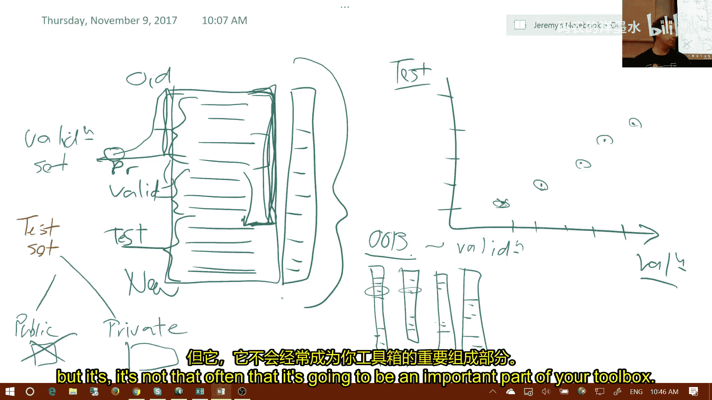
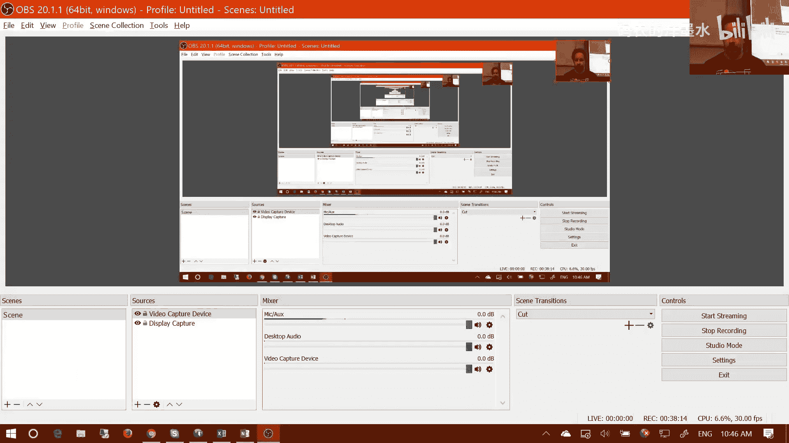
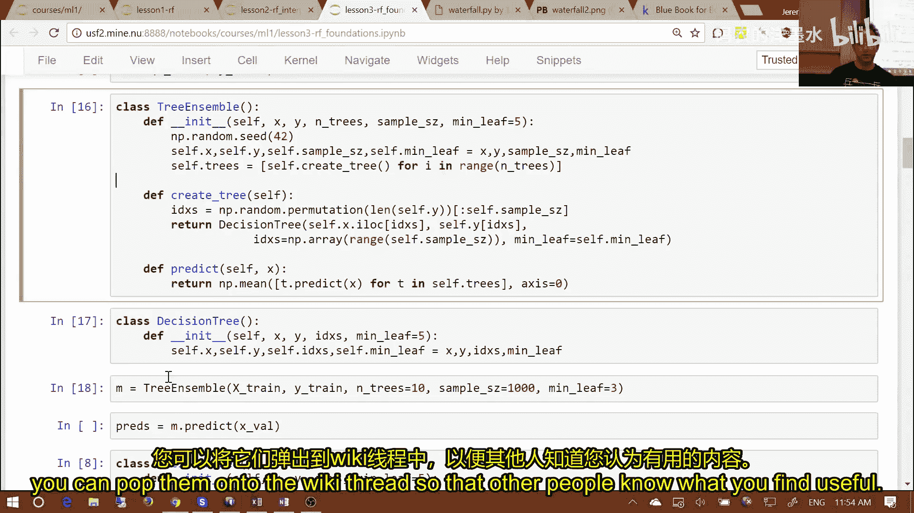

# 【全集】旧金山大学-面向程序员的机器学习-中英字幕-1080P-p05-Lecture-5---外推和射频--BV1YAvYBAEG3_p5-

Okay， so welcome back。 So we're going to start by doing some review。

 and we're going to talk about test sets。Training sets。

 validation sets and OOV something we haven't covered yet。

 but we will cover in more detail later is also cross validation。

 but I'm going to talk about that as well。We have a data set。With a bunch of rows in it。

And we've got some dependent variable。Yeah。And so what's the difference between？

Like machine learning。And。Kind of pretty much any other kind of work the difference is that in machine learning。

 the thing we care about is the generalization accuracy or the generalization error。

 where else in pretty much everything else all we care about is how well we could of map to the observations full stuff。

And so this thing about generalization is the key unique piece of earth machine learning。

And so if we want to know whether we're doing a good job of machine learning。

 we need to do know whether we're doing a good job of generalizing if we don't know that。

We know nothing。Right。By generalizing， do you mean like scaling being able to scale larger di No。

 I don't mean scaling at all。 so scaling is。An important thing in many， many areas。 It's like， okay。

 we've got something that works on on my computer with 10000。Items， I' need to work。

 make it work on 10000 items per second or something。 So scaling is important。

 but not just for machine learning for for just about everything we put in production。

 Generalization is where I say， okay， here is。A model that can predict cats from dogs。

 I've looked at five pictures of cats， five pictures of dogs， and Ive built a model that is perfect。

And then I look at a different set of five cats and dogs， and it gets them all wrong。So in that case。

 what it learnt was not to difference between a cat and a dog。

 but it learn what those five exact cats would look like and those five exact dogs look like。

Or I built a model of predicting。Grocery sales。For a particular。

Product so for toilet rolls in New Jersey last month。

And then I go and put it into production and it scales great， in other words it has a great latency。

 I don't have a high CPU load， but it fails to predict anything well other than toilet rolls in New Jersey it also turns out it only did it well for last month。

 not the next month， so these are all generalization failures。😊。

So the most common way that people check for the ability to generalize。Is to create a random sample。

 So they'll grab a few rows at random。And pulled out。Into a test set。

And then they'll build all of their models on the rest of the rows， and then when they're finished。

 they'll check the accuracy they got on there， so the rest of the rows are called the training set。

 everything else。Everything。Else。Or you could call the training set。

And so at the end of their modeling process on the training set。

 they've got an accuracy of 99% at predicting cats and dogs。

 at the very end they check it against a test set to make sure that the model really does generalize。

Now， the problem is。What if it doesn't？RightSo okay well。

 I could go back and change some hyperparameter， do some data augmentation， whatever else。

 try to create a more generalizable model， and then I'll go back again after doing all that and check and it's still no good。

And I'll keep doing this again and again， until eventually after 50 attempts， it does generalize。

That doesn't really generalize because maybe all I've done is accidentally found this one which happens to work just for that test set because I've tried 50 different things。

Right and so if I've got something which is like right coincidentally。055% of the time。

 then are very likely to accidentally get a good result。

So what we generally do is we put aside a second data set。

I've got a couple more of these and put these aside。Andto a validation set。Validation set， right。

 And then everything that's not in the validational test is now training。

 And so what we do is we train a model， check it against the validation to see if it generalizes。

Do that a few times。 and then when we finally got something where we were like， okay。

 we think this generalizes successfully based on the validations Act and then at the end of the project。

 we check it against the test set。啊，Yeah。So basically by making this two layer test validation set if it gets one right。

 the other one wrong， you' kind of double checking your errors kind of like it's checking that we haven' an overfit to the validation set so if we're using the validation set again and again。

Then we could end up not coming up with a generalizable set of hyperparameters。

 but a set of hyperparameters that just so happened to work on the training set and the validation set。

So。So if we try 50 different models。嗯。Against the validation set and then at the end of all that。

 we then check that against the test set and it' still generalize as well。

 Then we're kind of going to say， okay， that's good。

 we've actually come up with a generalizable model。 If it doesn't， then that's going to say okay。

 we've actually now overfit to the validation set at which point you kind of in trouble right because。

You don't know you don't have anything left。Behind right so the idea is to use effective techniques during the modeling so that so that doesn't happen right but if it's going to happen。

 you want to find out about it like you need that test set to be there because otherwise when you put it in production。

And then it turns out that it doesn't generalize that would be a really bad outcome， right。

 you end up with。Wes people clicking on your ads or selling less of your products or providing car insurance to very risky vehicles or whatever。

Just to make sure do you need to ever check if the validation set and the test set is coherent or you just keep test set So if you've done what I've just done here。

 which is to randomly sample， there's no particular reason to check long as as long as they're big enough right but we're going to come back to your question in a different context in just a moment。

嗯。你。Another trick we've learnedt for random forests is a way of not needing a validation set。

 and the way that we learned was to use instead use the OOB error。

or the OOB score and so this idea was to say， well every time we train a tree in a random forest。

 there's a bunch of observations that are held out anyway。

 because that's how we get some of the randomness and so let's calculate our score for each tree based on those held out samples and therefore the forest by averaging the trees that each row was not part of training。

Okay。And so the O O B score gives us something which is pretty similar to the。Validation score。

 but on average， it's a little less good。 Can anybody either remember or figure out why， on average。

 it's a little less good。Quite a subtle one， I to give it to Qian X。I'm not sure。

 but is it because you are treating like you are doing every kind of probe preprocessing on your test time。

 And so the O B score is reflecting the performance on testing set。No。

 so the OOP score is not using the test set at all。

 The OOP score is using the held out rows in the training set for each tree So I mean the you are basically testing each tree on some data from the training set Yes。

 so are you have the potential of overfiing the tree。

it shouldn't cause overfitting because H1 is looking at a held out sample。

 it's not an overfitting issue。 it's quite a subtle issue， Ernest， don't have try。

Aren't the samples from OB bootstap samples So then you're never going on average。

 they only grab 63% of on average the O is1 63% exactly so what's the issue So then if you're not Why would the score be lower than the validation score And that implies that you're leaving sort like a black hole in the data that there's like data points you're never going to sample and they're not going be represented by the model no。

 that's not true though because each tree is looking at a different set right so the O So like we've got like。

I don't know， dozens of models right， and in each one there's a different set。Of rose。

Which happened to be held out。Right。And so when we calculate the OOB score for like let's say row3。

 we say okay row3 is in this tree， this tree and that's it and so we calculate the prediction on that tree and for that tree and we average those two predictions and so with enough trees you know each one has a 30 or so percent chance sorry 40 or so percent chance that the row is in that tree so if you have 50 trees it's almost certain that every row is going to be mentioned somewhere did you have an idea per。

With validation set we can use the whole forest to make the predictions。

 but here we cannot use the whole forest so we cannot exactly see exactly so every row。

Is going to be using a subset of the trees to make its prediction。 and with less trees。

 we know we get a less accurate prediction。Sos that's a subtle one right， and if you didn't get it。

 have a think during the week。Until you understand。Why this is。

 because it's a really interesting test of your understanding of random forests of like why is OOB score on average less good than your validation score。

 they're both using random heldout subsets。Anyway， it's generally close enough， right？

Why have a validation set at all when you're using random For？啊。

If it's a randomly chosen validation set， it's not strictly speaking necessary。

 but you know you've got like four levels of things to test right so you could like test on the OOB when that's working well you can test on the validation set。

 you know when hopefully by the time you check against the test set there's going to be no surprises so that'll be one good reason。

Then what CAgel do the way they do this is kind of clever。

 What Kagel do is they split the test set into two pieces of public。And a private。

And they don't tell you which is rich。 So you submit your predictions to cattle and then。

A random 30% of those are used to tell you the leaderboard score。

But then at the end of the competition， that gets thrown away and they use the other 70% to calculate your real score。

So what that's doing is that you're making sure that you're not like continually using that feedback from the leader board to figure out some set of hyperparameter that happens to do well on the public。

 but actually doesn't generalize。So it's a great test。

 like this is one of the reasons why it's good practice to use CAggle because at the end of a competition at some point this will happen to you and you'll drop 10 places on the leaderboard the last day of the competition when they use the private test set and say。

 oh， that's what it feels like to overfit and it's much better to practice and get that sense there than it is to do it in a company where there's hundreds of millions of dollars on the line。

嗯。Okay， so this is like the easiest possible situation where you're able to use a random sample for your validation set。

嗯。Why might I not be able to use a random sample for my validation set pass tower？

In the case of something where we're forecasting， we can't randomly sample because we need to maintain the temporal ordering。

Go on what is that because it doesn't it doesn't make sense so in the case of like an armor model I can't use like I can't pull out random rows because there's。

I'm thinking that there's like a certain dependency or I'm trying to model a certain dependency that relies on like a specific lag term and if I randomly sample those things then that lag term isn't there for me to use okay so it could be like a。

A technical modeling issue that like I'm using a model that relies on like yesterday。

 the day before and the day before that。 And if I've randomly removed some things I don't have yesterday and my model might just fail。

 Okay， that's true， but there's a more fundamental issue。 Do you want to pass it to Tyler。

It's a really good point， although you know in general。

 we're going to try to build models that are not that are more resilient than that。

 particularly with。Yeah temporal order we expect things that are close by in time to be related to things close to them so we so how do that destroy that order like if if we destroy that order。

 we really aren't going to be able to use that this time is close to this other time I don't think that's true because we can pull out a random sample for a validation set and still keep everything nicely ordered Well claim predict things in the future。

Which we would require as much data close to the end of our Okay， that's true。

 I mean we could be like limiting the amount of data that we have by taking some of it out。

 but my claim is stronger my claim is that by using a random validation set。

We could get totally the wrong idea about our model。 Ka， Do you want to have a try。嗯。

So if our data is imbalanced， for example， we can， if you're randomly sampling it。

 we can only have one class in our validation set so our fitted model maybe that's true as well so maybe you're trying to predict in a medical situation who's going to die of lung cancer and that's only one out of 100 people and we pick out a validation set that we accidentally have nobody that died of lung cancer that's also true。

 these are all good niche examples。But none of them quite say like why could the validation set just be plain？

Wrong， like give you a totally inaccurate idea of whether this is going to generalize and so let's talk about and the closest is what Tyler was saying about time。

 closeness in time。The important thing to remember is when you build a model。😡。

You're always you always have a systematic error which is that you're going to use the model at a later time than the time that you built it right like you're going to put it into production by which time the world is different to the world that you're in now and even when you're building the model you're using data which is older than today anyway right so there's some lag between the data that you're building it on and the data that it's going to actually be used on your life。

And a lot of the time， if not most of the time， that matters right so if we're doing stuff in like predicting who's going to buy toilet paper in New Jersey and it takes us two weeks to put it in production。

And we did it using data from the last couple of years。 Then by that time， you， things may look。

Very different right and particularly our validation set。

 if we randomly sampled it right and it was like from a fouryear period。

 then the vast majority of that data is going to be over a year old right and it may be that the toilet buying habits of folks in New Jersey may have dramatically shifted maybe they've got a terrible recession there now and they can't afford high quality toilet paper anymore or maybe know their paper making industry has gone through the roof and suddenly you know they're buying lots more toilet paper because it's so cheap or whatever right so the world changes and therefore if you use a random sample for your validation set。

Then you're actually checking， how good are you at predicting things that are totally obsolete now。

 But how good are you at predicting things that happened four years ago， That's not interesting。Okay。

 so what we want to do in practice。Anytime there's some temporal peace。

Is to instead say assuming that we've ordered it by time。 so this is old。And this is new。

That's our validation set。Okay， or if we， you know， I suppose actually do it properly。

 that's our validation set。That's how Te said。Makes sense right so here's our training set and we use that and we try and build a model that still works on stuff that's later in time than anything the model was built on。

 and so we're not just testing generalization in some kind of abstract sense but in a very specific time sense which is it generalizes to the future。

 could you pass it to Serj please。So when we are as as you said as you said there is some temporal ordering in the data so in that case is it wise to take the entire whole data about training or only a few recent data set validation tests or training I'm talking about training training。

Yeah that's a whole other question right so how how old do you get the validation set to be good so I build a random forest on all the training data。

 it looks good on the training data。It looks good on the OOB and this is actually a really good reason to have OOB。

 if it looks good on the OOB， that it means you're not overfitting in a statistical sense right like it's working well on a random sample。

But then it looks bad on the validation set so what happened well what happened was that you somehow failed to predict the future。

 you only predicted the past and so Surj had an idea about how we could fix that would be okay well maybe we should just train so like maybe we shouldn't use the whole training set we should try a recent period only and now on the downside we're now using less data so we can create less rich models on the upside it's more uptod data and this is something you have to play around with。

Most machine learning functions have the ability to provide a weight that is given to each row。So。

 for example， with a random forest， rather than bootstrapping at random。

 you could have a weight on every row and randomly pick that row with some probability， right。

 And we could like say。Here's our， like， probability。We could， like， pick a。Cve。

 that looks like that。So the most recent rows。Have a higher probability of being selected。

 that can work really well。 Yeah， it's something that you have to try and if you don't have a validation set that represents the future compared to what you're training on。

 you have no way to know which of your techniques are working。

 How do you make the compromise between an amount of data versus recency of data。

So what I tend to do is is when I have this kind of temporal issue。

 which is probably most of the time， once I have something that's working well on the validation set。

 I wouldn't then go and just use that model on the test set because the thing that I've trained on is now like。

know the test set is much more in the future compared to the training set。

 so I would then replicate building that model again。

 but this time I would combine the training and validation sets together。Okay。

 and and retrain the model。 And at that point， you've got no way to to test。Against a validation set。

 so you have to make sure you have a reproducible script or notebook that does exactly the same steps in exactly the same ways。

 because if you get something wrong， then you're going to find on the test set that you've got a problem。

So。So what I do in practice is I need to know is my validation set。

A truly representative of the test set。 So what I do is I build five models on the training set。

I build five models on the training set and I try to have them kind of vary in how good I think they are and then I score them my five models on the validation set。

 and then I also score them on the test set。 so I'm not cheating。

 So I'm not using any feedback from the test set to change my hyperparameter。

 I'm only using it for this one thing， which is to check my validation set。 So I get my five scores。

From the test set。And then I check。That they fallen line。O。And if they don't。

 then you're not going to get good enough feedback from the validation set。

 So keep doing that process until you're getting a。 And that can be quite tricky， right， sometimes。

The the test set。You know tryinging to create something that's as similar to the real world outcome as possible it's difficult right And when you're kind of in the real world。

 the same is true of creating the test set like the test set has to be as close to production as possible So like what's the actual mix of customers that are going to be using this。

 how much time is there actually going to be between when you build the model and when you put it in production。

 how often are you're going to be able to refresh the model。

 these are all the things to think about when you build that test set。Okay。

So you want to say that first make five models on the rating data and then did you get a straight line relationship change your validation and test set you can't really change the test set generally so this is assuming that the test that's given change the validation set so if you start with a random sample validation set and then it's all over the place and you realize oh I should have picked the last two months and then you pick the last two months it's still low over the place and you realize oh I should have picked it so that's also from the first or of the month to the 15th of the month and you keep going until changing your validation set until you've found a validation set which is indicative of your test set results。

Okay。No。So of five models and he would start maybe like just the random data and then average they just make it better Yeah yeah yeah yeah maybe exactly maybe kind of five like not terrible ones but you want some variety and you also particularly want some variety in like how well they might generalize through time so one that was trained on the whole training set one that was trained on the last two weeks one that was trained on the last six weeks one which used you know lots and lots of columns and might have fit a bit more so you kind of want to get a sense of like oh if my validation set fails to generalize temporarily I'd want to see that if it fails generalize statistically I'd want to see that。

Sorry can you explain a bit more detail what you mean by change your validation set so it indicates the test set like what does that look like so so let's take the groceries competition where we're trying to predict the next two weeks of grocery sales so possible validation sets that Terrence and I played with was a random sample。

嗯。The last month of data。The last two weeks of data。And the other one we tried was same day range。

One month。Earlier， so that the test set in this competition was the first to the 15th of。August。

Sorry， this。15th maybe the 15th， the 30th of August。So we tried like a random sample as four years。

 we tried the 15th of July to the 15th of August， we tried the  first of August to the 15th of August。

 and we tried the 15th of July to the 30th of July。

And so there were four different validation sets we tried and so with random you know our kind of results were all over the place with last month。

 you know， they were like not bad but not great the last two weeks it was a couple that didn't look good but on the whole they were good and same day range of the month earlier they got a basically perfect line that's the part I'm talking about there what exactly are you comparing it to from the test set confused what you're creating that graph。

So for each of those so for each of my so I build five models right so there might be like just predict the average。

 do some kind of simple group mean of the whole data。

 do some group mean of the last month of the data， build a random forest of the whole thing。

 build a random forest in the last two weeks on each of those I calculate the validation score。

And then I retrain the model on the whole training set and calculate the same thing on the test set。

And so each of these points now tells me how well did it go on the validation set。

 how well did it go in the test set， and so if the validation set is useful。

 we would say every time the validation set improves， the test set score should also improve。She。

Yeah， so you just said retrain do you mean retrain the modeling on training and validations Yeah that was a step I was talking about here so once I've got the validation score based on just the training set I then retrain it on the train and validation and check against it somebody else。

So just to clarify。By test set， you mean。Submitting it to Kaggle and then checking the school。

 If it's Kale， then your test set is Cagggle's leaderboard in the real world。

 the test set is this third data set that you put aside， and it's that third data set that。

Having it reflect real world production differences。

Is the most important step in a machine learning project。Why is it the most important step。

 Because if you screw up everything else but you don't screw up that， you'll know you've screwed up？

Right like if you've got a good test set。Then you'll know you screwed up because you screwed up something else and you tested it and it didn't work out and it's like。

 okay， you're not going to destroy the company right if you' screwed up creating the test set。

That would be awful， right， because then you don't know if you've made a mistake。

 right you try to build a model， you test it on the test set。 It looks good。

 but the test set was not indicative of real world。Environment。

So you don't actually know if you're going to destroy the company now hopefully you've got ways to put things into production gradually so you won't actually destroy the company。

 but you'll at least destroy your reputation at work right it's like oh Jeremy tried to put this thing into production and in the first week the cohort we tried it on their sales halved and we're never going to give Jeremy machine learning job again But if Jeremy had used a proper test set then like he would have known oh this is like half as good as my validation set said it would be I'll keep trying and now I'm not going to get in any trouble I was actually like oh Jeremy's awesome he has identifies ahead of time when there's going to be a generalization problem。

Yeah。呃。O。So this is like。This is something that kind of everybody talks about a little bit in machine learning classes。

 but often it kind of stops at the point where you learn that there's a thing in SK learn called make test train split and it returns these things and off you go right but the fact that like。

Or here's the cross validation function，The fact that these things always give you random samples tells you that like much。

 if not most of the time， you shouldn't be using them。

The fact that random forest gives you an OOB for free。

 it's useful but it only tells you that this generalizes in a statistical sense。

 not in a practical sense right so then finally there's cross validation right which。😊。

Outside of class， you guys have been talking about a life。

 which makes me feel somebody's been overempphasizing the value of this technique。

So I'll explain what cross validation is， and then I'll explain why you probably shouldn't be using it most of the time。

So cross validation says， let's not just pull out one validation set， but let's pull out5。

 say So let's assume that we're going to randomly shuffle the data first。 right， This is critical。

 right， We first randomly shuffle the data。 And then we're going to split it into。5 groups。

And then for model number one， we'll call this the validation set。

And we'll call this the training set。Okay， and we'll train and we'll check against the validation and we'll get some RMSE R squared。

 whatever， and then we'll throw that away。And we'll call this the validation set。And we'll call this。

The training set。And we'll get another score。We'll do that five times。

And then we'll take the average。Okay， so that's cross validation。Average accuracy。

 So who can tell me like a benefit of using cross validation over a。

The kind of standard validation set I talked about before。Could you pass it phone？Yeah。2。

If you have a small dataset then course validation will make use all the data you have Yeah。

 you can use all of the data， you don't have to put anything aside and you kind of get a little benefit as well in that like you've now got five models that you could ensemble together each one of used which use 80% of the data so you know sometimes that ensseling can be helpful。

嗯。F， could you tell me like what what could be some reasons that you wouldn't use cross validation We have enough data。

 so we do not want the validations that to be included in the model trainings process to pollute like the model。

Okay， yeah。I'm not sure that cross validation is necessarily polluting the model。

 but what would be a key like downside of cross validation but like for beginning if you have learned the pictures and the neural network will know the pictures and it's more likely to predict less right so sure。

 but if we put aside some data each time in the cross validation， can you pass that to Seragej。

 I'm not so worried about。Like I don't think there's like one of these validation sets is。

More statistically accurate Yes I think that's what Feng was worried about。

 I don't see why that would happen like each time we're fitting a model just behind you each time we're fitting a model we are absolutely holding out 20% of the sample。

RightSo yes， the five models between them have seen all of the data。

 but it's kind of like a random forest。 and in fact， it's a lot like a random forest。

 Each model has only been trained on the subset of the data。Yes， we should。

 say if it is like a large data， like it will take a lot of time。 Oh， yes， exactly。 right。

 So we have to fit five models rather than one。 So here's a key downside。 numberumb one is time。

 And so if we。Doing deep learning and it takes a day to run suddenly now takes five days or we need five GPPUs Okay。

 one about my earlier issues about validation sets， Jonna plus it over there what's your name？

So if you had like temporal data， wouldn't you be like by shuffling。

 wouldn't you be breaking that relation Well， we could unshuffle it afterwards。

We could reorder it like we could shuffle， get the training set out and then sort it by time。

And like this， presumably there's a date column there。

I don't think don't think it's going to stop us from building a model， did you have let？Okay。你整。

With cross validation， you're building five even validation sets and if there is some sort of structure that you're trying to capture in your validation set to mirror your test set。

 you're essentially just throwing out a chance to construct that yourself。Right。

 youre going to I think you said the same thing as I'm going to say。

 which is that our earlier concerns about why random validation sets are a problem are entirely relevant here or these validation sets are random。

So if a random validation set is not appropriate for your problem， most likely because， for example。

 of temporal issues， then none of these four validation five validation sets are any good。

 they're all random and so if you have。Temporal data， like we did here。

 there's no way to do cross validation really， or like probably no good way to do cross validation。

You want to have us。Your validation set be as close to the test set as possible。

 and so you can't do that by randomly sampling different things。So。So as Fang said。

 you may well not need a todue cross validation because most of the time in the real world we don't really have that little data right unless your data is based on some very。

 very expensive labeling process or some experiments that will cost a lot to run or whatever。

 but nowadays that's，Data scientists are not very often doing that kind of work。

 some are in which cases is an issue， but most of us aren't。So we probably don't need to。

As Niishan said， if we do do it， it's going to take a whole lot of time and then as Ernest said。

 even if we did do it and we talk up all that time。

 it might give us totally the wrong answer because random validation sets are inappropriate for a problem。

Okay， so I'm not going to be spending much time on cross validation because I just I think it's an interesting tool to have。

 it's easy to use SK learn has a cross validation thing you can go ahead and use。

 but it's not that often that it's going to be an important part of your toolbox in my opinion。

 it'll come up sometimes。

Okay， so that is validation sets。So then the other thing we started talking about last week。

And got a little bit stuck on because I screwed it up was tree interpretation。

So I'm actually going to cover that again without the error and dig into it in a bit more detail。

So can anybody tell me？What tree interpreter？Does。😊，And how it does it。Ibody do you remember。

 it's a difficult one to explain。 I don't think I did a good job of explaining it。

 so don't worry if you don't do a great job， but does anybody want to have a go at explaining it。

Okay， that's fine。Let's start with the output of T interpretter。So。If we look at a single model。

 a single tree， in other words。Here is a single tree。Okay。And so to remind us。

 the top of a tree is before there's been any split at all。So 10。189。

It's the average log price of all of the options in our training set。

So I'm going to go ahead and draw。Right here，10。1899 is the average of all。系。

And then if I go a couple of systems let than I equal to 0。5。Then I get 10。345。 Okay。

 so for this subset。Of 16800。Capler is less than or equal to 0。5， the average is 10。34 foot。

And then off the people with a couple of system less than a  equal quarter 。5。

 we then take the subset where enclosure is less than or equal quarter to2 and the average there of log sale price is 9。

955。SoHere's 9。955。And then final step in our tree。Is model ID。

 just for this group with no coupler system with enclo less than equal to2。

 then let's just take model ID less than or equal to 4573。And that gives us 10。2 to6。Okay。

 so then we can say， all right， it's starting with 10。

109189 average for everybody in our training set for this particular tree subs sampleample of 20000。

Adding in the couple of decision。For coupler less than a to 。5 increased our prediction by 0。156。

 So if we predicted it with a naive model of just the mean， it would have been 10。189。

 adding in just the coupler decision would have changed it to 10。35。

 So this variable is responsible for a 0。156 increase in our prediction from that。

 the enclosure decision was responsible for a minus0。395 decrease。

The model ID was responsible for a 0。276 increase until eventually that was our final decision。

 thats our prediction for this auction of this particular sale price。

So we can draw that as what's called a waterfall plot and waterfall plots are one of the most useful plots I know about and weirdly enough there's nothing in Python to do them and this is one of these things where there's this disconnect between like the world of like management consulting and business where everybody uses waterfall plots all the time and like academia who have no idea what these things are。

 but like every time like you're looking at say。Here is last year's sales for Apple and then there was a change in that iPhones increased by this amount Max decreased by that amount and iPads increased by that amount every time you have a starting point and a number of changes and a finishing point waterfall charts are pretty much always the best way to show it。

 So here our prediction for price based on everything 10。189。

 there was an increase blue means increase of 0。156 for coupler decrease of 0。

395 for inclosure model ID of 0。276 so decrease increase decrease increase to get to our final 10。

266 So you see how waterfall chart works。 So with Excel 2016 it's built in you just click insert waterfall chart and there it is。

 if you want to be a hero create a waterfall chart package for Macpl labb put it on Pp and everybody will love you for it。

There are some like really crappy gs and manual notebooks and stuff around these are actually super easy to build like you basically do a stacked column plot where the bottom of this is like all white。

Like you can kind of do it， but if you can wrap that up all and put the data。

 the points in the right spots and color them nicely， that would be totally awesome。

 I think you've all got the skills to do it and would be a terrific thing for your portfolio so there's an idea。

Could make an interesting caval kernel even like here's how to build a waterfall plot from scratch and by the way I've put this up on P you can all use it。

So in general， therefore， obviously going from the all and then going through H change。

 then the sum of all of those is going to be equal to the final prediction。

So that's how we could say if we were just doing a decision tree。

 then you know you're coming along and saying like how come this particular option was this particular price and it's like your prediction for it and like oh。

 it's because of these three things had these three impacts， right？So for a random forest。

We could do that across all of the trees。 So every time we see coupleplr， we add up that change。

 Every time we see enclosure， we add up that change。 Every time we see model， we add up that change。

 Okay， and so then we combine them all together。Wake get what。

Tree interpretter does so you could go into the source code for tree interpretter right it's not at all complex logic or you could build it yourself And you can see how it does exactly this。

 So when you go tree interpreter do predict with a random forest model for some specific option。

 So I've got a specific row here， this is my zero index row， it tells you， okay。

 this is the prediction， the same as the random forest prediction。Bas。

 this is going to be always the same， it's the average sale price for everybody for each of the random samples in the tree。

And then， contributions。Its。The average of， or sorry。

 the total of all the contributions for each time we see that。Specific column appear in a tree。

 right， So last time I made the mistake of not sorting this correctly。 So this time。

 MP P dot a sort as a super handy function。 It sorts。 It doesn't actually sort。Contribution 0。

 It just tells you where each item would move to， if it were sorted。

 So now by passing I D access to each one of。The column， the level contribution。

 I can then print out all thoses in the right order， so I can see here here's my column。

 here's the level and the contribution， so the fact that it's a small version of this piece of industrial equipment meant that it was less expensive。

But the fact it was made pretty recently meant it was more expensive。The fact that it's pretty old。

 however， made that it was less expensive so this is not going to really help you much at all with like a tagggle style situation where you just need predictions。

 it's going to help you a lot in a production environment or even preproduction right so like something which any good manager should you should do if you say here's a machine learning model I think we should use is they should go away and grab a few examples of actual customers or actual as or whatever and check whether your model looks intuitive right And if it says like my prediction is that。

You know， lots and lots of people are going to really enjoy this crappy movie， you know。

 and it's like wow that was a really crappy movie， then they're going to come back to you and say like explain why your model's telling me。

That I'm going to like this movie because I hate that movie and then you can go back and you say。

 well， it's because you like this movie and because you're this age range and you're this gender on average。

 actually people like you did like that movie。诶一诶。没。Okay。

What's the second element of each tu This is saying for this particular row。

 it was a mini and it was 11 years old and it was a hydraulic excavator track 3 to 4 metric tons。

So it's just feeding back and telling you because this is actually what it was。It was these numbers。

 so I just went back to the original data to actually pull out the。

The descriptive versions of each one。Yeah。Okay。So if we sum up all the contributions together。

And then， add them。To the bias。Then that would be the same as adding up those three things。

Adding it to this。 And as we know from our waterfall chart， that gives us our final。Prediction。

This is a。Almost totally unknown technique。 And this particular。

Library is almost totally unknown as well。 So like it's a great opportunity to。😊，You know。

 shows something that a lot of people， like it's totally critical， in my opinion， but。

 but rarely not。 So that's。That's kind of the end of the ran of For interpretation piece and hopefully you've now seen enough that when somebody says we can't use modern machine learning techniques because they're black boxeses that aren't interpretable。

 you have enough information to say you're full of shit like they're extremely interpretable and the stuff that we've just done you trying to do that with a linear model。

 good luck to you you know even where you can do something similar to the linear model。

 trying to do it so that's not getting you totally the wrong answer and you had no idea it's the wrong answer is going to be a real challenge。

So。The last step we're going to do before we try and build our own random forest is deal with this tricky issue of extrapolation。

 So in this case， if we look at our tree。嗯。Let's look at the accuracy of our most recent trees。Yeah。

嗯。We still have。You know， a big difference between our validation。Score。And our training score。

Actually， in this case， it's not too bad that the difference between the OOB and the validation is actually pretty close。

 so if there was a big difference between validation and OOB like I'd be very worried about that we've dealt with the temporal side of things correctly。

Let's just have a look at， I think our most recent model。 here it was。Yeah。

 so there's a tiny difference， right， and so。On CAggal。

 at least you kind of need that last decimal place in the real world I probably stop here。

 but quite often you'll see there's a big difference between your validation score and your OOB score。

 and I want to show you how you would deal with that。

Particularly because actually we know that the OOB should be a little worse because it's using less trees。

 so it gets me a sense that we should be able to do a little bit better and so the reason the way we should be able to do a little bit better is by handling the time component a little bit better。

Here's the problem with random forests when it comes to extrapolation when you。

When you've got a data set that's like you know got four years of sales data in it and you create your tree right and it says's like。

 oh if if it's in some particular store and at some particular item and it is on special you know。

 here's the average price right it actually tells us the average price you know over the whole training set which could be pretty old right and so when you then。

You want to step forward to like， well， what's going to be the price next month？

It's never seen next month。 And， and where else with a kind of a linear model。

 it can find a relationship between time and price where even although we only have this much data。

 when you then go and predict something in the future， it can extrapolate that。

 But a random forest can't do that。 There's no wave。

 if you think about it for a tree to be able to say， oh， next month， it would be higher still。

So there's a few ways to deal with this。 And we'll talk about it over the next couple of lessons。

 But one simple way is just to try to。Avoid using。Time variables as predictors。

 if there's something else we could use that's going to give us a better you know something of a kind of a stronger relationship that's actually going to work in the future so in this case。

What I wanted to do was to， first of all， figure out。

What's the difference between our validation set and our training set Like if I understand the difference between our validation set and our training set then that tells me what are the predictors which which have a strong temporal component and therefore they may be irrelevant by the time I get to the future time period so I do something really interesting which is I create a random forest。

Where my dependent variable is， is it in the validation set？

So I've gone back and I've got my whole data frame， which the training and validation altogether。

And I've created a new column called Isval。Which I've set to one。

 And then for all of the stuff in the training set， I set it to0。 So I've got a new column。

 which is just， is this in the validation set or not。

And then I'm going to use that as my dependent variable and build a random first。

So this is a random forest not to predict price。The predict is this in the validation set or not。

 and so if your variables were not time dependent， then it shouldn't be possible to figure out if something's in the validation set or not。

 This is a great trick in CAle right because in CAle。

 they often won't tell you whether the test set is a random sample or not。

So you could put the test set and the training set together。

 create a new column called I test and see if you can predict it。If you can。

 you don't have a random sample， which means you have to come figure out how to create a validation set。

From it。 right， And so in this case， I can see I don't have a random sample because my validation set can be predicted with a 0。

9999。Asked Greg。And so then if I look at feature importance。

 the top thing is sales ID and so this is really interesting。

 it tells us very clearly sales ID is not a random identifier。

 but probably it's something that's just set consecutively as time goes on。

 we just increase the sales ID。Saale elapsed， that was the number of days since the first date in our data set。

 so not surprisingly that also is a good predictor interestingly machine ID。

 clearly each machine is being labeled with some consecutive identifier as well。

And then there's a big。 Don't just look at the order。 Look at the value。 So  point7。1。07。002。 Okay。

 stop， right， These top  three are hundreds of times more important than the rest， right。

 So let's next grab those top 3。And we can then have a look at their values。

 both in the training set。And in the validation set， and so we can see for example。

 sales ID on average is I've divided by 1000， on average is 1。8 million in the training set and 5。

8 million in the validation set right so like you can see。Just confirm like， okay。

 they're very different。So let's drop them。Okay， so after I drop them。

 let's now see if I can predict whether something's in the validation set， I still can with 0。98。As过。

So once you remove some things， then other things can like come to the front and it now turns out。

 okay， that's not surprisingly age。You know， things that are old are， you know， more likely， I guess。

 to be in the validation set because， you know， earlier on in the training set， yet。

 they can't be old。 Yeah， year made， same reason。 So then we can。诶。Try removing those as well。嗯。

And so once we， let's see， where do we go here？Yeah， so what we can try doing is we can then say。

 all right， let's take the sales ID sale that's machine ID from the first one， the age。

 year made sales over year from the second one and say， okay， these are all time dependent features。

嗯。So I still want them in my random forest if they're important。But if they're not important。

 then taking them out， there are some other non time dependent variables that work just as well。

 that would be better。 because now I'm going to have a model that generalizes over time better。

 So here I'm just going to go ahead and go through each one of those features and drop each one one at a time。

Okay， rer a near random forest and print out the skull。Okay， so before we do any of that。

 our score was。88。For our validation versus 0。890obB。And you can see here。When I remove sales IDd。

 my score goes up。And this is like what we're hoping for。 we've removed the time dependent variable。

 There were other variables that could find similar relationships without the time dependency。

 So removing it caused our validation to go up now OB didn't go up because this is genuinely statistically a useful predictor right but it's a time dependent one and we have a time dependent validation set。

 So this is like really subtle but it can be really important right it's trying to find the things that give you a generalizable time across time prediction and here's how you can see it by so it's like okay。

 we should remove sales I for sure but sale elapsed。😊，Didn't get better。Okay。

 so we don't want that Mach I did get better， went from 888 to 893。

 so it's actually quite a bit better。Okay。A got a bit better。Year made got worse。

 Sal day of year got a bit better。 Okay， so now we can say， all right， let's get rid of。The three。

Where we know that getting rid of it actually made it better。Okay， and as a result， look at this。

 we're now up to 915。Okay， so we've got rid of three time dependent things and now， as expected。

 our validation is better than our OOB。Okay， so that was a super successful approach there， right。

 And so now we can check the feature importance。And let's go ahead and say， all right。

 that was pretty damn good。Leave it for a while so give it 160 trees let it share on it and see how that goes okay and so as you can see like we did all of our interpretation。

 all of our fine tuning basically with smaller models subsets and at the end we ran the whole thing it actually still only took 16 seconds。

And so we've now got an RMSsC of 0。21 Okay， so now we can check that against CAle。Again。

 we can't we unfortunately this older competition we're not allowed to enter anymore to see how we would have gone。

 so the best we can do is check whether it looks like we could have done well based on our validation set so it should be in the right area and yeah based on that we would have come first。

Okay， so。You know， I think this is an interesting。Series of steps。

 right so you can go through the same series of steps in your CA projects and more importantly。

 your real world projects。 So one of the challenges is once you leave this learning environment。

 suddenly you're surrounded by people who they never have enough time。

 They always want you to be in a hurry， they're always telling you， you know。

 do this and then do that。 you need to find the time to step away and go back because this is a genuine real world modeling process you can use。

But it gives。Well I say it gives world class results I mean it right like this guy who won this Li Taoss。

 sadly he's passed away but he is the top kle competitor of all time， like he won。

 I believe like dozens of competition so if we can get a score even within Coui of him。

 then we are doing really really well。Okay， so let's take a five minute break and we're going to come back and build our own random forest。

Yeah。Okay。可拜。I just wanted to clarify something quickly， very good point during the break was。

Going back to the。Change in R squared。Between here。

And here it's not just due to the fact that we removed。These three predictors。

 we also went reset RF samples right so to actually see the impact of just removing we need to compare it to。

嗯。The final step earlier。 So it's actually compared to 9，0，7。

 So removing those three things took us from 9，0，7 to。915 Okay， so I mean， and you know， in the end。

 of course， what matters is our final model that yeah， district ho。Okay。So嗯。

Some of you have asked me about riding your own random forests from scratch。

 I don't know if any of you have。Given it a try yet my original plan here was to do it in real time and then as I started to do it。

 I realized that that would have kind of been boring because for you because I screw things up all the time。

 so instead we might do more of like a walk through the code together。Just as an aside。

 this reminds me talking about the exam actually somebody asked on the forum about like what what could you expect on the exam。

 the basic plan is to make it a the exam be very similar to these notebooks so it'll probably be a notebook that you have to you know。

Get a data set， create a model trainer feature importance whatever right and the plan is that it'll be open walk open internet you can use whatever resources you like so basically if you're entering competitions the exam should be very straightforward I also expect that there'll be some pieces about like。

He has a partially completed random forest or something， you know， finish。

Finish writing this step here or here's a random forest。 implement picture importance or you know。

 implement one of the things we've talked about。 So it'll be， you know。

 the exam will be much like what we do in class and what you're expected to be doing during the week。

 There won't be any define this or tell me the difference between this word and that word or whatever there's not going be any remote learning。

 It'll be entirely like， are you an effective machine learning practitioner I。e。

 Can you use the algorithms you know， can you create an effective validation set and can you can you create parts of the algorithm。

 I them from scratch？ So it'll be all about writing code。Basically。

 so if you're not comfortable writing code to practice machine learning， then。

You should be practicing that all the time， if you are comfortable。

 you should be practicing that all the time， also whatever you're doing。

 write code to implement random to do machine learning。嗯。Okay。So I kind of have a particular way of。

Writing code。 and I'm not going to claim it's the only way of writing code。

 but it might be a little bit different to what you're used to。 And hopefully。

 you'll find it at least interesting。 creating， implementing random forest algorithms is actually quite tricky。

 not because the code's tricky。 Like generally speaking。

Most random forest algorithms pretty conceptually easy。

 you know generally speaking academic papers and books have a knack of making them look difficult。

 but they're not difficult conceptually what's difficult is getting all the details right and and knowing when you're right and so in other words we need a good way of doing testing。

So if we're going to reimple something that already exists。 So like say。

 we wanted to create a random forest in some。Different framework， different language。

 different operating system。 You know， I would always start with something that does exist right。

 So in this case， we're just going to do as a learning exercise， writing a random forest and Python。

 So for testing， I'm going to compare it to an existing random forest implementation。

Okay so that's like critical anytime you're doing anything involving like non-trivial amounts of code and machine learning。

 knowing whether you've got it right or wrong is kind of the hardest fit。

 I always assume that I've screwed everything up at every step and so I'm thinking like okay assuming that I screwed it up how do I figure out that I screwed it up right and then much to my surprise from time to time I actually get something right and then I can move on but most of the time I get it wrong so。

Unfortunately with machine learning， there's a lot of ways you can get things wrong that don't give you an error。

 they just make your result like slightly less good。And so that's what you want to pick up。

So given that I want to kind of compare it to an existing implementation。

 I'm going to use our existing data set， our existing validation set。

 and then to simplify things I'm just going to use two columns to start with。

So let's go ahead and start writing a random first so my way of writing nearly all code is top down just like my teaching and so by top down I start by assuming that everything I want already exists。

Right， so in other words， the first thing I want to do， I'm going to call this a tree ensemble。

 right So to create a random forest， the first question I have is。What do I need to pass in right。

 what do I need to initialize my random first， So I'm going to need some independent variables。

Some dependent variable。Pick how many trees I want。

I'm going to use the sample size parameter from the start here。

 so how big you want each sample to be and then maybe some optional parameter of what's the smallest leaf size okay？

For testing， it's nice to use a constant random seed。 So we'll get the same result each time。

 So this is just how you set a random seed。 Okay， Maybe it's worth mentioning this for those of you arenfamiliar with it。

😊，Random number generators on computers aren't random at all。

 They're actually called pseudo random number generators。

And what they do is given some initial starting point， in this case， 42。

 a pseudo randomom number generator is a mathematical function that generates a deterministic。

 always the same sequence of numbers such that those numbers are designed to be as uncorrelated with the previous number as possible and as unpredictable as possible。

And as uncorrelated as possible with something with a different random see。

 So the second number in in the sequence， starting with 42 should be very different to the second number starting with 41。

 and generally， they involve kind of like taking， you know。

You using big prime numbers and taking mods and stuff like that。

 It's kind of an interesting area of math。If you want real random numbers。

 the only way to do that is you can actually buy hardware called a hardware random number generator that will have inside them like a little bit of some radioactive substance and like something that detects how many things it's spitting out。

 or there'll be some hardware thing。Yeah。唔。Getting current system time is is it a valid random like random number generation process So that would be for maybe for a random seed right so this thing of like what do we start the function with So one of the really interesting areas is like in your computer if you don't set the random seed what is it set to and。

Yeah， quite often people use the current time for security like obviously we use a lot of random number stuff for security stuff like if you're generating an SSH key。

 you need some it needs to be random it turns out like you know people can figure out roughly when you created a key like they could look at like oh ISA has a timestamp and they could try you know all of the different nanoseconds starting points for a random number generator around that time step and figure out your key So in practice a lot of like really random。

High randomness requiring applications actually have a step that say。

 please move your mouse and type random stuff at the keyboard for a while。

 And so it like gets you to be a sort。 It's called entropy。

 to be a source of entropy Other approaches is they'll look at like。

The hash of some of your log files or stuff like that。It's a really， really fun area。So in our case。

 our purpose actually is to remove randomness。 so we're saying okay。

 generate a series of pseudo random numbers starting with 42， so it always should be the same。

So if you haven't done much stuff in Python00， this is a basically standard idiom。

 at least I mean I write it this way most people don't， but if you pass in like one， two three。

 four five things that you're going to want to keep inside this object。

 then you basically have to say self。x equals x， self。t8 equals y， self dot sample equal sample。

And so we can assign to a tuple from a tuple。YouAgain， this is like my way of coding。

 most people think this is horrible but I prefer to be able to see everything at once and so I know in my code anytime I see something looks like this it's always all of the stuff in the method being set if I did it a different way than half the codes now come off the bottom of the page and you can't see it。

All right。So that was the first thing I thought about was like， okay， to create a random forest。

 what information do you need， then I'm going to need to store that information inside my object。

 and so then。And need to create some trees right a random forest is that creates is something that has some trees。

 so I basically figured okay， list comprehension to create a list of trees。

 how many trees do we have where we've got N trees trees。That's what we asked for。

So range entries gives me the numbers from zero up to entries， minus-1。Okay。

 so if I create a list comprehension that looks through that range。

 calling createre tree each time I now have n trees， trees。And now so I， I to write that。

 I didn't have to think at all。 Like， let's all like。Obous。

 and so I've kind of delayed the thinking to the point where it's like， oh， wait。

 we don't have something to create a tree。Okay， no worries。 But let's pretend we did。 If we did。

 we've now created a random forest。 Okay， we've still need like。Do a few things on top of that。

 for example， once we have it， we would need a predict function。 So okay， well。

 let's write a predict function。 How do you predict。At a random first。

Can somebody tell me either based on their own understanding or based on this line of code。

 what would be like your one or two sentence answer。

 how do you make a prediction in a random forest dispensr？

You would want to over every tree for your like the row that you're trying to predict on average the values that your that each tree would produce for that it's exactly good and so you know that's a summary of what this says right so for a particular row that or maybe this is a number of rows。

Go through H tree。Calculator is prediction so here is a list comprehension that is calculating the prediction for every tree for x。

 I don't know if x is one row or multiple rows， it doesn't matter right long as as long as tree dot predict works on it。

And then once you've got a list of things， a cool trick to know is you can pass nuy。

 mean a regular non nuumpy list。Okay， and it'll take the mean。 You just need to tell it。

Access equals 0 means average it across the lists。 Okay， so this is going to return the average。

Of dot predict for each tree。 and so I find list comprehensions allow me to write the code in the way that my brain works like you could take the words Spencer said and like translate them into this code or you could take this code and translate them into words like the one Spencer said right And so when I write code。

I want it to be as much like that as possible。 I want it to be readable。

 And so hopefully you'll find like when you look at the fast AI code and you're trying to understand well how did Jeremy do X。

 I try to write things in a way that you can read it and like。

 kind of turn it into English in your head。So if I cigarettely that predict method is recursive。

 its no， it's calling tree dot predict and we haven't written a tree yet。

 so self dot trees is going to containtrain a tree object。So this has tree ensemled up predict。

And inside the trees is a tree， not a tree ensemble。 So this is calling tree dot predict。

 not tree ensemble， dot predict。The question。Okay， so we've nearly finished writing our random forest。

 haven't we all we need to do now is right create tree so based on this code here。

Or on your own understanding of how we create trees in a random forest， can somebody tell me。

s take a few seconds， have a read and have a think and then I'm going to try and come up with a way of saying how do you create a tree in a random forest？

Okay， who wants to tell me？Anybody is， Okay， let's tie's plus the monkey。

You take your you're essentially taking a random sample or of the original data。

 and then you're just。just constructing a tree， however that happens。

 So construct a decision tree like a non random tree from a random sample of the data。Okay， so again。

 like we've delayed any actual thought process here， we've basically said okay。

 we could pick some random Is， this is a good trick to know if you call NP dot random dot permutation passing in an end。

It'll give you back a randomly shuffled sequence from zero to that it。

 right And so then if you grab the first。Coollon N items of that。

 That's now a random subs sampleample。 So this is not doing bootstping。

 We're not doing sampling with replacement here。Whi I think is fine。

 you know for my random forest I'm deciding that it's going to be something where we do do subampling。

 not bootstrapping okay so here's a good line of code to know how to write because it comes up all the time like I find in machine learning most algorithms I use are somewhat random and so often I need some kind of random sample can you pass that tight or chinsy。

Okay。嗯。Won't that give you one extra because the you said it'll go from zero to length？嗯。No。

 so this will give you if lens self dot y is of size n， this will give you n a sequence of length n。

 so0 to n minus1 and then from that I'm picking out colon self dot sample size。

 so the first sample size ideas。下一去。😔，Yes。Yeah。I have a comment on bootstping。

 I think this method is better because we have chance of giving more weight to each observation。

 or am I thinking wrong。 I think you for bootstrapping， we could also give weights。 I mean。

 waitinging single observations more than they are like。Without wanting that wait。

 because I'm bootstriping with replacement， we can have a single observation and duplicates of it。

 the same free。 It does feel weird， but I think。I'm not sure that the actual theory or empirical results backs up higher intuition。

 that it's worse， it would be interesting to look back at that actually。

Pally I prefer this because I feel like most of the time we have more data than we want to put in a tree at once。

 I feel like back when Bman created random forests， it was 1999。

 it was kind of a very different world you know where we pretty much always wanted to use all the data we had。

 but nowadays I would say that's。Generally not what we want。 We normally have too much data。

 And so what people tend to do is they'll like fire up a spark cluster and they'll run it on hundreds of machines。

When。It makes no sense because if they had just used a subs sampleample each time they could have done it on one machine。

 And like the overhead of like spark is a huge amount of IO overhead。

 Like I know you guys are doing distributed computing now。

 if if you've looked at some of the benchmarks Yeah yeah， exactly。

 so if you do something on a single machine， it can often be hundreds of times faster。

 because you don't have all this IO overhead。 it also tends to be easier to write the algorithms。

 like you can use like SK learn easier to visualize cheaper， so forth。 So like I。

Almost always avoid distributed computing and I have my whole life like even 25 years ago when I was starting in machine learning。

 I you know still didn't use clusters because I always feel like whatever I could do with a cluster now I could do with a single machine in five years time so wanted of does focus on always being as good as possible with the single machine you know and that's going to be more interactive and more iterative and worked for me so。

Okay so so again we've like delayed thinking to the point where we have to write decision tree and so hopefully you get an idea that this topdown approach。

 the goal is going to be that we're going to keep the learning thinking so long that that we delay it forever like like eventually we've somehow written the whole thing without actually having to think right and that' that's kind of what I need because I'm kind of slow right so this is why I write code this way and notice like you never have to design anything。

You know， you just say， hey， what if somebody already gave me the exact API I needed。

 how would I use it？Okay， and then， and then okay， to implement that next stage。

What would be the exact API I would need to implement that you keep going down until eventually you're like。

 oh， that already exists。Okay， so this assumes we've got a class core decision tree。

 so we're going to have to create that。Yeah。So a decision tree。Is something。

 So weve we already know what we're going to have to pass it because we just passed it， right。

 So we're passing in a random sample of x's。A random sample of wise。嗯。呃。Indexes is actually。

 so we know that down the track。 So I'm I've got to plan a tiny bit。

 We know that a decision tree is going to contain decision trees。

 which themselves contain decision trees。 And so as we go down the decision tree。

 there's going to be some subset of the original data that we've kind of got。

 And so I'm going pass in the indexes of the data that we're actually going to use here。 Okay。

 so initially， it's the entire random sample。 right， So I've got the poll。I've got the whole range。

And I turn that in Twitter array， so that's zero， the index is from zero to the size of the sample。

And then we'll just pass down the mid leaf sites so everything that we got for constructing the random forest。

 we're had to pass down the decision tree， except of course， numb trees。

 which is irrelevant for the decision tree。So again， now that we know that's the information we need。

 we can go ahead and store it inside this object。So I'm pretty likely to need to know how many rows we have in this tree。

 which I generally call N， how many columns do I have， which I generally call C。

 so the number of rows is just equal to the number of indexes we were given and the number of columns is just like however many columns there are in our independent variables。

So then we're going to need。This value here。😡，We need to know for this tree。What's its prediction。

 right？The prediction for this tree is the mean。Of our dependent variable for those indexes which are inside this part of the tree so at the very top of the tree。

 it contains all the indexes。Right， I'm assuming that by the time we've got to this point， remember。

 we've already done the。Random sampling， right so when were talk about indexes。

 we're not talking about the random sampling to create the tree。

 We're assuming this tree now has some random sample inside decision tree。

 this is this is one of the nice things right inside decision tree。

 whole random sampling things gone that was done by the random forest right So at this point。

 we're building something that's just a plain old decision tree。 It's not in any way。

 a random sampling anything a thing。 It's just a plain old decision tree right so the indexes is literally like which subset of the data have we got to so far in this tree。

 And so at the top of the decision tree it's all the data right So it's all of the indexes okay。

So all of the indexes， so this is therefore all of the dependent variable that are in this part of the tree。

 and so this is the value mean of that。Does that make sense。

 anybody could put any questions about that？So yes， please Pa to Chen X。Actually。

 just to let you know that a large portion of us don't have a orB。

I mean OP experiments Okay sure so quick so a quick OOP primer would be helpful。Great， yeah， okay。嗯。

Who has done object orient programming in some programming language？Okay嗯。Yeah。

So you've all used actually lots of object oriented programming in terms of using existing classes right so every time we've created a random forest。

We've called the random firsts constructor。And it's returned an object。

 And then we've called methods and attributes on that object。 So fit is a method。

 you can tell because it's got parentheses after it， Where else。Yeah。

 OLB score is a property or an attribute doesn't have parentheses after it Okay so inside an object there are kind of two kinds of things therere the functions that you can call so you have object dot function parenthesis arguments。

 or there are the properties or attributes you can grab。

 which is object dot and then just the attribute name with no parentheses。

So and then the other thing that we do with objects is we create them。

We pass in the name of the class and it returns us the object and you have to tell it all of the parameters necessary to get constructed。

So let's just copy this code。Okay。And see how we're going to go ahead and build this。

So the first step is we're not going to go。 M equals random For aggressor。

 We're going to go M equals tree ensemble。 We're creating a class tree ensemble。

 and we're going to pass in。Okay。Yeah。Various bits of information， okay。So maybe we'll have 10 trees。

Sle size of 100。Maybe a men leaf of three， And you can always like choose to name your arguments or not。

 So when you've got quite a few， it's kind of nice to name them So that just so we can see what each one means。

Yeah。It's always optional， right？嗯。So we're going to try and create a class that we can use like this。

And then。I'm not sure we're going to bother with dot fit because we've passed in the X in the way right Like in psyic learn。

 they use an approach where first of all， you construct something without telling it what data to use and then you pass in the data。

 We're doing these two steps at once。 We're actually passing in the data right And so then after that。

 we're going to be going。M dot。 So we're going to go Pres equals M dot predict。

Passing in maybe some validation there。Okay， so that's the API we're kind of creating here。

So this thing here is called a constructor。 Something that creates an object is called a constructor。

 and Python。嗯。There's a lot of ugly hideous things about Python。

 one of which is it uses these special magic method names。Undersco， underscore in it。 underscore。

 underscore is a special magic method that's it's called when you try to construct a class。

 So when I call tree ensemble parentheesis， it actually calls tree ensemble dot people say T in it。

 I kind of hate it。 but anyway， D in it。 double underscore in it double underscore T in it。

So that's why we've got this method called dander in it。 Okay。

 so when I call tree ensemble it's going to call this method。

Another hideously ugly thing about Pythons， oh oh， is that there's this special thing where if you have a class and to create a class。

 you just write class in the name of class， all of its methods automatically get sent。

 one extra parameter， one extra argument。Ithi is the first argument。

 and you can call it anything you like。If you call it anything other than self。

 everybody will hate you and you're a bad person， Okay， so call it anything you like as long as it'。

Okay， so。So that's why you always see this。 and in fact， I can immediately see here， I have a bug。

Anybody see the bug in my predict function， I should have so， right？

Like always do it right so any time you try and call a method on your own class and you get something saying you passed into parameters and it was only expecting one。

 you forgot self Okay so like this is a really dumb way to add OOP to a programming language but the older languages like Python often did this because they kind of needed to they started out not being OO and then they kind of added OO in a way that was hideously ugly so Pell which predates Python by a little bit kind of。

I think really came up with this approach and unfortunately other languages of that era stuck with it。

So。You have to add in this magic self so the magic self now when you're inside this class。

 you can now pretend as if any property name you like exists。

 so I can now pretend there's something called self。 X I can read from it。

 I can write to it right but if I read from it and I haven't yet written to it， I'll get an error。

So the stuff that's passed。To the constructor gets thrown away by default like there's nothing that like says you need to this class needs to remember what these things are。

 but anything that we stick inside self is remembered for all time you know as long as this object exists you can access it it's remembered so now that I've gone in fact let's do this right so let's let's create the tree ensemble class。

And let's now instantiate it okay。Of course， we haven got x we need to call。X train。Why right。Okay。

 decision tree is not defined， so let's。Create a really minimal decision tree。There we go Okay。

 so here is enough to actually instantiate our tree ensemble Okay。

 so we've defined find the in it for it， we have defined find the in it for decision tree。

 we need decision trees in it to be defined because inside our ensemble in it it called self dot create tree and then self dot createate tree called the decision tree Conor。

And then decision tree constructor。Basically does nothing at all other than save some information。

 So at this point， we can now go M dot。Okay， and if I press T at this point。

 can anybody tell me what I would expect to see， pass it to Taylor？Can security plus。

We would see like a we would see a dropdown of all available methods for that class okay which would be in this case so if M is a tree ensemble we would have create tree and predict okay anything else Oh yeah as well as Ernest whispers the variables as well yeah so the。

So variable could mean a lot of things， well' say the attributes。

 so the things that we put inside self， so if I hit tab。😡，Right， there they are。 right。

 as Taylor said， there's create a tree。 there's predict。

 and then there's everything else we put inside self。 Right， So if I look at。U M dot。Min leaf。

If I hit shift enter， what will I say。Yeah the number that I just put there I put menle is three so that went up here to menle。

 this here is a default argument which says if I don't pass anything it'll be five but I did pass something right so three selftop men leaf。

Here。Is going to be equal to mean life here？So something which like because of this rather annoying way of doing OO。

It does mean that it's very easy to accidentally forget。So do that right。

 so if I don't assign it to self dot Men leaf。Right， then I get an  error。And so here。

 tree ensemble doesn't happen in Min leaf， so how do I create that attribute。

 I just put something in it。Okay， so if you want to like。

 if you don't know what a value of it should be yet， but you kind of need to be able to refer to it。

 you can always go like self do min leaf。As none。So at least it's something you can read check for numbness and not have an error。

Great。Now。Interestingly， I was able to instance yetchi ensemble。

 even as though predict refers to a method of decision tree that doesn't exist。

And this is actually something very nice about the dynamic nature of Python is that。

Because it's not like compiling it， it's not checking anything unless you're using it。😡。

So we can go ahead and create decision D。 predict later and then our instantiateated object will magically start working it doesn't actually look up that functions。

 that methods details until you use it and so it really helps with top down programming。Okay。

 so when you're inside a class definition， in other words， you're at that indentation level。

 you know indented one in， so these are all class definitions。

 any function that you create unless you do some special things that we're not going to talk about yet is automatically a method of that class and so every method of that class magically gets a self passed to it。

So， we could call。Since we've got a tree ensemble， we could call M createre tree and we don't put anything inside those parentheses because the magic self will be passed and the magic self will be whatever M is。

Okay， so M dot create tree returns a decision tree， just like we asked it to。 right。

 So M dot create tree dot I D X S will give us the self dot ID X inside the decision tree。Okay。

 which is set to。And paid do range range， self do sample size。Right。嗯。

Why as data scientists do we care about object or programming Because a lot of the stuff you use is going to require you to implement stuff with OOP。

 for example， every single Pytorrch model of any kind。Is created with OOP。

 It's the only way to create hightorrch models。 Good news is what you see here is the entirety of what you need to know。

 So you this is all you need to know。 you need to know to create something called in it。

To assign the things to the pastor in it to something called self。

And then to stick the word self after each of your methods Okay and so the nice thing is like now to think as an OOP programmer is to realize you don't now have to pass around X。

 Y， sample size and min leaf to every function that uses them。By assigning them to。

 to attributes of self， they're now available like magic。

So this is why OOP is super handy if you're particularly I started trying to create a decision tree initially without using OOP and try to like keep track。

Of like what that decision tree was meant to know about was very difficult， You know。

 or else with O P， you can just say even say the decision tree。 You know。

 self dot indexes equals this and。Everything just was， okay。Okay， that's great。 So we're out of time。

 I think that's， that's great timing because。😊，There's an introduction to OOP， but this week。

You know next class I'm going to assume that you can use it right so you should create some classes。

 instantiate some classes， look at their methods and properties。

 have them call each other and so forth until you feel comfortable with them and maybe for those of you haven't done OOP before and find some other useful resources you could pop them onto the wki thread so that other people know what you find useful。

Great， thanks everybody。

