# 【全集】旧金山大学-面向程序员的机器学习-中英字幕-1080P-p06-Lecture-6---数据产品和实时编码--BV1YAvYBAEG3_p6-

So， we've looked at。A lot of different random forest interpretation techniques and。

A question that's come up a little bit on the forums is like。What are these for really Like like。

 how do these help me get a better score on kggle and my answer has kind of been like。

They don't necessarily。 And so I want to talk more about like。Why do we do machine learning？Like。

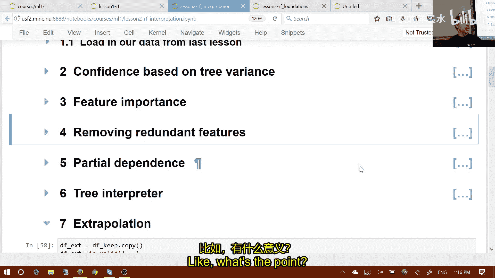

What's the point？And。

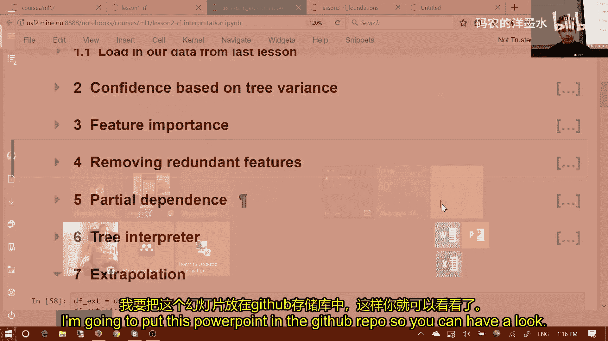

To answer this question。I'm going to put this PowerPoint in the GitHub repos so you can have a look。

I want to show you something。

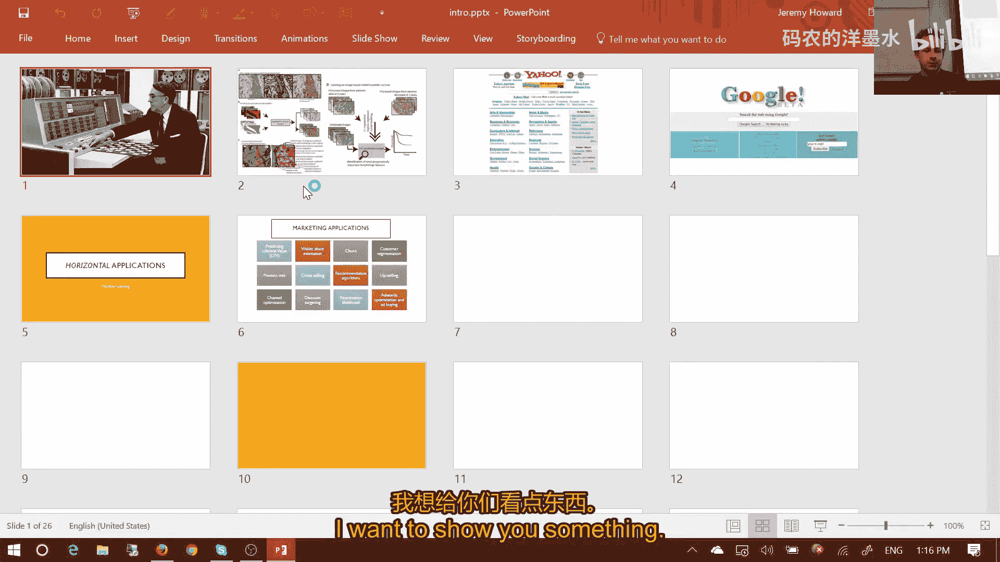

Really important， which is examples。Of how people have used machine learning。

 mainly in business because's。Where most of you are probably going to end up after this is working for some company。

I'm going to show you applications of machine learning。

 which are either based on things that I've been personally involved in myself or know of people who are doing them directly。

 So these are none of these are going to be like。Hypotheticals。

 these are all actual things that people are doing and I've got direct or secondhand knowledge of。

I'm going to split them into two groups horizontal and vertical。

 so in business horizontal means something that you do like across different kinds of business。

 whereas vertical means that something that you do within you within a business or within a supply chain or within a process so in other words an example of horizontal applications is everything involving marketing。

So like every company pretty much。Has to try to sell more products to its customers。

 And so therefore does marketing。 And so each of these boxes are examples of some of the things that people are using machine learning for in marketing。

So let's take an example， right， let's take。

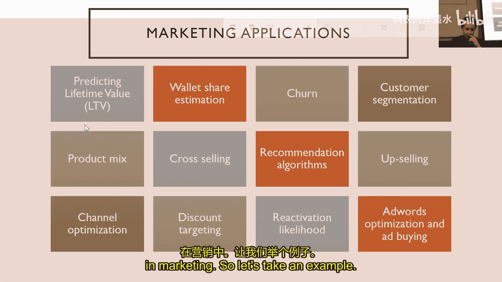

Chan。Okay， so Chen。Refers to a model which attempts to predict who's going to leave now so I've done some churn modeling fairly recently in telecommunications。

And so we're trying to figure out for this big cell phone company which customers are going to leave。

U。That is not。😡，Of itself that interesting， like building a highly predictive。

 predictive model that says。Jeremy Howard is almost certainly going to leave next month。

It's probably not that helpful because like if I'm almost certainly going to leave next month。

 there's probably nothing you can do about it， right it's too late。

It's going to cost you too much to keep me right so in order to understand like well why would we do churn modeling I've got a little framework that you might find helpful so if you Google for Jeremy Howard data products。

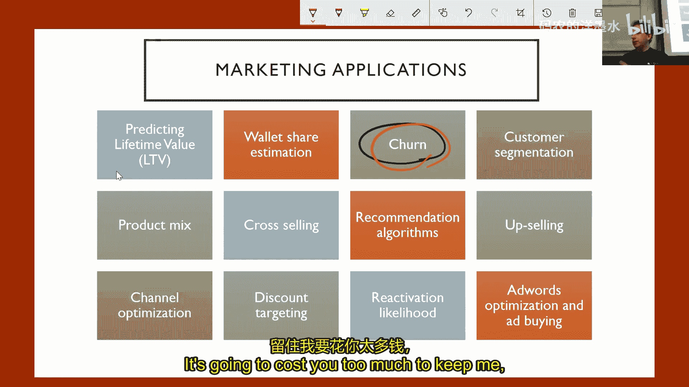

I think I've mentioned this thing before。There's a paper you can find designing great data products that I wrote with a couple of colleagues a few years ago。

And in it， I describe my experience of actually turning machine learning models into like stuff that makes money right and the basic trick is this thing I call the drive train approach。

 which is。

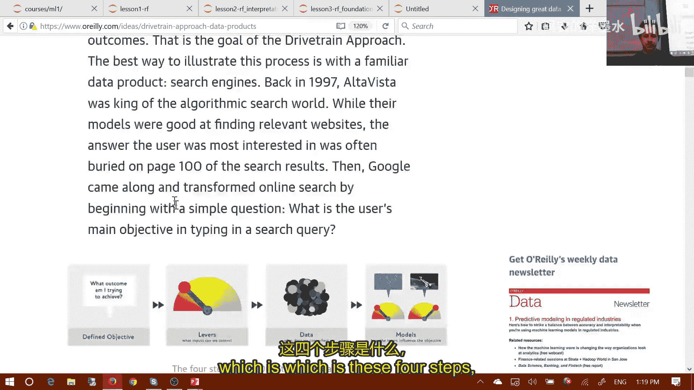

Which is these four steps。The starting point to actually turn a machine learning。

Project into something that's actually useful is to know what am I trying to achieve and that doesn't mean like Im trying to achieve a high area under the ROC curve or I'm trying to achieve a high large difference between classes no it would be I'm trying to sell more books。

Or I'm trying to reduce the number of customers that leave next month。Or I'm trying to。

Detect lung cancer earlier。 these are things that these are objective。

 So the objective is something that absolutely directly is the thing that the the company or the organization actually wants。

 No company or organization lives in order to create a。You know。

 a more accurate predictive model is some reason， so that's your objective。

Now that's obviously the most important thing， if you don't know the purpose of what you're modeling for。

 then you can't possibly do a good job of it。And hopefully people are starting to pick that up out there in the world of data science。

 but interestingly what very few people are talking about。

 but it's just as important is the next thing which is levers a lever is a thing that the organization can do to actually drive the objective so let's take the example of churn modeling right what is a lever that an organization could use。

To reduce the number of customers。That are leaving。

They could look take a closer look at the model and do some of this random forest interpretation and see some of the causes that are causing people to leave and potentially change those issues in the company Okay。

 so's that's a data scientist answer but I want you to go to the next level what are the things the leave is the things they can do' want to put it past behind you。

 what are the things that they can do。Just outreach， like calling or sending emails。

 They could call someone and say like。Are you happy anything we could do okay？

They can provide incentives to increase engagement to the product Yeah。

 so they could like give them a free pen or something if they buy 20 bucks worth of product next month。

You are going to do that as well Okay， so you guys you guys are the giving out carrots rather than the handing out sticks you're going to send over in a couple of guys。

我。I change the price of the product to the subscription of yeah you could give them a special all right so these are levers right and so whenever you're working as a data scientist you know kid coming back and thinking what are we trying to achieve we being the organization and how are we trying to achieve it being like what are the actual things we can do to make that objective happen so？

Building a model is never ever a lever， okay， but it could help you with a lever。😡。

So then the next step is what data does the organization have that could possibly help them to set that lever to achieve that objective right and so this is not what data did they give you when you started the project。

Right， but like think about it from a first principal's point of view， okay。

 I'm working for a telecommunications company， they gave me some certain set of data。

 but I'm sure they must know。Where their customers live， how many phone calls they made last month。

 how many times they called customer service， whatever。 like， and so have a think about like， okay。

 if we're trying to decide like。Who should we reduce the you know give a special offer to proactively。

 then we want to figure out like what information do we have that might help us to identify who's going to react？

Well or badly to that， perhaps more interestingly would be。What if we were doing like a fraud？

Algorithm right and so we're trying to figure out like who's going to like not pay for the phone that they that they take out of the store you know they're on some 12 month payment plan we never see them again Now in that case the data we have available it doesn't matter what's in the database What matters is what's the data that we can get when the customer is in the shop。

So there's often constraints around the data that we can actually use。

So we need to know what am I trying to achieve？What can this organization actually do specifically to change that outcome and at the point that that decision is being made。

 what data do they have or could they collect？Right。

And so then the way I put that all together is with a model。

 and this is not a model in the sense of a predictive model。

 but it's a model in the sense of a simulation model。

 so one of the main examples I give in this paper is when I spent many years building which is if an insurance company changes their prices。

How does that impact their profitability？RightAnd so generally your simulation model contains a number of predictive models。

 so I had， for example， a predictive model called an elasticity model that said for a specific customer。

 if we charge them a specific price for a specific product。

 what's the probability that they would say yes， both when it's new business and then a year later。

 what's the probability that they're new？And then there's another predictive model which is what's the probability that they're going to make a claim and how much is that claim going to be right and so like you can combine these models together then to say。

 all right if we changed our pricing by reducing it by 10% for everybody everybody between 18 and 25 and we can run it through these models that combine together into a simulation。

 then the overall impact on our market share in 10 years time is X and our cost is y and our profit is Z and so forth right？

So in practice。Most of the time you really are going to care more about kind of the results of that simulation than you do about the predictive model directly。

 but most people are not doing this effectively at the moment， so for example。When I go to Amazon。

 I read all of Douglas Adams's books right and so having read all of Douglas Adams's books。

 the next time I went to Amazon， they said，Would you like to buy the collected works of Douglas Adams？

This is after I had bought every one of his books。So like from a machine learning point of view。

 some data scientist had said， oh， people that buy one of Douglas Adams' books often go on to buy the collected works。

 but recommending to me that I buy the collected works of Douglas Adams isn't smart and it's actually not smart at a number of levels。

 like not only is it unlikely I' going to buy a box set of something of which I have everyone individually。

 but furthermore it's not going to change my buying behavior， I already know about Douglas Adams。

 I already know I like him， so taking up your valuable web space to tell me， hey。

 maybe you should buy more of the author who you're already familiar with and bought lots of times。

Isn't actually going to change my behavior so what if instead of creating a predictive model Amazon had built an optimization model that said like that could simulate and said if we show Jeremy this ad。

 how likely is he then to go on to buy this book and if I don't show him this ad how likely is he to go on to buy this book and so that's the counterfactual the counterfactual is what would have happened otherwise and then you can take the difference and say okay what should we recommend him that is going to maximally change his behavior so maximally result in more books and so you'd probably say like oh he's never bought new Terry Pratcht books he probably doesn't know about Terry Pratcht but like lots of people that liked Douglas Adams did turn out to like Terry Pratcht so let's like introduce him to a new author so it's the difference between a predictive model on the one hand versus an optimization model on the other hand。

The two tend to go hand in hand， right The optimization model basically is saying。嗯。Well。

 first of all， you have a simulation model， right， The simulation model is saying in a world where。

We put Terry Pratt's book on the front page of Amazon for Jeremy Howard。

This is what would have happened。He would have bought it with a 94% probability， right？

And so that then tells us with this lever of like。What do I put on my homepage for Jeremy today？

We say， okay， well the different settings of that lever that put Terry Patett on the homepage has the highest simulated outcome。

And then that's the thing which maximizeimss our profit from Jeremy's visit to Amazon。com today。O。

So generally speaking， your predictive models kind of feed in to this simulation model。

 but you've kind of got to think about like how do they all work together so for example let's go back to churn。

so I turned out that Jeremy Howard is very likely to leave his cell phone company next month。

What are we going to do about it？Oh， let's call him。

And I can tell you if my cell phone company calls me right now and says， just calling to say。

 we love you。I'd be like， I'm canceling right now。Like like that would be a terrible idea so again you would want a simulation model that says like what's the probability that Jeremy is going to change his behavior as a result of calling him right now right so one of the levers I have is call him on the other hand if I like got a piece of mail tomorrow that said like for each month you stay with us we're going to give you 100。

000 okay then that's going to definitely change my behavior but then feeding that into the simulation model it turns out that overall that would be an unprofitable choice to make so to see how this fits in together so。

😊。

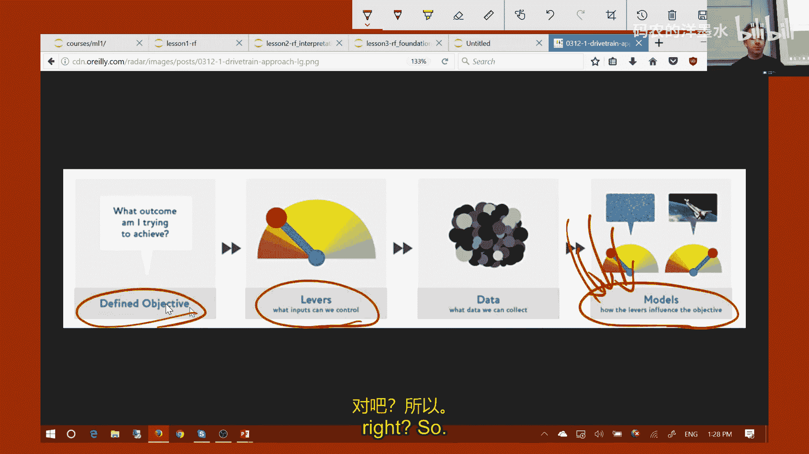

So when we look at something like。Churn we want to be thinking like what are the levers we can pull right and so what are the kind of models that we could build with what kinds of data to help us pull those levers better to achieve our objectives and so when you think about it that way you realize that the vast majority of these applications are not largely about a predictive model at all。

 they're about interpretation they're about understanding what happens if。

So if we kind of take the cross product not the cross product。

 sorry the intersection between on the one hand， here are all the levers that we could pull。

 like here are all the things we can do。And then here are all of the features from our random forest feature importance that turn out to be strong drivers of the outcome。

 and so then the intersection of those is here are the levers we could pull that actually matter。

RightBecause if you can't change the thing that it's not very interesting and if it's not actually a significant driver。

 it's not very interesting right， so we can actually use our random forest feature importance to tell us。

What can we actually do to make a difference？And then we can use the partial dependence to actually build this kind of simulation model to say like。

 okay， well， if we did change that。😊，What would happen？

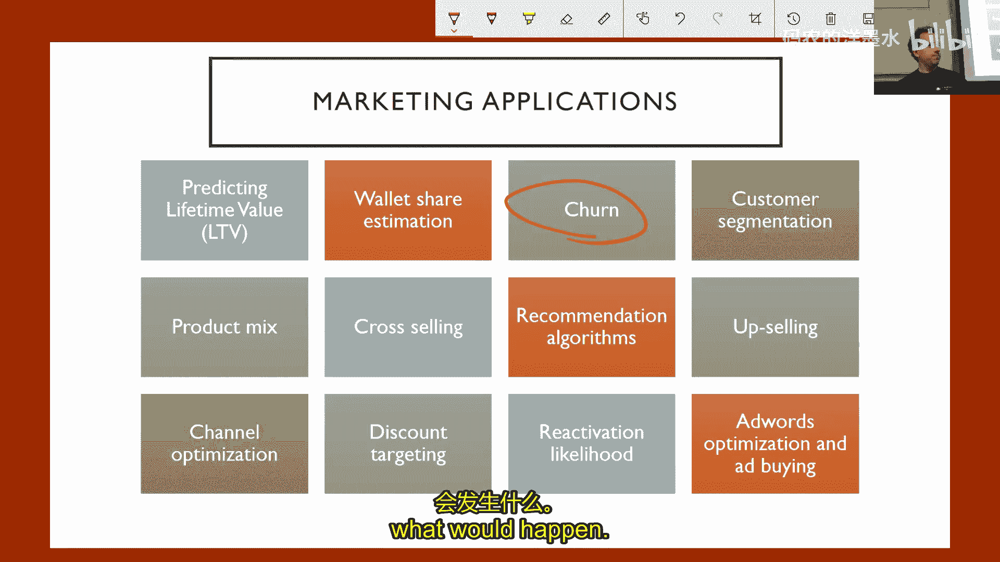

Right。You know， there are examples， lots and lots of these vertical examples。

 and so what I want you to kind of think about as you think about the machine learning problems you're working on is like。

Why does somebody care about this right and what would a good answer to them look like and how could you actually positively impact this business？

If you're creating like a kle kernel， you know， try to think about from the point of view of the competition organizer。

 like what would they want to know and how can you give them that information？

So something like fraud detection。On the other hand。

 you probably just basically want to know who's fraudulent。😡。

So you probably do just about the predictive model。

 but then you do have to think carefully about the data availability here， so it's like， okay。

 but we need to know whos fraudulent。😊，At the point that we're about to deliver them a product。😡。

Right so it's no point like looking at data that's available like a month later， for instance。

 so you've kind of got this。There's key issue of thinking about the actual operational constraints that you're working under。

You know， lots of interesting applications in human resources， but like employee churn。

 it's another kind of churn model we're finding out that。

Jeremy Howard sick of lecturing is's going to leave tomorrow what are you going to do about it well knowing that wouldn't actually be helpful it'd be too late right you would actually want a model that said what kinds of people you know are leaving USF and it turns out that like oh everybody that goes to the downstairs cafe leaves USF you know I guess their food is awful or you know whatever right or everybody that we're paying less than half a million dollars a year is leaving USF you because they can't afford basic housing in San Francisco。

So like you could use your employee churn model not so much to say like which employees hate us but。

Why do employees leave？And so again， it's really the interpretation there that matters。嗯。

Yeah lead prioritization is a really interesting one right like this is one where a lot of companies。

 yes， Dina， can you pass that over there？Yeah， so I was just wondering so like for the churn thing you suggested so one day is like pay an employee like 1 million a year or something。

 but then it sounds like there are two predictors that you need to predict for I mean one be churn and one you need to optimize for like your profit thing。

SoYeah， exactly。 So this is what this like simulation model is all about。 So it's a great question。

 So like you kind of figure out this objective we're trying to maximize。

 which is like company profitability。😊，You can kind of create like a pretty simple like X model or something that says like here's the revenues and here's the costs and the cost is equal to the you know number of people we employ multiplied by their salaries。

 blah blah， blah blah bla， right and so。Inside that kind of Excel model there are certain cells。

 there are certain inputs where you're like oh that thing's kind of stochastic you know。

 or that thing is kind of uncertain but we could predict it with a model and so that's kind of what I do then is I and say okay。

 we need a predictive model for how likely somebody is to stay if we change their salary。

 how likely they are to leave。You know， with the current salary。

How likely they are to leave next year if they， if I increase their salary now， blah， blah， blah。

 so you kind of build。A bunch of these models， and then you combine them together with simple business logic。

And then you can optimize that， you can then say， okay。If I， you know。

 pay Jeremy Howard half a million dollars， that's probably a really good idea， you know。

 and if I pay him less then you know， it's probably not whatever like you can figure out。

The overall impact and so it's。It's really shocking to me how few people do this。

 like most people in industry。Measure their models using like AUC or RMSE or whatever。

 which is never actually what you want。Yes， can you pass it over here？

I wanted to stress the point that you made before in my experience a lot of。

The problem was to define the problem right so you are in a company you're talking to somebody that doesn't have like this mentality that you have。

 They don't know that you have to have X and y and so on。

 So you have to try to get that out of them you know what exactly do you want and try to go through a few directions of understanding what they want and then you know the data you know what the day is you know actually where you can measure which is often know what they want So you have to kind of get a proxy for what they want and then so a lot of what you do is not that much of like well some people do actually just work on really good models for you know but a lot of people also just work on this kind of how do you put this as a you know classification regression or some other type of modeling that's actually kind of the most interesting I think and also kind of what's kind of what you have to do well。

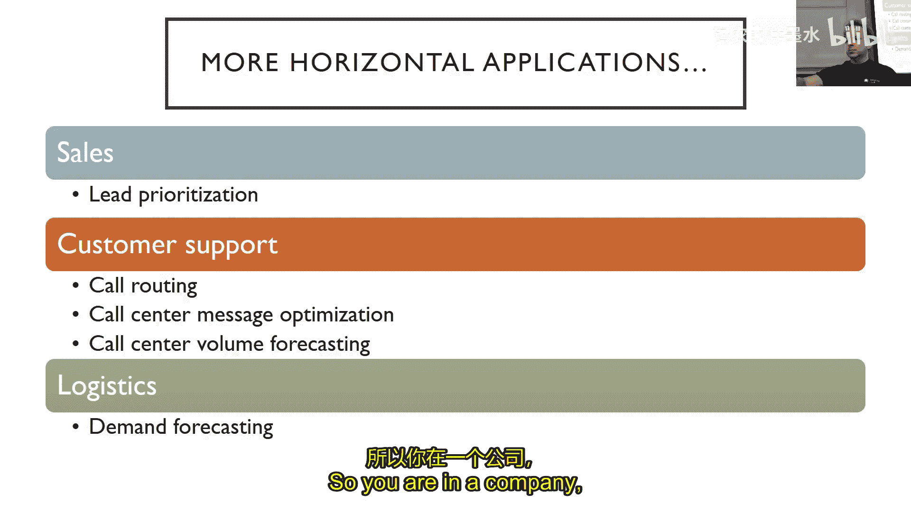

Understand the technical model building deeply。But also understand the kind of strategic context deeply。

 and so this is one way。To think about it， and as I say， like， you know。

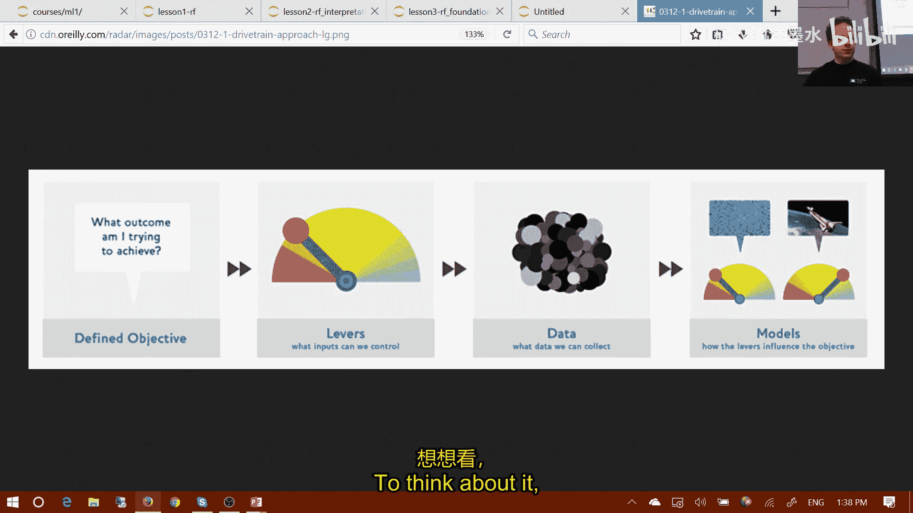

I actually think。You know， there aren't many articles I wrote in 2012， I'm still recommending。

 but this one I think is still equallyably valid today。嗯。So yeah。

 so like another great example is lead prioritization right so like a lot of companies like every one of these boxes I'm showing you can generally find our company or many companies whose sole job in life is to build models of that thing right so there are lots of companies that sell lead prioritization systems but again。

 like the question is，😊，How would we use that information right so if it's like， oh。

 our best lead is Jeremy， you know， he's our highest probability of buying。

Does that mean I should send a salesperson out to Jeremy or I shouldn't。

 like if he's highly probable to buy？Why I waste my time with him？You know， so like again。

 it's like you really want some kind of simulation that says like what's the change the likely change in Jeremy's behavior if I send。

My best salesperson， Yette out to go and like。Encourage him to sign。Yeah。

 I think this this is like there are many， many opportunities for data scientists in the world today to move beyond predictive modeling to actually。

Bringing it all together， with the kind of stuff that Dina was talking about in her question。

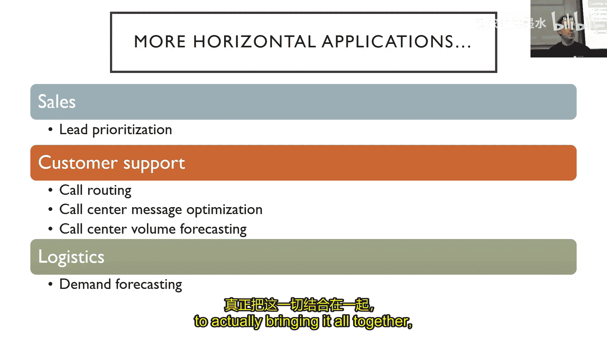

As well as these horizontal applications that basically apply to like every company。

There's a whole bunch of applications that are specific to like every part of the world right so for those of you that end up in healthcare。

 some of you will become experts in one or more of these areas like。Readmission risk。Okay。

 so what's the probability that this patient is going to come back to the hospital and readmission is depending on the details of of the。

The jurisdiction and so forth， it can be a disaster for hospitals when somebody is readmitted so if you find out that this patient has a high probability of readmission。

 what do you do about it？Well again， the predictive model is helpful of itself， right。

 it rather suggests like we just shouldn't send them home yet because they're going to come back。

But wouldn't it be nice if we had the tree interpreter and it said to us。

 the reason that they're at high risk is because we don't have a recent EKG for them and without a recent EKG。

 we can't have a high confidence about their cardiac health。In which case it wouldn't be like， well。

 let's keep them in the hospital for two weeks， and it'll be like， let's give them an AKG。

So this is interaction between interpretation and predictive accuracy。

So correct if I'm wrong but what I'm understanding you saying is that the predictive models are a really great starting point。

 but in order to actually like answer these questions。

 we really need to focus on the interpretability of these models Yeah I think so and more specifically I'm saying like we just learned a whole raft of random forest interpretation techniques and so I'm kind of just of trying to justify like well why right and so the reason why is because actually maybe I'd say most of the time the interpretation is the thing we care about and like。

You can create a chat。You know， or a table without machine learning。And indeed。

 that's how most of the world works， right most managers like build all kinds of tables and charts without any machine learning behind them。

But they often make terrible decisions because they don't know the future importance of the objective they're interested in so the table they create is the things that actually are the least important things anyway。

 or they just do a univevariate chart rather than a partial dependence plot so they don't actually realize that the relationship they thought they're looking at is due entirely to something else。

You know， I'm kind of arguing for data scientists getting like much more deeply involved in in strategy and in trying to use machine learning to really help。

You know， help a business with all of its objectives， right？嗯。Now there's like。

There are companies like Dunn Humby is a huge company that does nothing but retail applications with machine learning。

 And so like I believe there's like a Dunn Humby product you can buy， which will help you。

Which will help you figure out like if I put my new store in this location versus that location how much you know how many people are going to shop there or if I put like you know my diapers in this part of the shop versus that part of the shop。

 how's that going to impact you know purchasing behavior or whatever so it's I think it's also good to realize that like。

The subset of machine learning applications you tend to hear about， you know。

 in the tech press or whatever is this massively biased。

 tiny subset of stuff which kind of Google and Facebook do。

 whereas the vast majority of stuff that actually makes the world go around is you know these kinds of。

Applications that actually help people make things buy things， sell things。

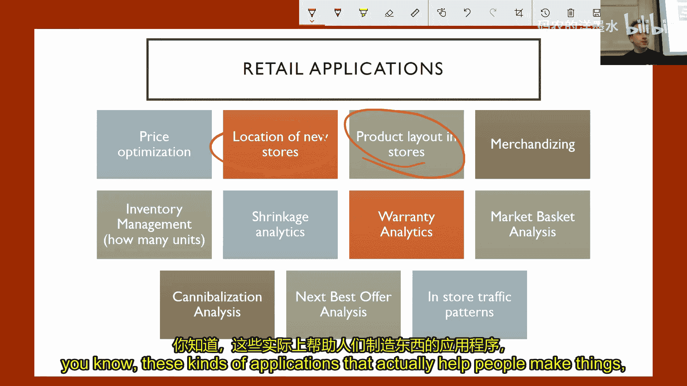

Build things， so forth。嗯。So about tree interpretation。

 the way we looked at the tree was we manually check which feature could cause was more important for particular observation but for businesses they would have huge amount of data and they they want this interpretation for a lot of observations so how do they automate it。

I don't think the automation is at all difficult like you just you can run any of these algorithms like looping through the rows or bring them in parallel it sort as code am I misunderstanding your question is it like they set a threshold that if some features is above like for different different people will have different behavior oh so。

Yeah， okay， I get it。 That's it's good question。 The important thing this is a really important issue。

 actually is。The vast majority of machine learning models don't automate anything。

 they're designed to provide information to humans。So for example， if you're appointed sales。

Customer service phone operator for an insurance company and your customer asks you。

 why is my renewal $500 more expensive than last time then hopefully。

 you know the insurance company has provides in your terminal as little screen that shows the result of the tree interpreter or whatever until so that you can jump there until the customer like。

 okay， well here's last year， you're in this different zip code。

 which you always less has lower amounts of car theft and this year also you've actually changed your vehicle a more expensive one or whatever so it's not so much about。

Freshholds of automation， but about you know， making these model outputs available to the decision makers in organization。

 whether they be at the top strategic level of like。You。

Are we going to shut down this whole product or not all the way to the operational level of La。

 that individual discussion with a customer？对。So like another example is like aircraft scheduling and gate management。

 like there's lots of companies that do that right and basically what happens is that the the people you know there there are people in。

诶。At of airport whose job it is to basically tell each aircraft what gate to go to to figure out when to close the doors。

 stuff like that and so the idea is you know you're giving them software which has the information they need to make good decisions so the machine learning models end up embedded in that software to kind of say like okay that plane that's currently coming in from Miami。

 there's a 48% chance that it's going to be over five minutes late and if it does then this is going to be the knock on impact through the rest of the terminal。

For instance instance。But that's kind of how these things tend to fit together。

So there's so many of these right there's lots and months and so it's not like I don't expect you to like remember all these applications。

 but what I do want you to do is to like spend some time like，Thinking about them。

 like sit down with one of your friends and like talk about a few examples of like， okay。

How would we go about like doing failure analysis and manufacturing I don't know。

 like you know who would be doing that， Why would be they doing it。

 What kind of models might they use， what kind of data might they use like start to like kind of practice this and get a sense So because then you're like interviewing and then when you're at the workplace and you know you' you're talking to managers you want to be like。

Straight away able to kind of recognize that the person you're talking to。

 what do they try to achieve， what are the levers that they have to pull， right。

 what are the data they have available to pull those levers to achieve that thing and therefore how could we build models to help them do that and what kind of predictions would they have to be？

Making， right。 And so then you can have this really。Thoughtful。

 empathetic conversation with those people and they saying like， hey， you know， in order to。

Reduce the number of customers that are leaving， you know I guess you're trying to figure out like。

 you know， who should you be providing better pricing to or whatever and so forth。Oh。Yeah。

So what I'm noticing like from your beautiful little chart above is that like a lot of this to me at least still seems like the primary purpose is like。

At the at least the base level like is predictive power and so I guess my thing is is like for explanatory problems。

 like a lot of the ones that people are faced with like in social sciences。

 is that something machine learning can be used for or is used for or is that not really the realm that it。

Yeah， that's a great question I've。A lot of conversations about this with people in social sciences and currently machine learning is not well applied in like economics or psychology or whatever on the whole。

But I'm convinced it can be for the exact reasons we're talking about。

 so if you're trying to figure out like you're going trying to do some kind of behavioral economics and you're trying to understand like why some people behave differently to other people。

 you know， a random forest with a feature importance plot would be a great way to start。

Or like more interestingly， if you're trying to do some kind of。

Sociology experiment or analysis based on a large social network data where you have an observational study。

 you really want to try and pull out all of the sources of kind of exogenous variables you know all the stuff that's going on outside and so if you use a partial dependence plot with a random forest that happens automatically so I actually David talk at MIT a couple of years ago for the first conference on digital experimentation which was really talking about like how do we experiment in you know things like social networks and kind of these digital environments and yeah economists economists all do things with like you know classic statistical tests but the group of yeah。

Yeah so but anyway in this case the economists I talked to were absolutely fascinated by this and they actually asked me to give an introduction to machine learning session at MIT to these various equity and graduate folks in the economics department and some of those folks have gone on to be you know write some pretty famous books and stuff and so hopefully it's been useful so it's definitely early days。

 but it's a big。Big opportunity， but as Jeanette says it's， you know。

 there's plenty of skepticism still out there。

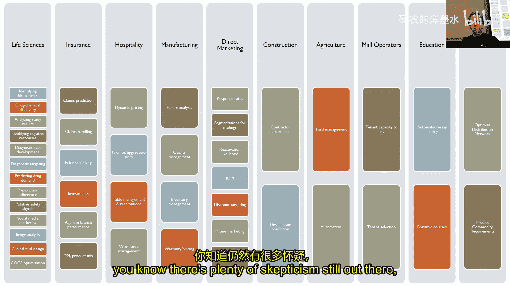

Right。好。Well， the skepticism。Comes from。Unfamiliarity basically with like this totally different approach。

 so like if you if you spent。20 years studying econometrics and somebody comes along and says。

You know， here's a totally different approach to all all the stuff that econometricians do， you know。

 naturally your first reaction will be like。Prove it。You know， so that's fair enough。嗯。

But I think it's， you know， over time the next generation of people who are growing up with machine learning。

 some of them will move into the social sciences， they'll make huge impacts that nobody's ever managed to make before and people will start going。

 wow， you know， just like happened in computer vision right when。You know。

Comp vision spent a long time of people saying like， hey。

 maybe you should use deep learning for computer vision and everybody in computer vision is like。

 prove it， you know， we have。Decades of work on amazing feature detectors for computer vision and then finally in 2012。

 you know Hinton and Ksky came along and said，Okay， our models like twice as good as yours。You know。

 we've only just started on this。 and everybody was like， oh， okay， that's pretty convincing。

 nowadays， nowadays， every computer vision researcher basically uses deep deep learning。

 So I think that time will come in the。In this area， too。Okay， I think what we might do then is。

Take a break and we're going to come back and talk about these random forest interpretation techniques and do a bit of a review。

 so let's come back at2 o'clock。So， let's have a go at。

Talking about these different random forest interpretation methods。

 having talked about like why they're important， so let's now remind ourselves like what they are so。

I got to let you folks have a go。 So let's let's start with。Confidence based on tree variants。

 so can one of you tell me one or more of the following things about confidence based on tree variants too。

 what does it tell us？Why would we be interested in that and how is it calculated？

This is going back away。First one we looked at， even if you're not sure or you only know a little piece of it。

 give us your piece and we'll build on it together。Yeah， I think I got a piece of it。

It's getting the variance of our predictions from。Random forest， that's true。

 That's the how can you be more specific， So what is it the variance of？I think it's。

I'm remembering correctly， I think it's just the overall。

The variance of their predictions of the trees yes so normally the prediction is just the average。

 this is the variance of the trees Yeah so it kind of just gives you an idea of how much your prediction is going to vary so if maybe you want to minimize variance。

 maybe that's your goal for whatever reason that could be that's not so much the reason so I like your calculation description。

 let's see if somebody else can tell us how you might use that。Yeah。It's okay， if you're not sure。

 you have a sta。So I remember that we talked about。呃。

Kind of the independence of the trees and so maybe something about if the。

Binance of the trees is higher low than。No， not so much then， that's an interesting question。

 but it's not what were going to see here， I'm going to pass it back behind you。So to remind you。

 just to fill in a detail here， what we generally do here is we take just one row。

Like one observation often and like find out how confident we are about that。

 like how much variances there are in the trees for that。

 or we can do it as we did here for different groups。

So according to me the idea like for each row we calculate the standard deviation that we get from the random forest model and then maybe group according to different variables of predictors and see for which particular predictor the standard deviation is high and then go deep down as why it is happening maybe it is because a particular category of that variable has very less number of observations Yeah that's great so that that would be one approach is kind of what we've done here is to say like is there any groups that have we're very uncomfortable。

Something that I think is even more important would be when you're using this like operationally。

 right let's say you're doing a credit decisioning algorithm， so we're trying to say like， okay。

 is Jeremy a good risk or a bad risk， should we loan him a million dollars？

And the random forest says。I think he's a good risk， but I'm not at all confident。

In which case we might say， okay， maybe I shouldn't give him a million dollars。

 or else if the Raomfor said I think he's a good risk。

 I am very sure of that then we're much more comfortable giving him a million dollars right and I'm a very good risk so feel free。

To give me a million dollars， I checked the random forest before。Different notebook， not in the repo。

So like this is like it's quite hard for me to give you folks direct experience with this kind of like。

Single observation interpretation stuff， because it's really like the kind of stuff that。

That you actually need to be putting out to the front line。

 you know what I mean like it's not something which you can really use so much in a kind of cale context。

 but it's more like， okay， if you're actually putting out some algorithm。

Which is making like big decisions that could cost a lot of money。

 you probably don't so much care about。The average prediction of the random forest。

 but maybe you actually care about like the average minus a couple of standard deviations。You know。

 like what's the kind of worst case？Prediction， and so。As Chika mentioned。

 it's like maybe there's a whole group。That where。Kind of uncondent。About so yeah， so that's。

Confidence based on tree variant。All right， who wants to have a go at answering feature importance。

 is it， why is it interesting， how do we calculate it， or any subset there of dinner？

I think it's like its basically to find out which of those which features are important for your model so you take each feature and you like randomly sample all the values in the feature and you see how the predictions are if it's very different it means that that feature was actually important else if it's fine to take any random values for that feature it means that maybe probably it's not very important Okay that was terrific。

There's this。That was all exactly right。 There was some details that maybe were skimmed over a little bit。

 I wonder if anybody else wants to jump into like a more detailed description of how it's calculated because I know this morning some people were not quite sure is there anybody who's like not quite sure maybe who wants to like have a go or want to just put it next to you there let's see。

How exactly do we calculate？Feature importance for a particular feature。

So I think after you are done building the random forest model。

 you take each column and randomly shuffle it and generate a prediction and check the validation score if it gets pretty bad for after shuffling one of the columns tighten means that column was important so。

That has higher importance。I'm not exactly sure how we quantifyize the future importance。 Okay。

 great。Dina do you know how we quantify the feature importance that was a great description I think we did the or score of some sort exactly yeah so let's say we've got our dependent variable which is price right and there's a bunch of independent variables including yearm right and so we basically we've used the whole lot to build a random forest。

And then that gives us our predictions。And so then we can let's call this y and so then we can compare that。

To get， I don't know， whatever R squared RMSC， whatever you're interested in right from the model now。

The key thing here is I don't want to have to retrain my whole random forest。

 that's kind of slow and boring right so using the existing random forest， how can I figure out。

How important year made was right and so the suggestion was let's randomly shuffle the whole column。

so now that column is totally useless， it's got the same mean， same distribution。

 everything about it is the same， but there's no connection at all between particular people actual year made and what's now in that column I've randomly shuffled it okay and so now I put that new version。

😊，Through with the same random forest， so there's no retraining done。Okay， to get some new。Why hat。

 I call it why hat， YM。And then I can compare that。To my actuals to get like an ISC。Y am。

And so now I can start to create a little table。😊，So now I can create a little table。😊。

where I've basically got like the original here， RMSC and then I've got with yearma scrambled。

 so this one had an RC of like three， this one had an RC of like two enclosure room scrambling that had an RMSC of like 2。

5。And so then I just take these differences， so I'd say year made， the importance is1。

3 minus2 enclosure is 0。5， 3 minus2 and a2 and so forth so how much worse did my model get after I shuffled that variable？

Does anybody have any questions about that， can you pass that to Danielle please？嗯。

I assume you just chose those numbers randomly， but my question， I guess is。

Does it do all of them theoretically？Perfect model to start out with like are they will all the importance is some to one or is that not they're just I don't honestly i've never actually looked at what the units are so i'm not i'm actually not quite sure okay sorry we can check it out during the week if somebody's interested have a look and have a look at the。

This SK learn code and see exactly what those units of measure are because I've never bother to check。

Although I don't check like the units of measure specifically， what I do check is。

The relative importance。 And so like here's an example。

 So rather than just saying like one of the top 10 yesterday， one of the。

Traccticum students asked me about a feature importance where they said like oh。

 I think these three are important and I pointed out that the top one was a thousand times more important than the second one。

Right， so like look at the relative numbers here。 And so in that case， it's like， no。

 don't look at the top three。 Look at the one that's a thousand times more important and ignore all the rest。

 And so this is where sometimes the kind of。Your natural tendency to want to be like precise and careful you need to overwride that and be very practical it's like okay this thing's a thousand times more important don't spend any time on anything else right so then you can go and talk to the manager of your project and say like okay this thing's a thousand times more important and then they might say oh。

That was a mistake it shouldn't have been in there we don't actually have that information at the decision time or you know for whatever reason we can't actually use that variable and so then you could remove it and have a look or they might say gosh I had no idea that like that was worried by far more important than everything else put together so let's。

Forget this random virus thing and just focus on like。

Understanding how we can better collect that one variable and better use that one variable's。

Something which comes up。Quite a lot and actually another place that came up just yesterday again。

 another practicum student asked me。Hey， I'm doing this medical diagnostics project and my ask wordd is 0。

95 for a disease， which I was told is very hard to diagnose。You know。

 is this random forest a genius or is something going wrong？

And I said like remember the second thing you do after you build a random forest is to do feature importance so do feature importance and what you'll probably find is that the top column is something that shouldn't be there and so that's what happened he came back to me half an hour later he said yeah I did the feature importance you were right。

 the top column was basically something that was another encoding of the dependent variable I've removed it and now my ask where is negative 0。

1 so that's an improvement。Okay。The other thing I like to look at is this chat right is to basically say like you know where do kind of things flatten off in terms of like which one should I be really focusing on？

So that's the most important one and so when I did credit scoring in telecommunications I found there were nine variables that basically predicted very accurately who was that going to end up paying for their phone and who wasn't and apart from ending up with a model that saved them $3 billion a year in fraud and credit costs。

 it also let them basically rejiig their process so they focused on collecting those nine variables much better。

All right。Who wants to do partial dependence？This is an interesting one， very important， but。

 you know， in some ways， kind of tricky to。Think about。Go ahead and try Yeah， please do。

 So from my understanding of what partial dependence is is that there's not always necessarily like a relationship between。

The strictly the dependent variable and this independent variable that necessarily like is showing importance。

 but rather than an interaction between two variables that are working together something like this right Yeah we were like。

 oh， that's weird， I could expect this to be kind of flatten and is a weird。

and so for and this example what we found was that it's not necessarily year made or when the sale was elaed。

 but it's actually the age of the model and so its that is easier to just like to tell a like company well obviously your younger models are going to sell for more and it's less about when the year was made exactly so let's come back to how we calculate this in a moment but the first thing to realize is that the vast majority of the time you know post your course here when somebody shows you a chat it'll be like a univariate chat that'll just like grab the data from the database and they'll plot X against Y and then managers have a tendency to want to like make a decision so be like oh there's this like drop off here so we should stop dealing in equipment made between 1990 and 1995 whatever right。

This is like a big problem because like real world data has lots of these。Interactions going on。

 So like， you know， maybe there was a。Recession going on around the time that those things are being sold or maybe around that time people were buying more of a different type of equipment or whatever right so generally what we actually want to know is all other things being equal。

What's the relationship between yearm and sale price right because like if you think about the drive train approach idea of like the levers you really want a model that says if I change this lever。

 how will it change？My objective。Okay， and so it's by pulling them apart using partial dependence that you can say。

 okay， actually， this is the relationship between year made and sale price。

All other things being equal。Right， so how do we calculate that？So for the variable you make。

 for example， you're going train。You keep every other variable constants。

 And then you're gonna pass every single value of the year made and then train the model after that。

 So for every model， you're gonna have the light blue。Or the values of it。

 And the media is gonna be the yellow line up there。So let's try and draw that。So， by。

Leave everything else constant what she means is leave them at whatever they are in the data set so just like when we did feature importance right we're going to leave the rest of the data set as it is and we're going to do partial dependence plot for yearM right so we've got all of these other rows of data that will just leave as they are and so instead of randomly shuffling year made。

Instead， what we're going to do is replace every single value with exactly the same thing。1960。我。

Okay。And just like before， we now pass that through our existing random forest。

 which we have not retrained or changed in any way。To get back out a set of predictions， why？1960。

Okay， and so then we can plot that。On of chart， you made。Against partial dependence。1960。Yeah。Okay。

 then we can do it for 1961，2，3，4，5。And so forth。And so we can do that for。On average。

 for all of them。Or we could do it just for one of them。

And so when we do it for just one of them and we change its year made to pass that single thing through our model。

 that gives us one of these blue lane。So each one of these blue lines is a single row as we change its year made from 1960 up till 2008。

And so then we can just take the median of all of those blue lines。To say， you know， on average。

 what's the relationship between year made and price or other things being equal。So。Why is it？That。

Why is it that this works， Why is it that this process tells us the relationship between year made and price。

 all other things being equal？Maybe it's good to think about like a really simplified approach。

 a really simplified approach would say， what's the average a？You know what's the average sale date。

 what's the most common type of machine we sell， which location do we mainly mostly sell things and like we could come up with a single row that represents the average auction and then we could say okay let's run that row through the random forest but replace its year made with 1960 and then do it again with 1961 and then do it again with 1962 and we could like plot you know those on our little chart right and that would give us。

A version of。The relationship between year made and sale price， all other things being equal。

 but what if？Like。tractors。Looked like that。And backho loaders。Looks like that。

Then taking the average one would hide the fact that there are these totally different relationships so instead。

We basically say， okay， our data tells us。What kinds of things we tend to sell and who we tend to sell them to and when we tend to sell them。

 So let's use that， right， So then we actually find out like for every blue line。

 like here are actual examples of。These relationships， right， and so then what we can do is。

 as well as plot in the median is we can do a cluster analysis to find out like。A few different。Spes。

And so we may find in this case they all look like pretty much the different versions of the same thing with different slopes so my main takeaway from this would be that the relationship between sale price and year is basically a straight line right and remember this was log of sale price right so this is actually showing us an exponential and so this is where I would then like bring in the domain expertise which is say okay。

Things depreciate over time by a constant ratio。 So therefore， I would expect。

Older stuff year made to have this exponential shape so this is where like I kind of mentioned like at the very start of my machine learning project I generally try to avoid as using as much domain expertise as I can and let the data do the talking right so like one of the questions I got this morning was like oh if there's like a sale ID a model ID I should throw those away right because they just IDs like no。

Don't assume anything about your data right Leave them in。

 And if they turn out to be super important predictors。

 you want to find out you know why is that Okay but then now I'm at the other end of my project right I've done my feature importance I've pulled out the stuff which is like。

 you know from that den you know the kind of redundant features。

 I'm looking at the partial dependence and now I'm thinking like okay。Is this shake what I expected。

Okay， so even better before you plot this。😡，First of all。

 think what shape would I expect this to be because it's always easy to justify to yourself after the fact。

 oh， I knew it would look like this。 So what shape to you expect and then is it that shape。

 So in this case I'd be like， yeah， this is what I would expect。Okay， where else？

This is definitely not what I'd expect。So the partial dependence plotlight has really pulled out the underlying truth。

ok。So does anybody have any questions about？Why we use partial dependence or how we calculate it。

Here's got the， oh， you've got it。You say you have few thousand。

Say 20 features everything think are important， are you going to measure the partial dependence for every single one of them？

So is there a limit on that？嗯。If there are 20 features that are important。

 then I will do the partial dependence for all of them where important means like。

It's a lever I can actually pull it's like the magnitude of its size is like not much smaller than the other 19 like you know based on all of these things it's like yeah it's a feature I ought to care about then I will want to know how it's related it's pretty unusual to have that many features that。

Are important both operationally and from a modeling point of view。In my experience。

Sorry one follow up how do you define important nationally now to think about it？

So important means it's a lever， so it's something I can change。And it's like。You know。

 kind of at the spiky end。Of this tale。诶。Or you know， maybe it's not a lever directly。

 like maybe it's like zip code。And I can't actually tell my customers where to live。

But I could like focus my new marketing attention on a different zip code， you know？Yeah。

Would it make sense to do pairwise shuffling for every combination of two features and hold everything else constant like in future importance to see interactions and compare scores？

嗯。So you wouldn't do that so much for partial dependence。

I think your question is really getting to the question of。Could we do that for feature importance？

All right， so。I think interaction feature importance is a very important and interesting question。

But doing it by randomly shuffling every pair of columns。You know， if you've got 100 columns。

 sounds computationally intensive， possibly infeasible。

So what I'm going to do is after we talk about T interpretter。

 I'll talk about an interesting but largely unexplored approach that will probably work。Okay。

 who wants to do tree interpreter？All right， over here， Prince。Can you pass that over here to Prince？

I was thinking this to be more like feature importance but feature importance is for complete random forest model and this three interpreter is for feature importance for particular observation so if that let's say its about hospital readmission so if a patient even is get is going to be readmitted to a hospital which feature for that particular patient is going to impact and how can we change that and it is calculated starting from。

The prediction of mean then seeing how each feature is changing the behavior of that particular equation。

I'm smiling because that was one of the best examples of technical communication I've heard in a long time so it's really good to think about like why was that effective right so what Prince did there was he used as specific an example as possible right so humans are much less good at understanding abstractions right so if you kind of say oh it takes some kind of feature and then there's an observation in that feature where you know where like no it's a hospital readmission okay and so we take a specific example。

The other thing he did which was very effective was to kind of take an analogy to something we already understand so we already understand the idea of feature importance across all of the rows in a data set so now we're going to do it for a single row okay so like you know one of the things I was really hoping we would learn from this experience is how to become effective technical communicators so you know that was a really great role model from print of like。

Using all of the tricks we have at our disposal for effective technical communication。

 So hopefully you found that a useful explanation。 I don't have a hell of a lot to add to that other than to show you you know what that looks like。

 So with the tree interpreter we picked out。😊，A row okay。

 and so remember when we talked about the confidence intervals at the very start。

 the confidence based on tree variants， we mainly said like you probably mainly use that for a row so this would also be for a row。

 so it's like okay， why is this patient。Likely to be readmitted Okay， so here is。

All of the information we have about that patient， or in this case， this auction。

 why is this auction so expensive？So then we call tree interpreter。t predictdt and we get back。

The prediction of the price， right the bias， which is the root of the tree。

 so this is just the average price for everybody， so this is always going to be the same。

And then the contributions， which is how important is each of these。

Each of these things right and so the way we calculated that。Yeah。

So the way we calculated that was to say， okay， at the very start the average price was 10 right。

 and then we split on enclosure right and for those with dis enclosure the average was 9。5。

And then we split on year made， I don't know， less than 1990， and for those with that year made。

 the average price was 9。7。And then we split it on the number of hours on the meter。

And for with this branch， we got 9。4。And so we then have a particular option。

 which we we pass it through the tree and it just so happens that it takes。This path， right。

 So one row can only have one path through the tree。Right， and so we ended up at。This point。Okay。

 so then。We can create little table right and so as we go through， we start at the top。

And we start with 10， right that's our bias and when we said enclosure resulted in a change from 10 to 9 and a half minus 0。

5。Yeah may changed it from 9。5 to 9。7， so plus 0。2。And then meta changed it from 9。7 down to 9。4。

Which is minus 0。3。And then if we add all that together， 10 minus a half is9 and a half plus 。2 is 9。

7， minus 0。3 is 9。4。Now and behold， that's that number。Which takes us to？Our Excel spreadsheet。

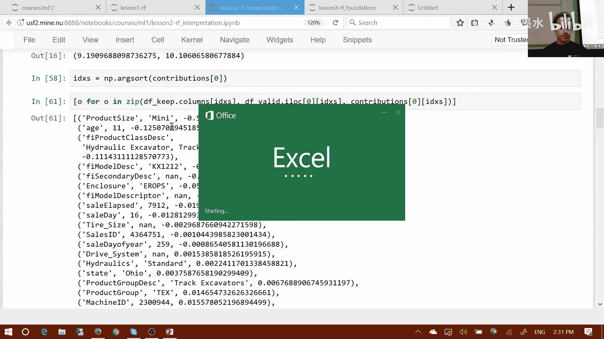

Where's Chris who did our waterfall， there you are right。

Last week we had to use Excel for this because there isn't a good Python library for doing waterfall charts and so we saw we got our starting point。

 this is the bias and then we had each of our contributions and we ended up with our total the world is now a better place because Chris has created a Python waterfall chart module for us and put it on pick so never again will we have to use Excel for this And I wanted to point out that like。

Waterford charts have been very important in business communications。

 at least as long as I've been in business， so that's about 25 years。Python is。You know what。

 a couple of decades old， a little bit less。 Yeah， maybe a couple of decades old。But， you know。

 despite that。No one in the Python world ever got to the point where they actually thought， you know。

 I'm going to make a waterfall chart。So they didn't exist until two days ago。

Which is to say like the world is full of stuff which ought to exist and doesn't and doesn't necessarily take it had a lot of time to build Chris how long did it take you to build the first Python waterfall chart？

Well， there was you know， a gist of it， yeah， whicht yeah， yeah。好对。About eight hours， okay。

 so you know， a hefty time amount but not unreasonable and now forevermore people when they want the Plython Waterfall chart will end up at Chris's GitHub repo and hopefully find lots of other USF contributors who have made it even better。

U。So in order for you to help improve Chris's Python waterfall。

 you need to know how to do that right and so you're going to need to submit a pull request。嗯。

Life becomes very easy for submitting pull requests if you use something called Hub so if you go to GitHub/lashHub。

That will send you over here。And what they suggest you do is that you alias get to hub because it turns out that hub actually is a strict superet of get。

 but what it lets you do is you can go。Did for。Get push。

Get pull request and you've now sent Chris a pull request without hub this is actually a pain and requires like going the website and filling in forms and stuff。

This gives you no reason not to do pull requests。 and I mentioned this because like。

When you're interviewing for a job or whatever， I can promise you that the person you're talking to will check your GitHub。

And if they see you have a history of submitting thoughtful pool requests that are accepted to interesting libraries that looks great right it looks great because it shows you're somebody who actually contributes。

 it also shows that if they're being accepted that you know how to create code that fits with people's coding standards has appropriate documentation passes their tests and coverage and so forth so when people look at you and they say oh here's a somebody with a history of successfully contributing accepted pool requests to open source libraries。

 that's a great part of your portfolio and you can specifically refer to it so either I'm the person who built Python waterfall。

 here is my repo or you I'm the person who contributed currency number formatting to Python waterfall。

 here's my pool request that any time you see something that doesn't work right in any open source software you use is not a problem。

It's a great opportunity because you can fix it and send in the pull request So yeah， give it a go。

 It actually feels great the first time you have a pull request accepted and of course。😊。

One big opportunity is the Fast AI Library and thank you who was the person here。

 the person who added all the docs to Fast AI structured。In the other class， okay。

 so thanks to one of our students， we now have doc strings or most of the Fast A I dot structured library and that again came via a pull request so thank you。

Okay。Does anybody have any questions about？How to calculate any of these random forest interpretation methods or why we might want to use any of these random forest interpretation methods。

Because towards the end of the week， you're going to need to be able to build all of these。

Yourself from scratch。One over then。Can you pass that please？Just looking at the tree interpreter。

 I noticed that some of the values are NINs， how I get why you keep them in the tree。

 but how can an NIN have a feature importance？Okay， let me pass it back to here， why not？

So in other words。How is NN handled in pandas and therefore in the trade？So just some default value。

Does anybody remember how pans， these are notice these are all in categorical variables。

 how does pandas handle NANs and categorical variables， and how does Fast AI deal with them？

Can somebody pass it to the person who's talking？Negative one for pandas Yeah pandas sets into negative one category code and do you have to remember what we then do doesn't matter really we add one to all of the category codes so it ends up being zero so in other words we have a category with remember by the time it hits the random forest it's just a number and it's just it's just the number zero right and we map it back to the descriptions back here so the question really is。

Why shouldn't the random forest be able to split on zero？It's's just another number。

 so it could be NAN， high medium or low， zero，1，2，3，4 and so。You know。

 missing values are one of these things that are generally taught really badly。

 like often people get taught like here are some ways to remove columns with missing values or remove rows with missing values or to replace missing values。

That's like never what we want because missingness is very， very。

 very often interesting and so we actually learned that from our feature importance that coupleer system NAAN is like one of the most important features and so for some reason。

 well I could guess right？Coupler system NAN presumably means this is the kind of industrial equipment that doesn't have a coupler system。

 I don't know what kind that is， but apparently it's a more expensive kind。If that makes sense，Okay。

So。Yeah， I did this competition for university grant research success where by far the most important predictors were whether or not some of the fields were null。

And it turned out that this was data leakage that these fields only got filled in most of the time after a research grant was accepted。

So it allowed me to win that Calgo competition， but didn't actually help the university very much。嗯。

Okay， great。So let's talk about。Extrapolation。And I am going to。Do something risky and dangerous。

 which is we're going to do some live coding。嗯。And the reason we're going to do some live coding。

I I want to explore extrapolation together with you。

 and I kind of also want to get kind of help give you a feel of。😊，You know。

 like how you might go about like。Wri writing code quickly in this notebook environment right and this is the kind of stuff that you're going to need to be able to do you know。

 in the real world and in the exam is kind of quickly create the kind of code that we're going to talk about。

So。I really like creating synthetic data sets anytime I'm trying to like investigate the behavior of something because if I have a synthetic data set。

 I know how it should behave。😊，Which reminds me， before we do this。

 I promised that we would talk about interaction importance and I just about forgot。Tree interpreter。

Tells us the contributions for our particular row。Based on the difference in the tree。

We could calculate that for every row。And our data set。And add them up。 and that would tell us。

That would tell us feature importance， that would tell us feature importance in a different way right one way of doing feature importance is by shuffling the columns one at a time。

Another way is by doing T interpreter for every row and adding them up。

Neither is right more right than the others。 They're actually both quite widely used。

 So this is kind of type 1 and type 2。Feature importance。So。Okay。We could。

Try to expand this a little bit。To do not just single variable feature importance。

But interaction feature importance。Now， here's the thing。

What I'm going to describe is very easy to describe。

It was described by Brianman right back when random forests were first invented， and it is part of。

The commercial software product from Salford Systems who have the trademark on random forests。

But it is not part of any open source library I unaware of。

And I've never seen an academic paper that actually studies it closely。

 so what I'm going to describe here is a huge opportunity。

But it's also like there's lots and lots of details that kind of need to be fleshed out。

 but here's the basic idea。This particular。This particular difference。Here。

It's not just because of year made。But because of a combination of year made and enclosure。Right。

The fact that this is 9。7 is because enclosure was in this branch and year made was in this branch。

 So in other words， we could say the。Contribution of enclosure interacted with Y made。Is。Minus 0。3。

Yeah。And so。What about？That difference。Well， that's an interaction of year made and hours on the meter。

So year made interacted with I'm using star here not to mean times， but to mean interacted with。

 it's a kind of a common way of doing things like ours formulas do it this way as well。

 year made by interacted with meter。Has a has a importance， sorry， a contribution of。Minus0。1。

Perhaps we could also say from here to here。That this also shows an interaction between meter and enclosure。

Like with one thing in between them。 So baby， we could say meter。Okay。By enclosure。

Equs and then what should it be， you know， what should it be？0。 sorry minus 0。6。I mean， in some ways。

 that kind of seems unfair because we're also including like the impact of。Of year made， right。

 so maybe it should be maybe it should be minus0。6。You know maybe we should add back。This point too。

 right and these are like details that I actually don't know the answer to right， like well。

 how should we best。Kind of assign a contribution to each pair of variables in this path。

 right but clearly conceptually we can， right the pairs of variables in that path。All represent。

Interactions， Yes， Chris， can you。Could you pass that to Chris。

 please Why don't you force the to be next to each other in the tree？I mean。

 I'm not going to say it's the wrong approach。I don't think it's the right approach， though。

 because it feels like。This path here， me and enclosure are interacting。

So it seems like not recognizing that contribution is throwing away information。嗯。But I'm not sure。

You know， I had one of my staff at CAL actually do some R&D on this a few years ago and I actually found。

 you know， and I wasn't close enough to know how they dealt with these details。

 but they got it working pretty well， but unfortunately it never saw the light of day as a software product。

 but like this is something which you know maybe a group of you could get together and build。

You know， I mean， do some Googling to check， but I really don't think that there are any。😡。

Interaction feature importance。Parts of any open source library， can you class up that？

Wouldn't this exclude。Interactions though between variables that don't matter until they interact。

So say your row never chooses to split down that path。

 but that variable interacting with another one becomes your most important split。

I don't think that happens right， because if there's an interaction that's important only because it's an interaction and not on a inivevariate basis。

 it will appear sometimes assuming that you set max features to less than one。And so therefore。

 it will appear in。And some fun。What is meant by interaction is it multiplication， ratio。

 addition interaction means。Appears branches appears on the same path through a tree。

Like an interaction， in this case， the tree， there's an interaction between enclosure and yearmate because we branched on enclosure and then we branched on year。

 so to get to here we have to have some specific value of enclosure and some specific value of year made。

Sorry， I just my brain's kind of working on this right now。

 what if what if you went down the middle leaves between the two things you were trying to observe and you could just sort of warm and you would also take into account what the final measure is so I mean if we extend the tree downwards you'd have many measures both of like the two things you're trying to look at and also the in between steps。

There seems to be a way to like average information out in between them but there could be so I think what we should do is talk about this on the forum I think this is fascinating and I hope we build something great but I need to do my live coding so let's。

Yeah， that was a great discussion。Keep thinking about it。 and yeah， there some experiments。

 and so to experiment with that。You almost certainly want to create a synthetic data set first right It's like y equals x1 plus x2 plus x1 times x2 or something。

 you know， like something where you know that there's this interaction effect and there isn't that interaction effect and then you want to make sure that the feature importance you get at the end is what you expected right and so probably the first step would be to do single variable feature importance using the。

Tree interpreter style。Approach。And one nice thing about this is like it's。

It doesn't really matter how much data you have like all you have to do to calculate feature importance is just like slide through the tree right so you should be able to write it in a way that's actually pretty fast and so even writing it in pure Python。

Might be fast enough depending on your tree size。Yeah。

Okay so we're going to talk about extrapolation and so the first thing I want to do is create a synthetic data set that has a simple linear relationship we're going to pretend it's like a time series right so we need to basically create some x values so the easiest way to kind of create some synthetic data of this type is to use lens space which just create some evenly spaced some evenly spaced data right between start and stop with by default 50 observations so if we just do that right？

There it is。Okay。Okay。U。And so then we're going to create a dependent variable。

 and so let's assume there's just a linear relationship between x and y。

 and let's add a little bit of randomness to it， right？嗯。So uniform random between low and high。

 so we could like add somewhere way between like。Minus 0。2。And 0。

2 say okay and so the next thing we need is a shape right。

 which is basically how what dimensions do you want random numbers these random numbers to be and obviously we want them to be the same shape as x's shape so we can just say x dot shape。

Okay， so。In other words， that's x dot shape remember when you see something in parentheses with a comma that's a topple with just one thing in it okay so this is of shape 50 and so we've added 50 random numbers and so now we could plot those。

Okay， so shift tab， x comma y。All right。So there's our data。Okay， so like。

For when you're both working as a data scientist or for doing your exams in this course。

 you need to be able to like quickly whip up a data set like that。

 throw it up in a plot without thinking too much okay and like as you can see you don't have to really remember much if anything。

 you just have to know how to like hit shift tab to check the names of parameters and you know everything in the exam will be open open walk open internet so you can always like Google for。

Something to try and find lens space if you've out what it's called。啊。All right。

 so let's assume that sound data right and so we're now going to build a random forest model and what I want to do is build a random forest model that kind of acts as if this is a time series。

 so I'm going to take this as a training set。I'm going to take this。As our validation or test set。

 just like we did in， you know， groceries or bulldozs or whatever， okay。嗯。

So we can use exactly the same kind of code that we used in split bells right so we can basically say X。

 train， comma， X， be equals x up to 40。Coma X。From 40。

Okay so that just splits it into the first 40 versus the last 10 right and so we can do the same thing for Y。

And there we go， okay。So the next thing to do is we want to create a random forest。Okay。And fit it。

And that's going to require x's and y's。Allright， now that's actually going to give an error and the reason why is that it expects x to be a matrix。

 not a vector because it expects x to have a number of columns of data so it's important to know that。

A matrix with one column is not the same thing as a vector。 right So if I try to run this。

 expected 2D array， got one D array instead。So we need to convert our 2D array into a 1D array。

 so remember I said x dot shape。Is 50 comm， right？So X has one axis。So here's important a meature。

 X is rank。Is one。The rank。Of a variable is equal to the length。Of its shape。

How many axes does it have， So a vector。We can think of as an array of rank one。

 a matrix as an array of rank two。I very rarely use words like vector and matrix because like they're kind of。

Meaningless。Specific examples of something more general。

 which is they're all n dimensional tensesors or n dimensional arrays。Okay。

 so an n dimensional array， we can say it's a tensor of rank and they basically mean。

Kind of the same thing， physicists get crazy when you say that because to a physicist a Tensor has quite a specific meaning。

 but in machine learning we generally use it in the same way okay。So how do we turn？An array。

A one dimensional array into a two dimensional array。There's a couple of ways we can do it。

 but basically we slice it right so colon means give me everything in that axis， right？

Cool and comma nu means give me everything in the first axis， which is the only access we have。

 and then none is a special indexer， which means add a unit access here， so let me show you。

That is of shape 50 comma 1。So it's of rank two， it has two axes。 One of them is a very boring axis。

 right， it's a length one axis。 so let's move this over here。There's one comm of 50。Okay。

 and then remind you the original。It's just 50。So you can see I can put none as a special indexer。

To introduce a new unit access there。 Okay， so this thing。Has one row and 50 columns。

This thing has 50 rows of one column。So that's what we want， right， we want 50 rows and one column。

Yeah。This kind of。Playing around with ranks and dimensions is going to become increasingly important in this course and in the deep learning course right so I spend a lot of time slicing with none slicing with other things try to create three dimensional four dimensional tensesors and so forth I'll show you a trick I'll show you two tricks The first is you never ever need to write comma colon it's always assumed So if I delete that。

This is exactly the same thing。Okay， and you'll see that in code all the time。

 So you need to recognize it。 The second trick is。This is adding an axis in the second dimension right or I guess the index one dimension what if I always want to put it in the last dimension right and like often our tenors change dimensions without us looking because like you went from a one channel image to a three channel image or you went from a single image to a mini batch of images like suddenly you get new dimensions appearing so to make things general。

 I would say this dot dot dot dot dot dot means as many dimensions as you need to fill this up。Okay。

 and so in this case it's exactly the same thing， but I would always try to write it that way because it means it's going to continue to work as I get you know higher dimensional tenses all right。

 so in this case。I want 50 rows in one column， so Ill call that say x1。Okay。

So let's now use that here。And so this is now a 2D array。 And so I can create my。Yeah。Random forest。

 okay， so then I could plot that。Okay。And this is where you're going to have to turn your brains on because the folks this morning got this very quickly。

 which was super impressive I'm going to plot。Why train against MDOt predictict？Ex train okay。

 before I hit go， what is this going to look like？喂喂。Yeah， it should basically be the same。

Our predictions hopefully are the same as the actuals， so this should fall on line。

 but there's some randomness， so it won't quite， I should have used scatter plug。Yeah。Okay。Right。

 so that's cool。Right， that was the easy one。Let's now do the hard one。The fun one。Yeah。

What's that going to look like？嗯。我 is。Okay。So I'm going to say no， but nice try， you know， it's like。

 hey， we're extrapolating to the validation， that's what I'd like it to look like。

But that's not what it is going to look like。The ratio。Think about what trees do and think about。

Think about the fact that we have a validation set here and a training set here。🤧Okay。

So think about a forest is just a bunch of trees。So the first tree is going to okay。

 Melissa' is going to have a go， can you pass that to Melissa？なか。嗯。

Will it' start grouping the dots Yeah， that's what I mean that's what it does， Okay。

 but you know let's think about how it groups the dots so。

Yeah I'm guessing since all the new data is actually outside of the original scope it's all going to be basically the same it's like one huge group one yeah right so like we make it like forget the forest let's create one tree right so we're probably going to split somewhere around here first and then we're going to probably split somewhere around here and then we're going split somewhere around here and somewhere around here right and so our final。

Split is here right， so our prediction， when we say， okay。

 let's take this one and so it's going to put that。Through the forest。

And end up predicting this average。It can't predict anything higher than that。

Because there is nothing higher than that to average， right。

 So this is really important to realize is a random forest is not magic， right。

 It's just returning the average of nearby observations where nearby is kind of in this。

 like tree space。So let's run it， let's see if Tim's right。TheHoly shit， that's awful。Right。

And like if you don't know how random first works， then this is going to totally screw right if you think that it's actually going to be able to extrapolate。

To any kind of data it hasn't seen before， like particularly like future time periods。It's just not。

Like it just can't， it's just averaging stuff it's already seen， that's all it can do。Okay。

 so we're going to be talking about like。How to avoid this problem。

 We talked a little bit in the last lesson about trying to avoid it by just like in avoiding。

Unnecessary time dependent。Variables where we can， right。

 but in the end if you really have a time series that looks like this。

We actually have to deal with a problem， right？So one way we could deal with the problem would be。

Use like a neural net， right， Use something that actually has a function or shape that can actually like fit something。

Then that can actually fit something like this right and so then it'll extrapolate nicely another approach would be to use all the time series techniques you guys are learning about in the morning class to fit some kind of time series。

Right， and then detrened。And so then you'll end up with deted dots。

And then use the random chos to predict those。Right，And that's particularly cool， right。

 because if your're。Like imagine that your random forest was actually trained to predict data。

That like， I don't know， maybe it was two different stakes。And so， the blue ones。You know。

 that down here and the red ones are up here right Now， if you tried to use a random forest。

It's going to do a pretty crappy job because like time is going to seem much more important。

 So it's basicallys still going to like。Split like this。

 and it's going to split like this and then finally once it kind of gets down to this piece。

 it'll be like， oh， okay， now I can see the difference between the states。😊，So in other words。

 like when you've got this big time piece going on。

You're not going to see the other relationships in the random forest until you've dealt and kill every tree。

Heals with time so one way to fix this would be with a gradient boosting machine GBM right and what a GBM does is it creates a little tree right and runs everything through that first little tree which could be like a time tree and then it calculates the residuals。

And then the next little tree just predicts the residuals。

 so itll be kind of like detending it right so GBMs handle this。

 GBMs still can't extrapolate to the future， but at least they can deal with time dependent data。

More conveniently right so we're going to be talking about this quite a lot more over the next couple of weeks right and in the end that a solution is going to be just used neural nets but for now you know using some kind of time series analysis detrend it and then use a random forest on that isn't a bad technique at all and if you're playing around at something like the Ecuador groceries competition that would be a really good thing to。

To fiddle around with。

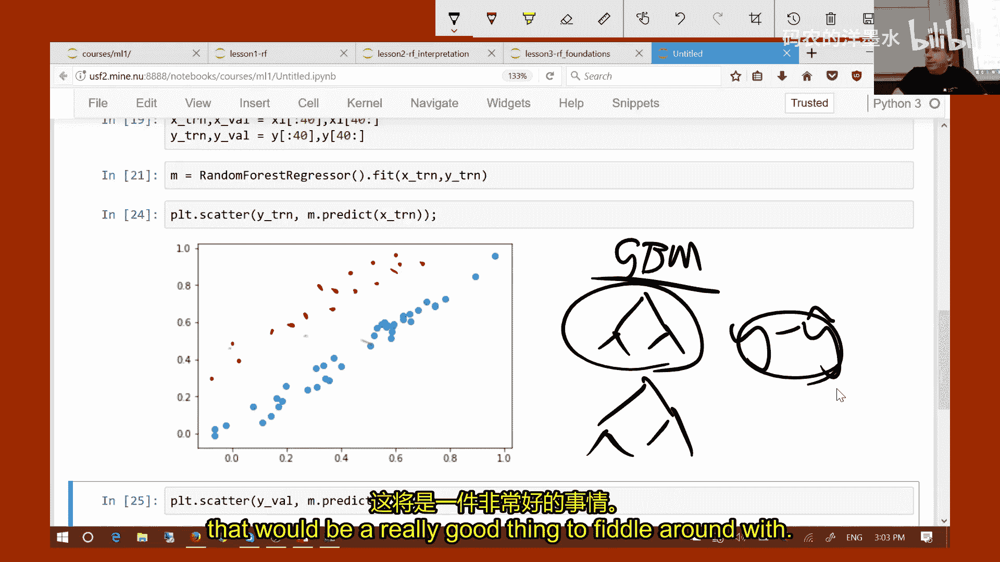

All right， see you next time。